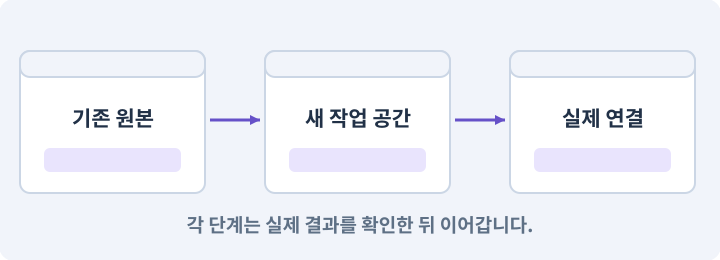

# 001. 빈 2D 프로젝트 만들기

**목표:** 빈 프로젝트를 열고 설치 상태를 확인합니다.

**시작 상태:** 로컬 파일과 도구에 접근할 수 있는 AI 작업창

## 한눈에 보는 기능의 흐름

작업 폴더 → Unity 2D 프로젝트 → Editor 버전 확인 → PC·Android 대상



**경계:** 아직 연결하지 않은 기기를 성공으로 표시하지 않기

그림은 실제 게임 실행 결과가 아닙니다. 값·규칙과 예제를 필요한 때 펼쳐 읽고 현재 단계의 메시지를 한 번씩 보냅니다.

## 1. 지금 상태 확인하기

아래 메시지를 로컬 AI 작업창에 보내세요. 답변에서 현재 대상과 준비 상태를 확인합니다. 아직 없는 준비가 있다면 먼저 해결합니다.

### AI에게 보낼 요구와 이유

#### 01. 내 PC와 작업 세션 연결 확인

**로컬에서 파일과 프로그램을 실제로 다룰 수 있는지 확인해 줘.**

왜 이렇게 요청하나요? 웹 대화가 열린 것만으로 내 PC의 파일이나 Unity를 조작할 수 있는 것은 아닙니다. 실제 파일 읽기와 도구 호출의 결과로 어느 컴퓨터에서 작업하는지 확인합니다.

#### 02. 작업 대상부터 확인

**Unity Hub·Editor·Android 모듈의 설치 여부와 새 프로젝트를 만들 안전한 위치를 읽기 전용으로 조사해 줘.**

왜 이렇게 요청하나요? AI가 다른 프로젝트나 오래된 예제를 보고 작업할 수 있습니다. 실제 경로·파일·현재 기능을 읽게 하면 지금 이어서 작업할 대상을 먼저 맞출 수 있습니다.

#### 03. 조사 단계에서 변경하지 않기

**아직 설치하거나 파일을 바꾸지 마.**

왜 이렇게 요청하나요? 현재 상태를 알아보기만 할 때 파일 변경이나 결제가 시작되면 검토 전의 환경이 바뀝니다. 준비 확인과 실제 구현을 나눠 되돌리기 어려운 작업이 먼저 실행되지 않게 합니다.

<details>
<summary>보낼 원문 전체 — 설명은 복사되지 않습니다</summary>

```text
로컬에서 파일과 프로그램을 실제로 다룰 수 있는지 확인해 줘. Unity Hub·Editor·Android 모듈의 설치 여부와 새 프로젝트를 만들 안전한 위치를 읽기 전용으로 조사해 줘. 아직 설치하거나 파일을 바꾸지 마.
```

</details>

**기대 결과:** 프로젝트 경로와 고정할 Editor 버전, 필요한 설치 항목을 구분한 답변

### 직접 확인하기

1. AI가 읽은 실제 프로젝트 또는 도구 경로를 확인합니다.
2. 필수 준비가 없다면 문제 해결 요청을 보내고, 준비됐을 때 다음으로 갑니다.

## 2. 필요한 기능 만들기

준비가 확인되면 아래 요청을 보냅니다. AI가 파일·설정·실행을 맡습니다. 변경 범위나 비용 승인이 나오면 내용을 읽고 결정하세요.

### AI에게 보낼 요구와 이유

#### 01. 첫 프로젝트의 대상과 범위

**Windows 와 Android 용 오프라인 2D 액션 RPG를 만들 새 프로젝트를 준비해 줘.**

왜 이렇게 요청하나요? 2D와 두 대상 플랫폼을 먼저 정하면 템플릿·입력·빌드 모듈을 그 기준으로 준비할 수 있습니다. 여기서는 네트워크 기능이나 던전을 만드는 것이 아니라 별도 새 프로젝트를 만드는 범위만 정합니다.

#### 02. 되돌아갈 원본 남기기

**이름은 AshfallRPG2D, 기본 위치는 C:\AIProjects\AshfallRPG2D로 하되 기존 파일이 있으면 덮어쓰지 말고 새 위치를 확인해 줘.**

왜 이렇게 요청하나요? 새 구현이 실패해도 이전 게임과 저장을 복원할 수 있어야 합니다. 현재 내용을 먼저 조사하고 별도 후보에서 작업하면 실험이 유일한 정상본을 망가뜨리는 일을 피할 수 있습니다.

#### 03. Unity Hub의 적용 조건

**로컬 파일·프로세스를 실제로 다룰 수 있는지, Unity Hub·Editor·Android 모듈이 설치되어 있는지 먼저 조사해 줘.**

왜 이렇게 요청하나요? 여러 Unity Editor 버전을 설치하고 프로젝트를 열어 주는 관리 프로그램입니다. 게임 장면을 직접 편집하는 창은 Editor입니다. Hub 버전과 Editor 버전은 다른 번호입니다. 둘 중 하나만 기록하면 재현할 환경을 확정할 수 없습니다.

#### 04. 설치 전 바뀔 환경 확인

**설치가 필요하면 공식 출처·버전·대상 폴더를 보여 주고 승인받아 실행해 줘.**

왜 이렇게 요청하나요? 설치는 내 PC의 프로그램과 디스크를 바꾸는 작업입니다. 무엇을 어디에 설치할지 먼저 확인해야 중복 설치나 잘못된 설치 파일 실행을 피할 수 있습니다.

#### 05. 환경 변화 줄이기

**Unity 6.3 LTS에서 사용할 한 패치를 정해 고정하고, Universal 2D 템플릿과 Android Build Support·대응 SDK/NDK/OpenJDK를 준비해 줘.**

왜 이렇게 요청하나요? 기능을 만드는 중 엔진·패키지 버전까지 바뀌면 오류 원인이 섞입니다. 시작 버전을 고정하고 변경은 따로 판단해야 AI가 같은 API와 설정을 기준으로 작업할 수 있습니다.

#### 06. 설치된 도구에 맞추기

**설치본의 지원 환경이 다르면 먼저 차이를 설명해 줘.**

왜 이렇게 요청하나요? 버전마다 명령과 인자가 다를 수 있습니다. 기억에 의존해 명령을 조합하지 않고 현재 설치본의 도움말·패키지·실제 호출 결과를 기준으로 연결하게 합니다.

#### 07. 관찰 가능한 기준으로 확인

**프로젝트 생성·실행·패키지 확인은 네가 맡아 줘.**

왜 이렇게 요청하나요? 구현 완료라는 설명을 실제 결과로 바꾸기 위한 조건입니다. 요청에 나온 대상과 경계 상황을 확인해 정상 결과뿐 아니라 실패를 어떻게 구분했는지도 남깁니다.

#### 08. 관찰 가능한 기준으로 확인

**현재 프로젝트 경로와 Assets/Packages/ProjectSettings, 실제 Editor 버전과 생성 결과를 확인해 줘.**

왜 이렇게 요청하나요? 구현 완료라는 설명을 실제 결과로 바꾸기 위한 조건입니다. 요청에 나온 대상과 경계 상황을 확인해 정상 결과뿐 아니라 실패를 어떻게 구분했는지도 남깁니다.

#### 09. 관찰 가능한 기준으로 확인

**아직 Editor 자동화 연결을 확인하지 못했다면 Renderer·카메라까지 검사했다고 하지 마.**

왜 이렇게 요청하나요? 구현 완료라는 설명을 실제 결과로 바꾸기 위한 조건입니다. 요청에 나온 대상과 경계 상황을 확인해 정상 결과뿐 아니라 실패를 어떻게 구분했는지도 남깁니다.

#### 10. 현재 상태와 다음 확인 지점 구분

**연결 후 확인할 항목으로 남겨 줘.**

왜 이렇게 요청하나요? 이미 준비된 기능과 아직 확인하지 못한 기능을 섞으면 불필요한 재설치나 성급한 완료 판정이 생깁니다. 현재 대상과 남은 준비를 나눠 가장 작은 다음 작업을 선택하게 합니다.

#### 11. 설명·확인과 실제 변경 분리

**게임 기능은 만들지 마.**

왜 이렇게 요청하나요? 원리를 확인하는 요청이 곧 구현이나 외부 게시의 승인은 아닙니다. 현재 상태를 유지한 채 이해한 뒤 필요한 변경을 별도 요청할 수 있게 합니다.

#### 12. 구현과 실행은 AI에게 맡기기

**코드·설정·파일 생성·실행은 네가 맡고, 필요한 화면과 결과를 보여 줘.**

왜 이렇게 요청하나요? 설명이나 코드 조각만 받으면 실제 파일 생성·연결·실행이 빠질 수 있습니다. AI가 개발 작업까지 수행하고, 사람은 요구·승인·결과 판단을 맡도록 역할을 분명히 합니다.

#### 13. 막힌 준비를 먼저 해결

**수행하지 못한 작업과 필요한 승인·도구 연결은 구분해서 알려 줘.**

왜 이렇게 요청하나요? 빠진 파일·권한·패키지를 있다고 가정하면 다음 구현이 엉뚱한 대상을 만들게 됩니다. 무엇이 없고 무엇을 먼저 해야 하는지 분리하면 불필요한 재작업을 줄일 수 있습니다.

<details>
<summary>보낼 원문 전체 — 설명은 복사되지 않습니다</summary>

```text
Windows 와 Android 용 오프라인 2D 액션 RPG를 만들 새 프로젝트를 준비해 줘. 이름은 AshfallRPG2D, 기본 위치는 C:\AIProjects\AshfallRPG2D로 하되 기존 파일이 있으면 덮어쓰지 말고 새 위치를 확인해 줘.
로컬 파일·프로세스를 실제로 다룰 수 있는지, Unity Hub·Editor·Android 모듈이 설치되어 있는지 먼저 조사해 줘. 설치가 필요하면 공식 출처·버전·대상 폴더를 보여 주고 승인받아 실행해 줘.
Unity 6.3 LTS에서 사용할 한 패치를 정해 고정하고, Universal 2D 템플릿과 Android Build Support·대응 SDK/NDK/OpenJDK를 준비해 줘. 설치본의 지원 환경이 다르면 먼저 차이를 설명해 줘.
프로젝트 생성·실행·패키지 확인은 네가 맡아 줘. 현재 프로젝트 경로와 Assets/Packages/ProjectSettings, 실제 Editor 버전과 생성 결과를 확인해 줘.
아직 Editor 자동화 연결을 확인하지 못했다면 Renderer·카메라까지 검사했다고 하지 마. 연결 후 확인할 항목으로 남겨 줘. 게임 기능은 만들지 마.

코드·설정·파일 생성·실행은 네가 맡고, 필요한 화면과 결과를 보여 줘. 수행하지 못한 작업과 필요한 승인·도구 연결은 구분해서 알려 줘.
```

</details>

**기대 결과:** 확인할 결과: 빈 프로젝트 화면과 경로가 확인됨. AI가 이 상태를 확인할 실제 화면과 변경 내용을 준비합니다. 아직 실행하지 못한 부분은 따로 표시합니다.

### 직접 확인하기

1. 제안서만 반환됐다면 “설명으로 끝내지 말고 승인한 범위의 실제 작업을 수행해 줘”라고 보냅니다.
2. 코드나 설정을 직접 고치라는 안내가 나오면 “작성과 실행은 네가 맡아 줘”라고 요청합니다.

## 3. 결과를 직접 확인하기

먼저 확인 요청을 보내 AI가 검사와 화면을 준비하게 하세요. 그다음 아래 동작을 하나씩 확인합니다.

### AI에게 보낼 요구와 이유

#### 01. 검사할 입력과 관찰 지점 준비

**방금 구현한 기능의 자동 검사와 확인 화면을 준비해 줘.**

왜 이렇게 요청하나요? 정상 예 하나만 보면 실패 조건을 놓치기 쉽습니다. 정상·경계·반례를 실제 입력으로 준비하고 사람이 볼 화면도 맞춰 확인 범위를 분명하게 합니다.

#### 02. 결과를 재확인할 근거 남기기

**정상 동작과 아래 실패 조건을 실제로 검사하고 대상·실행 수·결과를 보여 줘.**

왜 이렇게 요청하나요? “잘 됩니다”라는 요약만으로는 어떤 입력과 버전을 검사했는지 알 수 없습니다. 대상·실행 수·실패 내용·파일을 함께 남겨 같은 조건으로 다시 확인할 수 있게 합니다.

#### 03. 내 PC와 작업 세션 연결 확인

**로컬 도구 왕복·설치 버전·새 프로젝트 경로·템플릿 생성 경로를 확인한다.**

왜 이렇게 요청하나요? 웹 대화가 열린 것만으로 내 PC의 파일이나 Unity를 조작할 수 있는 것은 아닙니다. 실제 파일 읽기와 도구 호출의 결과로 어느 컴퓨터에서 작업하는지 확인합니다.

#### 04. 관찰 가능한 기준으로 확인

**Renderer·카메라의 실제 API 검사는 미검증으로 남길 수 있으나 완료로 기록하지 않는다.**

왜 이렇게 요청하나요? 구현 완료라는 설명을 실제 결과로 바꾸기 위한 조건입니다. 요청에 나온 대상과 경계 상황을 확인해 정상 결과뿐 아니라 실패를 어떻게 구분했는지도 남깁니다.

#### 05. 관찰하지 않은 성공을 채우지 않기

**Android 기기 미확보는 별도 표시한다.**

왜 이렇게 요청하나요? 자동 검사·AI의 추정·사람의 실제 관찰은 다른 종류의 근거입니다. 수행하지 않은 기기나 조작 검사는 미확인으로 남겨 나중에 실제 확인할 수 있게 합니다.

#### 06. 사람 검사의 시작점 준비

**내가 조작해야 하는 부분은 실행할 화면과 시작 상태를 준비해 줘.**

왜 이렇게 요청하나요? 같은 기능이라도 시작 상태가 다르면 관찰 결과가 달라집니다. AI가 실행 화면과 재현 위치를 먼저 준비해야 사람이 이동·공격·소리·조작감을 같은 조건에서 확인할 수 있습니다.

#### 07. 사람이 실제로 본 것만 기록

**연결되지 않은 휴대폰의 터치나 사람이 보지 않은 재미·소리 품질을 대신 확인했다고 하지 마.**

왜 이렇게 요청하나요? AI가 준비한 검사와 사람이 직접 플레이하거나 들은 결과는 다른 근거입니다. 관찰하지 않은 조작감·소리·실기기 결과를 임의로 완료 처리하지 않게 합니다.

#### 08. 실제로 실행한 검사만 인정

**테스트 0개와 예전 소스 결과는 현재 성공으로 쓰지 마.**

왜 이렇게 요청하나요? 실행된 검사가 없거나 같은 결과를 중복 집계한 경우는 기능을 확인한 것이 아닙니다. 실행 수와 개별 결과를 함께 확인해야 형식적인 성공 표시를 걸러낼 수 있습니다.

<details>
<summary>보낼 원문 전체 — 설명은 복사되지 않습니다</summary>

```text
방금 구현한 기능의 자동 검사와 확인 화면을 준비해 줘. 정상 동작과 아래 실패 조건을 실제로 검사하고 대상·실행 수·결과를 보여 줘.

로컬 도구 왕복·설치 버전·새 프로젝트 경로·템플릿 생성 경로를 확인한다. Renderer·카메라의 실제 API 검사는 미검증으로 남길 수 있으나 완료로 기록하지 않는다. Android 기기 미확보는 별도 표시한다.

내가 조작해야 하는 부분은 실행할 화면과 시작 상태를 준비해 줘. 연결되지 않은 휴대폰의 터치나 사람이 보지 않은 재미·소리 품질을 대신 확인했다고 하지 마. 테스트 0개와 예전 소스 결과는 현재 성공으로 쓰지 마.
```

</details>

**기대 결과:** 새 경로의 Assets·Packages·ProjectSettings와 Editor에 열린 프로젝트 이름이 일치합니다. 연결 전 카메라 검사는 미실행으로 남습니다.

### 직접 확인하기

1. 빈 Unity 프로젝트 화면에서 이름이 AshfallRPG2D 인지 봅니다.
2. AI가 알려 준 경로가 원래 업무 프로젝트와 다른지 확인합니다.
3. 아직 연결하지 않은 Android 기기를 검사했다고 적지 않았는지 봅니다.

## 4. 결과를 남기고 마무리하기

실제로 본 결과를 아래 메모에 적고 AI에 전달합니다. 결과 저장 요청으로 현재 상태를 남긴 뒤 다음 페이지로 갑니다.

### AI에게 보낼 요구와 이유

#### 01. 현재 상태와 다음 확인 지점 구분

**실제로 준비한 환경과 경로·버전, 성공한 연결, 아직 확인할 부분을 요약해 줘.**

왜 이렇게 요청하나요? 이미 준비된 기능과 아직 확인하지 못한 기능을 섞으면 불필요한 재설치나 성급한 완료 판정이 생깁니다. 현재 대상과 남은 준비를 나눠 가장 작은 다음 작업을 선택하게 합니다.

#### 02. 환경 기록을 잃지 않고 인계

**현재 작업 폴더에 환경 기록을 남길 수 있으면 네가 만들고, 없다면 실제 확인 내용부터 대화에 남겨 줘.**

왜 이렇게 요청하나요? 아직 프로젝트 폴더가 준비되지 않았더라도 조사한 버전과 경로는 다음 작업에 필요합니다. 쓸 수 있는 위치가 있으면 파일에, 없으면 현재 AI 대화에 사실만 남깁니다. 게임 속 NPC 대화를 만드는 요청이 아닙니다.

#### 03. 준비 상태를 서로 다른 단계로 기록

**설치·인증·프로젝트 생성 여부를 서로 구분해 줘.**

왜 이렇게 요청하나요? 프로그램 설치, 로그인, 프로젝트 생성, 실행 중 Editor 연결은 각각 별도 성공 조건입니다. 하나가 끝났다고 나머지도 됐다고 기록하지 않아야 실패한 연결 지점을 찾을 수 있습니다.

<details>
<summary>보낼 원문 전체 — 설명은 복사되지 않습니다</summary>

```text
실제로 준비한 환경과 경로·버전, 성공한 연결, 아직 확인할 부분을 요약해 줘. 현재 작업 폴더에 환경 기록을 남길 수 있으면 네가 만들고, 없다면 실제 확인 내용부터 대화에 남겨 줘. 설치·인증·프로젝트 생성 여부를 서로 구분해 줘.
```

</details>

**기대 결과:** 현재 상태·검사 결과·남은 문제·다음에 읽을 기록을 확인할 수 있습니다.

### 직접 확인하기

1. 자동 검사와 내 관찰 결과가 섞이지 않았는지 봅니다.
2. 문제가 남았다면 해결 요청을 보내고 같은 동작을 다시 확인합니다.

## 구체적인 예로 이해하기

### 빈 프로젝트를 만들었다는 증거

프로젝트 이름만 적힌 답변은 생성 결과가 아닙니다. 실제 폴더와 열린 Editor가 같은 대상을 가리켜야 합니다.

**시작 상태:** 기존 업무 프로젝트는 보존하고 새 폴더를 사용할 준비만 되어 있습니다.

**직접 해 볼 동작:** 첫 메시지로 경로를 조사한 뒤, 승인한 새 위치에 프로젝트를 만들게 합니다.

**보여야 하는 결과:** 새 경로의 Assets·Packages·ProjectSettings와 Editor에 열린 프로젝트 이름이 일치합니다. 연결 전 카메라 검사는 미실행으로 남습니다.

**이렇게 되면 아직 안 됩니다:** 클라우드 작업 폴더에 생성한 파일을 내 PC에 만든 결과로 착각하거나, 같은 이름의 다른 프로젝트를 엽니다.

**생각해 보기:** AI가 C:\work의 파일을 보여 주는데 Editor는 D:\game을 열고 있다면 다음으로 가도 될까요?

<details><summary>해설 보기</summary>

아니요. 프로젝트 이름보다 전체 경로를 대조해야 합니다. 두 경로가 같은 프로젝트라는 증거가 없으면 연결부터 다시 확인합니다.

</details>

## 이 작업에서 사용할 값과 규칙 전체

설계 시작값이며 측정된 성능·게임 성공 결과가 아닙니다. 구현은 AI가 수행합니다.

| 항목 | 본편 기준 |
|---|---|
| 프로젝트 | `C:\AIProjects\AshfallRPG2D` |
| 템플릿 | Universal 2D 또는 URP의 2D 템플릿 |
| 렌더러 | URP 2D Renderer |
| 게임 평면 | XY, Z=0 |
| 카메라 | 위치 (0,0,-10), 회전 (0,0,0), Orthographic |
| 대상 | Windows x86_64 / Android ARM64 가로 |
| 추가 패키지 | 필요한 시점에 Input System·2D Tilemap Editor·UGUI·Test Framework |

AI Navigation은 본편의 필수 패키지가 아니다. 3D 심화편에서 별도로 다룬다. 처음에는 외부 유료 에셋 없이 진행한다. 빈 프로젝트를 만드는 장이므로 아직 스킬트리나 던전을 만들지 않는다.

## 문제가 있으면

### AI에게 보낼 요구와 이유

#### 01. 되돌아갈 원본 남기기

**새 프로젝트 대신 기존 프로젝트가 열리면, 기존 파일을 수정하지 말고 실제 Editor 경로와 생성 결과부터 확인해 줘.**

왜 이렇게 요청하나요? 새 구현이 실패해도 이전 게임과 저장을 복원할 수 있어야 합니다. 현재 내용을 먼저 조사하고 별도 후보에서 작업하면 실험이 유일한 정상본을 망가뜨리는 일을 피할 수 있습니다.

#### 02. 원인 하나를 좁혀 수정

**새 기능을 추가하지 말고 현재 오류와 실제 로그를 먼저 읽어 줘.**

왜 이렇게 요청하나요? 오류 수정 중 새 기능까지 넣으면 어떤 변경이 문제를 해결하거나 악화했는지 알기 어렵습니다. 원래 재현을 보존하고 작은 변경 뒤 같은 입력과 주변 정상 동작을 다시 확인합니다.

#### 03. 원인 하나를 좁혀 수정

**최소 수정 뒤 같은 재현과 관련 정상 동작을 다시 검사해 줘.**

왜 이렇게 요청하나요? 오류 수정 중 새 기능까지 넣으면 어떤 변경이 문제를 해결하거나 악화했는지 알기 어렵습니다. 원래 재현을 보존하고 작은 변경 뒤 같은 입력과 주변 정상 동작을 다시 확인합니다.

#### 04. 실패도 재현 자료로 보존

**실패 기록은 지우지 마.**

왜 이렇게 요청하나요? 실패한 입력과 로그가 있어야 같은 문제가 다시 생겼을 때 비교할 수 있습니다. 성공 기록으로 덮어쓰지 않고 전후 자료를 남기면 무엇을 고쳤는지 확인할 수 있습니다.

<details>
<summary>보낼 원문 전체 — 설명은 복사되지 않습니다</summary>

```text
새 프로젝트 대신 기존 프로젝트가 열리면, 기존 파일을 수정하지 말고 실제 Editor 경로와 생성 결과부터 확인해 줘.
새 기능을 추가하지 말고 현재 오류와 실제 로그를 먼저 읽어 줘. 최소 수정 뒤 같은 재현과 관련 정상 동작을 다시 검사해 줘. 실패 기록은 지우지 마.
```

</details>

## 새 세션에서 이어가기

### AI에게 보낼 요구와 이유

#### 01. 이어서 할 작업 식별

**“빈 2D 프로젝트 만들기” 작업을 이어가고 싶어.**

왜 이렇게 요청하나요? 이름으로 재개할 작업을 찾고, 뒤에 이어지는 요청으로 실제 파일·진행 중 작업·기록을 다시 읽게 합니다. 제목만 보고 이전 상태를 기억한다고 가정하지 않습니다.

#### 02. 조회는 상태를 바꾸지 않게

**실제 프로젝트와 내 도구의 작업 기록을 읽고 어디까지 구현·검사됐는지 확인해 줘.**

왜 이렇게 요청하나요? 진행 상황을 물을 때 새 구현이나 유료 호출이 시작되면 단순 확인이 실행 명령이 되어 버립니다. 저장된 근거를 읽어 완료·진행·승인 대기·미검증을 나누게 합니다.

#### 03. 재개 전 중복 작업 방지

**진행 중인 프로세스·승인·미저장 변경을 확인한 뒤 남은 가장 작은 작업부터 안내해 줘.**

왜 이렇게 요청하나요? 대화가 끊겨도 외부 작업은 끝났거나 아직 실행 중일 수 있습니다. 프로세스·승인·미저장 상태를 먼저 읽어 같은 생성·빌드·결제를 두 번 시작하지 않도록 합니다.

#### 04. 되돌아갈 원본 남기기

**기존 성공과 실패 기록은 보존해 줘.**

왜 이렇게 요청하나요? 새 구현이 실패해도 이전 게임과 저장을 복원할 수 있어야 합니다. 현재 내용을 먼저 조사하고 별도 후보에서 작업하면 실험이 유일한 정상본을 망가뜨리는 일을 피할 수 있습니다.

<details>
<summary>보낼 원문 전체 — 설명은 복사되지 않습니다</summary>

```text
“빈 2D 프로젝트 만들기” 작업을 이어가고 싶어. 실제 프로젝트와 내 도구의 작업 기록을 읽고 어디까지 구현·검사됐는지 확인해 줘. 진행 중인 프로세스·승인·미저장 변경을 확인한 뒤 남은 가장 작은 작업부터 안내해 줘. 기존 성공과 실패 기록은 보존해 줘.
```

</details>

## 왜 이렇게 만드는가

Unity의 Transform은 3차원이지만 이 게임에서 이동 평면은 XY이고 Z는 게임 높이나 점프에 사용하지 않는다. 원근 없이 보는 Orthographic 카메라를 사용한다. 캐릭터 그림에는 얼굴과 몸의 옆면이 보이는 쿼터뷰 느낌을 넣을 수 있지만, 그것이 물리 공간을 3D로 바꾸지는 않는다. [D01][D02]

Android 빌드에는 Editor와 맞는 Android Build Support·SDK·NDK·OpenJDK를 준비한다. 수업 시작 시 Unity 6.3 LTS의 패치 하나를 고정하고 수업 도중 최신 패치로 자동 전환하지 않는다. [S01][S14]

## 공식 참고

- [Unity 2D game creation workflow](https://docs.unity3d.com/6000.3/Documentation/Manual/2d-game-creation-wokflow.html)
- [Set up a project for 2D games](https://docs.unity3d.com/6000.3/Documentation/Manual/setup-project-2d-game.html)
- [Unity 6 release overview](https://unity.com/releases/unity-6)
- [Unity Android environment setup](https://docs.unity3d.com/6000.3/Documentation/Manual/android-sdksetup.html)


## 실제 Unity Editor 화면 참고
공식 예시와 내 프로젝트 실행 결과를 구분하세요. 원본 사진은 온라인 연결이 필요합니다.

- [Editor 전체 배치 — 어디를 보고 있는지 구분하기](../editor_references/editor-layout.md)
