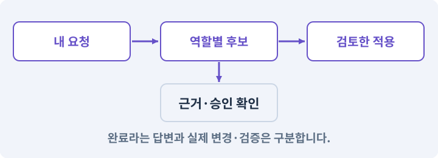

# 002. 내 게임을 알아듣는 개발 스킬 만들기

**목표:** 자연어 요청에 프로젝트용 스킬이 사용되는 것을 확인합니다.

**시작 상태:** 새 AshfallRPG2D 프로젝트

## 한눈에 보는 기능의 흐름

자연어 요청 → game-work 스킬 → 실제 파일 조사 → 읽기 전용 응답



**경계:** 조회 요청이 파일 수정으로 바뀌지 않기

그림은 실제 게임 실행 결과가 아닙니다. 값·규칙과 예제를 필요한 때 펼쳐 읽고 현재 단계의 메시지를 한 번씩 보냅니다.

## 1. 지금 상태 확인하기

아래 메시지를 로컬 AI 작업창에 보내세요. 답변에서 현재 대상과 준비 상태를 확인합니다. 아직 없는 준비가 있다면 먼저 해결합니다.

### AI에게 보낼 요구와 이유

#### 01. 내 PC와 작업 세션 연결 확인

**현재 AI 작업이 로컬 PC에 연결되어 있는지, Claude Code가 설치되어 있는지 확인해 줘.**

왜 이렇게 요청하나요? 웹 대화가 열린 것만으로 내 PC의 파일이나 Unity를 조작할 수 있는 것은 아닙니다. 실제 파일 읽기와 도구 호출의 결과로 어느 컴퓨터에서 작업하는지 확인합니다.

#### 02. 현재 상태와 다음 확인 지점 구분

**실제 경로와 연결되지 않은 부분을 알려 줘.**

왜 이렇게 요청하나요? 이미 준비된 기능과 아직 확인하지 못한 기능을 섞으면 불필요한 재설치나 성급한 완료 판정이 생깁니다. 현재 대상과 남은 준비를 나눠 가장 작은 다음 작업을 선택하게 합니다.

#### 03. 조사 단계에서 변경하지 않기

**아직 인증·설치·설정을 바꾸지 마.**

왜 이렇게 요청하나요? 현재 상태를 알아보기만 할 때 파일 변경이나 결제가 시작되면 검토 전의 환경이 바뀝니다. 준비 확인과 실제 구현을 나눠 되돌리기 어려운 작업이 먼저 실행되지 않게 합니다.

<details>
<summary>보낼 원문 전체 — 설명은 복사되지 않습니다</summary>

```text
현재 AI 작업이 로컬 PC에 연결되어 있는지, Claude Code가 설치되어 있는지 확인해 줘. 실제 경로와 연결되지 않은 부분을 알려 줘. 아직 인증·설치·설정을 바꾸지 마.
```

</details>

**기대 결과:** 실제 작업 경로와 사용 가능한 모델·도구의 목록

### 직접 확인하기

1. AI가 읽은 실제 프로젝트 또는 도구 경로를 확인합니다.
2. 필수 준비가 없다면 문제 해결 요청을 보내고, 준비됐을 때 다음으로 갑니다.

## 2. 필요한 기능 만들기

준비가 확인되면 아래 요청을 보냅니다. AI가 파일·설정·실행을 맡습니다. 변경 범위나 비용 승인이 나오면 내용을 읽고 결정하세요.

### AI에게 보낼 요구와 이유

#### 01. 공급자·어댑터·실제 호출의 적용 조건

**이 프로젝트를 로컬에서 작업할 Claude Code 환경을 준비해 줘.**

왜 이렇게 요청하나요? 공급자 어댑터는 하네스가 모델을 호출하고 응답을 읽는 연결부입니다. 고정 mock 응답과 실제 Claude 호출을 같은 결과 계약으로 연결할 수 있지만 검증 범위는 다릅니다. CLI 프로세스 종료 코드만으로 모델 요청 전체가 성공했다고 판단하지 않습니다. 응답 내부 오류도 봅니다.

#### 02. 내 PC와 작업 세션 연결 확인

**현재 AI가 클라우드 작업 공간에 있는지 실제 PC에 연결되어 있는지 먼저 구분해 줘.**

왜 이렇게 요청하나요? 웹 대화가 열린 것만으로 내 PC의 파일이나 Unity를 조작할 수 있는 것은 아닙니다. 실제 파일 읽기와 도구 호출의 결과로 어느 컴퓨터에서 작업하는지 확인합니다.

#### 03. 실제 설치·계정 조건 확인

**공식 설치 경로와 기존 설치를 확인해 중복 설치하지 말고, 필요한 설치·로그인 승인을 안내해 줘.**

왜 이렇게 요청하나요? 앱 설치, 로그인, 모델 접근 권한, 비용 부과는 서로 다른 준비입니다. 현재 설치와 계정을 확인해야 사용 불가 원인을 코드 오류로 착각하거나 중복 설치하지 않습니다.

#### 04. 작성과 실행을 AI가 끝까지 수행

**실행 명령은 네가 수행하고, 비밀번호나 인증 코드를 채팅에 받지 마.**

왜 이렇게 요청하나요? 설명만 받거나 코드 조각을 전달받는 데서 끝나지 않고 실제 파일 작성·연결·명령 실행까지 AI가 맡도록 하는 요청입니다. 사람은 결과와 승인 사항을 판단합니다.

#### 05. 요청한 모델과 실제 실행 구분

**claude-opus-5-5를 선택할 수 있는지 설치 버전·실제 계정·모델 표시를 확인해 줘.**

왜 이렇게 요청하나요? 모델 이름을 요청문에 적었다고 그 모델이 실제로 실행된 것은 아닙니다. 현재 계정·클라이언트가 지원하는지와 응답의 사용 정보를 확인해야 품질·비용 비교의 전제가 유지됩니다.

#### 06. 요청한 모델과 실제 실행 구분

**지원되지 않으면 다른 모델로 몰래 넘어가지 말고 이유를 알려 줘.**

왜 이렇게 요청하나요? 모델 이름을 요청문에 적었다고 그 모델이 실제로 실행된 것은 아닙니다. 현재 계정·클라이언트가 지원하는지와 응답의 사용 정보를 확인해야 품질·비용 비교의 전제가 유지됩니다.

#### 07. 작업 대상부터 확인

**현재 로컬 프로젝트 경로를 읽기 전용으로 조사한 뒤, 이 프로젝트의 자연어 작업을 돕는 game-work 스킬을 만들어 실제 세션에서 불러와지는지 확인해 줘.**

왜 이렇게 요청하나요? AI가 다른 프로젝트나 오래된 예제를 보고 작업할 수 있습니다. 실제 경로·파일·현재 기능을 읽게 하면 지금 이어서 작업할 대상을 먼저 맞출 수 있습니다.

#### 08. 되돌아갈 원본 남기기

**기존 스킬·설정은 보존해 줘.**

왜 이렇게 요청하나요? 새 구현이 실패해도 이전 게임과 저장을 복원할 수 있어야 합니다. 현재 내용을 먼저 조사하고 별도 후보에서 작업하면 실험이 유일한 정상본을 망가뜨리는 일을 피할 수 있습니다.

#### 09. 자연어를 실제 작업 절차에 연결

**스킬은 내 요구를 읽고 파일·도구를 조사해 실제 작업을 수행하는 절차이며, 아직 없는 하네스를 있다고 가정해서 호출하지 않게 해 줘.**

왜 이렇게 요청하나요? 스킬 이름을 문서에 적은 것만으로 현재 AI 세션에서 사용할 수 있는 것은 아닙니다. 파일·로드·선택·실제 호출을 확인해 자연어 요청이 등록된 작업 절차로 이어지게 합니다.

#### 10. 작업 대상부터 확인

**“현재 프로젝트를 읽기 전용으로 확인해 줘”라는 요청으로 실제 연결을 시험해 줘.**

왜 이렇게 요청하나요? AI가 다른 프로젝트나 오래된 예제를 보고 작업할 수 있습니다. 실제 경로·파일·현재 기능을 읽게 하면 지금 이어서 작업할 대상을 먼저 맞출 수 있습니다.

#### 11. 조사 단계에서 변경하지 않기

**아직 게임 코드나 패키지 구성은 바꾸지 마.**

왜 이렇게 요청하나요? 현재 상태를 알아보기만 할 때 파일 변경이나 결제가 시작되면 검토 전의 환경이 바뀝니다. 준비 확인과 실제 구현을 나눠 되돌리기 어려운 작업이 먼저 실행되지 않게 합니다.

#### 12. 구현과 실행은 AI에게 맡기기

**코드·설정·파일 생성·실행은 네가 맡고, 필요한 화면과 결과를 보여 줘.**

왜 이렇게 요청하나요? 설명이나 코드 조각만 받으면 실제 파일 생성·연결·실행이 빠질 수 있습니다. AI가 개발 작업까지 수행하고, 사람은 요구·승인·결과 판단을 맡도록 역할을 분명히 합니다.

#### 13. 막힌 준비를 먼저 해결

**수행하지 못한 작업과 필요한 승인·도구 연결은 구분해서 알려 줘.**

왜 이렇게 요청하나요? 빠진 파일·권한·패키지를 있다고 가정하면 다음 구현이 엉뚱한 대상을 만들게 됩니다. 무엇이 없고 무엇을 먼저 해야 하는지 분리하면 불필요한 재작업을 줄일 수 있습니다.

<details>
<summary>보낼 원문 전체 — 설명은 복사되지 않습니다</summary>

```text
이 프로젝트를 로컬에서 작업할 Claude Code 환경을 준비해 줘. 현재 AI가 클라우드 작업 공간에 있는지 실제 PC에 연결되어 있는지 먼저 구분해 줘.
공식 설치 경로와 기존 설치를 확인해 중복 설치하지 말고, 필요한 설치·로그인 승인을 안내해 줘. 실행 명령은 네가 수행하고, 비밀번호나 인증 코드를 채팅에 받지 마.
claude-opus-5-5를 선택할 수 있는지 설치 버전·실제 계정·모델 표시를 확인해 줘. 지원되지 않으면 다른 모델로 몰래 넘어가지 말고 이유를 알려 줘.
현재 로컬 프로젝트 경로를 읽기 전용으로 조사한 뒤, 이 프로젝트의 자연어 작업을 돕는 game-work 스킬을 만들어 실제 세션에서 불러와지는지 확인해 줘. 기존 스킬·설정은 보존해 줘.
스킬은 내 요구를 읽고 파일·도구를 조사해 실제 작업을 수행하는 절차이며, 아직 없는 하네스를 있다고 가정해서 호출하지 않게 해 줘.
“현재 프로젝트를 읽기 전용으로 확인해 줘”라는 요청으로 실제 연결을 시험해 줘. 아직 게임 코드나 패키지 구성은 바꾸지 마.

코드·설정·파일 생성·실행은 네가 맡고, 필요한 화면과 결과를 보여 줘. 수행하지 못한 작업과 필요한 승인·도구 연결은 구분해서 알려 줘.
```

</details>

**기대 결과:** 확인할 결과: 실제 세션에서 game-work 사용을 확인함. AI가 이 상태를 확인할 실제 화면과 변경 내용을 준비합니다. 아직 실행하지 못한 부분은 따로 표시합니다.

### 직접 확인하기

1. 제안서만 반환됐다면 “설명으로 끝내지 말고 승인한 범위의 실제 작업을 수행해 줘”라고 보냅니다.
2. 코드나 설정을 직접 고치라는 안내가 나오면 “작성과 실행은 네가 맡아 줘”라고 요청합니다.

## 3. 결과를 직접 확인하기

먼저 확인 요청을 보내 AI가 검사와 화면을 준비하게 하세요. 그다음 아래 동작을 하나씩 확인합니다.

### AI에게 보낼 요구와 이유

#### 01. 검사할 입력과 관찰 지점 준비

**방금 구현한 기능의 자동 검사와 확인 화면을 준비해 줘.**

왜 이렇게 요청하나요? 정상 예 하나만 보면 실패 조건을 놓치기 쉽습니다. 정상·경계·반례를 실제 입력으로 준비하고 사람이 볼 화면도 맞춰 확인 범위를 분명하게 합니다.

#### 02. 결과를 재확인할 근거 남기기

**정상 동작과 아래 실패 조건을 실제로 검사하고 대상·실행 수·결과를 보여 줘.**

왜 이렇게 요청하나요? “잘 됩니다”라는 요약만으로는 어떤 입력과 버전을 검사했는지 알 수 없습니다. 대상·실행 수·실패 내용·파일을 함께 남겨 같은 조건으로 다시 확인할 수 있게 합니다.

#### 03. 공급자·어댑터·실제 호출의 적용 조건

**Claude Code가 올바른 프로젝트 경로에서 실행된다.**

왜 이렇게 요청하나요? 공급자 어댑터는 하네스가 모델을 호출하고 응답을 읽는 연결부입니다. 고정 mock 응답과 실제 Claude 호출을 같은 결과 계약으로 연결할 수 있지만 검증 범위는 다릅니다. CLI 프로세스 종료 코드만으로 모델 요청 전체가 성공했다고 판단하지 않습니다. 응답 내부 오류도 봅니다.

#### 04. 실제 설치·계정 조건 확인

**/model의 실제 표시를 확인했다.**

왜 이렇게 요청하나요? 앱 설치, 로그인, 모델 접근 권한, 비용 부과는 서로 다른 준비입니다. 현재 설치와 계정을 확인해야 사용 불가 원인을 코드 오류로 착각하거나 중복 설치하지 않습니다.

#### 05. 패키지·패키지 관리자의 적용 조건

**읽기 요청만 했는데 패키지 설치나 파일 변경을 시작하지 않는다.**

왜 이렇게 요청하나요? 패키지는 입력·타일맵·테스트처럼 특정 기능을 묶어 프로젝트에 추가하는 단위입니다. Unity Package Manager가 설치와 의존 버전을 관리합니다. 이름이 비슷한 제삼자 패키지를 공식 패키지로 오해하지 않습니다. 버전과 출처를 기록합니다.

#### 06. 실제 설치·계정 조건 확인

**사용 계정과 비용 부과 경로를 알고 있다.**

왜 이렇게 요청하나요? 앱 설치, 로그인, 모델 접근 권한, 비용 부과는 서로 다른 준비입니다. 현재 설치와 계정을 확인해야 사용 불가 원인을 코드 오류로 착각하거나 중복 설치하지 않습니다.

#### 07. 사람 검사의 시작점 준비

**내가 조작해야 하는 부분은 실행할 화면과 시작 상태를 준비해 줘.**

왜 이렇게 요청하나요? 같은 기능이라도 시작 상태가 다르면 관찰 결과가 달라집니다. AI가 실행 화면과 재현 위치를 먼저 준비해야 사람이 이동·공격·소리·조작감을 같은 조건에서 확인할 수 있습니다.

#### 08. 사람이 실제로 본 것만 기록

**연결되지 않은 휴대폰의 터치나 사람이 보지 않은 재미·소리 품질을 대신 확인했다고 하지 마.**

왜 이렇게 요청하나요? AI가 준비한 검사와 사람이 직접 플레이하거나 들은 결과는 다른 근거입니다. 관찰하지 않은 조작감·소리·실기기 결과를 임의로 완료 처리하지 않게 합니다.

#### 09. 실제로 실행한 검사만 인정

**테스트 0개와 예전 소스 결과는 현재 성공으로 쓰지 마.**

왜 이렇게 요청하나요? 실행된 검사가 없거나 같은 결과를 중복 집계한 경우는 기능을 확인한 것이 아닙니다. 실행 수와 개별 결과를 함께 확인해야 형식적인 성공 표시를 걸러낼 수 있습니다.

<details>
<summary>보낼 원문 전체 — 설명은 복사되지 않습니다</summary>

```text
방금 구현한 기능의 자동 검사와 확인 화면을 준비해 줘. 정상 동작과 아래 실패 조건을 실제로 검사하고 대상·실행 수·결과를 보여 줘.

Claude Code가 올바른 프로젝트 경로에서 실행된다. /model의 실제 표시를 확인했다. 읽기 요청만 했는데 패키지 설치나 파일 변경을 시작하지 않는다. 사용 계정과 비용 부과 경로를 알고 있다.

내가 조작해야 하는 부분은 실행할 화면과 시작 상태를 준비해 줘. 연결되지 않은 휴대폰의 터치나 사람이 보지 않은 재미·소리 품질을 대신 확인했다고 하지 마. 테스트 0개와 예전 소스 결과는 현재 성공으로 쓰지 마.
```

</details>

**기대 결과:** 스킬이 로드된 사실과 실제 읽은 경로가 확인되며 게임 파일은 바뀌지 않습니다.

### 직접 확인하기

1. “현재 게임 상태를 읽고 요약해 줘”라고 보냅니다.
2. 사용된 스킬 이름과 읽은 프로젝트가 표시되는지 봅니다.
3. 단순 조회로 게임 파일이 바뀌지 않았는지 확인합니다.

## 4. 결과를 남기고 마무리하기

실제로 본 결과를 아래 메모에 적고 AI에 전달합니다. 결과 저장 요청으로 현재 상태를 남긴 뒤 다음 페이지로 갑니다.

### AI에게 보낼 요구와 이유

#### 01. 현재 상태와 다음 확인 지점 구분

**실제로 준비한 환경과 경로·버전, 성공한 연결, 아직 확인할 부분을 요약해 줘.**

왜 이렇게 요청하나요? 이미 준비된 기능과 아직 확인하지 못한 기능을 섞으면 불필요한 재설치나 성급한 완료 판정이 생깁니다. 현재 대상과 남은 준비를 나눠 가장 작은 다음 작업을 선택하게 합니다.

#### 02. 환경 기록을 잃지 않고 인계

**현재 작업 폴더에 환경 기록을 남길 수 있으면 네가 만들고, 없다면 실제 확인 내용부터 대화에 남겨 줘.**

왜 이렇게 요청하나요? 아직 프로젝트 폴더가 준비되지 않았더라도 조사한 버전과 경로는 다음 작업에 필요합니다. 쓸 수 있는 위치가 있으면 파일에, 없으면 현재 AI 대화에 사실만 남깁니다. 게임 속 NPC 대화를 만드는 요청이 아닙니다.

#### 03. 준비 상태를 서로 다른 단계로 기록

**설치·인증·프로젝트 생성 여부를 서로 구분해 줘.**

왜 이렇게 요청하나요? 프로그램 설치, 로그인, 프로젝트 생성, 실행 중 Editor 연결은 각각 별도 성공 조건입니다. 하나가 끝났다고 나머지도 됐다고 기록하지 않아야 실패한 연결 지점을 찾을 수 있습니다.

<details>
<summary>보낼 원문 전체 — 설명은 복사되지 않습니다</summary>

```text
실제로 준비한 환경과 경로·버전, 성공한 연결, 아직 확인할 부분을 요약해 줘. 현재 작업 폴더에 환경 기록을 남길 수 있으면 네가 만들고, 없다면 실제 확인 내용부터 대화에 남겨 줘. 설치·인증·프로젝트 생성 여부를 서로 구분해 줘.
```

</details>

**기대 결과:** 현재 상태·검사 결과·남은 문제·다음에 읽을 기록을 확인할 수 있습니다.

### 직접 확인하기

1. 자동 검사와 내 관찰 결과가 섞이지 않았는지 봅니다.
2. 문제가 남았다면 해결 요청을 보내고 같은 동작을 다시 확인합니다.

## 구체적인 예로 이해하기

### 프로젝트를 이해하는 스킬과 작업 권한

스킬은 반복할 작업 절차이고, 권한은 실제로 허용된 행동입니다. 스킬 파일이 있다는 것만으로 파일 접근이나 실행 권한이 생기지 않습니다.

**시작 상태:** Code 작업창의 대상 폴더와 사용할 모델을 확인했습니다.

**직접 해 볼 동작:** 프로젝트용 스킬을 AI가 만들게 하고, 읽기 전용으로 현재 프로젝트를 알려 달라고 요청합니다.

**보여야 하는 결과:** 스킬이 로드된 사실과 실제 읽은 경로가 확인되며 게임 파일은 바뀌지 않습니다.

**이렇게 되면 아직 안 됩니다:** 일반 채팅에서 스킬을 만들었다는 설명만 받거나, 아직 없는 하네스 명령을 호출합니다.

**생각해 보기:** 스킬이 “작업 가능”이라고 답했지만 읽은 파일이 없다면 무엇이 빠졌나요?

<details><summary>해설 보기</summary>

실제 도구 왕복입니다. 등록 확인과 파일 읽기 결과가 각각 있어야 로컬 작업에 사용할 수 있습니다.

</details>

## 문제가 있으면

### AI에게 보낼 요구와 이유

#### 01. 자연어를 실제 작업 절차에 연결

**스킬 파일이 있다는 설명만 하지 말고 현재 세션에서 로드되어 사용되는지 확인해 줘.**

왜 이렇게 요청하나요? 스킬 이름을 문서에 적은 것만으로 현재 AI 세션에서 사용할 수 있는 것은 아닙니다. 파일·로드·선택·실제 호출을 확인해 자연어 요청이 등록된 작업 절차로 이어지게 합니다.

#### 02. 실제 설치·계정 조건 확인

**미지원 기능은 설치된 것처럼 말하지 마.**

왜 이렇게 요청하나요? 앱 설치, 로그인, 모델 접근 권한, 비용 부과는 서로 다른 준비입니다. 현재 설치와 계정을 확인해야 사용 불가 원인을 코드 오류로 착각하거나 중복 설치하지 않습니다.

#### 03. 원인 하나를 좁혀 수정

**새 기능을 추가하지 말고 현재 오류와 실제 로그를 먼저 읽어 줘.**

왜 이렇게 요청하나요? 오류 수정 중 새 기능까지 넣으면 어떤 변경이 문제를 해결하거나 악화했는지 알기 어렵습니다. 원래 재현을 보존하고 작은 변경 뒤 같은 입력과 주변 정상 동작을 다시 확인합니다.

#### 04. 원인 하나를 좁혀 수정

**최소 수정 뒤 같은 재현과 관련 정상 동작을 다시 검사해 줘.**

왜 이렇게 요청하나요? 오류 수정 중 새 기능까지 넣으면 어떤 변경이 문제를 해결하거나 악화했는지 알기 어렵습니다. 원래 재현을 보존하고 작은 변경 뒤 같은 입력과 주변 정상 동작을 다시 확인합니다.

#### 05. 실패도 재현 자료로 보존

**실패 기록은 지우지 마.**

왜 이렇게 요청하나요? 실패한 입력과 로그가 있어야 같은 문제가 다시 생겼을 때 비교할 수 있습니다. 성공 기록으로 덮어쓰지 않고 전후 자료를 남기면 무엇을 고쳤는지 확인할 수 있습니다.

<details>
<summary>보낼 원문 전체 — 설명은 복사되지 않습니다</summary>

```text
스킬 파일이 있다는 설명만 하지 말고 현재 세션에서 로드되어 사용되는지 확인해 줘. 미지원 기능은 설치된 것처럼 말하지 마.
새 기능을 추가하지 말고 현재 오류와 실제 로그를 먼저 읽어 줘. 최소 수정 뒤 같은 재현과 관련 정상 동작을 다시 검사해 줘. 실패 기록은 지우지 마.
```

</details>

## 새 세션에서 이어가기

### AI에게 보낼 요구와 이유

#### 01. 이어서 할 작업 식별

**“내 게임을 알아듣는 개발 스킬 만들기” 작업을 이어가고 싶어.**

왜 이렇게 요청하나요? 이름으로 재개할 작업을 찾고, 뒤에 이어지는 요청으로 실제 파일·진행 중 작업·기록을 다시 읽게 합니다. 제목만 보고 이전 상태를 기억한다고 가정하지 않습니다.

#### 02. 조회는 상태를 바꾸지 않게

**실제 프로젝트와 내 도구의 작업 기록을 읽고 어디까지 구현·검사됐는지 확인해 줘.**

왜 이렇게 요청하나요? 진행 상황을 물을 때 새 구현이나 유료 호출이 시작되면 단순 확인이 실행 명령이 되어 버립니다. 저장된 근거를 읽어 완료·진행·승인 대기·미검증을 나누게 합니다.

#### 03. 재개 전 중복 작업 방지

**진행 중인 프로세스·승인·미저장 변경을 확인한 뒤 남은 가장 작은 작업부터 안내해 줘.**

왜 이렇게 요청하나요? 대화가 끊겨도 외부 작업은 끝났거나 아직 실행 중일 수 있습니다. 프로세스·승인·미저장 상태를 먼저 읽어 같은 생성·빌드·결제를 두 번 시작하지 않도록 합니다.

#### 04. 되돌아갈 원본 남기기

**기존 성공과 실패 기록은 보존해 줘.**

왜 이렇게 요청하나요? 새 구현이 실패해도 이전 게임과 저장을 복원할 수 있어야 합니다. 현재 내용을 먼저 조사하고 별도 후보에서 작업하면 실험이 유일한 정상본을 망가뜨리는 일을 피할 수 있습니다.

<details>
<summary>보낼 원문 전체 — 설명은 복사되지 않습니다</summary>

```text
“내 게임을 알아듣는 개발 스킬 만들기” 작업을 이어가고 싶어. 실제 프로젝트와 내 도구의 작업 기록을 읽고 어디까지 구현·검사됐는지 확인해 줘. 진행 중인 프로세스·승인·미저장 변경을 확인한 뒤 남은 가장 작은 작업부터 안내해 줘. 기존 성공과 실패 기록은 보존해 줘.
```

</details>

## 왜 이렇게 만드는가

개발 도구에 AI를 붙이는 첫 경로는 로컬 AI 작업창이다. 공식 Desktop Code의 Local 세션에서 자연어로 파일·명령 작업을 맡길 수 있다. 일반 채팅이나 Cloud 세션이 내 PC의 Unity와 연결된 것으로 착각하지 않는다. [A01][A02]

AI가 클라이언트·계정·실제 모델을 확인한다. 설치와 업데이트가 필요하면 출처·변경 범위를 설명하고 승인을 받은 뒤 수행한다. 사용자에게 PowerShell 설치 명령을 복사시키지 않는다. 주 세션에서는 스킬·훅이 실제 로드되어야 한다. 지정 모델은 기존 과정의 claude-opus-5-5를 유지하고 실제 접근을 확인한다. [A08]

## 공식 참고

- [Claude Code Desktop Quickstart](https://code.claude.com/docs/en/desktop-quickstart)
- [Claude Code Desktop](https://code.claude.com/docs/en/desktop)
- [Claude Code Model Configuration](https://code.claude.com/docs/en/model-config)
- [Claude Code · Skills](https://code.claude.com/docs/en/skills)
