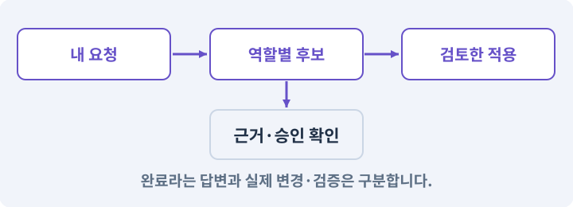

# 003. AI와 실행 중인 Unity 연결하기

**목표:** AI가 현재 Editor를 확인하고 실제 명령을 실행합니다.

**시작 상태:** 새 2D 프로젝트와 로컬 AI 도구

## 한눈에 보는 기능의 흐름

로컬 AI → Unity CLI → 현재 Editor → 씬·경로 응답



**경계:** 다른 프로젝트로 명령이 가지 않기

그림은 실제 게임 실행 결과가 아닙니다. 값·규칙과 예제를 필요한 때 펼쳐 읽고 현재 단계의 메시지를 한 번씩 보냅니다.

## 1. 지금 상태 확인하기

아래 메시지를 로컬 AI 작업창에 보내세요. 답변에서 현재 대상과 준비 상태를 확인합니다. 아직 없는 준비가 있다면 먼저 해결합니다.

### AI에게 보낼 요구와 이유

#### 01. 터미널과 Editor가 같은 대상을 보게

**공식 Unity CLI의 실행 파일·버전·지원 명령과 현재 Editor의 프로젝트 경로를 읽기 전용으로 대조해 줘.**

왜 이렇게 요청하나요? 여러 Unity 프로젝트나 실행 파일이 있으면 명령이 다른 Editor로 전달될 수 있습니다. 실행 파일·연결된 프로젝트·씬의 실제 응답을 대조해 올바른 작업 대상을 고정합니다.

#### 02. 현재 상태와 다음 확인 지점 구분

**지금은 실제 상태·바꿀 범위·남겨 둘 동작만 확인해 줘.**

왜 이렇게 요청하나요? 이미 준비된 기능과 아직 확인하지 못한 기능을 섞으면 불필요한 재설치나 성급한 완료 판정이 생깁니다. 현재 대상과 남은 준비를 나눠 가장 작은 다음 작업을 선택하게 합니다.

#### 03. 비용 한도·예약·실사용량의 적용 조건

**설치·유료 호출·기존 파일 변경이 필요하면 먼저 알려 줘.**

왜 이렇게 요청하나요? 비용 한도는 허용한 지출 범위입니다. 예약은 호출 전에 잠재 사용량을 잡아 두는 것이고 실사용량은 응답·공급자 기록으로 확인합니다. 추정과 청구서는 다를 수 있습니다. 웹 구독료와 별도 API 요금·CDN 전송료가 같은 결제에 포함된다고 가정하지 않습니다.

<details>
<summary>보낼 원문 전체 — 설명은 복사되지 않습니다</summary>

```text
공식 Unity CLI의 실행 파일·버전·지원 명령과 현재 Editor의 프로젝트 경로를 읽기 전용으로 대조해 줘.
지금은 실제 상태·바꿀 범위·남겨 둘 동작만 확인해 줘. 설치·유료 호출·기존 파일 변경이 필요하면 먼저 알려 줘.
```

</details>

**기대 결과:** 동일한 프로젝트를 가리키는 Editor와 CLI 정보

### 직접 확인하기

1. AI가 읽은 실제 프로젝트 또는 도구 경로를 확인합니다.
2. 필수 준비가 없다면 문제 해결 요청을 보내고, 준비됐을 때 다음으로 갑니다.

## 2. 필요한 기능 만들기

준비가 확인되면 아래 요청을 보냅니다. AI가 파일·설정·실행을 맡습니다. 변경 범위나 비용 승인이 나오면 내용을 읽고 결정하세요.

### AI에게 보낼 요구와 이유

#### 01. 터미널과 Editor가 같은 대상을 보게

**공식 Unity CLI와 Unity Pipeline을 현재 AshfallRPG2D Editor에 연결해 줘.**

왜 이렇게 요청하나요? 여러 Unity 프로젝트나 실행 파일이 있으면 명령이 다른 Editor로 전달될 수 있습니다. 실행 파일·연결된 프로젝트·씬의 실제 응답을 대조해 올바른 작업 대상을 고정합니다.

#### 02. 인증 정보 노출 방지

**기존 설치·인증·패키지를 확인하고 필요한 설치와 로그인만 승인받아 수행해 줘.**

왜 이렇게 요청하나요? 인증 정보가 프롬프트·로그·저장소에 남으면 다른 사람이 재사용할 수 있습니다. 로그인은 공식 경로에서 처리하고, AI에는 키 자체가 아니라 연결 성공 여부만 확인시킵니다.

#### 03. 터미널과 Editor가 같은 대상을 보게

**현재 경로, unity 실행 파일, CLI 버전, 연결된 Editor의 실제 프로젝트를 서로 대조해 줘.**

왜 이렇게 요청하나요? 여러 Unity 프로젝트나 실행 파일이 있으면 명령이 다른 Editor로 전달될 수 있습니다. 실행 파일·연결된 프로젝트·씬의 실제 응답을 대조해 올바른 작업 대상을 고정합니다.

#### 04. 설치된 도구에 맞추기

**설치본 도움말과 Editor의 명령 목록에서 상태·컴파일·Play·저장·테스트·캡처·빌드 기능을 찾아 줘.**

왜 이렇게 요청하나요? 버전마다 명령과 인자가 다를 수 있습니다. 기억에 의존해 명령을 조합하지 않고 현재 설치본의 도움말·패키지·실제 호출 결과를 기준으로 연결하게 합니다.

#### 05. 관찰 가능한 기준으로 확인

**사용 가능한 명령·매개변수·완료 확인 방법만 Docs/UNITY_COMMANDS.md에 기록해 줘.**

왜 이렇게 요청하나요? 구현 완료라는 설명을 실제 결과로 바꾸기 위한 조건입니다. 요청에 나온 대상과 경계 상황을 확인해 정상 결과뿐 아니라 실패를 어떻게 구분했는지도 남깁니다.

#### 06. 실제 도구와 결과 확인

**없는 명령을 추측해서 실행하지 마.**

왜 이렇게 요청하나요? 그럴듯한 명령이나 설계 설명이 있어도 현재 환경에서 실행되는 것은 아닙니다. 지원되는 기능과 실제 호출 결과를 확인해야 존재하지 않는 도구를 전제로 진행하지 않습니다.

#### 07. 준비 상태를 서로 다른 단계로 기록

**GUI Editor 연결과 별도 배치 실행은 구분해 줘.**

왜 이렇게 요청하나요? 프로그램 설치, 로그인, 프로젝트 생성, 실행 중 Editor 연결은 각각 별도 성공 조건입니다. 하나가 끝났다고 나머지도 됐다고 기록하지 않아야 실패한 연결 지점을 찾을 수 있습니다.

#### 08. 렌더러·재질·조명 조합 맞추기

**연결을 확인한 뒤 실제 2D Renderer·XY 평면·직교 카메라 구성을 조사하고 잘못된 부분만 바로잡아 줘.**

왜 이렇게 요청하나요? 현재 렌더러와 다른 재질을 쓰거나 필요한 2D 조명이 없으면 그림이 분홍색·검은색으로 보일 수 있습니다. 자산 생성뿐 아니라 실제 그리는 경로까지 맞추게 하는 조건입니다.

#### 09. 현재 목표 밖의 기능을 추가하지 않기

**아직 플레이어는 만들지 마.**

왜 이렇게 요청하나요? AI가 관련 있어 보이는 기능을 한꺼번에 늘리면 무엇이 완료되어야 하는지 흐려집니다. 이번 목표와 직접 관계없는 구현을 제외해 현재 기능의 검증을 먼저 끝냅니다.

#### 10. 파일 소유권·읽기 범위·쓰기 범위의 적용 조건

**프로젝트·Editor·열린 씬 정보를 반환하는 읽기 전용 ProjectProbe가 필요하면 현재 Pipeline API 로 만들어 줘.**

왜 이렇게 요청하나요? 파일 소유권은 이번 작업에서 누가 어느 파일을 수정할 책임과 권한이 있는지 정한 규칙입니다. 읽기 허용과 쓰기 허용은 별도로 관리합니다. 권한 설명 프롬프트만으로 운영체제의 실제 접근을 완전히 차단한 것은 아닙니다.

#### 11. 관찰 가능한 기준으로 확인

**작성, 컴파일, 명령 발견, 실제 호출을 각각 확인하고 지원 API가 없으면 그 단계를 구분해 줘.**

왜 이렇게 요청하나요? 구현 완료라는 설명을 실제 결과로 바꾸기 위한 조건입니다. 요청에 나온 대상과 경계 상황을 확인해 정상 결과뿐 아니라 실패를 어떻게 구분했는지도 남깁니다.

#### 12. 패키지·패키지 관리자의 적용 조건

**인증 토큰이나 로컬 액세스 키는 기록하지 말고, 실패하면 경로·패키지·컴파일·인증 중 원인을 좁혀 줘.**

왜 이렇게 요청하나요? 패키지는 입력·타일맵·테스트처럼 특정 기능을 묶어 프로젝트에 추가하는 단위입니다. Unity Package Manager가 설치와 의존 버전을 관리합니다. 이름이 비슷한 제삼자 패키지를 공식 패키지로 오해하지 않습니다. 버전과 출처를 기록합니다.

#### 13. 구현과 실행은 AI에게 맡기기

**코드·설정·파일 생성·실행은 네가 맡고, 필요한 화면과 결과를 보여 줘.**

왜 이렇게 요청하나요? 설명이나 코드 조각만 받으면 실제 파일 생성·연결·실행이 빠질 수 있습니다. AI가 개발 작업까지 수행하고, 사람은 요구·승인·결과 판단을 맡도록 역할을 분명히 합니다.

#### 14. 막힌 준비를 먼저 해결

**수행하지 못한 작업과 필요한 승인·도구 연결은 구분해서 알려 줘.**

왜 이렇게 요청하나요? 빠진 파일·권한·패키지를 있다고 가정하면 다음 구현이 엉뚱한 대상을 만들게 됩니다. 무엇이 없고 무엇을 먼저 해야 하는지 분리하면 불필요한 재작업을 줄일 수 있습니다.

<details>
<summary>보낼 원문 전체 — 설명은 복사되지 않습니다</summary>

```text
공식 Unity CLI와 Unity Pipeline을 현재 AshfallRPG2D Editor에 연결해 줘. 기존 설치·인증·패키지를 확인하고 필요한 설치와 로그인만 승인받아 수행해 줘.
현재 경로, unity 실행 파일, CLI 버전, 연결된 Editor의 실제 프로젝트를 서로 대조해 줘. 설치본 도움말과 Editor의 명령 목록에서 상태·컴파일·Play·저장·테스트·캡처·빌드 기능을 찾아 줘.
사용 가능한 명령·매개변수·완료 확인 방법만 Docs/UNITY_COMMANDS.md에 기록해 줘. 없는 명령을 추측해서 실행하지 마. GUI Editor 연결과 별도 배치 실행은 구분해 줘.
연결을 확인한 뒤 실제 2D Renderer·XY 평면·직교 카메라 구성을 조사하고 잘못된 부분만 바로잡아 줘. 아직 플레이어는 만들지 마.
프로젝트·Editor·열린 씬 정보를 반환하는 읽기 전용 ProjectProbe가 필요하면 현재 Pipeline API 로 만들어 줘. 작성, 컴파일, 명령 발견, 실제 호출을 각각 확인하고 지원 API가 없으면 그 단계를 구분해 줘.
인증 토큰이나 로컬 액세스 키는 기록하지 말고, 실패하면 경로·패키지·컴파일·인증 중 원인을 좁혀 줘.

코드·설정·파일 생성·실행은 네가 맡고, 필요한 화면과 결과를 보여 줘. 수행하지 못한 작업과 필요한 승인·도구 연결은 구분해서 알려 줘.
```

</details>

**기대 결과:** 확인할 결과: Editor 왕복 확인과 실제 2D 설정 확인을 마침. AI가 이 상태를 확인할 실제 화면과 변경 내용을 준비합니다. 아직 실행하지 못한 부분은 따로 표시합니다.

### 직접 확인하기

1. 제안서만 반환됐다면 “설명으로 끝내지 말고 승인한 범위의 실제 작업을 수행해 줘”라고 보냅니다.
2. 코드나 설정을 직접 고치라는 안내가 나오면 “작성과 실행은 네가 맡아 줘”라고 요청합니다.

## 3. 결과를 직접 확인하기

먼저 확인 요청을 보내 AI가 검사와 화면을 준비하게 하세요. 그다음 아래 동작을 하나씩 확인합니다.

### AI에게 보낼 요구와 이유

#### 01. 검사할 입력과 관찰 지점 준비

**방금 구현한 기능의 자동 검사와 확인 화면을 준비해 줘.**

왜 이렇게 요청하나요? 정상 예 하나만 보면 실패 조건을 놓치기 쉽습니다. 정상·경계·반례를 실제 입력으로 준비하고 사람이 볼 화면도 맞춰 확인 범위를 분명하게 합니다.

#### 02. 결과를 재확인할 근거 남기기

**정상 동작과 아래 실패 조건을 실제로 검사하고 대상·실행 수·결과를 보여 줘.**

왜 이렇게 요청하나요? “잘 됩니다”라는 요약만으로는 어떤 입력과 버전을 검사했는지 알 수 없습니다. 대상·실행 수·실패 내용·파일을 함께 남겨 같은 조건으로 다시 확인할 수 있게 합니다.

#### 03. 터미널과 Editor가 같은 대상을 보게

**Pipeline 목록에서 대상 프로젝트의 설치와 연결을 확인한다.**

왜 이렇게 요청하나요? 여러 Unity 프로젝트나 실행 파일이 있으면 명령이 다른 Editor로 전달될 수 있습니다. 실행 파일·연결된 프로젝트·씬의 실제 응답을 대조해 올바른 작업 대상을 고정합니다.

#### 04. 터미널과 Editor가 같은 대상을 보게

**CLI가 가리키는 경로가 AshfallRPG2D 다.**

왜 이렇게 요청하나요? 여러 Unity 프로젝트나 실행 파일이 있으면 명령이 다른 Editor로 전달될 수 있습니다. 실행 파일·연결된 프로젝트·씬의 실제 응답을 대조해 올바른 작업 대상을 고정합니다.

#### 05. 터미널과 Editor가 같은 대상을 보게

**실제 사용 가능한 명령이 문서화되어 있다.**

왜 이렇게 요청하나요? 여러 Unity 프로젝트나 실행 파일이 있으면 명령이 다른 Editor로 전달될 수 있습니다. 실행 파일·연결된 프로젝트·씬의 실제 응답을 대조해 올바른 작업 대상을 고정합니다.

#### 06. 실제 도구와 결과 확인

**없는 명령은 ‘미지원’으로 적혀 있다.**

왜 이렇게 요청하나요? 그럴듯한 명령이나 설계 설명이 있어도 현재 환경에서 실행되는 것은 아닙니다. 지원되는 기능과 실제 호출 결과를 확인해야 존재하지 않는 도구를 전제로 진행하지 않습니다.

#### 07. 로컬 자동화의 접근 범위 제한

**연결이 성공해도 방화벽을 외부에 개방하지 않는다.**

왜 이렇게 요청하나요? 내 PC의 제작 도구를 제어할 수 있는 연결을 불필요하게 외부에 열면 다른 요청이 들어올 수 있습니다. 승인된 로컬 경로와 대상만 사용해 자동화 권한이 넓어지지 않게 합니다.

#### 08. 사람 검사의 시작점 준비

**내가 조작해야 하는 부분은 실행할 화면과 시작 상태를 준비해 줘.**

왜 이렇게 요청하나요? 같은 기능이라도 시작 상태가 다르면 관찰 결과가 달라집니다. AI가 실행 화면과 재현 위치를 먼저 준비해야 사람이 이동·공격·소리·조작감을 같은 조건에서 확인할 수 있습니다.

#### 09. 사람이 실제로 본 것만 기록

**연결되지 않은 휴대폰의 터치나 사람이 보지 않은 재미·소리 품질을 대신 확인했다고 하지 마.**

왜 이렇게 요청하나요? AI가 준비한 검사와 사람이 직접 플레이하거나 들은 결과는 다른 근거입니다. 관찰하지 않은 조작감·소리·실기기 결과를 임의로 완료 처리하지 않게 합니다.

#### 10. 실제로 실행한 검사만 인정

**테스트 0개와 예전 소스 결과는 현재 성공으로 쓰지 마.**

왜 이렇게 요청하나요? 실행된 검사가 없거나 같은 결과를 중복 집계한 경우는 기능을 확인한 것이 아닙니다. 실행 수와 개별 결과를 함께 확인해야 형식적인 성공 표시를 걸러낼 수 있습니다.

<details>
<summary>보낼 원문 전체 — 설명은 복사되지 않습니다</summary>

```text
방금 구현한 기능의 자동 검사와 확인 화면을 준비해 줘. 정상 동작과 아래 실패 조건을 실제로 검사하고 대상·실행 수·결과를 보여 줘.

Pipeline 목록에서 대상 프로젝트의 설치와 연결을 확인한다. CLI가 가리키는 경로가 AshfallRPG2D 다. 실제 사용 가능한 명령이 문서화되어 있다. 없는 명령은 ‘미지원’으로 적혀 있다. 연결이 성공해도 방화벽을 외부에 개방하지 않는다.

내가 조작해야 하는 부분은 실행할 화면과 시작 상태를 준비해 줘. 연결되지 않은 휴대폰의 터치나 사람이 보지 않은 재미·소리 품질을 대신 확인했다고 하지 마. 테스트 0개와 예전 소스 결과는 현재 성공으로 쓰지 마.
```

</details>

**기대 결과:** 도움말의 실제 명령, 호출 대상, 완료 상태, 반환된 프로젝트 경로가 함께 보입니다.

### 직접 확인하기

1. AI가 보여 주는 현재 씬 이름을 Unity 화면과 비교합니다.
2. 읽기 전용 프로젝트 확인 명령의 실제 호출 결과를 봅니다.
3. 2D Renderer와 카메라 확인 결과에서 미검증 표시가 해소됐는지 봅니다.

## 4. 결과를 남기고 마무리하기

실제로 본 결과를 아래 메모에 적고 AI에 전달합니다. 결과 저장 요청으로 현재 상태를 남긴 뒤 다음 페이지로 갑니다.

### AI에게 보낼 요구와 이유

#### 01. 현재 상태와 다음 확인 지점 구분

**실제로 준비한 환경과 경로·버전, 성공한 연결, 아직 확인할 부분을 요약해 줘.**

왜 이렇게 요청하나요? 이미 준비된 기능과 아직 확인하지 못한 기능을 섞으면 불필요한 재설치나 성급한 완료 판정이 생깁니다. 현재 대상과 남은 준비를 나눠 가장 작은 다음 작업을 선택하게 합니다.

#### 02. 환경 기록을 잃지 않고 인계

**현재 작업 폴더에 환경 기록을 남길 수 있으면 네가 만들고, 없다면 실제 확인 내용부터 대화에 남겨 줘.**

왜 이렇게 요청하나요? 아직 프로젝트 폴더가 준비되지 않았더라도 조사한 버전과 경로는 다음 작업에 필요합니다. 쓸 수 있는 위치가 있으면 파일에, 없으면 현재 AI 대화에 사실만 남깁니다. 게임 속 NPC 대화를 만드는 요청이 아닙니다.

#### 03. 준비 상태를 서로 다른 단계로 기록

**설치·인증·프로젝트 생성 여부를 서로 구분해 줘.**

왜 이렇게 요청하나요? 프로그램 설치, 로그인, 프로젝트 생성, 실행 중 Editor 연결은 각각 별도 성공 조건입니다. 하나가 끝났다고 나머지도 됐다고 기록하지 않아야 실패한 연결 지점을 찾을 수 있습니다.

<details>
<summary>보낼 원문 전체 — 설명은 복사되지 않습니다</summary>

```text
실제로 준비한 환경과 경로·버전, 성공한 연결, 아직 확인할 부분을 요약해 줘. 현재 작업 폴더에 환경 기록을 남길 수 있으면 네가 만들고, 없다면 실제 확인 내용부터 대화에 남겨 줘. 설치·인증·프로젝트 생성 여부를 서로 구분해 줘.
```

</details>

**기대 결과:** 현재 상태·검사 결과·남은 문제·다음에 읽을 기록을 확인할 수 있습니다.

### 직접 확인하기

1. 자동 검사와 내 관찰 결과가 섞이지 않았는지 봅니다.
2. 문제가 남았다면 해결 요청을 보내고 같은 동작을 다시 확인합니다.

## 구체적인 예로 이해하기

### 명령 발견 → 실행 → 완료 구분

CLI가 요청을 접수한 시점과 Editor가 작업을 끝낸 시점은 다릅니다. 긴 작업은 완료 신호를 기다린 뒤 결과를 읽습니다.

**시작 상태:** CLI와 현재 프로젝트의 Editor가 연결되어 있습니다.

**직접 해 볼 동작:** AI에게 읽기 전용 프로젝트 확인 명령을 발견·호출하고 경로와 씬 이름을 반환하게 합니다.

**보여야 하는 결과:** 도움말의 실제 명령, 호출 대상, 완료 상태, 반환된 프로젝트 경로가 함께 보입니다.

**이렇게 되면 아직 안 됩니다:** 명령 이름을 추측하거나 “시작됨” 응답만 보고 씬 생성까지 완료됐다고 판단합니다.

**생각해 보기:** CLI는 종료됐는데 Editor가 아직 컴파일 중이라면 후속 검사를 시작할까요?

<details><summary>해설 보기</summary>

아니요. 컴파일과 도메인 리로드가 끝났는지 확인해야 합니다. 접수·진행·완료·실패를 별도 상태로 다룹니다.

</details>

## 문제가 있으면

### AI에게 보낼 요구와 이유

#### 01. 로컬 자동화의 접근 범위 제한

**명령을 추측하거나 포트를 외부에 열지 말고 CLI·Pipeline·컴파일·프로젝트 경로 중 끊긴 지점을 찾아 줘.**

왜 이렇게 요청하나요? 내 PC의 제작 도구를 제어할 수 있는 연결을 불필요하게 외부에 열면 다른 요청이 들어올 수 있습니다. 승인된 로컬 경로와 대상만 사용해 자동화 권한이 넓어지지 않게 합니다.

#### 02. 원인 하나를 좁혀 수정

**새 기능을 추가하지 말고 현재 오류와 실제 로그를 먼저 읽어 줘.**

왜 이렇게 요청하나요? 오류 수정 중 새 기능까지 넣으면 어떤 변경이 문제를 해결하거나 악화했는지 알기 어렵습니다. 원래 재현을 보존하고 작은 변경 뒤 같은 입력과 주변 정상 동작을 다시 확인합니다.

#### 03. 원인 하나를 좁혀 수정

**최소 수정 뒤 같은 재현과 관련 정상 동작을 다시 검사해 줘.**

왜 이렇게 요청하나요? 오류 수정 중 새 기능까지 넣으면 어떤 변경이 문제를 해결하거나 악화했는지 알기 어렵습니다. 원래 재현을 보존하고 작은 변경 뒤 같은 입력과 주변 정상 동작을 다시 확인합니다.

#### 04. 실패도 재현 자료로 보존

**실패 기록은 지우지 마.**

왜 이렇게 요청하나요? 실패한 입력과 로그가 있어야 같은 문제가 다시 생겼을 때 비교할 수 있습니다. 성공 기록으로 덮어쓰지 않고 전후 자료를 남기면 무엇을 고쳤는지 확인할 수 있습니다.

<details>
<summary>보낼 원문 전체 — 설명은 복사되지 않습니다</summary>

```text
명령을 추측하거나 포트를 외부에 열지 말고 CLI·Pipeline·컴파일·프로젝트 경로 중 끊긴 지점을 찾아 줘.
새 기능을 추가하지 말고 현재 오류와 실제 로그를 먼저 읽어 줘. 최소 수정 뒤 같은 재현과 관련 정상 동작을 다시 검사해 줘. 실패 기록은 지우지 마.
```

</details>

## 새 세션에서 이어가기

### AI에게 보낼 요구와 이유

#### 01. 이어서 할 작업 식별

**“AI와 실행 중인 Unity 연결하기” 작업을 이어가고 싶어.**

왜 이렇게 요청하나요? 이름으로 재개할 작업을 찾고, 뒤에 이어지는 요청으로 실제 파일·진행 중 작업·기록을 다시 읽게 합니다. 제목만 보고 이전 상태를 기억한다고 가정하지 않습니다.

#### 02. 조회는 상태를 바꾸지 않게

**실제 프로젝트와 내 도구의 작업 기록을 읽고 어디까지 구현·검사됐는지 확인해 줘.**

왜 이렇게 요청하나요? 진행 상황을 물을 때 새 구현이나 유료 호출이 시작되면 단순 확인이 실행 명령이 되어 버립니다. 저장된 근거를 읽어 완료·진행·승인 대기·미검증을 나누게 합니다.

#### 03. 재개 전 중복 작업 방지

**진행 중인 프로세스·승인·미저장 변경을 확인한 뒤 남은 가장 작은 작업부터 안내해 줘.**

왜 이렇게 요청하나요? 대화가 끊겨도 외부 작업은 끝났거나 아직 실행 중일 수 있습니다. 프로세스·승인·미저장 상태를 먼저 읽어 같은 생성·빌드·결제를 두 번 시작하지 않도록 합니다.

#### 04. 되돌아갈 원본 남기기

**기존 성공과 실패 기록은 보존해 줘.**

왜 이렇게 요청하나요? 새 구현이 실패해도 이전 게임과 저장을 복원할 수 있어야 합니다. 현재 내용을 먼저 조사하고 별도 후보에서 작업하면 실험이 유일한 정상본을 망가뜨리는 일을 피할 수 있습니다.

<details>
<summary>보낼 원문 전체 — 설명은 복사되지 않습니다</summary>

```text
“AI와 실행 중인 Unity 연결하기” 작업을 이어가고 싶어. 실제 프로젝트와 내 도구의 작업 기록을 읽고 어디까지 구현·검사됐는지 확인해 줘. 진행 중인 프로세스·승인·미저장 변경을 확인한 뒤 남은 가장 작은 작업부터 안내해 줘. 기존 성공과 실패 기록은 보존해 줘.
```

</details>

## 왜 이렇게 만드는가

Unity CLI 자체와 프로젝트 안의 Pipeline 패키지는 서로 다른 설치 대상이다. CLI만 설치했는데 씬 편집 명령이 안 보이면 Pipeline과 실행 중인 Editor 연결을 확인해야 한다.

AI는 공식 설치 문서의 Windows 설치 경로를 확인해 사용한다. 명령은 `unity`다. 이름이 비슷한 npm 패키지를 대신 설치하지 않는다. Pipeline은 Unity 6.0 이상을 요구하며, 설치 후 프로젝트의 재컴파일을 기다려야 한다. [S02][S05]

## 공식 참고

- [Use the Unity CLI](https://docs.unity.com/en-us/unity-cli/use-unity-cli)
- [Unity Pipeline package installation](https://docs.unity.com/en-us/unity-cli/unity-pipeline/unity-pipeline-package)


## 실제 Unity Editor 화면 참고
공식 예시와 내 프로젝트 실행 결과를 구분하세요. 원본 사진은 온라인 연결이 필요합니다.

- [Editor 전체 배치 — 어디를 보고 있는지 구분하기](../editor_references/editor-layout.md)
- [Console — 오류 줄과 상세 원인을 함께 읽기](../editor_references/console.md)
