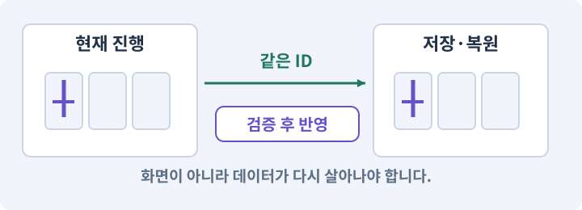

# 004. 되돌릴 수 있는 작업 습관 만들기

**목표:** 게임을 망가뜨리지 않고 변경을 되돌리는 방법을 확인합니다.

**시작 상태:** AI가 현재 Unity 프로젝트에 연결된 상태

## 한눈에 보는 기능의 흐름

정상 원본 → 변경 후보 → 차이 확인 → 선택한 변경 복구



**경계:** 복구할 때 관계없는 작업까지 지우지 않기

그림은 실제 게임 실행 결과가 아닙니다. 값·규칙과 예제를 필요한 때 펼쳐 읽고 현재 단계의 메시지를 한 번씩 보냅니다.

## 1. 지금 상태 확인하기

아래 메시지를 로컬 AI 작업창에 보내세요. 답변에서 현재 대상과 준비 상태를 확인합니다. 아직 없는 준비가 있다면 먼저 해결합니다.

### AI에게 보낼 요구와 이유

#### 01. Git 작업 전 미저장 편집 보호

**현재 변경과 저장하지 않은 씬을 먼저 조사해 줘.**

왜 이렇게 요청하나요? 씬의 미저장 편집과 디스크의 변경 파일은 다를 수 있습니다. 기준점을 만들기 전에 둘을 확인해야 아직 저장하지 않은 작업을 빠뜨리거나 덮어쓰지 않습니다.

#### 02. 되돌아갈 원본 남기기

**원본을 보존하고 작은 변경을 사본에서 되돌릴 계획을 보여 줘.**

왜 이렇게 요청하나요? 새 구현이 실패해도 이전 게임과 저장을 복원할 수 있어야 합니다. 현재 내용을 먼저 조사하고 별도 후보에서 작업하면 실험이 유일한 정상본을 망가뜨리는 일을 피할 수 있습니다.

#### 03. 현재 상태와 다음 확인 지점 구분

**지금은 실제 상태·바꿀 범위·남겨 둘 동작만 확인해 줘.**

왜 이렇게 요청하나요? 이미 준비된 기능과 아직 확인하지 못한 기능을 섞으면 불필요한 재설치나 성급한 완료 판정이 생깁니다. 현재 대상과 남은 준비를 나눠 가장 작은 다음 작업을 선택하게 합니다.

#### 04. 비용 한도·예약·실사용량의 적용 조건

**설치·유료 호출·기존 파일 변경이 필요하면 먼저 알려 줘.**

왜 이렇게 요청하나요? 비용 한도는 허용한 지출 범위입니다. 예약은 호출 전에 잠재 사용량을 잡아 두는 것이고 실사용량은 응답·공급자 기록으로 확인합니다. 추정과 청구서는 다를 수 있습니다. 웹 구독료와 별도 API 요금·CDN 전송료가 같은 결제에 포함된다고 가정하지 않습니다.

<details>
<summary>보낼 원문 전체 — 설명은 복사되지 않습니다</summary>

```text
현재 변경과 저장하지 않은 씬을 먼저 조사해 줘. 원본을 보존하고 작은 변경을 사본에서 되돌릴 계획을 보여 줘.
지금은 실제 상태·바꿀 범위·남겨 둘 동작만 확인해 줘. 설치·유료 호출·기존 파일 변경이 필요하면 먼저 알려 줘.
```

</details>

**기대 결과:** 보존할 변경과 복구용 사본을 구분한 설명

### 직접 확인하기

1. AI가 읽은 실제 프로젝트 또는 도구 경로를 확인합니다.
2. 필수 준비가 없다면 문제 해결 요청을 보내고, 준비됐을 때 다음으로 갑니다.

## 2. 필요한 기능 만들기

준비가 확인되면 아래 요청을 보냅니다. AI가 파일·설정·실행을 맡습니다. 변경 범위나 비용 승인이 나오면 내용을 읽고 결정하세요.

### AI에게 보낼 요구와 이유

#### 01. 지금 필요한 구조만 준비

**AshfallRPG2D의 작업 규칙과 작은 게임 규격을 실제 파일로 만들어 줘.**

왜 이렇게 요청하나요? 처음부터 전체 시스템을 한꺼번에 만들면 사용하지 않는 코드와 가정이 늘어납니다. 현재 기능의 자리·책임·범위를 먼저 만들고 실제 연결 여부를 단계별로 확인합니다.

#### 02. 되돌아갈 원본 남기기

**기존 문서와 Git 상태를 먼저 읽고 현재 작업을 보존해 줘.**

왜 이렇게 요청하나요? 새 구현이 실패해도 이전 게임과 저장을 복원할 수 있어야 합니다. 현재 내용을 먼저 조사하고 별도 후보에서 작업하면 실험이 유일한 정상본을 망가뜨리는 일을 피할 수 있습니다.

#### 03. 좌표계 혼동 방지

**만들 게임은 XY 평면의 2D 탑다운 RPG다.**

왜 이렇게 요청하나요? 2D의 XY와 3D의 XZ는 같은 이동 의미라도 축 배치가 다릅니다. 변환 위치를 한 곳으로 모아야 지도·물리·카메라가 서로 다른 축을 높이나 전진 방향으로 해석하지 않습니다.

#### 04. 동시 입력을 서로 독립적으로 유지

**PC는 클릭 이동과 WASD, Android 는 가로 화면의 조이스틱과 버튼을 쓴다.**

왜 이렇게 요청하나요? 한 손가락을 떼었을 때 다른 손가락의 이동까지 해제되면 모바일 전투가 끊깁니다. 입력의 주체와 눌림 상태를 따로 관리하고 실제 두 손가락 조합으로 검사해야 합니다.

#### 05. 성장을 한 번씩 정확히 반영

**직업 1개, 레벨 1~10, 기본 공격과 세 스킬, 마을 1개, 던전 1개, 아이템과 퀘스트·오프라인 저장을 차례로 붙인다.**

왜 이렇게 요청하나요? 처치 이벤트가 반복되거나 큰 경험치로 여러 단계를 넘으면 성장 수치가 빠지거나 중복될 수 있습니다. 증가·해금·상한을 한 흐름으로 처리하고 경계값을 검사합니다.

#### 06. Play 모드·편집 모드·런타임의 적용 조건

**멀티플레이·광고·런타임 LLM은 만들지 않는다.**

왜 이렇게 요청하나요? 편집 모드는 제작 상태이고 Play 모드는 게임 로직을 실행해 보는 상태입니다. 런타임은 게임이 실제로 실행되는 시간과 환경을 뜻합니다. Play에서 보인 상태만 보고 저장·재개방까지 통과했다고 기록하지 않습니다.

#### 07. 관찰 가능한 기준으로 확인

**CLAUDE.md에 내가 자연어로 요구하고 네가 코드·설정·Editor 연결·테스트·기록을 맡는 원칙을 써 줘.**

왜 이렇게 요청하나요? 구현 완료라는 설명을 실제 결과로 바꾸기 위한 조건입니다. 요청에 나온 대상과 경계 상황을 확인해 정상 결과뿐 아니라 실패를 어떻게 구분했는지도 남깁니다.

#### 08. 비용과 외부 작업은 별도 승인

**로그인·비용·게시 승인과 실제 플레이 판단은 나에게 남겨 줘.**

왜 이렇게 요청하나요? 로컬 파일을 고치는 것과 외부 서비스에 자료를 보내거나 비용을 지불하는 것은 영향이 다릅니다. 대상·내용·비용 범위를 확인한 승인 없이 요청이 확대되지 않도록 합니다.

#### 09. 스크립트와 실제 씬 연결

**씬·프리팹은 Editor API 로 수정하고, 모르는 명령은 설치본에서 확인해 줘.**

왜 이렇게 요청하나요? 코드 파일을 만들어도 씬의 오브젝트에 붙지 않거나 참조가 비어 있으면 플레이에 반영되지 않습니다. 실제 사용하는 프리팹과 컴포넌트까지 연결해 동작을 확인하게 합니다.

#### 10. 되돌아갈 원본 남기기

**요청한 범위만 만들고 원본을 보존해 줘.**

왜 이렇게 요청하나요? 새 구현이 실패해도 이전 게임과 저장을 복원할 수 있어야 합니다. 현재 내용을 먼저 조사하고 별도 후보에서 작업하면 실험이 유일한 정상본을 망가뜨리는 일을 피할 수 있습니다.

#### 11. 관찰하지 않은 성공을 채우지 않기

**실행하지 않은 검사는 성공으로 적지 마.**

왜 이렇게 요청하나요? 자동 검사·AI의 추정·사람의 실제 관찰은 다른 종류의 근거입니다. 수행하지 않은 기기나 조작 검사는 미확인으로 남겨 나중에 실제 확인할 수 있게 합니다.

#### 12. 다음 작업이 읽을 인수인계

**Docs/GAME_SPEC.md에는 결정한 규칙과 값을, Docs/WORK_LOG.md에는 실제로 끝낸 일·오류·다음 작업을 기능 이름으로 기록해 줘.**

왜 이렇게 요청하나요? 새 AI 세션은 이전 대화 전체를 알고 있다고 보장할 수 없습니다. 현재 후보·파일 위치·실행한 검사·남은 일을 남겨야 같은 작업을 반복하지 않고 이어갈 수 있습니다.

#### 13. 인증 정보 노출 방지

**비밀키는 넣지 마.**

왜 이렇게 요청하나요? 인증 정보가 프롬프트·로그·저장소에 남으면 다른 사람이 재사용할 수 있습니다. 로그인은 공식 경로에서 처리하고, AI에는 키 자체가 아니라 연결 성공 여부만 확인시킵니다.

#### 14. 버전 기록 도구 준비

**Git이 없으면 설치 여부를 확인하고 초기 저장소를 준비해 줘.**

왜 이렇게 요청하나요? Git 저장소는 소스 변경을 비교하고 되돌릴 기준을 남깁니다. 프로그램 존재를 확인하고 새 저장소의 범위를 정해야 하며 플레이어 세이브를 자동 백업하는 기능과 혼동하지 않습니다.

#### 15. 자산 참조의 정체성 보존

**Library·Temp·빌드·비밀 정보는 제외하고 Assets의 .meta와 프로젝트 설정은 보존해 줘.**

왜 이렇게 요청하나요? Unity는 자산을 파일 이름만으로 식별하지 않습니다. 메타 정보가 바뀌면 같은 이름의 파일이 있어도 참조가 끊길 수 있어 파일과 식별자를 함께 관리해야 합니다.

#### 16. 변경 단위를 다시 찾고 되돌리기

**변경 요약을 보여 주고 이 상태를 복구할 수 있는 체크포인트를 만들어 줘.**

왜 이렇게 요청하나요? 무엇을 어느 상태에서 바꿨는지 남기면 AI가 실수해도 변경 범위를 비교할 수 있습니다. 소스 기록과 빌드·세이브 백업은 별개이므로 함께 확인합니다.

#### 17. 설명·확인과 실제 변경 분리

**원격 업로드는 하지 마.**

왜 이렇게 요청하나요? 원리를 확인하는 요청이 곧 구현이나 외부 게시의 승인은 아닙니다. 현재 상태를 유지한 채 이해한 뒤 필요한 변경을 별도 요청할 수 있게 합니다.

#### 18. 구현과 실행은 AI에게 맡기기

**코드·설정·파일 생성·실행은 네가 맡고, 필요한 화면과 결과를 보여 줘.**

왜 이렇게 요청하나요? 설명이나 코드 조각만 받으면 실제 파일 생성·연결·실행이 빠질 수 있습니다. AI가 개발 작업까지 수행하고, 사람은 요구·승인·결과 판단을 맡도록 역할을 분명히 합니다.

#### 19. 막힌 준비를 먼저 해결

**수행하지 못한 작업과 필요한 승인·도구 연결은 구분해서 알려 줘.**

왜 이렇게 요청하나요? 빠진 파일·권한·패키지를 있다고 가정하면 다음 구현이 엉뚱한 대상을 만들게 됩니다. 무엇이 없고 무엇을 먼저 해야 하는지 분리하면 불필요한 재작업을 줄일 수 있습니다.

<details>
<summary>보낼 원문 전체 — 설명은 복사되지 않습니다</summary>

```text
AshfallRPG2D의 작업 규칙과 작은 게임 규격을 실제 파일로 만들어 줘. 기존 문서와 Git 상태를 먼저 읽고 현재 작업을 보존해 줘.
만들 게임은 XY 평면의 2D 탑다운 RPG다. PC는 클릭 이동과 WASD, Android 는 가로 화면의 조이스틱과 버튼을 쓴다. 직업 1개, 레벨 1~10, 기본 공격과 세 스킬, 마을 1개, 던전 1개, 아이템과 퀘스트·오프라인 저장을 차례로 붙인다. 멀티플레이·광고·런타임 LLM은 만들지 않는다.
CLAUDE.md에 내가 자연어로 요구하고 네가 코드·설정·Editor 연결·테스트·기록을 맡는 원칙을 써 줘. 로그인·비용·게시 승인과 실제 플레이 판단은 나에게 남겨 줘.
씬·프리팹은 Editor API 로 수정하고, 모르는 명령은 설치본에서 확인해 줘. 요청한 범위만 만들고 원본을 보존해 줘. 실행하지 않은 검사는 성공으로 적지 마.
Docs/GAME_SPEC.md에는 결정한 규칙과 값을, Docs/WORK_LOG.md에는 실제로 끝낸 일·오류·다음 작업을 기능 이름으로 기록해 줘. 비밀키는 넣지 마.
Git이 없으면 설치 여부를 확인하고 초기 저장소를 준비해 줘. Library·Temp·빌드·비밀 정보는 제외하고 Assets의 .meta와 프로젝트 설정은 보존해 줘. 변경 요약을 보여 주고 이 상태를 복구할 수 있는 체크포인트를 만들어 줘. 원격 업로드는 하지 마.

코드·설정·파일 생성·실행은 네가 맡고, 필요한 화면과 결과를 보여 줘. 수행하지 못한 작업과 필요한 승인·도구 연결은 구분해서 알려 줘.
```

</details>

**기대 결과:** 확인할 결과: 원본 보존과 사본의 제한된 복구를 확인함. AI가 이 상태를 확인할 실제 화면과 변경 내용을 준비합니다. 아직 실행하지 못한 부분은 따로 표시합니다.

### 직접 확인하기

1. 제안서만 반환됐다면 “설명으로 끝내지 말고 승인한 범위의 실제 작업을 수행해 줘”라고 보냅니다.
2. 코드나 설정을 직접 고치라는 안내가 나오면 “작성과 실행은 네가 맡아 줘”라고 요청합니다.

## 3. 결과를 직접 확인하기

먼저 확인 요청을 보내 AI가 검사와 화면을 준비하게 하세요. 그다음 아래 동작을 하나씩 확인합니다.

### AI에게 보낼 요구와 이유

#### 01. 검사할 입력과 관찰 지점 준비

**방금 구현한 기능의 자동 검사와 확인 화면을 준비해 줘.**

왜 이렇게 요청하나요? 정상 예 하나만 보면 실패 조건을 놓치기 쉽습니다. 정상·경계·반례를 실제 입력으로 준비하고 사람이 볼 화면도 맞춰 확인 범위를 분명하게 합니다.

#### 02. 결과를 재확인할 근거 남기기

**정상 동작과 아래 실패 조건을 실제로 검사하고 대상·실행 수·결과를 보여 줘.**

왜 이렇게 요청하나요? “잘 됩니다”라는 요약만으로는 어떤 입력과 버전을 검사했는지 알 수 없습니다. 대상·실행 수·실패 내용·파일을 함께 남겨 같은 조건으로 다시 확인할 수 있게 합니다.

#### 03. 지금 필요한 구조만 준비

**규칙과 게임 규격 문서가 존재한다.**

왜 이렇게 요청하나요? 처음부터 전체 시스템을 한꺼번에 만들면 사용하지 않는 코드와 가정이 늘어납니다. 현재 기능의 자리·책임·범위를 먼저 만들고 실제 연결 여부를 단계별로 확인합니다.

#### 04. 변경 단위를 다시 찾고 되돌리기

**Git 상태에 Library 전체가 올라오지 않는다.**

왜 이렇게 요청하나요? 무엇을 어느 상태에서 바꿨는지 남기면 AI가 실수해도 변경 범위를 비교할 수 있습니다. 소스 기록과 빌드·세이브 백업은 별개이므로 함께 확인합니다.

#### 05. 자산 참조의 정체성 보존

**초기 커밋에는 실제 프로젝트 설정과 .meta가 포함된다.**

왜 이렇게 요청하나요? Unity는 자산을 파일 이름만으로 식별하지 않습니다. 메타 정보가 바뀌면 같은 이름의 파일이 있어도 참조가 끊길 수 있어 파일과 식별자를 함께 관리해야 합니다.

#### 06. 인증 정보 노출 방지

**문서에 비밀번호가 없다.**

왜 이렇게 요청하나요? 인증 정보가 프롬프트·로그·저장소에 남으면 다른 사람이 재사용할 수 있습니다. 로그인은 공식 경로에서 처리하고, AI에는 키 자체가 아니라 연결 성공 여부만 확인시킵니다.

#### 07. 변경 단위를 다시 찾고 되돌리기

**커밋 이후 상태 확인 방법을 알고 있다.**

왜 이렇게 요청하나요? 무엇을 어느 상태에서 바꿨는지 남기면 AI가 실수해도 변경 범위를 비교할 수 있습니다. 소스 기록과 빌드·세이브 백업은 별개이므로 함께 확인합니다.

#### 08. 사람 검사의 시작점 준비

**내가 조작해야 하는 부분은 실행할 화면과 시작 상태를 준비해 줘.**

왜 이렇게 요청하나요? 같은 기능이라도 시작 상태가 다르면 관찰 결과가 달라집니다. AI가 실행 화면과 재현 위치를 먼저 준비해야 사람이 이동·공격·소리·조작감을 같은 조건에서 확인할 수 있습니다.

#### 09. 사람이 실제로 본 것만 기록

**연결되지 않은 휴대폰의 터치나 사람이 보지 않은 재미·소리 품질을 대신 확인했다고 하지 마.**

왜 이렇게 요청하나요? AI가 준비한 검사와 사람이 직접 플레이하거나 들은 결과는 다른 근거입니다. 관찰하지 않은 조작감·소리·실기기 결과를 임의로 완료 처리하지 않게 합니다.

#### 10. 실제로 실행한 검사만 인정

**테스트 0개와 예전 소스 결과는 현재 성공으로 쓰지 마.**

왜 이렇게 요청하나요? 실행된 검사가 없거나 같은 결과를 중복 집계한 경우는 기능을 확인한 것이 아닙니다. 실행 수와 개별 결과를 함께 확인해야 형식적인 성공 표시를 걸러낼 수 있습니다.

<details>
<summary>보낼 원문 전체 — 설명은 복사되지 않습니다</summary>

```text
방금 구현한 기능의 자동 검사와 확인 화면을 준비해 줘. 정상 동작과 아래 실패 조건을 실제로 검사하고 대상·실행 수·결과를 보여 줘.

규칙과 게임 규격 문서가 존재한다. Git 상태에 Library 전체가 올라오지 않는다. 초기 커밋에는 실제 프로젝트 설정과 .meta가 포함된다. 문서에 비밀번호가 없다. 커밋 이후 상태 확인 방법을 알고 있다.

내가 조작해야 하는 부분은 실행할 화면과 시작 상태를 준비해 줘. 연결되지 않은 휴대폰의 터치나 사람이 보지 않은 재미·소리 품질을 대신 확인했다고 하지 마. 테스트 0개와 예전 소스 결과는 현재 성공으로 쓰지 마.
```

</details>

**기대 결과:** 원본 보존과 사본의 제한된 복구를 확인함

### 직접 확인하기

1. 사본에서 바뀐 이름이나 색이 원래대로 돌아오는지 봅니다.
2. 원본 게임은 그대로인지 확인합니다.
3. AI에게 “지금 변경한 것만 설명해 줘”라고 요청해 결과를 비교합니다.

## 4. 결과를 남기고 마무리하기

실제로 본 결과를 아래 메모에 적고 AI에 전달합니다. 결과 저장 요청으로 현재 상태를 남긴 뒤 다음 페이지로 갑니다.

### AI에게 보낼 요구와 이유

#### 01. 결과를 재확인할 근거 남기기

**지금 작업한 “되돌릴 수 있는 작업 습관 만들기”의 실제 결과를 정리해 줘.**

왜 이렇게 요청하나요? “잘 됩니다”라는 요약만으로는 어떤 입력과 버전을 검사했는지 알 수 없습니다. 대상·실행 수·실패 내용·파일을 함께 남겨 같은 조건으로 다시 확인할 수 있게 합니다.

#### 02. 다음 작업이 읽을 인수인계

**변경한 기능·파일·현재 후보와 실제 실행한 검사, 남은 문제를 기능 이름으로 기록해 줘.**

왜 이렇게 요청하나요? 새 AI 세션은 이전 대화 전체를 알고 있다고 보장할 수 없습니다. 현재 후보·파일 위치·실행한 검사·남은 일을 남겨야 같은 작업을 반복하지 않고 이어갈 수 있습니다.

#### 03. 사람이 실제로 본 것만 기록

**자동 검사 결과와 내가 직접 확인한 결과를 구분하고, 내 관찰이 아직 없으면 미확인으로 남겨 줘.**

왜 이렇게 요청하나요? AI가 준비한 검사와 사람이 직접 플레이하거나 들은 결과는 다른 근거입니다. 관찰하지 않은 조작감·소리·실기기 결과를 임의로 완료 처리하지 않게 합니다.

#### 04. 다음 작업이 읽을 인수인계

**재시작하거나 다음 작업에서 읽을 기록의 실제 위치를 알려 줘.**

왜 이렇게 요청하나요? 새 AI 세션은 이전 대화 전체를 알고 있다고 보장할 수 없습니다. 현재 후보·파일 위치·실행한 검사·남은 일을 남겨야 같은 작업을 반복하지 않고 이어갈 수 있습니다.

#### 05. 미확인을 완료와 분리

**아직 확인하지 않은 결과를 완료로 채우지 마.**

왜 이렇게 요청하나요? 만들어진 것, 검사에 실패한 것, 아직 확인하지 못한 것을 나눠야 다음 작업을 정확히 고를 수 있습니다. 실행할 조건이 없는 기능을 성공으로 기록하면 뒤에서 원인을 찾기 어려워집니다.

<details>
<summary>보낼 원문 전체 — 설명은 복사되지 않습니다</summary>

```text
지금 작업한 “되돌릴 수 있는 작업 습관 만들기”의 실제 결과를 정리해 줘. 변경한 기능·파일·현재 후보와 실제 실행한 검사, 남은 문제를 기능 이름으로 기록해 줘.
자동 검사 결과와 내가 직접 확인한 결과를 구분하고, 내 관찰이 아직 없으면 미확인으로 남겨 줘. 재시작하거나 다음 작업에서 읽을 기록의 실제 위치를 알려 줘. 아직 확인하지 않은 결과를 완료로 채우지 마.
```

</details>

**기대 결과:** 현재 상태·검사 결과·남은 문제·다음에 읽을 기록을 확인할 수 있습니다.

### 직접 확인하기

1. 자동 검사와 내 관찰 결과가 섞이지 않았는지 봅니다.
2. 문제가 남았다면 해결 요청을 보내고 같은 동작을 다시 확인합니다.

## 문제가 있으면

### AI에게 보낼 요구와 이유

#### 01. 기존 결과를 보호

**전체 초기화나 강제 덮어쓰기 대신 이번 변경의 범위와 되돌릴 파일을 먼저 찾아 줘.**

왜 이렇게 요청하나요? 새 작업이 이미 정상인 기능이나 자산까지 바꾸면 원인을 추적하기 어렵습니다. 유지할 대상을 명시해 변경 전후를 비교하고 원치 않은 영향을 찾습니다.

#### 02. 원인 하나를 좁혀 수정

**새 기능을 추가하지 말고 현재 오류와 실제 로그를 먼저 읽어 줘.**

왜 이렇게 요청하나요? 오류 수정 중 새 기능까지 넣으면 어떤 변경이 문제를 해결하거나 악화했는지 알기 어렵습니다. 원래 재현을 보존하고 작은 변경 뒤 같은 입력과 주변 정상 동작을 다시 확인합니다.

#### 03. 원인 하나를 좁혀 수정

**최소 수정 뒤 같은 재현과 관련 정상 동작을 다시 검사해 줘.**

왜 이렇게 요청하나요? 오류 수정 중 새 기능까지 넣으면 어떤 변경이 문제를 해결하거나 악화했는지 알기 어렵습니다. 원래 재현을 보존하고 작은 변경 뒤 같은 입력과 주변 정상 동작을 다시 확인합니다.

#### 04. 실패도 재현 자료로 보존

**실패 기록은 지우지 마.**

왜 이렇게 요청하나요? 실패한 입력과 로그가 있어야 같은 문제가 다시 생겼을 때 비교할 수 있습니다. 성공 기록으로 덮어쓰지 않고 전후 자료를 남기면 무엇을 고쳤는지 확인할 수 있습니다.

<details>
<summary>보낼 원문 전체 — 설명은 복사되지 않습니다</summary>

```text
전체 초기화나 강제 덮어쓰기 대신 이번 변경의 범위와 되돌릴 파일을 먼저 찾아 줘.
새 기능을 추가하지 말고 현재 오류와 실제 로그를 먼저 읽어 줘. 최소 수정 뒤 같은 재현과 관련 정상 동작을 다시 검사해 줘. 실패 기록은 지우지 마.
```

</details>

## 새 세션에서 이어가기

### AI에게 보낼 요구와 이유

#### 01. 이어서 할 작업 식별

**“되돌릴 수 있는 작업 습관 만들기” 작업을 이어가고 싶어.**

왜 이렇게 요청하나요? 이름으로 재개할 작업을 찾고, 뒤에 이어지는 요청으로 실제 파일·진행 중 작업·기록을 다시 읽게 합니다. 제목만 보고 이전 상태를 기억한다고 가정하지 않습니다.

#### 02. 조회는 상태를 바꾸지 않게

**실제 프로젝트와 내 도구의 작업 기록을 읽고 어디까지 구현·검사됐는지 확인해 줘.**

왜 이렇게 요청하나요? 진행 상황을 물을 때 새 구현이나 유료 호출이 시작되면 단순 확인이 실행 명령이 되어 버립니다. 저장된 근거를 읽어 완료·진행·승인 대기·미검증을 나누게 합니다.

#### 03. 재개 전 중복 작업 방지

**진행 중인 프로세스·승인·미저장 변경을 확인한 뒤 남은 가장 작은 작업부터 안내해 줘.**

왜 이렇게 요청하나요? 대화가 끊겨도 외부 작업은 끝났거나 아직 실행 중일 수 있습니다. 프로세스·승인·미저장 상태를 먼저 읽어 같은 생성·빌드·결제를 두 번 시작하지 않도록 합니다.

#### 04. 되돌아갈 원본 남기기

**기존 성공과 실패 기록은 보존해 줘.**

왜 이렇게 요청하나요? 새 구현이 실패해도 이전 게임과 저장을 복원할 수 있어야 합니다. 현재 내용을 먼저 조사하고 별도 후보에서 작업하면 실험이 유일한 정상본을 망가뜨리는 일을 피할 수 있습니다.

<details>
<summary>보낼 원문 전체 — 설명은 복사되지 않습니다</summary>

```text
“되돌릴 수 있는 작업 습관 만들기” 작업을 이어가고 싶어. 실제 프로젝트와 내 도구의 작업 기록을 읽고 어디까지 구현·검사됐는지 확인해 줘. 진행 중인 프로세스·승인·미저장 변경을 확인한 뒤 남은 가장 작은 작업부터 안내해 줘. 기존 성공과 실패 기록은 보존해 줘.
```

</details>

## 왜 이렇게 만드는가

Git은 ‘AI에게 고치라고 말하기 전’ 상태로 돌아갈 근거다. 이 강의에서는 로컬 저장소만으로 시작한다. 원격 저장소 생성·업로드는 필요하지 않다. Unity가 만든 `.meta` 파일은 에셋과 함께 관리하고, Library·Temp·빌드 결과는 버전 기록에서 제외한다.

## 공식 참고

- [Claude Code project memory / CLAUDE.md](https://code.claude.com/docs/en/memory)


## 실제 Unity Editor 화면 참고
공식 예시와 내 프로젝트 실행 결과를 구분하세요. 원본 사진은 온라인 연결이 필요합니다.

- [Console — 오류 줄과 상세 원인을 함께 읽기](../editor_references/console.md)
