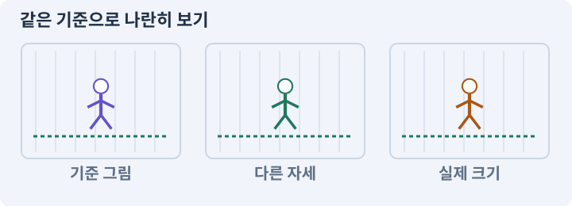

# 005. 말로 스프라이트 하나 만들기

**목표:** 생성한 그림이 씬을 다시 열어도 남습니다.

**시작 상태:** 빈 2D 프로젝트와 Editor 연결

## 한눈에 보는 기능의 흐름

PNG 생성 → Sprite로 가져오기 → 씬과 참조 저장 → 다시 열어 확인



**경계:** 같은 작업을 두 번 해도 DemoSprite는 하나

그림은 실제 게임 실행 결과가 아닙니다. 값·규칙과 예제를 필요한 때 펼쳐 읽고 현재 단계의 메시지를 한 번씩 보냅니다.

## 1. 지금 상태 확인하기

첫 메시지를 보내 현재 준비 상태를 확인합니다. AI가 읽어 온 실제 프로젝트가 맞는지 보고, 없는 준비나 다른 상태가 있으면 먼저 알려 주세요. 아직 기능을 만들지 않는 단계입니다.

### AI에게 보낼 요구와 이유

#### 01. 작업 대상부터 확인

**“말로 스프라이트 하나 만들기” 작업을 시작하기 전에 현재 상태를 읽기 전용으로 확인해 줘.**

왜 이렇게 요청하나요? AI가 다른 프로젝트나 오래된 예제를 보고 작업할 수 있습니다. 실제 경로·파일·현재 기능을 읽게 하면 지금 이어서 작업할 대상을 먼저 맞출 수 있습니다.

#### 02. 작업 대상부터 확인

**필요한 시작 상태는 빈 2D 프로젝트와 Editor 연결야.**

왜 이렇게 요청하나요? AI가 다른 프로젝트나 오래된 예제를 보고 작업할 수 있습니다. 실제 경로·파일·현재 기능을 읽게 하면 지금 이어서 작업할 대상을 먼저 맞출 수 있습니다.

#### 03. 실제 사용 중인 구현 재사용

**실제 프로젝트와 작업 기록을 읽고 이것이 준비되어 있는지, 이미 같은 기능이 있는지 확인해 줘.**

왜 이렇게 요청하나요? 이름이 비슷한 새 클래스를 또 만들면 기존 화면은 여전히 옛 코드를 사용할 수 있습니다. 실제 호출되는 진입점을 찾아 연결해야 두 구현이 충돌하거나 수정이 반영되지 않는 문제를 막습니다.

#### 04. 현재 상태와 다음 확인 지점 구분

**이번 기능이 연결될 실제 파일·화면·도구와 보존할 기존 동작을 짧게 정리해 줘.**

왜 이렇게 요청하나요? 이미 준비된 기능과 아직 확인하지 못한 기능을 섞으면 불필요한 재설치나 성급한 완료 판정이 생깁니다. 현재 대상과 남은 준비를 나눠 가장 작은 다음 작업을 선택하게 합니다.

#### 05. 조사 단계에서 변경하지 않기

**아직 새 구현·설치·유료 호출·파일 변경은 하지 마.**

왜 이렇게 요청하나요? 현재 상태를 알아보기만 할 때 파일 변경이나 결제가 시작되면 검토 전의 환경이 바뀝니다. 준비 확인과 실제 구현을 나눠 되돌리기 어려운 작업이 먼저 실행되지 않게 합니다.

#### 06. 막힌 준비를 먼저 해결

**준비가 다르면 부족한 항목과 다음에 필요한 작업을 알려 줘.**

왜 이렇게 요청하나요? 빠진 파일·권한·패키지를 있다고 가정하면 다음 구현이 엉뚱한 대상을 만들게 됩니다. 무엇이 없고 무엇을 먼저 해야 하는지 분리하면 불필요한 재작업을 줄일 수 있습니다.

<details>
<summary>보낼 원문 전체 — 설명은 복사되지 않습니다</summary>

```text
“말로 스프라이트 하나 만들기” 작업을 시작하기 전에 현재 상태를 읽기 전용으로 확인해 줘.
필요한 시작 상태는 빈 2D 프로젝트와 Editor 연결야. 실제 프로젝트와 작업 기록을 읽고 이것이 준비되어 있는지, 이미 같은 기능이 있는지 확인해 줘.
이번 기능이 연결될 실제 파일·화면·도구와 보존할 기존 동작을 짧게 정리해 줘. 아직 새 구현·설치·유료 호출·파일 변경은 하지 마. 준비가 다르면 부족한 항목과 다음에 필요한 작업을 알려 줘.
```

</details>

**기대 결과:** 새 씬과 생성할 오브젝트 이름

### 직접 확인하기

1. AI가 읽은 실제 프로젝트 또는 도구 경로를 확인합니다.
2. 필수 준비가 없다면 문제 해결 요청을 보내고, 준비됐을 때 다음으로 갑니다.

## 2. 필요한 기능 만들기

준비가 확인되면 아래 요청을 보냅니다. AI가 파일·설정·실행을 맡습니다. 변경 범위나 비용 승인이 나오면 내용을 읽고 결정하세요.

### AI에게 보낼 요구와 이유

#### 01. 스프라이트와 SpriteRenderer의 적용 조건

**AutomationLab2D 라는 작은 씬에 배경과 파란 스프라이트를 만들어 줘.**

왜 이렇게 요청하나요? Sprite는 2D 그림에서 사용할 영역과 기준점을 나타내는 에셋이고, SpriteRenderer는 그것을 게임 세계에 그리는 컴포넌트입니다. PNG 전체와 화면의 캐릭터가 항상 같은 개념은 아닙니다. SpriteRenderer는 이동이나 체력을 자동으로 만들지 않습니다. 그림과 몸체는 분리합니다.

#### 02. 그림 크기와 월드 크기 연결

**64×64 RGBA PNG를 실제 파일로 생성하고 PPU64, 위치 (0,0,0), Scale 1인 DemoSprite에 연결해 줘.**

왜 이렇게 요청하나요? 픽셀 수만 정하면 게임 안에서의 크기는 정해지지 않습니다. PPU와 배율을 함께 고정해야 자산을 바꿔도 캐릭터·바닥·UI의 크기 관계를 비교할 수 있습니다.

#### 03. 앞뒤를 그리는 기준 정하기

**배경은 Ground, 그림은 World 정렬을 사용해 줘.**

왜 이렇게 요청하나요? 2D 그림의 화면상 겹침 순서와 물리 충돌은 별개입니다. 바닥·배우·높은 장식의 정렬 기준을 나눠야 캐릭터가 기둥 앞뒤를 오갈 때 자연스럽게 가려집니다.

#### 04. 렌더러·재질·조명 조합 맞추기

**현재 2D Renderer와 맞는 Sprite Unlit 재질로 시작해 줘.**

왜 이렇게 요청하나요? 현재 렌더러와 다른 재질을 쓰거나 필요한 2D 조명이 없으면 그림이 분홍색·검은색으로 보일 수 있습니다. 자산 생성뿐 아니라 실제 그리는 경로까지 맞추게 하는 조건입니다.

#### 05. 렌더러·재질·조명 조합 맞추기

**Sprite Lit을 선택할 이유가 있다면 Global Light 2D 까지 연결하고 검정·분홍색 오류가 없게 해 줘.**

왜 이렇게 요청하나요? 현재 렌더러와 다른 재질을 쓰거나 필요한 2D 조명이 없으면 그림이 분홍색·검은색으로 보일 수 있습니다. 자산 생성뿐 아니라 실제 그리는 경로까지 맞추게 하는 조건입니다.

#### 06. 보이는 결과를 실제 자산으로 저장

**씬·PNG·재질·참조를 모두 만들고 저장해 줘.**

왜 이렇게 요청하나요? Play 중 생긴 오브젝트나 메모리의 이미지가 디스크에 저장된 자산과 같지는 않습니다. 생성·참조 연결·저장·재개방을 거쳐야 재시작 후에도 결과가 남습니다.

#### 07. 반복해도 같은 결과 유지

**같은 생성 작업을 두 번 수행해도 오브젝트와 자산이 중복되지 않게 해 줘.**

왜 이렇게 요청하나요? AI는 실패 복구 중 같은 생성 작업을 다시 실행할 수 있습니다. 새 오브젝트를 계속 추가하는 대신 자신이 만든 대상만 갱신해야 중복 렌더링·충돌·메모리 증가를 막습니다.

#### 08. 도구의 수정 범위 제한

**관계없는 오브젝트는 지우지 마.**

왜 이렇게 요청하나요? 생성 도구가 편하다는 이유로 씬 전체를 지우면 수동 배치나 다른 기능까지 사라집니다. 해당 도구가 소유한 대상만 갱신해 다른 작업을 보존합니다.

#### 09. 보이는 결과를 실제 자산으로 저장

**Play 화면을 실제로 열고, 종료·저장·씬 재개방 후에도 같은 그림과 참조가 남는지 확인해 줘.**

왜 이렇게 요청하나요? Play 중 생긴 오브젝트나 메모리의 이미지가 디스크에 저장된 자산과 같지는 않습니다. 생성·참조 연결·저장·재개방을 거쳐야 재시작 후에도 결과가 남습니다.

#### 10. 화면과 저장 결과를 다시 확인할 자료로 남기기

**화면 캡처와 저장 결과는 실제 파일로 남겨 줘.**

왜 이렇게 요청하나요? AI의 말로만 결과를 전달하면 실제로 무엇이 생성됐는지 대조하기 어렵습니다. 캡처와 저장 파일의 위치를 남겨 재개방 결과와 비교하고, 캡처가 동작 검사까지 대신하지는 않게 합니다.

#### 11. 구현과 실행은 AI에게 맡기기

**코드·설정·파일 생성·실행은 네가 맡고, 필요한 화면과 결과를 보여 줘.**

왜 이렇게 요청하나요? 설명이나 코드 조각만 받으면 실제 파일 생성·연결·실행이 빠질 수 있습니다. AI가 개발 작업까지 수행하고, 사람은 요구·승인·결과 판단을 맡도록 역할을 분명히 합니다.

#### 12. 막힌 준비를 먼저 해결

**수행하지 못한 작업과 필요한 승인·도구 연결은 구분해서 알려 줘.**

왜 이렇게 요청하나요? 빠진 파일·권한·패키지를 있다고 가정하면 다음 구현이 엉뚱한 대상을 만들게 됩니다. 무엇이 없고 무엇을 먼저 해야 하는지 분리하면 불필요한 재작업을 줄일 수 있습니다.

<details>
<summary>보낼 원문 전체 — 설명은 복사되지 않습니다</summary>

```text
AutomationLab2D 라는 작은 씬에 배경과 파란 스프라이트를 만들어 줘.
64×64 RGBA PNG를 실제 파일로 생성하고 PPU64, 위치 (0,0,0), Scale 1인 DemoSprite에 연결해 줘. 배경은 Ground, 그림은 World 정렬을 사용해 줘.
현재 2D Renderer와 맞는 Sprite Unlit 재질로 시작해 줘. Sprite Lit을 선택할 이유가 있다면 Global Light 2D 까지 연결하고 검정·분홍색 오류가 없게 해 줘.
씬·PNG·재질·참조를 모두 만들고 저장해 줘. 같은 생성 작업을 두 번 수행해도 오브젝트와 자산이 중복되지 않게 해 줘. 관계없는 오브젝트는 지우지 마.
Play 화면을 실제로 열고, 종료·저장·씬 재개방 후에도 같은 그림과 참조가 남는지 확인해 줘. 화면 캡처와 저장 결과는 실제 파일로 남겨 줘.

코드·설정·파일 생성·실행은 네가 맡고, 필요한 화면과 결과를 보여 줘. 수행하지 못한 작업과 필요한 승인·도구 연결은 구분해서 알려 줘.
```

</details>

**기대 결과:** 확인할 결과: 저장·재개방·반복 생성 후 도형이 하나임. AI가 이 상태를 확인할 실제 화면과 변경 내용을 준비합니다. 아직 실행하지 못한 부분은 따로 표시합니다.

### 직접 확인하기

1. 제안서만 반환됐다면 “설명으로 끝내지 말고 승인한 범위의 실제 작업을 수행해 줘”라고 보냅니다.
2. 코드나 설정을 직접 고치라는 안내가 나오면 “작성과 실행은 네가 맡아 줘”라고 요청합니다.

## 3. 결과를 직접 확인하기

먼저 확인 요청을 보내 AI가 검사와 화면을 준비하게 하세요. 그다음 아래 동작을 하나씩 확인합니다.

### AI에게 보낼 요구와 이유

#### 01. 검사할 입력과 관찰 지점 준비

**방금 구현한 기능의 자동 검사와 확인 화면을 준비해 줘.**

왜 이렇게 요청하나요? 정상 예 하나만 보면 실패 조건을 놓치기 쉽습니다. 정상·경계·반례를 실제 입력으로 준비하고 사람이 볼 화면도 맞춰 확인 범위를 분명하게 합니다.

#### 02. 결과를 재확인할 근거 남기기

**정상 동작과 아래 실패 조건을 실제로 검사하고 대상·실행 수·결과를 보여 줘.**

왜 이렇게 요청하나요? “잘 됩니다”라는 요약만으로는 어떤 입력과 버전을 검사했는지 알 수 없습니다. 대상·실행 수·실패 내용·파일을 함께 남겨 같은 조건으로 다시 확인할 수 있게 합니다.

#### 03. 스프라이트와 SpriteRenderer의 적용 조건

**파란 2D 스프라이트가 보인다.**

왜 이렇게 요청하나요? Sprite는 2D 그림에서 사용할 영역과 기준점을 나타내는 에셋이고, SpriteRenderer는 그것을 게임 세계에 그리는 컴포넌트입니다. PNG 전체와 화면의 캐릭터가 항상 같은 개념은 아닙니다. SpriteRenderer는 이동이나 체력을 자동으로 만들지 않습니다. 그림과 몸체는 분리합니다.

#### 04. 렌더러·재질·조명 조합 맞추기

**검정·분홍색 재질 오류가 없다.**

왜 이렇게 요청하나요? 현재 렌더러와 다른 재질을 쓰거나 필요한 2D 조명이 없으면 그림이 분홍색·검은색으로 보일 수 있습니다. 자산 생성뿐 아니라 실제 그리는 경로까지 맞추게 하는 조건입니다.

#### 05. 보이는 결과를 실제 자산으로 저장

**PNG가 실제 파일이며 다시 열어도 Sprite 참조가 유지된다.**

왜 이렇게 요청하나요? Play 중 생긴 오브젝트나 메모리의 이미지가 디스크에 저장된 자산과 같지는 않습니다. 생성·참조 연결·저장·재개방을 거쳐야 재시작 후에도 결과가 남습니다.

#### 06. 반복해도 같은 결과 유지

**두 번째 생성 뒤 DemoSprite는 하나다.**

왜 이렇게 요청하나요? AI는 실패 복구 중 같은 생성 작업을 다시 실행할 수 있습니다. 새 오브젝트를 계속 추가하는 대신 자신이 만든 대상만 갱신해야 중복 렌더링·충돌·메모리 증가를 막습니다.

#### 07. 사람 검사의 시작점 준비

**내가 조작해야 하는 부분은 실행할 화면과 시작 상태를 준비해 줘.**

왜 이렇게 요청하나요? 같은 기능이라도 시작 상태가 다르면 관찰 결과가 달라집니다. AI가 실행 화면과 재현 위치를 먼저 준비해야 사람이 이동·공격·소리·조작감을 같은 조건에서 확인할 수 있습니다.

#### 08. 사람이 실제로 본 것만 기록

**연결되지 않은 휴대폰의 터치나 사람이 보지 않은 재미·소리 품질을 대신 확인했다고 하지 마.**

왜 이렇게 요청하나요? AI가 준비한 검사와 사람이 직접 플레이하거나 들은 결과는 다른 근거입니다. 관찰하지 않은 조작감·소리·실기기 결과를 임의로 완료 처리하지 않게 합니다.

#### 09. 실제로 실행한 검사만 인정

**테스트 0개와 예전 소스 결과는 현재 성공으로 쓰지 마.**

왜 이렇게 요청하나요? 실행된 검사가 없거나 같은 결과를 중복 집계한 경우는 기능을 확인한 것이 아닙니다. 실행 수와 개별 결과를 함께 확인해야 형식적인 성공 표시를 걸러낼 수 있습니다.

<details>
<summary>보낼 원문 전체 — 설명은 복사되지 않습니다</summary>

```text
방금 구현한 기능의 자동 검사와 확인 화면을 준비해 줘. 정상 동작과 아래 실패 조건을 실제로 검사하고 대상·실행 수·결과를 보여 줘.

파란 2D 스프라이트가 보인다. 검정·분홍색 재질 오류가 없다. PNG가 실제 파일이며 다시 열어도 Sprite 참조가 유지된다. 두 번째 생성 뒤 DemoSprite는 하나다.

내가 조작해야 하는 부분은 실행할 화면과 시작 상태를 준비해 줘. 연결되지 않은 휴대폰의 터치나 사람이 보지 않은 재미·소리 품질을 대신 확인했다고 하지 마. 테스트 0개와 예전 소스 결과는 현재 성공으로 쓰지 마.
```

</details>

**기대 결과:** 스프라이트는 여전히 하나이고 위치·재질이 유지됩니다. 도구 밖의 이름표도 남습니다.

### 직접 확인하기

1. Game 화면에서 파란 도형을 찾습니다.
2. AI에게 씬을 저장한 뒤 다른 씬으로 갔다 다시 열어 달라고 합니다.
3. 같은 생성 작업을 두 번 실행해도 도형이 하나인지 봅니다.

## 4. 결과를 남기고 마무리하기

실제로 본 결과를 아래 메모에 적고 AI에 전달합니다. 결과 저장 요청으로 현재 상태를 남긴 뒤 다음 페이지로 갑니다.

### AI에게 보낼 요구와 이유

#### 01. 결과를 재확인할 근거 남기기

**지금 작업한 “말로 스프라이트 하나 만들기”의 실제 결과를 정리해 줘.**

왜 이렇게 요청하나요? “잘 됩니다”라는 요약만으로는 어떤 입력과 버전을 검사했는지 알 수 없습니다. 대상·실행 수·실패 내용·파일을 함께 남겨 같은 조건으로 다시 확인할 수 있게 합니다.

#### 02. 다음 작업이 읽을 인수인계

**변경한 기능·파일·현재 후보와 실제 실행한 검사, 남은 문제를 기능 이름으로 기록해 줘.**

왜 이렇게 요청하나요? 새 AI 세션은 이전 대화 전체를 알고 있다고 보장할 수 없습니다. 현재 후보·파일 위치·실행한 검사·남은 일을 남겨야 같은 작업을 반복하지 않고 이어갈 수 있습니다.

#### 03. 사람이 실제로 본 것만 기록

**자동 검사 결과와 내가 직접 확인한 결과를 구분하고, 내 관찰이 아직 없으면 미확인으로 남겨 줘.**

왜 이렇게 요청하나요? AI가 준비한 검사와 사람이 직접 플레이하거나 들은 결과는 다른 근거입니다. 관찰하지 않은 조작감·소리·실기기 결과를 임의로 완료 처리하지 않게 합니다.

#### 04. 다음 작업이 읽을 인수인계

**재시작하거나 다음 작업에서 읽을 기록의 실제 위치를 알려 줘.**

왜 이렇게 요청하나요? 새 AI 세션은 이전 대화 전체를 알고 있다고 보장할 수 없습니다. 현재 후보·파일 위치·실행한 검사·남은 일을 남겨야 같은 작업을 반복하지 않고 이어갈 수 있습니다.

#### 05. 미확인을 완료와 분리

**아직 확인하지 않은 결과를 완료로 채우지 마.**

왜 이렇게 요청하나요? 만들어진 것, 검사에 실패한 것, 아직 확인하지 못한 것을 나눠야 다음 작업을 정확히 고를 수 있습니다. 실행할 조건이 없는 기능을 성공으로 기록하면 뒤에서 원인을 찾기 어려워집니다.

<details>
<summary>보낼 원문 전체 — 설명은 복사되지 않습니다</summary>

```text
지금 작업한 “말로 스프라이트 하나 만들기”의 실제 결과를 정리해 줘. 변경한 기능·파일·현재 후보와 실제 실행한 검사, 남은 문제를 기능 이름으로 기록해 줘.
자동 검사 결과와 내가 직접 확인한 결과를 구분하고, 내 관찰이 아직 없으면 미확인으로 남겨 줘. 재시작하거나 다음 작업에서 읽을 기록의 실제 위치를 알려 줘. 아직 확인하지 않은 결과를 완료로 채우지 마.
```

</details>

**기대 결과:** 현재 상태·검사 결과·남은 문제·다음에 읽을 기록을 확인할 수 있습니다.

### 직접 확인하기

1. 자동 검사와 내 관찰 결과가 섞이지 않았는지 봅니다.
2. 문제가 남았다면 해결 요청을 보내고 같은 동작을 다시 확인합니다.

## 구체적인 예로 이해하기

### 한 번 만든 스프라이트를 다시 만들면

자동화 도구는 재실행을 전제로 만듭니다. 같은 요청은 도구가 소유한 대상을 갱신하고 관계없는 오브젝트는 보존해야 합니다.

**시작 상태:** 실습장에는 도구가 만든 스프라이트 하나와 수동 관찰용 이름표가 있습니다.

**직접 해 볼 동작:** 같은 생성 요청을 다시 보내고 씬을 저장한 뒤 닫았다 열어 달라고 합니다.

**보여야 하는 결과:** 스프라이트는 여전히 하나이고 위치·재질이 유지됩니다. 도구 밖의 이름표도 남습니다.

**이렇게 되면 아직 안 됩니다:** 중복을 숨기려고 씬의 모든 오브젝트를 삭제하고 새로 만듭니다.

**생각해 보기:** 최종 화면이 똑같으면 전체 삭제 후 재생성도 합격일까요?

<details><summary>해설 보기</summary>

아닙니다. 결과 모양뿐 아니라 소유 범위와 기존 데이터 보존도 요구사항입니다.

</details>

## 이 작업에서 사용할 값과 규칙 전체

설계 시작값이며 측정된 성능·게임 성공 결과가 아닙니다. 구현은 AI가 수행합니다.

`AutomationLab2D`에 배경과 파란 정사각형 스프라이트를 놓는다. PNG는 64×64, RGBA, PPU64다. DemoSprite의 월드 위치는 (0,0,0), Scale은1이다. 배경은 Sorting Layer Ground, 캐릭터 그림은 World를 사용한다.

초기 재질은 현재 2D Renderer와 호환되는 Sprite Unlit 계열로 한다. 조명에 반응하는 Sprite Lit 경로를 선택했다면 Global Light 2D를 연결한다. Directional Light를 추가해 검은 Sprite Lit 문제를 덮지 않는다. [D03][D07]

## 문제가 있으면

### AI에게 보낼 요구와 이유

#### 01. 보이는 결과를 실제 자산으로 저장

**Play 중 임시로 만든 오브젝트인지 확인해 줘.**

왜 이렇게 요청하나요? Play 중 생긴 오브젝트나 메모리의 이미지가 디스크에 저장된 자산과 같지는 않습니다. 생성·참조 연결·저장·재개방을 거쳐야 재시작 후에도 결과가 남습니다.

#### 02. 보이는 결과를 실제 자산으로 저장

**Editor API 로 저장 가능한 씬을 구성하고 다시 열어 확인해 줘.**

왜 이렇게 요청하나요? Play 중 생긴 오브젝트나 메모리의 이미지가 디스크에 저장된 자산과 같지는 않습니다. 생성·참조 연결·저장·재개방을 거쳐야 재시작 후에도 결과가 남습니다.

#### 03. 원인 하나를 좁혀 수정

**새 기능을 추가하지 말고 현재 오류와 실제 로그를 먼저 읽어 줘.**

왜 이렇게 요청하나요? 오류 수정 중 새 기능까지 넣으면 어떤 변경이 문제를 해결하거나 악화했는지 알기 어렵습니다. 원래 재현을 보존하고 작은 변경 뒤 같은 입력과 주변 정상 동작을 다시 확인합니다.

#### 04. 원인 하나를 좁혀 수정

**최소 수정 뒤 같은 재현과 관련 정상 동작을 다시 검사해 줘.**

왜 이렇게 요청하나요? 오류 수정 중 새 기능까지 넣으면 어떤 변경이 문제를 해결하거나 악화했는지 알기 어렵습니다. 원래 재현을 보존하고 작은 변경 뒤 같은 입력과 주변 정상 동작을 다시 확인합니다.

#### 05. 실패도 재현 자료로 보존

**실패 기록은 지우지 마.**

왜 이렇게 요청하나요? 실패한 입력과 로그가 있어야 같은 문제가 다시 생겼을 때 비교할 수 있습니다. 성공 기록으로 덮어쓰지 않고 전후 자료를 남기면 무엇을 고쳤는지 확인할 수 있습니다.

<details>
<summary>보낼 원문 전체 — 설명은 복사되지 않습니다</summary>

```text
Play 중 임시로 만든 오브젝트인지 확인해 줘. Editor API 로 저장 가능한 씬을 구성하고 다시 열어 확인해 줘.
새 기능을 추가하지 말고 현재 오류와 실제 로그를 먼저 읽어 줘. 최소 수정 뒤 같은 재현과 관련 정상 동작을 다시 검사해 줘. 실패 기록은 지우지 마.
```

</details>

## 새 세션에서 이어가기

### AI에게 보낼 요구와 이유

#### 01. 이어서 할 작업 식별

**“말로 스프라이트 하나 만들기” 작업을 이어가고 싶어.**

왜 이렇게 요청하나요? 이름으로 재개할 작업을 찾고, 뒤에 이어지는 요청으로 실제 파일·진행 중 작업·기록을 다시 읽게 합니다. 제목만 보고 이전 상태를 기억한다고 가정하지 않습니다.

#### 02. 조회는 상태를 바꾸지 않게

**실제 프로젝트와 내 도구의 작업 기록을 읽고 어디까지 구현·검사됐는지 확인해 줘.**

왜 이렇게 요청하나요? 진행 상황을 물을 때 새 구현이나 유료 호출이 시작되면 단순 확인이 실행 명령이 되어 버립니다. 저장된 근거를 읽어 완료·진행·승인 대기·미검증을 나누게 합니다.

#### 03. 재개 전 중복 작업 방지

**진행 중인 프로세스·승인·미저장 변경을 확인한 뒤 남은 가장 작은 작업부터 안내해 줘.**

왜 이렇게 요청하나요? 대화가 끊겨도 외부 작업은 끝났거나 아직 실행 중일 수 있습니다. 프로세스·승인·미저장 상태를 먼저 읽어 같은 생성·빌드·결제를 두 번 시작하지 않도록 합니다.

#### 04. 되돌아갈 원본 남기기

**기존 성공과 실패 기록은 보존해 줘.**

왜 이렇게 요청하나요? 새 구현이 실패해도 이전 게임과 저장을 복원할 수 있어야 합니다. 현재 내용을 먼저 조사하고 별도 후보에서 작업하면 실험이 유일한 정상본을 망가뜨리는 일을 피할 수 있습니다.

<details>
<summary>보낼 원문 전체 — 설명은 복사되지 않습니다</summary>

```text
“말로 스프라이트 하나 만들기” 작업을 이어가고 싶어. 실제 프로젝트와 내 도구의 작업 기록을 읽고 어디까지 구현·검사됐는지 확인해 줘. 진행 중인 프로세스·승인·미저장 변경을 확인한 뒤 남은 가장 작은 작업부터 안내해 줘. 기존 성공과 실패 기록은 보존해 줘.
```

</details>

## 왜 이렇게 만드는가

이미지가 화면에 보이는 것과 에셋·씬이 디스크에 저장된 것은 다르다. Play 중 잠깐 생성한 그림은 Play를 끝내면 사라질 수 있다. 이번 실습은 생성·가져오기·연결·저장·재개방을 모두 확인한다.

PNG 파일을 만들기만 해서는 Unity의 Sprite가 되지 않을 수 있다. Texture Type, Pixels Per Unit(PPU), Pivot, Filtering을 확인한다. PPU는 그림 몇 픽셀이 월드 한 단위인지 정한다. 64픽셀 그림을 PPU64로 읽으면 가로 1유닛이다. [D01]

## 공식 참고

- [Unity 2D game creation workflow](https://docs.unity3d.com/6000.3/Documentation/Manual/2d-game-creation-wokflow.html)
- [URP 2D Renderer Data](https://docs.unity3d.com/6000.3/Documentation/Manual/urp/2DRendererData-overview.html)
- [URP 2D lights](https://docs.unity3d.com/6000.3/Documentation/Manual/urp/Lights-2D-intro.html)


## 실제 Unity Editor 화면 참고
공식 예시와 내 프로젝트 실행 결과를 구분하세요. 원본 사진은 온라인 연결이 필요합니다.

- [Editor 전체 배치 — 어디를 보고 있는지 구분하기](../editor_references/editor-layout.md)
- [Sprite Editor — 그림 경계·테두리·기준점 구분하기](../editor_references/sprite-editor.md)
