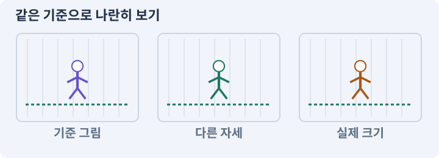

# 007. 캐릭터와 벽이 있는 공간 만들기

**목표:** 캐릭터의 발·몸체·바닥이 같은 위치에 놓입니다.

**시작 상태:** 메뉴와 TestArena

## 한눈에 보는 기능의 흐름

발 기준점 → 몸체 경계 → 바닥 위치 → 앞뒤 정렬



**경계:** 큰 그림과 실제 충돌 경계를 구분하기

그림은 실제 게임 실행 결과가 아닙니다. 값·규칙과 예제를 필요한 때 펼쳐 읽고 현재 단계의 메시지를 한 번씩 보냅니다.

## 1. 지금 상태 확인하기

첫 메시지를 보내 현재 준비 상태를 확인합니다. AI가 읽어 온 실제 프로젝트가 맞는지 보고, 없는 준비나 다른 상태가 있으면 먼저 알려 주세요. 아직 기능을 만들지 않는 단계입니다.

### AI에게 보낼 요구와 이유

#### 01. 작업 대상부터 확인

**“캐릭터와 벽이 있는 공간 만들기” 작업을 시작하기 전에 현재 상태를 읽기 전용으로 확인해 줘.**

왜 이렇게 요청하나요? AI가 다른 프로젝트나 오래된 예제를 보고 작업할 수 있습니다. 실제 경로·파일·현재 기능을 읽게 하면 지금 이어서 작업할 대상을 먼저 맞출 수 있습니다.

#### 02. 작업 대상부터 확인

**필요한 시작 상태는 메뉴와 TestArena야.**

왜 이렇게 요청하나요? AI가 다른 프로젝트나 오래된 예제를 보고 작업할 수 있습니다. 실제 경로·파일·현재 기능을 읽게 하면 지금 이어서 작업할 대상을 먼저 맞출 수 있습니다.

#### 03. 실제 사용 중인 구현 재사용

**실제 프로젝트와 작업 기록을 읽고 이것이 준비되어 있는지, 이미 같은 기능이 있는지 확인해 줘.**

왜 이렇게 요청하나요? 이름이 비슷한 새 클래스를 또 만들면 기존 화면은 여전히 옛 코드를 사용할 수 있습니다. 실제 호출되는 진입점을 찾아 연결해야 두 구현이 충돌하거나 수정이 반영되지 않는 문제를 막습니다.

#### 04. 현재 상태와 다음 확인 지점 구분

**이번 기능이 연결될 실제 파일·화면·도구와 보존할 기존 동작을 짧게 정리해 줘.**

왜 이렇게 요청하나요? 이미 준비된 기능과 아직 확인하지 못한 기능을 섞으면 불필요한 재설치나 성급한 완료 판정이 생깁니다. 현재 대상과 남은 준비를 나눠 가장 작은 다음 작업을 선택하게 합니다.

#### 05. 조사 단계에서 변경하지 않기

**아직 새 구현·설치·유료 호출·파일 변경은 하지 마.**

왜 이렇게 요청하나요? 현재 상태를 알아보기만 할 때 파일 변경이나 결제가 시작되면 검토 전의 환경이 바뀝니다. 준비 확인과 실제 구현을 나눠 되돌리기 어려운 작업이 먼저 실행되지 않게 합니다.

#### 06. 막힌 준비를 먼저 해결

**준비가 다르면 부족한 항목과 다음에 필요한 작업을 알려 줘.**

왜 이렇게 요청하나요? 빠진 파일·권한·패키지를 있다고 가정하면 다음 구현이 엉뚱한 대상을 만들게 됩니다. 무엇이 없고 무엇을 먼저 해야 하는지 분리하면 불필요한 재작업을 줄일 수 있습니다.

<details>
<summary>보낼 원문 전체 — 설명은 복사되지 않습니다</summary>

```text
“캐릭터와 벽이 있는 공간 만들기” 작업을 시작하기 전에 현재 상태를 읽기 전용으로 확인해 줘.
필요한 시작 상태는 메뉴와 TestArena야. 실제 프로젝트와 작업 기록을 읽고 이것이 준비되어 있는지, 이미 같은 기능이 있는지 확인해 줘.
이번 기능이 연결될 실제 파일·화면·도구와 보존할 기존 동작을 짧게 정리해 줘. 아직 새 구현·설치·유료 호출·파일 변경은 하지 마. 준비가 다르면 부족한 항목과 다음에 필요한 작업을 알려 줘.
```

</details>

**기대 결과:** 우회할 수 있는 벽과 발 기준점이 있는 배치

### 직접 확인하기

1. AI가 읽은 실제 프로젝트 또는 도구 경로를 확인합니다.
2. 필수 준비가 없다면 문제 해결 요청을 보내고, 준비됐을 때 다음으로 갑니다.

## 2. 필요한 기능 만들기

준비가 확인되면 아래 요청을 보냅니다. AI가 파일·설정·실행을 맡습니다. 변경 범위나 비용 승인이 나오면 내용을 읽고 결정하세요.

### AI에게 보낼 요구와 이유

#### 01. 작업 대상부터 확인

**현재 프로젝트의 실제 파일과 이미 결정한 규칙을 먼저 확인해 줘.**

왜 이렇게 요청하나요? AI가 다른 프로젝트나 오래된 예제를 보고 작업할 수 있습니다. 실제 경로·파일·현재 기능을 읽게 하면 지금 이어서 작업할 대상을 먼저 맞출 수 있습니다.

#### 02. 실제 사용 중인 코드에 연결

**이름이 다른 기존 구현이 있으면 새로 중복 제작하지 말고 그 구현에 연결해 줘.**

왜 이렇게 요청하나요? 예제와 이름이 다르더라도 현재 씬과 입력에서 호출하는 구현이 작업 대상입니다. 같은 기능을 새로 만들기보다 기존 진입점을 확인해 수정이 실제 게임에 반영되고 중복 실행되지 않게 합니다.

#### 03. 좌표계 혼동 방지

**TestArena를 XY24×24,cellSize1의 실제 2D 테스트 공간으로 구성해 줘.**

왜 이렇게 요청하나요? 2D의 XY와 3D의 XZ는 같은 이동 의미라도 축 배치가 다릅니다. 변환 위치를 한 곳으로 모아야 지도·물리·카메라가 서로 다른 축을 높이나 전진 방향으로 해석하지 않습니다.

#### 04. 미확인을 완료와 분리

**Floor는 collider 없는 Tilemap, 벽은 blocked 셀에서 생성한 Collider2D로 만들어 줘.**

왜 이렇게 요청하나요? 만들어진 것, 검사에 실패한 것, 아직 확인하지 못한 것을 나눠야 다음 작업을 정확히 고를 수 있습니다. 실행할 조건이 없는 기능을 성공으로 기록하면 뒤에서 원인을 찾기 어려워집니다.

#### 05. 스폰·디스폰·안전한 배치의 적용 조건

**통로 폭2 이상과 SpawnPoint를 마련하고 Floor/WallArt/Decor를 분리해 줘.**

왜 이렇게 요청하나요? 스폰은 게임 세계에 캐릭터·적·아이템을 생성하거나 활성화해 배치하는 일입니다. 안전한 스폰은 지면·충돌·다른 객체·접근 가능성까지 확인합니다. Instantiate 호출이 성공했다고 플레이 가능한 배치가 된 것은 아닙니다.

#### 06. 프레임의 기준점 통일

**Player2D는 발 위치 ActorRoot, Kinematic Rigidbody2D, 반경0.35 CircleCollider2D,**

왜 이렇게 요청하나요? 걷기·공격 그림의 몸통 크기가 달라도 발은 같은 위치에 있어야 합니다. 기준점이 다르면 몸체는 정지해 있는데 그림만 튀거나 바닥을 미끄러지는 것처럼 보입니다.

#### 07. 프레임의 기준점 통일

**자식 VisualRoot와 발Pivot 스프라이트로 구성해 줘.**

왜 이렇게 요청하나요? 걷기·공격 그림의 몸통 크기가 달라도 발은 같은 위치에 있어야 합니다. 기준점이 다르면 몸체는 정지해 있는데 그림만 튀거나 바닥을 미끄러지는 것처럼 보입니다.

#### 08. 외형과 충돌 규칙 분리

**그림 크기를 몸체로 자동 적용하지 마.**

왜 이렇게 요청하나요? 그림이나 모델을 교체하는 작업이 몸체 크기나 통과 가능한 길까지 바꾸면 아트 수정이 게임 규칙 변경이 됩니다. 표시용 자산과 충돌·사거리 데이터를 따로 유지합니다.

#### 09. 좌표계 혼동 방지

**카메라는 (player.x,player.y,-10), 회전0,Orthographic size8이며 XY만 추적해 줘.**

왜 이렇게 요청하나요? 2D의 XY와 3D의 XZ는 같은 이동 의미라도 축 배치가 다릅니다. 변환 위치를 한 곳으로 모아야 지도·물리·카메라가 서로 다른 축을 높이나 전진 방향으로 해석하지 않습니다.

#### 10. 앞뒤를 그리는 기준 정하기

**Ground/Telegraph/World/Overlay 정렬층과 Environment/Player/Enemy/Interactable 물리층을 별도로 문서화해 줘.**

왜 이렇게 요청하나요? 2D 그림의 화면상 겹침 순서와 물리 충돌은 별개입니다. 바닥·배우·높은 장식의 정렬 기준을 나눠야 캐릭터가 기둥 앞뒤를 오갈 때 자연스럽게 가려집니다.

#### 11. 앞뒤를 그리는 기준 정하기

**배우와 큰 장식의 공통 발Y 정렬 함수를 만들고 앞뒤 검사 위치를 준비해 줘.**

왜 이렇게 요청하나요? 2D 그림의 화면상 겹침 순서와 물리 충돌은 별개입니다. 바닥·배우·높은 장식의 정렬 기준을 나눠야 캐릭터가 기둥 앞뒤를 오갈 때 자연스럽게 가려집니다.

#### 12. 시점과 화면 크기 기준 고정

**3D Rigidbody,CharacterController,NavMeshAgent, 원근 카메라는 추가하지 마.**

왜 이렇게 요청하나요? 카메라 방식이 바뀌면 같은 물체도 화면에서 보이는 크기와 겹침이 달라집니다. 시점을 먼저 정해 캐릭터 크기·선택·위험 표시를 같은 조건으로 맞춥니다.

#### 13. 스크립트와 실제 씬 연결

**씬·프리팹을 저장하고 실제 세 화면 비율과 Collider2D 배치를 확인해 줘.**

왜 이렇게 요청하나요? 코드 파일을 만들어도 씬의 오브젝트에 붙지 않거나 참조가 비어 있으면 플레이에 반영되지 않습니다. 실제 사용하는 프리팹과 컴포넌트까지 연결해 동작을 확인하게 합니다.

#### 14. 아래 항목을 완료 조건으로 사용

**적용할 세부 규칙:**

왜 이렇게 요청하나요? 요구사항의 목록은 AI에게 참고 설명을 주는 것이 아니라 완료를 판단할 기준을 정합니다. 구현 뒤 각 항목을 실제 입력과 결과에 대응시켜 빠진 조건을 찾습니다.

#### 15. 좌표계 혼동 방지

**테스트 공간은 XY 24×24유닛, 셀 크기1이다.**

왜 이렇게 요청하나요? 2D의 XY와 3D의 XZ는 같은 이동 의미라도 축 배치가 다릅니다. 변환 위치를 한 곳으로 모아야 지도·물리·카메라가 서로 다른 축을 높이나 전진 방향으로 해석하지 않습니다.

#### 16. Tilemap Collider·Composite Collider의 적용 조건

**Floor·WallsCollision·WallArt·Decor의 Tilemap 또는 스프라이트 층을 구분한다.**

왜 이렇게 요청하나요? Tilemap Collider 2D는 타일의 충돌 모양을 만들고, Composite Collider 2D는 여러 모양을 결합하는 데 사용합니다. 타일 변경과 충돌 갱신 완료 시점도 고려해야 합니다. Composite를 추가했다고 모든 타일 경계 문제가 사라지지는 않습니다. 모양·Rigidbody2D·조합 설정을 확인합니다.

#### 17. Collider와 몸체 경계의 적용 조건

**Floor는 Collider가 없다.**

왜 이렇게 요청하나요? Collider는 물리 검사에 사용하는 경계입니다. 보이는 그림과 같을 필요는 없습니다. 탑다운 캐릭터는 보통 발 주변에 작은 몸체 경계를 둡니다. 스프라이트를 크게 바꿨다고 몸체·사거리도 자동으로 키우지 않습니다.

#### 18. Tilemap Collider·Composite Collider의 적용 조건

**WallsCollision은 벽의 실제 막힌 셀만 담는다.**

왜 이렇게 요청하나요? Tilemap Collider 2D는 타일의 충돌 모양을 만들고, Composite Collider 2D는 여러 모양을 결합하는 데 사용합니다. 타일 변경과 충돌 갱신 완료 시점도 고려해야 합니다. Composite를 추가했다고 모든 타일 경계 문제가 사라지지는 않습니다. 모양·Rigidbody2D·조합 설정을 확인합니다.

#### 19. ActorRoot·VisualRoot·ModelRoot의 적용 조건

**• 플레이어 구성: ActorRoot / 초기 설정: (0,0,0), 회전 고정, 논리 이동 위치**

왜 이렇게 요청하나요? 이 이름들은 프로젝트에서 몸체·게임 규칙과 외형을 분리하기 위해 정한 오브젝트 이름입니다. ActorRoot는 실제 위치·생명·이동의 기준, VisualRoot나 ModelRoot는 그림·모델을 담는 하위 객체로 사용합니다. Root라는 이름만 붙인다고 이런 분리가 자동으로 생기지는 않습니다. 실제 컴포넌트와 호출 관계가 중요합니다.

#### 20. 시간·방향과 물리 이동 일치

**• 플레이어 구성: Body / 초기 설정: Kinematic Rigidbody2D + CircleCollider2D, 반경0.35**

왜 이렇게 요청하나요? 입력 방향의 길이와 프레임 간격을 그대로 이동량에 섞으면 대각선이나 기기 속도에 따라 이동이 달라집니다. 정해진 속도·시간 기준과 물리 이동 경로를 사용해 비교 가능한 움직임을 만듭니다.

#### 21. 프레임의 기준점 통일

**• 플레이어 구성: VisualRoot / 초기 설정: 임시 스프라이트, 발 Pivot, 그림 키 약1.8유닛**

왜 이렇게 요청하나요? 걷기·공격 그림의 몸통 크기가 달라도 발은 같은 위치에 있어야 합니다. 기준점이 다르면 몸체는 정지해 있는데 그림만 튀거나 바닥을 미끄러지는 것처럼 보입니다.

#### 22. 벡터·방향·정규화의 적용 조건

**• 플레이어 구성: Facing / 초기 설정: 마지막 유효 이동/공격 방향 Vector2, 초기 아래**

왜 이렇게 요청하나요? 벡터는 방향과 크기를 함께 나타내는 값입니다. 위치 두 개의 차이는 목표로 향하는 벡터이며, 정규화는 방향을 유지하면서 길이를 1로 만드는 과정입니다. 0 벡터는 방향이 없습니다. 멈췄을 때 마지막 바라보는 방향을 별도로 보존할 수 있습니다.

#### 23. 시점과 화면 크기 기준 고정

**• 플레이어 구성: 카메라 / 초기 설정: (0,0,-10), 회전0, Orthographic size8**

왜 이렇게 요청하나요? 카메라 방식이 바뀌면 같은 물체도 화면에서 보이는 크기와 겹침이 달라집니다. 시점을 먼저 정해 캐릭터 크기·선택·위험 표시를 같은 조건으로 맞춥니다.

#### 24. 그림 크기와 월드 크기 연결

**처음 그림은 64×64를 PPU32로 표시해도 된다.**

왜 이렇게 요청하나요? 픽셀 수만 정하면 게임 안에서의 크기는 정해지지 않습니다. PPU와 배율을 함께 고정해야 자산을 바꿔도 캐릭터·바닥·UI의 크기 관계를 비교할 수 있습니다.

#### 25. 외형과 충돌 규칙 분리

**최종 아트64픽셀 규격과 몸체 크기를 혼동하지 않는다.**

왜 이렇게 요청하나요? 그림이나 모델을 교체하는 작업이 몸체 크기나 통과 가능한 길까지 바꾸면 아트 수정이 게임 규칙 변경이 됩니다. 표시용 자산과 충돌·사거리 데이터를 따로 유지합니다.

#### 26. 그림 크기와 월드 크기 연결

**타일은64픽셀·PPU64로 1셀이다.**

왜 이렇게 요청하나요? 픽셀 수만 정하면 게임 안에서의 크기는 정해지지 않습니다. PPU와 배율을 함께 고정해야 자산을 바꿔도 캐릭터·바닥·UI의 크기 관계를 비교할 수 있습니다.

#### 27. 그림 크기와 월드 크기 연결

**그림의 PPU를 바꿀 때 실제 화면 키를 검수한다.**

왜 이렇게 요청하나요? 픽셀 수만 정하면 게임 안에서의 크기는 정해지지 않습니다. PPU와 배율을 함께 고정해야 자산을 바꿔도 캐릭터·바닥·UI의 크기 관계를 비교할 수 있습니다.

#### 28. 좌표계 혼동 방지

**카메라는 LateUpdate에서 XY만 따라간다.**

왜 이렇게 요청하나요? 2D의 XY와 3D의 XZ는 같은 이동 의미라도 축 배치가 다릅니다. 변환 위치를 한 곳으로 모아야 지도·물리·카메라가 서로 다른 축을 높이나 전진 방향으로 해석하지 않습니다.

#### 29. 기존 결과를 보호

**Z=-10을 유지하고 Root 회전이나 바닥 기울기를 만들지 않는다.**

왜 이렇게 요청하나요? 새 작업이 이미 정상인 기능이나 자산까지 바꾸면 원인을 추적하기 어렵습니다. 유지할 대상을 명시해 변경 전후를 비교하고 원치 않은 영향을 찾습니다.

#### 30. 앞뒤를 그리는 기준 정하기

**World 정렬은 sortingOrder = -round(footY * 100)처럼 공통 함수를 사용하고 같은 위치의 안정된 우선순위를 추가한다.**

왜 이렇게 요청하나요? 2D 그림의 화면상 겹침 순서와 물리 충돌은 별개입니다. 바닥·배우·높은 장식의 정렬 기준을 나눠야 캐릭터가 기둥 앞뒤를 오갈 때 자연스럽게 가려집니다.

#### 31. 관찰 가능한 기준으로 확인

**테스트 월드 좌표 범위를 제한해 정렬 정수 범위를 넘지 않게 한다.**

왜 이렇게 요청하나요? 구현 완료라는 설명을 실제 결과로 바꾸기 위한 조건입니다. 요청에 나온 대상과 경계 상황을 확인해 정상 결과뿐 아니라 실패를 어떻게 구분했는지도 남깁니다.

#### 32. 구현과 실행은 AI에게 맡기기

**코드·설정·파일 생성·실행은 네가 맡고, 필요한 화면과 결과를 보여 줘.**

왜 이렇게 요청하나요? 설명이나 코드 조각만 받으면 실제 파일 생성·연결·실행이 빠질 수 있습니다. AI가 개발 작업까지 수행하고, 사람은 요구·승인·결과 판단을 맡도록 역할을 분명히 합니다.

#### 33. 막힌 준비를 먼저 해결

**수행하지 못한 작업과 필요한 승인·도구 연결은 구분해서 알려 줘.**

왜 이렇게 요청하나요? 빠진 파일·권한·패키지를 있다고 가정하면 다음 구현이 엉뚱한 대상을 만들게 됩니다. 무엇이 없고 무엇을 먼저 해야 하는지 분리하면 불필요한 재작업을 줄일 수 있습니다.

<details>
<summary>보낼 원문 전체 — 설명은 복사되지 않습니다</summary>

```text
현재 프로젝트의 실제 파일과 이미 결정한 규칙을 먼저 확인해 줘. 이름이 다른 기존 구현이 있으면 새로 중복 제작하지 말고 그 구현에 연결해 줘.

TestArena를 XY24×24,cellSize1의 실제 2D 테스트 공간으로 구성해 줘.
Floor는 collider 없는 Tilemap, 벽은 blocked 셀에서 생성한 Collider2D로 만들어 줘.
통로 폭2 이상과 SpawnPoint를 마련하고 Floor/WallArt/Decor를 분리해 줘.
Player2D는 발 위치 ActorRoot, Kinematic Rigidbody2D, 반경0.35 CircleCollider2D,
자식 VisualRoot와 발Pivot 스프라이트로 구성해 줘. 그림 크기를 몸체로 자동 적용하지 마.
카메라는 (player.x,player.y,-10), 회전0,Orthographic size8이며 XY만 추적해 줘.
Ground/Telegraph/World/Overlay 정렬층과 Environment/Player/Enemy/Interactable 물리층을 별도로 문서화해 줘.
배우와 큰 장식의 공통 발Y 정렬 함수를 만들고 앞뒤 검사 위치를 준비해 줘.
3D Rigidbody,CharacterController,NavMeshAgent, 원근 카메라는 추가하지 마.
씬·프리팹을 저장하고 실제 세 화면 비율과 Collider2D 배치를 확인해 줘.

적용할 세부 규칙:
테스트 공간은 XY 24×24유닛, 셀 크기1이다. Floor·WallsCollision·WallArt·Decor의 Tilemap 또는 스프라이트 층을 구분한다. Floor는 Collider가 없다. WallsCollision은 벽의 실제 막힌 셀만 담는다.

• 플레이어 구성: ActorRoot / 초기 설정: (0,0,0), 회전 고정, 논리 이동 위치
• 플레이어 구성: Body / 초기 설정: Kinematic Rigidbody2D + CircleCollider2D, 반경0.35
• 플레이어 구성: VisualRoot / 초기 설정: 임시 스프라이트, 발 Pivot, 그림 키 약1.8유닛
• 플레이어 구성: Facing / 초기 설정: 마지막 유효 이동/공격 방향 Vector2, 초기 아래
• 플레이어 구성: 카메라 / 초기 설정: (0,0,-10), 회전0, Orthographic size8

처음 그림은 64×64를 PPU32로 표시해도 된다. 최종 아트64픽셀 규격과 몸체 크기를 혼동하지 않는다. 타일은64픽셀·PPU64로 1셀이다. 그림의 PPU를 바꿀 때 실제 화면 키를 검수한다.

카메라는 LateUpdate에서 XY만 따라간다. Z=-10을 유지하고 Root 회전이나 바닥 기울기를 만들지 않는다. World 정렬은 sortingOrder = -round(footY * 100)처럼 공통 함수를 사용하고 같은 위치의 안정된 우선순위를 추가한다. 테스트 월드 좌표 범위를 제한해 정렬 정수 범위를 넘지 않게 한다.

코드·설정·파일 생성·실행은 네가 맡고, 필요한 화면과 결과를 보여 줘. 수행하지 못한 작업과 필요한 승인·도구 연결은 구분해서 알려 줘.
```

</details>

**기대 결과:** 확인할 결과: 발 기준과 앞뒤 정렬이 맞는 공간을 확인함. AI가 이 상태를 확인할 실제 화면과 변경 내용을 준비합니다. 아직 실행하지 못한 부분은 따로 표시합니다.

### 직접 확인하기

1. 제안서만 반환됐다면 “설명으로 끝내지 말고 승인한 범위의 실제 작업을 수행해 줘”라고 보냅니다.
2. 코드나 설정을 직접 고치라는 안내가 나오면 “작성과 실행은 네가 맡아 줘”라고 요청합니다.

## 3. 결과를 직접 확인하기

먼저 확인 요청을 보내 AI가 검사와 화면을 준비하게 하세요. 그다음 아래 동작을 하나씩 확인합니다.

### AI에게 보낼 요구와 이유

#### 01. 검사할 입력과 관찰 지점 준비

**방금 구현한 기능의 자동 검사와 확인 화면을 준비해 줘.**

왜 이렇게 요청하나요? 정상 예 하나만 보면 실패 조건을 놓치기 쉽습니다. 정상·경계·반례를 실제 입력으로 준비하고 사람이 볼 화면도 맞춰 확인 범위를 분명하게 합니다.

#### 02. 결과를 재확인할 근거 남기기

**정상 동작과 아래 실패 조건을 실제로 검사하고 대상·실행 수·결과를 보여 줘.**

왜 이렇게 요청하나요? “잘 됩니다”라는 요약만으로는 어떤 입력과 버전을 검사했는지 알 수 없습니다. 대상·실행 수·실패 내용·파일을 함께 남겨 같은 조건으로 다시 확인할 수 있게 합니다.

#### 03. 좌표계 혼동 방지

**발 좌표가 논리 좌표와 같다.**

왜 이렇게 요청하나요? 2D의 XY와 3D의 XZ는 같은 이동 의미라도 축 배치가 다릅니다. 변환 위치를 한 곳으로 모아야 지도·물리·카메라가 서로 다른 축을 높이나 전진 방향으로 해석하지 않습니다.

#### 04. 외형과 충돌 규칙 분리

**Floor가 이동을 막지 않고 벽만 막힌 셀로 표현된다.**

왜 이렇게 요청하나요? 그림이나 모델을 교체하는 작업이 몸체 크기나 통과 가능한 길까지 바꾸면 아트 수정이 게임 규칙 변경이 됩니다. 표시용 자산과 충돌·사거리 데이터를 따로 유지합니다.

#### 05. 프레임의 기준점 통일

**캐릭터와 기둥의 앞뒤 순서가 발 기준으로 맞다.**

왜 이렇게 요청하나요? 걷기·공격 그림의 몸통 크기가 달라도 발은 같은 위치에 있어야 합니다. 기준점이 다르면 몸체는 정지해 있는데 그림만 튀거나 바닥을 미끄러지는 것처럼 보입니다.

#### 06. 카메라·직교·원근의 적용 조건

**카메라 회전이0이고 Z가 고정이다.**

왜 이렇게 요청하나요? 카메라는 게임 세계를 어떤 위치·방향·범위로 볼지 정합니다. 직교 투영은 거리에 따른 크기 감소가 없고, 원근 투영은 먼 물체가 작아 보이게 합니다. 카메라를 멀리 옮기는 것만으로 직교 화면의 캐릭터 크기가 줄지는 않습니다. 직교 크기를 봅니다.

#### 07. 사람 검사의 시작점 준비

**내가 조작해야 하는 부분은 실행할 화면과 시작 상태를 준비해 줘.**

왜 이렇게 요청하나요? 같은 기능이라도 시작 상태가 다르면 관찰 결과가 달라집니다. AI가 실행 화면과 재현 위치를 먼저 준비해야 사람이 이동·공격·소리·조작감을 같은 조건에서 확인할 수 있습니다.

#### 08. 사람이 실제로 본 것만 기록

**연결되지 않은 휴대폰의 터치나 사람이 보지 않은 재미·소리 품질을 대신 확인했다고 하지 마.**

왜 이렇게 요청하나요? AI가 준비한 검사와 사람이 직접 플레이하거나 들은 결과는 다른 근거입니다. 관찰하지 않은 조작감·소리·실기기 결과를 임의로 완료 처리하지 않게 합니다.

#### 09. 실제로 실행한 검사만 인정

**테스트 0개와 예전 소스 결과는 현재 성공으로 쓰지 마.**

왜 이렇게 요청하나요? 실행된 검사가 없거나 같은 결과를 중복 집계한 경우는 기능을 확인한 것이 아닙니다. 실행 수와 개별 결과를 함께 확인해야 형식적인 성공 표시를 걸러낼 수 있습니다.

<details>
<summary>보낼 원문 전체 — 설명은 복사되지 않습니다</summary>

```text
방금 구현한 기능의 자동 검사와 확인 화면을 준비해 줘. 정상 동작과 아래 실패 조건을 실제로 검사하고 대상·실행 수·결과를 보여 줘.

발 좌표가 논리 좌표와 같다. Floor가 이동을 막지 않고 벽만 막힌 셀로 표현된다. 캐릭터와 기둥의 앞뒤 순서가 발 기준으로 맞다. 카메라 회전이0이고 Z가 고정이다.

내가 조작해야 하는 부분은 실행할 화면과 시작 상태를 준비해 줘. 연결되지 않은 휴대폰의 터치나 사람이 보지 않은 재미·소리 품질을 대신 확인했다고 하지 마. 테스트 0개와 예전 소스 결과는 현재 성공으로 쓰지 마.
```

</details>

**기대 결과:** 발 기준과 앞뒤 정렬이 맞는 공간을 확인함

### 직접 확인하기

1. 캐릭터의 발 밑 기준점과 몸체 원이 맞는지 봅니다.
2. 기둥 앞과 뒤의 비교 화면에서 가림 순서가 바뀌는지 봅니다.
3. 가로가 긴 화면에서도 바닥과 캐릭터가 잘리지 않는지 확인합니다.

## 4. 결과를 남기고 마무리하기

실제로 본 결과를 아래 메모에 적고 AI에 전달합니다. 결과 저장 요청으로 현재 상태를 남긴 뒤 다음 페이지로 갑니다.

### AI에게 보낼 요구와 이유

#### 01. 결과를 재확인할 근거 남기기

**지금 작업한 “캐릭터와 벽이 있는 공간 만들기”의 실제 결과를 정리해 줘.**

왜 이렇게 요청하나요? “잘 됩니다”라는 요약만으로는 어떤 입력과 버전을 검사했는지 알 수 없습니다. 대상·실행 수·실패 내용·파일을 함께 남겨 같은 조건으로 다시 확인할 수 있게 합니다.

#### 02. 다음 작업이 읽을 인수인계

**변경한 기능·파일·현재 후보와 실제 실행한 검사, 남은 문제를 기능 이름으로 기록해 줘.**

왜 이렇게 요청하나요? 새 AI 세션은 이전 대화 전체를 알고 있다고 보장할 수 없습니다. 현재 후보·파일 위치·실행한 검사·남은 일을 남겨야 같은 작업을 반복하지 않고 이어갈 수 있습니다.

#### 03. 사람이 실제로 본 것만 기록

**자동 검사 결과와 내가 직접 확인한 결과를 구분하고, 내 관찰이 아직 없으면 미확인으로 남겨 줘.**

왜 이렇게 요청하나요? AI가 준비한 검사와 사람이 직접 플레이하거나 들은 결과는 다른 근거입니다. 관찰하지 않은 조작감·소리·실기기 결과를 임의로 완료 처리하지 않게 합니다.

#### 04. 다음 작업이 읽을 인수인계

**재시작하거나 다음 작업에서 읽을 기록의 실제 위치를 알려 줘.**

왜 이렇게 요청하나요? 새 AI 세션은 이전 대화 전체를 알고 있다고 보장할 수 없습니다. 현재 후보·파일 위치·실행한 검사·남은 일을 남겨야 같은 작업을 반복하지 않고 이어갈 수 있습니다.

#### 05. 미확인을 완료와 분리

**아직 확인하지 않은 결과를 완료로 채우지 마.**

왜 이렇게 요청하나요? 만들어진 것, 검사에 실패한 것, 아직 확인하지 못한 것을 나눠야 다음 작업을 정확히 고를 수 있습니다. 실행할 조건이 없는 기능을 성공으로 기록하면 뒤에서 원인을 찾기 어려워집니다.

<details>
<summary>보낼 원문 전체 — 설명은 복사되지 않습니다</summary>

```text
지금 작업한 “캐릭터와 벽이 있는 공간 만들기”의 실제 결과를 정리해 줘. 변경한 기능·파일·현재 후보와 실제 실행한 검사, 남은 문제를 기능 이름으로 기록해 줘.
자동 검사 결과와 내가 직접 확인한 결과를 구분하고, 내 관찰이 아직 없으면 미확인으로 남겨 줘. 재시작하거나 다음 작업에서 읽을 기록의 실제 위치를 알려 줘. 아직 확인하지 않은 결과를 완료로 채우지 마.
```

</details>

**기대 결과:** 현재 상태·검사 결과·남은 문제·다음에 읽을 기록을 확인할 수 있습니다.

### 직접 확인하기

1. 자동 검사와 내 관찰 결과가 섞이지 않았는지 봅니다.
2. 문제가 남았다면 해결 요청을 보내고 같은 동작을 다시 확인합니다.

## 이 작업에서 사용할 값과 규칙 전체

설계 시작값이며 측정된 성능·게임 성공 결과가 아닙니다. 구현은 AI가 수행합니다.

실습장은 XY 24×24유닛, 셀 크기1이다. Floor·WallsCollision·WallArt·Decor의 Tilemap 또는 스프라이트 층을 구분한다. Floor는 Collider가 없다. WallsCollision은 벽의 실제 막힌 셀만 담는다.

| 플레이어 구성 | 초기 설정 |
|---|---|
| ActorRoot | (0,0,0), 회전 고정, 논리 이동 위치 |
| Body | Kinematic Rigidbody2D + CircleCollider2D, 반경0.35 |
| VisualRoot | 임시 스프라이트, 발 Pivot, 그림 키 약1.8유닛 |
| Facing | 마지막 유효 이동/공격 방향 Vector2, 초기 아래 |
| 카메라 | (0,0,-10), 회전0, Orthographic size8 |

처음 그림은 64×64를 PPU32로 표시해도 된다. 최종 아트64픽셀 규격과 몸체 크기를 혼동하지 않는다. 타일은64픽셀·PPU64로 1셀이다. 그림의 PPU를 바꿀 때 실제 화면 키를 검수한다.

카메라는 LateUpdate에서 XY만 따라간다. Z=-10을 유지하고 Root 회전이나 바닥 기울기를 만들지 않는다. World 정렬은 `sortingOrder = -round(footY * 100)`처럼 공통 함수를 사용하고 같은 위치의 안정된 우선순위를 추가한다. 실습 월드 좌표 범위를 제한해 정렬 정수 범위를 넘지 않게 한다.

## 문제가 있으면

### AI에게 보낼 요구와 이유

#### 01. 프레임의 기준점 통일

**캐릭터 그림을 무조건 맨 앞으로 올리지 말고 발 위치·SortingGroup·벽 그림의 기준점을 대조해 줘.**

왜 이렇게 요청하나요? 걷기·공격 그림의 몸통 크기가 달라도 발은 같은 위치에 있어야 합니다. 기준점이 다르면 몸체는 정지해 있는데 그림만 튀거나 바닥을 미끄러지는 것처럼 보입니다.

#### 02. 원인 하나를 좁혀 수정

**새 기능을 추가하지 말고 현재 오류와 실제 로그를 먼저 읽어 줘.**

왜 이렇게 요청하나요? 오류 수정 중 새 기능까지 넣으면 어떤 변경이 문제를 해결하거나 악화했는지 알기 어렵습니다. 원래 재현을 보존하고 작은 변경 뒤 같은 입력과 주변 정상 동작을 다시 확인합니다.

#### 03. 원인 하나를 좁혀 수정

**최소 수정 뒤 같은 재현과 관련 정상 동작을 다시 검사해 줘.**

왜 이렇게 요청하나요? 오류 수정 중 새 기능까지 넣으면 어떤 변경이 문제를 해결하거나 악화했는지 알기 어렵습니다. 원래 재현을 보존하고 작은 변경 뒤 같은 입력과 주변 정상 동작을 다시 확인합니다.

#### 04. 실패도 재현 자료로 보존

**실패 기록은 지우지 마.**

왜 이렇게 요청하나요? 실패한 입력과 로그가 있어야 같은 문제가 다시 생겼을 때 비교할 수 있습니다. 성공 기록으로 덮어쓰지 않고 전후 자료를 남기면 무엇을 고쳤는지 확인할 수 있습니다.

<details>
<summary>보낼 원문 전체 — 설명은 복사되지 않습니다</summary>

```text
캐릭터 그림을 무조건 맨 앞으로 올리지 말고 발 위치·SortingGroup·벽 그림의 기준점을 대조해 줘.
새 기능을 추가하지 말고 현재 오류와 실제 로그를 먼저 읽어 줘. 최소 수정 뒤 같은 재현과 관련 정상 동작을 다시 검사해 줘. 실패 기록은 지우지 마.
```

</details>

## 새 세션에서 이어가기

### AI에게 보낼 요구와 이유

#### 01. 이어서 할 작업 식별

**“캐릭터와 벽이 있는 공간 만들기” 작업을 이어가고 싶어.**

왜 이렇게 요청하나요? 이름으로 재개할 작업을 찾고, 뒤에 이어지는 요청으로 실제 파일·진행 중 작업·기록을 다시 읽게 합니다. 제목만 보고 이전 상태를 기억한다고 가정하지 않습니다.

#### 02. 조회는 상태를 바꾸지 않게

**실제 프로젝트와 내 도구의 작업 기록을 읽고 어디까지 구현·검사됐는지 확인해 줘.**

왜 이렇게 요청하나요? 진행 상황을 물을 때 새 구현이나 유료 호출이 시작되면 단순 확인이 실행 명령이 되어 버립니다. 저장된 근거를 읽어 완료·진행·승인 대기·미검증을 나누게 합니다.

#### 03. 재개 전 중복 작업 방지

**진행 중인 프로세스·승인·미저장 변경을 확인한 뒤 남은 가장 작은 작업부터 안내해 줘.**

왜 이렇게 요청하나요? 대화가 끊겨도 외부 작업은 끝났거나 아직 실행 중일 수 있습니다. 프로세스·승인·미저장 상태를 먼저 읽어 같은 생성·빌드·결제를 두 번 시작하지 않도록 합니다.

#### 04. 되돌아갈 원본 남기기

**기존 성공과 실패 기록은 보존해 줘.**

왜 이렇게 요청하나요? 새 구현이 실패해도 이전 게임과 저장을 복원할 수 있어야 합니다. 현재 내용을 먼저 조사하고 별도 후보에서 작업하면 실험이 유일한 정상본을 망가뜨리는 일을 피할 수 있습니다.

<details>
<summary>보낼 원문 전체 — 설명은 복사되지 않습니다</summary>

```text
“캐릭터와 벽이 있는 공간 만들기” 작업을 이어가고 싶어. 실제 프로젝트와 내 도구의 작업 기록을 읽고 어디까지 구현·검사됐는지 확인해 줘. 진행 중인 프로세스·승인·미저장 변경을 확인한 뒤 남은 가장 작은 작업부터 안내해 줘. 기존 성공과 실패 기록은 보존해 줘.
```

</details>

## 왜 이렇게 만드는가

2D 캐릭터의 머리 꼭대기와 실제 이동 위치를 같게 취급하면 문에 걸리거나 벽 가림이 흔들린다. **ActorRoot는 발이 닿는 논리 위치**, VisualRoot는 그림, Hurtbox는 피격 대상이다. 스프라이트의 픽셀 크기와 이동 몸체의 반지름은 별도다.

2D에서는 발 Y가 더 작은 캐릭터가 화면 아래에 보이므로 앞에 그리도록 설계한다. 배우와 키 큰 장식은 동일한 World Sorting Layer에서 같은 정렬 규칙을 사용한다. Ground는 뒤, 바닥 공격 예고는 그 위, UI는 Canvas로 분리한다. Sprite 정렬과 물리 레이어는 서로 다른 기능이다. [D01][D05]

## 공식 참고

- [Unity 2D game creation workflow](https://docs.unity3d.com/6000.3/Documentation/Manual/2d-game-creation-wokflow.html)
- [Sort sprites](https://docs.unity3d.com/6000.3/Documentation/Manual/sprite/sort-sprites/sort-sprites.html)


## 실제 Unity Editor 화면 참고
공식 예시와 내 프로젝트 실행 결과를 구분하세요. 원본 사진은 온라인 연결이 필요합니다.

- [Editor 전체 배치 — 어디를 보고 있는지 구분하기](../editor_references/editor-layout.md)
- [Sprite Editor — 그림 경계·테두리·기준점 구분하기](../editor_references/sprite-editor.md)
