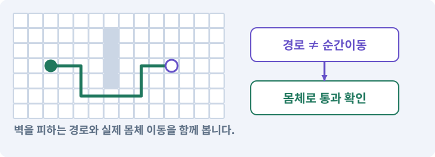

# 008. WASD로 벽에 부딪히며 이동하기

**목표:** 직선과 대각선으로 움직여도 벽을 통과하지 않습니다.

**시작 상태:** 캐릭터·바닥·벽이 있는 TestArena

## 한눈에 보는 기능의 흐름

WASD 방향 → 길이·시간 처리 → 몸체 이동 → 벽에서 멈춤



**경계:** 대각선이 더 빠르거나 벽을 통과하지 않기

그림은 실제 게임 실행 결과가 아닙니다. 값·규칙과 예제를 필요한 때 펼쳐 읽고 현재 단계의 메시지를 한 번씩 보냅니다.

## 1. 지금 상태 확인하기

첫 메시지를 보내 현재 준비 상태를 확인합니다. AI가 읽어 온 실제 프로젝트가 맞는지 보고, 없는 준비나 다른 상태가 있으면 먼저 알려 주세요. 아직 기능을 만들지 않는 단계입니다.

### AI에게 보낼 요구와 이유

#### 01. 작업 대상부터 확인

**“WASD로 벽에 부딪히며 이동하기” 작업을 시작하기 전에 현재 상태를 읽기 전용으로 확인해 줘.**

왜 이렇게 요청하나요? AI가 다른 프로젝트나 오래된 예제를 보고 작업할 수 있습니다. 실제 경로·파일·현재 기능을 읽게 하면 지금 이어서 작업할 대상을 먼저 맞출 수 있습니다.

#### 02. 작업 대상부터 확인

**필요한 시작 상태는 캐릭터·바닥·벽이 있는 TestArena야.**

왜 이렇게 요청하나요? AI가 다른 프로젝트나 오래된 예제를 보고 작업할 수 있습니다. 실제 경로·파일·현재 기능을 읽게 하면 지금 이어서 작업할 대상을 먼저 맞출 수 있습니다.

#### 03. 실제 사용 중인 구현 재사용

**실제 프로젝트와 작업 기록을 읽고 이것이 준비되어 있는지, 이미 같은 기능이 있는지 확인해 줘.**

왜 이렇게 요청하나요? 이름이 비슷한 새 클래스를 또 만들면 기존 화면은 여전히 옛 코드를 사용할 수 있습니다. 실제 호출되는 진입점을 찾아 연결해야 두 구현이 충돌하거나 수정이 반영되지 않는 문제를 막습니다.

#### 04. 현재 상태와 다음 확인 지점 구분

**이번 기능이 연결될 실제 파일·화면·도구와 보존할 기존 동작을 짧게 정리해 줘.**

왜 이렇게 요청하나요? 이미 준비된 기능과 아직 확인하지 못한 기능을 섞으면 불필요한 재설치나 성급한 완료 판정이 생깁니다. 현재 대상과 남은 준비를 나눠 가장 작은 다음 작업을 선택하게 합니다.

#### 05. 조사 단계에서 변경하지 않기

**아직 새 구현·설치·유료 호출·파일 변경은 하지 마.**

왜 이렇게 요청하나요? 현재 상태를 알아보기만 할 때 파일 변경이나 결제가 시작되면 검토 전의 환경이 바뀝니다. 준비 확인과 실제 구현을 나눠 되돌리기 어려운 작업이 먼저 실행되지 않게 합니다.

#### 06. 막힌 준비를 먼저 해결

**준비가 다르면 부족한 항목과 다음에 필요한 작업을 알려 줘.**

왜 이렇게 요청하나요? 빠진 파일·권한·패키지를 있다고 가정하면 다음 구현이 엉뚱한 대상을 만들게 됩니다. 무엇이 없고 무엇을 먼저 해야 하는지 분리하면 불필요한 재작업을 줄일 수 있습니다.

<details>
<summary>보낼 원문 전체 — 설명은 복사되지 않습니다</summary>

```text
“WASD로 벽에 부딪히며 이동하기” 작업을 시작하기 전에 현재 상태를 읽기 전용으로 확인해 줘.
필요한 시작 상태는 캐릭터·바닥·벽이 있는 TestArena야. 실제 프로젝트와 작업 기록을 읽고 이것이 준비되어 있는지, 이미 같은 기능이 있는지 확인해 줘.
이번 기능이 연결될 실제 파일·화면·도구와 보존할 기존 동작을 짧게 정리해 줘. 아직 새 구현·설치·유료 호출·파일 변경은 하지 마. 준비가 다르면 부족한 항목과 다음에 필요한 작업을 알려 줘.
```

</details>

**기대 결과:** 입력과 실제 이동 담당을 구분한 설명

### 직접 확인하기

1. AI가 읽은 실제 프로젝트 또는 도구 경로를 확인합니다.
2. 필수 준비가 없다면 문제 해결 요청을 보내고, 준비됐을 때 다음으로 갑니다.

## 2. 필요한 기능 만들기

준비가 확인되면 아래 요청을 보냅니다. AI가 파일·설정·실행을 맡습니다. 변경 범위나 비용 승인이 나오면 내용을 읽고 결정하세요.

### AI에게 보낼 요구와 이유

#### 01. 작업 대상부터 확인

**현재 프로젝트의 실제 파일과 이미 결정한 규칙을 먼저 확인해 줘.**

왜 이렇게 요청하나요? AI가 다른 프로젝트나 오래된 예제를 보고 작업할 수 있습니다. 실제 경로·파일·현재 기능을 읽게 하면 지금 이어서 작업할 대상을 먼저 맞출 수 있습니다.

#### 02. 실제 사용 중인 코드에 연결

**이름이 다른 기존 구현이 있으면 새로 중복 제작하지 말고 그 구현에 연결해 줘.**

왜 이렇게 요청하나요? 예제와 이름이 다르더라도 현재 씬과 입력에서 호출하는 구현이 작업 대상입니다. 같은 기능을 새로 만들기보다 기존 진입점을 확인해 수정이 실제 게임에 반영되고 중복 실행되지 않게 합니다.

#### 03. 이동 책임과 경계값 고정

**ActorMotor2D를 실제 Player2D에 연결해 줘.**

왜 이렇게 요청하나요? 캐릭터 이동은 입력뿐 아니라 시간·충돌·초기 위치를 함께 처리해야 합니다. 하나의 모터가 정해진 속도와 우선순위로 움직이게 하고 겹친 시작 위치는 별도 복구해 결과를 비교합니다.

#### 04. 시간·방향과 물리 이동 일치

**Input System Move를 공통 Vector2로 받아 FixedUpdate에서4.5units/s로 이동해 줘.**

왜 이렇게 요청하나요? 입력 방향의 길이와 프레임 간격을 그대로 이동량에 섞으면 대각선이나 기기 속도에 따라 이동이 달라집니다. 정해진 속도·시간 기준과 물리 이동 경로를 사용해 비교 가능한 움직임을 만듭니다.

#### 05. 시간·방향과 물리 이동 일치

**단일 Kinematic Rigidbody2D와 CircleCollider2D를 쓰고 MovePosition 전에**

왜 이렇게 요청하나요? 입력 방향의 길이와 프레임 간격을 그대로 이동량에 섞으면 대각선이나 기기 속도에 따라 이동이 달라집니다. 정해진 속도·시간 기준과 물리 이동 경로를 사용해 비교 가능한 움직임을 만듭니다.

#### 06. Raycast·Linecast·Cast의 적용 조건

**실제 몸체 Cast로 Environment 충돌을 계산해 skin0.02와 제한된 slide를 적용해 줘.**

왜 이렇게 요청하나요? Raycast는 시작점에서 방향으로 가는 선의 충돌을 묻고, Linecast는 두 점 사이를 검사합니다. CircleCast·SphereCast 등은 두께가 있는 모양을 쓸어 이동 가능한 공간을 검사합니다. Cast는 질문입니다. 결과를 받았다고 객체가 자동으로 이동하거나 피해를 주지는 않습니다.

#### 07. Rigidbody2D와 물리 몸체의 적용 조건

**Kinematic이라 벽에서 자동 정지한다고 가정하지 마.**

왜 이렇게 요청하나요? Rigidbody2D는 2D 물리 시스템이 객체를 어떻게 움직이고 접촉에 반응시킬지 관리하는 몸체입니다. Dynamic·Kinematic·Static은 물리적 행동 방식이 다른 설정입니다. 3D Rigidbody와 2D Rigidbody2D는 별개의 물리 세계에 참여합니다. 혼용한다고 서로 부딪히지 않습니다.

#### 08. Collider와 몸체 경계의 적용 조건

**자기 collider와 trigger는 걸러 줘.**

왜 이렇게 요청하나요? Collider는 물리 검사에 사용하는 경계입니다. 보이는 그림과 같을 필요는 없습니다. 탑다운 캐릭터는 보통 발 주변에 작은 몸체 경계를 둡니다. 스프라이트를 크게 바꿨다고 몸체·사거리도 자동으로 키우지 않습니다.

#### 09. 길찾기와 실제 도달을 구분

**Transform,NavMeshAgent,3D Rigidbody 등 다른 위치 작성자를 추가하지 마.**

왜 이렇게 요청하나요? 목적지 표시나 경로 목록이 있다고 캐릭터가 끝까지 갈 수 있는 것은 아닙니다. 이동 가능한 경로와 실제 몸체의 진행을 확인하고 막힌 지점을 성공으로 표시하지 않게 합니다.

#### 10. 시간·방향과 물리 이동 일치

**대각선 속도 제한, focus/disable/pause 입력 초기화, 잘못된 스폰 검증을 넣어 줘.**

왜 이렇게 요청하나요? 입력 방향의 길이와 프레임 간격을 그대로 이동량에 섞으면 대각선이나 기기 속도에 따라 이동이 달라집니다. 정해진 속도·시간 기준과 물리 이동 경로를 사용해 비교 가능한 움직임을 만듭니다.

#### 11. 시간·방향과 물리 이동 일치

**직선/대각선 5초 거리, 벽20회, 얇은벽, 모서리, 통로,30/60fps를 실제 검사해 줘.**

왜 이렇게 요청하나요? 입력 방향의 길이와 프레임 간격을 그대로 이동량에 섞으면 대각선이나 기기 속도에 따라 이동이 달라집니다. 정해진 속도·시간 기준과 물리 이동 경로를 사용해 비교 가능한 움직임을 만듭니다.

#### 12. Raycast·Linecast·Cast의 적용 조건

**입력→희망이동→Cast결과→실제이동을 디버그 화면에서 볼 수 있게 해 줘.**

왜 이렇게 요청하나요? Raycast는 시작점에서 방향으로 가는 선의 충돌을 묻고, Linecast는 두 점 사이를 검사합니다. CircleCast·SphereCast 등은 두께가 있는 모양을 쓸어 이동 가능한 공간을 검사합니다. Cast는 질문입니다. 결과를 받았다고 객체가 자동으로 이동하거나 피해를 주지는 않습니다.

#### 13. 아래 항목을 완료 조건으로 사용

**적용할 세부 규칙:**

왜 이렇게 요청하나요? 요구사항의 목록은 AI에게 참고 설명을 주는 것이 아니라 완료를 판단할 기준을 정합니다. 구현 뒤 각 항목을 실제 입력과 결과에 대응시켜 빠진 조건을 찾습니다.

#### 14. 이동 책임과 경계값 고정

**속도는 초당4.5유닛이다.**

왜 이렇게 요청하나요? 캐릭터 이동은 입력뿐 아니라 시간·충돌·초기 위치를 함께 처리해야 합니다. 하나의 모터가 정해진 속도와 우선순위로 움직이게 하고 겹친 시작 위치는 별도 복구해 결과를 비교합니다.

#### 15. 이동 책임과 경계값 고정

**입력 벡터 길이를 최대1로 제한한다.**

왜 이렇게 요청하나요? 캐릭터 이동은 입력뿐 아니라 시간·충돌·초기 위치를 함께 처리해야 합니다. 하나의 모터가 정해진 속도와 우선순위로 움직이게 하고 겹친 시작 위치는 별도 복구해 결과를 비교합니다.

#### 16. 시간·방향과 물리 이동 일치

**desired = input * speed * fixedDeltaTime을 만든 뒤 Environment만 대상으로 몸체 Cast를 수행한다.**

왜 이렇게 요청하나요? 입력 방향의 길이와 프레임 간격을 그대로 이동량에 섞으면 대각선이나 기기 속도에 따라 이동이 달라집니다. 정해진 속도·시간 기준과 물리 이동 경로를 사용해 비교 가능한 움직임을 만듭니다.

#### 17. 점이 아니라 몸체가 지나가게 하기

**가장 가까운 충돌 직전에서 skin0.02만큼 여유를 둔다.**

왜 이렇게 요청하나요? 길의 중심점이 연결돼 있어도 반경이 있는 캐릭터는 모서리나 좁은 문에 걸릴 수 있습니다. 실제 몸체 크기로 통과·차단을 확인해야 길찾기 그림과 플레이 결과가 맞습니다.

#### 18. 이동 책임과 경계값 고정

**남은 이동을 벽의 접선 방향에 투영하고 최대2~3회까지만 재검사한다.**

왜 이렇게 요청하나요? 캐릭터 이동은 입력뿐 아니라 시간·충돌·초기 위치를 함께 처리해야 합니다. 하나의 모터가 정해진 속도와 우선순위로 움직이게 하고 겹친 시작 위치는 별도 복구해 결과를 비교합니다.

#### 19. 실제 위치를 바꾸는 담당 하나

**경로 추종·AI 입력·넉백이 같은 프레임에 Transform을 각각 쓰지 않는다.**

왜 이렇게 요청하나요? 한 프레임에 여러 시스템이 위치를 덮어쓰면 떨림·벽 통과·입력 취소가 생길 수 있습니다. 이동 의도는 여러 곳에서 오더라도 실제 위치 변경과 우선순위는 한 모터에서 결정하게 합니다.

#### 20. 이동 책임과 경계값 고정

**모터가 이동 사유의 우선순위를 정한다.**

왜 이렇게 요청하나요? 캐릭터 이동은 입력뿐 아니라 시간·충돌·초기 위치를 함께 처리해야 합니다. 하나의 모터가 정해진 속도와 우선순위로 움직이게 하고 겹친 시작 위치는 별도 복구해 결과를 비교합니다.

#### 21. 표시와 아이템 존재 분리

**자기 Body와 Hurtbox, 아이템 trigger는 벽 필터에서 제외한다.**

왜 이렇게 요청하나요? 이름표를 숨기는 기능이 아이템 자체를 끄거나 삭제하면 줍기·퀘스트·저장까지 달라집니다. 보기 편하게 하는 정책은 소유 데이터와 획득 기능을 바꾸지 않게 분리합니다.

#### 22. 배우 겹침과 피격 판정 분리

**배우끼리는 초기 단계에서 강체로 서로 밀지 않고, AI 접근 위치 분산과 제한된 분리 보정으로 겹침을 줄인다.**

왜 이렇게 요청하나요? 적끼리 밀리는 물리 반응과 플레이어 공격에 맞는 판정은 목적이 다릅니다. 겹침을 줄이는 보정이 피격 대상을 없애거나 전투 위치를 임의로 바꾸지 않도록 구분합니다.

#### 23. 배우 겹침과 피격 판정 분리

**배우의 피격 검사는 독립적으로 유지한다.**

왜 이렇게 요청하나요? 적끼리 밀리는 물리 반응과 플레이어 공격에 맞는 판정은 목적이 다릅니다. 겹침을 줄이는 보정이 피격 대상을 없애거나 전투 위치를 임의로 바꾸지 않도록 구분합니다.

#### 24. 이동 책임과 경계값 고정

**처음부터 겹친 위치에서 시작한 경우는 정상 이동으로 해결할 수 없다.**

왜 이렇게 요청하나요? 캐릭터 이동은 입력뿐 아니라 시간·충돌·초기 위치를 함께 처리해야 합니다. 하나의 모터가 정해진 속도와 우선순위로 움직이게 하고 겹친 시작 위치는 별도 복구해 결과를 비교합니다.

#### 25. 관찰 가능한 기준으로 확인

**스폰 검증 실패를 기록하고 미리 검사한 SpawnPoint를 사용한다.**

왜 이렇게 요청하나요? 구현 완료라는 설명을 실제 결과로 바꾸기 위한 조건입니다. 요청에 나온 대상과 경계 상황을 확인해 정상 결과뿐 아니라 실패를 어떻게 구분했는지도 남깁니다.

#### 26. 잘못된 스폰과 충돌을 숨기지 않기

**매 프레임 순간이동으로 겹침을 숨기지 않는다.**

왜 이렇게 요청하나요? 겹친 몸체를 계속 강제로 옮기면 스폰이나 이동 충돌의 원인이 남고 화면도 튑니다. 정상 이동은 Cast로 제한하고, 처음부터 겹친 스폰은 실패 원인과 안전 위치 복구를 따로 처리합니다.

#### 27. 구현과 실행은 AI에게 맡기기

**코드·설정·파일 생성·실행은 네가 맡고, 필요한 화면과 결과를 보여 줘.**

왜 이렇게 요청하나요? 설명이나 코드 조각만 받으면 실제 파일 생성·연결·실행이 빠질 수 있습니다. AI가 개발 작업까지 수행하고, 사람은 요구·승인·결과 판단을 맡도록 역할을 분명히 합니다.

#### 28. 막힌 준비를 먼저 해결

**수행하지 못한 작업과 필요한 승인·도구 연결은 구분해서 알려 줘.**

왜 이렇게 요청하나요? 빠진 파일·권한·패키지를 있다고 가정하면 다음 구현이 엉뚱한 대상을 만들게 됩니다. 무엇이 없고 무엇을 먼저 해야 하는지 분리하면 불필요한 재작업을 줄일 수 있습니다.

<details>
<summary>보낼 원문 전체 — 설명은 복사되지 않습니다</summary>

```text
현재 프로젝트의 실제 파일과 이미 결정한 규칙을 먼저 확인해 줘. 이름이 다른 기존 구현이 있으면 새로 중복 제작하지 말고 그 구현에 연결해 줘.

ActorMotor2D를 실제 Player2D에 연결해 줘.
Input System Move를 공통 Vector2로 받아 FixedUpdate에서4.5units/s로 이동해 줘.
단일 Kinematic Rigidbody2D와 CircleCollider2D를 쓰고 MovePosition 전에
실제 몸체 Cast로 Environment 충돌을 계산해 skin0.02와 제한된 slide를 적용해 줘.
Kinematic이라 벽에서 자동 정지한다고 가정하지 마. 자기 collider와 trigger는 걸러 줘.
Transform,NavMeshAgent,3D Rigidbody 등 다른 위치 작성자를 추가하지 마.
대각선 속도 제한, focus/disable/pause 입력 초기화, 잘못된 스폰 검증을 넣어 줘.
직선/대각선 5초 거리, 벽20회, 얇은벽, 모서리, 통로,30/60fps를 실제 검사해 줘.
입력→희망이동→Cast결과→실제이동을 디버그 화면에서 볼 수 있게 해 줘.

적용할 세부 규칙:
속도는 초당4.5유닛이다. 입력 벡터 길이를 최대1로 제한한다. desired = input * speed * fixedDeltaTime을 만든 뒤 Environment만 대상으로 몸체 Cast를 수행한다. 가장 가까운 충돌 직전에서 skin0.02만큼 여유를 둔다. 남은 이동을 벽의 접선 방향에 투영하고 최대2~3회까지만 재검사한다.

경로 추종·AI 입력·넉백이 같은 프레임에 Transform을 각각 쓰지 않는다. 모터가 이동 사유의 우선순위를 정한다. 자기 Body와 Hurtbox, 아이템 trigger는 벽 필터에서 제외한다. 배우끼리는 초기 단계에서 강체로 서로 밀지 않고, AI 접근 위치 분산과 제한된 분리 보정으로 겹침을 줄인다. 배우의 피격 검사는 독립적으로 유지한다.

처음부터 겹친 위치에서 시작한 경우는 정상 이동으로 해결할 수 없다. 스폰 검증 실패를 기록하고 미리 검사한 SpawnPoint를 사용한다. 매 프레임 순간이동으로 겹침을 숨기지 않는다.

코드·설정·파일 생성·실행은 네가 맡고, 필요한 화면과 결과를 보여 줘. 수행하지 못한 작업과 필요한 승인·도구 연결은 구분해서 알려 줘.
```

</details>

**기대 결과:** 확인할 결과: 이동·벽 충돌·입력 해제가 정상임. AI가 이 상태를 확인할 실제 화면과 변경 내용을 준비합니다. 아직 실행하지 못한 부분은 따로 표시합니다.

### 직접 확인하기

1. 제안서만 반환됐다면 “설명으로 끝내지 말고 승인한 범위의 실제 작업을 수행해 줘”라고 보냅니다.
2. 코드나 설정을 직접 고치라는 안내가 나오면 “작성과 실행은 네가 맡아 줘”라고 요청합니다.

## 3. 결과를 직접 확인하기

먼저 확인 요청을 보내 AI가 검사와 화면을 준비하게 하세요. 그다음 아래 동작을 하나씩 확인합니다.

### AI에게 보낼 요구와 이유

#### 01. 검사할 입력과 관찰 지점 준비

**방금 구현한 기능의 자동 검사와 확인 화면을 준비해 줘.**

왜 이렇게 요청하나요? 정상 예 하나만 보면 실패 조건을 놓치기 쉽습니다. 정상·경계·반례를 실제 입력으로 준비하고 사람이 볼 화면도 맞춰 확인 범위를 분명하게 합니다.

#### 02. 결과를 재확인할 근거 남기기

**정상 동작과 아래 실패 조건을 실제로 검사하고 대상·실행 수·결과를 보여 줘.**

왜 이렇게 요청하나요? “잘 됩니다”라는 요약만으로는 어떤 입력과 버전을 검사했는지 알 수 없습니다. 대상·실행 수·실패 내용·파일을 함께 남겨 같은 조건으로 다시 확인할 수 있게 합니다.

#### 03. 점이 아니라 몸체가 지나가게 하기

**벽 앞에서 멈추고 모서리를 뚫지 않는다.**

왜 이렇게 요청하나요? 길의 중심점이 연결돼 있어도 반경이 있는 캐릭터는 모서리나 좁은 문에 걸릴 수 있습니다. 실제 몸체 크기로 통과·차단을 확인해야 길찾기 그림과 플레이 결과가 맞습니다.

#### 04. 이동 책임과 경계값 고정

**벽 접선으로 움직일 수 있다.**

왜 이렇게 요청하나요? 캐릭터 이동은 입력뿐 아니라 시간·충돌·초기 위치를 함께 처리해야 합니다. 하나의 모터가 정해진 속도와 우선순위로 움직이게 하고 겹친 시작 위치는 별도 복구해 결과를 비교합니다.

#### 05. 시간·방향과 물리 이동 일치

**대각선이 빨라지지 않는다.**

왜 이렇게 요청하나요? 입력 방향의 길이와 프레임 간격을 그대로 이동량에 섞으면 대각선이나 기기 속도에 따라 이동이 달라집니다. 정해진 속도·시간 기준과 물리 이동 경로를 사용해 비교 가능한 움직임을 만듭니다.

#### 06. 게임 시간·실시간·일시정지의 적용 조건

**Pause 후 유령 입력이 없다.**

왜 이렇게 요청하나요? 게임 시간은 일시정지나 느린 연출에 따라 흐름을 조절할 수 있습니다. 실시간은 그와 별개로 흐르며 메뉴·다운로드·일부 UI에 필요합니다. timeScale=0이 모든 코드를 자동 정지시키지는 않습니다. Update 호출과 비동기 작업·실시간 UI 등은 별도로 봅니다.

#### 07. 이동 책임과 경계값 고정

**테스트 결과의 실제 이동량이 기록된다.**

왜 이렇게 요청하나요? 캐릭터 이동은 입력뿐 아니라 시간·충돌·초기 위치를 함께 처리해야 합니다. 하나의 모터가 정해진 속도와 우선순위로 움직이게 하고 겹친 시작 위치는 별도 복구해 결과를 비교합니다.

#### 08. 사람 검사의 시작점 준비

**내가 조작해야 하는 부분은 실행할 화면과 시작 상태를 준비해 줘.**

왜 이렇게 요청하나요? 같은 기능이라도 시작 상태가 다르면 관찰 결과가 달라집니다. AI가 실행 화면과 재현 위치를 먼저 준비해야 사람이 이동·공격·소리·조작감을 같은 조건에서 확인할 수 있습니다.

#### 09. 사람이 실제로 본 것만 기록

**연결되지 않은 휴대폰의 터치나 사람이 보지 않은 재미·소리 품질을 대신 확인했다고 하지 마.**

왜 이렇게 요청하나요? AI가 준비한 검사와 사람이 직접 플레이하거나 들은 결과는 다른 근거입니다. 관찰하지 않은 조작감·소리·실기기 결과를 임의로 완료 처리하지 않게 합니다.

#### 10. 실제로 실행한 검사만 인정

**테스트 0개와 예전 소스 결과는 현재 성공으로 쓰지 마.**

왜 이렇게 요청하나요? 실행된 검사가 없거나 같은 결과를 중복 집계한 경우는 기능을 확인한 것이 아닙니다. 실행 수와 개별 결과를 함께 확인해야 형식적인 성공 표시를 걸러낼 수 있습니다.

<details>
<summary>보낼 원문 전체 — 설명은 복사되지 않습니다</summary>

```text
방금 구현한 기능의 자동 검사와 확인 화면을 준비해 줘. 정상 동작과 아래 실패 조건을 실제로 검사하고 대상·실행 수·결과를 보여 줘.

벽 앞에서 멈추고 모서리를 뚫지 않는다. 벽 접선으로 움직일 수 있다. 대각선이 빨라지지 않는다. Pause 후 유령 입력이 없다. 테스트 결과의 실제 이동량이 기록된다.

내가 조작해야 하는 부분은 실행할 화면과 시작 상태를 준비해 줘. 연결되지 않은 휴대폰의 터치나 사람이 보지 않은 재미·소리 품질을 대신 확인했다고 하지 마. 테스트 0개와 예전 소스 결과는 현재 성공으로 쓰지 마.
```

</details>

**기대 결과:** 대각선도 속도가 4.5를 넘지 않습니다. 벽 안으로 들어가지 않고 남은 이동 성분으로 벽을 따라 움직입니다.

### 직접 확인하기

1. WASD로 직선과 대각선으로 움직입니다.
2. 벽에 비스듬히 붙어 이동하고 모서리를 밀어 봅니다.
3. 게임에서 포커스를 뺐다가 돌아왔을 때 멋대로 움직이지 않는지 봅니다.

## 4. 결과를 남기고 마무리하기

실제로 본 결과를 아래 메모에 적고 AI에 전달합니다. 결과 저장 요청으로 현재 상태를 남긴 뒤 다음 페이지로 갑니다.

### AI에게 보낼 요구와 이유

#### 01. 결과를 재확인할 근거 남기기

**지금 작업한 “WASD로 벽에 부딪히며 이동하기”의 실제 결과를 정리해 줘.**

왜 이렇게 요청하나요? “잘 됩니다”라는 요약만으로는 어떤 입력과 버전을 검사했는지 알 수 없습니다. 대상·실행 수·실패 내용·파일을 함께 남겨 같은 조건으로 다시 확인할 수 있게 합니다.

#### 02. 다음 작업이 읽을 인수인계

**변경한 기능·파일·현재 후보와 실제 실행한 검사, 남은 문제를 기능 이름으로 기록해 줘.**

왜 이렇게 요청하나요? 새 AI 세션은 이전 대화 전체를 알고 있다고 보장할 수 없습니다. 현재 후보·파일 위치·실행한 검사·남은 일을 남겨야 같은 작업을 반복하지 않고 이어갈 수 있습니다.

#### 03. 사람이 실제로 본 것만 기록

**자동 검사 결과와 내가 직접 확인한 결과를 구분하고, 내 관찰이 아직 없으면 미확인으로 남겨 줘.**

왜 이렇게 요청하나요? AI가 준비한 검사와 사람이 직접 플레이하거나 들은 결과는 다른 근거입니다. 관찰하지 않은 조작감·소리·실기기 결과를 임의로 완료 처리하지 않게 합니다.

#### 04. 다음 작업이 읽을 인수인계

**재시작하거나 다음 작업에서 읽을 기록의 실제 위치를 알려 줘.**

왜 이렇게 요청하나요? 새 AI 세션은 이전 대화 전체를 알고 있다고 보장할 수 없습니다. 현재 후보·파일 위치·실행한 검사·남은 일을 남겨야 같은 작업을 반복하지 않고 이어갈 수 있습니다.

#### 05. 미확인을 완료와 분리

**아직 확인하지 않은 결과를 완료로 채우지 마.**

왜 이렇게 요청하나요? 만들어진 것, 검사에 실패한 것, 아직 확인하지 못한 것을 나눠야 다음 작업을 정확히 고를 수 있습니다. 실행할 조건이 없는 기능을 성공으로 기록하면 뒤에서 원인을 찾기 어려워집니다.

<details>
<summary>보낼 원문 전체 — 설명은 복사되지 않습니다</summary>

```text
지금 작업한 “WASD로 벽에 부딪히며 이동하기”의 실제 결과를 정리해 줘. 변경한 기능·파일·현재 후보와 실제 실행한 검사, 남은 문제를 기능 이름으로 기록해 줘.
자동 검사 결과와 내가 직접 확인한 결과를 구분하고, 내 관찰이 아직 없으면 미확인으로 남겨 줘. 재시작하거나 다음 작업에서 읽을 기록의 실제 위치를 알려 줘. 아직 확인하지 않은 결과를 완료로 채우지 마.
```

</details>

**기대 결과:** 현재 상태·검사 결과·남은 문제·다음에 읽을 기록을 확인할 수 있습니다.

### 직접 확인하기

1. 자동 검사와 내 관찰 결과가 섞이지 않았는지 봅니다.
2. 문제가 남았다면 해결 요청을 보내고 같은 동작을 다시 확인합니다.

## 구체적인 예로 이해하기

### 대각 이동과 벽 미끄러짐

입력 방향과 실제 이동은 구분합니다. 이동 사유를 한 모터로 모아야 직접 이동·경로·넉백이 서로 위치를 덮어쓰지 않습니다.

**시작 상태:** 속도 4.5유닛/초이며 직선 입력 길이는 1입니다.

**직접 해 볼 동작:** 같은 시간 동안 오른쪽으로, 그다음 오른쪽 위로 이동하고 벽을 향해 비스듬히 움직여 봅니다.

**보여야 하는 결과:** 대각선도 속도가 4.5를 넘지 않습니다. 벽 안으로 들어가지 않고 남은 이동 성분으로 벽을 따라 움직입니다.

**이렇게 되면 아직 안 됩니다:** 대각 입력 (1,1)을 그대로 쓰면 길이가 √2라서 약 6.36유닛/초로 빨라집니다.

**생각해 보기:** 벽에 걸릴 때 매 프레임 순간이동시켜 밖으로 빼내면 충분할까요?

<details><summary>해설 보기</summary>

아니요. 이동 전 몸체 Cast와 초기 스폰 검사를 구분해야 합니다. 반복 순간이동은 잘못된 충돌·스폰을 숨깁니다.

</details>

## 이 작업에서 사용할 값과 규칙 전체

설계 시작값이며 측정된 성능·게임 성공 결과가 아닙니다. 구현은 AI가 수행합니다.

속도는 초당4.5유닛이다. 입력 벡터 길이를 최대1로 제한한다. `desired = input * speed * fixedDeltaTime`을 만든 뒤 Environment만 대상으로 몸체 Cast를 수행한다. 가장 가까운 충돌 직전에서 skin0.02만큼 여유를 둔다. 남은 이동을 벽의 접선 방향에 투영하고 최대2~3회까지만 재검사한다.

경로 추종·AI 입력·넉백이 같은 프레임에 Transform을 각각 쓰지 않는다. 모터가 이동 사유의 우선순위를 정한다. 자기 Body와 Hurtbox, 아이템 trigger는 벽 필터에서 제외한다. 배우끼리는 초기 단계에서 강체로 서로 밀지 않고, AI 접근 위치 분산과 제한된 분리 보정으로 겹침을 줄인다. 배우의 피격 검사는 독립적으로 유지한다.

처음부터 겹친 위치에서 시작한 경우는 정상 이동으로 해결할 수 없다. 스폰 검증 실패를 기록하고 미리 검사한 SpawnPoint를 사용한다. 매 프레임 순간이동으로 겹침을 숨기지 않는다.

## 문제가 있으면

### AI에게 보낼 요구와 이유

#### 01. 다른 이동 주체의 전환 관리

**Transform 순간이동이나 충돌체 제거로 해결하지 말고 첫 충돌 지점과 남은 이동 벡터를 표시해 원인을 찾아 줘.**

왜 이렇게 요청하나요? 보조 캐릭터·탈것·수영 상태는 따라가기만 구현하면 길막·중복 생성·옛 입력 문제가 남을 수 있습니다. 제어권·추적 대상·진입과 종료 시 정리를 명확히 합니다.

#### 02. 원인 하나를 좁혀 수정

**새 기능을 추가하지 말고 현재 오류와 실제 로그를 먼저 읽어 줘.**

왜 이렇게 요청하나요? 오류 수정 중 새 기능까지 넣으면 어떤 변경이 문제를 해결하거나 악화했는지 알기 어렵습니다. 원래 재현을 보존하고 작은 변경 뒤 같은 입력과 주변 정상 동작을 다시 확인합니다.

#### 03. 원인 하나를 좁혀 수정

**최소 수정 뒤 같은 재현과 관련 정상 동작을 다시 검사해 줘.**

왜 이렇게 요청하나요? 오류 수정 중 새 기능까지 넣으면 어떤 변경이 문제를 해결하거나 악화했는지 알기 어렵습니다. 원래 재현을 보존하고 작은 변경 뒤 같은 입력과 주변 정상 동작을 다시 확인합니다.

#### 04. 실패도 재현 자료로 보존

**실패 기록은 지우지 마.**

왜 이렇게 요청하나요? 실패한 입력과 로그가 있어야 같은 문제가 다시 생겼을 때 비교할 수 있습니다. 성공 기록으로 덮어쓰지 않고 전후 자료를 남기면 무엇을 고쳤는지 확인할 수 있습니다.

<details>
<summary>보낼 원문 전체 — 설명은 복사되지 않습니다</summary>

```text
Transform 순간이동이나 충돌체 제거로 해결하지 말고 첫 충돌 지점과 남은 이동 벡터를 표시해 원인을 찾아 줘.
새 기능을 추가하지 말고 현재 오류와 실제 로그를 먼저 읽어 줘. 최소 수정 뒤 같은 재현과 관련 정상 동작을 다시 검사해 줘. 실패 기록은 지우지 마.
```

</details>

## 새 세션에서 이어가기

### AI에게 보낼 요구와 이유

#### 01. 이어서 할 작업 식별

**“WASD로 벽에 부딪히며 이동하기” 작업을 이어가고 싶어.**

왜 이렇게 요청하나요? 이름으로 재개할 작업을 찾고, 뒤에 이어지는 요청으로 실제 파일·진행 중 작업·기록을 다시 읽게 합니다. 제목만 보고 이전 상태를 기억한다고 가정하지 않습니다.

#### 02. 조회는 상태를 바꾸지 않게

**실제 프로젝트와 내 도구의 작업 기록을 읽고 어디까지 구현·검사됐는지 확인해 줘.**

왜 이렇게 요청하나요? 진행 상황을 물을 때 새 구현이나 유료 호출이 시작되면 단순 확인이 실행 명령이 되어 버립니다. 저장된 근거를 읽어 완료·진행·승인 대기·미검증을 나누게 합니다.

#### 03. 재개 전 중복 작업 방지

**진행 중인 프로세스·승인·미저장 변경을 확인한 뒤 남은 가장 작은 작업부터 안내해 줘.**

왜 이렇게 요청하나요? 대화가 끊겨도 외부 작업은 끝났거나 아직 실행 중일 수 있습니다. 프로세스·승인·미저장 상태를 먼저 읽어 같은 생성·빌드·결제를 두 번 시작하지 않도록 합니다.

#### 04. 되돌아갈 원본 남기기

**기존 성공과 실패 기록은 보존해 줘.**

왜 이렇게 요청하나요? 새 구현이 실패해도 이전 게임과 저장을 복원할 수 있어야 합니다. 현재 내용을 먼저 조사하고 별도 후보에서 작업하면 실험이 유일한 정상본을 망가뜨리는 일을 피할 수 있습니다.

<details>
<summary>보낼 원문 전체 — 설명은 복사되지 않습니다</summary>

```text
“WASD로 벽에 부딪히며 이동하기” 작업을 이어가고 싶어. 실제 프로젝트와 내 도구의 작업 기록을 읽고 어디까지 구현·검사됐는지 확인해 줘. 진행 중인 프로세스·승인·미저장 변경을 확인한 뒤 남은 가장 작은 작업부터 안내해 줘. 기존 성공과 실패 기록은 보존해 줘.
```

</details>

## 왜 이렇게 만드는가

중요한 점은 **Kinematic Rigidbody2D의 MovePosition이 정적 벽에서 자동으로 멈춰 준다고 가정하면 안 된다**는 것이다. 현재 프로젝트는 이동 전에 몸체 모양을 Cast하여 허용 이동량을 계산하고 그만큼만 적용한다. MovePosition은 물리 갱신 시 이동하며 작은 이동과 FixedUpdate 사용이 권장된다. [D04]

Collider2D/Physics2D의 Cast는 점 하나의 Ray보다 몸체 폭을 검사하는 데 적합하다. 실제 API 오버로드와 ContactFilter2D는 설치 버전 문서에서 확인한다. [D06]

## 공식 참고

- [Rigidbody2D.MovePosition](https://docs.unity3d.com/6000.3/Documentation/ScriptReference/Rigidbody2D.MovePosition.html)
- [Physics2D.CircleCast](https://docs.unity3d.com/6000.3/Documentation/ScriptReference/Physics2D.CircleCast.html)


## 실제 Unity Editor 화면 참고
공식 예시와 내 프로젝트 실행 결과를 구분하세요. 원본 사진은 온라인 연결이 필요합니다.

- [Input Actions — 입력 묶음·행동·값의 종류 읽기](../editor_references/input-actions.md)
