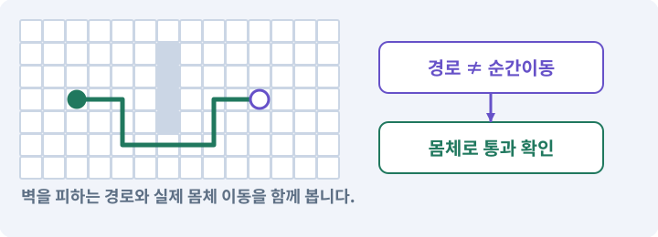

# 009. 클릭한 곳까지 벽을 돌아가기

**목표:** 클릭 이동과 직접 이동을 자연스럽게 바꿔 씁니다.

**시작 상태:** WASD 이동과 몸체 충돌

## 한눈에 보는 기능의 흐름

바닥 클릭 → 우회 경로 → 같은 이동 모터 → 직접 입력으로 취소



**경계:** WASD를 놓아도 옛 목적지로 돌아가지 않기

그림은 실제 게임 실행 결과가 아닙니다. 값·규칙과 예제를 필요한 때 펼쳐 읽고 현재 단계의 메시지를 한 번씩 보냅니다.

## 1. 지금 상태 확인하기

첫 메시지를 보내 현재 준비 상태를 확인합니다. AI가 읽어 온 실제 프로젝트가 맞는지 보고, 없는 준비나 다른 상태가 있으면 먼저 알려 주세요. 아직 기능을 만들지 않는 단계입니다.

### AI에게 보낼 요구와 이유

#### 01. 작업 대상부터 확인

**“클릭한 곳까지 벽을 돌아가기” 작업을 시작하기 전에 현재 상태를 읽기 전용으로 확인해 줘.**

왜 이렇게 요청하나요? AI가 다른 프로젝트나 오래된 예제를 보고 작업할 수 있습니다. 실제 경로·파일·현재 기능을 읽게 하면 지금 이어서 작업할 대상을 먼저 맞출 수 있습니다.

#### 02. 작업 대상부터 확인

**필요한 시작 상태는 WASD 이동과 몸체 충돌야.**

왜 이렇게 요청하나요? AI가 다른 프로젝트나 오래된 예제를 보고 작업할 수 있습니다. 실제 경로·파일·현재 기능을 읽게 하면 지금 이어서 작업할 대상을 먼저 맞출 수 있습니다.

#### 03. 실제 사용 중인 구현 재사용

**실제 프로젝트와 작업 기록을 읽고 이것이 준비되어 있는지, 이미 같은 기능이 있는지 확인해 줘.**

왜 이렇게 요청하나요? 이름이 비슷한 새 클래스를 또 만들면 기존 화면은 여전히 옛 코드를 사용할 수 있습니다. 실제 호출되는 진입점을 찾아 연결해야 두 구현이 충돌하거나 수정이 반영되지 않는 문제를 막습니다.

#### 04. 현재 상태와 다음 확인 지점 구분

**이번 기능이 연결될 실제 파일·화면·도구와 보존할 기존 동작을 짧게 정리해 줘.**

왜 이렇게 요청하나요? 이미 준비된 기능과 아직 확인하지 못한 기능을 섞으면 불필요한 재설치나 성급한 완료 판정이 생깁니다. 현재 대상과 남은 준비를 나눠 가장 작은 다음 작업을 선택하게 합니다.

#### 05. 조사 단계에서 변경하지 않기

**아직 새 구현·설치·유료 호출·파일 변경은 하지 마.**

왜 이렇게 요청하나요? 현재 상태를 알아보기만 할 때 파일 변경이나 결제가 시작되면 검토 전의 환경이 바뀝니다. 준비 확인과 실제 구현을 나눠 되돌리기 어려운 작업이 먼저 실행되지 않게 합니다.

#### 06. 막힌 준비를 먼저 해결

**준비가 다르면 부족한 항목과 다음에 필요한 작업을 알려 줘.**

왜 이렇게 요청하나요? 빠진 파일·권한·패키지를 있다고 가정하면 다음 구현이 엉뚱한 대상을 만들게 됩니다. 무엇이 없고 무엇을 먼저 해야 하는지 분리하면 불필요한 재작업을 줄일 수 있습니다.

<details>
<summary>보낼 원문 전체 — 설명은 복사되지 않습니다</summary>

```text
“클릭한 곳까지 벽을 돌아가기” 작업을 시작하기 전에 현재 상태를 읽기 전용으로 확인해 줘.
필요한 시작 상태는 WASD 이동과 몸체 충돌야. 실제 프로젝트와 작업 기록을 읽고 이것이 준비되어 있는지, 이미 같은 기능이 있는지 확인해 줘.
이번 기능이 연결될 실제 파일·화면·도구와 보존할 기존 동작을 짧게 정리해 줘. 아직 새 구현·설치·유료 호출·파일 변경은 하지 마. 준비가 다르면 부족한 항목과 다음에 필요한 작업을 알려 줘.
```

</details>

**기대 결과:** 길이 있는 곳과 없는 곳을 구분한 지도

### 직접 확인하기

1. AI가 읽은 실제 프로젝트 또는 도구 경로를 확인합니다.
2. 필수 준비가 없다면 문제 해결 요청을 보내고, 준비됐을 때 다음으로 갑니다.

## 2. 필요한 기능 만들기

준비가 확인되면 아래 요청을 보냅니다. AI가 파일·설정·실행을 맡습니다. 변경 범위나 비용 승인이 나오면 내용을 읽고 결정하세요.

### AI에게 보낼 요구와 이유

#### 01. 입력 방법만 확장하고 기존 플레이어 유지

**기존 2D 플레이어에 마우스 클릭 이동을 추가해 줘.**

왜 이렇게 요청하나요? 기존 캐릭터에 목적지를 주는 방법을 추가하는 작업입니다. 새 플레이어를 만들거나 기존 직접 이동을 제거하지 않아야 같은 몸체·전투·저장 연결 위에서 두 조작 방식을 사용할 수 있습니다.

#### 02. 새 입력이 오래된 이동 명령을 취소

**바닥을 클릭하면 벽을 우회해 목적지까지 가고, WASD를 누르면 클릭 이동을 즉시 취소하게 해 줘.**

왜 이렇게 요청하나요? 클릭 목적지가 남아 있으면 키를 놓는 순간 옛 위치로 다시 움직일 수 있습니다. 직접 입력을 시작할 때 이전 이동 요청을 취소해야 플레이어가 현재 의도한 방향만 따릅니다.

#### 03. 새 입력이 오래된 이동 명령을 취소

**WASD를 놓아도 예전 목적지로 다시 가지 않게 해 줘.**

왜 이렇게 요청하나요? 클릭 목적지가 남아 있으면 키를 놓는 순간 옛 위치로 다시 움직일 수 있습니다. 직접 입력을 시작할 때 이전 이동 요청을 취소해야 플레이어가 현재 의도한 방향만 따릅니다.

#### 04. 실제 사용 중인 코드에 연결

**먼저 실제 이동 담당 코드를 확인해 줘.**

왜 이렇게 요청하나요? 예제와 이름이 다르더라도 현재 씬과 입력에서 호출하는 구현이 작업 대상입니다. 같은 기능을 새로 만들기보다 기존 진입점을 확인해 수정이 실제 게임에 반영되고 중복 실행되지 않게 합니다.

#### 05. 실제 사용 중인 구현 재사용

**이름이 달라도 기존 구현을 재사용하고, 새 이동 스크립트가 동시에 위치를 바꾸지 않게 해 줘.**

왜 이렇게 요청하나요? 이름이 비슷한 새 클래스를 또 만들면 기존 화면은 여전히 옛 코드를 사용할 수 있습니다. 실제 호출되는 진입점을 찾아 연결해야 두 구현이 충돌하거나 수정이 반영되지 않는 문제를 막습니다.

#### 06. 좌표계 혼동 방지

**화면 좌표는 XY 평면의 셀로 바꾸고, Floor와 이동 가능한 셀 데이터로 목적지를 판정해 줘.**

왜 이렇게 요청하나요? 2D의 XY와 3D의 XZ는 같은 이동 의미라도 축 배치가 다릅니다. 변환 위치를 한 곳으로 모아야 지도·물리·카메라가 서로 다른 축을 높이나 전진 방향으로 해석하지 않습니다.

#### 07. 길찾기와 실제 도달을 구분

**길찾기는 격자 A*로 만들어 줘.**

왜 이렇게 요청하나요? 목적지 표시나 경로 목록이 있다고 캐릭터가 끝까지 갈 수 있는 것은 아닙니다. 이동 가능한 경로와 실제 몸체의 진행을 확인하고 막힌 지점을 성공으로 표시하지 않게 합니다.

#### 08. 단순한 경로 규칙부터 검증

**처음에는 4방향을 검사한 뒤 8방향으로 확장해 줘.**

왜 이렇게 요청하나요? 먼저 상하좌우만 검사하면 연결·비용·종료 조건의 오류를 찾기 쉽습니다. 그다음 대각선과 모서리 규칙을 추가해 무엇을 바꿨을 때 문제가 생겼는지 구분합니다.

#### 09. 대각 비용과 모서리 통과 규칙 지정

**직선 비용은 10, 대각선은 14이며 대각선 양옆의 셀이 모두 통과 가능할 때만 이동해 줘.**

왜 이렇게 요청하나요? 격자에서 대각 이동은 직선보다 길기 때문에 다른 비용을 줍니다. 인접한 두 칸이 모두 통과 가능해야 한다는 규칙은 벽 모서리 사이를 비집고 지나가는 경로를 막습니다.

#### 10. 같은 입력을 재현 가능한 경로로 만들기

**같은 입력에서 같은 경로가 나오도록 동률은 f값, h값, 셀 인덱스 순서로 정해 줘.**

왜 이렇게 요청하나요? 비용이 같은 후보의 순서를 정하지 않으면 실행마다 다른 길이 선택될 수 있습니다. 우선순위를 고정하면 실패 장면을 다시 만들고 경로 변화가 실제 수정 때문인지 비교할 수 있습니다.

#### 11. 선이 아니라 몸체 전체가 지나가는지 확인

**선으로 길이 이어지는 것만 검사하지 마.**

왜 이렇게 요청하나요? 길찾기 선에는 폭이 없지만 캐릭터에는 반경이 있습니다. 중심점만 이어진 경로는 좁은 문과 모서리에서 막힐 수 있으므로 실제 몸체와 여유 공간으로 통과 가능성을 확인합니다.

#### 12. 선이 아니라 몸체 전체가 지나가는지 확인

**플레이어의 몸체 반경 0.35와 여유 0.02를 반영하고, 실제 CircleCast로 몸체가 통과할 수 있는 구간만 따라가게 해 줘.**

왜 이렇게 요청하나요? 길찾기 선에는 폭이 없지만 캐릭터에는 반경이 있습니다. 중심점만 이어진 경로는 좁은 문과 모서리에서 막힐 수 있으므로 실제 몸체와 여유 공간으로 통과 가능성을 확인합니다.

#### 13. 점이 아니라 몸체가 지나가게 하기

**경로를 단순화해도 벽 모서리를 자르면 안 돼.**

왜 이렇게 요청하나요? 길의 중심점이 연결돼 있어도 반경이 있는 캐릭터는 모서리나 좁은 문에 걸릴 수 있습니다. 실제 몸체 크기로 통과·차단을 확인해야 길찾기 그림과 플레이 결과가 맞습니다.

#### 14. 불필요한 길찾기 요청 줄이기

**마우스를 길게 누르면 목적지를 갱신하되 같은 셀의 요청을 매 프레임 반복하지 말고 0.1초보다 자주 재요청하지 않게 해 줘.**

왜 이렇게 요청하나요? 마우스를 누른 동안 같은 목적지의 경로를 매 프레임 계산하면 결과는 같아도 CPU 비용이 커집니다. 목적지 변경과 최소 갱신 간격을 확인해 반응성과 계산량을 함께 관리합니다.

#### 15. 오래된 경로와 과도한 계산 차단

**요청 ID로 오래된 결과를 버리고, 한 경로의 최대 확장 수는 4096으로 제한해 줘.**

왜 이렇게 요청하나요? 새 목적지가 선택된 뒤 옛 경로 계산이 끝날 수 있습니다. 요청 ID로 현재 결과만 채택하고 확장 수에 한도를 두면 오래 걸린 계산 하나가 입력과 화면을 막는 위험을 줄입니다.

#### 16. 길 없음과 계산 중단을 다른 결과로 표시

**도착 불가와 계산 한도 초과를 구분해 줘.**

왜 이렇게 요청하나요? 계산 한도에 도달한 것은 길이 없다고 증명한 것이 아닙니다. 두 결과를 나누면 막힌 지형을 고칠지, 다음 계산 기회를 줄지 다른 대응을 선택할 수 있습니다.

#### 17. UI 입력과 월드 입력 분리

**UI에서 시작한 클릭은 이동으로 처리하지 마.**

왜 이렇게 요청하나요? 가방 버튼을 누른 입력이 뒤의 바닥 클릭으로도 처리되면 캐릭터가 원치 않게 이동하거나 공격합니다. 입력이 시작된 대상을 구분해 한 행동이 서로 다른 명령으로 중복 처리되지 않게 합니다.

#### 18. UI 입력과 월드 입력 분리

**닫힌 방, 지도 밖, 벽 우회, 대각 모서리, 작은 목적지 변경, 오래된 결과, UI 클릭과 WASD 전환을 실제로 검사해 줘.**

왜 이렇게 요청하나요? 가방 버튼을 누른 입력이 뒤의 바닥 클릭으로도 처리되면 캐릭터가 원치 않게 이동하거나 공격합니다. 입력이 시작된 대상을 구분해 한 행동이 서로 다른 명령으로 중복 처리되지 않게 합니다.

#### 19. 스크립트와 실제 씬 연결

**씬·입력·참조까지 연결하고 내가 눌러 볼 화면을 준비해 줘.**

왜 이렇게 요청하나요? 코드 파일을 만들어도 씬의 오브젝트에 붙지 않거나 참조가 비어 있으면 플레이에 반영되지 않습니다. 실제 사용하는 프리팹과 컴포넌트까지 연결해 동작을 확인하게 합니다.

#### 20. 작성과 실행을 AI가 끝까지 수행

**코드와 명령 실행은 네가 맡아 줘.**

왜 이렇게 요청하나요? 설명만 받거나 코드 조각을 전달받는 데서 끝나지 않고 실제 파일 작성·연결·명령 실행까지 AI가 맡도록 하는 요청입니다. 사람은 결과와 승인 사항을 판단합니다.

<details>
<summary>보낼 원문 전체 — 설명은 복사되지 않습니다</summary>

```text
기존 2D 플레이어에 마우스 클릭 이동을 추가해 줘. 바닥을 클릭하면 벽을 우회해 목적지까지 가고, WASD를 누르면 클릭 이동을 즉시 취소하게 해 줘. WASD를 놓아도 예전 목적지로 다시 가지 않게 해 줘.

먼저 실제 이동 담당 코드를 확인해 줘. 이름이 달라도 기존 구현을 재사용하고, 새 이동 스크립트가 동시에 위치를 바꾸지 않게 해 줘. 화면 좌표는 XY 평면의 셀로 바꾸고, Floor와 이동 가능한 셀 데이터로 목적지를 판정해 줘.

길찾기는 격자 A*로 만들어 줘. 처음에는 4방향을 검사한 뒤 8방향으로 확장해 줘. 직선 비용은 10, 대각선은 14이며 대각선 양옆의 셀이 모두 통과 가능할 때만 이동해 줘. 같은 입력에서 같은 경로가 나오도록 동률은 f값, h값, 셀 인덱스 순서로 정해 줘.

선으로 길이 이어지는 것만 검사하지 마. 플레이어의 몸체 반경 0.35와 여유 0.02를 반영하고, 실제 CircleCast로 몸체가 통과할 수 있는 구간만 따라가게 해 줘. 경로를 단순화해도 벽 모서리를 자르면 안 돼.

마우스를 길게 누르면 목적지를 갱신하되 같은 셀의 요청을 매 프레임 반복하지 말고 0.1초보다 자주 재요청하지 않게 해 줘. 요청 ID로 오래된 결과를 버리고, 한 경로의 최대 확장 수는 4096으로 제한해 줘. 도착 불가와 계산 한도 초과를 구분해 줘.

UI에서 시작한 클릭은 이동으로 처리하지 마. 닫힌 방, 지도 밖, 벽 우회, 대각 모서리, 작은 목적지 변경, 오래된 결과, UI 클릭과 WASD 전환을 실제로 검사해 줘. 씬·입력·참조까지 연결하고 내가 눌러 볼 화면을 준비해 줘. 코드와 명령 실행은 네가 맡아 줘.
```

</details>

**기대 결과:** 확인할 결과: 벽 우회·이동 전환·UI 클릭 차단을 확인함. AI가 이 상태를 확인할 실제 화면과 변경 내용을 준비합니다. 아직 실행하지 못한 부분은 따로 표시합니다.

### 직접 확인하기

1. 제안서만 반환됐다면 “설명으로 끝내지 말고 승인한 범위의 실제 작업을 수행해 줘”라고 보냅니다.
2. 코드나 설정을 직접 고치라는 안내가 나오면 “작성과 실행은 네가 맡아 줘”라고 요청합니다.

## 3. 결과를 직접 확인하기

먼저 확인 요청을 보내 AI가 검사와 화면을 준비하게 하세요. 그다음 아래 동작을 하나씩 확인합니다.

### AI에게 보낼 요구와 이유

#### 01. 검사할 입력과 관찰 지점 준비

**방금 구현한 기능의 자동 검사와 확인 화면을 준비해 줘.**

왜 이렇게 요청하나요? 정상 예 하나만 보면 실패 조건을 놓치기 쉽습니다. 정상·경계·반례를 실제 입력으로 준비하고 사람이 볼 화면도 맞춰 확인 범위를 분명하게 합니다.

#### 02. 결과를 재확인할 근거 남기기

**정상 동작과 아래 실패 조건을 실제로 검사하고 대상·실행 수·결과를 보여 줘.**

왜 이렇게 요청하나요? “잘 됩니다”라는 요약만으로는 어떤 입력과 버전을 검사했는지 알 수 없습니다. 대상·실행 수·실패 내용·파일을 함께 남겨 같은 조건으로 다시 확인할 수 있게 합니다.

#### 03. 이동 실패를 위치 덮어쓰기로 숨기지 않기

**벽 뒤 바닥에 완전 경로로 도달한다.**

왜 이렇게 요청하나요? 길이 막혔을 때 목표 위치로 즉시 옮기면 경로와 충돌 기능이 실제로 검증되지 않습니다. 유효한 경로를 따라 도착하는지 확인하고 막힌 경우에는 실패 이유를 분리합니다.

#### 04. 길찾기와 실제 도달을 구분

**A* 성공과 실제 도착을 따로 기록한다.**

왜 이렇게 요청하나요? 목적지 표시나 경로 목록이 있다고 캐릭터가 끝까지 갈 수 있는 것은 아닙니다. 이동 가능한 경로와 실제 몸체의 진행을 확인하고 막힌 지점을 성공으로 표시하지 않게 합니다.

#### 05. 새 입력이 오래된 이동 명령을 취소

**UI 클릭으로 움직이지 않고 WASD 후 오래된 목적지가 살아나지 않는다.**

왜 이렇게 요청하나요? 클릭 목적지가 남아 있으면 키를 놓는 순간 옛 위치로 다시 움직일 수 있습니다. 직접 입력을 시작할 때 이전 이동 요청을 취소해야 플레이어가 현재 의도한 방향만 따릅니다.

#### 06. 점이 아니라 몸체가 지나가게 하기

**좁은 모서리로 몸체가 빠져나가지 않는다.**

왜 이렇게 요청하나요? 길의 중심점이 연결돼 있어도 반경이 있는 캐릭터는 모서리나 좁은 문에 걸릴 수 있습니다. 실제 몸체 크기로 통과·차단을 확인해야 길찾기 그림과 플레이 결과가 맞습니다.

#### 07. 사람 검사의 시작점 준비

**내가 조작해야 하는 부분은 실행할 화면과 시작 상태를 준비해 줘.**

왜 이렇게 요청하나요? 같은 기능이라도 시작 상태가 다르면 관찰 결과가 달라집니다. AI가 실행 화면과 재현 위치를 먼저 준비해야 사람이 이동·공격·소리·조작감을 같은 조건에서 확인할 수 있습니다.

#### 08. 사람이 실제로 본 것만 기록

**연결되지 않은 휴대폰의 터치나 사람이 보지 않은 재미·소리 품질을 대신 확인했다고 하지 마.**

왜 이렇게 요청하나요? AI가 준비한 검사와 사람이 직접 플레이하거나 들은 결과는 다른 근거입니다. 관찰하지 않은 조작감·소리·실기기 결과를 임의로 완료 처리하지 않게 합니다.

#### 09. 실제로 실행한 검사만 인정

**테스트 0개와 예전 소스 결과는 현재 성공으로 쓰지 마.**

왜 이렇게 요청하나요? 실행된 검사가 없거나 같은 결과를 중복 집계한 경우는 기능을 확인한 것이 아닙니다. 실행 수와 개별 결과를 함께 확인해야 형식적인 성공 표시를 걸러낼 수 있습니다.

<details>
<summary>보낼 원문 전체 — 설명은 복사되지 않습니다</summary>

```text
방금 구현한 기능의 자동 검사와 확인 화면을 준비해 줘. 정상 동작과 아래 실패 조건을 실제로 검사하고 대상·실행 수·결과를 보여 줘.

벽 뒤 바닥에 완전 경로로 도달한다. A* 성공과 실제 도착을 따로 기록한다. UI 클릭으로 움직이지 않고 WASD 후 오래된 목적지가 살아나지 않는다. 좁은 모서리로 몸체가 빠져나가지 않는다.

내가 조작해야 하는 부분은 실행할 화면과 시작 상태를 준비해 줘. 연결되지 않은 휴대폰의 터치나 사람이 보지 않은 재미·소리 품질을 대신 확인했다고 하지 마. 테스트 0개와 예전 소스 결과는 현재 성공으로 쓰지 마.
```

</details>

**기대 결과:** 우회 경로로 이동하며, 몸체가 못 지나는 문에는 경로가 허용되지 않습니다. WASD를 놓아도 옛 목적지로 가지 않습니다.

### 직접 확인하기

1. 벽 반대편 바닥을 클릭하고 돌아가는지 봅니다.
2. 이동 중 WASD를 누르고 놓아도 옛 목적지로 돌아가지 않는지 봅니다.
3. UI 버튼을 눌렀을 때 바닥 이동이 생기지 않는지 봅니다.

## 4. 결과를 남기고 마무리하기

실제로 본 결과를 아래 메모에 적고 AI에 전달합니다. 결과 저장 요청으로 현재 상태를 남긴 뒤 다음 페이지로 갑니다.

### AI에게 보낼 요구와 이유

#### 01. 결과를 재확인할 근거 남기기

**지금 작업한 “클릭한 곳까지 벽을 돌아가기”의 실제 결과를 정리해 줘.**

왜 이렇게 요청하나요? “잘 됩니다”라는 요약만으로는 어떤 입력과 버전을 검사했는지 알 수 없습니다. 대상·실행 수·실패 내용·파일을 함께 남겨 같은 조건으로 다시 확인할 수 있게 합니다.

#### 02. 다음 작업이 읽을 인수인계

**변경한 기능·파일·현재 후보와 실제 실행한 검사, 남은 문제를 기능 이름으로 기록해 줘.**

왜 이렇게 요청하나요? 새 AI 세션은 이전 대화 전체를 알고 있다고 보장할 수 없습니다. 현재 후보·파일 위치·실행한 검사·남은 일을 남겨야 같은 작업을 반복하지 않고 이어갈 수 있습니다.

#### 03. 사람이 실제로 본 것만 기록

**자동 검사 결과와 내가 직접 확인한 결과를 구분하고, 내 관찰이 아직 없으면 미확인으로 남겨 줘.**

왜 이렇게 요청하나요? AI가 준비한 검사와 사람이 직접 플레이하거나 들은 결과는 다른 근거입니다. 관찰하지 않은 조작감·소리·실기기 결과를 임의로 완료 처리하지 않게 합니다.

#### 04. 다음 작업이 읽을 인수인계

**재시작하거나 다음 작업에서 읽을 기록의 실제 위치를 알려 줘.**

왜 이렇게 요청하나요? 새 AI 세션은 이전 대화 전체를 알고 있다고 보장할 수 없습니다. 현재 후보·파일 위치·실행한 검사·남은 일을 남겨야 같은 작업을 반복하지 않고 이어갈 수 있습니다.

#### 05. 미확인을 완료와 분리

**아직 확인하지 않은 결과를 완료로 채우지 마.**

왜 이렇게 요청하나요? 만들어진 것, 검사에 실패한 것, 아직 확인하지 못한 것을 나눠야 다음 작업을 정확히 고를 수 있습니다. 실행할 조건이 없는 기능을 성공으로 기록하면 뒤에서 원인을 찾기 어려워집니다.

<details>
<summary>보낼 원문 전체 — 설명은 복사되지 않습니다</summary>

```text
지금 작업한 “클릭한 곳까지 벽을 돌아가기”의 실제 결과를 정리해 줘. 변경한 기능·파일·현재 후보와 실제 실행한 검사, 남은 문제를 기능 이름으로 기록해 줘.
자동 검사 결과와 내가 직접 확인한 결과를 구분하고, 내 관찰이 아직 없으면 미확인으로 남겨 줘. 재시작하거나 다음 작업에서 읽을 기록의 실제 위치를 알려 줘. 아직 확인하지 않은 결과를 완료로 채우지 마.
```

</details>

**기대 결과:** 현재 상태·검사 결과·남은 문제·다음에 읽을 기록을 확인할 수 있습니다.

### 직접 확인하기

1. 자동 검사와 내 관찰 결과가 섞이지 않았는지 봅니다.
2. 문제가 남았다면 해결 요청을 보내고 같은 동작을 다시 확인합니다.

## 구체적인 예로 이해하기

### 점이 지나가는 길과 몸체가 지나가는 길

격자 경로가 이어져도 캐릭터 몸체가 통과할 수 없는 문이 있습니다. 길찾기 결과와 실제 이동 충돌을 함께 검사합니다.

**시작 상태:** 몸체 반경은 0.35유닛이고 그림의 크기는 따로 바꿀 수 있습니다.

**직접 해 볼 동작:** 벽 반대편을 클릭하고, 문 폭을 달리한 시험 구간에서 경로 결과를 비교합니다. 이동 중 WASD도 눌렀다 놓습니다.

**보여야 하는 결과:** 우회 경로로 이동하며, 몸체가 못 지나는 문에는 경로가 허용되지 않습니다. WASD를 놓아도 옛 목적지로 가지 않습니다.

**이렇게 되면 아직 안 됩니다:** 검색 상한 때문에 중단한 요청을 “길 없음”으로 영구 저장하거나 점 Ray만으로 길을 단순화합니다.

**생각해 보기:** 4096셀 계산 상한에 도달했다면 도달 불가가 증명됐나요?

<details><summary>해설 보기</summary>

아니요. 계산 한도 초과와 전체 탐색 후 도달 불가는 다릅니다. 상태를 구분해 재계산 여부를 결정합니다.

</details>

## 이 작업에서 사용할 값과 규칙 전체

설계 시작값이며 측정된 성능·게임 성공 결과가 아닙니다. 구현은 AI가 수행합니다.

A\* 입력은 blocked 격자, 시작 셀, 목적 셀이다. 처음은 4방향, 통과 후 8방향으로 확장한다. 직선 비용10, 대각14, 휴리스틱은 octile 거리로 정한다. 우선순위 동률은 f→h→셀 인덱스로 고정한다. 대각선으로 이동할 때 양옆 직교 셀이 모두 통과 가능해야 모서리를 자르지 않는다.

몸체 반경에 따른 여유는 셀 중심의 clearance와 연결 구간 sweep으로 확인한다. 경로 단순화는 점 Ray가 아니라 실제 반경의 CircleCast로 통과하는 구간에만 허용한다. 시각적으로 넓은 캐릭터 그림 대신 Body 반경0.35가 기준이다. 거구용 경로는 별도 반경 입력으로 검사한다.

요청은 완전경로/도달불가/예산초과/잘못된입력을 구분한다.64×64 한 요청은 최대 4096셀 확장 상한으로 시작하고 여러 요청은 프레임 예산에 나눠 처리한다. 예산초과를 길없음으로 영구 캐시하지 않는다. 클릭 갱신은 최소0.1초와 셀 변경을 함께 사용한다. 새 요청 ID가 도착하면 오래된 완료 결과를 무시한다.

## 문제가 있으면

### AI에게 보낼 요구와 이유

#### 01. 점이 아니라 몸체가 지나가게 하기

**경로선은 연결되는데 캐릭터가 멈춘다면 실제 몸체 반경의 통과 구간을 검사해 줘.**

왜 이렇게 요청하나요? 길의 중심점이 연결돼 있어도 반경이 있는 캐릭터는 모서리나 좁은 문에 걸릴 수 있습니다. 실제 몸체 크기로 통과·차단을 확인해야 길찾기 그림과 플레이 결과가 맞습니다.

#### 02. 이동 실패를 위치 덮어쓰기로 숨기지 않기

**경로를 강제로 순간이동하지 마.**

왜 이렇게 요청하나요? 길이 막혔을 때 목표 위치로 즉시 옮기면 경로와 충돌 기능이 실제로 검증되지 않습니다. 유효한 경로를 따라 도착하는지 확인하고 막힌 경우에는 실패 이유를 분리합니다.

#### 03. 원인 하나를 좁혀 수정

**새 기능을 추가하지 말고 현재 오류와 실제 로그를 먼저 읽어 줘.**

왜 이렇게 요청하나요? 오류 수정 중 새 기능까지 넣으면 어떤 변경이 문제를 해결하거나 악화했는지 알기 어렵습니다. 원래 재현을 보존하고 작은 변경 뒤 같은 입력과 주변 정상 동작을 다시 확인합니다.

#### 04. 원인 하나를 좁혀 수정

**최소 수정 뒤 같은 재현과 관련 정상 동작을 다시 검사해 줘.**

왜 이렇게 요청하나요? 오류 수정 중 새 기능까지 넣으면 어떤 변경이 문제를 해결하거나 악화했는지 알기 어렵습니다. 원래 재현을 보존하고 작은 변경 뒤 같은 입력과 주변 정상 동작을 다시 확인합니다.

#### 05. 실패도 재현 자료로 보존

**실패 기록은 지우지 마.**

왜 이렇게 요청하나요? 실패한 입력과 로그가 있어야 같은 문제가 다시 생겼을 때 비교할 수 있습니다. 성공 기록으로 덮어쓰지 않고 전후 자료를 남기면 무엇을 고쳤는지 확인할 수 있습니다.

<details>
<summary>보낼 원문 전체 — 설명은 복사되지 않습니다</summary>

```text
경로선은 연결되는데 캐릭터가 멈춘다면 실제 몸체 반경의 통과 구간을 검사해 줘. 경로를 강제로 순간이동하지 마.
새 기능을 추가하지 말고 현재 오류와 실제 로그를 먼저 읽어 줘. 최소 수정 뒤 같은 재현과 관련 정상 동작을 다시 검사해 줘. 실패 기록은 지우지 마.
```

</details>

## 새 세션에서 이어가기

### AI에게 보낼 요구와 이유

#### 01. 이어서 할 작업 식별

**“클릭한 곳까지 벽을 돌아가기” 작업을 이어가고 싶어.**

왜 이렇게 요청하나요? 이름으로 재개할 작업을 찾고, 뒤에 이어지는 요청으로 실제 파일·진행 중 작업·기록을 다시 읽게 합니다. 제목만 보고 이전 상태를 기억한다고 가정하지 않습니다.

#### 02. 조회는 상태를 바꾸지 않게

**실제 프로젝트와 내 도구의 작업 기록을 읽고 어디까지 구현·검사됐는지 확인해 줘.**

왜 이렇게 요청하나요? 진행 상황을 물을 때 새 구현이나 유료 호출이 시작되면 단순 확인이 실행 명령이 되어 버립니다. 저장된 근거를 읽어 완료·진행·승인 대기·미검증을 나누게 합니다.

#### 03. 재개 전 중복 작업 방지

**진행 중인 프로세스·승인·미저장 변경을 확인한 뒤 남은 가장 작은 작업부터 안내해 줘.**

왜 이렇게 요청하나요? 대화가 끊겨도 외부 작업은 끝났거나 아직 실행 중일 수 있습니다. 프로세스·승인·미저장 상태를 먼저 읽어 같은 생성·빌드·결제를 두 번 시작하지 않도록 합니다.

#### 04. 되돌아갈 원본 남기기

**기존 성공과 실패 기록은 보존해 줘.**

왜 이렇게 요청하나요? 새 구현이 실패해도 이전 게임과 저장을 복원할 수 있어야 합니다. 현재 내용을 먼저 조사하고 별도 후보에서 작업하면 실험이 유일한 정상본을 망가뜨리는 일을 피할 수 있습니다.

<details>
<summary>보낼 원문 전체 — 설명은 복사되지 않습니다</summary>

```text
“클릭한 곳까지 벽을 돌아가기” 작업을 이어가고 싶어. 실제 프로젝트와 내 도구의 작업 기록을 읽고 어디까지 구현·검사됐는지 확인해 줘. 진행 중인 프로세스·승인·미저장 변경을 확인한 뒤 남은 가장 작은 작업부터 안내해 줘. 기존 성공과 실패 기록은 보존해 줘.
```

</details>

## 왜 이렇게 만드는가

경로 탐색은 어디로 돌아갈지를 계산하고, 모터는 그 경로를 실제로 걷는다. A\*가 성공했다고 Collider2D를 건너뛰면 안 된다. 작은 실습장에는 정수 격자를 사용하는 A\*를 만들고, 랜덤 지형에도 같은 경로 서비스를 재사용한다.

카메라에서 지면으로 3D Raycast를 하는 대신, 화면점을 XY 게임 평면으로 변환한다. 카메라가 Z=-10·회전0이면 ScreenToWorldPoint에 카메라에서 Z=0까지의 거리를 넣는다. 바닥 여부는 Floor Tilemap과 논리 walkable 셀에서 검사한다. 보이지 않는 큰 3D Plane을 만들지 않는다.

## 공식 참고


## 실제 Unity Editor 화면 참고
공식 예시와 내 프로젝트 실행 결과를 구분하세요. 원본 사진은 온라인 연결이 필요합니다.

- [Input Actions — 입력 묶음·행동·값의 종류 읽기](../editor_references/input-actions.md)
