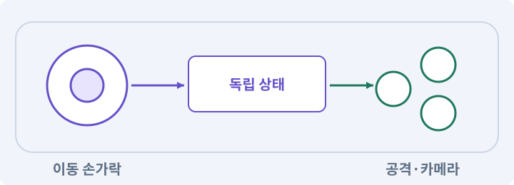

# 010. 모바일 조이스틱과 버튼 배치하기

**목표:** 조이스틱과 버튼이 서로 다른 입력으로 전달됩니다.

**시작 상태:** 공통 이동 모터와 입력 처리

## 한눈에 보는 기능의 흐름

왼쪽 조이스틱 → 이동 상태 → 오른쪽 버튼 → 공격 상태



**경계:** 서로 다른 손가락의 해제를 섞지 않기

그림은 실제 게임 실행 결과가 아닙니다. 값·규칙과 예제를 필요한 때 펼쳐 읽고 현재 단계의 메시지를 한 번씩 보냅니다.

## 1. 지금 상태 확인하기

첫 메시지를 보내 현재 준비 상태를 확인합니다. AI가 읽어 온 실제 프로젝트가 맞는지 보고, 없는 준비나 다른 상태가 있으면 먼저 알려 주세요. 아직 기능을 만들지 않는 단계입니다.

### AI에게 보낼 요구와 이유

#### 01. 작업 대상부터 확인

**“모바일 조이스틱과 버튼 배치하기” 작업을 시작하기 전에 현재 상태를 읽기 전용으로 확인해 줘.**

왜 이렇게 요청하나요? AI가 다른 프로젝트나 오래된 예제를 보고 작업할 수 있습니다. 실제 경로·파일·현재 기능을 읽게 하면 지금 이어서 작업할 대상을 먼저 맞출 수 있습니다.

#### 02. 작업 대상부터 확인

**필요한 시작 상태는 공통 이동 모터와 입력 처리야.**

왜 이렇게 요청하나요? AI가 다른 프로젝트나 오래된 예제를 보고 작업할 수 있습니다. 실제 경로·파일·현재 기능을 읽게 하면 지금 이어서 작업할 대상을 먼저 맞출 수 있습니다.

#### 03. 실제 사용 중인 구현 재사용

**실제 프로젝트와 작업 기록을 읽고 이것이 준비되어 있는지, 이미 같은 기능이 있는지 확인해 줘.**

왜 이렇게 요청하나요? 이름이 비슷한 새 클래스를 또 만들면 기존 화면은 여전히 옛 코드를 사용할 수 있습니다. 실제 호출되는 진입점을 찾아 연결해야 두 구현이 충돌하거나 수정이 반영되지 않는 문제를 막습니다.

#### 04. 현재 상태와 다음 확인 지점 구분

**이번 기능이 연결될 실제 파일·화면·도구와 보존할 기존 동작을 짧게 정리해 줘.**

왜 이렇게 요청하나요? 이미 준비된 기능과 아직 확인하지 못한 기능을 섞으면 불필요한 재설치나 성급한 완료 판정이 생깁니다. 현재 대상과 남은 준비를 나눠 가장 작은 다음 작업을 선택하게 합니다.

#### 05. 조사 단계에서 변경하지 않기

**아직 새 구현·설치·유료 호출·파일 변경은 하지 마.**

왜 이렇게 요청하나요? 현재 상태를 알아보기만 할 때 파일 변경이나 결제가 시작되면 검토 전의 환경이 바뀝니다. 준비 확인과 실제 구현을 나눠 되돌리기 어려운 작업이 먼저 실행되지 않게 합니다.

#### 06. 막힌 준비를 먼저 해결

**준비가 다르면 부족한 항목과 다음에 필요한 작업을 알려 줘.**

왜 이렇게 요청하나요? 빠진 파일·권한·패키지를 있다고 가정하면 다음 구현이 엉뚱한 대상을 만들게 됩니다. 무엇이 없고 무엇을 먼저 해야 하는지 분리하면 불필요한 재작업을 줄일 수 있습니다.

<details>
<summary>보낼 원문 전체 — 설명은 복사되지 않습니다</summary>

```text
“모바일 조이스틱과 버튼 배치하기” 작업을 시작하기 전에 현재 상태를 읽기 전용으로 확인해 줘.
필요한 시작 상태는 공통 이동 모터와 입력 처리야. 실제 프로젝트와 작업 기록을 읽고 이것이 준비되어 있는지, 이미 같은 기능이 있는지 확인해 줘.
이번 기능이 연결될 실제 파일·화면·도구와 보존할 기존 동작을 짧게 정리해 줘. 아직 새 구현·설치·유료 호출·파일 변경은 하지 마. 준비가 다르면 부족한 항목과 다음에 필요한 작업을 알려 줘.
```

</details>

**기대 결과:** 게임을 가리지 않는 터치 UI 배치

### 직접 확인하기

1. AI가 읽은 실제 프로젝트 또는 도구 경로를 확인합니다.
2. 필수 준비가 없다면 문제 해결 요청을 보내고, 준비됐을 때 다음으로 갑니다.

## 2. 필요한 기능 만들기

준비가 확인되면 아래 요청을 보냅니다. AI가 파일·설정·실행을 맡습니다. 변경 범위나 비용 승인이 나오면 내용을 읽고 결정하세요.

### AI에게 보낼 요구와 이유

#### 01. 작업 대상부터 확인

**현재 프로젝트의 실제 파일과 이미 결정한 규칙을 먼저 확인해 줘.**

왜 이렇게 요청하나요? AI가 다른 프로젝트나 오래된 예제를 보고 작업할 수 있습니다. 실제 경로·파일·현재 기능을 읽게 하면 지금 이어서 작업할 대상을 먼저 맞출 수 있습니다.

#### 02. 실제 사용 중인 코드에 연결

**이름이 다른 기존 구현이 있으면 새로 중복 제작하지 말고 그 구현에 연결해 줘.**

왜 이렇게 요청하나요? 예제와 이름이 다르더라도 현재 씬과 입력에서 호출하는 구현이 작업 대상입니다. 같은 기능을 새로 만들기보다 기존 진입점을 확인해 수정이 실제 게임에 반영되고 중복 실행되지 않게 합니다.

#### 03. 동시 입력을 서로 독립적으로 유지

**모바일 조이스틱과 버튼을 UGUI 로 만들고 기존 Gameplay Actions에 연결해 줘.**

왜 이렇게 요청하나요? 한 손가락을 떼었을 때 다른 손가락의 이동까지 해제되면 모바일 전투가 끊깁니다. 입력의 주체와 눌림 상태를 따로 관리하고 실제 두 손가락 조합으로 검사해야 합니다.

#### 04. 사용 성공과 자원 소비 묶기

**왼쪽 아래 이동 스틱, 오른쪽 아래 기본 공격, 주변 스킬 3개, 물약, 상호작용 버튼을 둬 줘.**

왜 이렇게 요청하나요? 실패한 사용에서 자원이 줄거나 연타로 여러 번 차감되면 표시와 실제 행동이 어긋납니다. 사용 조건·비용·대기시간을 함께 처리하고 실패 시 바뀌지 않아야 할 값을 확인합니다.

#### 05. 플랫폼별 실제 실행물 검사

**OnScreenStick은 <Gamepad>/leftStick, 기본 공격은 buttonSouth,**

왜 이렇게 요청하나요? Editor Play와 배포 앱은 빌드·파일·실행 환경이 다릅니다. 설치 형식과 대상 플랫폼을 구분하고 각 실제 실행물에서 메뉴·입력·저장·콘텐츠를 다시 확인합니다.

#### 06. 사용 성공과 자원 소비 묶기

**스킬1/2/3은 buttonWest/buttonEast/buttonNorth, 물약은 rightShoulder,**

왜 이렇게 요청하나요? 실패한 사용에서 자원이 줄거나 연타로 여러 번 차감되면 표시와 실제 행동이 어긋납니다. 사용 조건·비용·대기시간을 함께 처리하고 실패 시 바뀌지 않아야 할 값을 확인합니다.

#### 07. 예시 이름이 아니라 실제 코드에 연결

**상호작용은 leftShoulder로 연결하고 기존 키보드 바인딩과 함께 동작하게 해 줘.**

왜 이렇게 요청하나요? 수강생 프로젝트의 파일 이름은 예제와 다를 수 있습니다. 실제 호출되는 코드와 참조를 찾아 역할 입력에 연결해야 쓰이지 않는 파일을 고치고 완료라고 보고하는 일을 막습니다.

#### 08. 모바일 표시·장치·입력 상태를 함께 확인

**PlayerInput의 자동 장치 전환에 의해 가상 장치가 끊기지 않도록 구성하고**

왜 이렇게 요청하나요? 버튼이 화면에 보이는 것과 가상 입력 장치가 계속 활성화되는 것은 다릅니다. 자동 장치 전환과 실제 기기 경로를 구분해 이동 중 공격해도 다른 입력이 끊기지 않게 합니다.

#### 09. 관찰 가능한 기준으로 확인

**실제로 생성된 장치·Action 연결을 확인해 줘.**

왜 이렇게 요청하나요? 구현 완료라는 설명을 실제 결과로 바꾸기 위한 조건입니다. 요청에 나온 대상과 경계 상황을 확인해 정상 결과뿐 아니라 실패를 어떻게 구분했는지도 남깁니다.

#### 10. 입력 액션의 실제 소유자 확인

**중복 Action 인스턴스는 만들지 마.**

왜 이렇게 요청하나요? 같은 입력 자산을 여러 인스턴스에서 활성화하면 콜백이 중복되거나 가상 조이스틱과 실제 입력이 다른 대상을 사용할 수 있습니다. 한 연결 구조에서 등록·해제를 관리합니다.

#### 11. 동시 입력을 서로 독립적으로 유지

**움직임과 버튼은 서로 다른 pointerId를 독립 처리해야 해.**

왜 이렇게 요청하나요? 한 손가락을 떼었을 때 다른 손가락의 이동까지 해제되면 모바일 전투가 끊깁니다. 입력의 주체와 눌림 상태를 따로 관리하고 실제 두 손가락 조합으로 검사해야 합니다.

#### 12. 타임아웃·중단·취소의 적용 조건

**손가락이 버튼 밖으로 나가서 놓여도, focus/pause/cancel이 와도 held 입력을 해제해 줘.**

왜 이렇게 요청하나요? 타임아웃은 정한 시간 안에 끝나지 않은 작업을 제한하는 규칙입니다. 취소는 더 이상 결과를 원하지 않는다는 요청이며 실제 외부 작업이 즉시 멈추는지는 따로 확인합니다. 타임아웃을 무조건 실패 없음으로 바꾸거나 한도를 자동으로 무한 늘리지 않습니다.

#### 13. 동시 입력을 서로 독립적으로 유지

**오른쪽 버튼의 포인터가 월드 클릭이나 조이스틱 포인터로 처리되지 않게 해 줘.**

왜 이렇게 요청하나요? 한 손가락을 떼었을 때 다른 손가락의 이동까지 해제되면 모바일 전투가 끊깁니다. 입력의 주체와 눌림 상태를 따로 관리하고 실제 두 손가락 조합으로 검사해야 합니다.

#### 14. 안전영역·화면 비율·Viewport의 적용 조건

**Screen.safeArea를 반영하고 실제 버튼 터치 영역과 이미지 경계를 따로 점검해 줘.**

왜 이렇게 요청하나요? 안전영역은 노치·둥근 모서리·시스템 영역 때문에 가려지지 않는 UI 범위입니다. 화면 비율은 가로와 세로의 관계이고, Viewport는 카메라나 UI가 사용하는 화면 영역입니다. 에디터 해상도 프리셋은 실제 터치·시스템 영역 검증을 완전히 대체하지 않습니다.

#### 15. 조회는 상태를 바꾸지 않게

**아직 없는 전투는 구현하지 말고 입력 상태만 개발용 텍스트에 표시해 줘.**

왜 이렇게 요청하나요? 진행 상황을 물을 때 새 구현이나 유료 호출이 시작되면 단순 확인이 실행 명령이 되어 버립니다. 저장된 근거를 읽어 완료·진행·승인 대기·미검증을 나누게 합니다.

#### 16. 모바일 표시·장치·입력 상태를 함께 확인

**Editor ForceMobileUI와 Android 실제 UI 활성화 경로를 구분해 줘.**

왜 이렇게 요청하나요? 버튼이 화면에 보이는 것과 가상 입력 장치가 계속 활성화되는 것은 다릅니다. 자동 장치 전환과 실제 기기 경로를 구분해 이동 중 공격해도 다른 입력이 끊기지 않게 합니다.

#### 17. 구현과 실행은 AI에게 맡기기

**코드·설정·파일 생성·실행은 네가 맡고, 필요한 화면과 결과를 보여 줘.**

왜 이렇게 요청하나요? 설명이나 코드 조각만 받으면 실제 파일 생성·연결·실행이 빠질 수 있습니다. AI가 개발 작업까지 수행하고, 사람은 요구·승인·결과 판단을 맡도록 역할을 분명히 합니다.

#### 18. 막힌 준비를 먼저 해결

**수행하지 못한 작업과 필요한 승인·도구 연결은 구분해서 알려 줘.**

왜 이렇게 요청하나요? 빠진 파일·권한·패키지를 있다고 가정하면 다음 구현이 엉뚱한 대상을 만들게 됩니다. 무엇이 없고 무엇을 먼저 해야 하는지 분리하면 불필요한 재작업을 줄일 수 있습니다.

<details>
<summary>보낼 원문 전체 — 설명은 복사되지 않습니다</summary>

```text
현재 프로젝트의 실제 파일과 이미 결정한 규칙을 먼저 확인해 줘. 이름이 다른 기존 구현이 있으면 새로 중복 제작하지 말고 그 구현에 연결해 줘.

모바일 조이스틱과 버튼을 UGUI 로 만들고 기존 Gameplay Actions에 연결해 줘.
왼쪽 아래 이동 스틱, 오른쪽 아래 기본 공격, 주변 스킬 3개, 물약, 상호작용 버튼을 둬 줘.
OnScreenStick은 <Gamepad>/leftStick, 기본 공격은 buttonSouth,
스킬1/2/3은 buttonWest/buttonEast/buttonNorth, 물약은 rightShoulder,
상호작용은 leftShoulder로 연결하고 기존 키보드 바인딩과 함께 동작하게 해 줘.
PlayerInput의 자동 장치 전환에 의해 가상 장치가 끊기지 않도록 구성하고
실제로 생성된 장치·Action 연결을 확인해 줘. 중복 Action 인스턴스는 만들지 마.
움직임과 버튼은 서로 다른 pointerId를 독립 처리해야 해.
손가락이 버튼 밖으로 나가서 놓여도, focus/pause/cancel이 와도 held 입력을 해제해 줘.
오른쪽 버튼의 포인터가 월드 클릭이나 조이스틱 포인터로 처리되지 않게 해 줘.
Screen.safeArea를 반영하고 실제 버튼 터치 영역과 이미지 경계를 따로 점검해 줘.
아직 없는 전투는 구현하지 말고 입력 상태만 개발용 텍스트에 표시해 줘.
Editor ForceMobileUI와 Android 실제 UI 활성화 경로를 구분해 줘.

코드·설정·파일 생성·실행은 네가 맡고, 필요한 화면과 결과를 보여 줘. 수행하지 못한 작업과 필요한 승인·도구 연결은 구분해서 알려 줘.
```

</details>

**기대 결과:** 확인할 결과: 배치와 입력 연결을 확인하고 실기기 대기를 구분함. AI가 이 상태를 확인할 실제 화면과 변경 내용을 준비합니다. 아직 실행하지 못한 부분은 따로 표시합니다.

### 직접 확인하기

1. 제안서만 반환됐다면 “설명으로 끝내지 말고 승인한 범위의 실제 작업을 수행해 줘”라고 보냅니다.
2. 코드나 설정을 직접 고치라는 안내가 나오면 “작성과 실행은 네가 맡아 줘”라고 요청합니다.

## 3. 결과를 직접 확인하기

먼저 확인 요청을 보내 AI가 검사와 화면을 준비하게 하세요. 그다음 아래 동작을 하나씩 확인합니다.

### AI에게 보낼 요구와 이유

#### 01. 검사할 입력과 관찰 지점 준비

**방금 구현한 기능의 자동 검사와 확인 화면을 준비해 줘.**

왜 이렇게 요청하나요? 정상 예 하나만 보면 실패 조건을 놓치기 쉽습니다. 정상·경계·반례를 실제 입력으로 준비하고 사람이 볼 화면도 맞춰 확인 범위를 분명하게 합니다.

#### 02. 결과를 재확인할 근거 남기기

**정상 동작과 아래 실패 조건을 실제로 검사하고 대상·실행 수·결과를 보여 줘.**

왜 이렇게 요청하나요? “잘 됩니다”라는 요약만으로는 어떤 입력과 버전을 검사했는지 알 수 없습니다. 대상·실행 수·실패 내용·파일을 함께 남겨 같은 조건으로 다시 확인할 수 있게 합니다.

#### 03. 동시 입력을 서로 독립적으로 유지

**가로 화면에서 조이스틱과 버튼이 겹치지 않는다.**

왜 이렇게 요청하나요? 한 손가락을 떼었을 때 다른 손가락의 이동까지 해제되면 모바일 전투가 끊깁니다. 입력의 주체와 눌림 상태를 따로 관리하고 실제 두 손가락 조합으로 검사해야 합니다.

#### 04. 동시 입력을 서로 독립적으로 유지

**조이스틱을 놓으면 Move가 0이다.**

왜 이렇게 요청하나요? 한 손가락을 떼었을 때 다른 손가락의 이동까지 해제되면 모바일 전투가 끊깁니다. 입력의 주체와 눌림 상태를 따로 관리하고 실제 두 손가락 조합으로 검사해야 합니다.

#### 05. 같은 요청의 반복 처리 정의

**누름·해제 상태가 한 번씩 반영된다.**

왜 이렇게 요청하나요? 클릭 연타·재연결·중복 이벤트는 개발과 플레이 중 모두 발생할 수 있습니다. 반복돼도 한 번 처리해야 하는 결과와 매번 새로 처리할 결과를 나눠 데이터가 누적되지 않게 합니다.

#### 06. UI 입력과 월드 입력 분리

**UI 위 터치가 월드 클릭을 만들지 않는다.**

왜 이렇게 요청하나요? 가방 버튼을 누른 입력이 뒤의 바닥 클릭으로도 처리되면 캐릭터가 원치 않게 이동하거나 공격합니다. 입력이 시작된 대상을 구분해 한 행동이 서로 다른 명령으로 중복 처리되지 않게 합니다.

#### 07. 미확인을 완료와 분리

**실기기 동시 입력은 미실행이면 NOT RUN이다.**

왜 이렇게 요청하나요? 만들어진 것, 검사에 실패한 것, 아직 확인하지 못한 것을 나눠야 다음 작업을 정확히 고를 수 있습니다. 실행할 조건이 없는 기능을 성공으로 기록하면 뒤에서 원인을 찾기 어려워집니다.

#### 08. 사람 검사의 시작점 준비

**내가 조작해야 하는 부분은 실행할 화면과 시작 상태를 준비해 줘.**

왜 이렇게 요청하나요? 같은 기능이라도 시작 상태가 다르면 관찰 결과가 달라집니다. AI가 실행 화면과 재현 위치를 먼저 준비해야 사람이 이동·공격·소리·조작감을 같은 조건에서 확인할 수 있습니다.

#### 09. 사람이 실제로 본 것만 기록

**연결되지 않은 휴대폰의 터치나 사람이 보지 않은 재미·소리 품질을 대신 확인했다고 하지 마.**

왜 이렇게 요청하나요? AI가 준비한 검사와 사람이 직접 플레이하거나 들은 결과는 다른 근거입니다. 관찰하지 않은 조작감·소리·실기기 결과를 임의로 완료 처리하지 않게 합니다.

#### 10. 실제로 실행한 검사만 인정

**테스트 0개와 예전 소스 결과는 현재 성공으로 쓰지 마.**

왜 이렇게 요청하나요? 실행된 검사가 없거나 같은 결과를 중복 집계한 경우는 기능을 확인한 것이 아닙니다. 실행 수와 개별 결과를 함께 확인해야 형식적인 성공 표시를 걸러낼 수 있습니다.

<details>
<summary>보낼 원문 전체 — 설명은 복사되지 않습니다</summary>

```text
방금 구현한 기능의 자동 검사와 확인 화면을 준비해 줘. 정상 동작과 아래 실패 조건을 실제로 검사하고 대상·실행 수·결과를 보여 줘.

가로 화면에서 조이스틱과 버튼이 겹치지 않는다. 조이스틱을 놓으면 Move가 0이다. 누름·해제 상태가 한 번씩 반영된다. UI 위 터치가 월드 클릭을 만들지 않는다. 실기기 동시 입력은 미실행이면 NOT RUN이다.

내가 조작해야 하는 부분은 실행할 화면과 시작 상태를 준비해 줘. 연결되지 않은 휴대폰의 터치나 사람이 보지 않은 재미·소리 품질을 대신 확인했다고 하지 마. 테스트 0개와 예전 소스 결과는 현재 성공으로 쓰지 마.
```

</details>

**기대 결과:** 공격 손을 떼도 이동은 유지됩니다. 포커스를 잃으면 남은 입력이 정리되어 복귀 직후 혼자 움직이지 않습니다.

### 직접 확인하기

1. Editor에서 조이스틱을 움직여 입력 표시를 봅니다.
2. 버튼을 눌렀을 때 이동 입력과 다른 표시인지 봅니다.
3. 실제 두 손가락 검사는 휴대폰에서 해야 한다는 점을 확인합니다.

## 4. 결과를 남기고 마무리하기

실제로 본 결과를 아래 메모에 적고 AI에 전달합니다. 결과 저장 요청으로 현재 상태를 남긴 뒤 다음 페이지로 갑니다.

### AI에게 보낼 요구와 이유

#### 01. 결과를 재확인할 근거 남기기

**지금 작업한 “모바일 조이스틱과 버튼 배치하기”의 실제 결과를 정리해 줘.**

왜 이렇게 요청하나요? “잘 됩니다”라는 요약만으로는 어떤 입력과 버전을 검사했는지 알 수 없습니다. 대상·실행 수·실패 내용·파일을 함께 남겨 같은 조건으로 다시 확인할 수 있게 합니다.

#### 02. 다음 작업이 읽을 인수인계

**변경한 기능·파일·현재 후보와 실제 실행한 검사, 남은 문제를 기능 이름으로 기록해 줘.**

왜 이렇게 요청하나요? 새 AI 세션은 이전 대화 전체를 알고 있다고 보장할 수 없습니다. 현재 후보·파일 위치·실행한 검사·남은 일을 남겨야 같은 작업을 반복하지 않고 이어갈 수 있습니다.

#### 03. 사람이 실제로 본 것만 기록

**자동 검사 결과와 내가 직접 확인한 결과를 구분하고, 내 관찰이 아직 없으면 미확인으로 남겨 줘.**

왜 이렇게 요청하나요? AI가 준비한 검사와 사람이 직접 플레이하거나 들은 결과는 다른 근거입니다. 관찰하지 않은 조작감·소리·실기기 결과를 임의로 완료 처리하지 않게 합니다.

#### 04. 다음 작업이 읽을 인수인계

**재시작하거나 다음 작업에서 읽을 기록의 실제 위치를 알려 줘.**

왜 이렇게 요청하나요? 새 AI 세션은 이전 대화 전체를 알고 있다고 보장할 수 없습니다. 현재 후보·파일 위치·실행한 검사·남은 일을 남겨야 같은 작업을 반복하지 않고 이어갈 수 있습니다.

#### 05. 미확인을 완료와 분리

**아직 확인하지 않은 결과를 완료로 채우지 마.**

왜 이렇게 요청하나요? 만들어진 것, 검사에 실패한 것, 아직 확인하지 못한 것을 나눠야 다음 작업을 정확히 고를 수 있습니다. 실행할 조건이 없는 기능을 성공으로 기록하면 뒤에서 원인을 찾기 어려워집니다.

<details>
<summary>보낼 원문 전체 — 설명은 복사되지 않습니다</summary>

```text
지금 작업한 “모바일 조이스틱과 버튼 배치하기”의 실제 결과를 정리해 줘. 변경한 기능·파일·현재 후보와 실제 실행한 검사, 남은 문제를 기능 이름으로 기록해 줘.
자동 검사 결과와 내가 직접 확인한 결과를 구분하고, 내 관찰이 아직 없으면 미확인으로 남겨 줘. 재시작하거나 다음 작업에서 읽을 기록의 실제 위치를 알려 줘. 아직 확인하지 않은 결과를 완료로 채우지 마.
```

</details>

**기대 결과:** 현재 상태·검사 결과·남은 문제·다음에 읽을 기록을 확인할 수 있습니다.

### 직접 확인하기

1. 자동 검사와 내 관찰 결과가 섞이지 않았는지 봅니다.
2. 문제가 남았다면 해결 요청을 보내고 같은 동작을 다시 확인합니다.

## 구체적인 예로 이해하기

### 두 손가락의 누름과 해제

입력은 버튼별 모양만이 아니라 포인터별 수명입니다. 한 손가락을 떼어도 다른 손가락의 입력이 유지되어야 합니다.

**시작 상태:** 실제 Android 기기에서 왼손으로 이동을 계속 누릅니다.

**직접 해 볼 동작:** 오른손으로 공격을 누르고, 공격만 뗀 뒤 다시 누릅니다. 이후 앱을 홈으로 보냈다가 돌아옵니다.

**보여야 하는 결과:** 공격 손을 떼도 이동은 유지됩니다. 포커스를 잃으면 남은 입력이 정리되어 복귀 직후 혼자 움직이지 않습니다.

**이렇게 되면 아직 안 됩니다:** Editor에서 조이스틱과 버튼을 차례로 클릭한 것을 멀티터치 성공으로 보고합니다.

**생각해 보기:** 마우스로 두 버튼을 각각 눌러 봤다면 멀티터치 검사가 끝났나요?

<details><summary>해설 보기</summary>

아니요. 서로 다른 포인터가 동시에 유지되는 상황은 실제 기기에서 따로 확인해야 합니다.

</details>

## 문제가 있으면

### AI에게 보낼 요구와 이유

#### 01. 동시 입력을 서로 독립적으로 유지

**포인터 ID 별 소유권을 확인해 줘.**

왜 이렇게 요청하나요? 한 손가락을 떼었을 때 다른 손가락의 이동까지 해제되면 모바일 전투가 끊깁니다. 입력의 주체와 눌림 상태를 따로 관리하고 실제 두 손가락 조합으로 검사해야 합니다.

#### 02. 동시 입력을 서로 독립적으로 유지

**버튼을 눌렀다는 이유로 조이스틱 입력 전체를 취소하지 마.**

왜 이렇게 요청하나요? 한 손가락을 떼었을 때 다른 손가락의 이동까지 해제되면 모바일 전투가 끊깁니다. 입력의 주체와 눌림 상태를 따로 관리하고 실제 두 손가락 조합으로 검사해야 합니다.

#### 03. 원인 하나를 좁혀 수정

**새 기능을 추가하지 말고 현재 오류와 실제 로그를 먼저 읽어 줘.**

왜 이렇게 요청하나요? 오류 수정 중 새 기능까지 넣으면 어떤 변경이 문제를 해결하거나 악화했는지 알기 어렵습니다. 원래 재현을 보존하고 작은 변경 뒤 같은 입력과 주변 정상 동작을 다시 확인합니다.

#### 04. 원인 하나를 좁혀 수정

**최소 수정 뒤 같은 재현과 관련 정상 동작을 다시 검사해 줘.**

왜 이렇게 요청하나요? 오류 수정 중 새 기능까지 넣으면 어떤 변경이 문제를 해결하거나 악화했는지 알기 어렵습니다. 원래 재현을 보존하고 작은 변경 뒤 같은 입력과 주변 정상 동작을 다시 확인합니다.

#### 05. 실패도 재현 자료로 보존

**실패 기록은 지우지 마.**

왜 이렇게 요청하나요? 실패한 입력과 로그가 있어야 같은 문제가 다시 생겼을 때 비교할 수 있습니다. 성공 기록으로 덮어쓰지 않고 전후 자료를 남기면 무엇을 고쳤는지 확인할 수 있습니다.

<details>
<summary>보낼 원문 전체 — 설명은 복사되지 않습니다</summary>

```text
포인터 ID 별 소유권을 확인해 줘. 버튼을 눌렀다는 이유로 조이스틱 입력 전체를 취소하지 마.
새 기능을 추가하지 말고 현재 오류와 실제 로그를 먼저 읽어 줘. 최소 수정 뒤 같은 재현과 관련 정상 동작을 다시 검사해 줘. 실패 기록은 지우지 마.
```

</details>

## 새 세션에서 이어가기

### AI에게 보낼 요구와 이유

#### 01. 이어서 할 작업 식별

**“모바일 조이스틱과 버튼 배치하기” 작업을 이어가고 싶어.**

왜 이렇게 요청하나요? 이름으로 재개할 작업을 찾고, 뒤에 이어지는 요청으로 실제 파일·진행 중 작업·기록을 다시 읽게 합니다. 제목만 보고 이전 상태를 기억한다고 가정하지 않습니다.

#### 02. 조회는 상태를 바꾸지 않게

**실제 프로젝트와 내 도구의 작업 기록을 읽고 어디까지 구현·검사됐는지 확인해 줘.**

왜 이렇게 요청하나요? 진행 상황을 물을 때 새 구현이나 유료 호출이 시작되면 단순 확인이 실행 명령이 되어 버립니다. 저장된 근거를 읽어 완료·진행·승인 대기·미검증을 나누게 합니다.

#### 03. 재개 전 중복 작업 방지

**진행 중인 프로세스·승인·미저장 변경을 확인한 뒤 남은 가장 작은 작업부터 안내해 줘.**

왜 이렇게 요청하나요? 대화가 끊겨도 외부 작업은 끝났거나 아직 실행 중일 수 있습니다. 프로세스·승인·미저장 상태를 먼저 읽어 같은 생성·빌드·결제를 두 번 시작하지 않도록 합니다.

#### 04. 되돌아갈 원본 남기기

**기존 성공과 실패 기록은 보존해 줘.**

왜 이렇게 요청하나요? 새 구현이 실패해도 이전 게임과 저장을 복원할 수 있어야 합니다. 현재 내용을 먼저 조사하고 별도 후보에서 작업하면 실험이 유일한 정상본을 망가뜨리는 일을 피할 수 있습니다.

<details>
<summary>보낼 원문 전체 — 설명은 복사되지 않습니다</summary>

```text
“모바일 조이스틱과 버튼 배치하기” 작업을 이어가고 싶어. 실제 프로젝트와 내 도구의 작업 기록을 읽고 어디까지 구현·검사됐는지 확인해 줘. 진행 중인 프로세스·승인·미저장 변경을 확인한 뒤 남은 가장 작은 작업부터 안내해 줘. 기존 성공과 실패 기록은 보존해 줘.
```

</details>

## 왜 이렇게 만드는가

모바일 대응은 PC 입력을 화면에 그리는 일만이 아니다. 두 손가락을 동시에 처리하고, 버튼 밖에서 손을 놓거나 앱이 중단되어도 입력이 해제되어야 한다.

Input System의 On-screen Control은 UI를 통해 가상 입력 장치의 값을 만들 수 있다. 여기서는 조이스틱과 버튼을 같은 Gameplay Actions에 연결한다. UI에는 InputSystemUIInputModule을 사용하고 기존 입력 모듈을 중복 배치하지 않는다. [S10][S11]

## 공식 참고

- [Unity Input System: On-screen controls](https://docs.unity3d.com/Packages/com.unity.inputsystem@1.17/manual/OnScreen.html)
- [Unity Input System: UI support](https://docs.unity3d.com/Packages/com.unity.inputsystem@1.17/manual/UISupport.html)


## 실제 Unity Editor 화면 참고
공식 예시와 내 프로젝트 실행 결과를 구분하세요. 원본 사진은 온라인 연결이 필요합니다.

- [Input Actions — 입력 묶음·행동·값의 종류 읽기](../editor_references/input-actions.md)
