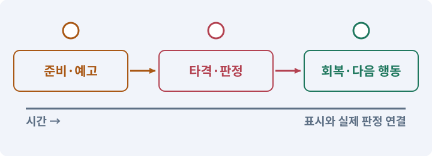

# 012. 체력과 피해를 눈으로 확인하기

**목표:** 피해·회복·사망의 숫자가 체력바와 일치합니다.

**시작 상태:** TestArena와 UI 표시

## 한눈에 보는 기능의 흐름

피해 요청 → 피해 계산 → 체력 갱신 → 사망·회복 판단



**경계:** 체력이 0 아래나 최대치를 넘지 않기

그림은 실제 게임 실행 결과가 아닙니다. 값·규칙과 예제를 필요한 때 펼쳐 읽고 현재 단계의 메시지를 한 번씩 보냅니다.

## 1. 지금 상태 확인하기

첫 메시지를 보내 현재 준비 상태를 확인합니다. AI가 읽어 온 실제 프로젝트가 맞는지 보고, 없는 준비나 다른 상태가 있으면 먼저 알려 주세요. 아직 기능을 만들지 않는 단계입니다.

### AI에게 보낼 요구와 이유

#### 01. 작업 대상부터 확인

**“체력과 피해를 눈으로 확인하기” 작업을 시작하기 전에 현재 상태를 읽기 전용으로 확인해 줘.**

왜 이렇게 요청하나요? AI가 다른 프로젝트나 오래된 예제를 보고 작업할 수 있습니다. 실제 경로·파일·현재 기능을 읽게 하면 지금 이어서 작업할 대상을 먼저 맞출 수 있습니다.

#### 02. 작업 대상부터 확인

**필요한 시작 상태는 TestArena와 UI 표시야.**

왜 이렇게 요청하나요? AI가 다른 프로젝트나 오래된 예제를 보고 작업할 수 있습니다. 실제 경로·파일·현재 기능을 읽게 하면 지금 이어서 작업할 대상을 먼저 맞출 수 있습니다.

#### 03. 실제 사용 중인 구현 재사용

**실제 프로젝트와 작업 기록을 읽고 이것이 준비되어 있는지, 이미 같은 기능이 있는지 확인해 줘.**

왜 이렇게 요청하나요? 이름이 비슷한 새 클래스를 또 만들면 기존 화면은 여전히 옛 코드를 사용할 수 있습니다. 실제 호출되는 진입점을 찾아 연결해야 두 구현이 충돌하거나 수정이 반영되지 않는 문제를 막습니다.

#### 04. 현재 상태와 다음 확인 지점 구분

**이번 기능이 연결될 실제 파일·화면·도구와 보존할 기존 동작을 짧게 정리해 줘.**

왜 이렇게 요청하나요? 이미 준비된 기능과 아직 확인하지 못한 기능을 섞으면 불필요한 재설치나 성급한 완료 판정이 생깁니다. 현재 대상과 남은 준비를 나눠 가장 작은 다음 작업을 선택하게 합니다.

#### 05. 조사 단계에서 변경하지 않기

**아직 새 구현·설치·유료 호출·파일 변경은 하지 마.**

왜 이렇게 요청하나요? 현재 상태를 알아보기만 할 때 파일 변경이나 결제가 시작되면 검토 전의 환경이 바뀝니다. 준비 확인과 실제 구현을 나눠 되돌리기 어려운 작업이 먼저 실행되지 않게 합니다.

#### 06. 막힌 준비를 먼저 해결

**준비가 다르면 부족한 항목과 다음에 필요한 작업을 알려 줘.**

왜 이렇게 요청하나요? 빠진 파일·권한·패키지를 있다고 가정하면 다음 구현이 엉뚱한 대상을 만들게 됩니다. 무엇이 없고 무엇을 먼저 해야 하는지 분리하면 불필요한 재작업을 줄일 수 있습니다.

<details>
<summary>보낼 원문 전체 — 설명은 복사되지 않습니다</summary>

```text
“체력과 피해를 눈으로 확인하기” 작업을 시작하기 전에 현재 상태를 읽기 전용으로 확인해 줘.
필요한 시작 상태는 TestArena와 UI 표시야. 실제 프로젝트와 작업 기록을 읽고 이것이 준비되어 있는지, 이미 같은 기능이 있는지 확인해 줘.
이번 기능이 연결될 실제 파일·화면·도구와 보존할 기존 동작을 짧게 정리해 줘. 아직 새 구현·설치·유료 호출·파일 변경은 하지 마. 준비가 다르면 부족한 항목과 다음에 필요한 작업을 알려 줘.
```

</details>

**기대 결과:** 대상의 현재·최대 체력과 사용할 계산 규칙

### 직접 확인하기

1. AI가 읽은 실제 프로젝트 또는 도구 경로를 확인합니다.
2. 필수 준비가 없다면 문제 해결 요청을 보내고, 준비됐을 때 다음으로 갑니다.

## 2. 필요한 기능 만들기

준비가 확인되면 아래 요청을 보냅니다. AI가 파일·설정·실행을 맡습니다. 변경 범위나 비용 승인이 나오면 내용을 읽고 결정하세요.

### AI에게 보낼 요구와 이유

#### 01. 작업 대상부터 확인

**현재 프로젝트의 실제 파일과 이미 결정한 규칙을 먼저 확인해 줘.**

왜 이렇게 요청하나요? AI가 다른 프로젝트나 오래된 예제를 보고 작업할 수 있습니다. 실제 경로·파일·현재 기능을 읽게 하면 지금 이어서 작업할 대상을 먼저 맞출 수 있습니다.

#### 02. 실제 사용 중인 코드에 연결

**이름이 다른 기존 구현이 있으면 새로 중복 제작하지 말고 그 구현에 연결해 줘.**

왜 이렇게 요청하나요? 예제와 이름이 다르더라도 현재 씬과 입력에서 호출하는 구현이 작업 대상입니다. 같은 기능을 새로 만들기보다 기존 진입점을 확인해 수정이 실제 게임에 반영되고 중복 실행되지 않게 합니다.

#### 03. 전투 수치를 한 규칙으로 계산

**Core에 테스트 가능한 DamageCalculator와 HealthState를 만들어 줘.**

왜 이렇게 요청하나요? 표시와 실제 피해 계산이 다르면 장비·레벨·스킬 효과를 믿을 수 없습니다. 경계값과 사망·회복 조건을 명확히 정하고 숫자와 체력바를 함께 비교합니다.

#### 04. 전투 수치를 한 규칙으로 계산

**피해 공식은 max(1, roundAwayFromZero(rawDamage*100/(100+max(0,armor))))다.**

왜 이렇게 요청하나요? 표시와 실제 피해 계산이 다르면 장비·레벨·스킬 효과를 믿을 수 없습니다. 경계값과 사망·회복 조건을 명확히 정하고 숫자와 체력바를 함께 비교합니다.

#### 05. 전투 수치를 한 규칙으로 계산

**rawDamage가 0 이하인 요청은 무효로 처리하고 피해 0을 반환해 줘.**

왜 이렇게 요청하나요? 표시와 실제 피해 계산이 다르면 장비·레벨·스킬 효과를 믿을 수 없습니다. 경계값과 사망·회복 조건을 명확히 정하고 숫자와 체력바를 함께 비교합니다.

#### 06. 전투 수치를 한 규칙으로 계산

**체력은 0..MaxHp 범위, 중복 사망 이벤트 금지, 죽은 대상은 추가 피해·일반 회복을 거부해 줘.**

왜 이렇게 요청하나요? 표시와 실제 피해 계산이 다르면 장비·레벨·스킬 효과를 믿을 수 없습니다. 경계값과 사망·회복 조건을 명확히 정하고 숫자와 체력바를 함께 비교합니다.

#### 07. 사망과 회복을 별도 상태로 처리

**부활은 별도 명시 동작으로만 허용해 줘.**

왜 이렇게 요청하나요? 죽은 대상에게 일반 회복을 적용했다고 자동 부활하면 사망 처리·보상·재시작 흐름과 충돌할 수 있습니다. 부활은 명시적인 상태 전환으로만 허용해 중복 처리를 막습니다.

#### 08. 스크립트와 실제 씬 연결

**Runtime에는 배우의 체력·능력치를 바인딩하는 컴포넌트와 체력 표시를 만들어 줘.**

왜 이렇게 요청하나요? 코드 파일을 만들어도 씬의 오브젝트에 붙지 않거나 참조가 비어 있으면 플레이에 반영되지 않습니다. 실제 사용하는 프리팹과 컴포넌트까지 연결해 동작을 확인하게 합니다.

#### 09. 설정·기본값·검증·환경 변수의 적용 조건

**플레이어 기본값은 HP100/MP50/ATK12/Armor0이다.**

왜 이렇게 요청하나요? 설정은 프로그램의 동작을 바꾸는 입력입니다. 코드와 분리할 수 있지만 잘못된 값은 위험하므로 형식·범위·경로·권한을 검증해야 합니다. 환경 변수는 실행 환경에서 전달하는 이름과 값입니다. 설정을 바꾸는 것도 게임·하네스의 동작 변경입니다. 코드가 그대로라고 재검사가 필요 없지는 않습니다.

#### 10. 관찰 가능한 기준으로 확인

**테스트는 12 대 방어0=12, 12 대 방어20=10, 12 대 방어100=6,**

왜 이렇게 요청하나요? 구현 완료라는 설명을 실제 결과로 바꾸기 위한 조건입니다. 요청에 나온 대상과 경계 상황을 확인해 정상 결과뿐 아니라 실패를 어떻게 구분했는지도 남깁니다.

#### 11. 사망과 회복을 별도 상태로 처리

**무효 피해=0, 초과 피해에서 HP0, 과잉 회복에서 최대치,**

왜 이렇게 요청하나요? 죽은 대상에게 일반 회복을 적용했다고 자동 부활하면 사망 처리·보상·재시작 흐름과 충돌할 수 있습니다. 부활은 명시적인 상태 전환으로만 허용해 중복 처리를 막습니다.

#### 12. 이벤트·콜백·구독·이벤트 버스의 적용 조건

**같은 대상의 사망 이벤트 1회를 포함해 줘.**

왜 이렇게 요청하나요? 이벤트는 어떤 일이 일어났다는 알림입니다. 구독자는 관심 있는 알림을 받아 콜백을 실행합니다. 이벤트 버스는 여러 기능 사이의 알림 전달을 모으는 구조입니다. 모든 것을 전역 이벤트로 만들면 흐름을 추적하기 어려워집니다. 소유권·발행 시점·순서를 명시합니다.

#### 13. 관찰 가능한 기준으로 확인

**TestArena에서 개발용 피해/회복 버튼으로 실제 UI 연결도 검증해 줘.**

왜 이렇게 요청하나요? 구현 완료라는 설명을 실제 결과로 바꾸기 위한 조건입니다. 요청에 나온 대상과 경계 상황을 확인해 정상 결과뿐 아니라 실패를 어떻게 구분했는지도 남깁니다.

#### 14. 예시 이름이 아니라 실제 코드에 연결

**Core 테스트를 통과했다는 이유로 Runtime 바인딩 검증을 생략하지 마.**

왜 이렇게 요청하나요? 수강생 프로젝트의 파일 이름은 예제와 다를 수 있습니다. 실제 호출되는 코드와 참조를 찾아 역할 입력에 연결해야 쓰이지 않는 파일을 고치고 완료라고 보고하는 일을 막습니다.

#### 15. 구현과 실행은 AI에게 맡기기

**코드·설정·파일 생성·실행은 네가 맡고, 필요한 화면과 결과를 보여 줘.**

왜 이렇게 요청하나요? 설명이나 코드 조각만 받으면 실제 파일 생성·연결·실행이 빠질 수 있습니다. AI가 개발 작업까지 수행하고, 사람은 요구·승인·결과 판단을 맡도록 역할을 분명히 합니다.

#### 16. 막힌 준비를 먼저 해결

**수행하지 못한 작업과 필요한 승인·도구 연결은 구분해서 알려 줘.**

왜 이렇게 요청하나요? 빠진 파일·권한·패키지를 있다고 가정하면 다음 구현이 엉뚱한 대상을 만들게 됩니다. 무엇이 없고 무엇을 먼저 해야 하는지 분리하면 불필요한 재작업을 줄일 수 있습니다.

<details>
<summary>보낼 원문 전체 — 설명은 복사되지 않습니다</summary>

```text
현재 프로젝트의 실제 파일과 이미 결정한 규칙을 먼저 확인해 줘. 이름이 다른 기존 구현이 있으면 새로 중복 제작하지 말고 그 구현에 연결해 줘.

Core에 테스트 가능한 DamageCalculator와 HealthState를 만들어 줘.
피해 공식은 max(1, roundAwayFromZero(rawDamage*100/(100+max(0,armor))))다.
rawDamage가 0 이하인 요청은 무효로 처리하고 피해 0을 반환해 줘.
체력은 0..MaxHp 범위, 중복 사망 이벤트 금지, 죽은 대상은 추가 피해·일반 회복을 거부해 줘.
부활은 별도 명시 동작으로만 허용해 줘.
Runtime에는 배우의 체력·능력치를 바인딩하는 컴포넌트와 체력 표시를 만들어 줘.
플레이어 기본값은 HP100/MP50/ATK12/Armor0이다.
테스트는 12 대 방어0=12, 12 대 방어20=10, 12 대 방어100=6,
무효 피해=0, 초과 피해에서 HP0, 과잉 회복에서 최대치,
같은 대상의 사망 이벤트 1회를 포함해 줘.
TestArena에서 개발용 피해/회복 버튼으로 실제 UI 연결도 검증해 줘.
Core 테스트를 통과했다는 이유로 Runtime 바인딩 검증을 생략하지 마.

코드·설정·파일 생성·실행은 네가 맡고, 필요한 화면과 결과를 보여 줘. 수행하지 못한 작업과 필요한 승인·도구 연결은 구분해서 알려 줘.
```

</details>

**기대 결과:** 확인할 결과: 피해·회복·사망의 경계가 맞음. AI가 이 상태를 확인할 실제 화면과 변경 내용을 준비합니다. 아직 실행하지 못한 부분은 따로 표시합니다.

### 직접 확인하기

1. 제안서만 반환됐다면 “설명으로 끝내지 말고 승인한 범위의 실제 작업을 수행해 줘”라고 보냅니다.
2. 코드나 설정을 직접 고치라는 안내가 나오면 “작성과 실행은 네가 맡아 줘”라고 요청합니다.

## 3. 결과를 직접 확인하기

먼저 확인 요청을 보내 AI가 검사와 화면을 준비하게 하세요. 그다음 아래 동작을 하나씩 확인합니다.

### AI에게 보낼 요구와 이유

#### 01. 검사할 입력과 관찰 지점 준비

**방금 구현한 기능의 자동 검사와 확인 화면을 준비해 줘.**

왜 이렇게 요청하나요? 정상 예 하나만 보면 실패 조건을 놓치기 쉽습니다. 정상·경계·반례를 실제 입력으로 준비하고 사람이 볼 화면도 맞춰 확인 범위를 분명하게 합니다.

#### 02. 결과를 재확인할 근거 남기기

**정상 동작과 아래 실패 조건을 실제로 검사하고 대상·실행 수·결과를 보여 줘.**

왜 이렇게 요청하나요? “잘 됩니다”라는 요약만으로는 어떤 입력과 버전을 검사했는지 알 수 없습니다. 대상·실행 수·실패 내용·파일을 함께 남겨 같은 조건으로 다시 확인할 수 있게 합니다.

#### 03. 값의 경계와 계산 결과 확인

**피해 12가 들어오면 HP100→88이다.**

왜 이렇게 요청하나요? 피해는 체력을 0 아래로, 회복은 최대치 위로 보내지 않아야 합니다. 알려진 입력값과 기대값을 먼저 계산하고 음수·초과량을 넣어 경계에서도 결과가 유지되는지 확인합니다.

#### 04. 값의 경계와 계산 결과 확인

**회복 35를 적용하면 100을 넘지 않는다.**

왜 이렇게 요청하나요? 피해는 체력을 0 아래로, 회복은 최대치 위로 보내지 않아야 합니다. 알려진 입력값과 기대값을 먼저 계산하고 음수·초과량을 넣어 경계에서도 결과가 유지되는지 확인합니다.

#### 05. 같은 요청의 반복 처리 정의

**죽었을 때 이벤트는 한 번이다.**

왜 이렇게 요청하나요? 클릭 연타·재연결·중복 이벤트는 개발과 플레이 중 모두 발생할 수 있습니다. 반복돼도 한 번 처리해야 하는 결과와 매번 새로 처리할 결과를 나눠 데이터가 누적되지 않게 합니다.

#### 06. 구현할 결과와 조건 고정

**HP 데이터와 표시가 일치한다.**

왜 이렇게 요청하나요? “HP 데이터와 표시가 일치한다”를 명시하면 AI가 무엇을 구현하거나 검사해야 하는지 범위를 좁힐 수 있습니다. 피해·회복·사망의 숫자가 체력바와 일치합니다. 이 결과를 확인할 때 이 조건이 실제로 반영됐는지 함께 봅니다.

#### 07. 관찰 가능한 기준으로 확인

**유효 피해를 무조건 0으로 만들어 테스트를 통과시키지 않는다.**

왜 이렇게 요청하나요? 구현 완료라는 설명을 실제 결과로 바꾸기 위한 조건입니다. 요청에 나온 대상과 경계 상황을 확인해 정상 결과뿐 아니라 실패를 어떻게 구분했는지도 남깁니다.

#### 08. 사람 검사의 시작점 준비

**내가 조작해야 하는 부분은 실행할 화면과 시작 상태를 준비해 줘.**

왜 이렇게 요청하나요? 같은 기능이라도 시작 상태가 다르면 관찰 결과가 달라집니다. AI가 실행 화면과 재현 위치를 먼저 준비해야 사람이 이동·공격·소리·조작감을 같은 조건에서 확인할 수 있습니다.

#### 09. 사람이 실제로 본 것만 기록

**연결되지 않은 휴대폰의 터치나 사람이 보지 않은 재미·소리 품질을 대신 확인했다고 하지 마.**

왜 이렇게 요청하나요? AI가 준비한 검사와 사람이 직접 플레이하거나 들은 결과는 다른 근거입니다. 관찰하지 않은 조작감·소리·실기기 결과를 임의로 완료 처리하지 않게 합니다.

#### 10. 실제로 실행한 검사만 인정

**테스트 0개와 예전 소스 결과는 현재 성공으로 쓰지 마.**

왜 이렇게 요청하나요? 실행된 검사가 없거나 같은 결과를 중복 집계한 경우는 기능을 확인한 것이 아닙니다. 실행 수와 개별 결과를 함께 확인해야 형식적인 성공 표시를 걸러낼 수 있습니다.

<details>
<summary>보낼 원문 전체 — 설명은 복사되지 않습니다</summary>

```text
방금 구현한 기능의 자동 검사와 확인 화면을 준비해 줘. 정상 동작과 아래 실패 조건을 실제로 검사하고 대상·실행 수·결과를 보여 줘.

피해 12가 들어오면 HP100→88이다. 회복 35를 적용하면 100을 넘지 않는다. 죽었을 때 이벤트는 한 번이다. HP 데이터와 표시가 일치한다. 유효 피해를 무조건 0으로 만들어 테스트를 통과시키지 않는다.

내가 조작해야 하는 부분은 실행할 화면과 시작 상태를 준비해 줘. 연결되지 않은 휴대폰의 터치나 사람이 보지 않은 재미·소리 품질을 대신 확인했다고 하지 마. 테스트 0개와 예전 소스 결과는 현재 성공으로 쓰지 마.
```

</details>

**기대 결과:** 정상 공격은 36→24입니다. 별개의 공격은 다시 피해를 주되, 같은 타격의 중복은 한 번만 반영합니다.

### 직접 확인하기

1. 피해 버튼을 눌러 숫자와 체력바를 비교합니다.
2. 최대 체력에서 회복해도 넘치지 않는지 봅니다.
3. 체력이 0이 된 뒤 사망 알림이 반복되지 않는지 봅니다.

## 4. 결과를 남기고 마무리하기

실제로 본 결과를 아래 메모에 적고 AI에 전달합니다. 결과 저장 요청으로 현재 상태를 남긴 뒤 다음 페이지로 갑니다.

### AI에게 보낼 요구와 이유

#### 01. 결과를 재확인할 근거 남기기

**지금 작업한 “체력과 피해를 눈으로 확인하기”의 실제 결과를 정리해 줘.**

왜 이렇게 요청하나요? “잘 됩니다”라는 요약만으로는 어떤 입력과 버전을 검사했는지 알 수 없습니다. 대상·실행 수·실패 내용·파일을 함께 남겨 같은 조건으로 다시 확인할 수 있게 합니다.

#### 02. 다음 작업이 읽을 인수인계

**변경한 기능·파일·현재 후보와 실제 실행한 검사, 남은 문제를 기능 이름으로 기록해 줘.**

왜 이렇게 요청하나요? 새 AI 세션은 이전 대화 전체를 알고 있다고 보장할 수 없습니다. 현재 후보·파일 위치·실행한 검사·남은 일을 남겨야 같은 작업을 반복하지 않고 이어갈 수 있습니다.

#### 03. 사람이 실제로 본 것만 기록

**자동 검사 결과와 내가 직접 확인한 결과를 구분하고, 내 관찰이 아직 없으면 미확인으로 남겨 줘.**

왜 이렇게 요청하나요? AI가 준비한 검사와 사람이 직접 플레이하거나 들은 결과는 다른 근거입니다. 관찰하지 않은 조작감·소리·실기기 결과를 임의로 완료 처리하지 않게 합니다.

#### 04. 다음 작업이 읽을 인수인계

**재시작하거나 다음 작업에서 읽을 기록의 실제 위치를 알려 줘.**

왜 이렇게 요청하나요? 새 AI 세션은 이전 대화 전체를 알고 있다고 보장할 수 없습니다. 현재 후보·파일 위치·실행한 검사·남은 일을 남겨야 같은 작업을 반복하지 않고 이어갈 수 있습니다.

#### 05. 미확인을 완료와 분리

**아직 확인하지 않은 결과를 완료로 채우지 마.**

왜 이렇게 요청하나요? 만들어진 것, 검사에 실패한 것, 아직 확인하지 못한 것을 나눠야 다음 작업을 정확히 고를 수 있습니다. 실행할 조건이 없는 기능을 성공으로 기록하면 뒤에서 원인을 찾기 어려워집니다.

<details>
<summary>보낼 원문 전체 — 설명은 복사되지 않습니다</summary>

```text
지금 작업한 “체력과 피해를 눈으로 확인하기”의 실제 결과를 정리해 줘. 변경한 기능·파일·현재 후보와 실제 실행한 검사, 남은 문제를 기능 이름으로 기록해 줘.
자동 검사 결과와 내가 직접 확인한 결과를 구분하고, 내 관찰이 아직 없으면 미확인으로 남겨 줘. 재시작하거나 다음 작업에서 읽을 기록의 실제 위치를 알려 줘. 아직 확인하지 않은 결과를 완료로 채우지 마.
```

</details>

**기대 결과:** 현재 상태·검사 결과·남은 문제·다음에 읽을 기록을 확인할 수 있습니다.

### 직접 확인하기

1. 자동 검사와 내 관찰 결과가 섞이지 않았는지 봅니다.
2. 문제가 남았다면 해결 요청을 보내고 같은 동작을 다시 확인합니다.

## 구체적인 예로 이해하기

### 피해 계산과 사망 사건

피해는 체력 숫자의 변경이고 사망은 한 번만 발생해야 하는 상태 전이입니다.

**시작 상태:** 살아 있는 적의 HP가 36이며 이번 직접 공격의 최종 피해가 12입니다.

**직접 해 볼 동작:** 한 번 공격한 뒤 같은 타격 사건을 중복 전달하는 시험도 AI에게 준비시킵니다.

**보여야 하는 결과:** 정상 공격은 36→24입니다. 별개의 공격은 다시 피해를 주되, 같은 타격의 중복은 한 번만 반영합니다.

**이렇게 되면 아직 안 됩니다:** HP가 0 이하인 매 프레임 사망 사건을 보내 경험치와 드롭이 반복됩니다.

**생각해 보기:** 체력을 0으로 제한했는데 경험치가 두 번 나왔다면 어디를 봐야 하나요?

<details><summary>해설 보기</summary>

체력 clamp만으로 사망 사건이 한 번이 되지는 않습니다. 살아 있음→사망 전이와 사건 ID·보상 소비자를 확인합니다.

</details>

## 문제가 있으면

### AI에게 보낼 요구와 이유

#### 01. 구현할 결과와 조건 고정

**기대값을 코드에 맞춰 바꾸지 말고 입력 수치부터 계산해 줘.**

왜 이렇게 요청하나요? “기대값을 코드에 맞춰 바꾸지 말고 입력 수치부터 계산해 줘”를 명시하면 AI가 무엇을 구현하거나 검사해야 하는지 범위를 좁힐 수 있습니다. 피해·회복·사망의 숫자가 체력바와 일치합니다. 이 결과를 확인할 때 이 조건이 실제로 반영됐는지 함께 봅니다.

#### 02. 같은 요청의 반복 처리 정의

**같은 피해가 두 번 전달되는지도 확인해 줘.**

왜 이렇게 요청하나요? 클릭 연타·재연결·중복 이벤트는 개발과 플레이 중 모두 발생할 수 있습니다. 반복돼도 한 번 처리해야 하는 결과와 매번 새로 처리할 결과를 나눠 데이터가 누적되지 않게 합니다.

#### 03. 원인 하나를 좁혀 수정

**새 기능을 추가하지 말고 현재 오류와 실제 로그를 먼저 읽어 줘.**

왜 이렇게 요청하나요? 오류 수정 중 새 기능까지 넣으면 어떤 변경이 문제를 해결하거나 악화했는지 알기 어렵습니다. 원래 재현을 보존하고 작은 변경 뒤 같은 입력과 주변 정상 동작을 다시 확인합니다.

#### 04. 원인 하나를 좁혀 수정

**최소 수정 뒤 같은 재현과 관련 정상 동작을 다시 검사해 줘.**

왜 이렇게 요청하나요? 오류 수정 중 새 기능까지 넣으면 어떤 변경이 문제를 해결하거나 악화했는지 알기 어렵습니다. 원래 재현을 보존하고 작은 변경 뒤 같은 입력과 주변 정상 동작을 다시 확인합니다.

#### 05. 실패도 재현 자료로 보존

**실패 기록은 지우지 마.**

왜 이렇게 요청하나요? 실패한 입력과 로그가 있어야 같은 문제가 다시 생겼을 때 비교할 수 있습니다. 성공 기록으로 덮어쓰지 않고 전후 자료를 남기면 무엇을 고쳤는지 확인할 수 있습니다.

<details>
<summary>보낼 원문 전체 — 설명은 복사되지 않습니다</summary>

```text
기대값을 코드에 맞춰 바꾸지 말고 입력 수치부터 계산해 줘. 같은 피해가 두 번 전달되는지도 확인해 줘.
새 기능을 추가하지 말고 현재 오류와 실제 로그를 먼저 읽어 줘. 최소 수정 뒤 같은 재현과 관련 정상 동작을 다시 검사해 줘. 실패 기록은 지우지 마.
```

</details>

## 새 세션에서 이어가기

### AI에게 보낼 요구와 이유

#### 01. 이어서 할 작업 식별

**“체력과 피해를 눈으로 확인하기” 작업을 이어가고 싶어.**

왜 이렇게 요청하나요? 이름으로 재개할 작업을 찾고, 뒤에 이어지는 요청으로 실제 파일·진행 중 작업·기록을 다시 읽게 합니다. 제목만 보고 이전 상태를 기억한다고 가정하지 않습니다.

#### 02. 조회는 상태를 바꾸지 않게

**실제 프로젝트와 내 도구의 작업 기록을 읽고 어디까지 구현·검사됐는지 확인해 줘.**

왜 이렇게 요청하나요? 진행 상황을 물을 때 새 구현이나 유료 호출이 시작되면 단순 확인이 실행 명령이 되어 버립니다. 저장된 근거를 읽어 완료·진행·승인 대기·미검증을 나누게 합니다.

#### 03. 재개 전 중복 작업 방지

**진행 중인 프로세스·승인·미저장 변경을 확인한 뒤 남은 가장 작은 작업부터 안내해 줘.**

왜 이렇게 요청하나요? 대화가 끊겨도 외부 작업은 끝났거나 아직 실행 중일 수 있습니다. 프로세스·승인·미저장 상태를 먼저 읽어 같은 생성·빌드·결제를 두 번 시작하지 않도록 합니다.

#### 04. 되돌아갈 원본 남기기

**기존 성공과 실패 기록은 보존해 줘.**

왜 이렇게 요청하나요? 새 구현이 실패해도 이전 게임과 저장을 복원할 수 있어야 합니다. 현재 내용을 먼저 조사하고 별도 후보에서 작업하면 실험이 유일한 정상본을 망가뜨리는 일을 피할 수 있습니다.

<details>
<summary>보낼 원문 전체 — 설명은 복사되지 않습니다</summary>

```text
“체력과 피해를 눈으로 확인하기” 작업을 이어가고 싶어. 실제 프로젝트와 내 도구의 작업 기록을 읽고 어디까지 구현·검사됐는지 확인해 줘. 진행 중인 프로세스·승인·미저장 변경을 확인한 뒤 남은 가장 작은 작업부터 안내해 줘. 기존 성공과 실패 기록은 보존해 줘.
```

</details>

## 왜 이렇게 만드는가

체력바가 줄어드는 모습과 체력이라는 데이터는 서로 다르다. 규칙이 정확해야 UI가 바뀌어도 게임이 유지된다. 피해 계산처럼 입력과 결과가 명확한 기능을 먼저 테스트하면 AI의 실수를 잡기 쉽다.

이 강의의 초기값은 플레이어 체력 100, 마나 50, 공격력 12, 방어력 0이다. 피해는 rawDamage × 100 / (100 + max(0, armor))를 계산해 0.5는 올림으로 반올림하고 최소 1로 제한한다. 이것은 본 강의의 단순화된 규칙이지 디아블로 2의 실제 공식이 아니다.

## 공식 참고


## 실제 Unity Editor 화면 참고
공식 예시와 내 프로젝트 실행 결과를 구분하세요. 원본 사진은 온라인 연결이 필요합니다.

- [Editor 전체 배치 — 어디를 보고 있는지 구분하기](../editor_references/editor-layout.md)
