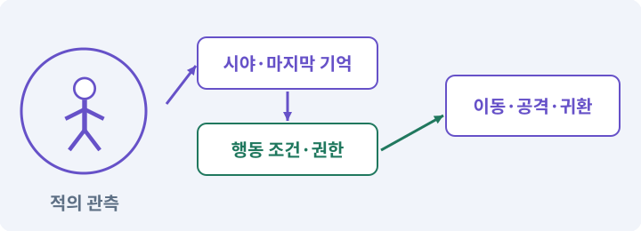

# 015. 다른 방식으로 싸우는 적 추가하기

**목표:** 석궁수·거구·정예의 차이를 전투에서 느낍니다.

**시작 상태:** 근접 적 한 종류

## 한눈에 보는 기능의 흐름

근접 압박 → 석궁 사격 → 거구의 예고 → 정예 변형



**경계:** 역할 차이는 보이되 기존 피해 규칙은 유지

그림은 실제 게임 실행 결과가 아닙니다. 값·규칙과 예제를 필요한 때 펼쳐 읽고 현재 단계의 메시지를 한 번씩 보냅니다.

## 1. 지금 상태 확인하기

첫 메시지를 보내 현재 준비 상태를 확인합니다. AI가 읽어 온 실제 프로젝트가 맞는지 보고, 없는 준비나 다른 상태가 있으면 먼저 알려 주세요. 아직 기능을 만들지 않는 단계입니다.

### AI에게 보낼 요구와 이유

#### 01. 작업 대상부터 확인

**“다른 방식으로 싸우는 적 추가하기” 작업을 시작하기 전에 현재 상태를 읽기 전용으로 확인해 줘.**

왜 이렇게 요청하나요? AI가 다른 프로젝트나 오래된 예제를 보고 작업할 수 있습니다. 실제 경로·파일·현재 기능을 읽게 하면 지금 이어서 작업할 대상을 먼저 맞출 수 있습니다.

#### 02. 작업 대상부터 확인

**필요한 시작 상태는 근접 적 한 종류야.**

왜 이렇게 요청하나요? AI가 다른 프로젝트나 오래된 예제를 보고 작업할 수 있습니다. 실제 경로·파일·현재 기능을 읽게 하면 지금 이어서 작업할 대상을 먼저 맞출 수 있습니다.

#### 03. 실제 사용 중인 구현 재사용

**실제 프로젝트와 작업 기록을 읽고 이것이 준비되어 있는지, 이미 같은 기능이 있는지 확인해 줘.**

왜 이렇게 요청하나요? 이름이 비슷한 새 클래스를 또 만들면 기존 화면은 여전히 옛 코드를 사용할 수 있습니다. 실제 호출되는 진입점을 찾아 연결해야 두 구현이 충돌하거나 수정이 반영되지 않는 문제를 막습니다.

#### 04. 현재 상태와 다음 확인 지점 구분

**이번 기능이 연결될 실제 파일·화면·도구와 보존할 기존 동작을 짧게 정리해 줘.**

왜 이렇게 요청하나요? 이미 준비된 기능과 아직 확인하지 못한 기능을 섞으면 불필요한 재설치나 성급한 완료 판정이 생깁니다. 현재 대상과 남은 준비를 나눠 가장 작은 다음 작업을 선택하게 합니다.

#### 05. 조사 단계에서 변경하지 않기

**아직 새 구현·설치·유료 호출·파일 변경은 하지 마.**

왜 이렇게 요청하나요? 현재 상태를 알아보기만 할 때 파일 변경이나 결제가 시작되면 검토 전의 환경이 바뀝니다. 준비 확인과 실제 구현을 나눠 되돌리기 어려운 작업이 먼저 실행되지 않게 합니다.

#### 06. 막힌 준비를 먼저 해결

**준비가 다르면 부족한 항목과 다음에 필요한 작업을 알려 줘.**

왜 이렇게 요청하나요? 빠진 파일·권한·패키지를 있다고 가정하면 다음 구현이 엉뚱한 대상을 만들게 됩니다. 무엇이 없고 무엇을 먼저 해야 하는지 분리하면 불필요한 재작업을 줄일 수 있습니다.

<details>
<summary>보낼 원문 전체 — 설명은 복사되지 않습니다</summary>

```text
“다른 방식으로 싸우는 적 추가하기” 작업을 시작하기 전에 현재 상태를 읽기 전용으로 확인해 줘.
필요한 시작 상태는 근접 적 한 종류야. 실제 프로젝트와 작업 기록을 읽고 이것이 준비되어 있는지, 이미 같은 기능이 있는지 확인해 줘.
이번 기능이 연결될 실제 파일·화면·도구와 보존할 기존 동작을 짧게 정리해 줘. 아직 새 구현·설치·유료 호출·파일 변경은 하지 마. 준비가 다르면 부족한 항목과 다음에 필요한 작업을 알려 줘.
```

</details>

**기대 결과:** 적마다 다른 공격 방식과 확인 순서

### 직접 확인하기

1. AI가 읽은 실제 프로젝트 또는 도구 경로를 확인합니다.
2. 필수 준비가 없다면 문제 해결 요청을 보내고, 준비됐을 때 다음으로 갑니다.

## 2. 필요한 기능 만들기

준비가 확인되면 아래 요청을 보냅니다. AI가 파일·설정·실행을 맡습니다. 변경 범위나 비용 승인이 나오면 내용을 읽고 결정하세요.

### AI에게 보낼 요구와 이유

#### 01. 작업 대상부터 확인

**현재 프로젝트의 실제 파일과 이미 결정한 규칙을 먼저 확인해 줘.**

왜 이렇게 요청하나요? AI가 다른 프로젝트나 오래된 예제를 보고 작업할 수 있습니다. 실제 경로·파일·현재 기능을 읽게 하면 지금 이어서 작업할 대상을 먼저 맞출 수 있습니다.

#### 02. 실제 사용 중인 코드에 연결

**이름이 다른 기존 구현이 있으면 새로 중복 제작하지 말고 그 구현에 연결해 줘.**

왜 이렇게 요청하나요? 예제와 이름이 다르더라도 현재 씬과 입력에서 호출하는 구현이 작업 대상입니다. 같은 기능을 새로 만들기보다 기존 진입점을 확인해 수정이 실제 게임에 반영되고 중복 실행되지 않게 합니다.

#### 03. 전투 수치를 한 규칙으로 계산

**기존 Enemy 공통 Health/Death를 재사용해 석궁수와 거구를 추가해 줘.**

왜 이렇게 요청하나요? 표시와 실제 피해 계산이 다르면 장비·레벨·스킬 효과를 믿을 수 없습니다. 경계값과 사망·회복 조건을 명확히 정하고 숫자와 체력바를 함께 비교합니다.

#### 04. 피할 수 있는 정보와 실제 판정 일치

**석궁수: HP24/ATK6/Armor0/XP18, 사거리9m, 발사 예고0.7초,**

왜 이렇게 요청하나요? 표시한 위험 범위·시점과 실제 피해가 다르면 플레이어는 올바르게 반응해도 손해를 봅니다. 예고·판정·효과가 같은 규칙을 사용하게 해 공격을 학습할 수 있게 합니다.

#### 05. 공격의 거리·시간을 명시

**재공격1.8초.**

왜 이렇게 요청하나요? 그림이 닿아 보이는 순간과 실제 판정 시간은 다를 수 있습니다. 사거리·각도·공격 간격·타격 시점을 고정하면 회피 가능한 구간과 실제 피해 결과를 같은 조건으로 검사할 수 있습니다.

#### 06. 적이 아는 정보에 맞춰 행동

**시야가 없으면 쏘지 말고 경로가 있는 위치로 접근해 줘.**

왜 이렇게 요청하나요? 적이 플레이어의 실제 위치를 항상 읽으면 벽 뒤에 숨는 행동에 의미가 없습니다. 감지·기억·추적·귀환을 나눠 실제 관측 정보가 행동을 결정하게 합니다.

#### 07. 투사체가 맞을 대상과 무시할 대상 구분

**투사체는 플레이어와 Environment에 맞고 발사자·다른 투사체는 무시해 줘.**

왜 이렇게 요청하나요? 생성 직후 자신의 몸에 맞거나 다른 투사체와 충돌하면 실제 표적까지 가지 못합니다. 대상·환경·발사자의 충돌 관계를 정하고 실제 충돌과 사거리 종료를 검사하게 합니다.

#### 08. 한 공격의 피해 중복 방지

**프레임 사이 이동 구간을 SphereCast 등으로 검사해 터널링과 중복 피해를 방지해 줘.**

왜 이렇게 요청하나요? 한 적에 여러 피격 영역이 있거나 여러 프레임에서 겹치면 같은 공격이 반복 적용될 수 있습니다. 공격과 대상을 식별해 허용한 타격 횟수만 처리합니다.

#### 09. 피할 수 있는 정보와 실제 판정 일치

**거구: HP72/ATK12/Armor4/XP25, 속도1.8, 공격 예고 1초,**

왜 이렇게 요청하나요? 표시한 위험 범위·시점과 실제 피해가 다르면 플레이어는 올바르게 반응해도 손해를 봅니다. 예고·판정·효과가 같은 규칙을 사용하게 해 공격을 학습할 수 있게 합니다.

#### 10. 보이는 장애물과 전투 판정 맞추기

**반경2m의 느린 범위 타격을 만들고 벽 너머 피해를 막아 줘.**

왜 이렇게 요청하나요? 거리만 맞으면 벽 뒤에도 피해가 들어가거나 빠른 투사체가 얇은 벽을 지나칠 수 있습니다. 사선과 이동 구간을 검사해 장애물의 의미가 전투에서도 유지되게 합니다.

#### 11. 한 공격의 피해 중복 방지

**정예는 원본 최대 HP×2, 공격력×1.5, XP×2.5를 반올림해 한 번 적용해 줘.**

왜 이렇게 요청하나요? 한 적에 여러 피격 영역이 있거나 여러 프레임에서 겹치면 같은 공격이 반복 적용될 수 있습니다. 공격과 대상을 식별해 허용한 타격 횟수만 처리합니다.

#### 12. 전투 단계 전환을 한 번씩 처리

**정예 표시를 몸 크기만 지나치게 키우지 않고 테두리·이름으로 구분해 줘.**

왜 이렇게 요청하나요? 큰 피해·취소·사망으로 단계를 건너뛰거나 여러 조건이 함께 참이 되면 공격이 겹칠 수 있습니다. 진입·종료·보상을 분리해 끝난 단계의 예약이 남지 않도록 합니다.

#### 13. 초기 진입점·Bootstrap·AppRoot의 적용 조건

**새 적마다 별도의 GameManager를 만들지 마.**

왜 이렇게 요청하나요? 초기 진입점은 앱이 시작할 때 필요한 공통 서비스와 첫 씬 흐름을 준비하는 곳입니다. 싱글턴은 하나의 공유 인스턴스에 접근하는 설계이고, 씬을 넘어 생존하는 오브젝트와 관련될 수 있지만 같은 말은 아닙니다. 모든 기능을 거대한 GameManager 하나에 넣어야 한다는 뜻은 아닙니다.

#### 14. 보이는 장애물과 전투 판정 맞추기

**혼합 전투에서 공격 예고, 벽 차단, 사망 후 투사체 정책을 검증해 줘.**

왜 이렇게 요청하나요? 거리만 맞으면 벽 뒤에도 피해가 들어가거나 빠른 투사체가 얇은 벽을 지나칠 수 있습니다. 사선과 이동 구간을 검사해 장애물의 의미가 전투에서도 유지되게 합니다.

#### 15. 종료 이후 남는 상태 방지

**발사된 일반 투사체는 발사자 사망 후에도 날아가지만 씬 종료 때 모두 정리해 줘.**

왜 이렇게 요청하나요? 기능을 켜는 것만큼 끝낼 때 입력·예약·효과를 정리하는 것도 중요합니다. 취소나 사망 같은 중간 종료에서도 이전 상태가 다음 행동으로 넘어가지 않게 합니다.

#### 16. 구현과 실행은 AI에게 맡기기

**코드·설정·파일 생성·실행은 네가 맡고, 필요한 화면과 결과를 보여 줘.**

왜 이렇게 요청하나요? 설명이나 코드 조각만 받으면 실제 파일 생성·연결·실행이 빠질 수 있습니다. AI가 개발 작업까지 수행하고, 사람은 요구·승인·결과 판단을 맡도록 역할을 분명히 합니다.

#### 17. 막힌 준비를 먼저 해결

**수행하지 못한 작업과 필요한 승인·도구 연결은 구분해서 알려 줘.**

왜 이렇게 요청하나요? 빠진 파일·권한·패키지를 있다고 가정하면 다음 구현이 엉뚱한 대상을 만들게 됩니다. 무엇이 없고 무엇을 먼저 해야 하는지 분리하면 불필요한 재작업을 줄일 수 있습니다.

<details>
<summary>보낼 원문 전체 — 설명은 복사되지 않습니다</summary>

```text
현재 프로젝트의 실제 파일과 이미 결정한 규칙을 먼저 확인해 줘. 이름이 다른 기존 구현이 있으면 새로 중복 제작하지 말고 그 구현에 연결해 줘.

기존 Enemy 공통 Health/Death를 재사용해 석궁수와 거구를 추가해 줘.
석궁수: HP24/ATK6/Armor0/XP18, 사거리9m, 발사 예고0.7초,
재공격1.8초. 시야가 없으면 쏘지 말고 경로가 있는 위치로 접근해 줘.
투사체는 플레이어와 Environment에 맞고 발사자·다른 투사체는 무시해 줘.
프레임 사이 이동 구간을 SphereCast 등으로 검사해 터널링과 중복 피해를 방지해 줘.
거구: HP72/ATK12/Armor4/XP25, 속도1.8, 공격 예고 1초,
반경2m의 느린 범위 타격을 만들고 벽 너머 피해를 막아 줘.
정예는 원본 최대 HP×2, 공격력×1.5, XP×2.5를 반올림해 한 번 적용해 줘.
정예 표시를 몸 크기만 지나치게 키우지 않고 테두리·이름으로 구분해 줘.
새 적마다 별도의 GameManager를 만들지 마.
혼합 전투에서 공격 예고, 벽 차단, 사망 후 투사체 정책을 검증해 줘.
발사된 일반 투사체는 발사자 사망 후에도 날아가지만 씬 종료 때 모두 정리해 줘.

코드·설정·파일 생성·실행은 네가 맡고, 필요한 화면과 결과를 보여 줘. 수행하지 못한 작업과 필요한 승인·도구 연결은 구분해서 알려 줘.
```

</details>

**기대 결과:** 확인할 결과: 세 적의 차이와 재사용 후 수치를 확인함. AI가 이 상태를 확인할 실제 화면과 변경 내용을 준비합니다. 아직 실행하지 못한 부분은 따로 표시합니다.

### 직접 확인하기

1. 제안서만 반환됐다면 “설명으로 끝내지 말고 승인한 범위의 실제 작업을 수행해 줘”라고 보냅니다.
2. 코드나 설정을 직접 고치라는 안내가 나오면 “작성과 실행은 네가 맡아 줘”라고 요청합니다.

## 3. 결과를 직접 확인하기

먼저 확인 요청을 보내 AI가 검사와 화면을 준비하게 하세요. 그다음 아래 동작을 하나씩 확인합니다.

### AI에게 보낼 요구와 이유

#### 01. 검사할 입력과 관찰 지점 준비

**방금 구현한 기능의 자동 검사와 확인 화면을 준비해 줘.**

왜 이렇게 요청하나요? 정상 예 하나만 보면 실패 조건을 놓치기 쉽습니다. 정상·경계·반례를 실제 입력으로 준비하고 사람이 볼 화면도 맞춰 확인 범위를 분명하게 합니다.

#### 02. 결과를 재확인할 근거 남기기

**정상 동작과 아래 실패 조건을 실제로 검사하고 대상·실행 수·결과를 보여 줘.**

왜 이렇게 요청하나요? “잘 됩니다”라는 요약만으로는 어떤 입력과 버전을 검사했는지 알 수 없습니다. 대상·실행 수·실패 내용·파일을 함께 남겨 같은 조건으로 다시 확인할 수 있게 합니다.

#### 03. 피할 수 있는 정보와 실제 판정 일치

**적 종류가 실루엣 또는 공격 예고로 구분된다.**

왜 이렇게 요청하나요? 표시한 위험 범위·시점과 실제 피해가 다르면 플레이어는 올바르게 반응해도 손해를 봅니다. 예고·판정·효과가 같은 규칙을 사용하게 해 공격을 학습할 수 있게 합니다.

#### 04. 보이는 장애물과 전투 판정 맞추기

**석궁수는 벽 뒤에서 관통 사격하지 않는다.**

왜 이렇게 요청하나요? 거리만 맞으면 벽 뒤에도 피해가 들어가거나 빠른 투사체가 얇은 벽을 지나칠 수 있습니다. 사선과 이동 구간을 검사해 장애물의 의미가 전투에서도 유지되게 합니다.

#### 05. 피할 수 있는 정보와 실제 판정 일치

**거구의 예고를 보고 피할 수 있다.**

왜 이렇게 요청하나요? 표시한 위험 범위·시점과 실제 피해가 다르면 플레이어는 올바르게 반응해도 손해를 봅니다. 예고·판정·효과가 같은 규칙을 사용하게 해 공격을 학습할 수 있게 합니다.

#### 06. 전투 단계 전환을 한 번씩 처리

**정예 재사용 후 배율이 누적되지 않는다.**

왜 이렇게 요청하나요? 큰 피해·취소·사망으로 단계를 건너뛰거나 여러 조건이 함께 참이 되면 공격이 겹칠 수 있습니다. 진입·종료·보상을 분리해 끝난 단계의 예약이 남지 않도록 합니다.

#### 07. 투사체가 맞을 대상과 무시할 대상 구분

**투사체 하나가 같은 플레이어에게 두 번 피해를 주지 않는다.**

왜 이렇게 요청하나요? 생성 직후 자신의 몸에 맞거나 다른 투사체와 충돌하면 실제 표적까지 가지 못합니다. 대상·환경·발사자의 충돌 관계를 정하고 실제 충돌과 사거리 종료를 검사하게 합니다.

#### 08. 사람 검사의 시작점 준비

**내가 조작해야 하는 부분은 실행할 화면과 시작 상태를 준비해 줘.**

왜 이렇게 요청하나요? 같은 기능이라도 시작 상태가 다르면 관찰 결과가 달라집니다. AI가 실행 화면과 재현 위치를 먼저 준비해야 사람이 이동·공격·소리·조작감을 같은 조건에서 확인할 수 있습니다.

#### 09. 사람이 실제로 본 것만 기록

**연결되지 않은 휴대폰의 터치나 사람이 보지 않은 재미·소리 품질을 대신 확인했다고 하지 마.**

왜 이렇게 요청하나요? AI가 준비한 검사와 사람이 직접 플레이하거나 들은 결과는 다른 근거입니다. 관찰하지 않은 조작감·소리·실기기 결과를 임의로 완료 처리하지 않게 합니다.

#### 10. 실제로 실행한 검사만 인정

**테스트 0개와 예전 소스 결과는 현재 성공으로 쓰지 마.**

왜 이렇게 요청하나요? 실행된 검사가 없거나 같은 결과를 중복 집계한 경우는 기능을 확인한 것이 아닙니다. 실행 수와 개별 결과를 함께 확인해야 형식적인 성공 표시를 걸러낼 수 있습니다.

<details>
<summary>보낼 원문 전체 — 설명은 복사되지 않습니다</summary>

```text
방금 구현한 기능의 자동 검사와 확인 화면을 준비해 줘. 정상 동작과 아래 실패 조건을 실제로 검사하고 대상·실행 수·결과를 보여 줘.

적 종류가 실루엣 또는 공격 예고로 구분된다. 석궁수는 벽 뒤에서 관통 사격하지 않는다. 거구의 예고를 보고 피할 수 있다. 정예 재사용 후 배율이 누적되지 않는다. 투사체 하나가 같은 플레이어에게 두 번 피해를 주지 않는다.

내가 조작해야 하는 부분은 실행할 화면과 시작 상태를 준비해 줘. 연결되지 않은 휴대폰의 터치나 사람이 보지 않은 재미·소리 품질을 대신 확인했다고 하지 마. 테스트 0개와 예전 소스 결과는 현재 성공으로 쓰지 마.
```

</details>

**기대 결과:** 세 적의 차이와 재사용 후 수치를 확인함

### 직접 확인하기

1. 벽을 사이에 두고 석궁수의 발사체를 피합니다.
2. 거구의 느린 예고와 넓은 공격을 비교합니다.
3. 정예를 다시 생성해도 체력이 계속 늘지 않는지 봅니다.

## 4. 결과를 남기고 마무리하기

실제로 본 결과를 아래 메모에 적고 AI에 전달합니다. 결과 저장 요청으로 현재 상태를 남긴 뒤 다음 페이지로 갑니다.

### AI에게 보낼 요구와 이유

#### 01. 결과를 재확인할 근거 남기기

**지금 작업한 “다른 방식으로 싸우는 적 추가하기”의 실제 결과를 정리해 줘.**

왜 이렇게 요청하나요? “잘 됩니다”라는 요약만으로는 어떤 입력과 버전을 검사했는지 알 수 없습니다. 대상·실행 수·실패 내용·파일을 함께 남겨 같은 조건으로 다시 확인할 수 있게 합니다.

#### 02. 다음 작업이 읽을 인수인계

**변경한 기능·파일·현재 후보와 실제 실행한 검사, 남은 문제를 기능 이름으로 기록해 줘.**

왜 이렇게 요청하나요? 새 AI 세션은 이전 대화 전체를 알고 있다고 보장할 수 없습니다. 현재 후보·파일 위치·실행한 검사·남은 일을 남겨야 같은 작업을 반복하지 않고 이어갈 수 있습니다.

#### 03. 사람이 실제로 본 것만 기록

**자동 검사 결과와 내가 직접 확인한 결과를 구분하고, 내 관찰이 아직 없으면 미확인으로 남겨 줘.**

왜 이렇게 요청하나요? AI가 준비한 검사와 사람이 직접 플레이하거나 들은 결과는 다른 근거입니다. 관찰하지 않은 조작감·소리·실기기 결과를 임의로 완료 처리하지 않게 합니다.

#### 04. 다음 작업이 읽을 인수인계

**재시작하거나 다음 작업에서 읽을 기록의 실제 위치를 알려 줘.**

왜 이렇게 요청하나요? 새 AI 세션은 이전 대화 전체를 알고 있다고 보장할 수 없습니다. 현재 후보·파일 위치·실행한 검사·남은 일을 남겨야 같은 작업을 반복하지 않고 이어갈 수 있습니다.

#### 05. 미확인을 완료와 분리

**아직 확인하지 않은 결과를 완료로 채우지 마.**

왜 이렇게 요청하나요? 만들어진 것, 검사에 실패한 것, 아직 확인하지 못한 것을 나눠야 다음 작업을 정확히 고를 수 있습니다. 실행할 조건이 없는 기능을 성공으로 기록하면 뒤에서 원인을 찾기 어려워집니다.

<details>
<summary>보낼 원문 전체 — 설명은 복사되지 않습니다</summary>

```text
지금 작업한 “다른 방식으로 싸우는 적 추가하기”의 실제 결과를 정리해 줘. 변경한 기능·파일·현재 후보와 실제 실행한 검사, 남은 문제를 기능 이름으로 기록해 줘.
자동 검사 결과와 내가 직접 확인한 결과를 구분하고, 내 관찰이 아직 없으면 미확인으로 남겨 줘. 재시작하거나 다음 작업에서 읽을 기록의 실제 위치를 알려 줘. 아직 확인하지 않은 결과를 완료로 채우지 마.
```

</details>

**기대 결과:** 현재 상태·검사 결과·남은 문제·다음에 읽을 기록을 확인할 수 있습니다.

### 직접 확인하기

1. 자동 검사와 내 관찰 결과가 섞이지 않았는지 봅니다.
2. 문제가 남았다면 해결 요청을 보내고 같은 동작을 다시 확인합니다.

## 문제가 있으면

### AI에게 보낼 요구와 이유

#### 01. 기존 결과를 보호

**원래 적 전체를 복제하지 말고 공통 공격·사망 경로를 유지해 줘.**

왜 이렇게 요청하나요? 새 작업이 이미 정상인 기능이나 자산까지 바꾸면 원인을 추적하기 어렵습니다. 유지할 대상을 명시해 변경 전후를 비교하고 원치 않은 영향을 찾습니다.

#### 02. 전투 단계 전환을 한 번씩 처리

**정예 배율이 초기값에 한 번만 적용되는지 검사해 줘.**

왜 이렇게 요청하나요? 큰 피해·취소·사망으로 단계를 건너뛰거나 여러 조건이 함께 참이 되면 공격이 겹칠 수 있습니다. 진입·종료·보상을 분리해 끝난 단계의 예약이 남지 않도록 합니다.

#### 03. 원인 하나를 좁혀 수정

**새 기능을 추가하지 말고 현재 오류와 실제 로그를 먼저 읽어 줘.**

왜 이렇게 요청하나요? 오류 수정 중 새 기능까지 넣으면 어떤 변경이 문제를 해결하거나 악화했는지 알기 어렵습니다. 원래 재현을 보존하고 작은 변경 뒤 같은 입력과 주변 정상 동작을 다시 확인합니다.

#### 04. 원인 하나를 좁혀 수정

**최소 수정 뒤 같은 재현과 관련 정상 동작을 다시 검사해 줘.**

왜 이렇게 요청하나요? 오류 수정 중 새 기능까지 넣으면 어떤 변경이 문제를 해결하거나 악화했는지 알기 어렵습니다. 원래 재현을 보존하고 작은 변경 뒤 같은 입력과 주변 정상 동작을 다시 확인합니다.

#### 05. 실패도 재현 자료로 보존

**실패 기록은 지우지 마.**

왜 이렇게 요청하나요? 실패한 입력과 로그가 있어야 같은 문제가 다시 생겼을 때 비교할 수 있습니다. 성공 기록으로 덮어쓰지 않고 전후 자료를 남기면 무엇을 고쳤는지 확인할 수 있습니다.

<details>
<summary>보낼 원문 전체 — 설명은 복사되지 않습니다</summary>

```text
원래 적 전체를 복제하지 말고 공통 공격·사망 경로를 유지해 줘. 정예 배율이 초기값에 한 번만 적용되는지 검사해 줘.
새 기능을 추가하지 말고 현재 오류와 실제 로그를 먼저 읽어 줘. 최소 수정 뒤 같은 재현과 관련 정상 동작을 다시 검사해 줘. 실패 기록은 지우지 마.
```

</details>

## 새 세션에서 이어가기

### AI에게 보낼 요구와 이유

#### 01. 이어서 할 작업 식별

**“다른 방식으로 싸우는 적 추가하기” 작업을 이어가고 싶어.**

왜 이렇게 요청하나요? 이름으로 재개할 작업을 찾고, 뒤에 이어지는 요청으로 실제 파일·진행 중 작업·기록을 다시 읽게 합니다. 제목만 보고 이전 상태를 기억한다고 가정하지 않습니다.

#### 02. 조회는 상태를 바꾸지 않게

**실제 프로젝트와 내 도구의 작업 기록을 읽고 어디까지 구현·검사됐는지 확인해 줘.**

왜 이렇게 요청하나요? 진행 상황을 물을 때 새 구현이나 유료 호출이 시작되면 단순 확인이 실행 명령이 되어 버립니다. 저장된 근거를 읽어 완료·진행·승인 대기·미검증을 나누게 합니다.

#### 03. 재개 전 중복 작업 방지

**진행 중인 프로세스·승인·미저장 변경을 확인한 뒤 남은 가장 작은 작업부터 안내해 줘.**

왜 이렇게 요청하나요? 대화가 끊겨도 외부 작업은 끝났거나 아직 실행 중일 수 있습니다. 프로세스·승인·미저장 상태를 먼저 읽어 같은 생성·빌드·결제를 두 번 시작하지 않도록 합니다.

#### 04. 되돌아갈 원본 남기기

**기존 성공과 실패 기록은 보존해 줘.**

왜 이렇게 요청하나요? 새 구현이 실패해도 이전 게임과 저장을 복원할 수 있어야 합니다. 현재 내용을 먼저 조사하고 별도 후보에서 작업하면 실험이 유일한 정상본을 망가뜨리는 일을 피할 수 있습니다.

<details>
<summary>보낼 원문 전체 — 설명은 복사되지 않습니다</summary>

```text
“다른 방식으로 싸우는 적 추가하기” 작업을 이어가고 싶어. 실제 프로젝트와 내 도구의 작업 기록을 읽고 어디까지 구현·검사됐는지 확인해 줘. 진행 중인 프로세스·승인·미저장 변경을 확인한 뒤 남은 가장 작은 작업부터 안내해 줘. 기존 성공과 실패 기록은 보존해 줘.
```

</details>

## 왜 이렇게 만드는가

다른 색의 적 세 마리는 다른 플레이를 만들지 못할 수 있다. 석궁수는 투사체 진행선을 피하게 하고, 거구는 긴 예고를 읽게 하며, 근접병은 거리를 관리하게 만든다.

정예는 새로운 AI 전체를 복제하는 대신 기존 적 데이터에 명시적인 배율을 적용한다. 배율이 두 번 적용되지 않도록 원본 능력치와 현재 생성된 능력치를 구분한다.

## 공식 참고

