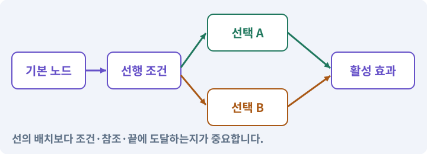

# 017. 적을 잡아 레벨 올리기

**목표:** 처치 한 번이 경험치 한 번으로 이어집니다.

**시작 상태:** 사망 이벤트와 기본 UI

## 한눈에 보는 기능의 흐름

적 처치 → 경험치 한 번 → 레벨 경계 검사 → 능력·해금 갱신



**경계:** 큰 경험치로 여러 레벨을 넘어도 누락하지 않기

그림은 실제 게임 실행 결과가 아닙니다. 값·규칙과 예제를 필요한 때 펼쳐 읽고 현재 단계의 메시지를 한 번씩 보냅니다.

## 1. 지금 상태 확인하기

첫 메시지를 보내 현재 준비 상태를 확인합니다. AI가 읽어 온 실제 프로젝트가 맞는지 보고, 없는 준비나 다른 상태가 있으면 먼저 알려 주세요. 아직 기능을 만들지 않는 단계입니다.

### AI에게 보낼 요구와 이유

#### 01. 작업 대상부터 확인

**“적을 잡아 레벨 올리기” 작업을 시작하기 전에 현재 상태를 읽기 전용으로 확인해 줘.**

왜 이렇게 요청하나요? AI가 다른 프로젝트나 오래된 예제를 보고 작업할 수 있습니다. 실제 경로·파일·현재 기능을 읽게 하면 지금 이어서 작업할 대상을 먼저 맞출 수 있습니다.

#### 02. 작업 대상부터 확인

**필요한 시작 상태는 사망 이벤트와 기본 UI야.**

왜 이렇게 요청하나요? AI가 다른 프로젝트나 오래된 예제를 보고 작업할 수 있습니다. 실제 경로·파일·현재 기능을 읽게 하면 지금 이어서 작업할 대상을 먼저 맞출 수 있습니다.

#### 03. 실제 사용 중인 구현 재사용

**실제 프로젝트와 작업 기록을 읽고 이것이 준비되어 있는지, 이미 같은 기능이 있는지 확인해 줘.**

왜 이렇게 요청하나요? 이름이 비슷한 새 클래스를 또 만들면 기존 화면은 여전히 옛 코드를 사용할 수 있습니다. 실제 호출되는 진입점을 찾아 연결해야 두 구현이 충돌하거나 수정이 반영되지 않는 문제를 막습니다.

#### 04. 현재 상태와 다음 확인 지점 구분

**이번 기능이 연결될 실제 파일·화면·도구와 보존할 기존 동작을 짧게 정리해 줘.**

왜 이렇게 요청하나요? 이미 준비된 기능과 아직 확인하지 못한 기능을 섞으면 불필요한 재설치나 성급한 완료 판정이 생깁니다. 현재 대상과 남은 준비를 나눠 가장 작은 다음 작업을 선택하게 합니다.

#### 05. 조사 단계에서 변경하지 않기

**아직 새 구현·설치·유료 호출·파일 변경은 하지 마.**

왜 이렇게 요청하나요? 현재 상태를 알아보기만 할 때 파일 변경이나 결제가 시작되면 검토 전의 환경이 바뀝니다. 준비 확인과 실제 구현을 나눠 되돌리기 어려운 작업이 먼저 실행되지 않게 합니다.

#### 06. 막힌 준비를 먼저 해결

**준비가 다르면 부족한 항목과 다음에 필요한 작업을 알려 줘.**

왜 이렇게 요청하나요? 빠진 파일·권한·패키지를 있다고 가정하면 다음 구현이 엉뚱한 대상을 만들게 됩니다. 무엇이 없고 무엇을 먼저 해야 하는지 분리하면 불필요한 재작업을 줄일 수 있습니다.

<details>
<summary>보낼 원문 전체 — 설명은 복사되지 않습니다</summary>

```text
“적을 잡아 레벨 올리기” 작업을 시작하기 전에 현재 상태를 읽기 전용으로 확인해 줘.
필요한 시작 상태는 사망 이벤트와 기본 UI야. 실제 프로젝트와 작업 기록을 읽고 이것이 준비되어 있는지, 이미 같은 기능이 있는지 확인해 줘.
이번 기능이 연결될 실제 파일·화면·도구와 보존할 기존 동작을 짧게 정리해 줘. 아직 새 구현·설치·유료 호출·파일 변경은 하지 마. 준비가 다르면 부족한 항목과 다음에 필요한 작업을 알려 줘.
```

</details>

**기대 결과:** 경험치·레벨·능력치가 이어지는 구조

### 직접 확인하기

1. AI가 읽은 실제 프로젝트 또는 도구 경로를 확인합니다.
2. 필수 준비가 없다면 문제 해결 요청을 보내고, 준비됐을 때 다음으로 갑니다.

## 2. 필요한 기능 만들기

준비가 확인되면 아래 요청을 보냅니다. AI가 파일·설정·실행을 맡습니다. 변경 범위나 비용 승인이 나오면 내용을 읽고 결정하세요.

### AI에게 보낼 요구와 이유

#### 01. 작업 대상부터 확인

**현재 프로젝트의 실제 파일과 이미 결정한 규칙을 먼저 확인해 줘.**

왜 이렇게 요청하나요? AI가 다른 프로젝트나 오래된 예제를 보고 작업할 수 있습니다. 실제 경로·파일·현재 기능을 읽게 하면 지금 이어서 작업할 대상을 먼저 맞출 수 있습니다.

#### 02. 실제 사용 중인 코드에 연결

**이름이 다른 기존 구현이 있으면 새로 중복 제작하지 말고 그 구현에 연결해 줘.**

왜 이렇게 요청하나요? 예제와 이름이 다르더라도 현재 씬과 입력에서 호출하는 구현이 작업 대상입니다. 같은 기능을 새로 만들기보다 기존 진입점을 확인해 수정이 실제 게임에 반영되고 중복 실행되지 않게 합니다.

#### 03. 순수 함수·불변 조건·결정적 계산의 적용 조건

**Core에 ProgressionState와 레벨업 계산을 만들고 사망 보상에 연결해 줘.**

왜 이렇게 요청하나요? 순수 함수는 같은 입력에서 같은 결과를 만들고 외부 상태를 몰래 바꾸지 않는 계산입니다. 게임 규칙을 이런 형태로 분리하면 씬·기기 없이도 검사하기 쉬워집니다. 함수 안에서 현재 시간·전역 난수·싱글톤을 몰래 읽으면 입력만으로 재현하기 어렵습니다.

#### 04. 성장을 한 번씩 정확히 반영

**현재 레벨에서 다음 레벨 요구 경험치는 40+25*(L-1), 최대 레벨10이다.**

왜 이렇게 요청하나요? 처치 이벤트가 반복되거나 큰 경험치로 여러 단계를 넘으면 성장 수치가 빠지거나 중복될 수 있습니다. 증가·해금·상한을 한 흐름으로 처리하고 경계값을 검사합니다.

#### 05. 성장을 한 번씩 정확히 반영

**남는 경험치를 유지하고 한 번에 여러 레벨을 오를 수 있게 해 줘.**

왜 이렇게 요청하나요? 처치 이벤트가 반복되거나 큰 경험치로 여러 단계를 넘으면 성장 수치가 빠지거나 중복될 수 있습니다. 증가·해금·상한을 한 흐름으로 처리하고 경계값을 검사합니다.

#### 06. 성장을 한 번씩 정확히 반영

**레벨10에서는 레벨을 더 올리지 않고 남는 진행 경험치는 0으로 정리해 줘.**

왜 이렇게 요청하나요? 처치 이벤트가 반복되거나 큰 경험치로 여러 단계를 넘으면 성장 수치가 빠지거나 중복될 수 있습니다. 증가·해금·상한을 한 흐름으로 처리하고 경계값을 검사합니다.

#### 07. 성장을 한 번씩 정확히 반영

**레벨당 기본 최대HP+12, 최대MP+5, 기본ATK+2를 적용해 줘.**

왜 이렇게 요청하나요? 처치 이벤트가 반복되거나 큰 경험치로 여러 단계를 넘으면 성장 수치가 빠지거나 중복될 수 있습니다. 증가·해금·상한을 한 흐름으로 처리하고 경계값을 검사합니다.

#### 08. 성장을 한 번씩 정확히 반영

**레벨업 때 현재 HP/MP는 증가한 최대치만큼만 더하고 최대치를 넘지 않게 해 줘.**

왜 이렇게 요청하나요? 처치 이벤트가 반복되거나 큰 경험치로 여러 단계를 넘으면 성장 수치가 빠지거나 중복될 수 있습니다. 증가·해금·상한을 한 흐름으로 처리하고 경계값을 검사합니다.

#### 09. 기본값과 현재 상태에서 능력치 재계산

**장비를 나중에 바꾸어도 레벨 보너스가 중복 적용되지 않게 원본에서 다시 계산해 줘.**

왜 이렇게 요청하나요? 장착할 때마다 기존 값에 레벨 보너스를 더하면 같은 장비를 바꿀수록 강해집니다. 기본값·레벨·현재 장비 목록에서 최종 값을 새로 계산합니다.

#### 10. 설정과 실제 사용 결과 연결

**스킬1은2레벨, 스킬2는4레벨, 스킬3은6레벨에 해금한다.**

왜 이렇게 요청하나요? 데이터에 수치를 넣어도 사용 조건·UI·실제 전투가 그 값을 읽지 않으면 기능이 완성되지 않습니다. 선택 전후의 계산과 저장을 함께 확인합니다.

#### 11. 성장을 한 번씩 정확히 반영

**UI에는 레벨/경험치/해금 알림을 표시해 줘.**

왜 이렇게 요청하나요? 처치 이벤트가 반복되거나 큰 경험치로 여러 단계를 넘으면 성장 수치가 빠지거나 중복될 수 있습니다. 증가·해금·상한을 한 흐름으로 처리하고 경계값을 검사합니다.

#### 12. 거래·보상의 전체 성공 보장

**죽은 적 한 개의 보상은 한 번만 처리해 줘.**

왜 이렇게 요청하나요? 재료 차감과 결과 지급이 따로 성공하면 손해나 복제가 생깁니다. 조건을 먼저 검사하고 한 거래로 반영하며 같은 요청을 다시 받아도 두 번 지급하지 않게 합니다.

#### 13. 레벨 경계와 남은 경험치 검사

**39XP,40XP,105XP, 큰 XP, 최대 레벨, 동일 사망 중복 이벤트를 자동 테스트해 줘.**

왜 이렇게 요청하나요? 한 번의 경험치 지급이 임계값에 정확히 닿거나 여러 레벨을 넘길 수 있습니다. 레벨 전환 후 남은 경험치와 최대 레벨 정책을 확인해 보상이 사라지거나 무한 레벨업하지 않게 합니다.

#### 14. 성장을 한 번씩 정확히 반영

**개발용 경험치 지급은 릴리스에서 제거 가능한 별도 도구로 만들어 줘.**

왜 이렇게 요청하나요? 처치 이벤트가 반복되거나 큰 경험치로 여러 단계를 넘으면 성장 수치가 빠지거나 중복될 수 있습니다. 증가·해금·상한을 한 흐름으로 처리하고 경계값을 검사합니다.

#### 15. 구현과 실행은 AI에게 맡기기

**코드·설정·파일 생성·실행은 네가 맡고, 필요한 화면과 결과를 보여 줘.**

왜 이렇게 요청하나요? 설명이나 코드 조각만 받으면 실제 파일 생성·연결·실행이 빠질 수 있습니다. AI가 개발 작업까지 수행하고, 사람은 요구·승인·결과 판단을 맡도록 역할을 분명히 합니다.

#### 16. 막힌 준비를 먼저 해결

**수행하지 못한 작업과 필요한 승인·도구 연결은 구분해서 알려 줘.**

왜 이렇게 요청하나요? 빠진 파일·권한·패키지를 있다고 가정하면 다음 구현이 엉뚱한 대상을 만들게 됩니다. 무엇이 없고 무엇을 먼저 해야 하는지 분리하면 불필요한 재작업을 줄일 수 있습니다.

<details>
<summary>보낼 원문 전체 — 설명은 복사되지 않습니다</summary>

```text
현재 프로젝트의 실제 파일과 이미 결정한 규칙을 먼저 확인해 줘. 이름이 다른 기존 구현이 있으면 새로 중복 제작하지 말고 그 구현에 연결해 줘.

Core에 ProgressionState와 레벨업 계산을 만들고 사망 보상에 연결해 줘.
현재 레벨에서 다음 레벨 요구 경험치는 40+25*(L-1), 최대 레벨10이다.
남는 경험치를 유지하고 한 번에 여러 레벨을 오를 수 있게 해 줘.
레벨10에서는 레벨을 더 올리지 않고 남는 진행 경험치는 0으로 정리해 줘.
레벨당 기본 최대HP+12, 최대MP+5, 기본ATK+2를 적용해 줘.
레벨업 때 현재 HP/MP는 증가한 최대치만큼만 더하고 최대치를 넘지 않게 해 줘.
장비를 나중에 바꾸어도 레벨 보너스가 중복 적용되지 않게 원본에서 다시 계산해 줘.
스킬1은2레벨, 스킬2는4레벨, 스킬3은6레벨에 해금한다.
UI에는 레벨/경험치/해금 알림을 표시해 줘.
죽은 적 한 개의 보상은 한 번만 처리해 줘.
39XP,40XP,105XP, 큰 XP, 최대 레벨, 동일 사망 중복 이벤트를 자동 테스트해 줘.
개발용 경험치 지급은 릴리스에서 제거 가능한 별도 도구로 만들어 줘.

코드·설정·파일 생성·실행은 네가 맡고, 필요한 화면과 결과를 보여 줘. 수행하지 못한 작업과 필요한 승인·도구 연결은 구분해서 알려 줘.
```

</details>

**기대 결과:** 확인할 결과: 레벨 경계와 보상 1회 지급을 확인함. AI가 이 상태를 확인할 실제 화면과 변경 내용을 준비합니다. 아직 실행하지 못한 부분은 따로 표시합니다.

### 직접 확인하기

1. 제안서만 반환됐다면 “설명으로 끝내지 말고 승인한 범위의 실제 작업을 수행해 줘”라고 보냅니다.
2. 코드나 설정을 직접 고치라는 안내가 나오면 “작성과 실행은 네가 맡아 줘”라고 요청합니다.

## 3. 결과를 직접 확인하기

먼저 확인 요청을 보내 AI가 검사와 화면을 준비하게 하세요. 그다음 아래 동작을 하나씩 확인합니다.

### AI에게 보낼 요구와 이유

#### 01. 검사할 입력과 관찰 지점 준비

**방금 구현한 기능의 자동 검사와 확인 화면을 준비해 줘.**

왜 이렇게 요청하나요? 정상 예 하나만 보면 실패 조건을 놓치기 쉽습니다. 정상·경계·반례를 실제 입력으로 준비하고 사람이 볼 화면도 맞춰 확인 범위를 분명하게 합니다.

#### 02. 결과를 재확인할 근거 남기기

**정상 동작과 아래 실패 조건을 실제로 검사하고 대상·실행 수·결과를 보여 줘.**

왜 이렇게 요청하나요? “잘 됩니다”라는 요약만으로는 어떤 입력과 버전을 검사했는지 알 수 없습니다. 대상·실행 수·실패 내용·파일을 함께 남겨 같은 조건으로 다시 확인할 수 있게 합니다.

#### 03. 레벨 경계와 남은 경험치 검사

**레벨1에서 39XP는 그대로다.**

왜 이렇게 요청하나요? 한 번의 경험치 지급이 임계값에 정확히 닿거나 여러 레벨을 넘길 수 있습니다. 레벨 전환 후 남은 경험치와 최대 레벨 정책을 확인해 보상이 사라지거나 무한 레벨업하지 않게 합니다.

#### 04. 레벨 경계와 남은 경험치 검사

**40XP면 레벨2·잔여0이다.**

왜 이렇게 요청하나요? 한 번의 경험치 지급이 임계값에 정확히 닿거나 여러 레벨을 넘길 수 있습니다. 레벨 전환 후 남은 경험치와 최대 레벨 정책을 확인해 보상이 사라지거나 무한 레벨업하지 않게 합니다.

#### 05. 레벨 경계와 남은 경험치 검사

**새 캐릭터에게 105XP를 주면 레벨3·잔여0이다.**

왜 이렇게 요청하나요? 한 번의 경험치 지급이 임계값에 정확히 닿거나 여러 레벨을 넘길 수 있습니다. 레벨 전환 후 남은 경험치와 최대 레벨 정책을 확인해 보상이 사라지거나 무한 레벨업하지 않게 합니다.

#### 06. 거래·보상의 전체 성공 보장

**처치 한 번에 보상 한 번이다.**

왜 이렇게 요청하나요? 재료 차감과 결과 지급이 따로 성공하면 손해나 복제가 생깁니다. 조건을 먼저 검사하고 한 거래로 반영하며 같은 요청을 다시 받아도 두 번 지급하지 않게 합니다.

#### 07. HP·MP·ATK·DEF·XP의 적용 조건

**레벨업으로 기본 공격력이 실제로 증가한다.**

왜 이렇게 요청하나요? HP는 체력, MP는 마나 같은 스킬 자원, ATK는 공격력, DEF는 방어력, XP는 경험치를 뜻하는 관용 표기입니다. 실제 피해 공식과 성장 규칙은 게임마다 다릅니다. 방어력 10이 언제나 피해를 10 줄인다는 보편 규칙은 없습니다. 승인한 공식을 확인합니다.

#### 08. 사람 검사의 시작점 준비

**내가 조작해야 하는 부분은 실행할 화면과 시작 상태를 준비해 줘.**

왜 이렇게 요청하나요? 같은 기능이라도 시작 상태가 다르면 관찰 결과가 달라집니다. AI가 실행 화면과 재현 위치를 먼저 준비해야 사람이 이동·공격·소리·조작감을 같은 조건에서 확인할 수 있습니다.

#### 09. 사람이 실제로 본 것만 기록

**연결되지 않은 휴대폰의 터치나 사람이 보지 않은 재미·소리 품질을 대신 확인했다고 하지 마.**

왜 이렇게 요청하나요? AI가 준비한 검사와 사람이 직접 플레이하거나 들은 결과는 다른 근거입니다. 관찰하지 않은 조작감·소리·실기기 결과를 임의로 완료 처리하지 않게 합니다.

#### 10. 실제로 실행한 검사만 인정

**테스트 0개와 예전 소스 결과는 현재 성공으로 쓰지 마.**

왜 이렇게 요청하나요? 실행된 검사가 없거나 같은 결과를 중복 집계한 경우는 기능을 확인한 것이 아닙니다. 실행 수와 개별 결과를 함께 확인해야 형식적인 성공 표시를 걸러낼 수 있습니다.

<details>
<summary>보낼 원문 전체 — 설명은 복사되지 않습니다</summary>

```text
방금 구현한 기능의 자동 검사와 확인 화면을 준비해 줘. 정상 동작과 아래 실패 조건을 실제로 검사하고 대상·실행 수·결과를 보여 줘.

레벨1에서 39XP는 그대로다. 40XP면 레벨2·잔여0이다. 새 캐릭터에게 105XP를 주면 레벨3·잔여0이다. 처치 한 번에 보상 한 번이다. 레벨업으로 기본 공격력이 실제로 증가한다.

내가 조작해야 하는 부분은 실행할 화면과 시작 상태를 준비해 줘. 연결되지 않은 휴대폰의 터치나 사람이 보지 않은 재미·소리 품질을 대신 확인했다고 하지 마. 테스트 0개와 예전 소스 결과는 현재 성공으로 쓰지 마.
```

</details>

**기대 결과:** 레벨 경계와 보상 1회 지급을 확인함

### 직접 확인하기

1. 적을 한 마리 처치하고 경험치 증가를 봅니다.
2. 레벨이 오를 때 실제 능력치와 표시를 비교합니다.
3. 개발용 큰 경험치 사례에서 여러 레벨과 최대 레벨을 확인합니다.

## 4. 결과를 남기고 마무리하기

실제로 본 결과를 아래 메모에 적고 AI에 전달합니다. 결과 저장 요청으로 현재 상태를 남긴 뒤 다음 페이지로 갑니다.

### AI에게 보낼 요구와 이유

#### 01. 결과를 재확인할 근거 남기기

**지금 작업한 “적을 잡아 레벨 올리기”의 실제 결과를 정리해 줘.**

왜 이렇게 요청하나요? “잘 됩니다”라는 요약만으로는 어떤 입력과 버전을 검사했는지 알 수 없습니다. 대상·실행 수·실패 내용·파일을 함께 남겨 같은 조건으로 다시 확인할 수 있게 합니다.

#### 02. 다음 작업이 읽을 인수인계

**변경한 기능·파일·현재 후보와 실제 실행한 검사, 남은 문제를 기능 이름으로 기록해 줘.**

왜 이렇게 요청하나요? 새 AI 세션은 이전 대화 전체를 알고 있다고 보장할 수 없습니다. 현재 후보·파일 위치·실행한 검사·남은 일을 남겨야 같은 작업을 반복하지 않고 이어갈 수 있습니다.

#### 03. 사람이 실제로 본 것만 기록

**자동 검사 결과와 내가 직접 확인한 결과를 구분하고, 내 관찰이 아직 없으면 미확인으로 남겨 줘.**

왜 이렇게 요청하나요? AI가 준비한 검사와 사람이 직접 플레이하거나 들은 결과는 다른 근거입니다. 관찰하지 않은 조작감·소리·실기기 결과를 임의로 완료 처리하지 않게 합니다.

#### 04. 다음 작업이 읽을 인수인계

**재시작하거나 다음 작업에서 읽을 기록의 실제 위치를 알려 줘.**

왜 이렇게 요청하나요? 새 AI 세션은 이전 대화 전체를 알고 있다고 보장할 수 없습니다. 현재 후보·파일 위치·실행한 검사·남은 일을 남겨야 같은 작업을 반복하지 않고 이어갈 수 있습니다.

#### 05. 미확인을 완료와 분리

**아직 확인하지 않은 결과를 완료로 채우지 마.**

왜 이렇게 요청하나요? 만들어진 것, 검사에 실패한 것, 아직 확인하지 못한 것을 나눠야 다음 작업을 정확히 고를 수 있습니다. 실행할 조건이 없는 기능을 성공으로 기록하면 뒤에서 원인을 찾기 어려워집니다.

<details>
<summary>보낼 원문 전체 — 설명은 복사되지 않습니다</summary>

```text
지금 작업한 “적을 잡아 레벨 올리기”의 실제 결과를 정리해 줘. 변경한 기능·파일·현재 후보와 실제 실행한 검사, 남은 문제를 기능 이름으로 기록해 줘.
자동 검사 결과와 내가 직접 확인한 결과를 구분하고, 내 관찰이 아직 없으면 미확인으로 남겨 줘. 재시작하거나 다음 작업에서 읽을 기록의 실제 위치를 알려 줘. 아직 확인하지 않은 결과를 완료로 채우지 마.
```

</details>

**기대 결과:** 현재 상태·검사 결과·남은 문제·다음에 읽을 기록을 확인할 수 있습니다.

### 직접 확인하기

1. 자동 검사와 내 관찰 결과가 섞이지 않았는지 봅니다.
2. 문제가 남았다면 해결 요청을 보내고 같은 동작을 다시 확인합니다.

## 문제가 있으면

### AI에게 보낼 요구와 이유

#### 01. 성장을 한 번씩 정확히 반영

**경험치가 두 번 오르면 사망 이벤트의 발행·구독 수를 확인해 줘.**

왜 이렇게 요청하나요? 처치 이벤트가 반복되거나 큰 경험치로 여러 단계를 넘으면 성장 수치가 빠지거나 중복될 수 있습니다. 증가·해금·상한을 한 흐름으로 처리하고 경계값을 검사합니다.

#### 02. 레벨 경계와 남은 경험치 검사

**최대 레벨 뒤 증가 규칙도 명확히 해 줘.**

왜 이렇게 요청하나요? 한 번의 경험치 지급이 임계값에 정확히 닿거나 여러 레벨을 넘길 수 있습니다. 레벨 전환 후 남은 경험치와 최대 레벨 정책을 확인해 보상이 사라지거나 무한 레벨업하지 않게 합니다.

#### 03. 원인 하나를 좁혀 수정

**새 기능을 추가하지 말고 현재 오류와 실제 로그를 먼저 읽어 줘.**

왜 이렇게 요청하나요? 오류 수정 중 새 기능까지 넣으면 어떤 변경이 문제를 해결하거나 악화했는지 알기 어렵습니다. 원래 재현을 보존하고 작은 변경 뒤 같은 입력과 주변 정상 동작을 다시 확인합니다.

#### 04. 원인 하나를 좁혀 수정

**최소 수정 뒤 같은 재현과 관련 정상 동작을 다시 검사해 줘.**

왜 이렇게 요청하나요? 오류 수정 중 새 기능까지 넣으면 어떤 변경이 문제를 해결하거나 악화했는지 알기 어렵습니다. 원래 재현을 보존하고 작은 변경 뒤 같은 입력과 주변 정상 동작을 다시 확인합니다.

#### 05. 실패도 재현 자료로 보존

**실패 기록은 지우지 마.**

왜 이렇게 요청하나요? 실패한 입력과 로그가 있어야 같은 문제가 다시 생겼을 때 비교할 수 있습니다. 성공 기록으로 덮어쓰지 않고 전후 자료를 남기면 무엇을 고쳤는지 확인할 수 있습니다.

<details>
<summary>보낼 원문 전체 — 설명은 복사되지 않습니다</summary>

```text
경험치가 두 번 오르면 사망 이벤트의 발행·구독 수를 확인해 줘. 최대 레벨 뒤 증가 규칙도 명확히 해 줘.
새 기능을 추가하지 말고 현재 오류와 실제 로그를 먼저 읽어 줘. 최소 수정 뒤 같은 재현과 관련 정상 동작을 다시 검사해 줘. 실패 기록은 지우지 마.
```

</details>

## 새 세션에서 이어가기

### AI에게 보낼 요구와 이유

#### 01. 이어서 할 작업 식별

**“적을 잡아 레벨 올리기” 작업을 이어가고 싶어.**

왜 이렇게 요청하나요? 이름으로 재개할 작업을 찾고, 뒤에 이어지는 요청으로 실제 파일·진행 중 작업·기록을 다시 읽게 합니다. 제목만 보고 이전 상태를 기억한다고 가정하지 않습니다.

#### 02. 조회는 상태를 바꾸지 않게

**실제 프로젝트와 내 도구의 작업 기록을 읽고 어디까지 구현·검사됐는지 확인해 줘.**

왜 이렇게 요청하나요? 진행 상황을 물을 때 새 구현이나 유료 호출이 시작되면 단순 확인이 실행 명령이 되어 버립니다. 저장된 근거를 읽어 완료·진행·승인 대기·미검증을 나누게 합니다.

#### 03. 재개 전 중복 작업 방지

**진행 중인 프로세스·승인·미저장 변경을 확인한 뒤 남은 가장 작은 작업부터 안내해 줘.**

왜 이렇게 요청하나요? 대화가 끊겨도 외부 작업은 끝났거나 아직 실행 중일 수 있습니다. 프로세스·승인·미저장 상태를 먼저 읽어 같은 생성·빌드·결제를 두 번 시작하지 않도록 합니다.

#### 04. 되돌아갈 원본 남기기

**기존 성공과 실패 기록은 보존해 줘.**

왜 이렇게 요청하나요? 새 구현이 실패해도 이전 게임과 저장을 복원할 수 있어야 합니다. 현재 내용을 먼저 조사하고 별도 후보에서 작업하면 실험이 유일한 정상본을 망가뜨리는 일을 피할 수 있습니다.

<details>
<summary>보낼 원문 전체 — 설명은 복사되지 않습니다</summary>

```text
“적을 잡아 레벨 올리기” 작업을 이어가고 싶어. 실제 프로젝트와 내 도구의 작업 기록을 읽고 어디까지 구현·검사됐는지 확인해 줘. 진행 중인 프로세스·승인·미저장 변경을 확인한 뒤 남은 가장 작은 작업부터 안내해 줘. 기존 성공과 실패 기록은 보존해 줘.
```

</details>

## 왜 이렇게 만드는가

경험치는 적이 죽었다는 사건에서 한 번 지급한다. 체력이 0인지 매 프레임 확인하며 경험치를 더하면 같은 적이 계속 보상을 줄 수 있다.

레벨업 요구 경험치는 현재 레벨 L에서 `40 + 25×(L−1)`로 정한다. 최대 레벨은 10이다. 한 번에 많은 경험치를 얻으면 여러 번 레벨업할 수 있어야 한다. 레벨 2·4·6에서 세 스킬을 차례로 해금한다. 이 값들은 이 게임의 초기 설계다.

## 공식 참고

