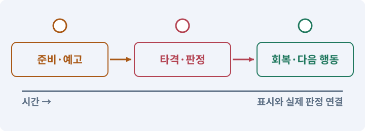

# 018. 베기·마력탄·회전 공격 만들기

**목표:** 세 스킬의 범위·비용·재사용 대기시간을 확인합니다.

**시작 상태:** 기본 공격과 자원 표시

## 한눈에 보는 기능의 흐름

베기 영역 → 마력탄 경로 → 회전 타격 → 마나·대기시간



**경계:** 스킬 종료 뒤 임시 속도와 타격이 남지 않기

그림은 실제 게임 실행 결과가 아닙니다. 값·규칙과 예제를 필요한 때 펼쳐 읽고 현재 단계의 메시지를 한 번씩 보냅니다.

## 1. 지금 상태 확인하기

첫 메시지를 보내 현재 준비 상태를 확인합니다. AI가 읽어 온 실제 프로젝트가 맞는지 보고, 없는 준비나 다른 상태가 있으면 먼저 알려 주세요. 아직 기능을 만들지 않는 단계입니다.

### AI에게 보낼 요구와 이유

#### 01. 작업 대상부터 확인

**“베기·마력탄·회전 공격 만들기” 작업을 시작하기 전에 현재 상태를 읽기 전용으로 확인해 줘.**

왜 이렇게 요청하나요? AI가 다른 프로젝트나 오래된 예제를 보고 작업할 수 있습니다. 실제 경로·파일·현재 기능을 읽게 하면 지금 이어서 작업할 대상을 먼저 맞출 수 있습니다.

#### 02. 작업 대상부터 확인

**필요한 시작 상태는 기본 공격과 자원 표시야.**

왜 이렇게 요청하나요? AI가 다른 프로젝트나 오래된 예제를 보고 작업할 수 있습니다. 실제 경로·파일·현재 기능을 읽게 하면 지금 이어서 작업할 대상을 먼저 맞출 수 있습니다.

#### 03. 실제 사용 중인 구현 재사용

**실제 프로젝트와 작업 기록을 읽고 이것이 준비되어 있는지, 이미 같은 기능이 있는지 확인해 줘.**

왜 이렇게 요청하나요? 이름이 비슷한 새 클래스를 또 만들면 기존 화면은 여전히 옛 코드를 사용할 수 있습니다. 실제 호출되는 진입점을 찾아 연결해야 두 구현이 충돌하거나 수정이 반영되지 않는 문제를 막습니다.

#### 04. 현재 상태와 다음 확인 지점 구분

**이번 기능이 연결될 실제 파일·화면·도구와 보존할 기존 동작을 짧게 정리해 줘.**

왜 이렇게 요청하나요? 이미 준비된 기능과 아직 확인하지 못한 기능을 섞으면 불필요한 재설치나 성급한 완료 판정이 생깁니다. 현재 대상과 남은 준비를 나눠 가장 작은 다음 작업을 선택하게 합니다.

#### 05. 조사 단계에서 변경하지 않기

**아직 새 구현·설치·유료 호출·파일 변경은 하지 마.**

왜 이렇게 요청하나요? 현재 상태를 알아보기만 할 때 파일 변경이나 결제가 시작되면 검토 전의 환경이 바뀝니다. 준비 확인과 실제 구현을 나눠 되돌리기 어려운 작업이 먼저 실행되지 않게 합니다.

#### 06. 막힌 준비를 먼저 해결

**준비가 다르면 부족한 항목과 다음에 필요한 작업을 알려 줘.**

왜 이렇게 요청하나요? 빠진 파일·권한·패키지를 있다고 가정하면 다음 구현이 엉뚱한 대상을 만들게 됩니다. 무엇이 없고 무엇을 먼저 해야 하는지 분리하면 불필요한 재작업을 줄일 수 있습니다.

<details>
<summary>보낼 원문 전체 — 설명은 복사되지 않습니다</summary>

```text
“베기·마력탄·회전 공격 만들기” 작업을 시작하기 전에 현재 상태를 읽기 전용으로 확인해 줘.
필요한 시작 상태는 기본 공격과 자원 표시야. 실제 프로젝트와 작업 기록을 읽고 이것이 준비되어 있는지, 이미 같은 기능이 있는지 확인해 줘.
이번 기능이 연결될 실제 파일·화면·도구와 보존할 기존 동작을 짧게 정리해 줘. 아직 새 구현·설치·유료 호출·파일 변경은 하지 마. 준비가 다르면 부족한 항목과 다음에 필요한 작업을 알려 줘.
```

</details>

**기대 결과:** 스킬별 범위·자원·타격 횟수 설명

### 직접 확인하기

1. AI가 읽은 실제 프로젝트 또는 도구 경로를 확인합니다.
2. 필수 준비가 없다면 문제 해결 요청을 보내고, 준비됐을 때 다음으로 갑니다.

## 2. 필요한 기능 만들기

준비가 확인되면 아래 요청을 보냅니다. AI가 파일·설정·실행을 맡습니다. 변경 범위나 비용 승인이 나오면 내용을 읽고 결정하세요.

### AI에게 보낼 요구와 이유

#### 01. 작업 대상부터 확인

**현재 프로젝트의 실제 파일과 이미 결정한 규칙을 먼저 확인해 줘.**

왜 이렇게 요청하나요? AI가 다른 프로젝트나 오래된 예제를 보고 작업할 수 있습니다. 실제 경로·파일·현재 기능을 읽게 하면 지금 이어서 작업할 대상을 먼저 맞출 수 있습니다.

#### 02. 실제 사용 중인 코드에 연결

**이름이 다른 기존 구현이 있으면 새로 중복 제작하지 말고 그 구현에 연결해 줘.**

왜 이렇게 요청하나요? 예제와 이름이 다르더라도 현재 씬과 입력에서 호출하는 구현이 작업 대상입니다. 같은 기능을 새로 만들기보다 기존 진입점을 확인해 수정이 실제 게임에 반영되고 중복 실행되지 않게 합니다.

#### 03. 기존 전투 위에 단계적으로 능력 추가

**기본 전투 위에 베기·마력탄·회전 공격을 연결해 줘.**

왜 이렇게 요청하나요? 새 스킬마다 피해·자원·입력을 별도로 구현하면 기존 전투와 달라질 수 있습니다. 공통 규칙에 연결하고 지정한 레벨에서 사용 가능 여부를 바꾸어 해금 전후를 비교합니다.

#### 04. 기존 전투 위에 단계적으로 능력 추가

**지금은 레벨 2·4·6에서 각각 자동으로 사용할 수 있게 해 줘.**

왜 이렇게 요청하나요? 새 스킬마다 피해·자원·입력을 별도로 구현하면 기존 전투와 달라질 수 있습니다. 공통 규칙에 연결하고 지정한 레벨에서 사용 가능 여부를 바꾸어 해금 전후를 비교합니다.

#### 05. 공격의 거리·시간을 명시

**베기는 공격력×1.6, MP10, 쿨다운4초, 반경2.2·120도다.**

왜 이렇게 요청하나요? 그림이 닿아 보이는 순간과 실제 판정 시간은 다를 수 있습니다. 사거리·각도·공격 간격·타격 시점을 고정하면 회피 가능한 구간과 실제 피해 결과를 같은 조건으로 검사할 수 있습니다.

#### 06. 사용 성공과 자원 소비 묶기

**마력탄은 공격력×1.3, MP6, 쿨다운1.5초, 속도12·최대거리10이다.**

왜 이렇게 요청하나요? 실패한 사용에서 자원이 줄거나 연타로 여러 번 차감되면 표시와 실제 행동이 어긋납니다. 사용 조건·비용·대기시간을 함께 처리하고 실패 시 바뀌지 않아야 할 값을 확인합니다.

#### 07. 공격의 거리·시간을 명시

**회전은 공격력×0.45/틱, MP18, 쿨다운8초, 반경2.2·2초다.**

왜 이렇게 요청하나요? 그림이 닿아 보이는 순간과 실제 판정 시간은 다를 수 있습니다. 사거리·각도·공격 간격·타격 시점을 고정하면 회피 가능한 구간과 실제 피해 결과를 같은 조건으로 검사할 수 있습니다.

#### 08. 사용 성공과 자원 소비 묶기

**시전 조건을 통과한 뒤 자원과 쿨다운을 한 번만 확정해 줘.**

왜 이렇게 요청하나요? 실패한 사용에서 자원이 줄거나 연타로 여러 번 차감되면 표시와 실제 행동이 어긋납니다. 사용 조건·비용·대기시간을 함께 처리하고 실패 시 바뀌지 않아야 할 값을 확인합니다.

#### 09. 보이는 장애물과 전투 판정 맞추기

**마력탄은 이동 구간에서 벽과 적 중 가까운 대상을 맞히고, 충돌 콜백과 직접 검사가 피해를 두 번 적용하지 않게 해 줘.**

왜 이렇게 요청하나요? 거리만 맞으면 벽 뒤에도 피해가 들어가거나 빠른 투사체가 얇은 벽을 지나칠 수 있습니다. 사선과 이동 구간을 검사해 장애물의 의미가 전투에서도 유지되게 합니다.

#### 10. 같은 요청의 반복 처리 정의

**회전은 0.25초부터 2초까지 총8틱이며 한 틱에 같은 적을 한 번만 맞혀야 해.**

왜 이렇게 요청하나요? 클릭 연타·재연결·중복 이벤트는 개발과 플레이 중 모두 발생할 수 있습니다. 반복돼도 한 번 처리해야 하는 결과와 매번 새로 처리할 결과를 나눠 데이터가 누적되지 않게 합니다.

#### 11. 구현할 결과와 조건 고정

**회전 중 이동속도40%는 사망·취소·씬 종료 때 반드시 해제해 줘.**

왜 이렇게 요청하나요? “회전 중 이동속도40%는 사망·취소·씬 종료 때 반드시 해제해 줘”를 명시하면 AI가 무엇을 구현하거나 검사해야 하는지 범위를 좁힐 수 있습니다. 세 스킬의 범위·비용·재사용 대기시간을 확인합니다. 이 결과를 확인할 때 이 조건이 실제로 반영됐는지 함께 봅니다.

#### 12. 사용 성공과 자원 소비 묶기

**버튼·마나·재사용 표시를 연결하고 각 스킬을 시험할 장면을 열어 줘.**

왜 이렇게 요청하나요? 실패한 사용에서 자원이 줄거나 연타로 여러 번 차감되면 표시와 실제 행동이 어긋납니다. 사용 조건·비용·대기시간을 함께 처리하고 실패 시 바뀌지 않아야 할 값을 확인합니다.

#### 13. 사용 성공과 자원 소비 묶기

**레벨 부족·마나 부족·벽 뒤 공격·연타·취소를 실제로 검사해 줘.**

왜 이렇게 요청하나요? 실패한 사용에서 자원이 줄거나 연타로 여러 번 차감되면 표시와 실제 행동이 어긋납니다. 사용 조건·비용·대기시간을 함께 처리하고 실패 시 바뀌지 않아야 할 값을 확인합니다.

#### 14. 구현과 실행은 AI에게 맡기기

**코드·설정·파일 생성·실행은 네가 맡고, 필요한 화면과 결과를 보여 줘.**

왜 이렇게 요청하나요? 설명이나 코드 조각만 받으면 실제 파일 생성·연결·실행이 빠질 수 있습니다. AI가 개발 작업까지 수행하고, 사람은 요구·승인·결과 판단을 맡도록 역할을 분명히 합니다.

#### 15. 막힌 준비를 먼저 해결

**수행하지 못한 작업과 필요한 승인·도구 연결은 구분해서 알려 줘.**

왜 이렇게 요청하나요? 빠진 파일·권한·패키지를 있다고 가정하면 다음 구현이 엉뚱한 대상을 만들게 됩니다. 무엇이 없고 무엇을 먼저 해야 하는지 분리하면 불필요한 재작업을 줄일 수 있습니다.

<details>
<summary>보낼 원문 전체 — 설명은 복사되지 않습니다</summary>

```text
현재 프로젝트의 실제 파일과 이미 결정한 규칙을 먼저 확인해 줘. 이름이 다른 기존 구현이 있으면 새로 중복 제작하지 말고 그 구현에 연결해 줘.

기본 전투 위에 베기·마력탄·회전 공격을 연결해 줘. 지금은 레벨 2·4·6에서 각각 자동으로 사용할 수 있게 해 줘.
베기는 공격력×1.6, MP10, 쿨다운4초, 반경2.2·120도다. 마력탄은 공격력×1.3, MP6, 쿨다운1.5초, 속도12·최대거리10이다. 회전은 공격력×0.45/틱, MP18, 쿨다운8초, 반경2.2·2초다.
시전 조건을 통과한 뒤 자원과 쿨다운을 한 번만 확정해 줘. 마력탄은 이동 구간에서 벽과 적 중 가까운 대상을 맞히고, 충돌 콜백과 직접 검사가 피해를 두 번 적용하지 않게 해 줘.
회전은 0.25초부터 2초까지 총8틱이며 한 틱에 같은 적을 한 번만 맞혀야 해. 회전 중 이동속도40%는 사망·취소·씬 종료 때 반드시 해제해 줘.
버튼·마나·재사용 표시를 연결하고 각 스킬을 시험할 장면을 열어 줘. 레벨 부족·마나 부족·벽 뒤 공격·연타·취소를 실제로 검사해 줘.

코드·설정·파일 생성·실행은 네가 맡고, 필요한 화면과 결과를 보여 줘. 수행하지 못한 작업과 필요한 승인·도구 연결은 구분해서 알려 줘.
```

</details>

**기대 결과:** 확인할 결과: 범위·벽 차단·자원·회전 종료를 확인함. AI가 이 상태를 확인할 실제 화면과 변경 내용을 준비합니다. 아직 실행하지 못한 부분은 따로 표시합니다.

### 직접 확인하기

1. 제안서만 반환됐다면 “설명으로 끝내지 말고 승인한 범위의 실제 작업을 수행해 줘”라고 보냅니다.
2. 코드나 설정을 직접 고치라는 안내가 나오면 “작성과 실행은 네가 맡아 줘”라고 요청합니다.

## 3. 결과를 직접 확인하기

먼저 확인 요청을 보내 AI가 검사와 화면을 준비하게 하세요. 그다음 아래 동작을 하나씩 확인합니다.

### AI에게 보낼 요구와 이유

#### 01. 검사할 입력과 관찰 지점 준비

**방금 구현한 기능의 자동 검사와 확인 화면을 준비해 줘.**

왜 이렇게 요청하나요? 정상 예 하나만 보면 실패 조건을 놓치기 쉽습니다. 정상·경계·반례를 실제 입력으로 준비하고 사람이 볼 화면도 맞춰 확인 범위를 분명하게 합니다.

#### 02. 결과를 재확인할 근거 남기기

**정상 동작과 아래 실패 조건을 실제로 검사하고 대상·실행 수·결과를 보여 줘.**

왜 이렇게 요청하나요? “잘 됩니다”라는 요약만으로는 어떤 입력과 버전을 검사했는지 알 수 없습니다. 대상·실행 수·실패 내용·파일을 함께 남겨 같은 조건으로 다시 확인할 수 있게 합니다.

#### 03. 시작할 수 없음과 유효한 헛공격을 구분

**시전 실패는 MP를 소비하지 않는다.**

왜 이렇게 요청하나요? 마나 부족이나 사용 불가 상태에서 실패한 요청은 자원을 쓰지 않아야 합니다. 반면 정상적으로 발동했지만 적이 없는 공격은 정한 규칙대로 소비해야 취소나 빈 타격을 이용한 편법이 생기지 않습니다.

#### 04. 시작할 수 없음과 유효한 헛공격을 구분

**유효 헛시전은 규격대로 소비한다.**

왜 이렇게 요청하나요? 마나 부족이나 사용 불가 상태에서 실패한 요청은 자원을 쓰지 않아야 합니다. 반면 정상적으로 발동했지만 적이 없는 공격은 정한 규칙대로 소비해야 취소나 빈 타격을 이용한 편법이 생기지 않습니다.

#### 05. 보이는 장애물과 전투 판정 맞추기

**마력탄은 얇은 벽에서 끝나고 회전은8틱이다.**

왜 이렇게 요청하나요? 거리만 맞으면 벽 뒤에도 피해가 들어가거나 빠른 투사체가 얇은 벽을 지나칠 수 있습니다. 사선과 이동 구간을 검사해 장애물의 의미가 전투에서도 유지되게 합니다.

#### 06. 구현할 결과와 조건 고정

**취소 후 이동속도가 원상복구된다.**

왜 이렇게 요청하나요? “취소 후 이동속도가 원상복구된다”를 명시하면 AI가 무엇을 구현하거나 검사해야 하는지 범위를 좁힐 수 있습니다. 세 스킬의 범위·비용·재사용 대기시간을 확인합니다. 이 결과를 확인할 때 이 조건이 실제로 반영됐는지 함께 봅니다.

#### 07. 사람 검사의 시작점 준비

**내가 조작해야 하는 부분은 실행할 화면과 시작 상태를 준비해 줘.**

왜 이렇게 요청하나요? 같은 기능이라도 시작 상태가 다르면 관찰 결과가 달라집니다. AI가 실행 화면과 재현 위치를 먼저 준비해야 사람이 이동·공격·소리·조작감을 같은 조건에서 확인할 수 있습니다.

#### 08. 사람이 실제로 본 것만 기록

**연결되지 않은 휴대폰의 터치나 사람이 보지 않은 재미·소리 품질을 대신 확인했다고 하지 마.**

왜 이렇게 요청하나요? AI가 준비한 검사와 사람이 직접 플레이하거나 들은 결과는 다른 근거입니다. 관찰하지 않은 조작감·소리·실기기 결과를 임의로 완료 처리하지 않게 합니다.

#### 09. 실제로 실행한 검사만 인정

**테스트 0개와 예전 소스 결과는 현재 성공으로 쓰지 마.**

왜 이렇게 요청하나요? 실행된 검사가 없거나 같은 결과를 중복 집계한 경우는 기능을 확인한 것이 아닙니다. 실행 수와 개별 결과를 함께 확인해야 형식적인 성공 표시를 걸러낼 수 있습니다.

<details>
<summary>보낼 원문 전체 — 설명은 복사되지 않습니다</summary>

```text
방금 구현한 기능의 자동 검사와 확인 화면을 준비해 줘. 정상 동작과 아래 실패 조건을 실제로 검사하고 대상·실행 수·결과를 보여 줘.

시전 실패는 MP를 소비하지 않는다. 유효 헛시전은 규격대로 소비한다. 마력탄은 얇은 벽에서 끝나고 회전은8틱이다. 취소 후 이동속도가 원상복구된다.

내가 조작해야 하는 부분은 실행할 화면과 시작 상태를 준비해 줘. 연결되지 않은 휴대폰의 터치나 사람이 보지 않은 재미·소리 품질을 대신 확인했다고 하지 마. 테스트 0개와 예전 소스 결과는 현재 성공으로 쓰지 마.
```

</details>

**기대 결과:** 거부된 요청은 마나를 빼지 않습니다. 시작한 효과와 일시 변경된 이동 상태는 종료·취소 시 정리됩니다.

### 직접 확인하기

1. 베기를 정면·옆·벽 뒤 적에게 사용해 봅니다.
2. 얇은 벽에 마력탄을 쏴 관통하지 않는지 봅니다.
3. 회전 중 이동하다 죽거나 취소한 뒤 이동 속도가 정상으로 돌아오는지 봅니다.

## 4. 결과를 남기고 마무리하기

실제로 본 결과를 아래 메모에 적고 AI에 전달합니다. 결과 저장 요청으로 현재 상태를 남긴 뒤 다음 페이지로 갑니다.

### AI에게 보낼 요구와 이유

#### 01. 결과를 재확인할 근거 남기기

**지금 작업한 “베기·마력탄·회전 공격 만들기”의 실제 결과를 정리해 줘.**

왜 이렇게 요청하나요? “잘 됩니다”라는 요약만으로는 어떤 입력과 버전을 검사했는지 알 수 없습니다. 대상·실행 수·실패 내용·파일을 함께 남겨 같은 조건으로 다시 확인할 수 있게 합니다.

#### 02. 다음 작업이 읽을 인수인계

**변경한 기능·파일·현재 후보와 실제 실행한 검사, 남은 문제를 기능 이름으로 기록해 줘.**

왜 이렇게 요청하나요? 새 AI 세션은 이전 대화 전체를 알고 있다고 보장할 수 없습니다. 현재 후보·파일 위치·실행한 검사·남은 일을 남겨야 같은 작업을 반복하지 않고 이어갈 수 있습니다.

#### 03. 사람이 실제로 본 것만 기록

**자동 검사 결과와 내가 직접 확인한 결과를 구분하고, 내 관찰이 아직 없으면 미확인으로 남겨 줘.**

왜 이렇게 요청하나요? AI가 준비한 검사와 사람이 직접 플레이하거나 들은 결과는 다른 근거입니다. 관찰하지 않은 조작감·소리·실기기 결과를 임의로 완료 처리하지 않게 합니다.

#### 04. 다음 작업이 읽을 인수인계

**재시작하거나 다음 작업에서 읽을 기록의 실제 위치를 알려 줘.**

왜 이렇게 요청하나요? 새 AI 세션은 이전 대화 전체를 알고 있다고 보장할 수 없습니다. 현재 후보·파일 위치·실행한 검사·남은 일을 남겨야 같은 작업을 반복하지 않고 이어갈 수 있습니다.

#### 05. 미확인을 완료와 분리

**아직 확인하지 않은 결과를 완료로 채우지 마.**

왜 이렇게 요청하나요? 만들어진 것, 검사에 실패한 것, 아직 확인하지 못한 것을 나눠야 다음 작업을 정확히 고를 수 있습니다. 실행할 조건이 없는 기능을 성공으로 기록하면 뒤에서 원인을 찾기 어려워집니다.

<details>
<summary>보낼 원문 전체 — 설명은 복사되지 않습니다</summary>

```text
지금 작업한 “베기·마력탄·회전 공격 만들기”의 실제 결과를 정리해 줘. 변경한 기능·파일·현재 후보와 실제 실행한 검사, 남은 문제를 기능 이름으로 기록해 줘.
자동 검사 결과와 내가 직접 확인한 결과를 구분하고, 내 관찰이 아직 없으면 미확인으로 남겨 줘. 재시작하거나 다음 작업에서 읽을 기록의 실제 위치를 알려 줘. 아직 확인하지 않은 결과를 완료로 채우지 마.
```

</details>

**기대 결과:** 현재 상태·검사 결과·남은 문제·다음에 읽을 기록을 확인할 수 있습니다.

### 직접 확인하기

1. 자동 검사와 내 관찰 결과가 섞이지 않았는지 봅니다.
2. 문제가 남았다면 해결 요청을 보내고 같은 동작을 다시 확인합니다.

## 구체적인 예로 이해하기

### 실패한 스킬이 마나를 소비하면

스킬 사용은 가능 여부 확인, 자원 소비, 실행 시작이 일관된 하나의 결정이어야 합니다.

**시작 상태:** 마나가 부족하거나 재사용 대기시간이 끝나지 않은 상태입니다.

**직접 해 볼 동작:** 스킬 버튼을 누른 뒤 정상 상태로도 한 번 사용하고, 사용 중 사망·장면 이동을 시험합니다.

**보여야 하는 결과:** 거부된 요청은 마나를 빼지 않습니다. 시작한 효과와 일시 변경된 이동 상태는 종료·취소 시 정리됩니다.

**이렇게 되면 아직 안 됩니다:** 회전 공격을 취소한 뒤 이동 속도 감소가 남거나 타이머와 애니메이션 이벤트가 둘 다 피해를 줍니다.

**생각해 보기:** 버튼 애니메이션은 나왔지만 스킬이 거부됐다면 쿨다운이 시작돼도 될까요?

<details><summary>해설 보기</summary>

규칙에서 성공 사용에만 비용을 부과한다면 안 됩니다. UI 효과와 실제 사용 승인 결과를 분리합니다.

</details>

## 이 작업에서 사용할 값과 규칙 전체

설계 시작값이며 측정된 성능·게임 성공 결과가 아닙니다. 구현은 AI가 수행합니다.

| 스킬 | 기본값 |
|---|---|
| 베기 | 레벨2, 공격력×1.6,MP10, 쿨다운 4초, 반경2.2,120도 |
| 마력탄 | 레벨4, 공격력×1.3,MP6, 쿨다운1.5초, 속도12, 최대거리10 |
| 회전 | 레벨6, 공격력×0.45/틱,MP18, 쿨다운 8초, 반경2.2,2초 |

회전은0.25,0.5,…,2.0초에 총8틱이다. 틱별로 Actor ID 중복을 제거한다. 회전 이동속도40%는 modifier token으로 관리하고 사망·취소·씬 종료 때 제거한다. 첫 즉시틱을 추가해9틱이 되지 않게 한다.

마력탄은 Environment와 Hurtbox hit를 같은 이동 구간에서 모아 가장 가까운 유효 hit를 확정한다. 벽 hit와 적 hit가 사실상 동거리면 벽을 우선하는 등 동률 규칙을 정한다. 발사자 자신은 제외한다. 투사체 충돌 이벤트와 수동 sweep이 동시에 피해를 주지 않는다.

현재는 레벨에 따라 자동으로 사용할 수 있습니다. 스킬트리를 연결할 때 해금 조건을 투자 상태로 바꾸되 기본 스킬 수치는 유지합니다.

## 문제가 있으면

### AI에게 보낼 요구와 이유

#### 01. VFX·Particle System·플립북의 적용 조건

**이펙트와 AnimationEvent가 각각 피해를 주지 않게 해 줘.**

왜 이렇게 요청하나요? VFX는 불꽃·먼지·마법 같은 시각 효과입니다. Particle System은 작은 입자 여러 개를 생성·이동·소멸시키며, 플립북은 텍스처의 여러 프레임을 순서대로 보여 주는 방식입니다. 입자가 적 몸에 닿았다고 자동 피해로 사용하지 않습니다. 게임 판정과 표시를 분리합니다.

#### 02. 구현할 결과와 조건 고정

**회전 종료의 모든 경로에서 이동 보정을 해제해 줘.**

왜 이렇게 요청하나요? “회전 종료의 모든 경로에서 이동 보정을 해제해 줘”를 명시하면 AI가 무엇을 구현하거나 검사해야 하는지 범위를 좁힐 수 있습니다. 세 스킬의 범위·비용·재사용 대기시간을 확인합니다. 이 결과를 확인할 때 이 조건이 실제로 반영됐는지 함께 봅니다.

#### 03. 원인 하나를 좁혀 수정

**새 기능을 추가하지 말고 현재 오류와 실제 로그를 먼저 읽어 줘.**

왜 이렇게 요청하나요? 오류 수정 중 새 기능까지 넣으면 어떤 변경이 문제를 해결하거나 악화했는지 알기 어렵습니다. 원래 재현을 보존하고 작은 변경 뒤 같은 입력과 주변 정상 동작을 다시 확인합니다.

#### 04. 원인 하나를 좁혀 수정

**최소 수정 뒤 같은 재현과 관련 정상 동작을 다시 검사해 줘.**

왜 이렇게 요청하나요? 오류 수정 중 새 기능까지 넣으면 어떤 변경이 문제를 해결하거나 악화했는지 알기 어렵습니다. 원래 재현을 보존하고 작은 변경 뒤 같은 입력과 주변 정상 동작을 다시 확인합니다.

#### 05. 실패도 재현 자료로 보존

**실패 기록은 지우지 마.**

왜 이렇게 요청하나요? 실패한 입력과 로그가 있어야 같은 문제가 다시 생겼을 때 비교할 수 있습니다. 성공 기록으로 덮어쓰지 않고 전후 자료를 남기면 무엇을 고쳤는지 확인할 수 있습니다.

<details>
<summary>보낼 원문 전체 — 설명은 복사되지 않습니다</summary>

```text
이펙트와 AnimationEvent가 각각 피해를 주지 않게 해 줘. 회전 종료의 모든 경로에서 이동 보정을 해제해 줘.
새 기능을 추가하지 말고 현재 오류와 실제 로그를 먼저 읽어 줘. 최소 수정 뒤 같은 재현과 관련 정상 동작을 다시 검사해 줘. 실패 기록은 지우지 마.
```

</details>

## 새 세션에서 이어가기

### AI에게 보낼 요구와 이유

#### 01. 이어서 할 작업 식별

**“베기·마력탄·회전 공격 만들기” 작업을 이어가고 싶어.**

왜 이렇게 요청하나요? 이름으로 재개할 작업을 찾고, 뒤에 이어지는 요청으로 실제 파일·진행 중 작업·기록을 다시 읽게 합니다. 제목만 보고 이전 상태를 기억한다고 가정하지 않습니다.

#### 02. 조회는 상태를 바꾸지 않게

**실제 프로젝트와 내 도구의 작업 기록을 읽고 어디까지 구현·검사됐는지 확인해 줘.**

왜 이렇게 요청하나요? 진행 상황을 물을 때 새 구현이나 유료 호출이 시작되면 단순 확인이 실행 명령이 되어 버립니다. 저장된 근거를 읽어 완료·진행·승인 대기·미검증을 나누게 합니다.

#### 03. 재개 전 중복 작업 방지

**진행 중인 프로세스·승인·미저장 변경을 확인한 뒤 남은 가장 작은 작업부터 안내해 줘.**

왜 이렇게 요청하나요? 대화가 끊겨도 외부 작업은 끝났거나 아직 실행 중일 수 있습니다. 프로세스·승인·미저장 상태를 먼저 읽어 같은 생성·빌드·결제를 두 번 시작하지 않도록 합니다.

#### 04. 되돌아갈 원본 남기기

**기존 성공과 실패 기록은 보존해 줘.**

왜 이렇게 요청하나요? 새 구현이 실패해도 이전 게임과 저장을 복원할 수 있어야 합니다. 현재 내용을 먼저 조사하고 별도 후보에서 작업하면 실험이 유일한 정상본을 망가뜨리는 일을 피할 수 있습니다.

<details>
<summary>보낼 원문 전체 — 설명은 복사되지 않습니다</summary>

```text
“베기·마력탄·회전 공격 만들기” 작업을 이어가고 싶어. 실제 프로젝트와 내 도구의 작업 기록을 읽고 어디까지 구현·검사됐는지 확인해 줘. 진행 중인 프로세스·승인·미저장 변경을 확인한 뒤 남은 가장 작은 작업부터 안내해 줘. 기존 성공과 실패 기록은 보존해 줘.
```

</details>

## 왜 이렇게 만드는가

스킬은 그림 모양만 다른 공격이 아니다. 순간 부채꼴, 이동하는 투사체, 지속 범위 공격은 각각 언제 누구에게 피해를 주는지가 다르다. 하지만 시전 가능성 검사와 MP·쿨다운 확정은 공통으로 처리한다.

## 공식 참고

- [Physics2D.CircleCast](https://docs.unity3d.com/6000.3/Documentation/ScriptReference/Physics2D.CircleCast.html)
