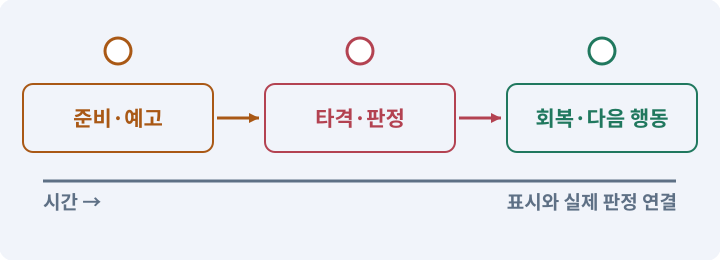

# 019. 누가 때렸는지 보이는 전투 만들기

**목표:** 공격·피격·위험을 화면에서 구분합니다.

**시작 상태:** 세 스킬과 여러 적

## 한눈에 보는 기능의 흐름

적의 예고 → 실제 타격 → 피격 표시 → 소리·체력 변화



**경계:** 효과가 위험 표시와 대상을 가리지 않기

그림은 실제 게임 실행 결과가 아닙니다. 값·규칙과 예제를 필요한 때 펼쳐 읽고 현재 단계의 메시지를 한 번씩 보냅니다.

## 1. 지금 상태 확인하기

첫 메시지를 보내 현재 준비 상태를 확인합니다. AI가 읽어 온 실제 프로젝트가 맞는지 보고, 없는 준비나 다른 상태가 있으면 먼저 알려 주세요. 아직 기능을 만들지 않는 단계입니다.

### AI에게 보낼 요구와 이유

#### 01. 작업 대상부터 확인

**“누가 때렸는지 보이는 전투 만들기” 작업을 시작하기 전에 현재 상태를 읽기 전용으로 확인해 줘.**

왜 이렇게 요청하나요? AI가 다른 프로젝트나 오래된 예제를 보고 작업할 수 있습니다. 실제 경로·파일·현재 기능을 읽게 하면 지금 이어서 작업할 대상을 먼저 맞출 수 있습니다.

#### 02. 작업 대상부터 확인

**필요한 시작 상태는 세 스킬과 여러 적야.**

왜 이렇게 요청하나요? AI가 다른 프로젝트나 오래된 예제를 보고 작업할 수 있습니다. 실제 경로·파일·현재 기능을 읽게 하면 지금 이어서 작업할 대상을 먼저 맞출 수 있습니다.

#### 03. 실제 사용 중인 구현 재사용

**실제 프로젝트와 작업 기록을 읽고 이것이 준비되어 있는지, 이미 같은 기능이 있는지 확인해 줘.**

왜 이렇게 요청하나요? 이름이 비슷한 새 클래스를 또 만들면 기존 화면은 여전히 옛 코드를 사용할 수 있습니다. 실제 호출되는 진입점을 찾아 연결해야 두 구현이 충돌하거나 수정이 반영되지 않는 문제를 막습니다.

#### 04. 현재 상태와 다음 확인 지점 구분

**이번 기능이 연결될 실제 파일·화면·도구와 보존할 기존 동작을 짧게 정리해 줘.**

왜 이렇게 요청하나요? 이미 준비된 기능과 아직 확인하지 못한 기능을 섞으면 불필요한 재설치나 성급한 완료 판정이 생깁니다. 현재 대상과 남은 준비를 나눠 가장 작은 다음 작업을 선택하게 합니다.

#### 05. 조사 단계에서 변경하지 않기

**아직 새 구현·설치·유료 호출·파일 변경은 하지 마.**

왜 이렇게 요청하나요? 현재 상태를 알아보기만 할 때 파일 변경이나 결제가 시작되면 검토 전의 환경이 바뀝니다. 준비 확인과 실제 구현을 나눠 되돌리기 어려운 작업이 먼저 실행되지 않게 합니다.

#### 06. 막힌 준비를 먼저 해결

**준비가 다르면 부족한 항목과 다음에 필요한 작업을 알려 줘.**

왜 이렇게 요청하나요? 빠진 파일·권한·패키지를 있다고 가정하면 다음 구현이 엉뚱한 대상을 만들게 됩니다. 무엇이 없고 무엇을 먼저 해야 하는지 분리하면 불필요한 재작업을 줄일 수 있습니다.

<details>
<summary>보낼 원문 전체 — 설명은 복사되지 않습니다</summary>

```text
“누가 때렸는지 보이는 전투 만들기” 작업을 시작하기 전에 현재 상태를 읽기 전용으로 확인해 줘.
필요한 시작 상태는 세 스킬과 여러 적야. 실제 프로젝트와 작업 기록을 읽고 이것이 준비되어 있는지, 이미 같은 기능이 있는지 확인해 줘.
이번 기능이 연결될 실제 파일·화면·도구와 보존할 기존 동작을 짧게 정리해 줘. 아직 새 구현·설치·유료 호출·파일 변경은 하지 마. 준비가 다르면 부족한 항목과 다음에 필요한 작업을 알려 줘.
```

</details>

**기대 결과:** 읽기 어려운 순간과 변경할 시각 요소

### 직접 확인하기

1. AI가 읽은 실제 프로젝트 또는 도구 경로를 확인합니다.
2. 필수 준비가 없다면 문제 해결 요청을 보내고, 준비됐을 때 다음으로 갑니다.

## 2. 필요한 기능 만들기

준비가 확인되면 아래 요청을 보냅니다. AI가 파일·설정·실행을 맡습니다. 변경 범위나 비용 승인이 나오면 내용을 읽고 결정하세요.

### AI에게 보낼 요구와 이유

#### 01. 작업 대상부터 확인

**현재 프로젝트의 실제 파일과 이미 결정한 규칙을 먼저 확인해 줘.**

왜 이렇게 요청하나요? AI가 다른 프로젝트나 오래된 예제를 보고 작업할 수 있습니다. 실제 경로·파일·현재 기능을 읽게 하면 지금 이어서 작업할 대상을 먼저 맞출 수 있습니다.

#### 02. 실제 사용 중인 코드에 연결

**이름이 다른 기존 구현이 있으면 새로 중복 제작하지 말고 그 구현에 연결해 줘.**

왜 이렇게 요청하나요? 예제와 이름이 다르더라도 현재 씬과 입력에서 호출하는 구현이 작업 대상입니다. 같은 기능을 새로 만들기보다 기존 진입점을 확인해 수정이 실제 게임에 반영되고 중복 실행되지 않게 합니다.

#### 03. 접근성·가독성·피드백의 적용 조건

**현재 전투 규칙을 바꾸지 않고 읽히는 피드백을 개선해 줘.**

왜 이렇게 요청하나요? 접근성은 다양한 감각·조작 조건에서도 정보를 이해하고 사용할 수 있게 하는 설계입니다. 가독성은 현재 무엇이 일어나는지 구분하기 쉬운 정도이며 피드백은 행동 결과를 알려 주는 반응입니다. 강한 흔들림이 항상 좋은 타격감은 아닙니다. 끄거나 줄일 수 있게 합니다.

#### 04. 피할 수 있는 정보와 실제 판정 일치

**피해 숫자, 짧은 피격 색 변화, 사망 표시, 공격 예고 원/부채꼴을 추가해 줘.**

왜 이렇게 요청하나요? 표시한 위험 범위·시점과 실제 피해가 다르면 플레이어는 올바르게 반응해도 손해를 봅니다. 예고·판정·효과가 같은 규칙을 사용하게 해 공격을 학습할 수 있게 합니다.

#### 05. 피할 수 있는 정보와 실제 판정 일치

**예고 도형은 실제 피해 범위와 같은 데이터에서 만들어 줘.**

왜 이렇게 요청하나요? 표시한 위험 범위·시점과 실제 피해가 다르면 플레이어는 올바르게 반응해도 손해를 봅니다. 예고·판정·효과가 같은 규칙을 사용하게 해 공격을 학습할 수 있게 합니다.

#### 06. 피할 수 있는 정보와 실제 판정 일치

**바닥 예고는 적과 바닥에 가려지지 않되 HUD보다 앞에 나오지 않게 해 줘.**

왜 이렇게 요청하나요? 표시한 위험 범위·시점과 실제 피해가 다르면 플레이어는 올바르게 반응해도 손해를 봅니다. 예고·판정·효과가 같은 규칙을 사용하게 해 공격을 학습할 수 있게 합니다.

#### 07. 피격 정보는 읽히게, 장식은 제한

**플레이어 피격과 적 피격의 표현을 구분하고 과도한 전체 화면 플래시는 피해야 해.**

왜 이렇게 요청하나요? 작은 숫자와 섬광도 전투가 길어지면 화면을 가리거나 부담이 될 수 있습니다. 대상별 차이를 표현하면서 재생 수·수명·강도를 제한해 중요한 공격 예고를 계속 볼 수 있게 합니다.

#### 08. 카메라로 조작 정보 보존

**카메라 흔들림은 작은 초기값과 끄기 옵션을 제공해 줘.**

왜 이렇게 요청하나요? 카메라가 벽 안에 있거나 심하게 흔들리면 판정이 정상이어도 대상을 찾기 어렵습니다. 시야·선택·멀미 완화 설정을 확인해 화면 연출이 플레이를 방해하지 않게 합니다.

#### 09. 피격 정보는 읽히게, 장식은 제한

**피해 숫자는 동시에 과도하게 생성되지 않게 상한과 수명 관리를 넣어 줘.**

왜 이렇게 요청하나요? 작은 숫자와 섬광도 전투가 길어지면 화면을 가리거나 부담이 될 수 있습니다. 대상별 차이를 표현하면서 재생 수·수명·강도를 제한해 중요한 공격 예고를 계속 볼 수 있게 합니다.

#### 10. 전역 시간 변경의 충돌 방지

**슬로모션을 위해 전역 timeScale을 반복 수정하지 마.**

왜 이렇게 요청하나요? 여러 효과가 각자 전역 배속을 바꾸면 마지막 복구가 다른 효과나 일시정지를 풀 수 있습니다. 시간 효과의 소유와 우선순위를 한 곳에서 정리합니다.

#### 11. 피할 수 있는 정보와 실제 판정 일치

**실제 전투 전/공격 예고/타격/사망의 연속 상태를 캡처하거나 녹화해 줘.**

왜 이렇게 요청하나요? 표시한 위험 범위·시점과 실제 피해가 다르면 플레이어는 올바르게 반응해도 손해를 봅니다. 예고·판정·효과가 같은 규칙을 사용하게 해 공격을 학습할 수 있게 합니다.

#### 12. 사용 성공과 자원 소비 묶기

**수치 변화 없이 가독성이 개선됐는지 비교하고 관측하지 못한 것은 별도로 적어 줘.**

왜 이렇게 요청하나요? 실패한 사용에서 자원이 줄거나 연타로 여러 번 차감되면 표시와 실제 행동이 어긋납니다. 사용 조건·비용·대기시간을 함께 처리하고 실패 시 바뀌지 않아야 할 값을 확인합니다.

#### 13. 구현과 실행은 AI에게 맡기기

**코드·설정·파일 생성·실행은 네가 맡고, 필요한 화면과 결과를 보여 줘.**

왜 이렇게 요청하나요? 설명이나 코드 조각만 받으면 실제 파일 생성·연결·실행이 빠질 수 있습니다. AI가 개발 작업까지 수행하고, 사람은 요구·승인·결과 판단을 맡도록 역할을 분명히 합니다.

#### 14. 막힌 준비를 먼저 해결

**수행하지 못한 작업과 필요한 승인·도구 연결은 구분해서 알려 줘.**

왜 이렇게 요청하나요? 빠진 파일·권한·패키지를 있다고 가정하면 다음 구현이 엉뚱한 대상을 만들게 됩니다. 무엇이 없고 무엇을 먼저 해야 하는지 분리하면 불필요한 재작업을 줄일 수 있습니다.

<details>
<summary>보낼 원문 전체 — 설명은 복사되지 않습니다</summary>

```text
현재 프로젝트의 실제 파일과 이미 결정한 규칙을 먼저 확인해 줘. 이름이 다른 기존 구현이 있으면 새로 중복 제작하지 말고 그 구현에 연결해 줘.

현재 전투 규칙을 바꾸지 않고 읽히는 피드백을 개선해 줘.
피해 숫자, 짧은 피격 색 변화, 사망 표시, 공격 예고 원/부채꼴을 추가해 줘.
예고 도형은 실제 피해 범위와 같은 데이터에서 만들어 줘.
바닥 예고는 적과 바닥에 가려지지 않되 HUD보다 앞에 나오지 않게 해 줘.
플레이어 피격과 적 피격의 표현을 구분하고 과도한 전체 화면 플래시는 피해야 해.
카메라 흔들림은 작은 초기값과 끄기 옵션을 제공해 줘.
피해 숫자는 동시에 과도하게 생성되지 않게 상한과 수명 관리를 넣어 줘.
슬로모션을 위해 전역 timeScale을 반복 수정하지 마.
실제 전투 전/공격 예고/타격/사망의 연속 상태를 캡처하거나 녹화해 줘.
수치 변화 없이 가독성이 개선됐는지 비교하고 관측하지 못한 것은 별도로 적어 줘.

코드·설정·파일 생성·실행은 네가 맡고, 필요한 화면과 결과를 보여 줘. 수행하지 못한 작업과 필요한 승인·도구 연결은 구분해서 알려 줘.
```

</details>

**기대 결과:** 확인할 결과: 화면을 보고 공격과 피해 원인을 구분함. AI가 이 상태를 확인할 실제 화면과 변경 내용을 준비합니다. 아직 실행하지 못한 부분은 따로 표시합니다.

### 직접 확인하기

1. 제안서만 반환됐다면 “설명으로 끝내지 말고 승인한 범위의 실제 작업을 수행해 줘”라고 보냅니다.
2. 코드나 설정을 직접 고치라는 안내가 나오면 “작성과 실행은 네가 맡아 줘”라고 요청합니다.

## 3. 결과를 직접 확인하기

먼저 확인 요청을 보내 AI가 검사와 화면을 준비하게 하세요. 그다음 아래 동작을 하나씩 확인합니다.

### AI에게 보낼 요구와 이유

#### 01. 검사할 입력과 관찰 지점 준비

**방금 구현한 기능의 자동 검사와 확인 화면을 준비해 줘.**

왜 이렇게 요청하나요? 정상 예 하나만 보면 실패 조건을 놓치기 쉽습니다. 정상·경계·반례를 실제 입력으로 준비하고 사람이 볼 화면도 맞춰 확인 범위를 분명하게 합니다.

#### 02. 결과를 재확인할 근거 남기기

**정상 동작과 아래 실패 조건을 실제로 검사하고 대상·실행 수·결과를 보여 줘.**

왜 이렇게 요청하나요? “잘 됩니다”라는 요약만으로는 어떤 입력과 버전을 검사했는지 알 수 없습니다. 대상·실행 수·실패 내용·파일을 함께 남겨 같은 조건으로 다시 확인할 수 있게 합니다.

#### 03. 피할 수 있는 정보와 실제 판정 일치

**타격 전에 예고가 보인다.**

왜 이렇게 요청하나요? 표시한 위험 범위·시점과 실제 피해가 다르면 플레이어는 올바르게 반응해도 손해를 봅니다. 예고·판정·효과가 같은 규칙을 사용하게 해 공격을 학습할 수 있게 합니다.

#### 04. 피할 수 있는 정보와 실제 판정 일치

**예고 범위와 실제 피해 범위가 맞다.**

왜 이렇게 요청하나요? 표시한 위험 범위·시점과 실제 피해가 다르면 플레이어는 올바르게 반응해도 손해를 봅니다. 예고·판정·효과가 같은 규칙을 사용하게 해 공격을 학습할 수 있게 합니다.

#### 05. 사용 성공과 자원 소비 묶기

**이펙트가 플레이어·물약 버튼을 가리지 않는다.**

왜 이렇게 요청하나요? 실패한 사용에서 자원이 줄거나 연타로 여러 번 차감되면 표시와 실제 행동이 어긋납니다. 사용 조건·비용·대기시간을 함께 처리하고 실패 시 바뀌지 않아야 할 값을 확인합니다.

#### 06. 피격 정보는 읽히게, 장식은 제한

**연속 전투에서 피해 숫자가 끝없이 쌓이지 않는다.**

왜 이렇게 요청하나요? 작은 숫자와 섬광도 전투가 길어지면 화면을 가리거나 부담이 될 수 있습니다. 대상별 차이를 표현하면서 재생 수·수명·강도를 제한해 중요한 공격 예고를 계속 볼 수 있게 합니다.

#### 07. 표현 설정이 게임 규칙을 바꾸지 않게

**흔들림을 꺼도 게임 상태는 정상이다.**

왜 이렇게 요청하나요? 카메라 흔들림과 시청각 전달을 조정하는 것이 공격 피해나 적의 동작 조건까지 바꾸어서는 안 됩니다. 표현을 꺼도 같은 전투 결과가 나오는지 확인합니다.

#### 08. 성공 예와 회귀 반례 함께 확인

**관문 확인으로 현재 Windows/Android 빌드를 다시 만들고 해당 핵심 흐름을 실제 검사한다.**

왜 이렇게 요청하나요? 새 기능 하나가 동작해도 이전 동작이 깨지거나 실패 입력에서 상태가 망가질 수 있습니다. 정상·오류·기존 흐름을 함께 검사해 수정 범위 밖의 회귀를 찾습니다.

#### 09. 사람이 실제로 본 것만 기록

**연결되지 않은 기기는 BLOCKED로 기록한다.**

왜 이렇게 요청하나요? AI가 준비한 검사와 사람이 직접 플레이하거나 들은 결과는 다른 근거입니다. 관찰하지 않은 조작감·소리·실기기 결과를 임의로 완료 처리하지 않게 합니다.

#### 10. 사람 검사의 시작점 준비

**내가 조작해야 하는 부분은 실행할 화면과 시작 상태를 준비해 줘.**

왜 이렇게 요청하나요? 같은 기능이라도 시작 상태가 다르면 관찰 결과가 달라집니다. AI가 실행 화면과 재현 위치를 먼저 준비해야 사람이 이동·공격·소리·조작감을 같은 조건에서 확인할 수 있습니다.

#### 11. 사람이 실제로 본 것만 기록

**연결되지 않은 휴대폰의 터치나 사람이 보지 않은 재미·소리 품질을 대신 확인했다고 하지 마.**

왜 이렇게 요청하나요? AI가 준비한 검사와 사람이 직접 플레이하거나 들은 결과는 다른 근거입니다. 관찰하지 않은 조작감·소리·실기기 결과를 임의로 완료 처리하지 않게 합니다.

#### 12. 실제로 실행한 검사만 인정

**테스트 0개와 예전 소스 결과는 현재 성공으로 쓰지 마.**

왜 이렇게 요청하나요? 실행된 검사가 없거나 같은 결과를 중복 집계한 경우는 기능을 확인한 것이 아닙니다. 실행 수와 개별 결과를 함께 확인해야 형식적인 성공 표시를 걸러낼 수 있습니다.

<details>
<summary>보낼 원문 전체 — 설명은 복사되지 않습니다</summary>

```text
방금 구현한 기능의 자동 검사와 확인 화면을 준비해 줘. 정상 동작과 아래 실패 조건을 실제로 검사하고 대상·실행 수·결과를 보여 줘.

타격 전에 예고가 보인다. 예고 범위와 실제 피해 범위가 맞다. 이펙트가 플레이어·물약 버튼을 가리지 않는다. 연속 전투에서 피해 숫자가 끝없이 쌓이지 않는다. 흔들림을 꺼도 게임 상태는 정상이다. 관문 확인으로 현재 Windows/Android 빌드를 다시 만들고 해당 핵심 흐름을 실제 검사한다. 연결되지 않은 기기는 BLOCKED로 기록한다.

내가 조작해야 하는 부분은 실행할 화면과 시작 상태를 준비해 줘. 연결되지 않은 휴대폰의 터치나 사람이 보지 않은 재미·소리 품질을 대신 확인했다고 하지 마. 테스트 0개와 예전 소스 결과는 현재 성공으로 쓰지 마.
```

</details>

**기대 결과:** 화면을 보고 공격과 피해 원인을 구분함

### 직접 확인하기

1. 같은 전투를 효과 전후로 비교합니다.
2. 여러 스킬을 써도 적과 위험 표시를 찾을 수 있는지 봅니다.
3. 소리를 줄여도 맞은 방향과 체력 변화를 이해할 수 있는지 봅니다.

## 4. 결과를 남기고 마무리하기

실제로 본 결과를 아래 메모에 적고 AI에 전달합니다. 결과 저장 요청으로 현재 상태를 남긴 뒤 다음 페이지로 갑니다.

### AI에게 보낼 요구와 이유

#### 01. 결과를 재확인할 근거 남기기

**지금 작업한 “누가 때렸는지 보이는 전투 만들기”의 실제 결과를 정리해 줘.**

왜 이렇게 요청하나요? “잘 됩니다”라는 요약만으로는 어떤 입력과 버전을 검사했는지 알 수 없습니다. 대상·실행 수·실패 내용·파일을 함께 남겨 같은 조건으로 다시 확인할 수 있게 합니다.

#### 02. 다음 작업이 읽을 인수인계

**변경한 기능·파일·현재 후보와 실제 실행한 검사, 남은 문제를 기능 이름으로 기록해 줘.**

왜 이렇게 요청하나요? 새 AI 세션은 이전 대화 전체를 알고 있다고 보장할 수 없습니다. 현재 후보·파일 위치·실행한 검사·남은 일을 남겨야 같은 작업을 반복하지 않고 이어갈 수 있습니다.

#### 03. 사람이 실제로 본 것만 기록

**자동 검사 결과와 내가 직접 확인한 결과를 구분하고, 내 관찰이 아직 없으면 미확인으로 남겨 줘.**

왜 이렇게 요청하나요? AI가 준비한 검사와 사람이 직접 플레이하거나 들은 결과는 다른 근거입니다. 관찰하지 않은 조작감·소리·실기기 결과를 임의로 완료 처리하지 않게 합니다.

#### 04. 다음 작업이 읽을 인수인계

**재시작하거나 다음 작업에서 읽을 기록의 실제 위치를 알려 줘.**

왜 이렇게 요청하나요? 새 AI 세션은 이전 대화 전체를 알고 있다고 보장할 수 없습니다. 현재 후보·파일 위치·실행한 검사·남은 일을 남겨야 같은 작업을 반복하지 않고 이어갈 수 있습니다.

#### 05. 미확인을 완료와 분리

**아직 확인하지 않은 결과를 완료로 채우지 마.**

왜 이렇게 요청하나요? 만들어진 것, 검사에 실패한 것, 아직 확인하지 못한 것을 나눠야 다음 작업을 정확히 고를 수 있습니다. 실행할 조건이 없는 기능을 성공으로 기록하면 뒤에서 원인을 찾기 어려워집니다.

<details>
<summary>보낼 원문 전체 — 설명은 복사되지 않습니다</summary>

```text
지금 작업한 “누가 때렸는지 보이는 전투 만들기”의 실제 결과를 정리해 줘. 변경한 기능·파일·현재 후보와 실제 실행한 검사, 남은 문제를 기능 이름으로 기록해 줘.
자동 검사 결과와 내가 직접 확인한 결과를 구분하고, 내 관찰이 아직 없으면 미확인으로 남겨 줘. 재시작하거나 다음 작업에서 읽을 기록의 실제 위치를 알려 줘. 아직 확인하지 않은 결과를 완료로 채우지 마.
```

</details>

**기대 결과:** 현재 상태·검사 결과·남은 문제·다음에 읽을 기록을 확인할 수 있습니다.

### 직접 확인하기

1. 자동 검사와 내 관찰 결과가 섞이지 않았는지 봅니다.
2. 문제가 남았다면 해결 요청을 보내고 같은 동작을 다시 확인합니다.

## 문제가 있으면

### AI에게 보낼 요구와 이유

#### 01. 구현할 결과와 조건 고정

**효과를 더 쌓기 전에 가장 중요한 위험 표시가 묻히는 순간을 찾아 줘.**

왜 이렇게 요청하나요? “효과를 더 쌓기 전에 가장 중요한 위험 표시가 묻히는 순간을 찾아 줘”를 명시하면 AI가 무엇을 구현하거나 검사해야 하는지 범위를 좁힐 수 있습니다. 공격·피격·위험을 화면에서 구분합니다. 이 결과를 확인할 때 이 조건이 실제로 반영됐는지 함께 봅니다.

#### 02. 표현 설정이 게임 규칙을 바꾸지 않게

**피해량이나 적 속도를 바꾸지 말고 전달만 수정해 줘.**

왜 이렇게 요청하나요? 카메라 흔들림과 시청각 전달을 조정하는 것이 공격 피해나 적의 동작 조건까지 바꾸어서는 안 됩니다. 표현을 꺼도 같은 전투 결과가 나오는지 확인합니다.

#### 03. 원인 하나를 좁혀 수정

**새 기능을 추가하지 말고 현재 오류와 실제 로그를 먼저 읽어 줘.**

왜 이렇게 요청하나요? 오류 수정 중 새 기능까지 넣으면 어떤 변경이 문제를 해결하거나 악화했는지 알기 어렵습니다. 원래 재현을 보존하고 작은 변경 뒤 같은 입력과 주변 정상 동작을 다시 확인합니다.

#### 04. 원인 하나를 좁혀 수정

**최소 수정 뒤 같은 재현과 관련 정상 동작을 다시 검사해 줘.**

왜 이렇게 요청하나요? 오류 수정 중 새 기능까지 넣으면 어떤 변경이 문제를 해결하거나 악화했는지 알기 어렵습니다. 원래 재현을 보존하고 작은 변경 뒤 같은 입력과 주변 정상 동작을 다시 확인합니다.

#### 05. 실패도 재현 자료로 보존

**실패 기록은 지우지 마.**

왜 이렇게 요청하나요? 실패한 입력과 로그가 있어야 같은 문제가 다시 생겼을 때 비교할 수 있습니다. 성공 기록으로 덮어쓰지 않고 전후 자료를 남기면 무엇을 고쳤는지 확인할 수 있습니다.

<details>
<summary>보낼 원문 전체 — 설명은 복사되지 않습니다</summary>

```text
효과를 더 쌓기 전에 가장 중요한 위험 표시가 묻히는 순간을 찾아 줘. 피해량이나 적 속도를 바꾸지 말고 전달만 수정해 줘.
새 기능을 추가하지 말고 현재 오류와 실제 로그를 먼저 읽어 줘. 최소 수정 뒤 같은 재현과 관련 정상 동작을 다시 검사해 줘. 실패 기록은 지우지 마.
```

</details>

## 새 세션에서 이어가기

### AI에게 보낼 요구와 이유

#### 01. 이어서 할 작업 식별

**“누가 때렸는지 보이는 전투 만들기” 작업을 이어가고 싶어.**

왜 이렇게 요청하나요? 이름으로 재개할 작업을 찾고, 뒤에 이어지는 요청으로 실제 파일·진행 중 작업·기록을 다시 읽게 합니다. 제목만 보고 이전 상태를 기억한다고 가정하지 않습니다.

#### 02. 조회는 상태를 바꾸지 않게

**실제 프로젝트와 내 도구의 작업 기록을 읽고 어디까지 구현·검사됐는지 확인해 줘.**

왜 이렇게 요청하나요? 진행 상황을 물을 때 새 구현이나 유료 호출이 시작되면 단순 확인이 실행 명령이 되어 버립니다. 저장된 근거를 읽어 완료·진행·승인 대기·미검증을 나누게 합니다.

#### 03. 재개 전 중복 작업 방지

**진행 중인 프로세스·승인·미저장 변경을 확인한 뒤 남은 가장 작은 작업부터 안내해 줘.**

왜 이렇게 요청하나요? 대화가 끊겨도 외부 작업은 끝났거나 아직 실행 중일 수 있습니다. 프로세스·승인·미저장 상태를 먼저 읽어 같은 생성·빌드·결제를 두 번 시작하지 않도록 합니다.

#### 04. 되돌아갈 원본 남기기

**기존 성공과 실패 기록은 보존해 줘.**

왜 이렇게 요청하나요? 새 구현이 실패해도 이전 게임과 저장을 복원할 수 있어야 합니다. 현재 내용을 먼저 조사하고 별도 후보에서 작업하면 실험이 유일한 정상본을 망가뜨리는 일을 피할 수 있습니다.

<details>
<summary>보낼 원문 전체 — 설명은 복사되지 않습니다</summary>

```text
“누가 때렸는지 보이는 전투 만들기” 작업을 이어가고 싶어. 실제 프로젝트와 내 도구의 작업 기록을 읽고 어디까지 구현·검사됐는지 확인해 줘. 진행 중인 프로세스·승인·미저장 변경을 확인한 뒤 남은 가장 작은 작업부터 안내해 줘. 기존 성공과 실패 기록은 보존해 줘.
```

</details>

## 왜 이렇게 만드는가

전투 피드백은 ‘크고 화려하게’가 목표가 아니다. 적의 예고, 실제 타격, 체력 변화가 같은 사건처럼 읽히게 만드는 것이 목표다. 작은 모바일 화면에서는 큰 이펙트가 오히려 적과 바닥을 가릴 수 있다.

이 단계에서는 색상 외에 모양·움직임·숫자를 함께 써서 공격 상태를 구분한다. 카메라 흔들림과 플래시는 옵션으로 줄일 수 있게 한다.

## 공식 참고

