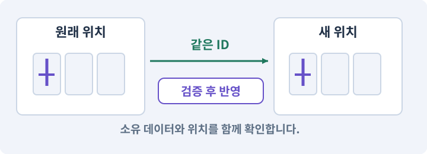

# 020. 같은 검 두 자루를 다른 물건으로 다루기

**목표:** 아이템 종류와 내가 가진 아이템을 구분합니다.

**시작 상태:** 전투 기본 기능

## 한눈에 보는 기능의 흐름

아이템 정의 → 검 A의 고유 ID → 검 B의 고유 ID → 서로 다른 옵션



**경계:** 한 검을 바꿔도 다른 검의 옵션은 그대로

그림은 실제 게임 실행 결과가 아닙니다. 값·규칙과 예제를 필요한 때 펼쳐 읽고 현재 단계의 메시지를 한 번씩 보냅니다.

## 1. 지금 상태 확인하기

첫 메시지를 보내 현재 준비 상태를 확인합니다. AI가 읽어 온 실제 프로젝트가 맞는지 보고, 없는 준비나 다른 상태가 있으면 먼저 알려 주세요. 아직 기능을 만들지 않는 단계입니다.

### AI에게 보낼 요구와 이유

#### 01. 작업 대상부터 확인

**“같은 검 두 자루를 다른 물건으로 다루기” 작업을 시작하기 전에 현재 상태를 읽기 전용으로 확인해 줘.**

왜 이렇게 요청하나요? AI가 다른 프로젝트나 오래된 예제를 보고 작업할 수 있습니다. 실제 경로·파일·현재 기능을 읽게 하면 지금 이어서 작업할 대상을 먼저 맞출 수 있습니다.

#### 02. 작업 대상부터 확인

**필요한 시작 상태는 전투 기본 기능야.**

왜 이렇게 요청하나요? AI가 다른 프로젝트나 오래된 예제를 보고 작업할 수 있습니다. 실제 경로·파일·현재 기능을 읽게 하면 지금 이어서 작업할 대상을 먼저 맞출 수 있습니다.

#### 03. 실제 사용 중인 구현 재사용

**실제 프로젝트와 작업 기록을 읽고 이것이 준비되어 있는지, 이미 같은 기능이 있는지 확인해 줘.**

왜 이렇게 요청하나요? 이름이 비슷한 새 클래스를 또 만들면 기존 화면은 여전히 옛 코드를 사용할 수 있습니다. 실제 호출되는 진입점을 찾아 연결해야 두 구현이 충돌하거나 수정이 반영되지 않는 문제를 막습니다.

#### 04. 현재 상태와 다음 확인 지점 구분

**이번 기능이 연결될 실제 파일·화면·도구와 보존할 기존 동작을 짧게 정리해 줘.**

왜 이렇게 요청하나요? 이미 준비된 기능과 아직 확인하지 못한 기능을 섞으면 불필요한 재설치나 성급한 완료 판정이 생깁니다. 현재 대상과 남은 준비를 나눠 가장 작은 다음 작업을 선택하게 합니다.

#### 05. 조사 단계에서 변경하지 않기

**아직 새 구현·설치·유료 호출·파일 변경은 하지 마.**

왜 이렇게 요청하나요? 현재 상태를 알아보기만 할 때 파일 변경이나 결제가 시작되면 검토 전의 환경이 바뀝니다. 준비 확인과 실제 구현을 나눠 되돌리기 어려운 작업이 먼저 실행되지 않게 합니다.

#### 06. 막힌 준비를 먼저 해결

**준비가 다르면 부족한 항목과 다음에 필요한 작업을 알려 줘.**

왜 이렇게 요청하나요? 빠진 파일·권한·패키지를 있다고 가정하면 다음 구현이 엉뚱한 대상을 만들게 됩니다. 무엇이 없고 무엇을 먼저 해야 하는지 분리하면 불필요한 재작업을 줄일 수 있습니다.

<details>
<summary>보낼 원문 전체 — 설명은 복사되지 않습니다</summary>

```text
“같은 검 두 자루를 다른 물건으로 다루기” 작업을 시작하기 전에 현재 상태를 읽기 전용으로 확인해 줘.
필요한 시작 상태는 전투 기본 기능야. 실제 프로젝트와 작업 기록을 읽고 이것이 준비되어 있는지, 이미 같은 기능이 있는지 확인해 줘.
이번 기능이 연결될 실제 파일·화면·도구와 보존할 기존 동작을 짧게 정리해 줘. 아직 새 구현·설치·유료 호출·파일 변경은 하지 마. 준비가 다르면 부족한 항목과 다음에 필요한 작업을 알려 줘.
```

</details>

**기대 결과:** 같은 종류지만 서로 다른 고유 ID를 가진 두 아이템

### 직접 확인하기

1. AI가 읽은 실제 프로젝트 또는 도구 경로를 확인합니다.
2. 필수 준비가 없다면 문제 해결 요청을 보내고, 준비됐을 때 다음으로 갑니다.

## 2. 필요한 기능 만들기

준비가 확인되면 아래 요청을 보냅니다. AI가 파일·설정·실행을 맡습니다. 변경 범위나 비용 승인이 나오면 내용을 읽고 결정하세요.

### AI에게 보낼 요구와 이유

#### 01. 작업 대상부터 확인

**현재 프로젝트의 실제 파일과 이미 결정한 규칙을 먼저 확인해 줘.**

왜 이렇게 요청하나요? AI가 다른 프로젝트나 오래된 예제를 보고 작업할 수 있습니다. 실제 경로·파일·현재 기능을 읽게 하면 지금 이어서 작업할 대상을 먼저 맞출 수 있습니다.

#### 02. 실제 사용 중인 코드에 연결

**이름이 다른 기존 구현이 있으면 새로 중복 제작하지 말고 그 구현에 연결해 줘.**

왜 이렇게 요청하나요? 예제와 이름이 다르더라도 현재 씬과 입력에서 호출하는 구현이 작업 대상입니다. 같은 기능을 새로 만들기보다 기존 진입점을 확인해 수정이 실제 게임에 반영되고 중복 실행되지 않게 합니다.

#### 03. 종류와 실제 소유 물건 구분

**아이템의 공통 설명서 ItemDefinition과 실제로 주운 한 개의 물건 ItemInstance를 분리해 줘.**

왜 이렇게 요청하나요? 같은 종류의 검 두 자루도 옵션과 소유 위치는 별개입니다. 정의 데이터와 개별 아이템을 나누면 한 물건을 수정했을 때 다른 물건과 원본 규격까지 바뀌지 않습니다.

#### 04. 종류와 실제 소유 물건 구분

**Definition에는 고정 definitionId·표시명·장비 슬롯·기본 보너스·아이콘과 외형 참조를 두고, Instance에는 고유 instanceId·definitionId·등급·생성할 때 확정한 옵션을 둬.**

왜 이렇게 요청하나요? 같은 종류의 검 두 자루도 옵션과 소유 위치는 별개입니다. 정의 데이터와 개별 아이템을 나누면 한 물건을 수정했을 때 다른 물건과 원본 규격까지 바뀌지 않습니다.

#### 05. 기존 결과를 보호

**ScriptableObject 원본에 소유 상태나 랜덤 옵션을 쓰지 마.**

왜 이렇게 요청하나요? 새 작업이 이미 정상인 기능이나 자산까지 바꾸면 원인을 추적하기 어렵습니다. 유지할 대상을 명시해 변경 전후를 비교하고 원치 않은 영향을 찾습니다.

#### 06. 전리품의 종류·확률·옵션 수를 따로 정의

**종류는 Weapon/Armor/Trinket, 등급은 Common/Magic/Rare다.**

왜 이렇게 요청하나요? 아이템 종류, 드롭될 확률, 생성된 뒤의 등급과 옵션은 서로 다른 결정입니다. 각각의 기준을 고정해야 재시작이나 표시 변경으로 옵션이 다시 뽑히지 않고 결과 분포를 검사할 수 있습니다.

#### 07. 비교 가능한 아이템 원형 준비

**아래 18개 초기 정의를 생성해 줘.**

왜 이렇게 요청하나요? 각 줄의 ID·분류·기본 수치는 아이템 종류의 기준 데이터입니다. 실제로 주운 한 자루의 고유 ID·옵션과 분리해 같은 종류를 여러 개 얻어도 정의와 소유 상태가 섞이지 않게 합니다. 숫자는 시작용 설계값이며 재미를 보장하는 측정값이 아닙니다.

#### 08. 데이터 생성기의 재실행

**기존 정의가 있으면 ID와 값을 대조하고 중복 생성하지 마.**

왜 이렇게 요청하나요? 같은 생성 도구를 다시 실행해도 정의가 중복되거나 ID가 바뀌지 않아야 저장 참조가 유지됩니다. 기존 자산을 실제로 찾아 값을 대조하고 소유 범위 안에서 갱신합니다.

#### 09. 비교 가능한 아이템 원형 준비

**weapon.rusty_sword · 녹슨 검 · Weapon · 공격 +4**

왜 이렇게 요청하나요? 각 줄의 ID·분류·기본 수치는 아이템 종류의 기준 데이터입니다. 실제로 주운 한 자루의 고유 ID·옵션과 분리해 같은 종류를 여러 개 얻어도 정의와 소유 상태가 섞이지 않게 합니다. 숫자는 시작용 설계값이며 재미를 보장하는 측정값이 아닙니다.

#### 10. 비교 가능한 아이템 원형 준비

**weapon.iron_sword · 철검 · Weapon · 공격 +6**

왜 이렇게 요청하나요? 각 줄의 ID·분류·기본 수치는 아이템 종류의 기준 데이터입니다. 실제로 주운 한 자루의 고유 ID·옵션과 분리해 같은 종류를 여러 개 얻어도 정의와 소유 상태가 섞이지 않게 합니다. 숫자는 시작용 설계값이며 재미를 보장하는 측정값이 아닙니다.

#### 11. 비교 가능한 아이템 원형 준비

**weapon.guards_blade · 경비대 검 · Weapon · 공격 +8**

왜 이렇게 요청하나요? 각 줄의 ID·분류·기본 수치는 아이템 종류의 기준 데이터입니다. 실제로 주운 한 자루의 고유 ID·옵션과 분리해 같은 종류를 여러 개 얻어도 정의와 소유 상태가 섞이지 않게 합니다. 숫자는 시작용 설계값이며 재미를 보장하는 측정값이 아닙니다.

#### 12. 비교 가능한 아이템 원형 준비

**weapon.heavy_axe · 무거운 도끼 · Weapon · 공격 +10**

왜 이렇게 요청하나요? 각 줄의 ID·분류·기본 수치는 아이템 종류의 기준 데이터입니다. 실제로 주운 한 자루의 고유 ID·옵션과 분리해 같은 종류를 여러 개 얻어도 정의와 소유 상태가 섞이지 않게 합니다. 숫자는 시작용 설계값이며 재미를 보장하는 측정값이 아닙니다.

#### 13. 비교 가능한 아이템 원형 준비

**weapon.runed_mace · 룬 철퇴 · Weapon · 공격 +12**

왜 이렇게 요청하나요? 각 줄의 ID·분류·기본 수치는 아이템 종류의 기준 데이터입니다. 실제로 주운 한 자루의 고유 ID·옵션과 분리해 같은 종류를 여러 개 얻어도 정의와 소유 상태가 섞이지 않게 합니다. 숫자는 시작용 설계값이며 재미를 보장하는 측정값이 아닙니다.

#### 14. 비교 가능한 아이템 원형 준비

**weapon.castle_blade · 성채의 검 · Weapon · 공격 +14**

왜 이렇게 요청하나요? 각 줄의 ID·분류·기본 수치는 아이템 종류의 기준 데이터입니다. 실제로 주운 한 자루의 고유 ID·옵션과 분리해 같은 종류를 여러 개 얻어도 정의와 소유 상태가 섞이지 않게 합니다. 숫자는 시작용 설계값이며 재미를 보장하는 측정값이 아닙니다.

#### 15. 비교 가능한 아이템 원형 준비

**armor.worn_tunic · 낡은 튜닉 · Armor · 방어 +2**

왜 이렇게 요청하나요? 각 줄의 ID·분류·기본 수치는 아이템 종류의 기준 데이터입니다. 실제로 주운 한 자루의 고유 ID·옵션과 분리해 같은 종류를 여러 개 얻어도 정의와 소유 상태가 섞이지 않게 합니다. 숫자는 시작용 설계값이며 재미를 보장하는 측정값이 아닙니다.

#### 16. 비교 가능한 아이템 원형 준비

**armor.leather_vest · 가죽 조끼 · Armor · 방어 +4**

왜 이렇게 요청하나요? 각 줄의 ID·분류·기본 수치는 아이템 종류의 기준 데이터입니다. 실제로 주운 한 자루의 고유 ID·옵션과 분리해 같은 종류를 여러 개 얻어도 정의와 소유 상태가 섞이지 않게 합니다. 숫자는 시작용 설계값이며 재미를 보장하는 측정값이 아닙니다.

#### 17. 비교 가능한 아이템 원형 준비

**armor.guards_mail · 경비대 사슬갑옷 · Armor · 방어 +6**

왜 이렇게 요청하나요? 각 줄의 ID·분류·기본 수치는 아이템 종류의 기준 데이터입니다. 실제로 주운 한 자루의 고유 ID·옵션과 분리해 같은 종류를 여러 개 얻어도 정의와 소유 상태가 섞이지 않게 합니다. 숫자는 시작용 설계값이며 재미를 보장하는 측정값이 아닙니다.

#### 18. 비교 가능한 아이템 원형 준비

**armor.iron_mail · 철 사슬갑옷 · Armor · 방어 +8**

왜 이렇게 요청하나요? 각 줄의 ID·분류·기본 수치는 아이템 종류의 기준 데이터입니다. 실제로 주운 한 자루의 고유 ID·옵션과 분리해 같은 종류를 여러 개 얻어도 정의와 소유 상태가 섞이지 않게 합니다. 숫자는 시작용 설계값이며 재미를 보장하는 측정값이 아닙니다.

#### 19. 비교 가능한 아이템 원형 준비

**armor.runed_plate · 룬 판금갑옷 · Armor · 방어 +10**

왜 이렇게 요청하나요? 각 줄의 ID·분류·기본 수치는 아이템 종류의 기준 데이터입니다. 실제로 주운 한 자루의 고유 ID·옵션과 분리해 같은 종류를 여러 개 얻어도 정의와 소유 상태가 섞이지 않게 합니다. 숫자는 시작용 설계값이며 재미를 보장하는 측정값이 아닙니다.

#### 20. 비교 가능한 아이템 원형 준비

**armor.castle_plate · 성채 판금갑옷 · Armor · 방어 +12**

왜 이렇게 요청하나요? 각 줄의 ID·분류·기본 수치는 아이템 종류의 기준 데이터입니다. 실제로 주운 한 자루의 고유 ID·옵션과 분리해 같은 종류를 여러 개 얻어도 정의와 소유 상태가 섞이지 않게 합니다. 숫자는 시작용 설계값이며 재미를 보장하는 측정값이 아닙니다.

#### 21. 비교 가능한 아이템 원형 준비

**trinket.wood_charm · 나무 부적 · Trinket · 최대 HP +10**

왜 이렇게 요청하나요? 각 줄의 ID·분류·기본 수치는 아이템 종류의 기준 데이터입니다. 실제로 주운 한 자루의 고유 ID·옵션과 분리해 같은 종류를 여러 개 얻어도 정의와 소유 상태가 섞이지 않게 합니다. 숫자는 시작용 설계값이며 재미를 보장하는 측정값이 아닙니다.

#### 22. 비교 가능한 아이템 원형 준비

**trinket.copper_charm · 구리 부적 · Trinket · 최대 HP +15**

왜 이렇게 요청하나요? 각 줄의 ID·분류·기본 수치는 아이템 종류의 기준 데이터입니다. 실제로 주운 한 자루의 고유 ID·옵션과 분리해 같은 종류를 여러 개 얻어도 정의와 소유 상태가 섞이지 않게 합니다. 숫자는 시작용 설계값이며 재미를 보장하는 측정값이 아닙니다.

#### 23. 비교 가능한 아이템 원형 준비

**trinket.silver_charm · 은 부적 · Trinket · 최대 HP +20**

왜 이렇게 요청하나요? 각 줄의 ID·분류·기본 수치는 아이템 종류의 기준 데이터입니다. 실제로 주운 한 자루의 고유 ID·옵션과 분리해 같은 종류를 여러 개 얻어도 정의와 소유 상태가 섞이지 않게 합니다. 숫자는 시작용 설계값이며 재미를 보장하는 측정값이 아닙니다.

#### 24. 비교 가능한 아이템 원형 준비

**trinket.warding_charm · 수호 부적 · Trinket · 최대 HP +25**

왜 이렇게 요청하나요? 각 줄의 ID·분류·기본 수치는 아이템 종류의 기준 데이터입니다. 실제로 주운 한 자루의 고유 ID·옵션과 분리해 같은 종류를 여러 개 얻어도 정의와 소유 상태가 섞이지 않게 합니다. 숫자는 시작용 설계값이며 재미를 보장하는 측정값이 아닙니다.

#### 25. 비교 가능한 아이템 원형 준비

**trinket.runed_charm · 룬 부적 · Trinket · 최대 HP +30**

왜 이렇게 요청하나요? 각 줄의 ID·분류·기본 수치는 아이템 종류의 기준 데이터입니다. 실제로 주운 한 자루의 고유 ID·옵션과 분리해 같은 종류를 여러 개 얻어도 정의와 소유 상태가 섞이지 않게 합니다. 숫자는 시작용 설계값이며 재미를 보장하는 측정값이 아닙니다.

#### 26. 비교 가능한 아이템 원형 준비

**trinket.castle_charm · 성채 부적 · Trinket · 최대 HP +35**

왜 이렇게 요청하나요? 각 줄의 ID·분류·기본 수치는 아이템 종류의 기준 데이터입니다. 실제로 주운 한 자루의 고유 ID·옵션과 분리해 같은 종류를 여러 개 얻어도 정의와 소유 상태가 섞이지 않게 합니다. 숫자는 시작용 설계값이며 재미를 보장하는 측정값이 아닙니다.

#### 27. 아트가 없어도 기능을 완주

**실제 아이콘이 없으면 기본 도형 아이콘을 생성해 연결해 줘.**

왜 이렇게 요청하나요? 최종 아이콘이 없어 기능 연결을 미루지 않도록 임시 자산을 실제로 만듭니다. 나중에 그림만 교체하고 ID·장착·저장 규칙은 유지할 수 있게 합니다.

#### 28. 되돌아갈 원본 남기기

**ID·슬롯·참조 검사를 만들고 같은 원형의 두 물건이 서로와 원본을 바꾸지 않는지 시험해 줘.**

왜 이렇게 요청하나요? 새 구현이 실패해도 이전 게임과 저장을 복원할 수 있어야 합니다. 현재 내용을 먼저 조사하고 별도 후보에서 작업하면 실험이 유일한 정상본을 망가뜨리는 일을 피할 수 있습니다.

#### 29. 기준 수치를 프로젝트 문서에 보존

**이 표를 Docs/GAME_SPEC.md에 저장해 줘.**

왜 이렇게 요청하나요? 뒤의 작업이 같은 아이템·능력치 정의를 사용하도록 승인한 표를 프로젝트의 규격 기록에 남깁니다. 플레이어 진행을 저장하는 세이브 파일과는 다른 문서입니다.

#### 30. 구현과 실행은 AI에게 맡기기

**코드·설정·파일 생성·실행은 네가 맡고, 필요한 화면과 결과를 보여 줘.**

왜 이렇게 요청하나요? 설명이나 코드 조각만 받으면 실제 파일 생성·연결·실행이 빠질 수 있습니다. AI가 개발 작업까지 수행하고, 사람은 요구·승인·결과 판단을 맡도록 역할을 분명히 합니다.

#### 31. 막힌 준비를 먼저 해결

**수행하지 못한 작업과 필요한 승인·도구 연결은 구분해서 알려 줘.**

왜 이렇게 요청하나요? 빠진 파일·권한·패키지를 있다고 가정하면 다음 구현이 엉뚱한 대상을 만들게 됩니다. 무엇이 없고 무엇을 먼저 해야 하는지 분리하면 불필요한 재작업을 줄일 수 있습니다.

<details>
<summary>보낼 원문 전체 — 설명은 복사되지 않습니다</summary>

```text
현재 프로젝트의 실제 파일과 이미 결정한 규칙을 먼저 확인해 줘. 이름이 다른 기존 구현이 있으면 새로 중복 제작하지 말고 그 구현에 연결해 줘.

아이템의 공통 설명서 ItemDefinition과 실제로 주운 한 개의 물건 ItemInstance를 분리해 줘.
Definition에는 고정 definitionId·표시명·장비 슬롯·기본 보너스·아이콘과 외형 참조를 두고, Instance에는 고유 instanceId·definitionId·등급·생성할 때 확정한 옵션을 둬. ScriptableObject 원본에 소유 상태나 랜덤 옵션을 쓰지 마.
종류는 Weapon/Armor/Trinket, 등급은 Common/Magic/Rare다. 아래 18개 초기 정의를 생성해 줘. 기존 정의가 있으면 ID와 값을 대조하고 중복 생성하지 마.

weapon.rusty_sword · 녹슨 검 · Weapon · 공격 +4
weapon.iron_sword · 철검 · Weapon · 공격 +6
weapon.guards_blade · 경비대 검 · Weapon · 공격 +8
weapon.heavy_axe · 무거운 도끼 · Weapon · 공격 +10
weapon.runed_mace · 룬 철퇴 · Weapon · 공격 +12
weapon.castle_blade · 성채의 검 · Weapon · 공격 +14
armor.worn_tunic · 낡은 튜닉 · Armor · 방어 +2
armor.leather_vest · 가죽 조끼 · Armor · 방어 +4
armor.guards_mail · 경비대 사슬갑옷 · Armor · 방어 +6
armor.iron_mail · 철 사슬갑옷 · Armor · 방어 +8
armor.runed_plate · 룬 판금갑옷 · Armor · 방어 +10
armor.castle_plate · 성채 판금갑옷 · Armor · 방어 +12
trinket.wood_charm · 나무 부적 · Trinket · 최대 HP +10
trinket.copper_charm · 구리 부적 · Trinket · 최대 HP +15
trinket.silver_charm · 은 부적 · Trinket · 최대 HP +20
trinket.warding_charm · 수호 부적 · Trinket · 최대 HP +25
trinket.runed_charm · 룬 부적 · Trinket · 최대 HP +30
trinket.castle_charm · 성채 부적 · Trinket · 최대 HP +35
실제 아이콘이 없으면 기본 도형 아이콘을 생성해 연결해 줘. ID·슬롯·참조 검사를 만들고 같은 원형의 두 물건이 서로와 원본을 바꾸지 않는지 시험해 줘. 이 표를 Docs/GAME_SPEC.md에 저장해 줘.

코드·설정·파일 생성·실행은 네가 맡고, 필요한 화면과 결과를 보여 줘. 수행하지 못한 작업과 필요한 승인·도구 연결은 구분해서 알려 줘.
```

</details>

**기대 결과:** 확인할 결과: 정의와 소유 데이터가 분리됨. AI가 이 상태를 확인할 실제 화면과 변경 내용을 준비합니다. 아직 실행하지 못한 부분은 따로 표시합니다.

### 직접 확인하기

1. 제안서만 반환됐다면 “설명으로 끝내지 말고 승인한 범위의 실제 작업을 수행해 줘”라고 보냅니다.
2. 코드나 설정을 직접 고치라는 안내가 나오면 “작성과 실행은 네가 맡아 줘”라고 요청합니다.

## 3. 결과를 직접 확인하기

먼저 확인 요청을 보내 AI가 검사와 화면을 준비하게 하세요. 그다음 아래 동작을 하나씩 확인합니다.

### AI에게 보낼 요구와 이유

#### 01. 검사할 입력과 관찰 지점 준비

**방금 구현한 기능의 자동 검사와 확인 화면을 준비해 줘.**

왜 이렇게 요청하나요? 정상 예 하나만 보면 실패 조건을 놓치기 쉽습니다. 정상·경계·반례를 실제 입력으로 준비하고 사람이 볼 화면도 맞춰 확인 범위를 분명하게 합니다.

#### 02. 결과를 재확인할 근거 남기기

**정상 동작과 아래 실패 조건을 실제로 검사하고 대상·실행 수·결과를 보여 줘.**

왜 이렇게 요청하나요? “잘 됩니다”라는 요약만으로는 어떤 입력과 버전을 검사했는지 알 수 없습니다. 대상·실행 수·실패 내용·파일을 함께 남겨 같은 조건으로 다시 확인할 수 있게 합니다.

#### 03. 기존 결과를 보호

**18개 원본의 ID가 모두 다르다.**

왜 이렇게 요청하나요? 새 작업이 이미 정상인 기능이나 자산까지 바꾸면 원인을 추적하기 어렵습니다. 유지할 대상을 명시해 변경 전후를 비교하고 원치 않은 영향을 찾습니다.

#### 04. 종류와 실제 소유 물건 구분

**특정 검 두 자루의 instanceId는 다르다.**

왜 이렇게 요청하나요? 같은 종류의 검 두 자루도 옵션과 소유 위치는 별개입니다. 정의 데이터와 개별 아이템을 나누면 한 물건을 수정했을 때 다른 물건과 원본 규격까지 바뀌지 않습니다.

#### 05. 기존 결과를 보호

**한 아이템의 옵션을 변경해도 원본과 다른 아이템은 유지된다.**

왜 이렇게 요청하나요? 새 작업이 이미 정상인 기능이나 자산까지 바꾸면 원인을 추적하기 어렵습니다. 유지할 대상을 명시해 변경 전후를 비교하고 원치 않은 영향을 찾습니다.

#### 06. 공유 정의와 개인 진행 저장 분리

**SO를 플레이어 저장 파일로 사용하지 않는다.**

왜 이렇게 요청하나요? ScriptableObject는 공유 정의로 사용하고 플레이어가 소유한 아이템·옵션·진행은 별도의 저장 데이터로 유지합니다. 실행 중 원본 정의를 바꿔 모든 인스턴스에 영향을 주지 않기 위한 구분입니다.

#### 07. 사람 검사의 시작점 준비

**내가 조작해야 하는 부분은 실행할 화면과 시작 상태를 준비해 줘.**

왜 이렇게 요청하나요? 같은 기능이라도 시작 상태가 다르면 관찰 결과가 달라집니다. AI가 실행 화면과 재현 위치를 먼저 준비해야 사람이 이동·공격·소리·조작감을 같은 조건에서 확인할 수 있습니다.

#### 08. 사람이 실제로 본 것만 기록

**연결되지 않은 휴대폰의 터치나 사람이 보지 않은 재미·소리 품질을 대신 확인했다고 하지 마.**

왜 이렇게 요청하나요? AI가 준비한 검사와 사람이 직접 플레이하거나 들은 결과는 다른 근거입니다. 관찰하지 않은 조작감·소리·실기기 결과를 임의로 완료 처리하지 않게 합니다.

#### 09. 실제로 실행한 검사만 인정

**테스트 0개와 예전 소스 결과는 현재 성공으로 쓰지 마.**

왜 이렇게 요청하나요? 실행된 검사가 없거나 같은 결과를 중복 집계한 경우는 기능을 확인한 것이 아닙니다. 실행 수와 개별 결과를 함께 확인해야 형식적인 성공 표시를 걸러낼 수 있습니다.

<details>
<summary>보낼 원문 전체 — 설명은 복사되지 않습니다</summary>

```text
방금 구현한 기능의 자동 검사와 확인 화면을 준비해 줘. 정상 동작과 아래 실패 조건을 실제로 검사하고 대상·실행 수·결과를 보여 줘.

18개 원본의 ID가 모두 다르다. 특정 검 두 자루의 instanceId는 다르다. 한 아이템의 옵션을 변경해도 원본과 다른 아이템은 유지된다. SO를 플레이어 저장 파일로 사용하지 않는다.

내가 조작해야 하는 부분은 실행할 화면과 시작 상태를 준비해 줘. 연결되지 않은 휴대폰의 터치나 사람이 보지 않은 재미·소리 품질을 대신 확인했다고 하지 마. 테스트 0개와 예전 소스 결과는 현재 성공으로 쓰지 마.
```

</details>

**기대 결과:** A와 B의 고유 ID는 다르고 정의 ID는 같을 수 있습니다. A를 바꿔도 B와 원본 정의는 변하지 않습니다.

### 직접 확인하기

1. 두 검의 종류 ID와 고유 ID를 비교합니다.
2. 한 검의 옵션만 바꾼 결과를 봅니다.
3. 다른 검과 원본 정의가 그대로인지 확인합니다.

## 4. 결과를 남기고 마무리하기

실제로 본 결과를 아래 메모에 적고 AI에 전달합니다. 결과 저장 요청으로 현재 상태를 남긴 뒤 다음 페이지로 갑니다.

### AI에게 보낼 요구와 이유

#### 01. 결과를 재확인할 근거 남기기

**지금 작업한 “같은 검 두 자루를 다른 물건으로 다루기”의 실제 결과를 정리해 줘.**

왜 이렇게 요청하나요? “잘 됩니다”라는 요약만으로는 어떤 입력과 버전을 검사했는지 알 수 없습니다. 대상·실행 수·실패 내용·파일을 함께 남겨 같은 조건으로 다시 확인할 수 있게 합니다.

#### 02. 다음 작업이 읽을 인수인계

**변경한 기능·파일·현재 후보와 실제 실행한 검사, 남은 문제를 기능 이름으로 기록해 줘.**

왜 이렇게 요청하나요? 새 AI 세션은 이전 대화 전체를 알고 있다고 보장할 수 없습니다. 현재 후보·파일 위치·실행한 검사·남은 일을 남겨야 같은 작업을 반복하지 않고 이어갈 수 있습니다.

#### 03. 사람이 실제로 본 것만 기록

**자동 검사 결과와 내가 직접 확인한 결과를 구분하고, 내 관찰이 아직 없으면 미확인으로 남겨 줘.**

왜 이렇게 요청하나요? AI가 준비한 검사와 사람이 직접 플레이하거나 들은 결과는 다른 근거입니다. 관찰하지 않은 조작감·소리·실기기 결과를 임의로 완료 처리하지 않게 합니다.

#### 04. 다음 작업이 읽을 인수인계

**재시작하거나 다음 작업에서 읽을 기록의 실제 위치를 알려 줘.**

왜 이렇게 요청하나요? 새 AI 세션은 이전 대화 전체를 알고 있다고 보장할 수 없습니다. 현재 후보·파일 위치·실행한 검사·남은 일을 남겨야 같은 작업을 반복하지 않고 이어갈 수 있습니다.

#### 05. 미확인을 완료와 분리

**아직 확인하지 않은 결과를 완료로 채우지 마.**

왜 이렇게 요청하나요? 만들어진 것, 검사에 실패한 것, 아직 확인하지 못한 것을 나눠야 다음 작업을 정확히 고를 수 있습니다. 실행할 조건이 없는 기능을 성공으로 기록하면 뒤에서 원인을 찾기 어려워집니다.

<details>
<summary>보낼 원문 전체 — 설명은 복사되지 않습니다</summary>

```text
지금 작업한 “같은 검 두 자루를 다른 물건으로 다루기”의 실제 결과를 정리해 줘. 변경한 기능·파일·현재 후보와 실제 실행한 검사, 남은 문제를 기능 이름으로 기록해 줘.
자동 검사 결과와 내가 직접 확인한 결과를 구분하고, 내 관찰이 아직 없으면 미확인으로 남겨 줘. 재시작하거나 다음 작업에서 읽을 기록의 실제 위치를 알려 줘. 아직 확인하지 않은 결과를 완료로 채우지 마.
```

</details>

**기대 결과:** 현재 상태·검사 결과·남은 문제·다음에 읽을 기록을 확인할 수 있습니다.

### 직접 확인하기

1. 자동 검사와 내 관찰 결과가 섞이지 않았는지 봅니다.
2. 문제가 남았다면 해결 요청을 보내고 같은 동작을 다시 확인합니다.

## 구체적인 예로 이해하기

### 종류와 실제 검 한 자루

정의는 아이템 종류의 설명서입니다. 소유 인스턴스는 고유 ID·확정된 옵션·위치를 가진 실제 물건입니다.

**시작 상태:** 철검 정의 하나를 참조하는 검 A와 검 B가 있습니다.

**직접 해 볼 동작:** A만 장착하거나 옵션을 비교하고 저장·복원합니다.

**보여야 하는 결과:** A와 B의 고유 ID는 다르고 정의 ID는 같을 수 있습니다. A를 바꿔도 B와 원본 정의는 변하지 않습니다.

**이렇게 되면 아직 안 됩니다:** 플레이어별 옵션을 ScriptableObject 정의에 덮어써 같은 종류의 모든 검이 바뀝니다.

**생각해 보기:** 가방에서 장비로 옮길 때 새 아이템 ID를 만들어야 하나요?

<details><summary>해설 보기</summary>

아니요. 같은 물건의 위치만 달라집니다. ID나 옵션을 새로 뽑으면 복제·저장 오류를 만들 수 있습니다.

</details>

## 문제가 있으면

### AI에게 보낼 요구와 이유

#### 01. 원본 정의에 개인 상태가 섞였는지 확인

**소유 아이템을 ScriptableObject 원본에 직접 저장하고 있는지 확인해 줘.**

왜 이렇게 요청하나요? 같은 정의를 참조하는 여러 아이템이 개인 상태를 공유하면 한 자루의 옵션 변경이 다른 자루까지 바꿉니다. 소유 데이터와 원본 정의의 실제 쓰기 위치를 찾아 분리합니다.

#### 02. 아이템 인스턴스와 소유권의 적용 조건

**인스턴스 값과 정의 값을 분리해 줘.**

왜 이렇게 요청하나요? 인스턴스는 실제로 생성되어 소유되는 한 개의 물건입니다. 같은 종류의 검이라도 고유 ID·랜덤 옵션·소켓 상태가 각각 다를 수 있습니다. 화면 아이콘 두 개와 소유 데이터 두 개는 다를 수 있습니다. 실제 데이터 목록을 검사합니다.

#### 03. 원인 하나를 좁혀 수정

**새 기능을 추가하지 말고 현재 오류와 실제 로그를 먼저 읽어 줘.**

왜 이렇게 요청하나요? 오류 수정 중 새 기능까지 넣으면 어떤 변경이 문제를 해결하거나 악화했는지 알기 어렵습니다. 원래 재현을 보존하고 작은 변경 뒤 같은 입력과 주변 정상 동작을 다시 확인합니다.

#### 04. 원인 하나를 좁혀 수정

**최소 수정 뒤 같은 재현과 관련 정상 동작을 다시 검사해 줘.**

왜 이렇게 요청하나요? 오류 수정 중 새 기능까지 넣으면 어떤 변경이 문제를 해결하거나 악화했는지 알기 어렵습니다. 원래 재현을 보존하고 작은 변경 뒤 같은 입력과 주변 정상 동작을 다시 확인합니다.

#### 05. 실패도 재현 자료로 보존

**실패 기록은 지우지 마.**

왜 이렇게 요청하나요? 실패한 입력과 로그가 있어야 같은 문제가 다시 생겼을 때 비교할 수 있습니다. 성공 기록으로 덮어쓰지 않고 전후 자료를 남기면 무엇을 고쳤는지 확인할 수 있습니다.

<details>
<summary>보낼 원문 전체 — 설명은 복사되지 않습니다</summary>

```text
소유 아이템을 ScriptableObject 원본에 직접 저장하고 있는지 확인해 줘. 인스턴스 값과 정의 값을 분리해 줘.
새 기능을 추가하지 말고 현재 오류와 실제 로그를 먼저 읽어 줘. 최소 수정 뒤 같은 재현과 관련 정상 동작을 다시 검사해 줘. 실패 기록은 지우지 마.
```

</details>

## 새 세션에서 이어가기

### AI에게 보낼 요구와 이유

#### 01. 이어서 할 작업 식별

**“같은 검 두 자루를 다른 물건으로 다루기” 작업을 이어가고 싶어.**

왜 이렇게 요청하나요? 이름으로 재개할 작업을 찾고, 뒤에 이어지는 요청으로 실제 파일·진행 중 작업·기록을 다시 읽게 합니다. 제목만 보고 이전 상태를 기억한다고 가정하지 않습니다.

#### 02. 조회는 상태를 바꾸지 않게

**실제 프로젝트와 내 도구의 작업 기록을 읽고 어디까지 구현·검사됐는지 확인해 줘.**

왜 이렇게 요청하나요? 진행 상황을 물을 때 새 구현이나 유료 호출이 시작되면 단순 확인이 실행 명령이 되어 버립니다. 저장된 근거를 읽어 완료·진행·승인 대기·미검증을 나누게 합니다.

#### 03. 재개 전 중복 작업 방지

**진행 중인 프로세스·승인·미저장 변경을 확인한 뒤 남은 가장 작은 작업부터 안내해 줘.**

왜 이렇게 요청하나요? 대화가 끊겨도 외부 작업은 끝났거나 아직 실행 중일 수 있습니다. 프로세스·승인·미저장 상태를 먼저 읽어 같은 생성·빌드·결제를 두 번 시작하지 않도록 합니다.

#### 04. 되돌아갈 원본 남기기

**기존 성공과 실패 기록은 보존해 줘.**

왜 이렇게 요청하나요? 새 구현이 실패해도 이전 게임과 저장을 복원할 수 있어야 합니다. 현재 내용을 먼저 조사하고 별도 후보에서 작업하면 실험이 유일한 정상본을 망가뜨리는 일을 피할 수 있습니다.

<details>
<summary>보낼 원문 전체 — 설명은 복사되지 않습니다</summary>

```text
“같은 검 두 자루를 다른 물건으로 다루기” 작업을 이어가고 싶어. 실제 프로젝트와 내 도구의 작업 기록을 읽고 어디까지 구현·검사됐는지 확인해 줘. 진행 중인 프로세스·승인·미저장 변경을 확인한 뒤 남은 가장 작은 작업부터 안내해 줘. 기존 성공과 실패 기록은 보존해 줘.
```

</details>

## 왜 이렇게 만드는가

ItemDefinition은 ‘녹슨 검이라는 종류의 설명서’이고 ItemInstance는 ‘내가 방금 주운 특정 검 한 자루’다. 종류의 설명서를 바꾸어 현재 아이템 옵션을 저장하면 모든 검이 같이 바뀌는 문제가 생긴다.

정적 정의는 ScriptableObject로 편집하고, 실행 중 변화하는 데이터는 일반 직렬화 가능한 상태로 둔다. ScriptableObject는 배포된 게임의 진행 저장 파일을 대신하지 않는다. [S20]

## 공식 참고

- [Unity ScriptableObject](https://docs.unity3d.com/6000.3/Documentation/Manual/class-ScriptableObject.html)


## 실제 Unity Editor 화면 참고
공식 예시와 내 프로젝트 실행 결과를 구분하세요. 원본 사진은 온라인 연결이 필요합니다.

- [Editor 전체 배치 — 어디를 보고 있는지 구분하기](../editor_references/editor-layout.md)
