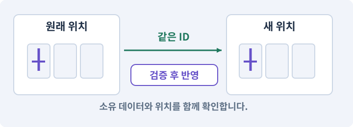

# 021. 몬스터가 장비를 떨어뜨리게 하기

**목표:** 적을 잡을 때 등급과 옵션이 있는 장비가 생깁니다.

**시작 상태:** 아이템 정의와 고유 인스턴스

## 한눈에 보는 기능의 흐름

적 처치 사건 → 등급 선택 → 옵션 확정 → 바닥 아이템 생성



**경계:** 줍거나 불러올 때 옵션을 다시 뽑지 않기

그림은 실제 게임 실행 결과가 아닙니다. 값·규칙과 예제를 필요한 때 펼쳐 읽고 현재 단계의 메시지를 한 번씩 보냅니다.

## 1. 지금 상태 확인하기

첫 메시지를 보내 현재 준비 상태를 확인합니다. AI가 읽어 온 실제 프로젝트가 맞는지 보고, 없는 준비나 다른 상태가 있으면 먼저 알려 주세요. 아직 기능을 만들지 않는 단계입니다.

### AI에게 보낼 요구와 이유

#### 01. 작업 대상부터 확인

**“몬스터가 장비를 떨어뜨리게 하기” 작업을 시작하기 전에 현재 상태를 읽기 전용으로 확인해 줘.**

왜 이렇게 요청하나요? AI가 다른 프로젝트나 오래된 예제를 보고 작업할 수 있습니다. 실제 경로·파일·현재 기능을 읽게 하면 지금 이어서 작업할 대상을 먼저 맞출 수 있습니다.

#### 02. 작업 대상부터 확인

**필요한 시작 상태는 아이템 정의와 고유 인스턴스야.**

왜 이렇게 요청하나요? AI가 다른 프로젝트나 오래된 예제를 보고 작업할 수 있습니다. 실제 경로·파일·현재 기능을 읽게 하면 지금 이어서 작업할 대상을 먼저 맞출 수 있습니다.

#### 03. 실제 사용 중인 구현 재사용

**실제 프로젝트와 작업 기록을 읽고 이것이 준비되어 있는지, 이미 같은 기능이 있는지 확인해 줘.**

왜 이렇게 요청하나요? 이름이 비슷한 새 클래스를 또 만들면 기존 화면은 여전히 옛 코드를 사용할 수 있습니다. 실제 호출되는 진입점을 찾아 연결해야 두 구현이 충돌하거나 수정이 반영되지 않는 문제를 막습니다.

#### 04. 현재 상태와 다음 확인 지점 구분

**이번 기능이 연결될 실제 파일·화면·도구와 보존할 기존 동작을 짧게 정리해 줘.**

왜 이렇게 요청하나요? 이미 준비된 기능과 아직 확인하지 못한 기능을 섞으면 불필요한 재설치나 성급한 완료 판정이 생깁니다. 현재 대상과 남은 준비를 나눠 가장 작은 다음 작업을 선택하게 합니다.

#### 05. 조사 단계에서 변경하지 않기

**아직 새 구현·설치·유료 호출·파일 변경은 하지 마.**

왜 이렇게 요청하나요? 현재 상태를 알아보기만 할 때 파일 변경이나 결제가 시작되면 검토 전의 환경이 바뀝니다. 준비 확인과 실제 구현을 나눠 되돌리기 어려운 작업이 먼저 실행되지 않게 합니다.

#### 06. 막힌 준비를 먼저 해결

**준비가 다르면 부족한 항목과 다음에 필요한 작업을 알려 줘.**

왜 이렇게 요청하나요? 빠진 파일·권한·패키지를 있다고 가정하면 다음 구현이 엉뚱한 대상을 만들게 됩니다. 무엇이 없고 무엇을 먼저 해야 하는지 분리하면 불필요한 재작업을 줄일 수 있습니다.

<details>
<summary>보낼 원문 전체 — 설명은 복사되지 않습니다</summary>

```text
“몬스터가 장비를 떨어뜨리게 하기” 작업을 시작하기 전에 현재 상태를 읽기 전용으로 확인해 줘.
필요한 시작 상태는 아이템 정의와 고유 인스턴스야. 실제 프로젝트와 작업 기록을 읽고 이것이 준비되어 있는지, 이미 같은 기능이 있는지 확인해 줘.
이번 기능이 연결될 실제 파일·화면·도구와 보존할 기존 동작을 짧게 정리해 줘. 아직 새 구현·설치·유료 호출·파일 변경은 하지 마. 준비가 다르면 부족한 항목과 다음에 필요한 작업을 알려 줘.
```

</details>

**기대 결과:** 사망 1회와 드롭 생성 1회를 연결한 설명

### 직접 확인하기

1. AI가 읽은 실제 프로젝트 또는 도구 경로를 확인합니다.
2. 필수 준비가 없다면 문제 해결 요청을 보내고, 준비됐을 때 다음으로 갑니다.

## 2. 필요한 기능 만들기

준비가 확인되면 아래 요청을 보냅니다. AI가 파일·설정·실행을 맡습니다. 변경 범위나 비용 승인이 나오면 내용을 읽고 결정하세요.

### AI에게 보낼 요구와 이유

#### 01. 작업 대상부터 확인

**현재 프로젝트의 실제 파일과 이미 결정한 규칙을 먼저 확인해 줘.**

왜 이렇게 요청하나요? AI가 다른 프로젝트나 오래된 예제를 보고 작업할 수 있습니다. 실제 경로·파일·현재 기능을 읽게 하면 지금 이어서 작업할 대상을 먼저 맞출 수 있습니다.

#### 02. 실제 사용 중인 코드에 연결

**이름이 다른 기존 구현이 있으면 새로 중복 제작하지 말고 그 구현에 연결해 줘.**

왜 이렇게 요청하나요? 예제와 이름이 다르더라도 현재 씬과 입력에서 호출하는 구현이 작업 대상입니다. 같은 기능을 새로 만들기보다 기존 진입점을 확인해 수정이 실제 게임에 반영되고 중복 실행되지 않게 합니다.

#### 03. 거래·보상의 전체 성공 보장

**LootGenerator를 만들고 적의 사망 보상에 한 번 연결해 줘.**

왜 이렇게 요청하나요? 재료 차감과 결과 지급이 따로 성공하면 손해나 복제가 생깁니다. 조건을 먼저 검사하고 한 거래로 반영하며 같은 요청을 다시 받아도 두 번 지급하지 않게 합니다.

#### 04. 전리품의 종류·확률·옵션 수를 따로 정의

**일반 적은 골드5~12를 주고 별도로30% 확률로 장비 1개를 생성한다.**

왜 이렇게 요청하나요? 아이템 종류, 드롭될 확률, 생성된 뒤의 등급과 옵션은 서로 다른 결정입니다. 각각의 기준을 고정해야 재시작이나 표시 변경으로 옵션이 다시 뽑히지 않고 결과 분포를 검사할 수 있습니다.

#### 05. 전리품·가중치·드롭 확률의 적용 조건

**장비가 나왔을 때 Common75/Magic20/Rare5의 가중치를 적용해 줘.**

왜 이렇게 요청하나요? 전리품은 처치·상자 등의 보상입니다. 가중치는 여러 후보를 상대적 비중으로 선택하는 값이며, 그 자체가 퍼센트라는 뜻은 아닙니다. 통계 검사와 한 번의 재현 검사는 다릅니다. seed·순서와 장기 분포를 각각 봅니다.

#### 06. 전리품의 종류·확률·옵션 수를 따로 정의

**옵션 개수는 Common0, Magic1, Rare2다.**

왜 이렇게 요청하나요? 아이템 종류, 드롭될 확률, 생성된 뒤의 등급과 옵션은 서로 다른 결정입니다. 각각의 기준을 고정해야 재시작이나 표시 변경으로 옵션이 다시 뽑히지 않고 결과 분포를 검사할 수 있습니다.

#### 07. 구현할 결과와 조건 고정

**옵션 종류는 공격+1~5, 최대HP+10~30, 방어+1~6으로 시작하며**

왜 이렇게 요청하나요? “옵션 종류는 공격+1~5, 최대HP+10~30, 방어+1~6으로 시작하며”를 명시하면 AI가 무엇을 구현하거나 검사해야 하는지 범위를 좁힐 수 있습니다. 적을 잡을 때 등급과 옵션이 있는 장비가 생깁니다. 이 결과를 확인할 때 이 조건이 실제로 반영됐는지 함께 봅니다.

#### 08. 장비 옵션 추첨의 중복 정책

**한 Instance 안에서 같은 옵션 종류가 중복되지 않게 해 줘.**

왜 이렇게 요청하나요? 한 장비에 같은 종류 옵션이 여러 번 뽑히면 정한 옵션 슬롯과 수치 범위를 벗어날 수 있습니다. 이미 선택한 옵션 종류를 제외하고, 가능 종류가 부족할 때의 결과도 정합니다.

#### 09. 기존 결과를 보호

**Definition 기본 보너스와 랜덤 옵션은 합산하지만 원본을 변경하지 마.**

왜 이렇게 요청하나요? 새 작업이 이미 정상인 기능이나 자산까지 바꾸면 원인을 추적하기 어렵습니다. 유지할 대상을 명시해 변경 전후를 비교하고 원치 않은 영향을 찾습니다.

#### 10. 무작위 결과를 재현 가능하게

**loot 전용 난수 생성기를 주입하고 결과를 생성 시점에 고정해 줘.**

왜 이렇게 요청하나요? 실패한 맵이나 전리품 결과를 다시 만들 수 있어야 원인을 고칠 수 있습니다. 생성 버전·설정·시드를 함께 기록하고 지형·장식·보상 난수를 분리해 작은 변경의 파급을 줄입니다.

#### 11. 무작위 결과를 재현 가능하게

**테스트용 고정 시드와 일반 플레이의 시드 생성 경로를 분리해 줘.**

왜 이렇게 요청하나요? 실패한 맵이나 전리품 결과를 다시 만들 수 있어야 원인을 고칠 수 있습니다. 생성 버전·설정·시드를 함께 기록하고 지형·장식·보상 난수를 분리해 작은 변경의 파급을 줄입니다.

#### 12. 이동에 실패해도 아이템 보존

**바닥 아이템은 데이터 Instance와 연결하고 이동/격자 경로를 막지 않는 Interactable로 표현해 줘.**

왜 이렇게 요청하나요? 줍기·보관·장착은 한 물건의 위치를 바꾸는 작업입니다. 목적지 공간이 없거나 취소됐을 때 원래 위치를 먼저 지우지 않아야 아이템 분실과 복제를 막습니다.

#### 13. 같은 요청의 반복 처리 정의

**사망 이벤트 중복에도 드롭이 중복 생성되지 않게 해 줘.**

왜 이렇게 요청하나요? 클릭 연타·재연결·중복 이벤트는 개발과 플레이 중 모두 발생할 수 있습니다. 반복돼도 한 번 처리해야 하는 결과와 매번 새로 처리할 결과를 나눠 데이터가 누적되지 않게 합니다.

#### 14. 무작위 결과를 재현 가능하게

**0%/100% 경계, 가중치 합, 동일 시드 재현, 희귀2옵션 비중복,**

왜 이렇게 요청하나요? 실패한 맵이나 전리품 결과를 다시 만들 수 있어야 원인을 고칠 수 있습니다. 생성 버전·설정·시드를 함께 기록하고 지형·장식·보상 난수를 분리해 작은 변경의 파급을 줄입니다.

#### 15. 같은 요청의 반복 처리 정의

**유효 DefinitionId와 한 번 생성된 옵션 불변을 테스트해 줘.**

왜 이렇게 요청하나요? 클릭 연타·재연결·중복 이벤트는 개발과 플레이 중 모두 발생할 수 있습니다. 반복돼도 한 번 처리해야 하는 결과와 매번 새로 처리할 결과를 나눠 데이터가 누적되지 않게 합니다.

#### 16. 관찰 가능한 기준으로 확인

**실제 빈 드롭·일반·마법·희귀 표본을 개발 도구로 만들어 화면에서도 확인해 줘.**

왜 이렇게 요청하나요? 구현 완료라는 설명을 실제 결과로 바꾸기 위한 조건입니다. 요청에 나온 대상과 경계 상황을 확인해 정상 결과뿐 아니라 실패를 어떻게 구분했는지도 남깁니다.

#### 17. 전투 단계 전환을 한 번씩 처리

**정예도 같은 기본 드롭 규칙을 적용하고 원형 18개 중 균등 선택해 줘.**

왜 이렇게 요청하나요? 큰 피해·취소·사망으로 단계를 건너뛰거나 여러 조건이 함께 참이 되면 공격이 겹칠 수 있습니다. 진입·종료·보상을 분리해 끝난 단계의 예약이 남지 않도록 합니다.

#### 18. 아이템 인스턴스와 소유권의 적용 조건

**run seed와 별개로 Instance ID는 서로 다른 run 사이에도 충돌하지 않아야 해.**

왜 이렇게 요청하나요? 인스턴스는 실제로 생성되어 소유되는 한 개의 물건입니다. 같은 종류의 검이라도 고유 ID·랜덤 옵션·소켓 상태가 각각 다를 수 있습니다. 화면 아이콘 두 개와 소유 데이터 두 개는 다를 수 있습니다. 실제 데이터 목록을 검사합니다.

#### 19. 구현과 실행은 AI에게 맡기기

**코드·설정·파일 생성·실행은 네가 맡고, 필요한 화면과 결과를 보여 줘.**

왜 이렇게 요청하나요? 설명이나 코드 조각만 받으면 실제 파일 생성·연결·실행이 빠질 수 있습니다. AI가 개발 작업까지 수행하고, 사람은 요구·승인·결과 판단을 맡도록 역할을 분명히 합니다.

#### 20. 막힌 준비를 먼저 해결

**수행하지 못한 작업과 필요한 승인·도구 연결은 구분해서 알려 줘.**

왜 이렇게 요청하나요? 빠진 파일·권한·패키지를 있다고 가정하면 다음 구현이 엉뚱한 대상을 만들게 됩니다. 무엇이 없고 무엇을 먼저 해야 하는지 분리하면 불필요한 재작업을 줄일 수 있습니다.

<details>
<summary>보낼 원문 전체 — 설명은 복사되지 않습니다</summary>

```text
현재 프로젝트의 실제 파일과 이미 결정한 규칙을 먼저 확인해 줘. 이름이 다른 기존 구현이 있으면 새로 중복 제작하지 말고 그 구현에 연결해 줘.

LootGenerator를 만들고 적의 사망 보상에 한 번 연결해 줘.
일반 적은 골드5~12를 주고 별도로30% 확률로 장비 1개를 생성한다.
장비가 나왔을 때 Common75/Magic20/Rare5의 가중치를 적용해 줘.
옵션 개수는 Common0, Magic1, Rare2다.
옵션 종류는 공격+1~5, 최대HP+10~30, 방어+1~6으로 시작하며
한 Instance 안에서 같은 옵션 종류가 중복되지 않게 해 줘.
Definition 기본 보너스와 랜덤 옵션은 합산하지만 원본을 변경하지 마.
loot 전용 난수 생성기를 주입하고 결과를 생성 시점에 고정해 줘.
테스트용 고정 시드와 일반 플레이의 시드 생성 경로를 분리해 줘.
바닥 아이템은 데이터 Instance와 연결하고 이동/격자 경로를 막지 않는 Interactable로 표현해 줘.
사망 이벤트 중복에도 드롭이 중복 생성되지 않게 해 줘.
0%/100% 경계, 가중치 합, 동일 시드 재현, 희귀2옵션 비중복,
유효 DefinitionId와 한 번 생성된 옵션 불변을 테스트해 줘.
실제 빈 드롭·일반·마법·희귀 표본을 개발 도구로 만들어 화면에서도 확인해 줘.
정예도 같은 기본 드롭 규칙을 적용하고 원형 18개 중 균등 선택해 줘. run seed와 별개로 Instance ID는 서로 다른 run 사이에도 충돌하지 않아야 해.

코드·설정·파일 생성·실행은 네가 맡고, 필요한 화면과 결과를 보여 줘. 수행하지 못한 작업과 필요한 승인·도구 연결은 구분해서 알려 줘.
```

</details>

**기대 결과:** 확인할 결과: 한 번 생성된 옵션이 유지되는 드롭을 확인함. AI가 이 상태를 확인할 실제 화면과 변경 내용을 준비합니다. 아직 실행하지 못한 부분은 따로 표시합니다.

### 직접 확인하기

1. 제안서만 반환됐다면 “설명으로 끝내지 말고 승인한 범위의 실제 작업을 수행해 줘”라고 보냅니다.
2. 코드나 설정을 직접 고치라는 안내가 나오면 “작성과 실행은 네가 맡아 줘”라고 요청합니다.

## 3. 결과를 직접 확인하기

먼저 확인 요청을 보내 AI가 검사와 화면을 준비하게 하세요. 그다음 아래 동작을 하나씩 확인합니다.

### AI에게 보낼 요구와 이유

#### 01. 검사할 입력과 관찰 지점 준비

**방금 구현한 기능의 자동 검사와 확인 화면을 준비해 줘.**

왜 이렇게 요청하나요? 정상 예 하나만 보면 실패 조건을 놓치기 쉽습니다. 정상·경계·반례를 실제 입력으로 준비하고 사람이 볼 화면도 맞춰 확인 범위를 분명하게 합니다.

#### 02. 결과를 재확인할 근거 남기기

**정상 동작과 아래 실패 조건을 실제로 검사하고 대상·실행 수·결과를 보여 줘.**

왜 이렇게 요청하나요? “잘 됩니다”라는 요약만으로는 어떤 입력과 버전을 검사했는지 알 수 없습니다. 대상·실행 수·실패 내용·파일을 함께 남겨 같은 조건으로 다시 확인할 수 있게 합니다.

#### 03. 무작위 결과를 재현 가능하게

**같은 시드의 데이터 생성 결과가 재현된다.**

왜 이렇게 요청하나요? 실패한 맵이나 전리품 결과를 다시 만들 수 있어야 원인을 고칠 수 있습니다. 생성 버전·설정·시드를 함께 기록하고 지형·장식·보상 난수를 분리해 작은 변경의 파급을 줄입니다.

#### 04. 전리품의 종류·확률·옵션 수를 따로 정의

**희귀는 서로 다른 옵션 2개다.**

왜 이렇게 요청하나요? 아이템 종류, 드롭될 확률, 생성된 뒤의 등급과 옵션은 서로 다른 결정입니다. 각각의 기준을 고정해야 재시작이나 표시 변경으로 옵션이 다시 뽑히지 않고 결과 분포를 검사할 수 있습니다.

#### 05. 아이템 이동에서도 정체성과 수량 유지

**플레이를 멈추거나 UI를 열었다고 옵션이 바뀌지 않는다.**

왜 이렇게 요청하나요? 바닥·가방·장비 사이를 이동해도 하나의 아이템은 하나의 소유 위치만 가져야 합니다. 고유 ID와 옵션을 비교해 이동이 재생성이나 복제로 처리되지 않는지 확인합니다.

#### 06. 같은 요청의 반복 처리 정의

**같은 적에서 드롭이 두 번 나오지 않는다.**

왜 이렇게 요청하나요? 클릭 연타·재연결·중복 이벤트는 개발과 플레이 중 모두 발생할 수 있습니다. 반복돼도 한 번 처리해야 하는 결과와 매번 새로 처리할 결과를 나눠 데이터가 누적되지 않게 합니다.

#### 07. Collider와 몸체 경계의 적용 조건

**드롭의 Collider가 이동을 막지 않는다.**

왜 이렇게 요청하나요? Collider는 물리 검사에 사용하는 경계입니다. 보이는 그림과 같을 필요는 없습니다. 탑다운 캐릭터는 보통 발 주변에 작은 몸체 경계를 둡니다. 스프라이트를 크게 바꿨다고 몸체·사거리도 자동으로 키우지 않습니다.

#### 08. 사람 검사의 시작점 준비

**내가 조작해야 하는 부분은 실행할 화면과 시작 상태를 준비해 줘.**

왜 이렇게 요청하나요? 같은 기능이라도 시작 상태가 다르면 관찰 결과가 달라집니다. AI가 실행 화면과 재현 위치를 먼저 준비해야 사람이 이동·공격·소리·조작감을 같은 조건에서 확인할 수 있습니다.

#### 09. 사람이 실제로 본 것만 기록

**연결되지 않은 휴대폰의 터치나 사람이 보지 않은 재미·소리 품질을 대신 확인했다고 하지 마.**

왜 이렇게 요청하나요? AI가 준비한 검사와 사람이 직접 플레이하거나 들은 결과는 다른 근거입니다. 관찰하지 않은 조작감·소리·실기기 결과를 임의로 완료 처리하지 않게 합니다.

#### 10. 실제로 실행한 검사만 인정

**테스트 0개와 예전 소스 결과는 현재 성공으로 쓰지 마.**

왜 이렇게 요청하나요? 실행된 검사가 없거나 같은 결과를 중복 집계한 경우는 기능을 확인한 것이 아닙니다. 실행 수와 개별 결과를 함께 확인해야 형식적인 성공 표시를 걸러낼 수 있습니다.

<details>
<summary>보낼 원문 전체 — 설명은 복사되지 않습니다</summary>

```text
방금 구현한 기능의 자동 검사와 확인 화면을 준비해 줘. 정상 동작과 아래 실패 조건을 실제로 검사하고 대상·실행 수·결과를 보여 줘.

같은 시드의 데이터 생성 결과가 재현된다. 희귀는 서로 다른 옵션 2개다. 플레이를 멈추거나 UI를 열었다고 옵션이 바뀌지 않는다. 같은 적에서 드롭이 두 번 나오지 않는다. 드롭의 Collider가 이동을 막지 않는다.

내가 조작해야 하는 부분은 실행할 화면과 시작 상태를 준비해 줘. 연결되지 않은 휴대폰의 터치나 사람이 보지 않은 재미·소리 품질을 대신 확인했다고 하지 마. 테스트 0개와 예전 소스 결과는 현재 성공으로 쓰지 마.
```

</details>

**기대 결과:** 한 번 생성된 옵션이 유지되는 드롭을 확인함

### 직접 확인하기

1. 적을 처치해 바닥 장비를 봅니다.
2. 일반·마법·희귀의 표시와 옵션을 비교합니다.
3. 같은 시드의 결과와 다른 시드의 결과를 AI가 보여 주게 합니다.

## 4. 결과를 남기고 마무리하기

실제로 본 결과를 아래 메모에 적고 AI에 전달합니다. 결과 저장 요청으로 현재 상태를 남긴 뒤 다음 페이지로 갑니다.

### AI에게 보낼 요구와 이유

#### 01. 결과를 재확인할 근거 남기기

**지금 작업한 “몬스터가 장비를 떨어뜨리게 하기”의 실제 결과를 정리해 줘.**

왜 이렇게 요청하나요? “잘 됩니다”라는 요약만으로는 어떤 입력과 버전을 검사했는지 알 수 없습니다. 대상·실행 수·실패 내용·파일을 함께 남겨 같은 조건으로 다시 확인할 수 있게 합니다.

#### 02. 다음 작업이 읽을 인수인계

**변경한 기능·파일·현재 후보와 실제 실행한 검사, 남은 문제를 기능 이름으로 기록해 줘.**

왜 이렇게 요청하나요? 새 AI 세션은 이전 대화 전체를 알고 있다고 보장할 수 없습니다. 현재 후보·파일 위치·실행한 검사·남은 일을 남겨야 같은 작업을 반복하지 않고 이어갈 수 있습니다.

#### 03. 사람이 실제로 본 것만 기록

**자동 검사 결과와 내가 직접 확인한 결과를 구분하고, 내 관찰이 아직 없으면 미확인으로 남겨 줘.**

왜 이렇게 요청하나요? AI가 준비한 검사와 사람이 직접 플레이하거나 들은 결과는 다른 근거입니다. 관찰하지 않은 조작감·소리·실기기 결과를 임의로 완료 처리하지 않게 합니다.

#### 04. 다음 작업이 읽을 인수인계

**재시작하거나 다음 작업에서 읽을 기록의 실제 위치를 알려 줘.**

왜 이렇게 요청하나요? 새 AI 세션은 이전 대화 전체를 알고 있다고 보장할 수 없습니다. 현재 후보·파일 위치·실행한 검사·남은 일을 남겨야 같은 작업을 반복하지 않고 이어갈 수 있습니다.

#### 05. 미확인을 완료와 분리

**아직 확인하지 않은 결과를 완료로 채우지 마.**

왜 이렇게 요청하나요? 만들어진 것, 검사에 실패한 것, 아직 확인하지 못한 것을 나눠야 다음 작업을 정확히 고를 수 있습니다. 실행할 조건이 없는 기능을 성공으로 기록하면 뒤에서 원인을 찾기 어려워집니다.

<details>
<summary>보낼 원문 전체 — 설명은 복사되지 않습니다</summary>

```text
지금 작업한 “몬스터가 장비를 떨어뜨리게 하기”의 실제 결과를 정리해 줘. 변경한 기능·파일·현재 후보와 실제 실행한 검사, 남은 문제를 기능 이름으로 기록해 줘.
자동 검사 결과와 내가 직접 확인한 결과를 구분하고, 내 관찰이 아직 없으면 미확인으로 남겨 줘. 재시작하거나 다음 작업에서 읽을 기록의 실제 위치를 알려 줘. 아직 확인하지 않은 결과를 완료로 채우지 마.
```

</details>

**기대 결과:** 현재 상태·검사 결과·남은 문제·다음에 읽을 기록을 확인할 수 있습니다.

### 직접 확인하기

1. 자동 검사와 내 관찰 결과가 섞이지 않았는지 봅니다.
2. 문제가 남았다면 해결 요청을 보내고 같은 동작을 다시 확인합니다.

## 문제가 있으면

### AI에게 보낼 요구와 이유

#### 01. 구현할 결과와 조건 고정

**화면을 다시 표시할 때 옵션을 다시 뽑지 마.**

왜 이렇게 요청하나요? “화면을 다시 표시할 때 옵션을 다시 뽑지 마”를 명시하면 AI가 무엇을 구현하거나 검사해야 하는지 범위를 좁힐 수 있습니다. 적을 잡을 때 등급과 옵션이 있는 장비가 생깁니다. 이 결과를 확인할 때 이 조건이 실제로 반영됐는지 함께 봅니다.

#### 02. 불변 조건·경계값·속성 검사의 적용 조건

**짧은 표본의 확률 차이와 실제 경계값 오류를 구분해 줘.**

왜 이렇게 요청하나요? 불변 조건은 어떤 허용된 동작을 거쳐도 유지되어야 하는 규칙입니다. 경계값 검사는 0·최대·바로 전후 같은 오류가 잘 생기는 지점을 시험합니다. 많은 무작위 검사 통과가 모든 경우의 증명은 아닙니다. 알려진 경계와 반례를 별도 고정합니다.

#### 03. 원인 하나를 좁혀 수정

**새 기능을 추가하지 말고 현재 오류와 실제 로그를 먼저 읽어 줘.**

왜 이렇게 요청하나요? 오류 수정 중 새 기능까지 넣으면 어떤 변경이 문제를 해결하거나 악화했는지 알기 어렵습니다. 원래 재현을 보존하고 작은 변경 뒤 같은 입력과 주변 정상 동작을 다시 확인합니다.

#### 04. 원인 하나를 좁혀 수정

**최소 수정 뒤 같은 재현과 관련 정상 동작을 다시 검사해 줘.**

왜 이렇게 요청하나요? 오류 수정 중 새 기능까지 넣으면 어떤 변경이 문제를 해결하거나 악화했는지 알기 어렵습니다. 원래 재현을 보존하고 작은 변경 뒤 같은 입력과 주변 정상 동작을 다시 확인합니다.

#### 05. 실패도 재현 자료로 보존

**실패 기록은 지우지 마.**

왜 이렇게 요청하나요? 실패한 입력과 로그가 있어야 같은 문제가 다시 생겼을 때 비교할 수 있습니다. 성공 기록으로 덮어쓰지 않고 전후 자료를 남기면 무엇을 고쳤는지 확인할 수 있습니다.

<details>
<summary>보낼 원문 전체 — 설명은 복사되지 않습니다</summary>

```text
화면을 다시 표시할 때 옵션을 다시 뽑지 마. 짧은 표본의 확률 차이와 실제 경계값 오류를 구분해 줘.
새 기능을 추가하지 말고 현재 오류와 실제 로그를 먼저 읽어 줘. 최소 수정 뒤 같은 재현과 관련 정상 동작을 다시 검사해 줘. 실패 기록은 지우지 마.
```

</details>

## 새 세션에서 이어가기

### AI에게 보낼 요구와 이유

#### 01. 이어서 할 작업 식별

**“몬스터가 장비를 떨어뜨리게 하기” 작업을 이어가고 싶어.**

왜 이렇게 요청하나요? 이름으로 재개할 작업을 찾고, 뒤에 이어지는 요청으로 실제 파일·진행 중 작업·기록을 다시 읽게 합니다. 제목만 보고 이전 상태를 기억한다고 가정하지 않습니다.

#### 02. 조회는 상태를 바꾸지 않게

**실제 프로젝트와 내 도구의 작업 기록을 읽고 어디까지 구현·검사됐는지 확인해 줘.**

왜 이렇게 요청하나요? 진행 상황을 물을 때 새 구현이나 유료 호출이 시작되면 단순 확인이 실행 명령이 되어 버립니다. 저장된 근거를 읽어 완료·진행·승인 대기·미검증을 나누게 합니다.

#### 03. 재개 전 중복 작업 방지

**진행 중인 프로세스·승인·미저장 변경을 확인한 뒤 남은 가장 작은 작업부터 안내해 줘.**

왜 이렇게 요청하나요? 대화가 끊겨도 외부 작업은 끝났거나 아직 실행 중일 수 있습니다. 프로세스·승인·미저장 상태를 먼저 읽어 같은 생성·빌드·결제를 두 번 시작하지 않도록 합니다.

#### 04. 되돌아갈 원본 남기기

**기존 성공과 실패 기록은 보존해 줘.**

왜 이렇게 요청하나요? 새 구현이 실패해도 이전 게임과 저장을 복원할 수 있어야 합니다. 현재 내용을 먼저 조사하고 별도 후보에서 작업하면 실험이 유일한 정상본을 망가뜨리는 일을 피할 수 있습니다.

<details>
<summary>보낼 원문 전체 — 설명은 복사되지 않습니다</summary>

```text
“몬스터가 장비를 떨어뜨리게 하기” 작업을 이어가고 싶어. 실제 프로젝트와 내 도구의 작업 기록을 읽고 어디까지 구현·검사됐는지 확인해 줘. 진행 중인 프로세스·승인·미저장 변경을 확인한 뒤 남은 가장 작은 작업부터 안내해 줘. 기존 성공과 실패 기록은 보존해 줘.
```

</details>

## 왜 이렇게 만드는가

랜덤 아이템은 아이템을 얻을 때 한 번 생성하고 이후 고정해야 한다. 인벤토리를 열거나 저장을 불러올 때마다 옵션을 다시 뽑으면 같은 장비가 계속 바뀐다.

디버깅용 랜덤은 시드를 기록하면 재현하기 쉽다. 드롭·스폰·장식의 난수 흐름을 나누면 장식을 하나 추가했다고 아이템 결과가 바뀌는 일을 줄일 수 있다.

## 공식 참고

