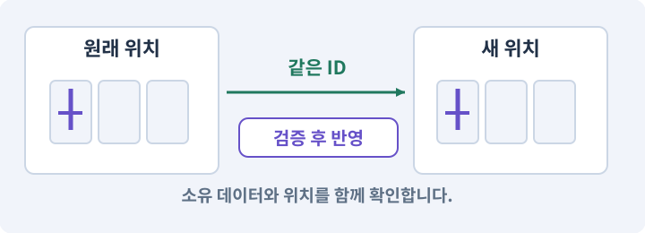

# 022. 장비를 주워 24칸 가방에 넣기

**목표:** 가방이 가득 차도 아이템을 잃지 않습니다.

**시작 상태:** 바닥 장비와 고유 ID

## 한눈에 보는 기능의 흐름

바닥의 아이템 → 가방 공간 확인 → 같은 ID 이동 → 바닥에서 제거



**경계:** 가방이 가득 차면 바닥에 그대로 남기기

그림은 실제 게임 실행 결과가 아닙니다. 값·규칙과 예제를 필요한 때 펼쳐 읽고 현재 단계의 메시지를 한 번씩 보냅니다.

## 1. 지금 상태 확인하기

첫 메시지를 보내 현재 준비 상태를 확인합니다. AI가 읽어 온 실제 프로젝트가 맞는지 보고, 없는 준비나 다른 상태가 있으면 먼저 알려 주세요. 아직 기능을 만들지 않는 단계입니다.

### AI에게 보낼 요구와 이유

#### 01. 작업 대상부터 확인

**“장비를 주워 24칸 가방에 넣기” 작업을 시작하기 전에 현재 상태를 읽기 전용으로 확인해 줘.**

왜 이렇게 요청하나요? AI가 다른 프로젝트나 오래된 예제를 보고 작업할 수 있습니다. 실제 경로·파일·현재 기능을 읽게 하면 지금 이어서 작업할 대상을 먼저 맞출 수 있습니다.

#### 02. 작업 대상부터 확인

**필요한 시작 상태는 바닥 장비와 고유 ID야.**

왜 이렇게 요청하나요? AI가 다른 프로젝트나 오래된 예제를 보고 작업할 수 있습니다. 실제 경로·파일·현재 기능을 읽게 하면 지금 이어서 작업할 대상을 먼저 맞출 수 있습니다.

#### 03. 실제 사용 중인 구현 재사용

**실제 프로젝트와 작업 기록을 읽고 이것이 준비되어 있는지, 이미 같은 기능이 있는지 확인해 줘.**

왜 이렇게 요청하나요? 이름이 비슷한 새 클래스를 또 만들면 기존 화면은 여전히 옛 코드를 사용할 수 있습니다. 실제 호출되는 진입점을 찾아 연결해야 두 구현이 충돌하거나 수정이 반영되지 않는 문제를 막습니다.

#### 04. 현재 상태와 다음 확인 지점 구분

**이번 기능이 연결될 실제 파일·화면·도구와 보존할 기존 동작을 짧게 정리해 줘.**

왜 이렇게 요청하나요? 이미 준비된 기능과 아직 확인하지 못한 기능을 섞으면 불필요한 재설치나 성급한 완료 판정이 생깁니다. 현재 대상과 남은 준비를 나눠 가장 작은 다음 작업을 선택하게 합니다.

#### 05. 조사 단계에서 변경하지 않기

**아직 새 구현·설치·유료 호출·파일 변경은 하지 마.**

왜 이렇게 요청하나요? 현재 상태를 알아보기만 할 때 파일 변경이나 결제가 시작되면 검토 전의 환경이 바뀝니다. 준비 확인과 실제 구현을 나눠 되돌리기 어려운 작업이 먼저 실행되지 않게 합니다.

#### 06. 막힌 준비를 먼저 해결

**준비가 다르면 부족한 항목과 다음에 필요한 작업을 알려 줘.**

왜 이렇게 요청하나요? 빠진 파일·권한·패키지를 있다고 가정하면 다음 구현이 엉뚱한 대상을 만들게 됩니다. 무엇이 없고 무엇을 먼저 해야 하는지 분리하면 불필요한 재작업을 줄일 수 있습니다.

<details>
<summary>보낼 원문 전체 — 설명은 복사되지 않습니다</summary>

```text
“장비를 주워 24칸 가방에 넣기” 작업을 시작하기 전에 현재 상태를 읽기 전용으로 확인해 줘.
필요한 시작 상태는 바닥 장비와 고유 ID야. 실제 프로젝트와 작업 기록을 읽고 이것이 준비되어 있는지, 이미 같은 기능이 있는지 확인해 줘.
이번 기능이 연결될 실제 파일·화면·도구와 보존할 기존 동작을 짧게 정리해 줘. 아직 새 구현·설치·유료 호출·파일 변경은 하지 마. 준비가 다르면 부족한 항목과 다음에 필요한 작업을 알려 줘.
```

</details>

**기대 결과:** 바닥에서 가방으로 소유권이 이동하는 순서

### 직접 확인하기

1. AI가 읽은 실제 프로젝트 또는 도구 경로를 확인합니다.
2. 필수 준비가 없다면 문제 해결 요청을 보내고, 준비됐을 때 다음으로 갑니다.

## 2. 필요한 기능 만들기

준비가 확인되면 아래 요청을 보냅니다. AI가 파일·설정·실행을 맡습니다. 변경 범위나 비용 승인이 나오면 내용을 읽고 결정하세요.

### AI에게 보낼 요구와 이유

#### 01. 작업 대상부터 확인

**현재 프로젝트의 실제 파일과 이미 결정한 규칙을 먼저 확인해 줘.**

왜 이렇게 요청하나요? AI가 다른 프로젝트나 오래된 예제를 보고 작업할 수 있습니다. 실제 경로·파일·현재 기능을 읽게 하면 지금 이어서 작업할 대상을 먼저 맞출 수 있습니다.

#### 02. 실제 사용 중인 코드에 연결

**이름이 다른 기존 구현이 있으면 새로 중복 제작하지 말고 그 구현에 연결해 줘.**

왜 이렇게 요청하나요? 예제와 이름이 다르더라도 현재 씬과 입력에서 호출하는 구현이 작업 대상입니다. 같은 기능을 새로 만들기보다 기존 진입점을 확인해 수정이 실제 게임에 반영되고 중복 실행되지 않게 합니다.

#### 03. 이동에 실패해도 아이템 보존

**Core InventoryState에 장비24칸을 만들어 줘.**

왜 이렇게 요청하나요? 줍기·보관·장착은 한 물건의 위치를 바꾸는 작업입니다. 목적지 공간이 없거나 취소됐을 때 원래 위치를 먼저 지우지 않아야 아이템 분실과 복제를 막습니다.

#### 04. 아이템 인스턴스와 소유권의 적용 조건

**장비는 한 Instance당 한 칸이다.**

왜 이렇게 요청하나요? 인스턴스는 실제로 생성되어 소유되는 한 개의 물건입니다. 같은 종류의 검이라도 고유 ID·랜덤 옵션·소켓 상태가 각각 다를 수 있습니다. 화면 아이콘 두 개와 소유 데이터 두 개는 다를 수 있습니다. 실제 데이터 목록을 검사합니다.

#### 05. 사용 성공과 자원 소비 묶기

**물약 수량과 골드는 별도 필드로 두고 장비 칸을 사용하지 않게 해 줘.**

왜 이렇게 요청하나요? 실패한 사용에서 자원이 줄거나 연타로 여러 번 차감되면 표시와 실제 행동이 어긋납니다. 사용 조건·비용·대기시간을 함께 처리하고 실패 시 바뀌지 않아야 할 값을 확인합니다.

#### 06. 이벤트·콜백·구독·이벤트 버스의 적용 조건

**TryAdd/TryRemove/ContainsInstance를 두고 상태 변경이 성공했을 때만 이벤트를 보내 줘.**

왜 이렇게 요청하나요? 이벤트는 어떤 일이 일어났다는 알림입니다. 구독자는 관심 있는 알림을 받아 콜백을 실행합니다. 이벤트 버스는 여러 기능 사이의 알림 전달을 모으는 구조입니다. 모든 것을 전역 이벤트로 만들면 흐름을 추적하기 어려워집니다. 소유권·발행 시점·순서를 명시합니다.

#### 07. 종류와 실제 소유 물건 구분

**같은 instanceId를 다시 추가하는 요청은 거부해 줘.**

왜 이렇게 요청하나요? 같은 종류의 검 두 자루도 옵션과 소유 위치는 별개입니다. 정의 데이터와 개별 아이템을 나누면 한 물건을 수정했을 때 다른 물건과 원본 규격까지 바뀌지 않습니다.

#### 08. 구현할 결과와 조건 고정

**PC는 Interactable 아이템 클릭→유효 경로 접근→거리1.5m 이내 획득으로 연결해 줘.**

왜 이렇게 요청하나요? “PC는 Interactable 아이템 클릭→유효 경로 접근→거리1.5m 이내 획득으로 연결해 줘”를 명시하면 AI가 무엇을 구현하거나 검사해야 하는지 범위를 좁힐 수 있습니다. 가방이 가득 차도 아이템을 잃지 않습니다. 이 결과를 확인할 때 이 조건이 실제로 반영됐는지 함께 봅니다.

#### 09. 적이 아는 정보에 맞춰 행동

**모바일 Interact는 시야가 열리고 거리1.5m 이내인 가까운 대상을 선택해 줘.**

왜 이렇게 요청하나요? 적이 플레이어의 실제 위치를 항상 읽으면 벽 뒤에 숨는 행동에 의미가 없습니다. 감지·기억·추적·귀환을 나눠 실제 관측 정보가 행동을 결정하게 합니다.

#### 10. 장애물이 실제 행동을 막게 하기

**벽 너머 획득은 금지하고 골드는 가까운 거리에서 자동 획득할 수 있게 해 줘.**

왜 이렇게 요청하나요? 화면의 벽이 이동만 막고 공격이나 줍기는 통과시키면 플레이어가 예상하는 규칙과 달라집니다. 해당 행동의 시야·경로·거리를 함께 검사해 벽의 양쪽이 실제로 분리되게 합니다.

#### 11. 인벤토리·슬롯·스택·창고의 적용 조건

**Inventory 추가가 성공한 뒤에만 WorldDrop을 비활성화/제거해 줘.**

왜 이렇게 요청하나요? 인벤토리는 소유 아이템을 담는 구조이고 슬롯은 그 위치 단위입니다. 스택은 동일 종류를 수량으로 합치는 정책입니다. 창고는 다른 보관 위치지만 소유권 규칙은 이어집니다. 슬롯 순서를 아이템의 영구 ID로 사용하면 정렬·삽입 때 식별이 바뀝니다.

#### 12. 같은 요청의 반복 처리 정의

**두 요청이 같은 프레임에 들어와도 한 번만 획득되도록 상태 전이를 보호해 줘.**

왜 이렇게 요청하나요? 클릭 연타·재연결·중복 이벤트는 개발과 플레이 중 모두 발생할 수 있습니다. 반복돼도 한 번 처리해야 하는 결과와 매번 새로 처리할 결과를 나눠 데이터가 누적되지 않게 합니다.

#### 13. 이동에 실패해도 아이템 보존

**가방 가득 참·없는 아이템·중복 획득·골드 획득을 테스트해 줘.**

왜 이렇게 요청하나요? 줍기·보관·장착은 한 물건의 위치를 바꾸는 작업입니다. 목적지 공간이 없거나 취소됐을 때 원래 위치를 먼저 지우지 않아야 아이템 분실과 복제를 막습니다.

#### 14. 종류와 실제 소유 물건 구분

**임시 인벤토리 목록으로 획득 전후 instanceId를 실제 확인해 줘.**

왜 이렇게 요청하나요? 같은 종류의 검 두 자루도 옵션과 소유 위치는 별개입니다. 정의 데이터와 개별 아이템을 나누면 한 물건을 수정했을 때 다른 물건과 원본 규격까지 바뀌지 않습니다.

#### 15. 구현과 실행은 AI에게 맡기기

**코드·설정·파일 생성·실행은 네가 맡고, 필요한 화면과 결과를 보여 줘.**

왜 이렇게 요청하나요? 설명이나 코드 조각만 받으면 실제 파일 생성·연결·실행이 빠질 수 있습니다. AI가 개발 작업까지 수행하고, 사람은 요구·승인·결과 판단을 맡도록 역할을 분명히 합니다.

#### 16. 막힌 준비를 먼저 해결

**수행하지 못한 작업과 필요한 승인·도구 연결은 구분해서 알려 줘.**

왜 이렇게 요청하나요? 빠진 파일·권한·패키지를 있다고 가정하면 다음 구현이 엉뚱한 대상을 만들게 됩니다. 무엇이 없고 무엇을 먼저 해야 하는지 분리하면 불필요한 재작업을 줄일 수 있습니다.

<details>
<summary>보낼 원문 전체 — 설명은 복사되지 않습니다</summary>

```text
현재 프로젝트의 실제 파일과 이미 결정한 규칙을 먼저 확인해 줘. 이름이 다른 기존 구현이 있으면 새로 중복 제작하지 말고 그 구현에 연결해 줘.

Core InventoryState에 장비24칸을 만들어 줘. 장비는 한 Instance당 한 칸이다.
물약 수량과 골드는 별도 필드로 두고 장비 칸을 사용하지 않게 해 줘.
TryAdd/TryRemove/ContainsInstance를 두고 상태 변경이 성공했을 때만 이벤트를 보내 줘.
같은 instanceId를 다시 추가하는 요청은 거부해 줘.
PC는 Interactable 아이템 클릭→유효 경로 접근→거리1.5m 이내 획득으로 연결해 줘.
모바일 Interact는 시야가 열리고 거리1.5m 이내인 가까운 대상을 선택해 줘.
벽 너머 획득은 금지하고 골드는 가까운 거리에서 자동 획득할 수 있게 해 줘.
Inventory 추가가 성공한 뒤에만 WorldDrop을 비활성화/제거해 줘.
두 요청이 같은 프레임에 들어와도 한 번만 획득되도록 상태 전이를 보호해 줘.
가방 가득 참·없는 아이템·중복 획득·골드 획득을 테스트해 줘.
임시 인벤토리 목록으로 획득 전후 instanceId를 실제 확인해 줘.

코드·설정·파일 생성·실행은 네가 맡고, 필요한 화면과 결과를 보여 줘. 수행하지 못한 작업과 필요한 승인·도구 연결은 구분해서 알려 줘.
```

</details>

**기대 결과:** 확인할 결과: 획득·가방 가득 참·중복 방지를 확인함. AI가 이 상태를 확인할 실제 화면과 변경 내용을 준비합니다. 아직 실행하지 못한 부분은 따로 표시합니다.

### 직접 확인하기

1. 제안서만 반환됐다면 “설명으로 끝내지 말고 승인한 범위의 실제 작업을 수행해 줘”라고 보냅니다.
2. 코드나 설정을 직접 고치라는 안내가 나오면 “작성과 실행은 네가 맡아 줘”라고 요청합니다.

## 3. 결과를 직접 확인하기

먼저 확인 요청을 보내 AI가 검사와 화면을 준비하게 하세요. 그다음 아래 동작을 하나씩 확인합니다.

### AI에게 보낼 요구와 이유

#### 01. 검사할 입력과 관찰 지점 준비

**방금 구현한 기능의 자동 검사와 확인 화면을 준비해 줘.**

왜 이렇게 요청하나요? 정상 예 하나만 보면 실패 조건을 놓치기 쉽습니다. 정상·경계·반례를 실제 입력으로 준비하고 사람이 볼 화면도 맞춰 확인 범위를 분명하게 합니다.

#### 02. 결과를 재확인할 근거 남기기

**정상 동작과 아래 실패 조건을 실제로 검사하고 대상·실행 수·결과를 보여 줘.**

왜 이렇게 요청하나요? “잘 됩니다”라는 요약만으로는 어떤 입력과 버전을 검사했는지 알 수 없습니다. 대상·실행 수·실패 내용·파일을 함께 남겨 같은 조건으로 다시 확인할 수 있게 합니다.

#### 03. 아이템 이동에서도 정체성과 수량 유지

**아이템을 주우면 바닥에서 사라지고 정확히 한 칸을 차지한다.**

왜 이렇게 요청하나요? 바닥·가방·장비 사이를 이동해도 하나의 아이템은 하나의 소유 위치만 가져야 합니다. 고유 ID와 옵션을 비교해 이동이 재생성이나 복제로 처리되지 않는지 확인합니다.

#### 04. 이동에 실패해도 아이템 보존

**가방이 꽉 차면 바닥에 남는다.**

왜 이렇게 요청하나요? 줍기·보관·장착은 한 물건의 위치를 바꾸는 작업입니다. 목적지 공간이 없거나 취소됐을 때 원래 위치를 먼저 지우지 않아야 아이템 분실과 복제를 막습니다.

#### 05. 아이템 이동에서도 정체성과 수량 유지

**같은 순간 클릭과 키 입력이 겹쳐도 복제되지 않는다.**

왜 이렇게 요청하나요? 바닥·가방·장비 사이를 이동해도 하나의 아이템은 하나의 소유 위치만 가져야 합니다. 고유 ID와 옵션을 비교해 이동이 재생성이나 복제로 처리되지 않는지 확인합니다.

#### 06. 장애물이 실제 행동을 막게 하기

**벽 너머 아이템은 주울 수 없다.**

왜 이렇게 요청하나요? 화면의 벽이 이동만 막고 공격이나 줍기는 통과시키면 플레이어가 예상하는 규칙과 달라집니다. 해당 행동의 시야·경로·거리를 함께 검사해 벽의 양쪽이 실제로 분리되게 합니다.

#### 07. 사람 검사의 시작점 준비

**내가 조작해야 하는 부분은 실행할 화면과 시작 상태를 준비해 줘.**

왜 이렇게 요청하나요? 같은 기능이라도 시작 상태가 다르면 관찰 결과가 달라집니다. AI가 실행 화면과 재현 위치를 먼저 준비해야 사람이 이동·공격·소리·조작감을 같은 조건에서 확인할 수 있습니다.

#### 08. 사람이 실제로 본 것만 기록

**연결되지 않은 휴대폰의 터치나 사람이 보지 않은 재미·소리 품질을 대신 확인했다고 하지 마.**

왜 이렇게 요청하나요? AI가 준비한 검사와 사람이 직접 플레이하거나 들은 결과는 다른 근거입니다. 관찰하지 않은 조작감·소리·실기기 결과를 임의로 완료 처리하지 않게 합니다.

#### 09. 실제로 실행한 검사만 인정

**테스트 0개와 예전 소스 결과는 현재 성공으로 쓰지 마.**

왜 이렇게 요청하나요? 실행된 검사가 없거나 같은 결과를 중복 집계한 경우는 기능을 확인한 것이 아닙니다. 실행 수와 개별 결과를 함께 확인해야 형식적인 성공 표시를 걸러낼 수 있습니다.

<details>
<summary>보낼 원문 전체 — 설명은 복사되지 않습니다</summary>

```text
방금 구현한 기능의 자동 검사와 확인 화면을 준비해 줘. 정상 동작과 아래 실패 조건을 실제로 검사하고 대상·실행 수·결과를 보여 줘.

아이템을 주우면 바닥에서 사라지고 정확히 한 칸을 차지한다. 가방이 꽉 차면 바닥에 남는다. 같은 순간 클릭과 키 입력이 겹쳐도 복제되지 않는다. 벽 너머 아이템은 주울 수 없다.

내가 조작해야 하는 부분은 실행할 화면과 시작 상태를 준비해 줘. 연결되지 않은 휴대폰의 터치나 사람이 보지 않은 재미·소리 품질을 대신 확인했다고 하지 마. 테스트 0개와 예전 소스 결과는 현재 성공으로 쓰지 마.
```

</details>

**기대 결과:** 획득·가방 가득 참·중복 방지를 확인함

### 직접 확인하기

1. PC에서 아이템을 클릭해 줍습니다.
2. 휴대폰에서는 가까운 아이템의 상호작용 버튼을 사용합니다.
3. 가방을 채우고 하나 더 주워 바닥에 남는지 봅니다.

## 4. 결과를 남기고 마무리하기

실제로 본 결과를 아래 메모에 적고 AI에 전달합니다. 결과 저장 요청으로 현재 상태를 남긴 뒤 다음 페이지로 갑니다.

### AI에게 보낼 요구와 이유

#### 01. 결과를 재확인할 근거 남기기

**지금 작업한 “장비를 주워 24칸 가방에 넣기”의 실제 결과를 정리해 줘.**

왜 이렇게 요청하나요? “잘 됩니다”라는 요약만으로는 어떤 입력과 버전을 검사했는지 알 수 없습니다. 대상·실행 수·실패 내용·파일을 함께 남겨 같은 조건으로 다시 확인할 수 있게 합니다.

#### 02. 다음 작업이 읽을 인수인계

**변경한 기능·파일·현재 후보와 실제 실행한 검사, 남은 문제를 기능 이름으로 기록해 줘.**

왜 이렇게 요청하나요? 새 AI 세션은 이전 대화 전체를 알고 있다고 보장할 수 없습니다. 현재 후보·파일 위치·실행한 검사·남은 일을 남겨야 같은 작업을 반복하지 않고 이어갈 수 있습니다.

#### 03. 사람이 실제로 본 것만 기록

**자동 검사 결과와 내가 직접 확인한 결과를 구분하고, 내 관찰이 아직 없으면 미확인으로 남겨 줘.**

왜 이렇게 요청하나요? AI가 준비한 검사와 사람이 직접 플레이하거나 들은 결과는 다른 근거입니다. 관찰하지 않은 조작감·소리·실기기 결과를 임의로 완료 처리하지 않게 합니다.

#### 04. 다음 작업이 읽을 인수인계

**재시작하거나 다음 작업에서 읽을 기록의 실제 위치를 알려 줘.**

왜 이렇게 요청하나요? 새 AI 세션은 이전 대화 전체를 알고 있다고 보장할 수 없습니다. 현재 후보·파일 위치·실행한 검사·남은 일을 남겨야 같은 작업을 반복하지 않고 이어갈 수 있습니다.

#### 05. 미확인을 완료와 분리

**아직 확인하지 않은 결과를 완료로 채우지 마.**

왜 이렇게 요청하나요? 만들어진 것, 검사에 실패한 것, 아직 확인하지 못한 것을 나눠야 다음 작업을 정확히 고를 수 있습니다. 실행할 조건이 없는 기능을 성공으로 기록하면 뒤에서 원인을 찾기 어려워집니다.

<details>
<summary>보낼 원문 전체 — 설명은 복사되지 않습니다</summary>

```text
지금 작업한 “장비를 주워 24칸 가방에 넣기”의 실제 결과를 정리해 줘. 변경한 기능·파일·현재 후보와 실제 실행한 검사, 남은 문제를 기능 이름으로 기록해 줘.
자동 검사 결과와 내가 직접 확인한 결과를 구분하고, 내 관찰이 아직 없으면 미확인으로 남겨 줘. 재시작하거나 다음 작업에서 읽을 기록의 실제 위치를 알려 줘. 아직 확인하지 않은 결과를 완료로 채우지 마.
```

</details>

**기대 결과:** 현재 상태·검사 결과·남은 문제·다음에 읽을 기록을 확인할 수 있습니다.

### 직접 확인하기

1. 자동 검사와 내 관찰 결과가 섞이지 않았는지 봅니다.
2. 문제가 남았다면 해결 요청을 보내고 같은 동작을 다시 확인합니다.

## 문제가 있으면

### AI에게 보낼 요구와 이유

#### 01. 이동에 실패해도 아이템 보존

**바닥 아이템을 먼저 지우지 말고 가방 수용 검증과 소유권 이전이 성공한 뒤에만 제거해 줘.**

왜 이렇게 요청하나요? 줍기·보관·장착은 한 물건의 위치를 바꾸는 작업입니다. 목적지 공간이 없거나 취소됐을 때 원래 위치를 먼저 지우지 않아야 아이템 분실과 복제를 막습니다.

#### 02. 원인 하나를 좁혀 수정

**새 기능을 추가하지 말고 현재 오류와 실제 로그를 먼저 읽어 줘.**

왜 이렇게 요청하나요? 오류 수정 중 새 기능까지 넣으면 어떤 변경이 문제를 해결하거나 악화했는지 알기 어렵습니다. 원래 재현을 보존하고 작은 변경 뒤 같은 입력과 주변 정상 동작을 다시 확인합니다.

#### 03. 원인 하나를 좁혀 수정

**최소 수정 뒤 같은 재현과 관련 정상 동작을 다시 검사해 줘.**

왜 이렇게 요청하나요? 오류 수정 중 새 기능까지 넣으면 어떤 변경이 문제를 해결하거나 악화했는지 알기 어렵습니다. 원래 재현을 보존하고 작은 변경 뒤 같은 입력과 주변 정상 동작을 다시 확인합니다.

#### 04. 실패도 재현 자료로 보존

**실패 기록은 지우지 마.**

왜 이렇게 요청하나요? 실패한 입력과 로그가 있어야 같은 문제가 다시 생겼을 때 비교할 수 있습니다. 성공 기록으로 덮어쓰지 않고 전후 자료를 남기면 무엇을 고쳤는지 확인할 수 있습니다.

<details>
<summary>보낼 원문 전체 — 설명은 복사되지 않습니다</summary>

```text
바닥 아이템을 먼저 지우지 말고 가방 수용 검증과 소유권 이전이 성공한 뒤에만 제거해 줘.
새 기능을 추가하지 말고 현재 오류와 실제 로그를 먼저 읽어 줘. 최소 수정 뒤 같은 재현과 관련 정상 동작을 다시 검사해 줘. 실패 기록은 지우지 마.
```

</details>

## 새 세션에서 이어가기

### AI에게 보낼 요구와 이유

#### 01. 이어서 할 작업 식별

**“장비를 주워 24칸 가방에 넣기” 작업을 이어가고 싶어.**

왜 이렇게 요청하나요? 이름으로 재개할 작업을 찾고, 뒤에 이어지는 요청으로 실제 파일·진행 중 작업·기록을 다시 읽게 합니다. 제목만 보고 이전 상태를 기억한다고 가정하지 않습니다.

#### 02. 조회는 상태를 바꾸지 않게

**실제 프로젝트와 내 도구의 작업 기록을 읽고 어디까지 구현·검사됐는지 확인해 줘.**

왜 이렇게 요청하나요? 진행 상황을 물을 때 새 구현이나 유료 호출이 시작되면 단순 확인이 실행 명령이 되어 버립니다. 저장된 근거를 읽어 완료·진행·승인 대기·미검증을 나누게 합니다.

#### 03. 재개 전 중복 작업 방지

**진행 중인 프로세스·승인·미저장 변경을 확인한 뒤 남은 가장 작은 작업부터 안내해 줘.**

왜 이렇게 요청하나요? 대화가 끊겨도 외부 작업은 끝났거나 아직 실행 중일 수 있습니다. 프로세스·승인·미저장 상태를 먼저 읽어 같은 생성·빌드·결제를 두 번 시작하지 않도록 합니다.

#### 04. 되돌아갈 원본 남기기

**기존 성공과 실패 기록은 보존해 줘.**

왜 이렇게 요청하나요? 새 구현이 실패해도 이전 게임과 저장을 복원할 수 있어야 합니다. 현재 내용을 먼저 조사하고 별도 후보에서 작업하면 실험이 유일한 정상본을 망가뜨리는 일을 피할 수 있습니다.

<details>
<summary>보낼 원문 전체 — 설명은 복사되지 않습니다</summary>

```text
“장비를 주워 24칸 가방에 넣기” 작업을 이어가고 싶어. 실제 프로젝트와 내 도구의 작업 기록을 읽고 어디까지 구현·검사됐는지 확인해 줘. 진행 중인 프로세스·승인·미저장 변경을 확인한 뒤 남은 가장 작은 작업부터 안내해 줘. 기존 성공과 실패 기록은 보존해 줘.
```

</details>

## 왜 이렇게 만드는가

아이템을 줍는 일은 ‘바닥에서 삭제’와 ‘인벤토리에 추가’를 따로 하면 안 된다. 인벤토리가 꽉 찼는데 바닥 아이템부터 지우면 아이템이 사라진다.

우선 획득 가능한지 검사하고, 한 번의 소유 이전이 성공했을 때만 월드 표시를 없앤다. 아이템별 고유 ID는 중복 요청을 구분하는 데도 쓰인다.

## 공식 참고

