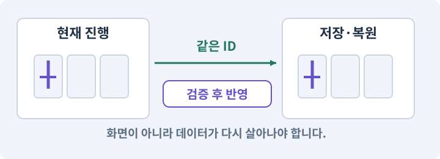

# 025. 게임을 껐다 켜도 장비 유지하기

**목표:** 장비 옵션과 진행을 다시 불러옵니다.

**시작 상태:** 가방·장비·경험치

## 한눈에 보는 기능의 흐름

현재 진행 → 저장 데이터 → 파일·백업 → 재실행 후 복원



**경계:** 같은 아이템 ID·옵션·장착을 복원하기

그림은 실제 게임 실행 결과가 아닙니다. 값·규칙과 예제를 필요한 때 펼쳐 읽고 현재 단계의 메시지를 한 번씩 보냅니다.

## 1. 지금 상태 확인하기

첫 메시지를 보내 현재 준비 상태를 확인합니다. AI가 읽어 온 실제 프로젝트가 맞는지 보고, 없는 준비나 다른 상태가 있으면 먼저 알려 주세요. 아직 기능을 만들지 않는 단계입니다.

### AI에게 보낼 요구와 이유

#### 01. 작업 대상부터 확인

**“게임을 껐다 켜도 장비 유지하기” 작업을 시작하기 전에 현재 상태를 읽기 전용으로 확인해 줘.**

왜 이렇게 요청하나요? AI가 다른 프로젝트나 오래된 예제를 보고 작업할 수 있습니다. 실제 경로·파일·현재 기능을 읽게 하면 지금 이어서 작업할 대상을 먼저 맞출 수 있습니다.

#### 02. 작업 대상부터 확인

**필요한 시작 상태는 가방·장비·경험치야.**

왜 이렇게 요청하나요? AI가 다른 프로젝트나 오래된 예제를 보고 작업할 수 있습니다. 실제 경로·파일·현재 기능을 읽게 하면 지금 이어서 작업할 대상을 먼저 맞출 수 있습니다.

#### 03. 실제 사용 중인 구현 재사용

**실제 프로젝트와 작업 기록을 읽고 이것이 준비되어 있는지, 이미 같은 기능이 있는지 확인해 줘.**

왜 이렇게 요청하나요? 이름이 비슷한 새 클래스를 또 만들면 기존 화면은 여전히 옛 코드를 사용할 수 있습니다. 실제 호출되는 진입점을 찾아 연결해야 두 구현이 충돌하거나 수정이 반영되지 않는 문제를 막습니다.

#### 04. 현재 상태와 다음 확인 지점 구분

**이번 기능이 연결될 실제 파일·화면·도구와 보존할 기존 동작을 짧게 정리해 줘.**

왜 이렇게 요청하나요? 이미 준비된 기능과 아직 확인하지 못한 기능을 섞으면 불필요한 재설치나 성급한 완료 판정이 생깁니다. 현재 대상과 남은 준비를 나눠 가장 작은 다음 작업을 선택하게 합니다.

#### 05. 조사 단계에서 변경하지 않기

**아직 새 구현·설치·유료 호출·파일 변경은 하지 마.**

왜 이렇게 요청하나요? 현재 상태를 알아보기만 할 때 파일 변경이나 결제가 시작되면 검토 전의 환경이 바뀝니다. 준비 확인과 실제 구현을 나눠 되돌리기 어려운 작업이 먼저 실행되지 않게 합니다.

#### 06. 막힌 준비를 먼저 해결

**준비가 다르면 부족한 항목과 다음에 필요한 작업을 알려 줘.**

왜 이렇게 요청하나요? 빠진 파일·권한·패키지를 있다고 가정하면 다음 구현이 엉뚱한 대상을 만들게 됩니다. 무엇이 없고 무엇을 먼저 해야 하는지 분리하면 불필요한 재작업을 줄일 수 있습니다.

<details>
<summary>보낼 원문 전체 — 설명은 복사되지 않습니다</summary>

```text
“게임을 껐다 켜도 장비 유지하기” 작업을 시작하기 전에 현재 상태를 읽기 전용으로 확인해 줘.
필요한 시작 상태는 가방·장비·경험치야. 실제 프로젝트와 작업 기록을 읽고 이것이 준비되어 있는지, 이미 같은 기능이 있는지 확인해 줘.
이번 기능이 연결될 실제 파일·화면·도구와 보존할 기존 동작을 짧게 정리해 줘. 아직 새 구현·설치·유료 호출·파일 변경은 하지 마. 준비가 다르면 부족한 항목과 다음에 필요한 작업을 알려 줘.
```

</details>

**기대 결과:** 저장 대상과 백업·손상 복구 방식

### 직접 확인하기

1. AI가 읽은 실제 프로젝트 또는 도구 경로를 확인합니다.
2. 필수 준비가 없다면 문제 해결 요청을 보내고, 준비됐을 때 다음으로 갑니다.

## 2. 필요한 기능 만들기

준비가 확인되면 아래 요청을 보냅니다. AI가 파일·설정·실행을 맡습니다. 변경 범위나 비용 승인이 나오면 내용을 읽고 결정하세요.

### AI에게 보낼 요구와 이유

#### 01. 작업 대상부터 확인

**현재 프로젝트의 실제 파일과 이미 결정한 규칙을 먼저 확인해 줘.**

왜 이렇게 요청하나요? AI가 다른 프로젝트나 오래된 예제를 보고 작업할 수 있습니다. 실제 경로·파일·현재 기능을 읽게 하면 지금 이어서 작업할 대상을 먼저 맞출 수 있습니다.

#### 02. 실제 사용 중인 코드에 연결

**이름이 다른 기존 구현이 있으면 새로 중복 제작하지 말고 그 구현에 연결해 줘.**

왜 이렇게 요청하나요? 예제와 이름이 다르더라도 현재 씬과 입력에서 호출하는 구현이 작업 대상입니다. 같은 기능을 새로 만들기보다 기존 진입점을 확인해 수정이 실제 게임에 반영되고 중복 실행되지 않게 합니다.

#### 03. 저장 형식 변화에 대응

**schemaVersion=1의 단일 슬롯 오프라인 저장을 구현해 줘.**

왜 이렇게 요청하나요? 새 기능의 필드를 추가했다고 예전 저장에 그 값이 생기지는 않습니다. 이전·기본값·불명 ID 처리 규칙을 정해야 업데이트 후 장비나 퀘스트 진행을 잃지 않습니다.

#### 04. 사용 성공과 자원 소비 묶기

**저장 대상은 레벨/현재XP/현재 HP·MP/골드/물약수량/아이템 Instance 목록/**

왜 이렇게 요청하나요? 실패한 사용에서 자원이 줄거나 연타로 여러 번 차감되면 표시와 실제 행동이 어긋납니다. 사용 조건·비용·대기시간을 함께 처리하고 실패 시 바뀌지 않아야 할 값을 확인합니다.

#### 05. 종류와 실제 소유 물건 구분

**장비 슬롯의 instanceId/퀘스트 상태 자리/설정이다.**

왜 이렇게 요청하나요? 같은 종류의 검 두 자루도 옵션과 소유 위치는 별개입니다. 정의 데이터와 개별 아이템을 나누면 한 물건을 수정했을 때 다른 물건과 원본 규격까지 바뀌지 않습니다.

#### 06. 기계가 읽을 값의 형식 검사

**SO, GameObject, Transform, Dictionary를 JsonUtility에 그대로 넣지 말고**

왜 이렇게 요청하나요? 문자열이 JSON으로 읽힌다고 업무 규칙까지 올바른 것은 아닙니다. 필드·타입·범위·참조를 검사해 잘못된 값이 실제 코드·저장·편집기로 들어오지 않게 합니다.

#### 07. 변수·자료형·리스트·딕셔너리의 적용 조건

**serializable class와 List 중심의 명시적 DTO로 변환해 줘.**

왜 이렇게 요청하나요? 변수는 값을 가리키거나 담는 이름이고 자료형은 값의 종류를 정합니다. 리스트·배열은 순서 있는 여러 값, 딕셔너리는 키로 값을 찾는 구조, 집합은 중복 없이 모은 구조입니다. 리스트 순서와 영구 ID를 혼동하면 정렬 후 다른 아이템을 참조할 수 있습니다.

#### 08. 저장 중단과 손상에 대비

**저장 위치는 Application.persistentDataPath 아래다.**

왜 이렇게 요청하나요? 파일 쓰기가 중단되거나 읽을 수 없는 값이 있으면 정상 진행을 잃을 수 있습니다. 완성된 데이터 검증·교체·백업 복구를 나눠 손상된 자료가 정상본을 덮지 않게 합니다.

#### 09. 종류와 실제 소유 물건 구분

**itemDefinitionId와 생성된 옵션을 저장하고 불러올 때 다시 랜덤 생성하지 마.**

왜 이렇게 요청하나요? 같은 종류의 검 두 자루도 옵션과 소유 위치는 별개입니다. 정의 데이터와 개별 아이템을 나누면 한 물건을 수정했을 때 다른 물건과 원본 규격까지 바뀌지 않습니다.

#### 10. 장착 결과를 원본에서 재계산

**최종 능력치는 레벨·장비에서 재계산한 뒤 현재 HP/MP를 안전하게 제한해 줘.**

왜 이렇게 요청하나요? 현재 능력치에 보너스를 계속 더하고 빼면 중복 이벤트나 저장 복원에서 오차가 쌓일 수 있습니다. 기본값과 현재 장착 상태에서 다시 계산해야 해제 후 원래 수치로 돌아옵니다.

#### 11. 저장 중단과 손상에 대비

**임시 파일 쓰기→직렬화 결과 검증→기존 정상본 백업→대상 플랫폼에서 안전한 교체 순서로 해 줘.**

왜 이렇게 요청하나요? 파일 쓰기가 중단되거나 읽을 수 없는 값이 있으면 정상 진행을 잃을 수 있습니다. 완성된 데이터 검증·교체·백업 복구를 나눠 손상된 자료가 정상본을 덮지 않게 합니다.

#### 12. 되돌아갈 원본 남기기

**primary 손상 시 유효 backup만 복원하고, 둘 다 손상되면 원본을 보존한 채 오류를 안내해 줘.**

왜 이렇게 요청하나요? 새 구현이 실패해도 이전 게임과 저장을 복원할 수 있어야 합니다. 현재 내용을 먼저 조사하고 별도 후보에서 작업하면 실험이 유일한 정상본을 망가뜨리는 일을 피할 수 있습니다.

#### 13. 종류와 실제 소유 물건 구분

**미래 schemaVersion·중복 instanceId·없는 DefinitionId·비정상 수치를 조용히 덮어쓰지 마.**

왜 이렇게 요청하나요? 같은 종류의 검 두 자루도 옵션과 소유 위치는 별개입니다. 정의 데이터와 개별 아이템을 나누면 한 물건을 수정했을 때 다른 물건과 원본 규격까지 바뀌지 않습니다.

#### 14. 모르는 데이터와 정상 데이터를 분리

**없는 아이템은 격리/경고 정책을 적용하고 정상 데이터를 임의 삭제하지 마.**

왜 이렇게 요청하나요? 업데이트나 손상으로 읽을 수 없는 아이템이 있어도 다른 정상 진행까지 지울 필요는 없습니다. 알 수 없는 ID를 격리·경고하고 원본을 보존해 복구 가능성을 남깁니다.

#### 15. 종료 이후의 상태까지 확인

**autosave는 소유/성장/퀘스트 변경을 모아 짧게 지연 저장하고,**

왜 이렇게 요청하나요? 현재 화면에서 맞는 값도 저장하거나 다시 구성할 때 빠질 수 있습니다. 실제 종료·불러오기 전후에 ID·옵션·장착·진행을 비교해야 유지되는 범위를 확인할 수 있습니다.

#### 16. 종료 이후의 상태까지 확인

**메뉴 복귀·앱 pause에서는 현재 정상 상태를 명시적으로 저장해 줘.**

왜 이렇게 요청하나요? 현재 화면에서 맞는 값도 저장하거나 다시 구성할 때 빠질 수 있습니다. 실제 종료·불러오기 전후에 ID·옵션·장착·진행을 비교해야 유지되는 범위를 확인할 수 있습니다.

#### 17. 저장 경쟁과 정상본 손실 방지

**동시 저장을 직렬화하고 정상본을 먼저 삭제하지 마.**

왜 이렇게 요청하나요? 두 저장이 동시에 같은 파일을 쓰면 오래된 상태가 새 상태를 덮거나 파일이 손상될 수 있습니다. 순서를 정하고 임시 결과를 검증한 뒤 정상본을 교체해야 복구할 기준이 남습니다.

#### 18. 저장 중단과 손상에 대비

**화면에 저장 성공/실패를 실제 결과로 표시해 줘.**

왜 이렇게 요청하나요? 파일 쓰기가 중단되거나 읽을 수 없는 값이 있으면 정상 진행을 잃을 수 있습니다. 완성된 데이터 검증·교체·백업 복구를 나눠 손상된 자료가 정상본을 덮지 않게 합니다.

#### 19. 저장 중단과 손상에 대비

**roundtrip, 옵션불변, 손상primary/backup, 미래버전, 중복 ID, 저장실패를 테스트해 줘.**

왜 이렇게 요청하나요? 파일 쓰기가 중단되거나 읽을 수 없는 값이 있으면 정상 진행을 잃을 수 있습니다. 완성된 데이터 검증·교체·백업 복구를 나눠 손상된 자료가 정상본을 덮지 않게 합니다.

#### 20. 구현과 실행은 AI에게 맡기기

**코드·설정·파일 생성·실행은 네가 맡고, 필요한 화면과 결과를 보여 줘.**

왜 이렇게 요청하나요? 설명이나 코드 조각만 받으면 실제 파일 생성·연결·실행이 빠질 수 있습니다. AI가 개발 작업까지 수행하고, 사람은 요구·승인·결과 판단을 맡도록 역할을 분명히 합니다.

#### 21. 막힌 준비를 먼저 해결

**수행하지 못한 작업과 필요한 승인·도구 연결은 구분해서 알려 줘.**

왜 이렇게 요청하나요? 빠진 파일·권한·패키지를 있다고 가정하면 다음 구현이 엉뚱한 대상을 만들게 됩니다. 무엇이 없고 무엇을 먼저 해야 하는지 분리하면 불필요한 재작업을 줄일 수 있습니다.

<details>
<summary>보낼 원문 전체 — 설명은 복사되지 않습니다</summary>

```text
현재 프로젝트의 실제 파일과 이미 결정한 규칙을 먼저 확인해 줘. 이름이 다른 기존 구현이 있으면 새로 중복 제작하지 말고 그 구현에 연결해 줘.

schemaVersion=1의 단일 슬롯 오프라인 저장을 구현해 줘.
저장 대상은 레벨/현재XP/현재 HP·MP/골드/물약수량/아이템 Instance 목록/
장비 슬롯의 instanceId/퀘스트 상태 자리/설정이다.
SO, GameObject, Transform, Dictionary를 JsonUtility에 그대로 넣지 말고
serializable class와 List 중심의 명시적 DTO로 변환해 줘.
저장 위치는 Application.persistentDataPath 아래다.
itemDefinitionId와 생성된 옵션을 저장하고 불러올 때 다시 랜덤 생성하지 마.
최종 능력치는 레벨·장비에서 재계산한 뒤 현재 HP/MP를 안전하게 제한해 줘.
임시 파일 쓰기→직렬화 결과 검증→기존 정상본 백업→대상 플랫폼에서 안전한 교체 순서로 해 줘.
primary 손상 시 유효 backup만 복원하고, 둘 다 손상되면 원본을 보존한 채 오류를 안내해 줘.
미래 schemaVersion·중복 instanceId·없는 DefinitionId·비정상 수치를 조용히 덮어쓰지 마.
없는 아이템은 격리/경고 정책을 적용하고 정상 데이터를 임의 삭제하지 마.
autosave는 소유/성장/퀘스트 변경을 모아 짧게 지연 저장하고,
메뉴 복귀·앱 pause에서는 현재 정상 상태를 명시적으로 저장해 줘.
동시 저장을 직렬화하고 정상본을 먼저 삭제하지 마.
화면에 저장 성공/실패를 실제 결과로 표시해 줘.
roundtrip, 옵션불변, 손상primary/backup, 미래버전, 중복 ID, 저장실패를 테스트해 줘.

코드·설정·파일 생성·실행은 네가 맡고, 필요한 화면과 결과를 보여 줘. 수행하지 못한 작업과 필요한 승인·도구 연결은 구분해서 알려 줘.
```

</details>

**기대 결과:** 확인할 결과: 재실행 복원과 사본의 손상 복구를 확인함. AI가 이 상태를 확인할 실제 화면과 변경 내용을 준비합니다. 아직 실행하지 못한 부분은 따로 표시합니다.

### 직접 확인하기

1. 제안서만 반환됐다면 “설명으로 끝내지 말고 승인한 범위의 실제 작업을 수행해 줘”라고 보냅니다.
2. 코드나 설정을 직접 고치라는 안내가 나오면 “작성과 실행은 네가 맡아 줘”라고 요청합니다.

## 3. 결과를 직접 확인하기

먼저 확인 요청을 보내 AI가 검사와 화면을 준비하게 하세요. 그다음 아래 동작을 하나씩 확인합니다.

### AI에게 보낼 요구와 이유

#### 01. 검사할 입력과 관찰 지점 준비

**방금 구현한 기능의 자동 검사와 확인 화면을 준비해 줘.**

왜 이렇게 요청하나요? 정상 예 하나만 보면 실패 조건을 놓치기 쉽습니다. 정상·경계·반례를 실제 입력으로 준비하고 사람이 볼 화면도 맞춰 확인 범위를 분명하게 합니다.

#### 02. 결과를 재확인할 근거 남기기

**정상 동작과 아래 실패 조건을 실제로 검사하고 대상·실행 수·결과를 보여 줘.**

왜 이렇게 요청하나요? “잘 됩니다”라는 요약만으로는 어떤 입력과 버전을 검사했는지 알 수 없습니다. 대상·실행 수·실패 내용·파일을 함께 남겨 같은 조건으로 다시 확인할 수 있게 합니다.

#### 03. 종류와 실제 소유 물건 구분

**장비와 가방의 모든 instanceId·옵션이 전후 일치한다.**

왜 이렇게 요청하나요? 같은 종류의 검 두 자루도 옵션과 소유 위치는 별개입니다. 정의 데이터와 개별 아이템을 나누면 한 물건을 수정했을 때 다른 물건과 원본 규격까지 바뀌지 않습니다.

#### 04. 구현할 결과와 조건 고정

**스탯도 동일하다.**

왜 이렇게 요청하나요? “스탯도 동일하다”를 명시하면 AI가 무엇을 구현하거나 검사해야 하는지 범위를 좁힐 수 있습니다. 장비 옵션과 진행을 다시 불러옵니다. 이 결과를 확인할 때 이 조건이 실제로 반영됐는지 함께 봅니다.

#### 05. 구현할 결과와 조건 고정

**손상 파일은 정상 백업으로 복구하거나 오류를 명시한다.**

왜 이렇게 요청하나요? “손상 파일은 정상 백업으로 복구하거나 오류를 명시한다”를 명시하면 AI가 무엇을 구현하거나 검사해야 하는지 범위를 좁힐 수 있습니다. 장비 옵션과 진행을 다시 불러옵니다. 이 결과를 확인할 때 이 조건이 실제로 반영됐는지 함께 봅니다.

#### 06. 기존 결과를 보호

**새로운 버전의 파일을 구버전으로 덮어쓰지 않는다.**

왜 이렇게 요청하나요? 새 작업이 이미 정상인 기능이나 자산까지 바꾸면 원인을 추적하기 어렵습니다. 유지할 대상을 명시해 변경 전후를 비교하고 원치 않은 영향을 찾습니다.

#### 07. 종료 이후의 상태까지 확인

**Android 종료·재실행도 따로 검사한다.**

왜 이렇게 요청하나요? 현재 화면에서 맞는 값도 저장하거나 다시 구성할 때 빠질 수 있습니다. 실제 종료·불러오기 전후에 ID·옵션·장착·진행을 비교해야 유지되는 범위를 확인할 수 있습니다.

#### 08. 구현할 결과와 조건 고정

**갑작스러운 전원 차단 직전까지 무조건 무손실이라고 주장하지 않는다.**

왜 이렇게 요청하나요? “갑작스러운 전원 차단 직전까지 무조건 무손실이라고 주장하지 않는다”를 명시하면 AI가 무엇을 구현하거나 검사해야 하는지 범위를 좁힐 수 있습니다. 장비 옵션과 진행을 다시 불러옵니다. 이 결과를 확인할 때 이 조건이 실제로 반영됐는지 함께 봅니다.

#### 09. 성공 예와 회귀 반례 함께 확인

**관문 확인으로 현재 Windows/Android 빌드를 다시 만들고 해당 핵심 흐름을 실제 검사한다.**

왜 이렇게 요청하나요? 새 기능 하나가 동작해도 이전 동작이 깨지거나 실패 입력에서 상태가 망가질 수 있습니다. 정상·오류·기존 흐름을 함께 검사해 수정 범위 밖의 회귀를 찾습니다.

#### 10. 사람이 실제로 본 것만 기록

**연결되지 않은 기기는 BLOCKED로 기록한다.**

왜 이렇게 요청하나요? AI가 준비한 검사와 사람이 직접 플레이하거나 들은 결과는 다른 근거입니다. 관찰하지 않은 조작감·소리·실기기 결과를 임의로 완료 처리하지 않게 합니다.

#### 11. 사람 검사의 시작점 준비

**내가 조작해야 하는 부분은 실행할 화면과 시작 상태를 준비해 줘.**

왜 이렇게 요청하나요? 같은 기능이라도 시작 상태가 다르면 관찰 결과가 달라집니다. AI가 실행 화면과 재현 위치를 먼저 준비해야 사람이 이동·공격·소리·조작감을 같은 조건에서 확인할 수 있습니다.

#### 12. 사람이 실제로 본 것만 기록

**연결되지 않은 휴대폰의 터치나 사람이 보지 않은 재미·소리 품질을 대신 확인했다고 하지 마.**

왜 이렇게 요청하나요? AI가 준비한 검사와 사람이 직접 플레이하거나 들은 결과는 다른 근거입니다. 관찰하지 않은 조작감·소리·실기기 결과를 임의로 완료 처리하지 않게 합니다.

#### 13. 실제로 실행한 검사만 인정

**테스트 0개와 예전 소스 결과는 현재 성공으로 쓰지 마.**

왜 이렇게 요청하나요? 실행된 검사가 없거나 같은 결과를 중복 집계한 경우는 기능을 확인한 것이 아닙니다. 실행 수와 개별 결과를 함께 확인해야 형식적인 성공 표시를 걸러낼 수 있습니다.

<details>
<summary>보낼 원문 전체 — 설명은 복사되지 않습니다</summary>

```text
방금 구현한 기능의 자동 검사와 확인 화면을 준비해 줘. 정상 동작과 아래 실패 조건을 실제로 검사하고 대상·실행 수·결과를 보여 줘.

장비와 가방의 모든 instanceId·옵션이 전후 일치한다. 스탯도 동일하다. 손상 파일은 정상 백업으로 복구하거나 오류를 명시한다. 새로운 버전의 파일을 구버전으로 덮어쓰지 않는다. Android 종료·재실행도 따로 검사한다. 갑작스러운 전원 차단 직전까지 무조건 무손실이라고 주장하지 않는다. 관문 확인으로 현재 Windows/Android 빌드를 다시 만들고 해당 핵심 흐름을 실제 검사한다. 연결되지 않은 기기는 BLOCKED로 기록한다.

내가 조작해야 하는 부분은 실행할 화면과 시작 상태를 준비해 줘. 연결되지 않은 휴대폰의 터치나 사람이 보지 않은 재미·소리 품질을 대신 확인했다고 하지 마. 테스트 0개와 예전 소스 결과는 현재 성공으로 쓰지 마.
```

</details>

**기대 결과:** 정상본은 같은 ID와 옵션으로 복원되고, 잘못된 저장은 조용히 초기화되지 않습니다. 원본·백업과 실패 이유가 남습니다.

### 직접 확인하기

1. 검을 장착하고 골드·물약 수를 기억합니다.
2. AI가 준비한 실행 파일을 종료했다 다시 켭니다.
3. 아이템 ID·옵션·장착 상태가 같은지 비교합니다.

## 4. 결과를 남기고 마무리하기

실제로 본 결과를 아래 메모에 적고 AI에 전달합니다. 결과 저장 요청으로 현재 상태를 남긴 뒤 다음 페이지로 갑니다.

### AI에게 보낼 요구와 이유

#### 01. 결과를 재확인할 근거 남기기

**지금 작업한 “게임을 껐다 켜도 장비 유지하기”의 실제 결과를 정리해 줘.**

왜 이렇게 요청하나요? “잘 됩니다”라는 요약만으로는 어떤 입력과 버전을 검사했는지 알 수 없습니다. 대상·실행 수·실패 내용·파일을 함께 남겨 같은 조건으로 다시 확인할 수 있게 합니다.

#### 02. 다음 작업이 읽을 인수인계

**변경한 기능·파일·현재 후보와 실제 실행한 검사, 남은 문제를 기능 이름으로 기록해 줘.**

왜 이렇게 요청하나요? 새 AI 세션은 이전 대화 전체를 알고 있다고 보장할 수 없습니다. 현재 후보·파일 위치·실행한 검사·남은 일을 남겨야 같은 작업을 반복하지 않고 이어갈 수 있습니다.

#### 03. 사람이 실제로 본 것만 기록

**자동 검사 결과와 내가 직접 확인한 결과를 구분하고, 내 관찰이 아직 없으면 미확인으로 남겨 줘.**

왜 이렇게 요청하나요? AI가 준비한 검사와 사람이 직접 플레이하거나 들은 결과는 다른 근거입니다. 관찰하지 않은 조작감·소리·실기기 결과를 임의로 완료 처리하지 않게 합니다.

#### 04. 다음 작업이 읽을 인수인계

**재시작하거나 다음 작업에서 읽을 기록의 실제 위치를 알려 줘.**

왜 이렇게 요청하나요? 새 AI 세션은 이전 대화 전체를 알고 있다고 보장할 수 없습니다. 현재 후보·파일 위치·실행한 검사·남은 일을 남겨야 같은 작업을 반복하지 않고 이어갈 수 있습니다.

#### 05. 미확인을 완료와 분리

**아직 확인하지 않은 결과를 완료로 채우지 마.**

왜 이렇게 요청하나요? 만들어진 것, 검사에 실패한 것, 아직 확인하지 못한 것을 나눠야 다음 작업을 정확히 고를 수 있습니다. 실행할 조건이 없는 기능을 성공으로 기록하면 뒤에서 원인을 찾기 어려워집니다.

<details>
<summary>보낼 원문 전체 — 설명은 복사되지 않습니다</summary>

```text
지금 작업한 “게임을 껐다 켜도 장비 유지하기”의 실제 결과를 정리해 줘. 변경한 기능·파일·현재 후보와 실제 실행한 검사, 남은 문제를 기능 이름으로 기록해 줘.
자동 검사 결과와 내가 직접 확인한 결과를 구분하고, 내 관찰이 아직 없으면 미확인으로 남겨 줘. 재시작하거나 다음 작업에서 읽을 기록의 실제 위치를 알려 줘. 아직 확인하지 않은 결과를 완료로 채우지 마.
```

</details>

**기대 결과:** 현재 상태·검사 결과·남은 문제·다음에 읽을 기록을 확인할 수 있습니다.

### 직접 확인하기

1. 자동 검사와 내 관찰 결과가 섞이지 않았는지 봅니다.
2. 문제가 남았다면 해결 요청을 보내고 같은 동작을 다시 확인합니다.

## 구체적인 예로 이해하기

### 파일을 읽는 것과 저장을 복원하는 것

JSON 파싱 성공은 문법만 읽었다는 뜻입니다. 알려진 ID, 중복 소유, 수량 범위, 버전도 맞아야 정상 저장입니다.

**시작 상태:** 장비 A·확정 옵션·골드·레벨을 가진 테스트 저장과 백업을 별도로 보관합니다.

**직접 해 볼 동작:** 게임을 닫았다 열고 값을 비교합니다. 원본 대신 격리 사본에 잘못된 ID를 넣어 복구 경로도 시험하게 합니다.

**보여야 하는 결과:** 정상본은 같은 ID와 옵션으로 복원되고, 잘못된 저장은 조용히 초기화되지 않습니다. 원본·백업과 실패 이유가 남습니다.

**이렇게 되면 아직 안 됩니다:** 파싱된 필드만 부분 적용해 골드와 장비가 서로 다른 시점으로 복원됩니다.

**생각해 보기:** 장비 복원이 실패했는데 골드만 먼저 적용해도 될까요?

<details><summary>해설 보기</summary>

안 됩니다. 전체 저장을 검증한 뒤 한 상태로 적용하거나, 실패를 설명하고 검증된 백업으로 복구합니다.

</details>

## 문제가 있으면

### AI에게 보낼 요구와 이유

#### 01. 문법 검사 다음에 의미 검증

**파싱 성공만으로 정상 저장으로 보지 마.**

왜 이렇게 요청하나요? JSON 문법이 맞아도 존재하지 않는 아이템 ID, 중복 소유, 음수 수량이 들어 있을 수 있습니다. 전체 데이터의 의미와 호환 버전을 검증한 뒤 실제 진행에 적용합니다.

#### 02. 되돌아갈 원본 남기기

**중복 ID와 없는 정의를 검사하고 손상 원본은 보존해 줘.**

왜 이렇게 요청하나요? 새 구현이 실패해도 이전 게임과 저장을 복원할 수 있어야 합니다. 현재 내용을 먼저 조사하고 별도 후보에서 작업하면 실험이 유일한 정상본을 망가뜨리는 일을 피할 수 있습니다.

#### 03. 원인 하나를 좁혀 수정

**새 기능을 추가하지 말고 현재 오류와 실제 로그를 먼저 읽어 줘.**

왜 이렇게 요청하나요? 오류 수정 중 새 기능까지 넣으면 어떤 변경이 문제를 해결하거나 악화했는지 알기 어렵습니다. 원래 재현을 보존하고 작은 변경 뒤 같은 입력과 주변 정상 동작을 다시 확인합니다.

#### 04. 원인 하나를 좁혀 수정

**최소 수정 뒤 같은 재현과 관련 정상 동작을 다시 검사해 줘.**

왜 이렇게 요청하나요? 오류 수정 중 새 기능까지 넣으면 어떤 변경이 문제를 해결하거나 악화했는지 알기 어렵습니다. 원래 재현을 보존하고 작은 변경 뒤 같은 입력과 주변 정상 동작을 다시 확인합니다.

#### 05. 실패도 재현 자료로 보존

**실패 기록은 지우지 마.**

왜 이렇게 요청하나요? 실패한 입력과 로그가 있어야 같은 문제가 다시 생겼을 때 비교할 수 있습니다. 성공 기록으로 덮어쓰지 않고 전후 자료를 남기면 무엇을 고쳤는지 확인할 수 있습니다.

<details>
<summary>보낼 원문 전체 — 설명은 복사되지 않습니다</summary>

```text
파싱 성공만으로 정상 저장으로 보지 마. 중복 ID와 없는 정의를 검사하고 손상 원본은 보존해 줘.
새 기능을 추가하지 말고 현재 오류와 실제 로그를 먼저 읽어 줘. 최소 수정 뒤 같은 재현과 관련 정상 동작을 다시 검사해 줘. 실패 기록은 지우지 마.
```

</details>

## 새 세션에서 이어가기

### AI에게 보낼 요구와 이유

#### 01. 이어서 할 작업 식별

**“게임을 껐다 켜도 장비 유지하기” 작업을 이어가고 싶어.**

왜 이렇게 요청하나요? 이름으로 재개할 작업을 찾고, 뒤에 이어지는 요청으로 실제 파일·진행 중 작업·기록을 다시 읽게 합니다. 제목만 보고 이전 상태를 기억한다고 가정하지 않습니다.

#### 02. 조회는 상태를 바꾸지 않게

**실제 프로젝트와 내 도구의 작업 기록을 읽고 어디까지 구현·검사됐는지 확인해 줘.**

왜 이렇게 요청하나요? 진행 상황을 물을 때 새 구현이나 유료 호출이 시작되면 단순 확인이 실행 명령이 되어 버립니다. 저장된 근거를 읽어 완료·진행·승인 대기·미검증을 나누게 합니다.

#### 03. 재개 전 중복 작업 방지

**진행 중인 프로세스·승인·미저장 변경을 확인한 뒤 남은 가장 작은 작업부터 안내해 줘.**

왜 이렇게 요청하나요? 대화가 끊겨도 외부 작업은 끝났거나 아직 실행 중일 수 있습니다. 프로세스·승인·미저장 상태를 먼저 읽어 같은 생성·빌드·결제를 두 번 시작하지 않도록 합니다.

#### 04. 되돌아갈 원본 남기기

**기존 성공과 실패 기록은 보존해 줘.**

왜 이렇게 요청하나요? 새 구현이 실패해도 이전 게임과 저장을 복원할 수 있어야 합니다. 현재 내용을 먼저 조사하고 별도 후보에서 작업하면 실험이 유일한 정상본을 망가뜨리는 일을 피할 수 있습니다.

<details>
<summary>보낼 원문 전체 — 설명은 복사되지 않습니다</summary>

```text
“게임을 껐다 켜도 장비 유지하기” 작업을 이어가고 싶어. 실제 프로젝트와 내 도구의 작업 기록을 읽고 어디까지 구현·검사됐는지 확인해 줘. 진행 중인 프로세스·승인·미저장 변경을 확인한 뒤 남은 가장 작은 작업부터 안내해 줘. 기존 성공과 실패 기록은 보존해 줘.
```

</details>

## 왜 이렇게 만드는가

저장은 화면의 오브젝트를 통째로 파일에 넣는 일이 아니다. 레벨, 골드, 물약, 아이템 ID와 옵션, 장착 위치처럼 복원에 필요한 데이터만 저장한다. 저장 DTO는 파일에 넣기 위한 단순한 데이터 묶음이다.

파일은 Application.persistentDataPath 아래에 둔다. Unity Editor의 Assets 폴더에 저장하는 방식은 Android 의 실제 저장과 다르다. 경로를 하드코딩하지 않고 실행 환경에서 얻는다. [S17]

## 공식 참고

- [Application.persistentDataPath](https://docs.unity3d.com/6000.3/Documentation/ScriptReference/Application-persistentDataPath.html)
