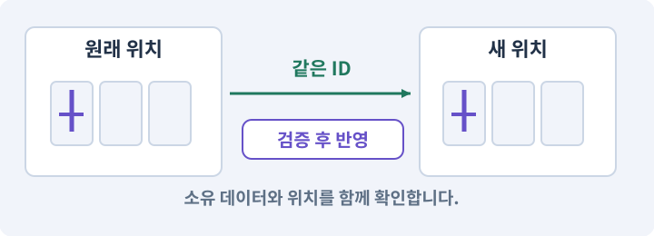

# 027. 회복하고 물약을 사는 마을 만들기

**목표:** NPC와 대화하고 안전하게 물건을 사고팝니다.

**시작 상태:** 마을·가방·골드

## 한눈에 보는 기능의 흐름

NPC 상호작용 → 구매·판매 조건 → 골드·아이템 교환 → 화면 갱신



**경계:** 골드 부족과 연타에서 소유권을 지키기

그림은 실제 게임 실행 결과가 아닙니다. 값·규칙과 예제를 필요한 때 펼쳐 읽고 현재 단계의 메시지를 한 번씩 보냅니다.

## 1. 지금 상태 확인하기

첫 메시지를 보내 현재 준비 상태를 확인합니다. AI가 읽어 온 실제 프로젝트가 맞는지 보고, 없는 준비나 다른 상태가 있으면 먼저 알려 주세요. 아직 기능을 만들지 않는 단계입니다.

### AI에게 보낼 요구와 이유

#### 01. 작업 대상부터 확인

**“회복하고 물약을 사는 마을 만들기” 작업을 시작하기 전에 현재 상태를 읽기 전용으로 확인해 줘.**

왜 이렇게 요청하나요? AI가 다른 프로젝트나 오래된 예제를 보고 작업할 수 있습니다. 실제 경로·파일·현재 기능을 읽게 하면 지금 이어서 작업할 대상을 먼저 맞출 수 있습니다.

#### 02. 작업 대상부터 확인

**필요한 시작 상태는 마을·가방·골드야.**

왜 이렇게 요청하나요? AI가 다른 프로젝트나 오래된 예제를 보고 작업할 수 있습니다. 실제 경로·파일·현재 기능을 읽게 하면 지금 이어서 작업할 대상을 먼저 맞출 수 있습니다.

#### 03. 실제 사용 중인 구현 재사용

**실제 프로젝트와 작업 기록을 읽고 이것이 준비되어 있는지, 이미 같은 기능이 있는지 확인해 줘.**

왜 이렇게 요청하나요? 이름이 비슷한 새 클래스를 또 만들면 기존 화면은 여전히 옛 코드를 사용할 수 있습니다. 실제 호출되는 진입점을 찾아 연결해야 두 구현이 충돌하거나 수정이 반영되지 않는 문제를 막습니다.

#### 04. 현재 상태와 다음 확인 지점 구분

**이번 기능이 연결될 실제 파일·화면·도구와 보존할 기존 동작을 짧게 정리해 줘.**

왜 이렇게 요청하나요? 이미 준비된 기능과 아직 확인하지 못한 기능을 섞으면 불필요한 재설치나 성급한 완료 판정이 생깁니다. 현재 대상과 남은 준비를 나눠 가장 작은 다음 작업을 선택하게 합니다.

#### 05. 조사 단계에서 변경하지 않기

**아직 새 구현·설치·유료 호출·파일 변경은 하지 마.**

왜 이렇게 요청하나요? 현재 상태를 알아보기만 할 때 파일 변경이나 결제가 시작되면 검토 전의 환경이 바뀝니다. 준비 확인과 실제 구현을 나눠 되돌리기 어려운 작업이 먼저 실행되지 않게 합니다.

#### 06. 막힌 준비를 먼저 해결

**준비가 다르면 부족한 항목과 다음에 필요한 작업을 알려 줘.**

왜 이렇게 요청하나요? 빠진 파일·권한·패키지를 있다고 가정하면 다음 구현이 엉뚱한 대상을 만들게 됩니다. 무엇이 없고 무엇을 먼저 해야 하는지 분리하면 불필요한 재작업을 줄일 수 있습니다.

<details>
<summary>보낼 원문 전체 — 설명은 복사되지 않습니다</summary>

```text
“회복하고 물약을 사는 마을 만들기” 작업을 시작하기 전에 현재 상태를 읽기 전용으로 확인해 줘.
필요한 시작 상태는 마을·가방·골드야. 실제 프로젝트와 작업 기록을 읽고 이것이 준비되어 있는지, 이미 같은 기능이 있는지 확인해 줘.
이번 기능이 연결될 실제 파일·화면·도구와 보존할 기존 동작을 짧게 정리해 줘. 아직 새 구현·설치·유료 호출·파일 변경은 하지 마. 준비가 다르면 부족한 항목과 다음에 필요한 작업을 알려 줘.
```

</details>

**기대 결과:** 마을 동선과 회복·구매·판매 규칙

### 직접 확인하기

1. AI가 읽은 실제 프로젝트 또는 도구 경로를 확인합니다.
2. 필수 준비가 없다면 문제 해결 요청을 보내고, 준비됐을 때 다음으로 갑니다.

## 2. 필요한 기능 만들기

준비가 확인되면 아래 요청을 보냅니다. AI가 파일·설정·실행을 맡습니다. 변경 범위나 비용 승인이 나오면 내용을 읽고 결정하세요.

### AI에게 보낼 요구와 이유

#### 01. 작업 대상부터 확인

**현재 프로젝트의 실제 파일과 이미 결정한 규칙을 먼저 확인해 줘.**

왜 이렇게 요청하나요? AI가 다른 프로젝트나 오래된 예제를 보고 작업할 수 있습니다. 실제 경로·파일·현재 기능을 읽게 하면 지금 이어서 작업할 대상을 먼저 맞출 수 있습니다.

#### 02. 실제 사용 중인 코드에 연결

**이름이 다른 기존 구현이 있으면 새로 중복 제작하지 말고 그 구현에 연결해 줘.**

왜 이렇게 요청하나요? 예제와 이름이 다르더라도 현재 씬과 입력에서 호출하는 구현이 작업 대상입니다. 같은 기능을 새로 만들기보다 기존 진입점을 확인해 수정이 실제 게임에 반영되고 중복 실행되지 않게 합니다.

#### 03. 상호작용·NPC·퀘스트의 적용 조건

**Town에 작은 광장과 NPC 3명, 던전 입구를 만들어 줘.**

왜 이렇게 요청하나요? 상호작용은 근처 객체와 대화·문 열기·줍기 등의 행동을 하는 기능입니다. NPC는 플레이어가 아닌 캐릭터, 퀘스트는 목표와 진행·보상 규칙을 가진 작업입니다. NPC의 말풍선을 봤다고 보상 지급이 완료된 것은 아닙니다. 데이터 상태와 저장을 확인합니다.

#### 04. NPC 서비스와 자원 변경 연결

**회복 NPC는 대화의 회복 버튼으로 HP/MP를 전부 회복한다.**

왜 이렇게 요청하나요? 대화 버튼 표시만 만들지 않고 실제 체력·마나를 정한 최대치로 회복하는 서비스를 호출해야 합니다. 상한을 넘기거나 대화를 다시 열어 다른 상태를 바꾸지 않는지 확인합니다.

#### 05. 사용 성공과 자원 소비 묶기

**상인은 물약을20골드에 판매하고 보유 수량99에서는 구매를 거부한다.**

왜 이렇게 요청하나요? 실패한 사용에서 자원이 줄거나 연타로 여러 번 차감되면 표시와 실제 행동이 어긋납니다. 사용 조건·비용·대기시간을 함께 처리하고 실패 시 바뀌지 않아야 할 값을 확인합니다.

#### 06. 구현할 결과와 조건 고정

**가방의 장비는 Common8/Magic20/Rare50골드에 판매할 수 있게 해 줘.**

왜 이렇게 요청하나요? “가방의 장비는 Common8/Magic20/Rare50골드에 판매할 수 있게 해 줘”를 명시하면 AI가 무엇을 구현하거나 검사해야 하는지 범위를 좁힐 수 있습니다. NPC와 대화하고 안전하게 물건을 사고팝니다. 이 결과를 확인할 때 이 조건이 실제로 반영됐는지 함께 봅니다.

#### 07. 장착 해제와 판매 순서

**장착 중 아이템은 현재 규칙에서는 직접 판매하지 못하게 하고 먼저 해제하도록 안내해 줘.**

왜 이렇게 요청하나요? 장착한 물건을 팔면서 장비 슬롯에 참조가 남으면 능력치와 소유권이 어긋납니다. 먼저 해제해 가방에 있는 아이템만 판매하도록 범위를 고정합니다.

#### 08. 사용 성공과 자원 소비 묶기

**골드·물약·아이템 상태 변경은 검증 후 원자적으로 확정하고 저장 요청을 한 번 보내 줘.**

왜 이렇게 요청하나요? 실패한 사용에서 자원이 줄거나 연타로 여러 번 차감되면 표시와 실제 행동이 어긋납니다. 사용 조건·비용·대기시간을 함께 처리하고 실패 시 바뀌지 않아야 할 값을 확인합니다.

#### 09. 입력 방식이 달라도 같은 상호작용 규칙

**PC와 모바일 모두 Interactable 선택→거리 확인→대화 창의 동일 경로를 사용해 줘.**

왜 이렇게 요청하나요? 마우스와 터치가 각자 NPC 규칙을 구현하면 거리·대상·잠금 조건이 달라질 수 있습니다. 입력만 달리 받고 같은 상호작용 경로에서 조건을 확인합니다.

#### 10. 빠른 반응과 허용 행동 구분

**UI 버튼 연타가 이중 거래를 만들지 않도록 해 줘.**

왜 이렇게 요청하나요? 다음 입력을 받는 것과 현재 공격을 무조건 취소하는 것은 다릅니다. 입력 저장 시간과 취소 가능한 시점을 정해야 조작은 이어지면서 비정상적인 빠른 연타는 막을 수 있습니다.

#### 11. 지금 만들 UI 범위 한정

**퀘스트 담당자는 소개 대화와 후속 퀘스트 UI의 자리만 만들고**

왜 이렇게 요청하나요? 먼저 NPC와 대화하는 연결을 완성하고, 퀘스트 진행·보상은 해당 데이터와 함께 확장할 자리로 남깁니다. 아직 없는 퀘스트 처리까지 완료했다고 가정하지 않습니다.

#### 12. 상호작용·NPC·퀘스트의 적용 조건

**아직 구현되지 않은 퀘스트를 완료된 것처럼 표시하지 마.**

왜 이렇게 요청하나요? 상호작용은 근처 객체와 대화·문 열기·줍기 등의 행동을 하는 기능입니다. NPC는 플레이어가 아닌 캐릭터, 퀘스트는 목표와 진행·보상 규칙을 가진 작업입니다. NPC의 말풍선을 봤다고 보상 지급이 완료된 것은 아닙니다. 데이터 상태와 저장을 확인합니다.

#### 13. 소개 화면과 퀘스트 처리 분리

**의뢰 수락·목표 판정·보상 지급은 지금 구현하지 말고 소개 대화만 만들어 줘.**

왜 이렇게 요청하나요? 지금 만드는 것은 마을과 NPC의 기본 상호작용입니다. 퀘스트 처리기가 없는 상태에서 임의의 완료 판정이나 보상을 추가하지 않고, 실제 수락·목표·보상 규칙을 연결할 자리를 준비합니다.

#### 14. 대화 종료 때 눌림 상태 정리

**대화 중 전투/이동 입력을 잠그고 닫을 때 held 입력을 초기화해 줘.**

왜 이렇게 요청하나요? NPC와 이야기하는 동안 뒤에서 공격하거나 움직이면 UI와 게임이 동시에 반응합니다. 대화를 닫을 때 예전 눌림 상태를 지워 원치 않는 이동·공격 재개도 막습니다.

#### 15. 한 거래의 차감과 지급을 한 번만 완료

**골드 부족, 수량99, 장착품 판매, 중복 요청, 창 닫기 경로를 검사해 줘.**

왜 이렇게 요청하나요? 버튼 연타나 재시도로 같은 요청이 두 번 올 수 있습니다. 거래 ID와 검증된 변경 묶음을 사용해 재료만 사라지거나 보상이 복제되지 않도록 차감·지급·기록을 함께 처리합니다.

#### 16. 구현과 실행은 AI에게 맡기기

**코드·설정·파일 생성·실행은 네가 맡고, 필요한 화면과 결과를 보여 줘.**

왜 이렇게 요청하나요? 설명이나 코드 조각만 받으면 실제 파일 생성·연결·실행이 빠질 수 있습니다. AI가 개발 작업까지 수행하고, 사람은 요구·승인·결과 판단을 맡도록 역할을 분명히 합니다.

#### 17. 막힌 준비를 먼저 해결

**수행하지 못한 작업과 필요한 승인·도구 연결은 구분해서 알려 줘.**

왜 이렇게 요청하나요? 빠진 파일·권한·패키지를 있다고 가정하면 다음 구현이 엉뚱한 대상을 만들게 됩니다. 무엇이 없고 무엇을 먼저 해야 하는지 분리하면 불필요한 재작업을 줄일 수 있습니다.

<details>
<summary>보낼 원문 전체 — 설명은 복사되지 않습니다</summary>

```text
현재 프로젝트의 실제 파일과 이미 결정한 규칙을 먼저 확인해 줘. 이름이 다른 기존 구현이 있으면 새로 중복 제작하지 말고 그 구현에 연결해 줘.

Town에 작은 광장과 NPC 3명, 던전 입구를 만들어 줘.
회복 NPC는 대화의 회복 버튼으로 HP/MP를 전부 회복한다.
상인은 물약을20골드에 판매하고 보유 수량99에서는 구매를 거부한다.
가방의 장비는 Common8/Magic20/Rare50골드에 판매할 수 있게 해 줘.
장착 중 아이템은 현재 규칙에서는 직접 판매하지 못하게 하고 먼저 해제하도록 안내해 줘.
골드·물약·아이템 상태 변경은 검증 후 원자적으로 확정하고 저장 요청을 한 번 보내 줘.
PC와 모바일 모두 Interactable 선택→거리 확인→대화 창의 동일 경로를 사용해 줘.
UI 버튼 연타가 이중 거래를 만들지 않도록 해 줘.
퀘스트 담당자는 소개 대화와 후속 퀘스트 UI의 자리만 만들고
아직 구현되지 않은 퀘스트를 완료된 것처럼 표시하지 마. 의뢰 수락·목표 판정·보상 지급은 지금 구현하지 말고 소개 대화만 만들어 줘.
대화 중 전투/이동 입력을 잠그고 닫을 때 held 입력을 초기화해 줘.
골드 부족, 수량99, 장착품 판매, 중복 요청, 창 닫기 경로를 검사해 줘.

코드·설정·파일 생성·실행은 네가 맡고, 필요한 화면과 결과를 보여 줘. 수행하지 못한 작업과 필요한 승인·도구 연결은 구분해서 알려 줘.
```

</details>

**기대 결과:** 확인할 결과: 상호작용·구매·판매의 경계를 확인함. AI가 이 상태를 확인할 실제 화면과 변경 내용을 준비합니다. 아직 실행하지 못한 부분은 따로 표시합니다.

### 직접 확인하기

1. 제안서만 반환됐다면 “설명으로 끝내지 말고 승인한 범위의 실제 작업을 수행해 줘”라고 보냅니다.
2. 코드나 설정을 직접 고치라는 안내가 나오면 “작성과 실행은 네가 맡아 줘”라고 요청합니다.

## 3. 결과를 직접 확인하기

먼저 확인 요청을 보내 AI가 검사와 화면을 준비하게 하세요. 그다음 아래 동작을 하나씩 확인합니다.

### AI에게 보낼 요구와 이유

#### 01. 검사할 입력과 관찰 지점 준비

**방금 구현한 기능의 자동 검사와 확인 화면을 준비해 줘.**

왜 이렇게 요청하나요? 정상 예 하나만 보면 실패 조건을 놓치기 쉽습니다. 정상·경계·반례를 실제 입력으로 준비하고 사람이 볼 화면도 맞춰 확인 범위를 분명하게 합니다.

#### 02. 결과를 재확인할 근거 남기기

**정상 동작과 아래 실패 조건을 실제로 검사하고 대상·실행 수·결과를 보여 줘.**

왜 이렇게 요청하나요? “잘 됩니다”라는 요약만으로는 어떤 입력과 버전을 검사했는지 알 수 없습니다. 대상·실행 수·실패 내용·파일을 함께 남겨 같은 조건으로 다시 확인할 수 있게 합니다.

#### 03. 구현할 결과와 조건 고정

**HP/MP가 실제로 회복된다.**

왜 이렇게 요청하나요? “HP/MP가 실제로 회복된다”를 명시하면 AI가 무엇을 구현하거나 검사해야 하는지 범위를 좁힐 수 있습니다. NPC와 대화하고 안전하게 물건을 사고팝니다. 이 결과를 확인할 때 이 조건이 실제로 반영됐는지 함께 봅니다.

#### 04. 사용 성공과 자원 소비 묶기

**골드20 이상에서 물약이 정확히 한 개 증가한다.**

왜 이렇게 요청하나요? 실패한 사용에서 자원이 줄거나 연타로 여러 번 차감되면 표시와 실제 행동이 어긋납니다. 사용 조건·비용·대기시간을 함께 처리하고 실패 시 바뀌지 않아야 할 값을 확인합니다.

#### 05. 구현할 결과와 조건 고정

**실패하면 돈이 그대로다.**

왜 이렇게 요청하나요? “실패하면 돈이 그대로다”를 명시하면 AI가 무엇을 구현하거나 검사해야 하는지 범위를 좁힐 수 있습니다. NPC와 대화하고 안전하게 물건을 사고팝니다. 이 결과를 확인할 때 이 조건이 실제로 반영됐는지 함께 봅니다.

#### 06. 구현할 결과와 조건 고정

**판매한 아이템은 가방에서 없어지고 정해진 골드를 받는다.**

왜 이렇게 요청하나요? “판매한 아이템은 가방에서 없어지고 정해진 골드를 받는다”를 명시하면 AI가 무엇을 구현하거나 검사해야 하는지 범위를 좁힐 수 있습니다. NPC와 대화하고 안전하게 물건을 사고팝니다. 이 결과를 확인할 때 이 조건이 실제로 반영됐는지 함께 봅니다.

#### 07. 구현할 결과와 조건 고정

**창을 닫은 후 이동이 정상이다.**

왜 이렇게 요청하나요? “창을 닫은 후 이동이 정상이다”를 명시하면 AI가 무엇을 구현하거나 검사해야 하는지 범위를 좁힐 수 있습니다. NPC와 대화하고 안전하게 물건을 사고팝니다. 이 결과를 확인할 때 이 조건이 실제로 반영됐는지 함께 봅니다.

#### 08. 사람 검사의 시작점 준비

**내가 조작해야 하는 부분은 실행할 화면과 시작 상태를 준비해 줘.**

왜 이렇게 요청하나요? 같은 기능이라도 시작 상태가 다르면 관찰 결과가 달라집니다. AI가 실행 화면과 재현 위치를 먼저 준비해야 사람이 이동·공격·소리·조작감을 같은 조건에서 확인할 수 있습니다.

#### 09. 사람이 실제로 본 것만 기록

**연결되지 않은 휴대폰의 터치나 사람이 보지 않은 재미·소리 품질을 대신 확인했다고 하지 마.**

왜 이렇게 요청하나요? AI가 준비한 검사와 사람이 직접 플레이하거나 들은 결과는 다른 근거입니다. 관찰하지 않은 조작감·소리·실기기 결과를 임의로 완료 처리하지 않게 합니다.

#### 10. 실제로 실행한 검사만 인정

**테스트 0개와 예전 소스 결과는 현재 성공으로 쓰지 마.**

왜 이렇게 요청하나요? 실행된 검사가 없거나 같은 결과를 중복 집계한 경우는 기능을 확인한 것이 아닙니다. 실행 수와 개별 결과를 함께 확인해야 형식적인 성공 표시를 걸러낼 수 있습니다.

<details>
<summary>보낼 원문 전체 — 설명은 복사되지 않습니다</summary>

```text
방금 구현한 기능의 자동 검사와 확인 화면을 준비해 줘. 정상 동작과 아래 실패 조건을 실제로 검사하고 대상·실행 수·결과를 보여 줘.

HP/MP가 실제로 회복된다. 골드20 이상에서 물약이 정확히 한 개 증가한다. 실패하면 돈이 그대로다. 판매한 아이템은 가방에서 없어지고 정해진 골드를 받는다. 창을 닫은 후 이동이 정상이다.

내가 조작해야 하는 부분은 실행할 화면과 시작 상태를 준비해 줘. 연결되지 않은 휴대폰의 터치나 사람이 보지 않은 재미·소리 품질을 대신 확인했다고 하지 마. 테스트 0개와 예전 소스 결과는 현재 성공으로 쓰지 마.
```

</details>

**기대 결과:** 상호작용·구매·판매의 경계를 확인함

### 직접 확인하기

1. 상인에게 접근해 물약을 삽니다.
2. 골드가 부족한 경우와 연속 구매를 시험합니다.
3. 착용 중인 장비를 잘못 판매하지 않는지 봅니다.

## 4. 결과를 남기고 마무리하기

실제로 본 결과를 아래 메모에 적고 AI에 전달합니다. 결과 저장 요청으로 현재 상태를 남긴 뒤 다음 페이지로 갑니다.

### AI에게 보낼 요구와 이유

#### 01. 결과를 재확인할 근거 남기기

**지금 작업한 “회복하고 물약을 사는 마을 만들기”의 실제 결과를 정리해 줘.**

왜 이렇게 요청하나요? “잘 됩니다”라는 요약만으로는 어떤 입력과 버전을 검사했는지 알 수 없습니다. 대상·실행 수·실패 내용·파일을 함께 남겨 같은 조건으로 다시 확인할 수 있게 합니다.

#### 02. 다음 작업이 읽을 인수인계

**변경한 기능·파일·현재 후보와 실제 실행한 검사, 남은 문제를 기능 이름으로 기록해 줘.**

왜 이렇게 요청하나요? 새 AI 세션은 이전 대화 전체를 알고 있다고 보장할 수 없습니다. 현재 후보·파일 위치·실행한 검사·남은 일을 남겨야 같은 작업을 반복하지 않고 이어갈 수 있습니다.

#### 03. 사람이 실제로 본 것만 기록

**자동 검사 결과와 내가 직접 확인한 결과를 구분하고, 내 관찰이 아직 없으면 미확인으로 남겨 줘.**

왜 이렇게 요청하나요? AI가 준비한 검사와 사람이 직접 플레이하거나 들은 결과는 다른 근거입니다. 관찰하지 않은 조작감·소리·실기기 결과를 임의로 완료 처리하지 않게 합니다.

#### 04. 다음 작업이 읽을 인수인계

**재시작하거나 다음 작업에서 읽을 기록의 실제 위치를 알려 줘.**

왜 이렇게 요청하나요? 새 AI 세션은 이전 대화 전체를 알고 있다고 보장할 수 없습니다. 현재 후보·파일 위치·실행한 검사·남은 일을 남겨야 같은 작업을 반복하지 않고 이어갈 수 있습니다.

#### 05. 미확인을 완료와 분리

**아직 확인하지 않은 결과를 완료로 채우지 마.**

왜 이렇게 요청하나요? 만들어진 것, 검사에 실패한 것, 아직 확인하지 못한 것을 나눠야 다음 작업을 정확히 고를 수 있습니다. 실행할 조건이 없는 기능을 성공으로 기록하면 뒤에서 원인을 찾기 어려워집니다.

<details>
<summary>보낼 원문 전체 — 설명은 복사되지 않습니다</summary>

```text
지금 작업한 “회복하고 물약을 사는 마을 만들기”의 실제 결과를 정리해 줘. 변경한 기능·파일·현재 후보와 실제 실행한 검사, 남은 문제를 기능 이름으로 기록해 줘.
자동 검사 결과와 내가 직접 확인한 결과를 구분하고, 내 관찰이 아직 없으면 미확인으로 남겨 줘. 재시작하거나 다음 작업에서 읽을 기록의 실제 위치를 알려 줘. 아직 확인하지 않은 결과를 완료로 채우지 마.
```

</details>

**기대 결과:** 현재 상태·검사 결과·남은 문제·다음에 읽을 기록을 확인할 수 있습니다.

### 직접 확인하기

1. 자동 검사와 내 관찰 결과가 섞이지 않았는지 봅니다.
2. 문제가 남았다면 해결 요청을 보내고 같은 동작을 다시 확인합니다.

## 문제가 있으면

### AI에게 보낼 요구와 이유

#### 01. 같은 요청의 반복 처리 정의

**구매와 수량 갱신을 따로 중복 처리하지 마.**

왜 이렇게 요청하나요? 클릭 연타·재연결·중복 이벤트는 개발과 플레이 중 모두 발생할 수 있습니다. 반복돼도 한 번 처리해야 하는 결과와 매번 새로 처리할 결과를 나눠 데이터가 누적되지 않게 합니다.

#### 02. UI 클릭의 월드 전달 차단

**대화 버튼 클릭이 뒤의 바닥 이동으로 전달되는지도 확인해 줘.**

왜 이렇게 요청하나요? 대화 선택을 한 클릭이 같은 순간 바닥 이동으로도 처리될 수 있습니다. UI에서 시작한 입력을 소비해 클릭 한 번이 두 작업을 하지 않도록 확인합니다.

#### 03. 원인 하나를 좁혀 수정

**새 기능을 추가하지 말고 현재 오류와 실제 로그를 먼저 읽어 줘.**

왜 이렇게 요청하나요? 오류 수정 중 새 기능까지 넣으면 어떤 변경이 문제를 해결하거나 악화했는지 알기 어렵습니다. 원래 재현을 보존하고 작은 변경 뒤 같은 입력과 주변 정상 동작을 다시 확인합니다.

#### 04. 원인 하나를 좁혀 수정

**최소 수정 뒤 같은 재현과 관련 정상 동작을 다시 검사해 줘.**

왜 이렇게 요청하나요? 오류 수정 중 새 기능까지 넣으면 어떤 변경이 문제를 해결하거나 악화했는지 알기 어렵습니다. 원래 재현을 보존하고 작은 변경 뒤 같은 입력과 주변 정상 동작을 다시 확인합니다.

#### 05. 실패도 재현 자료로 보존

**실패 기록은 지우지 마.**

왜 이렇게 요청하나요? 실패한 입력과 로그가 있어야 같은 문제가 다시 생겼을 때 비교할 수 있습니다. 성공 기록으로 덮어쓰지 않고 전후 자료를 남기면 무엇을 고쳤는지 확인할 수 있습니다.

<details>
<summary>보낼 원문 전체 — 설명은 복사되지 않습니다</summary>

```text
구매와 수량 갱신을 따로 중복 처리하지 마. 대화 버튼 클릭이 뒤의 바닥 이동으로 전달되는지도 확인해 줘.
새 기능을 추가하지 말고 현재 오류와 실제 로그를 먼저 읽어 줘. 최소 수정 뒤 같은 재현과 관련 정상 동작을 다시 검사해 줘. 실패 기록은 지우지 마.
```

</details>

## 새 세션에서 이어가기

### AI에게 보낼 요구와 이유

#### 01. 이어서 할 작업 식별

**“회복하고 물약을 사는 마을 만들기” 작업을 이어가고 싶어.**

왜 이렇게 요청하나요? 이름으로 재개할 작업을 찾고, 뒤에 이어지는 요청으로 실제 파일·진행 중 작업·기록을 다시 읽게 합니다. 제목만 보고 이전 상태를 기억한다고 가정하지 않습니다.

#### 02. 조회는 상태를 바꾸지 않게

**실제 프로젝트와 내 도구의 작업 기록을 읽고 어디까지 구현·검사됐는지 확인해 줘.**

왜 이렇게 요청하나요? 진행 상황을 물을 때 새 구현이나 유료 호출이 시작되면 단순 확인이 실행 명령이 되어 버립니다. 저장된 근거를 읽어 완료·진행·승인 대기·미검증을 나누게 합니다.

#### 03. 재개 전 중복 작업 방지

**진행 중인 프로세스·승인·미저장 변경을 확인한 뒤 남은 가장 작은 작업부터 안내해 줘.**

왜 이렇게 요청하나요? 대화가 끊겨도 외부 작업은 끝났거나 아직 실행 중일 수 있습니다. 프로세스·승인·미저장 상태를 먼저 읽어 같은 생성·빌드·결제를 두 번 시작하지 않도록 합니다.

#### 04. 되돌아갈 원본 남기기

**기존 성공과 실패 기록은 보존해 줘.**

왜 이렇게 요청하나요? 새 구현이 실패해도 이전 게임과 저장을 복원할 수 있어야 합니다. 현재 내용을 먼저 조사하고 별도 후보에서 작업하면 실험이 유일한 정상본을 망가뜨리는 일을 피할 수 있습니다.

<details>
<summary>보낼 원문 전체 — 설명은 복사되지 않습니다</summary>

```text
“회복하고 물약을 사는 마을 만들기” 작업을 이어가고 싶어. 실제 프로젝트와 내 도구의 작업 기록을 읽고 어디까지 구현·검사됐는지 확인해 줘. 진행 중인 프로세스·승인·미저장 변경을 확인한 뒤 남은 가장 작은 작업부터 안내해 줘. 기존 성공과 실패 기록은 보존해 줘.
```

</details>

## 왜 이렇게 만드는가

마을은 큰 도시일 필요가 없다. 귀환 지점, 회복 NPC, 상점, 다음 목표를 알려 주는 NPC가 짧은 동선으로 연결되면 역할을 한다.

상점 구매도 하나의 거래다. 골드를 먼저 빼고 물약 추가가 실패하면 돈만 사라진다. 수량 제한·보유 골드·아이템 소유를 확인한 뒤 함께 확정한다.

## 공식 참고

