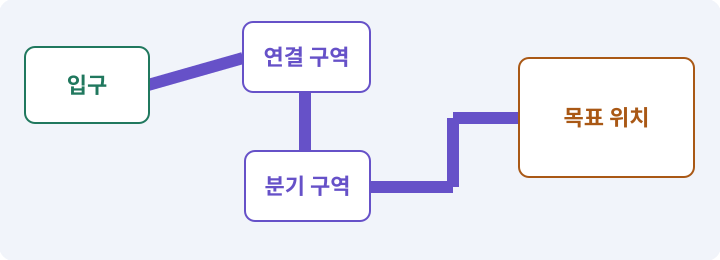

# 028. 여덟 구역의 첫 던전 만들기

**목표:** 입구에서 보물방과 보스방까지 걸어갑니다.

**시작 상태:** 마을과 2D 이동·전투

## 한눈에 보는 기능의 흐름

입구 → 전투 구역 → 보물방 → 보스방



**경계:** 그림상 통로와 실제 충돌·경로가 맞기

그림은 실제 게임 실행 결과가 아닙니다. 값·규칙과 예제를 필요한 때 펼쳐 읽고 현재 단계의 메시지를 한 번씩 보냅니다.

## 1. 지금 상태 확인하기

첫 메시지를 보내 현재 준비 상태를 확인합니다. AI가 읽어 온 실제 프로젝트가 맞는지 보고, 없는 준비나 다른 상태가 있으면 먼저 알려 주세요. 아직 기능을 만들지 않는 단계입니다.

### AI에게 보낼 요구와 이유

#### 01. 작업 대상부터 확인

**“여덟 구역의 첫 던전 만들기” 작업을 시작하기 전에 현재 상태를 읽기 전용으로 확인해 줘.**

왜 이렇게 요청하나요? AI가 다른 프로젝트나 오래된 예제를 보고 작업할 수 있습니다. 실제 경로·파일·현재 기능을 읽게 하면 지금 이어서 작업할 대상을 먼저 맞출 수 있습니다.

#### 02. 작업 대상부터 확인

**필요한 시작 상태는 마을과 2D 이동·전투야.**

왜 이렇게 요청하나요? AI가 다른 프로젝트나 오래된 예제를 보고 작업할 수 있습니다. 실제 경로·파일·현재 기능을 읽게 하면 지금 이어서 작업할 대상을 먼저 맞출 수 있습니다.

#### 03. 실제 사용 중인 구현 재사용

**실제 프로젝트와 작업 기록을 읽고 이것이 준비되어 있는지, 이미 같은 기능이 있는지 확인해 줘.**

왜 이렇게 요청하나요? 이름이 비슷한 새 클래스를 또 만들면 기존 화면은 여전히 옛 코드를 사용할 수 있습니다. 실제 호출되는 진입점을 찾아 연결해야 두 구현이 충돌하거나 수정이 반영되지 않는 문제를 막습니다.

#### 04. 현재 상태와 다음 확인 지점 구분

**이번 기능이 연결될 실제 파일·화면·도구와 보존할 기존 동작을 짧게 정리해 줘.**

왜 이렇게 요청하나요? 이미 준비된 기능과 아직 확인하지 못한 기능을 섞으면 불필요한 재설치나 성급한 완료 판정이 생깁니다. 현재 대상과 남은 준비를 나눠 가장 작은 다음 작업을 선택하게 합니다.

#### 05. 조사 단계에서 변경하지 않기

**아직 새 구현·설치·유료 호출·파일 변경은 하지 마.**

왜 이렇게 요청하나요? 현재 상태를 알아보기만 할 때 파일 변경이나 결제가 시작되면 검토 전의 환경이 바뀝니다. 준비 확인과 실제 구현을 나눠 되돌리기 어려운 작업이 먼저 실행되지 않게 합니다.

#### 06. 막힌 준비를 먼저 해결

**준비가 다르면 부족한 항목과 다음에 필요한 작업을 알려 줘.**

왜 이렇게 요청하나요? 빠진 파일·권한·패키지를 있다고 가정하면 다음 구현이 엉뚱한 대상을 만들게 됩니다. 무엇이 없고 무엇을 먼저 해야 하는지 분리하면 불필요한 재작업을 줄일 수 있습니다.

<details>
<summary>보낼 원문 전체 — 설명은 복사되지 않습니다</summary>

```text
“여덟 구역의 첫 던전 만들기” 작업을 시작하기 전에 현재 상태를 읽기 전용으로 확인해 줘.
필요한 시작 상태는 마을과 2D 이동·전투야. 실제 프로젝트와 작업 기록을 읽고 이것이 준비되어 있는지, 이미 같은 기능이 있는지 확인해 줘.
이번 기능이 연결될 실제 파일·화면·도구와 보존할 기존 동작을 짧게 정리해 줘. 아직 새 구현·설치·유료 호출·파일 변경은 하지 마. 준비가 다르면 부족한 항목과 다음에 필요한 작업을 알려 줘.
```

</details>

**기대 결과:** 8개 구역과 통로가 있는 지도

### 직접 확인하기

1. AI가 읽은 실제 프로젝트 또는 도구 경로를 확인합니다.
2. 필수 준비가 없다면 문제 해결 요청을 보내고, 준비됐을 때 다음으로 갑니다.

## 2. 필요한 기능 만들기

준비가 확인되면 아래 요청을 보냅니다. AI가 파일·설정·실행을 맡습니다. 변경 범위나 비용 승인이 나오면 내용을 읽고 결정하세요.

### AI에게 보낼 요구와 이유

#### 01. 작업 대상부터 확인

**현재 프로젝트의 실제 파일과 이미 결정한 규칙을 먼저 확인해 줘.**

왜 이렇게 요청하나요? AI가 다른 프로젝트나 오래된 예제를 보고 작업할 수 있습니다. 실제 경로·파일·현재 기능을 읽게 하면 지금 이어서 작업할 대상을 먼저 맞출 수 있습니다.

#### 02. 실제 사용 중인 코드에 연결

**이름이 다른 기존 구현이 있으면 새로 중복 제작하지 말고 그 구현에 연결해 줘.**

왜 이렇게 요청하나요? 예제와 이름이 다르더라도 현재 씬과 입력에서 호출하는 구현이 작업 대상입니다. 같은 기능을 새로 만들기보다 기존 진입점을 확인해 수정이 실제 게임에 반영되고 중복 실행되지 않게 합니다.

#### 03. Tilemap·Tile·타일 팔레트의 적용 조건

**고정 Dungeon01을 2D Tilemap으로 만들어 줘.**

왜 이렇게 요청하나요? Tile은 칸에 놓을 그림과 속성을 가진 자료이고, Tilemap은 많은 칸의 타일 배치를 관리하는 컴포넌트입니다. 팔레트는 타일을 고르는 목록이며 생성 규칙 자체는 아닙니다. 예쁜 바닥 그림을 놓았다고 A*의 이동 가능 칸도 자동 갱신되지는 않습니다.

#### 04. 구현할 결과와 조건 고정

**GAME_SPEC의8구역 좌표와 27마리편성을 사용해 줘.**

왜 이렇게 요청하나요? “GAME_SPEC의8구역 좌표와 27마리편성을 사용해 줘”를 명시하면 AI가 무엇을 구현하거나 검사해야 하는지 범위를 좁힐 수 있습니다. 입구에서 보물방과 보스방까지 걸어갑니다. 이 결과를 확인할 때 이 조건이 실제로 반영됐는지 함께 봅니다.

#### 05. 좌표계 혼동 방지

**방14×14셀/복도 4셀/XY평면/1셀 1유닛으로 만들고 고정맵 bounds를 실제 데이터에서 계산해 줘.**

왜 이렇게 요청하나요? 2D의 XY와 3D의 XZ는 같은 이동 의미라도 축 배치가 다릅니다. 변환 위치를 한 곳으로 모아야 지도·물리·카메라가 서로 다른 축을 높이나 전진 방향으로 해석하지 않습니다.

#### 06. 길찾기와 실제 도달을 구분

**Floor, WallsCollision, WallArt, Decor를 나누고 같은 LayoutData를 A*와 충돌의 정본으로 사용해 줘.**

왜 이렇게 요청하나요? 목적지 표시나 경로 목록이 있다고 캐릭터가 끝까지 갈 수 있는 것은 아닙니다. 이동 가능한 경로와 실제 몸체의 진행을 확인하고 막힌 지점을 성공으로 표시하지 않게 합니다.

#### 07. 관찰 가능한 기준으로 확인

**이동용 벽타일 Collider2D를 합성하되 현재 버전의 Composite Operation 설정과 Static Body를 확인해 줘.**

왜 이렇게 요청하나요? 구현 완료라는 설명을 실제 결과로 바꾸기 위한 조건입니다. 요청에 나온 대상과 경계 상황을 확인해 정상 결과뿐 아니라 실패를 어떻게 구분했는지도 남깁니다.

#### 08. 구현할 결과와 조건 고정

**타일 갱신 완료 전에 플레이어를 활성화하지 마.**

왜 이렇게 요청하나요? “타일 갱신 완료 전에 플레이어를 활성화하지 마”를 명시하면 AI가 무엇을 구현하거나 검사해야 하는지 범위를 좁힐 수 있습니다. 입구에서 보물방과 보스방까지 걸어갑니다. 이 결과를 확인할 때 이 조건이 실제로 반영됐는지 함께 봅니다.

#### 09. 관찰 가능한 기준으로 확인

**입구→모든방→보물→보스의 반경별 경로와 실제 통과를 검사해 줘.**

왜 이렇게 요청하나요? 구현 완료라는 설명을 실제 결과로 바꾸기 위한 조건입니다. 요청에 나온 대상과 경계 상황을 확인해 정상 결과뿐 아니라 실패를 어떻게 구분했는지도 남깁니다.

#### 10. 미확인을 완료와 분리

**보스문은 blocked/Collider2D/표시를 함께 제어하고 지도 버전으로 기존 경로를 무효화해 줘.**

왜 이렇게 요청하나요? 만들어진 것, 검사에 실패한 것, 아직 확인하지 못한 것을 나눠야 다음 작업을 정확히 고를 수 있습니다. 실행할 조건이 없는 기능을 성공으로 기록하면 뒤에서 원인을 찾기 어려워집니다.

#### 11. 길찾기와 실제 도달을 구분

**재실행 시 GeneratedRoot 소유물만 갱신하며 3D Plane/NavMesh를 추가하지 마.**

왜 이렇게 요청하나요? 목적지 표시나 경로 목록이 있다고 캐릭터가 끝까지 갈 수 있는 것은 아닙니다. 이동 가능한 경로와 실제 몸체의 진행을 확인하고 막힌 지점을 성공으로 표시하지 않게 합니다.

#### 12. 아래 항목을 완료 조건으로 사용

**적용할 세부 규칙:**

왜 이렇게 요청하나요? 요구사항의 목록은 AI에게 참고 설명을 주는 것이 아니라 완료를 판단할 기준을 정합니다. 구현 뒤 각 항목을 실제 입력과 결과에 대응시켜 빠진 조건을 찾습니다.

#### 13. 구현할 결과와 조건 고정

**방은14×14셀, 복도는 4셀 폭으로 통일한다.**

왜 이렇게 요청하나요? “방은14×14셀, 복도는 4셀 폭으로 통일한다”를 명시하면 AI가 무엇을 구현하거나 검사해야 하는지 범위를 좁힐 수 있습니다. 입구에서 보물방과 보스방까지 걸어갑니다. 이 결과를 확인할 때 이 조건이 실제로 반영됐는지 함께 봅니다.

#### 14. 좌표계 혼동 방지

**중심 좌표는 논리 XY다.**

왜 이렇게 요청하나요? 2D의 XY와 3D의 XZ는 같은 이동 의미라도 축 배치가 다릅니다. 변환 위치를 한 곳으로 모아야 지도·물리·카메라가 서로 다른 축을 높이나 전진 방향으로 해석하지 않습니다.

#### 15. 논리 지도·DungeonLayout의 적용 조건

**• roomId: R00 / 중심 X,Y: 0,0 / 역할·편성: 입구·튜토리얼 보급함**

왜 이렇게 요청하나요? 논리 지도는 그림과 상관없이 방·통로·문·스폰 후보를 표현한 데이터입니다. 이를 2D Tilemap과 3D 메시가 각각 화면과 충돌로 바꿉니다. Layout이라는 단어는 UI 배치에도 쓰입니다. 여기서는 던전의 논리 배치 데이터입니다.

#### 16. 논리 지도·DungeonLayout의 적용 조건

**• roomId: R01 / 중심 X,Y: 0,20 / 역할·편성: 근접병4**

왜 이렇게 요청하나요? 논리 지도는 그림과 상관없이 방·통로·문·스폰 후보를 표현한 데이터입니다. 이를 2D Tilemap과 3D 메시가 각각 화면과 충돌로 바꿉니다. Layout이라는 단어는 UI 배치에도 쓰입니다. 여기서는 던전의 논리 배치 데이터입니다.

#### 17. 논리 지도·DungeonLayout의 적용 조건

**• roomId: R02 / 중심 X,Y: 20,20 / 역할·편성: 근접병3·석궁수2**

왜 이렇게 요청하나요? 논리 지도는 그림과 상관없이 방·통로·문·스폰 후보를 표현한 데이터입니다. 이를 2D Tilemap과 3D 메시가 각각 화면과 충돌로 바꿉니다. Layout이라는 단어는 UI 배치에도 쓰입니다. 여기서는 던전의 논리 배치 데이터입니다.

#### 18. 논리 지도·DungeonLayout의 적용 조건

**• roomId: R03 / 중심 X,Y: 20,40 / 역할·편성: 근접병3·석궁수2·거구1**

왜 이렇게 요청하나요? 논리 지도는 그림과 상관없이 방·통로·문·스폰 후보를 표현한 데이터입니다. 이를 2D Tilemap과 3D 메시가 각각 화면과 충돌로 바꿉니다. Layout이라는 단어는 UI 배치에도 쓰입니다. 여기서는 던전의 논리 배치 데이터입니다.

#### 19. 논리 지도·DungeonLayout의 적용 조건

**• roomId: R04 / 중심 X,Y: 0,40 / 역할·편성: 석궁수3·거구2**

왜 이렇게 요청하나요? 논리 지도는 그림과 상관없이 방·통로·문·스폰 후보를 표현한 데이터입니다. 이를 2D Tilemap과 3D 메시가 각각 화면과 충돌로 바꿉니다. Layout이라는 단어는 UI 배치에도 쓰입니다. 여기서는 던전의 논리 배치 데이터입니다.

#### 20. 전투 단계 전환을 한 번씩 처리

**• roomId: R05 / 중심 X,Y: 0,60 / 역할·편성: 근접병3·석궁수2·거구1·정예거구1**

왜 이렇게 요청하나요? 큰 피해·취소·사망으로 단계를 건너뛰거나 여러 조건이 함께 참이 되면 공격이 겹칠 수 있습니다. 진입·종료·보상을 분리해 끝난 단계의 예약이 남지 않도록 합니다.

#### 21. 논리 지도·DungeonLayout의 적용 조건

**• roomId: R06 / 중심 X,Y: 40,40 / 역할·편성: 보물상자**

왜 이렇게 요청하나요? 논리 지도는 그림과 상관없이 방·통로·문·스폰 후보를 표현한 데이터입니다. 이를 2D Tilemap과 3D 메시가 각각 화면과 충돌로 바꿉니다. Layout이라는 단어는 UI 배치에도 쓰입니다. 여기서는 던전의 논리 배치 데이터입니다.

#### 22. 논리 지도·DungeonLayout의 적용 조건

**• roomId: R07 / 중심 X,Y: 0,80 / 역할·편성: 보스1**

왜 이렇게 요청하나요? 논리 지도는 그림과 상관없이 방·통로·문·스폰 후보를 표현한 데이터입니다. 이를 2D Tilemap과 3D 메시가 각각 화면과 충돌로 바꿉니다. Layout이라는 단어는 UI 배치에도 쓰입니다. 여기서는 던전의 논리 배치 데이터입니다.

#### 23. 구현할 결과와 조건 고정

**연결은 R00→R01→R02→R03→R04→R05→R07, 분기는 R03→R06이다.**

왜 이렇게 요청하나요? “연결은 R00→R01→R02→R03→R04→R05→R07, 분기는 R03→R06이다”를 명시하면 AI가 무엇을 구현하거나 검사해야 하는지 범위를 좁힐 수 있습니다. 입구에서 보물방과 보스방까지 걸어갑니다. 이 결과를 확인할 때 이 조건이 실제로 반영됐는지 함께 봅니다.

#### 24. 전투 단계 전환을 한 번씩 처리

**일반/정예 27마리와 보스1이다.**

왜 이렇게 요청하나요? 큰 피해·취소·사망으로 단계를 건너뛰거나 여러 조건이 함께 참이 되면 공격이 겹칠 수 있습니다. 진입·종료·보상을 분리해 끝난 단계의 예약이 남지 않도록 합니다.

#### 25. 그림 크기와 월드 크기 연결

**고정 맵은 세로로 길어64×64 랜덤맵 범위와 다르다.**

왜 이렇게 요청하나요? 픽셀 수만 정하면 게임 안에서의 크기는 정해지지 않습니다. PPU와 배율을 함께 고정해야 자산을 바꿔도 캐릭터·바닥·UI의 크기 관계를 비교할 수 있습니다.

#### 26. 그림 크기와 월드 크기 연결

**고정맵에서64×64 크기를 하드코딩하지 않고 데이터 bounds로 배열 크기를 정한다.**

왜 이렇게 요청하나요? 픽셀 수만 정하면 게임 안에서의 크기는 정해지지 않습니다. PPU와 배율을 함께 고정해야 자산을 바꿔도 캐릭터·바닥·UI의 크기 관계를 비교할 수 있습니다.

#### 27. Collider와 몸체 경계의 적용 조건

**Collider2D 타일은 실제 벽 셀의 사각형을 사용한다.**

왜 이렇게 요청하나요? Collider는 물리 검사에 사용하는 경계입니다. 보이는 그림과 같을 필요는 없습니다. 탑다운 캐릭터는 보통 발 주변에 작은 몸체 경계를 둡니다. 스프라이트를 크게 바꿨다고 몸체·사거리도 자동으로 키우지 않습니다.

#### 28. 조명·Lit·Unlit·그림자의 적용 조건

**WallArt의 머리 부분이나 그림자 모양을 자동 충돌로 만들지 않는다.**

왜 이렇게 요청하나요? 조명은 표면이 밝고 어두워 보이는 원인을 계산하는 요소입니다. Lit 재질은 지정된 조명 경로의 영향을 받고 Unlit은 일반적으로 그 조명 계산 없이 표시됩니다. Unlit이 모든 투명·후처리·색 영향에서 완전히 자유롭다는 뜻은 아닙니다. 파이프라인 구성을 봅니다.

#### 29. 미확인을 완료와 분리

**문은 표시,blocked 데이터,Collider2D가 함께 열리고 닫힌다.**

왜 이렇게 요청하나요? 만들어진 것, 검사에 실패한 것, 아직 확인하지 못한 것을 나눠야 다음 작업을 정확히 고를 수 있습니다. 실행할 조건이 없는 기능을 성공으로 기록하면 뒤에서 원인을 찾기 어려워집니다.

#### 30. 구현과 실행은 AI에게 맡기기

**코드·설정·파일 생성·실행은 네가 맡고, 필요한 화면과 결과를 보여 줘.**

왜 이렇게 요청하나요? 설명이나 코드 조각만 받으면 실제 파일 생성·연결·실행이 빠질 수 있습니다. AI가 개발 작업까지 수행하고, 사람은 요구·승인·결과 판단을 맡도록 역할을 분명히 합니다.

#### 31. 막힌 준비를 먼저 해결

**수행하지 못한 작업과 필요한 승인·도구 연결은 구분해서 알려 줘.**

왜 이렇게 요청하나요? 빠진 파일·권한·패키지를 있다고 가정하면 다음 구현이 엉뚱한 대상을 만들게 됩니다. 무엇이 없고 무엇을 먼저 해야 하는지 분리하면 불필요한 재작업을 줄일 수 있습니다.

<details>
<summary>보낼 원문 전체 — 설명은 복사되지 않습니다</summary>

```text
현재 프로젝트의 실제 파일과 이미 결정한 규칙을 먼저 확인해 줘. 이름이 다른 기존 구현이 있으면 새로 중복 제작하지 말고 그 구현에 연결해 줘.

고정 Dungeon01을 2D Tilemap으로 만들어 줘. GAME_SPEC의8구역 좌표와 27마리편성을 사용해 줘.
방14×14셀/복도 4셀/XY평면/1셀 1유닛으로 만들고 고정맵 bounds를 실제 데이터에서 계산해 줘.
Floor, WallsCollision, WallArt, Decor를 나누고 같은 LayoutData를 A*와 충돌의 정본으로 사용해 줘.
이동용 벽타일 Collider2D를 합성하되 현재 버전의 Composite Operation 설정과 Static Body를 확인해 줘.
타일 갱신 완료 전에 플레이어를 활성화하지 마.
입구→모든방→보물→보스의 반경별 경로와 실제 통과를 검사해 줘.
보스문은 blocked/Collider2D/표시를 함께 제어하고 지도 버전으로 기존 경로를 무효화해 줘.
재실행 시 GeneratedRoot 소유물만 갱신하며 3D Plane/NavMesh를 추가하지 마.

적용할 세부 규칙:
방은14×14셀, 복도는 4셀 폭으로 통일한다.  중심 좌표는 논리 XY다.

• roomId: R00 / 중심 X,Y: 0,0 / 역할·편성: 입구·튜토리얼 보급함
• roomId: R01 / 중심 X,Y: 0,20 / 역할·편성: 근접병4
• roomId: R02 / 중심 X,Y: 20,20 / 역할·편성: 근접병3·석궁수2
• roomId: R03 / 중심 X,Y: 20,40 / 역할·편성: 근접병3·석궁수2·거구1
• roomId: R04 / 중심 X,Y: 0,40 / 역할·편성: 석궁수3·거구2
• roomId: R05 / 중심 X,Y: 0,60 / 역할·편성: 근접병3·석궁수2·거구1·정예거구1
• roomId: R06 / 중심 X,Y: 40,40 / 역할·편성: 보물상자
• roomId: R07 / 중심 X,Y: 0,80 / 역할·편성: 보스1

연결은 R00→R01→R02→R03→R04→R05→R07, 분기는 R03→R06이다. 일반/정예 27마리와 보스1이다. 고정 맵은 세로로 길어64×64 랜덤맵 범위와 다르다. 고정맵에서64×64 크기를 하드코딩하지 않고 데이터 bounds로 배열 크기를 정한다.

Collider2D 타일은 실제 벽 셀의 사각형을 사용한다. WallArt의 머리 부분이나 그림자 모양을 자동 충돌로 만들지 않는다. 문은 표시,blocked 데이터,Collider2D가 함께 열리고 닫힌다.

코드·설정·파일 생성·실행은 네가 맡고, 필요한 화면과 결과를 보여 줘. 수행하지 못한 작업과 필요한 승인·도구 연결은 구분해서 알려 줘.
```

</details>

**기대 결과:** 확인할 결과: 모든 방의 실제 이동과 반복 생성을 확인함. AI가 이 상태를 확인할 실제 화면과 변경 내용을 준비합니다. 아직 실행하지 못한 부분은 따로 표시합니다.

### 직접 확인하기

1. 제안서만 반환됐다면 “설명으로 끝내지 말고 승인한 범위의 실제 작업을 수행해 줘”라고 보냅니다.
2. 코드나 설정을 직접 고치라는 안내가 나오면 “작성과 실행은 네가 맡아 줘”라고 요청합니다.

## 3. 결과를 직접 확인하기

먼저 확인 요청을 보내 AI가 검사와 화면을 준비하게 하세요. 그다음 아래 동작을 하나씩 확인합니다.

### AI에게 보낼 요구와 이유

#### 01. 검사할 입력과 관찰 지점 준비

**방금 구현한 기능의 자동 검사와 확인 화면을 준비해 줘.**

왜 이렇게 요청하나요? 정상 예 하나만 보면 실패 조건을 놓치기 쉽습니다. 정상·경계·반례를 실제 입력으로 준비하고 사람이 볼 화면도 맞춰 확인 범위를 분명하게 합니다.

#### 02. 결과를 재확인할 근거 남기기

**정상 동작과 아래 실패 조건을 실제로 검사하고 대상·실행 수·결과를 보여 줘.**

왜 이렇게 요청하나요? “잘 됩니다”라는 요약만으로는 어떤 입력과 버전을 검사했는지 알 수 없습니다. 대상·실행 수·실패 내용·파일을 함께 남겨 같은 조건으로 다시 확인할 수 있게 합니다.

#### 03. 구현할 결과와 조건 고정

**정해진8구역과 통로가 실제로 이어진다.**

왜 이렇게 요청하나요? “정해진8구역과 통로가 실제로 이어진다”를 명시하면 AI가 무엇을 구현하거나 검사해야 하는지 범위를 좁힐 수 있습니다. 입구에서 보물방과 보스방까지 걸어갑니다. 이 결과를 확인할 때 이 조건이 실제로 반영됐는지 함께 봅니다.

#### 04. 논리 지형과 플레이 가능한 지형 검사

**Floor가 장애물이 아니고 벽은 격자와 맞는다.**

왜 이렇게 요청하나요? 방이 보기 좋게 놓였어도 통로가 끊기거나 출구가 막히면 완주할 수 없습니다. 연결성과 스폰·몸체 이동을 검사하고 실패한 생성은 재현 정보와 함께 복구합니다.

#### 05. 길찾기와 실제 도달을 구분

**보스문을 닫으면 A*와 모터 모두 막힌다.**

왜 이렇게 요청하나요? 목적지 표시나 경로 목록이 있다고 캐릭터가 끝까지 갈 수 있는 것은 아닙니다. 이동 가능한 경로와 실제 몸체의 진행을 확인하고 막힌 지점을 성공으로 표시하지 않게 합니다.

#### 06. 논리 지형과 플레이 가능한 지형 검사

**고정맵이 64셀 경계에서 잘리지 않는다.**

왜 이렇게 요청하나요? 방이 보기 좋게 놓였어도 통로가 끊기거나 출구가 막히면 완주할 수 없습니다. 연결성과 스폰·몸체 이동을 검사하고 실패한 생성은 재현 정보와 함께 복구합니다.

#### 07. 사람 검사의 시작점 준비

**내가 조작해야 하는 부분은 실행할 화면과 시작 상태를 준비해 줘.**

왜 이렇게 요청하나요? 같은 기능이라도 시작 상태가 다르면 관찰 결과가 달라집니다. AI가 실행 화면과 재현 위치를 먼저 준비해야 사람이 이동·공격·소리·조작감을 같은 조건에서 확인할 수 있습니다.

#### 08. 사람이 실제로 본 것만 기록

**연결되지 않은 휴대폰의 터치나 사람이 보지 않은 재미·소리 품질을 대신 확인했다고 하지 마.**

왜 이렇게 요청하나요? AI가 준비한 검사와 사람이 직접 플레이하거나 들은 결과는 다른 근거입니다. 관찰하지 않은 조작감·소리·실기기 결과를 임의로 완료 처리하지 않게 합니다.

#### 09. 실제로 실행한 검사만 인정

**테스트 0개와 예전 소스 결과는 현재 성공으로 쓰지 마.**

왜 이렇게 요청하나요? 실행된 검사가 없거나 같은 결과를 중복 집계한 경우는 기능을 확인한 것이 아닙니다. 실행 수와 개별 결과를 함께 확인해야 형식적인 성공 표시를 걸러낼 수 있습니다.

<details>
<summary>보낼 원문 전체 — 설명은 복사되지 않습니다</summary>

```text
방금 구현한 기능의 자동 검사와 확인 화면을 준비해 줘. 정상 동작과 아래 실패 조건을 실제로 검사하고 대상·실행 수·결과를 보여 줘.

정해진8구역과 통로가 실제로 이어진다. Floor가 장애물이 아니고 벽은 격자와 맞는다. 보스문을 닫으면 A*와 모터 모두 막힌다. 고정맵이 64셀 경계에서 잘리지 않는다.

내가 조작해야 하는 부분은 실행할 화면과 시작 상태를 준비해 줘. 연결되지 않은 휴대폰의 터치나 사람이 보지 않은 재미·소리 품질을 대신 확인했다고 하지 마. 테스트 0개와 예전 소스 결과는 현재 성공으로 쓰지 마.
```

</details>

**기대 결과:** 모든 방의 실제 이동과 반복 생성을 확인함

### 직접 확인하기

1. 입구에서 각 방을 직접 걸어갑니다.
2. 벽처럼 보이는 곳은 막히고 통로처럼 보이는 곳은 통과하는지 봅니다.
3. 문을 닫거나 다시 생성한 뒤에도 길이 맞는지 봅니다.

## 4. 결과를 남기고 마무리하기

실제로 본 결과를 아래 메모에 적고 AI에 전달합니다. 결과 저장 요청으로 현재 상태를 남긴 뒤 다음 페이지로 갑니다.

### AI에게 보낼 요구와 이유

#### 01. 결과를 재확인할 근거 남기기

**지금 작업한 “여덟 구역의 첫 던전 만들기”의 실제 결과를 정리해 줘.**

왜 이렇게 요청하나요? “잘 됩니다”라는 요약만으로는 어떤 입력과 버전을 검사했는지 알 수 없습니다. 대상·실행 수·실패 내용·파일을 함께 남겨 같은 조건으로 다시 확인할 수 있게 합니다.

#### 02. 다음 작업이 읽을 인수인계

**변경한 기능·파일·현재 후보와 실제 실행한 검사, 남은 문제를 기능 이름으로 기록해 줘.**

왜 이렇게 요청하나요? 새 AI 세션은 이전 대화 전체를 알고 있다고 보장할 수 없습니다. 현재 후보·파일 위치·실행한 검사·남은 일을 남겨야 같은 작업을 반복하지 않고 이어갈 수 있습니다.

#### 03. 사람이 실제로 본 것만 기록

**자동 검사 결과와 내가 직접 확인한 결과를 구분하고, 내 관찰이 아직 없으면 미확인으로 남겨 줘.**

왜 이렇게 요청하나요? AI가 준비한 검사와 사람이 직접 플레이하거나 들은 결과는 다른 근거입니다. 관찰하지 않은 조작감·소리·실기기 결과를 임의로 완료 처리하지 않게 합니다.

#### 04. 다음 작업이 읽을 인수인계

**재시작하거나 다음 작업에서 읽을 기록의 실제 위치를 알려 줘.**

왜 이렇게 요청하나요? 새 AI 세션은 이전 대화 전체를 알고 있다고 보장할 수 없습니다. 현재 후보·파일 위치·실행한 검사·남은 일을 남겨야 같은 작업을 반복하지 않고 이어갈 수 있습니다.

#### 05. 미확인을 완료와 분리

**아직 확인하지 않은 결과를 완료로 채우지 마.**

왜 이렇게 요청하나요? 만들어진 것, 검사에 실패한 것, 아직 확인하지 못한 것을 나눠야 다음 작업을 정확히 고를 수 있습니다. 실행할 조건이 없는 기능을 성공으로 기록하면 뒤에서 원인을 찾기 어려워집니다.

<details>
<summary>보낼 원문 전체 — 설명은 복사되지 않습니다</summary>

```text
지금 작업한 “여덟 구역의 첫 던전 만들기”의 실제 결과를 정리해 줘. 변경한 기능·파일·현재 후보와 실제 실행한 검사, 남은 문제를 기능 이름으로 기록해 줘.
자동 검사 결과와 내가 직접 확인한 결과를 구분하고, 내 관찰이 아직 없으면 미확인으로 남겨 줘. 재시작하거나 다음 작업에서 읽을 기록의 실제 위치를 알려 줘. 아직 확인하지 않은 결과를 완료로 채우지 마.
```

</details>

**기대 결과:** 현재 상태·검사 결과·남은 문제·다음에 읽을 기록을 확인할 수 있습니다.

### 직접 확인하기

1. 자동 검사와 내 관찰 결과가 섞이지 않았는지 봅니다.
2. 문제가 남았다면 해결 요청을 보내고 같은 동작을 다시 확인합니다.

## 이 작업에서 사용할 값과 규칙 전체

설계 시작값이며 측정된 성능·게임 성공 결과가 아닙니다. 구현은 AI가 수행합니다.

방은14×14셀, 복도는 4셀 폭으로 통일한다. 이전 아래3.5유닛 폭은 이번 2D 격자에서는 사용하지 않는다. 중심 좌표는 **논리 XY**다.

| roomId | 중심 X,Y | 역할·편성 |
|---|---|---|
| R00 | 0,0 | 입구·튜토리얼 보급함 |
| R01 | 0,20 | 근접병4 |
| R02 | 20,20 | 근접병3·석궁수2 |
| R03 | 20,40 | 근접병3·석궁수2·거구1 |
| R04 | 0,40 | 석궁수3·거구2 |
| R05 | 0,60 | 근접병3·석궁수2·거구1·정예거구1 |
| R06 | 40,40 | 보물상자 |
| R07 | 0,80 | 보스1 |

연결은 R00→R01→R02→R03→R04→R05→R07, 분기는 R03→R06이다. 일반/정예 27마리와 보스1이다. 고정 맵은 세로로 길어64×64 랜덤맵 범위와 다르다. 고정맵에서64×64 크기를 하드코딩하지 않고 데이터 bounds로 배열 크기를 정한다.

Collider2D 타일은 실제 벽 셀의 사각형을 사용한다. WallArt의 머리 부분이나 그림자 모양을 자동 충돌로 만들지 않는다. 문은 표시,blocked 데이터,Collider2D가 함께 열리고 닫힌다.

## 문제가 있으면

### AI에게 보낼 요구와 이유

#### 01. 점이 아니라 몸체가 지나가게 하기

**지도 그래프만 통과했다고 끝내지 말고 실제 Collider2D와 몸체 반경으로 첫 막힌 구간을 찾아 줘.**

왜 이렇게 요청하나요? 길의 중심점이 연결돼 있어도 반경이 있는 캐릭터는 모서리나 좁은 문에 걸릴 수 있습니다. 실제 몸체 크기로 통과·차단을 확인해야 길찾기 그림과 플레이 결과가 맞습니다.

#### 02. 원인 하나를 좁혀 수정

**새 기능을 추가하지 말고 현재 오류와 실제 로그를 먼저 읽어 줘.**

왜 이렇게 요청하나요? 오류 수정 중 새 기능까지 넣으면 어떤 변경이 문제를 해결하거나 악화했는지 알기 어렵습니다. 원래 재현을 보존하고 작은 변경 뒤 같은 입력과 주변 정상 동작을 다시 확인합니다.

#### 03. 원인 하나를 좁혀 수정

**최소 수정 뒤 같은 재현과 관련 정상 동작을 다시 검사해 줘.**

왜 이렇게 요청하나요? 오류 수정 중 새 기능까지 넣으면 어떤 변경이 문제를 해결하거나 악화했는지 알기 어렵습니다. 원래 재현을 보존하고 작은 변경 뒤 같은 입력과 주변 정상 동작을 다시 확인합니다.

#### 04. 실패도 재현 자료로 보존

**실패 기록은 지우지 마.**

왜 이렇게 요청하나요? 실패한 입력과 로그가 있어야 같은 문제가 다시 생겼을 때 비교할 수 있습니다. 성공 기록으로 덮어쓰지 않고 전후 자료를 남기면 무엇을 고쳤는지 확인할 수 있습니다.

<details>
<summary>보낼 원문 전체 — 설명은 복사되지 않습니다</summary>

```text
지도 그래프만 통과했다고 끝내지 말고 실제 Collider2D와 몸체 반경으로 첫 막힌 구간을 찾아 줘.
새 기능을 추가하지 말고 현재 오류와 실제 로그를 먼저 읽어 줘. 최소 수정 뒤 같은 재현과 관련 정상 동작을 다시 검사해 줘. 실패 기록은 지우지 마.
```

</details>

## 새 세션에서 이어가기

### AI에게 보낼 요구와 이유

#### 01. 이어서 할 작업 식별

**“여덟 구역의 첫 던전 만들기” 작업을 이어가고 싶어.**

왜 이렇게 요청하나요? 이름으로 재개할 작업을 찾고, 뒤에 이어지는 요청으로 실제 파일·진행 중 작업·기록을 다시 읽게 합니다. 제목만 보고 이전 상태를 기억한다고 가정하지 않습니다.

#### 02. 조회는 상태를 바꾸지 않게

**실제 프로젝트와 내 도구의 작업 기록을 읽고 어디까지 구현·검사됐는지 확인해 줘.**

왜 이렇게 요청하나요? 진행 상황을 물을 때 새 구현이나 유료 호출이 시작되면 단순 확인이 실행 명령이 되어 버립니다. 저장된 근거를 읽어 완료·진행·승인 대기·미검증을 나누게 합니다.

#### 03. 재개 전 중복 작업 방지

**진행 중인 프로세스·승인·미저장 변경을 확인한 뒤 남은 가장 작은 작업부터 안내해 줘.**

왜 이렇게 요청하나요? 대화가 끊겨도 외부 작업은 끝났거나 아직 실행 중일 수 있습니다. 프로세스·승인·미저장 상태를 먼저 읽어 같은 생성·빌드·결제를 두 번 시작하지 않도록 합니다.

#### 04. 되돌아갈 원본 남기기

**기존 성공과 실패 기록은 보존해 줘.**

왜 이렇게 요청하나요? 새 구현이 실패해도 이전 게임과 저장을 복원할 수 있어야 합니다. 현재 내용을 먼저 조사하고 별도 후보에서 작업하면 실험이 유일한 정상본을 망가뜨리는 일을 피할 수 있습니다.

<details>
<summary>보낼 원문 전체 — 설명은 복사되지 않습니다</summary>

```text
“여덟 구역의 첫 던전 만들기” 작업을 이어가고 싶어. 실제 프로젝트와 내 도구의 작업 기록을 읽고 어디까지 구현·검사됐는지 확인해 줘. 진행 중인 프로세스·승인·미저장 변경을 확인한 뒤 남은 가장 작은 작업부터 안내해 줘. 기존 성공과 실패 기록은 보존해 줘.
```

</details>

## 왜 이렇게 만드는가

고정 던전은 랜덤 생성 전의 검증 기준이자 후반 생성 실패 때 돌아갈 안전한 지도다. 방 그림만 연결됐다고 이동 가능한 것은 아니다. Tilemap에 바닥이 있지만 논리 셀은 막혀 있거나, 벽의 투명 부분까지 Collider가 덮는 경우를 구분한다.

TilemapCollider2D는 타일 변화에 따라 형상을 갱신하며 CompositeCollider2D로 인접 형상을 합칠 수 있다. 렌더링 타일의 디테일과 이동용 벽 셀을 분리하고 필요한 타일 변화 처리를 완료한 뒤 이동을 연다. [D08][D09]

## 공식 참고

- [Tilemap Collider 2D and pending tile changes](https://docs.unity3d.com/6000.3/Documentation/Manual/tilemaps/work-with-tilemaps/tilemap-collider-2d.html)
- [Composite Collider 2D reference](https://docs.unity3d.com/6000.3/Documentation/Manual/2d-physics/collider/composite-collider/composite-collider-2d-reference.html)


## 실제 Unity Editor 화면 참고
공식 예시와 내 프로젝트 실행 결과를 구분하세요. 원본 사진은 온라인 연결이 필요합니다.

- [Editor 전체 배치 — 어디를 보고 있는지 구분하기](../editor_references/editor-layout.md)
