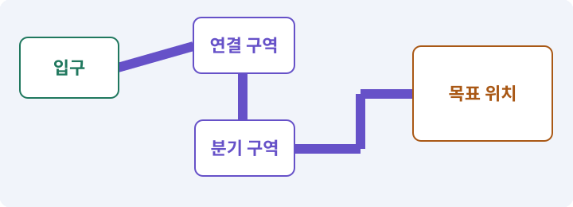

# 029. 방마다 적과 상자 배치하기

**목표:** 방별 전투와 한 번의 보상이 이어집니다.

**시작 상태:** 8개 구역의 던전

## 한눈에 보는 기능의 흐름

방 진입 → 적 배치 → 처치·상자 보상 → 새 탐험 생성



**경계:** 같은 탐험에서 상자를 반복 지급하지 않기

그림은 실제 게임 실행 결과가 아닙니다. 값·규칙과 예제를 필요한 때 펼쳐 읽고 현재 단계의 메시지를 한 번씩 보냅니다.

## 1. 지금 상태 확인하기

첫 메시지를 보내 현재 준비 상태를 확인합니다. AI가 읽어 온 실제 프로젝트가 맞는지 보고, 없는 준비나 다른 상태가 있으면 먼저 알려 주세요. 아직 기능을 만들지 않는 단계입니다.

### AI에게 보낼 요구와 이유

#### 01. 작업 대상부터 확인

**“방마다 적과 상자 배치하기” 작업을 시작하기 전에 현재 상태를 읽기 전용으로 확인해 줘.**

왜 이렇게 요청하나요? AI가 다른 프로젝트나 오래된 예제를 보고 작업할 수 있습니다. 실제 경로·파일·현재 기능을 읽게 하면 지금 이어서 작업할 대상을 먼저 맞출 수 있습니다.

#### 02. 작업 대상부터 확인

**필요한 시작 상태는 8개 구역의 던전야.**

왜 이렇게 요청하나요? AI가 다른 프로젝트나 오래된 예제를 보고 작업할 수 있습니다. 실제 경로·파일·현재 기능을 읽게 하면 지금 이어서 작업할 대상을 먼저 맞출 수 있습니다.

#### 03. 실제 사용 중인 구현 재사용

**실제 프로젝트와 작업 기록을 읽고 이것이 준비되어 있는지, 이미 같은 기능이 있는지 확인해 줘.**

왜 이렇게 요청하나요? 이름이 비슷한 새 클래스를 또 만들면 기존 화면은 여전히 옛 코드를 사용할 수 있습니다. 실제 호출되는 진입점을 찾아 연결해야 두 구현이 충돌하거나 수정이 반영되지 않는 문제를 막습니다.

#### 04. 현재 상태와 다음 확인 지점 구분

**이번 기능이 연결될 실제 파일·화면·도구와 보존할 기존 동작을 짧게 정리해 줘.**

왜 이렇게 요청하나요? 이미 준비된 기능과 아직 확인하지 못한 기능을 섞으면 불필요한 재설치나 성급한 완료 판정이 생깁니다. 현재 대상과 남은 준비를 나눠 가장 작은 다음 작업을 선택하게 합니다.

#### 05. 조사 단계에서 변경하지 않기

**아직 새 구현·설치·유료 호출·파일 변경은 하지 마.**

왜 이렇게 요청하나요? 현재 상태를 알아보기만 할 때 파일 변경이나 결제가 시작되면 검토 전의 환경이 바뀝니다. 준비 확인과 실제 구현을 나눠 되돌리기 어려운 작업이 먼저 실행되지 않게 합니다.

#### 06. 막힌 준비를 먼저 해결

**준비가 다르면 부족한 항목과 다음에 필요한 작업을 알려 줘.**

왜 이렇게 요청하나요? 빠진 파일·권한·패키지를 있다고 가정하면 다음 구현이 엉뚱한 대상을 만들게 됩니다. 무엇이 없고 무엇을 먼저 해야 하는지 분리하면 불필요한 재작업을 줄일 수 있습니다.

<details>
<summary>보낼 원문 전체 — 설명은 복사되지 않습니다</summary>

```text
“방마다 적과 상자 배치하기” 작업을 시작하기 전에 현재 상태를 읽기 전용으로 확인해 줘.
필요한 시작 상태는 8개 구역의 던전야. 실제 프로젝트와 작업 기록을 읽고 이것이 준비되어 있는지, 이미 같은 기능이 있는지 확인해 줘.
이번 기능이 연결될 실제 파일·화면·도구와 보존할 기존 동작을 짧게 정리해 줘. 아직 새 구현·설치·유료 호출·파일 변경은 하지 마. 준비가 다르면 부족한 항목과 다음에 필요한 작업을 알려 줘.
```

</details>

**기대 결과:** 방 활성화와 이번 탐험 상태를 구분한 설명

### 직접 확인하기

1. AI가 읽은 실제 프로젝트 또는 도구 경로를 확인합니다.
2. 필수 준비가 없다면 문제 해결 요청을 보내고, 준비됐을 때 다음으로 갑니다.

## 2. 필요한 기능 만들기

준비가 확인되면 아래 요청을 보냅니다. AI가 파일·설정·실행을 맡습니다. 변경 범위나 비용 승인이 나오면 내용을 읽고 결정하세요.

### AI에게 보낼 요구와 이유

#### 01. 작업 대상부터 확인

**현재 프로젝트의 실제 파일과 이미 결정한 규칙을 먼저 확인해 줘.**

왜 이렇게 요청하나요? AI가 다른 프로젝트나 오래된 예제를 보고 작업할 수 있습니다. 실제 경로·파일·현재 기능을 읽게 하면 지금 이어서 작업할 대상을 먼저 맞출 수 있습니다.

#### 02. 실제 사용 중인 코드에 연결

**이름이 다른 기존 구현이 있으면 새로 중복 제작하지 말고 그 구현에 연결해 줘.**

왜 이렇게 요청하나요? 예제와 이름이 다르더라도 현재 씬과 입력에서 호출하는 구현이 작업 대상입니다. 같은 기능을 새로 만들기보다 기존 진입점을 확인해 수정이 실제 게임에 반영되고 중복 실행되지 않게 합니다.

#### 03. 조우·전투 감독·페이즈의 적용 조건

**DungeonRunState를 runId/seed/방별 encounter 상태/열린 chestId 목록으로 만들어 줘.**

왜 이렇게 요청하나요? 조우는 하나의 전투 상황에 배치된 적·공간·보상·위험의 묶음입니다. 전투 감독은 전체 압박을 조절하고, 보스 페이즈는 체력·사건 등에 따라 달라지는 행동 구간입니다. 적 수를 늘리는 것만으로 재미가 늘지는 않습니다. 회피 공간·예고·반격 기회가 있어야 합니다.

#### 04. 구현할 결과와 조건 고정

**R01 근접4, R02 근접3+석궁2, R03 근접3+석궁2+거구1,**

왜 이렇게 요청하나요? “R01 근접4, R02 근접3+석궁2, R03 근접3+석궁2+거구1,”를 명시하면 AI가 무엇을 구현하거나 검사해야 하는지 범위를 좁힐 수 있습니다. 방별 전투와 한 번의 보상이 이어집니다. 이 결과를 확인할 때 이 조건이 실제로 반영됐는지 함께 봅니다.

#### 05. 전투 단계 전환을 한 번씩 처리

**R04 석궁3+거구2, R05 근접3+석궁2+일반거구1+정예거구1로 구성해 줘.**

왜 이렇게 요청하나요? 큰 피해·취소·사망으로 단계를 건너뛰거나 여러 조건이 함께 참이 되면 공격이 겹칠 수 있습니다. 진입·종료·보상을 분리해 끝난 단계의 예약이 남지 않도록 합니다.

#### 06. 같은 요청의 반복 처리 정의

**플레이어가 접근한 방에서 적을 활성화하고 같은 run에서 재방문 시 중복 생성하지 마.**

왜 이렇게 요청하나요? 클릭 연타·재연결·중복 이벤트는 개발과 플레이 중 모두 발생할 수 있습니다. 반복돼도 한 번 처리해야 하는 결과와 매번 새로 처리할 결과를 나눠 데이터가 누적되지 않게 합니다.

#### 07. 점이 아니라 몸체가 지나가게 하기

**스폰 후보는 동일 연결 영역의 walkable 셀 위, 실제 반경의 Physics2D overlap과 벽/문/상자 접근점을 통과한 곳으로 사전 검증해 줘.**

왜 이렇게 요청하나요? 길의 중심점이 연결돼 있어도 반경이 있는 캐릭터는 모서리나 좁은 문에 걸릴 수 있습니다. 실제 몸체 크기로 통과·차단을 확인해야 길찾기 그림과 플레이 결과가 맞습니다.

#### 08. 무작위 결과를 재현 가능하게

**사용 시드와 실제 후보 선택을 기록하고 부족한 후보는 명시적 생성 실패로 보고해 줘.**

왜 이렇게 요청하나요? 실패한 맵이나 전리품 결과를 다시 만들 수 있어야 원인을 고칠 수 있습니다. 생성 버전·설정·시드를 함께 기록하고 지형·장식·보상 난수를 분리해 작은 변경의 파급을 줄입니다.

#### 09. 구현할 결과와 조건 고정

**R06 보물방에 안정적인 chestId의 상자를 둬 줘.**

왜 이렇게 요청하나요? “R06 보물방에 안정적인 chestId의 상자를 둬 줘”를 명시하면 AI가 무엇을 구현하거나 검사해야 하는지 범위를 좁힐 수 있습니다. 방별 전투와 한 번의 보상이 이어집니다. 이 결과를 확인할 때 이 조건이 실제로 반영됐는지 함께 봅니다.

#### 10. run·attempt·revision·인수인계의 적용 조건

**상자는 한 run에서1회만 열리고 골드30+장비 1개를 생성한다.**

왜 이렇게 요청하나요? run은 고정한 작업 계획을 실행한 한 묶음, attempt는 그 안의 개별 시도, revision은 계획이나 후보의 새 버전입니다. 이 용어의 세부 정책은 하네스 구현에서 정합니다. 게임의 한 던전 탐험을 뜻하는 run과 개발 작업 run을 혼동하지 않습니다.

#### 11. 같은 요청의 반복 처리 정의

**던전 재입장 새 run에서만 적·상자를 초기화하되 퀘스트/인벤토리는 유지해 줘.**

왜 이렇게 요청하나요? 클릭 연타·재연결·중복 이벤트는 개발과 플레이 중 모두 발생할 수 있습니다. 반복돼도 한 번 처리해야 하는 결과와 매번 새로 처리할 결과를 나눠 데이터가 누적되지 않게 합니다.

#### 12. 절차적·무작위 지형 생성의 적용 조건

**맵의 무작위 지형 생성은 하지 마.**

왜 이렇게 요청하나요? 절차적 생성은 사람이 정한 규칙을 프로그램이 실행해 콘텐츠를 만드는 방식입니다. 무작위 값을 섞을 수 있지만 아무렇게나 배치한다는 뜻은 아닙니다. 100개 시드 통과는 모든 가능한 시드의 수학적 보장이 아닙니다. 반례를 보존하고 실제 공간도 검사합니다.

#### 13. 구현할 결과와 조건 고정

**전투 중 귀환 정책은 출입구까지 걸어가는 방식으로 단순화해 줘.**

왜 이렇게 요청하나요? “전투 중 귀환 정책은 출입구까지 걸어가는 방식으로 단순화해 줘”를 명시하면 AI가 무엇을 구현하거나 검사해야 하는지 범위를 좁힐 수 있습니다. 방별 전투와 한 번의 보상이 이어집니다. 이 결과를 확인할 때 이 조건이 실제로 반영됐는지 함께 봅니다.

#### 14. 빠른 반응과 허용 행동 구분

**같은 run 재방문/새 run/상자연타/스폰겹침/시드재현을 검증해 줘.**

왜 이렇게 요청하나요? 다음 입력을 받는 것과 현재 공격을 무조건 취소하는 것은 다릅니다. 입력 저장 시간과 취소 가능한 시점을 정해야 조작은 이어지면서 비정상적인 빠른 연타는 막을 수 있습니다.

#### 15. 구현과 실행은 AI에게 맡기기

**코드·설정·파일 생성·실행은 네가 맡고, 필요한 화면과 결과를 보여 줘.**

왜 이렇게 요청하나요? 설명이나 코드 조각만 받으면 실제 파일 생성·연결·실행이 빠질 수 있습니다. AI가 개발 작업까지 수행하고, 사람은 요구·승인·결과 판단을 맡도록 역할을 분명히 합니다.

#### 16. 막힌 준비를 먼저 해결

**수행하지 못한 작업과 필요한 승인·도구 연결은 구분해서 알려 줘.**

왜 이렇게 요청하나요? 빠진 파일·권한·패키지를 있다고 가정하면 다음 구현이 엉뚱한 대상을 만들게 됩니다. 무엇이 없고 무엇을 먼저 해야 하는지 분리하면 불필요한 재작업을 줄일 수 있습니다.

<details>
<summary>보낼 원문 전체 — 설명은 복사되지 않습니다</summary>

```text
현재 프로젝트의 실제 파일과 이미 결정한 규칙을 먼저 확인해 줘. 이름이 다른 기존 구현이 있으면 새로 중복 제작하지 말고 그 구현에 연결해 줘.

DungeonRunState를 runId/seed/방별 encounter 상태/열린 chestId 목록으로 만들어 줘.
R01 근접4, R02 근접3+석궁2, R03 근접3+석궁2+거구1,
R04 석궁3+거구2, R05 근접3+석궁2+일반거구1+정예거구1로 구성해 줘.
플레이어가 접근한 방에서 적을 활성화하고 같은 run에서 재방문 시 중복 생성하지 마.
스폰 후보는 동일 연결 영역의 walkable 셀 위, 실제 반경의 Physics2D overlap과 벽/문/상자 접근점을 통과한 곳으로 사전 검증해 줘.
사용 시드와 실제 후보 선택을 기록하고 부족한 후보는 명시적 생성 실패로 보고해 줘.
R06 보물방에 안정적인 chestId의 상자를 둬 줘.
상자는 한 run에서1회만 열리고 골드30+장비 1개를 생성한다.
던전 재입장 새 run에서만 적·상자를 초기화하되 퀘스트/인벤토리는 유지해 줘.
맵의 무작위 지형 생성은 하지 마.
전투 중 귀환 정책은 출입구까지 걸어가는 방식으로 단순화해 줘.
같은 run 재방문/새 run/상자연타/스폰겹침/시드재현을 검증해 줘.

코드·설정·파일 생성·실행은 네가 맡고, 필요한 화면과 결과를 보여 줘. 수행하지 못한 작업과 필요한 승인·도구 연결은 구분해서 알려 줘.
```

</details>

**기대 결과:** 확인할 결과: 방 상태와 새 탐험의 구분을 확인함. AI가 이 상태를 확인할 실제 화면과 변경 내용을 준비합니다. 아직 실행하지 못한 부분은 따로 표시합니다.

### 직접 확인하기

1. 제안서만 반환됐다면 “설명으로 끝내지 말고 승인한 범위의 실제 작업을 수행해 줘”라고 보냅니다.
2. 코드나 설정을 직접 고치라는 안내가 나오면 “작성과 실행은 네가 맡아 줘”라고 요청합니다.

## 3. 결과를 직접 확인하기

먼저 확인 요청을 보내 AI가 검사와 화면을 준비하게 하세요. 그다음 아래 동작을 하나씩 확인합니다.

### AI에게 보낼 요구와 이유

#### 01. 검사할 입력과 관찰 지점 준비

**방금 구현한 기능의 자동 검사와 확인 화면을 준비해 줘.**

왜 이렇게 요청하나요? 정상 예 하나만 보면 실패 조건을 놓치기 쉽습니다. 정상·경계·반례를 실제 입력으로 준비하고 사람이 볼 화면도 맞춰 확인 범위를 분명하게 합니다.

#### 02. 결과를 재확인할 근거 남기기

**정상 동작과 아래 실패 조건을 실제로 검사하고 대상·실행 수·결과를 보여 줘.**

왜 이렇게 요청하나요? “잘 됩니다”라는 요약만으로는 어떤 입력과 버전을 검사했는지 알 수 없습니다. 대상·실행 수·실패 내용·파일을 함께 남겨 같은 조건으로 다시 확인할 수 있게 합니다.

#### 03. 구현할 결과와 조건 고정

**정해진 방별 적 수가 맞다.**

왜 이렇게 요청하나요? “정해진 방별 적 수가 맞다”를 명시하면 AI가 무엇을 구현하거나 검사해야 하는지 범위를 좁힐 수 있습니다. 방별 전투와 한 번의 보상이 이어집니다. 이 결과를 확인할 때 이 조건이 실제로 반영됐는지 함께 봅니다.

#### 04. 구현할 결과와 조건 고정

**벽이나 출입구 안에 스폰하지 않는다.**

왜 이렇게 요청하나요? “벽이나 출입구 안에 스폰하지 않는다”를 명시하면 AI가 무엇을 구현하거나 검사해야 하는지 범위를 좁힐 수 있습니다. 방별 전투와 한 번의 보상이 이어집니다. 이 결과를 확인할 때 이 조건이 실제로 반영됐는지 함께 봅니다.

#### 05. run·attempt·revision·인수인계의 적용 조건

**같은 run에서 적과 상자 보상이 복제되지 않는다.**

왜 이렇게 요청하나요? run은 고정한 작업 계획을 실행한 한 묶음, attempt는 그 안의 개별 시도, revision은 계획이나 후보의 새 버전입니다. 이 용어의 세부 정책은 하네스 구현에서 정합니다. 게임의 한 던전 탐험을 뜻하는 run과 개발 작업 run을 혼동하지 않습니다.

#### 06. 수명주기·초기화·정리의 적용 조건

**새 run에서는 초기화된다.**

왜 이렇게 요청하나요? 객체는 생성·준비·활성·비활성·파괴의 단계를 거칩니다. 각 단계에서 구독·타이머·자원·참조를 준비하고 정리해야 합니다. “안 보임”과 “완전히 없어짐”도 다릅니다. OnDisable과 파괴는 같은 사건이 아닙니다. 다시 활성화될 수 있는지에 따라 정리·초기화 규칙을 맞춥니다.

#### 07. 기존 결과를 보호

**새 run을 시작해도 장비·레벨은 유지된다.**

왜 이렇게 요청하나요? 새 작업이 이미 정상인 기능이나 자산까지 바꾸면 원인을 추적하기 어렵습니다. 유지할 대상을 명시해 변경 전후를 비교하고 원치 않은 영향을 찾습니다.

#### 08. 사람 검사의 시작점 준비

**내가 조작해야 하는 부분은 실행할 화면과 시작 상태를 준비해 줘.**

왜 이렇게 요청하나요? 같은 기능이라도 시작 상태가 다르면 관찰 결과가 달라집니다. AI가 실행 화면과 재현 위치를 먼저 준비해야 사람이 이동·공격·소리·조작감을 같은 조건에서 확인할 수 있습니다.

#### 09. 사람이 실제로 본 것만 기록

**연결되지 않은 휴대폰의 터치나 사람이 보지 않은 재미·소리 품질을 대신 확인했다고 하지 마.**

왜 이렇게 요청하나요? AI가 준비한 검사와 사람이 직접 플레이하거나 들은 결과는 다른 근거입니다. 관찰하지 않은 조작감·소리·실기기 결과를 임의로 완료 처리하지 않게 합니다.

#### 10. 실제로 실행한 검사만 인정

**테스트 0개와 예전 소스 결과는 현재 성공으로 쓰지 마.**

왜 이렇게 요청하나요? 실행된 검사가 없거나 같은 결과를 중복 집계한 경우는 기능을 확인한 것이 아닙니다. 실행 수와 개별 결과를 함께 확인해야 형식적인 성공 표시를 걸러낼 수 있습니다.

<details>
<summary>보낼 원문 전체 — 설명은 복사되지 않습니다</summary>

```text
방금 구현한 기능의 자동 검사와 확인 화면을 준비해 줘. 정상 동작과 아래 실패 조건을 실제로 검사하고 대상·실행 수·결과를 보여 줘.

정해진 방별 적 수가 맞다. 벽이나 출입구 안에 스폰하지 않는다. 같은 run에서 적과 상자 보상이 복제되지 않는다. 새 run에서는 초기화된다. 새 run을 시작해도 장비·레벨은 유지된다.

내가 조작해야 하는 부분은 실행할 화면과 시작 상태를 준비해 줘. 연결되지 않은 휴대폰의 터치나 사람이 보지 않은 재미·소리 품질을 대신 확인했다고 하지 마. 테스트 0개와 예전 소스 결과는 현재 성공으로 쓰지 마.
```

</details>

**기대 결과:** 방 상태와 새 탐험의 구분을 확인함

### 직접 확인하기

1. 한 방을 정리하고 상자를 엽니다.
2. 같은 방을 다시 들어가 중복 보상이 없는지 봅니다.
3. 마을에서 새 던전을 시작했을 때 새 탐험이 되는지 봅니다.

## 4. 결과를 남기고 마무리하기

실제로 본 결과를 아래 메모에 적고 AI에 전달합니다. 결과 저장 요청으로 현재 상태를 남긴 뒤 다음 페이지로 갑니다.

### AI에게 보낼 요구와 이유

#### 01. 결과를 재확인할 근거 남기기

**지금 작업한 “방마다 적과 상자 배치하기”의 실제 결과를 정리해 줘.**

왜 이렇게 요청하나요? “잘 됩니다”라는 요약만으로는 어떤 입력과 버전을 검사했는지 알 수 없습니다. 대상·실행 수·실패 내용·파일을 함께 남겨 같은 조건으로 다시 확인할 수 있게 합니다.

#### 02. 다음 작업이 읽을 인수인계

**변경한 기능·파일·현재 후보와 실제 실행한 검사, 남은 문제를 기능 이름으로 기록해 줘.**

왜 이렇게 요청하나요? 새 AI 세션은 이전 대화 전체를 알고 있다고 보장할 수 없습니다. 현재 후보·파일 위치·실행한 검사·남은 일을 남겨야 같은 작업을 반복하지 않고 이어갈 수 있습니다.

#### 03. 사람이 실제로 본 것만 기록

**자동 검사 결과와 내가 직접 확인한 결과를 구분하고, 내 관찰이 아직 없으면 미확인으로 남겨 줘.**

왜 이렇게 요청하나요? AI가 준비한 검사와 사람이 직접 플레이하거나 들은 결과는 다른 근거입니다. 관찰하지 않은 조작감·소리·실기기 결과를 임의로 완료 처리하지 않게 합니다.

#### 04. 다음 작업이 읽을 인수인계

**재시작하거나 다음 작업에서 읽을 기록의 실제 위치를 알려 줘.**

왜 이렇게 요청하나요? 새 AI 세션은 이전 대화 전체를 알고 있다고 보장할 수 없습니다. 현재 후보·파일 위치·실행한 검사·남은 일을 남겨야 같은 작업을 반복하지 않고 이어갈 수 있습니다.

#### 05. 미확인을 완료와 분리

**아직 확인하지 않은 결과를 완료로 채우지 마.**

왜 이렇게 요청하나요? 만들어진 것, 검사에 실패한 것, 아직 확인하지 못한 것을 나눠야 다음 작업을 정확히 고를 수 있습니다. 실행할 조건이 없는 기능을 성공으로 기록하면 뒤에서 원인을 찾기 어려워집니다.

<details>
<summary>보낼 원문 전체 — 설명은 복사되지 않습니다</summary>

```text
지금 작업한 “방마다 적과 상자 배치하기”의 실제 결과를 정리해 줘. 변경한 기능·파일·현재 후보와 실제 실행한 검사, 남은 문제를 기능 이름으로 기록해 줘.
자동 검사 결과와 내가 직접 확인한 결과를 구분하고, 내 관찰이 아직 없으면 미확인으로 남겨 줘. 재시작하거나 다음 작업에서 읽을 기록의 실제 위치를 알려 줘. 아직 확인하지 않은 결과를 완료로 채우지 마.
```

</details>

**기대 결과:** 현재 상태·검사 결과·남은 문제·다음에 읽을 기록을 확인할 수 있습니다.

### 직접 확인하기

1. 자동 검사와 내 관찰 결과가 섞이지 않았는지 봅니다.
2. 문제가 남았다면 해결 요청을 보내고 같은 동작을 다시 확인합니다.

## 문제가 있으면

### AI에게 보낼 요구와 이유

#### 01. 수명주기·초기화·정리의 적용 조건

**방을 떠난 것만으로 상자 상태를 초기화하지 마.**

왜 이렇게 요청하나요? 객체는 생성·준비·활성·비활성·파괴의 단계를 거칩니다. 각 단계에서 구독·타이머·자원·참조를 준비하고 정리해야 합니다. “안 보임”과 “완전히 없어짐”도 다릅니다. OnDisable과 파괴는 같은 사건이 아닙니다. 다시 활성화될 수 있는지에 따라 정리·초기화 규칙을 맞춥니다.

#### 02. 종료 이후의 상태까지 확인

**전역 저장과 이번 탐험 상태의 소유자를 분리해 줘.**

왜 이렇게 요청하나요? 현재 화면에서 맞는 값도 저장하거나 다시 구성할 때 빠질 수 있습니다. 실제 종료·불러오기 전후에 ID·옵션·장착·진행을 비교해야 유지되는 범위를 확인할 수 있습니다.

#### 03. 원인 하나를 좁혀 수정

**새 기능을 추가하지 말고 현재 오류와 실제 로그를 먼저 읽어 줘.**

왜 이렇게 요청하나요? 오류 수정 중 새 기능까지 넣으면 어떤 변경이 문제를 해결하거나 악화했는지 알기 어렵습니다. 원래 재현을 보존하고 작은 변경 뒤 같은 입력과 주변 정상 동작을 다시 확인합니다.

#### 04. 원인 하나를 좁혀 수정

**최소 수정 뒤 같은 재현과 관련 정상 동작을 다시 검사해 줘.**

왜 이렇게 요청하나요? 오류 수정 중 새 기능까지 넣으면 어떤 변경이 문제를 해결하거나 악화했는지 알기 어렵습니다. 원래 재현을 보존하고 작은 변경 뒤 같은 입력과 주변 정상 동작을 다시 확인합니다.

#### 05. 실패도 재현 자료로 보존

**실패 기록은 지우지 마.**

왜 이렇게 요청하나요? 실패한 입력과 로그가 있어야 같은 문제가 다시 생겼을 때 비교할 수 있습니다. 성공 기록으로 덮어쓰지 않고 전후 자료를 남기면 무엇을 고쳤는지 확인할 수 있습니다.

<details>
<summary>보낼 원문 전체 — 설명은 복사되지 않습니다</summary>

```text
방을 떠난 것만으로 상자 상태를 초기화하지 마. 전역 저장과 이번 탐험 상태의 소유자를 분리해 줘.
새 기능을 추가하지 말고 현재 오류와 실제 로그를 먼저 읽어 줘. 최소 수정 뒤 같은 재현과 관련 정상 동작을 다시 검사해 줘. 실패 기록은 지우지 마.
```

</details>

## 새 세션에서 이어가기

### AI에게 보낼 요구와 이유

#### 01. 이어서 할 작업 식별

**“방마다 적과 상자 배치하기” 작업을 이어가고 싶어.**

왜 이렇게 요청하나요? 이름으로 재개할 작업을 찾고, 뒤에 이어지는 요청으로 실제 파일·진행 중 작업·기록을 다시 읽게 합니다. 제목만 보고 이전 상태를 기억한다고 가정하지 않습니다.

#### 02. 조회는 상태를 바꾸지 않게

**실제 프로젝트와 내 도구의 작업 기록을 읽고 어디까지 구현·검사됐는지 확인해 줘.**

왜 이렇게 요청하나요? 진행 상황을 물을 때 새 구현이나 유료 호출이 시작되면 단순 확인이 실행 명령이 되어 버립니다. 저장된 근거를 읽어 완료·진행·승인 대기·미검증을 나누게 합니다.

#### 03. 재개 전 중복 작업 방지

**진행 중인 프로세스·승인·미저장 변경을 확인한 뒤 남은 가장 작은 작업부터 안내해 줘.**

왜 이렇게 요청하나요? 대화가 끊겨도 외부 작업은 끝났거나 아직 실행 중일 수 있습니다. 프로세스·승인·미저장 상태를 먼저 읽어 같은 생성·빌드·결제를 두 번 시작하지 않도록 합니다.

#### 04. 되돌아갈 원본 남기기

**기존 성공과 실패 기록은 보존해 줘.**

왜 이렇게 요청하나요? 새 구현이 실패해도 이전 게임과 저장을 복원할 수 있어야 합니다. 현재 내용을 먼저 조사하고 별도 후보에서 작업하면 실험이 유일한 정상본을 망가뜨리는 일을 피할 수 있습니다.

<details>
<summary>보낼 원문 전체 — 설명은 복사되지 않습니다</summary>

```text
“방마다 적과 상자 배치하기” 작업을 이어가고 싶어. 실제 프로젝트와 내 도구의 작업 기록을 읽고 어디까지 구현·검사됐는지 확인해 줘. 진행 중인 프로세스·승인·미저장 변경을 확인한 뒤 남은 가장 작은 작업부터 안내해 줘. 기존 성공과 실패 기록은 보존해 줘.
```

</details>

## 왜 이렇게 만드는가

몹이 아무 데서나 랜덤으로 나오면 벽 안이나 플레이어 발밑에서 생성될 수 있다. 미리 검증한 스폰 후보 중 일부를 선택하고 후보의 바닥·거리·경로를 검사한다.

던전 안에서는 처치한 적과 연 상자가 다시 생기지 않는다. 마을로 나갔다가 새 runId로 들어오면 초기화된다. 영구 성장 데이터와 한 번의 던전 실행 데이터를 분리하는 실습이다.

## 공식 참고

