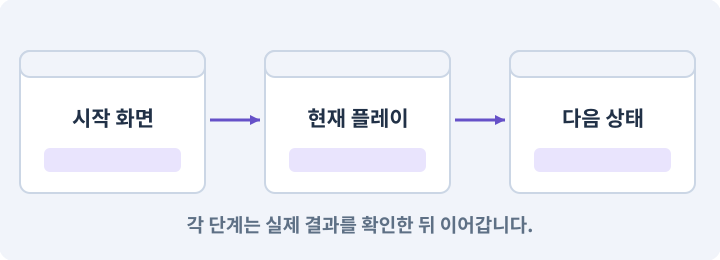

# 032. 길 안내와 처음 하는 사람의 동선 만들기

**목표:** 설명 없이도 이동·공격·장착·출정을 찾습니다.

**시작 상태:** 처음부터 끝까지 이어지는 기본 흐름

## 한눈에 보는 기능의 흐름

이동 안내 → 공격 학습 → 장착 학습 → 출정과 길 안내



**경계:** 건너뛴 안내가 진행과 보상을 반복하지 않기

그림은 실제 게임 실행 결과가 아닙니다. 값·규칙과 예제를 필요한 때 펼쳐 읽고 현재 단계의 메시지를 한 번씩 보냅니다.

## 1. 지금 상태 확인하기

첫 메시지를 보내 현재 준비 상태를 확인합니다. AI가 읽어 온 실제 프로젝트가 맞는지 보고, 없는 준비나 다른 상태가 있으면 먼저 알려 주세요. 아직 기능을 만들지 않는 단계입니다.

### AI에게 보낼 요구와 이유

#### 01. 작업 대상부터 확인

**“길 안내와 처음 하는 사람의 동선 만들기” 작업을 시작하기 전에 현재 상태를 읽기 전용으로 확인해 줘.**

왜 이렇게 요청하나요? AI가 다른 프로젝트나 오래된 예제를 보고 작업할 수 있습니다. 실제 경로·파일·현재 기능을 읽게 하면 지금 이어서 작업할 대상을 먼저 맞출 수 있습니다.

#### 02. 작업 대상부터 확인

**필요한 시작 상태는 처음부터 끝까지 이어지는 기본 흐름야.**

왜 이렇게 요청하나요? AI가 다른 프로젝트나 오래된 예제를 보고 작업할 수 있습니다. 실제 경로·파일·현재 기능을 읽게 하면 지금 이어서 작업할 대상을 먼저 맞출 수 있습니다.

#### 03. 실제 사용 중인 구현 재사용

**실제 프로젝트와 작업 기록을 읽고 이것이 준비되어 있는지, 이미 같은 기능이 있는지 확인해 줘.**

왜 이렇게 요청하나요? 이름이 비슷한 새 클래스를 또 만들면 기존 화면은 여전히 옛 코드를 사용할 수 있습니다. 실제 호출되는 진입점을 찾아 연결해야 두 구현이 충돌하거나 수정이 반영되지 않는 문제를 막습니다.

#### 04. 현재 상태와 다음 확인 지점 구분

**이번 기능이 연결될 실제 파일·화면·도구와 보존할 기존 동작을 짧게 정리해 줘.**

왜 이렇게 요청하나요? 이미 준비된 기능과 아직 확인하지 못한 기능을 섞으면 불필요한 재설치나 성급한 완료 판정이 생깁니다. 현재 대상과 남은 준비를 나눠 가장 작은 다음 작업을 선택하게 합니다.

#### 05. 조사 단계에서 변경하지 않기

**아직 새 구현·설치·유료 호출·파일 변경은 하지 마.**

왜 이렇게 요청하나요? 현재 상태를 알아보기만 할 때 파일 변경이나 결제가 시작되면 검토 전의 환경이 바뀝니다. 준비 확인과 실제 구현을 나눠 되돌리기 어려운 작업이 먼저 실행되지 않게 합니다.

#### 06. 막힌 준비를 먼저 해결

**준비가 다르면 부족한 항목과 다음에 필요한 작업을 알려 줘.**

왜 이렇게 요청하나요? 빠진 파일·권한·패키지를 있다고 가정하면 다음 구현이 엉뚱한 대상을 만들게 됩니다. 무엇이 없고 무엇을 먼저 해야 하는지 분리하면 불필요한 재작업을 줄일 수 있습니다.

<details>
<summary>보낼 원문 전체 — 설명은 복사되지 않습니다</summary>

```text
“길 안내와 처음 하는 사람의 동선 만들기” 작업을 시작하기 전에 현재 상태를 읽기 전용으로 확인해 줘.
필요한 시작 상태는 처음부터 끝까지 이어지는 기본 흐름야. 실제 프로젝트와 작업 기록을 읽고 이것이 준비되어 있는지, 이미 같은 기능이 있는지 확인해 줘.
이번 기능이 연결될 실제 파일·화면·도구와 보존할 기존 동작을 짧게 정리해 줘. 아직 새 구현·설치·유료 호출·파일 변경은 하지 마. 준비가 다르면 부족한 항목과 다음에 필요한 작업을 알려 줘.
```

</details>

**기대 결과:** 처음5분에 볼 안내와 목표 순서

### 직접 확인하기

1. AI가 읽은 실제 프로젝트 또는 도구 경로를 확인합니다.
2. 필수 준비가 없다면 문제 해결 요청을 보내고, 준비됐을 때 다음으로 갑니다.

## 2. 필요한 기능 만들기

준비가 확인되면 아래 요청을 보냅니다. AI가 파일·설정·실행을 맡습니다. 변경 범위나 비용 승인이 나오면 내용을 읽고 결정하세요.

### AI에게 보낼 요구와 이유

#### 01. 작업 대상부터 확인

**현재 프로젝트의 실제 파일과 이미 결정한 규칙을 먼저 확인해 줘.**

왜 이렇게 요청하나요? AI가 다른 프로젝트나 오래된 예제를 보고 작업할 수 있습니다. 실제 경로·파일·현재 기능을 읽게 하면 지금 이어서 작업할 대상을 먼저 맞출 수 있습니다.

#### 02. 실제 사용 중인 코드에 연결

**이름이 다른 기존 구현이 있으면 새로 중복 제작하지 말고 그 구현에 연결해 줘.**

왜 이렇게 요청하나요? 예제와 이름이 다르더라도 현재 씬과 입력에서 호출하는 구현이 작업 대상입니다. 같은 기능을 새로 만들기보다 기존 진입점을 확인해 수정이 실제 게임에 반영되고 중복 실행되지 않게 합니다.

#### 03. 안내 위치와 실제 목표 연결

**방 중심/연결/방문 정보를 사용하는 가벼운 도식형 미니맵을 만들어 줘.**

왜 이렇게 요청하나요? 텍스트 목표와 지도 표식이 서로 다른 데이터를 쓰면 끝난 목표가 남거나 잘못된 지역을 안내할 수 있습니다. 활성 단계·지역·실제 월드 위치를 기준으로 표식을 구성합니다.

#### 04. 논리 지형과 플레이 가능한 지형 검사

**두 번째 월드 렌더 카메라를 추가하지 말고 UGUI 로 방과 통로를 그려 줘.**

왜 이렇게 요청하나요? 방이 보기 좋게 놓였어도 통로가 끊기거나 출구가 막히면 완주할 수 없습니다. 연결성과 스폰·몸체 이동을 검사하고 실패한 생성은 재현 정보와 함께 복구합니다.

#### 05. 좌표계 혼동 방지

**Player 위치는 Dungeon 좌표를 맵 좌표로 변환하고 마을/던전 지도 범위를 분리해 줘.**

왜 이렇게 요청하나요? 2D의 XY와 3D의 XZ는 같은 이동 의미라도 축 배치가 다릅니다. 변환 위치를 한 곳으로 모아야 지도·물리·카메라가 서로 다른 축을 높이나 전진 방향으로 해석하지 않습니다.

#### 06. 상호작용·NPC·퀘스트의 적용 조건

**튜토리얼은 Town에서 이동→퀘스트 NPC→던전 입장,**

왜 이렇게 요청하나요? 상호작용은 근처 객체와 대화·문 열기·줍기 등의 행동을 하는 기능입니다. NPC는 플레이어가 아닌 캐릭터, 퀘스트는 목표와 진행·보상 규칙을 가진 작업입니다. NPC의 말풍선을 봤다고 보상 지급이 완료된 것은 아닙니다. 데이터 상태와 저장을 확인합니다.

#### 07. 구현할 결과와 조건 고정

**Dungeon에서 R00 보급함→장비 획득/장착→첫 적 기본공격 순서로 진행해 줘.**

왜 이렇게 요청하나요? “Dungeon에서 R00 보급함→장비 획득/장착→첫 적 기본공격 순서로 진행해 줘”를 명시하면 AI가 무엇을 구현하거나 검사해야 하는지 범위를 좁힐 수 있습니다. 설명 없이도 이동·공격·장착·출정을 찾습니다. 이 결과를 확인할 때 이 조건이 실제로 반영됐는지 함께 봅니다.

#### 08. 설치된 도구에 맞추기

**물약 안내는 실제 피격으로 HP가 낮아졌을 때만 나타나는 별도 도움말이며 진행을 막지 마.**

왜 이렇게 요청하나요? 버전마다 명령과 인자가 다를 수 있습니다. 기억에 의존해 명령을 조합하지 않고 현재 설치본의 도움말·패키지·실제 호출 결과를 기준으로 연결하게 합니다.

#### 09. 인벤토리·슬롯·스택·창고의 적용 조건

**R00 보급함은 옵션 없는 Common 녹슨 검 1개를 Inventory에 직접 지급해 줘.**

왜 이렇게 요청하나요? 인벤토리는 소유 아이템을 담는 구조이고 슬롯은 그 위치 단위입니다. 스택은 동일 종류를 수량으로 합치는 정책입니다. 창고는 다른 보관 위치지만 소유권 규칙은 이어집니다. 슬롯 순서를 아이템의 영구 ID로 사용하면 정렬·삽입 때 식별이 바뀝니다.

#### 10. 종료 이후의 상태까지 확인

**이는 랜덤 드롭과 별개인 최초1회 튜토리얼 보상이고 영구 claimed 플래그로 저장해 줘.**

왜 이렇게 요청하나요? 현재 화면에서 맞는 값도 저장하거나 다시 구성할 때 빠질 수 있습니다. 실제 종료·불러오기 전후에 ID·옵션·장착·진행을 비교해야 유지되는 범위를 확인할 수 있습니다.

#### 11. 이동에 실패해도 아이템 보존

**TryAdd 성공 후에만 claimed를 확정하며 가방이 꽉 차면 그대로 재시도 가능해야 해.**

왜 이렇게 요청하나요? 줍기·보관·장착은 한 물건의 위치를 바꾸는 작업입니다. 목적지 공간이 없거나 취소됐을 때 원래 위치를 먼저 지우지 않아야 아이템 분실과 복제를 막습니다.

#### 12. 종료 이후의 상태까지 확인

**새 run/재실행으로 보급함 보상이 복제되지 않게 해 줘.**

왜 이렇게 요청하나요? 현재 화면에서 맞는 값도 저장하거나 다시 구성할 때 빠질 수 있습니다. 실제 종료·불러오기 전후에 ID·옵션·장착·진행을 비교해야 유지되는 범위를 확인할 수 있습니다.

#### 13. 이벤트·콜백·구독·이벤트 버스의 적용 조건

**단순 버튼 입력 대신 실제 행동 성공 이벤트로 진행시켜 줘.**

왜 이렇게 요청하나요? 이벤트는 어떤 일이 일어났다는 알림입니다. 구독자는 관심 있는 알림을 받아 콜백을 실행합니다. 이벤트 버스는 여러 기능 사이의 알림 전달을 모으는 구조입니다. 모든 것을 전역 이벤트로 만들면 흐름을 추적하기 어려워집니다. 소유권·발행 시점·순서를 명시합니다.

#### 14. 구현할 결과와 조건 고정

**PC는 실제 키/클릭 안내,Android 는 터치 버튼 강조를 사용해 줘.**

왜 이렇게 요청하나요? “PC는 실제 키/클릭 안내,Android 는 터치 버튼 강조를 사용해 줘”를 명시하면 AI가 무엇을 구현하거나 검사해야 하는지 범위를 좁힐 수 있습니다. 설명 없이도 이동·공격·장착·출정을 찾습니다. 이 결과를 확인할 때 이 조건이 실제로 반영됐는지 함께 봅니다.

#### 15. 동시 입력을 서로 독립적으로 유지

**안내가 공격 예고나 조이스틱을 가리지 않게 하고 건너뛰기/다시보기 설정을 제공해 줘.**

왜 이렇게 요청하나요? 한 손가락을 떼었을 때 다른 손가락의 이동까지 해제되면 모바일 전투가 끊깁니다. 입력의 주체와 눌림 상태를 따로 관리하고 실제 두 손가락 조합으로 검사해야 합니다.

#### 16. 종료 이후의 상태까지 확인

**튜토리얼 진행은 저장하고 새 게임에서만 초기화해 줘.**

왜 이렇게 요청하나요? 현재 화면에서 맞는 값도 저장하거나 다시 구성할 때 빠질 수 있습니다. 실제 종료·불러오기 전후에 ID·옵션·장착·진행을 비교해야 유지되는 범위를 확인할 수 있습니다.

#### 17. 구현할 결과와 조건 고정

**모든 UI 텍스트는 짧은 한국어로 쓰고 입력 수단에 맞춰 갱신해 줘.**

왜 이렇게 요청하나요? “모든 UI 텍스트는 짧은 한국어로 쓰고 입력 수단에 맞춰 갱신해 줘”를 명시하면 AI가 무엇을 구현하거나 검사해야 하는지 범위를 좁힐 수 있습니다. 설명 없이도 이동·공격·장착·출정을 찾습니다. 이 결과를 확인할 때 이 조건이 실제로 반영됐는지 함께 봅니다.

#### 18. 다른 화면에서도 읽고 누를 수 있게

**한글이 네모로 나오지 않도록 사용권이 확인된 폰트와 필요한 글리프를 실제 연결해 줘.**

왜 이렇게 요청하나요? 개발용 해상도에서 맞는 UI가 작은 기기나 긴 문장에서는 잘리거나 겹칠 수 있습니다. 텍스트 길이·버튼 영역·안전영역을 실제 배치로 검사합니다.

#### 19. 다른 화면에서도 읽고 누를 수 있게

**무료라고 추정해 외부 폰트를 가져오지 말고 현재 이용 가능한 폰트 또는 명시적 허용 자산만 사용해 줘.**

왜 이렇게 요청하나요? 개발용 해상도에서 맞는 UI가 작은 기기나 긴 문장에서는 잘리거나 겹칠 수 있습니다. 텍스트 길이·버튼 영역·안전영역을 실제 배치로 검사합니다.

#### 20. 연출 전후의 실제 진행 유지

**새 게임부터 보스/엔딩까지 흐름을 검사하고 막힌 지점을 Docs/ISSUES.md에 기록해 줘.**

왜 이렇게 요청하나요? 영상이나 대사를 건너뛰어도 보상·다음 상태·조작권은 일관되게 처리되어야 합니다. 연출 재생 여부와 게임 진행을 분리해 엔딩·재개가 막히지 않게 합니다.

#### 21. 구현과 실행은 AI에게 맡기기

**코드·설정·파일 생성·실행은 네가 맡고, 필요한 화면과 결과를 보여 줘.**

왜 이렇게 요청하나요? 설명이나 코드 조각만 받으면 실제 파일 생성·연결·실행이 빠질 수 있습니다. AI가 개발 작업까지 수행하고, 사람은 요구·승인·결과 판단을 맡도록 역할을 분명히 합니다.

#### 22. 막힌 준비를 먼저 해결

**수행하지 못한 작업과 필요한 승인·도구 연결은 구분해서 알려 줘.**

왜 이렇게 요청하나요? 빠진 파일·권한·패키지를 있다고 가정하면 다음 구현이 엉뚱한 대상을 만들게 됩니다. 무엇이 없고 무엇을 먼저 해야 하는지 분리하면 불필요한 재작업을 줄일 수 있습니다.

<details>
<summary>보낼 원문 전체 — 설명은 복사되지 않습니다</summary>

```text
현재 프로젝트의 실제 파일과 이미 결정한 규칙을 먼저 확인해 줘. 이름이 다른 기존 구현이 있으면 새로 중복 제작하지 말고 그 구현에 연결해 줘.

방 중심/연결/방문 정보를 사용하는 가벼운 도식형 미니맵을 만들어 줘.
두 번째 월드 렌더 카메라를 추가하지 말고 UGUI 로 방과 통로를 그려 줘.
Player 위치는 Dungeon 좌표를 맵 좌표로 변환하고 마을/던전 지도 범위를 분리해 줘.
튜토리얼은 Town에서 이동→퀘스트 NPC→던전 입장,
Dungeon에서 R00 보급함→장비 획득/장착→첫 적 기본공격 순서로 진행해 줘.
물약 안내는 실제 피격으로 HP가 낮아졌을 때만 나타나는 별도 도움말이며 진행을 막지 마.
R00 보급함은 옵션 없는 Common 녹슨 검 1개를 Inventory에 직접 지급해 줘.
이는 랜덤 드롭과 별개인 최초1회 튜토리얼 보상이고 영구 claimed 플래그로 저장해 줘.
TryAdd 성공 후에만 claimed를 확정하며 가방이 꽉 차면 그대로 재시도 가능해야 해.
새 run/재실행으로 보급함 보상이 복제되지 않게 해 줘.
단순 버튼 입력 대신 실제 행동 성공 이벤트로 진행시켜 줘.
PC는 실제 키/클릭 안내,Android 는 터치 버튼 강조를 사용해 줘.
안내가 공격 예고나 조이스틱을 가리지 않게 하고 건너뛰기/다시보기 설정을 제공해 줘.
튜토리얼 진행은 저장하고 새 게임에서만 초기화해 줘.
모든 UI 텍스트는 짧은 한국어로 쓰고 입력 수단에 맞춰 갱신해 줘.
한글이 네모로 나오지 않도록 사용권이 확인된 폰트와 필요한 글리프를 실제 연결해 줘.
무료라고 추정해 외부 폰트를 가져오지 말고 현재 이용 가능한 폰트 또는 명시적 허용 자산만 사용해 줘.
새 게임부터 보스/엔딩까지 흐름을 검사하고 막힌 지점을 Docs/ISSUES.md에 기록해 줘.

코드·설정·파일 생성·실행은 네가 맡고, 필요한 화면과 결과를 보여 줘. 수행하지 못한 작업과 필요한 승인·도구 연결은 구분해서 알려 줘.
```

</details>

**기대 결과:** 확인할 결과: 첫 동선과 안내 재표시를 확인함. AI가 이 상태를 확인할 실제 화면과 변경 내용을 준비합니다. 아직 실행하지 못한 부분은 따로 표시합니다.

### 직접 확인하기

1. 제안서만 반환됐다면 “설명으로 끝내지 말고 승인한 범위의 실제 작업을 수행해 줘”라고 보냅니다.
2. 코드나 설정을 직접 고치라는 안내가 나오면 “작성과 실행은 네가 맡아 줘”라고 요청합니다.

## 3. 결과를 직접 확인하기

먼저 확인 요청을 보내 AI가 검사와 화면을 준비하게 하세요. 그다음 아래 동작을 하나씩 확인합니다.

### AI에게 보낼 요구와 이유

#### 01. 검사할 입력과 관찰 지점 준비

**방금 구현한 기능의 자동 검사와 확인 화면을 준비해 줘.**

왜 이렇게 요청하나요? 정상 예 하나만 보면 실패 조건을 놓치기 쉽습니다. 정상·경계·반례를 실제 입력으로 준비하고 사람이 볼 화면도 맞춰 확인 범위를 분명하게 합니다.

#### 02. 결과를 재확인할 근거 남기기

**정상 동작과 아래 실패 조건을 실제로 검사하고 대상·실행 수·결과를 보여 줘.**

왜 이렇게 요청하나요? “잘 됩니다”라는 요약만으로는 어떤 입력과 버전을 검사했는지 알 수 없습니다. 대상·실행 수·실패 내용·파일을 함께 남겨 같은 조건으로 다시 확인할 수 있게 합니다.

#### 03. 안내 위치와 실제 목표 연결

**플레이어 위치가 미니맵의 올바른 방에 표시된다.**

왜 이렇게 요청하나요? 텍스트 목표와 지도 표식이 서로 다른 데이터를 쓰면 끝난 목표가 남거나 잘못된 지역을 안내할 수 있습니다. 활성 단계·지역·실제 월드 위치를 기준으로 표식을 구성합니다.

#### 04. 서로 다른 자산의 정체성 유지

**방문하지 않은 방의 표시 정책이 일관된다.**

왜 이렇게 요청하나요? 프레임·방향·모델마다 무기 손이나 장비 형태가 달라지면 같은 캐릭터로 읽히지 않습니다. 기준을 먼저 고정하고 실제 작은 화면에서 나란히 비교해 채택할 결과를 고릅니다.

#### 05. 구현할 결과와 조건 고정

**튜토리얼이 실제 성공에 반응한다.**

왜 이렇게 요청하나요? “튜토리얼이 실제 성공에 반응한다”를 명시하면 AI가 무엇을 구현하거나 검사해야 하는지 범위를 좁힐 수 있습니다. 설명 없이도 이동·공격·장착·출정을 찾습니다. 이 결과를 확인할 때 이 조건이 실제로 반영됐는지 함께 봅니다.

#### 06. 구현할 결과와 조건 고정

**PC 안내가 모바일에서 나오지 않는다.**

왜 이렇게 요청하나요? “PC 안내가 모바일에서 나오지 않는다”를 명시하면 AI가 무엇을 구현하거나 검사해야 하는지 범위를 좁힐 수 있습니다. 설명 없이도 이동·공격·장착·출정을 찾습니다. 이 결과를 확인할 때 이 조건이 실제로 반영됐는지 함께 봅니다.

#### 07. 구현할 결과와 조건 고정

**긴 한국어와 한글 글리프가 정상이다.**

왜 이렇게 요청하나요? “긴 한국어와 한글 글리프가 정상이다”를 명시하면 AI가 무엇을 구현하거나 검사해야 하는지 범위를 좁힐 수 있습니다. 설명 없이도 이동·공격·장착·출정을 찾습니다. 이 결과를 확인할 때 이 조건이 실제로 반영됐는지 함께 봅니다.

#### 08. 연출 전후의 실제 진행 유지

**새 게임부터 엔딩까지 끊기지 않는다.**

왜 이렇게 요청하나요? 영상이나 대사를 건너뛰어도 보상·다음 상태·조작권은 일관되게 처리되어야 합니다. 연출 재생 여부와 게임 진행을 분리해 엔딩·재개가 막히지 않게 합니다.

#### 09. 성공 예와 회귀 반례 함께 확인

**관문 확인으로 현재 Windows/Android 빌드를 다시 만들고 해당 핵심 흐름을 실제 검사한다.**

왜 이렇게 요청하나요? 새 기능 하나가 동작해도 이전 동작이 깨지거나 실패 입력에서 상태가 망가질 수 있습니다. 정상·오류·기존 흐름을 함께 검사해 수정 범위 밖의 회귀를 찾습니다.

#### 10. 사람이 실제로 본 것만 기록

**연결되지 않은 기기는 BLOCKED로 기록한다.**

왜 이렇게 요청하나요? AI가 준비한 검사와 사람이 직접 플레이하거나 들은 결과는 다른 근거입니다. 관찰하지 않은 조작감·소리·실기기 결과를 임의로 완료 처리하지 않게 합니다.

#### 11. 사람 검사의 시작점 준비

**내가 조작해야 하는 부분은 실행할 화면과 시작 상태를 준비해 줘.**

왜 이렇게 요청하나요? 같은 기능이라도 시작 상태가 다르면 관찰 결과가 달라집니다. AI가 실행 화면과 재현 위치를 먼저 준비해야 사람이 이동·공격·소리·조작감을 같은 조건에서 확인할 수 있습니다.

#### 12. 사람이 실제로 본 것만 기록

**연결되지 않은 휴대폰의 터치나 사람이 보지 않은 재미·소리 품질을 대신 확인했다고 하지 마.**

왜 이렇게 요청하나요? AI가 준비한 검사와 사람이 직접 플레이하거나 들은 결과는 다른 근거입니다. 관찰하지 않은 조작감·소리·실기기 결과를 임의로 완료 처리하지 않게 합니다.

#### 13. 실제로 실행한 검사만 인정

**테스트 0개와 예전 소스 결과는 현재 성공으로 쓰지 마.**

왜 이렇게 요청하나요? 실행된 검사가 없거나 같은 결과를 중복 집계한 경우는 기능을 확인한 것이 아닙니다. 실행 수와 개별 결과를 함께 확인해야 형식적인 성공 표시를 걸러낼 수 있습니다.

<details>
<summary>보낼 원문 전체 — 설명은 복사되지 않습니다</summary>

```text
방금 구현한 기능의 자동 검사와 확인 화면을 준비해 줘. 정상 동작과 아래 실패 조건을 실제로 검사하고 대상·실행 수·결과를 보여 줘.

플레이어 위치가 미니맵의 올바른 방에 표시된다. 방문하지 않은 방의 표시 정책이 일관된다. 튜토리얼이 실제 성공에 반응한다. PC 안내가 모바일에서 나오지 않는다. 긴 한국어와 한글 글리프가 정상이다. 새 게임부터 엔딩까지 끊기지 않는다. 관문 확인으로 현재 Windows/Android 빌드를 다시 만들고 해당 핵심 흐름을 실제 검사한다. 연결되지 않은 기기는 BLOCKED로 기록한다.

내가 조작해야 하는 부분은 실행할 화면과 시작 상태를 준비해 줘. 연결되지 않은 휴대폰의 터치나 사람이 보지 않은 재미·소리 품질을 대신 확인했다고 하지 마. 테스트 0개와 예전 소스 결과는 현재 성공으로 쓰지 마.
```

</details>

**기대 결과:** 첫 동선과 안내 재표시를 확인함

### 직접 확인하기

1. 새 테스트 저장으로 시작합니다.
2. 화면 안내만 보고 이동·공격·장착을 찾습니다.
3. 건너뛰고 다시 봐도 보상이나 진행이 반복되지 않는지 봅니다.

## 4. 결과를 남기고 마무리하기

실제로 본 결과를 아래 메모에 적고 AI에 전달합니다. 결과 저장 요청으로 현재 상태를 남긴 뒤 다음 페이지로 갑니다.

### AI에게 보낼 요구와 이유

#### 01. 결과를 재확인할 근거 남기기

**지금 작업한 “길 안내와 처음 하는 사람의 동선 만들기”의 실제 결과를 정리해 줘.**

왜 이렇게 요청하나요? “잘 됩니다”라는 요약만으로는 어떤 입력과 버전을 검사했는지 알 수 없습니다. 대상·실행 수·실패 내용·파일을 함께 남겨 같은 조건으로 다시 확인할 수 있게 합니다.

#### 02. 다음 작업이 읽을 인수인계

**변경한 기능·파일·현재 후보와 실제 실행한 검사, 남은 문제를 기능 이름으로 기록해 줘.**

왜 이렇게 요청하나요? 새 AI 세션은 이전 대화 전체를 알고 있다고 보장할 수 없습니다. 현재 후보·파일 위치·실행한 검사·남은 일을 남겨야 같은 작업을 반복하지 않고 이어갈 수 있습니다.

#### 03. 사람이 실제로 본 것만 기록

**자동 검사 결과와 내가 직접 확인한 결과를 구분하고, 내 관찰이 아직 없으면 미확인으로 남겨 줘.**

왜 이렇게 요청하나요? AI가 준비한 검사와 사람이 직접 플레이하거나 들은 결과는 다른 근거입니다. 관찰하지 않은 조작감·소리·실기기 결과를 임의로 완료 처리하지 않게 합니다.

#### 04. 다음 작업이 읽을 인수인계

**재시작하거나 다음 작업에서 읽을 기록의 실제 위치를 알려 줘.**

왜 이렇게 요청하나요? 새 AI 세션은 이전 대화 전체를 알고 있다고 보장할 수 없습니다. 현재 후보·파일 위치·실행한 검사·남은 일을 남겨야 같은 작업을 반복하지 않고 이어갈 수 있습니다.

#### 05. 미확인을 완료와 분리

**아직 확인하지 않은 결과를 완료로 채우지 마.**

왜 이렇게 요청하나요? 만들어진 것, 검사에 실패한 것, 아직 확인하지 못한 것을 나눠야 다음 작업을 정확히 고를 수 있습니다. 실행할 조건이 없는 기능을 성공으로 기록하면 뒤에서 원인을 찾기 어려워집니다.

<details>
<summary>보낼 원문 전체 — 설명은 복사되지 않습니다</summary>

```text
지금 작업한 “길 안내와 처음 하는 사람의 동선 만들기”의 실제 결과를 정리해 줘. 변경한 기능·파일·현재 후보와 실제 실행한 검사, 남은 문제를 기능 이름으로 기록해 줘.
자동 검사 결과와 내가 직접 확인한 결과를 구분하고, 내 관찰이 아직 없으면 미확인으로 남겨 줘. 재시작하거나 다음 작업에서 읽을 기록의 실제 위치를 알려 줘. 아직 확인하지 않은 결과를 완료로 채우지 마.
```

</details>

**기대 결과:** 현재 상태·검사 결과·남은 문제·다음에 읽을 기록을 확인할 수 있습니다.

### 직접 확인하기

1. 자동 검사와 내 관찰 결과가 섞이지 않았는지 봅니다.
2. 문제가 남았다면 해결 요청을 보내고 같은 동작을 다시 확인합니다.

## 문제가 있으면

### AI에게 보낼 요구와 이유

#### 01. 구현할 결과와 조건 고정

**안내가 많아졌다면 지금 필요한 한 행동만 보여 줘.**

왜 이렇게 요청하나요? “안내가 많아졌다면 지금 필요한 한 행동만 보여 줘”를 명시하면 AI가 무엇을 구현하거나 검사해야 하는지 범위를 좁힐 수 있습니다. 설명 없이도 이동·공격·장착·출정을 찾습니다. 이 결과를 확인할 때 이 조건이 실제로 반영됐는지 함께 봅니다.

#### 02. 구현할 결과와 조건 고정

**실제로 찾지 못한 버튼과 다음 목표를 먼저 수정해 줘.**

왜 이렇게 요청하나요? “실제로 찾지 못한 버튼과 다음 목표를 먼저 수정해 줘”를 명시하면 AI가 무엇을 구현하거나 검사해야 하는지 범위를 좁힐 수 있습니다. 설명 없이도 이동·공격·장착·출정을 찾습니다. 이 결과를 확인할 때 이 조건이 실제로 반영됐는지 함께 봅니다.

#### 03. 원인 하나를 좁혀 수정

**새 기능을 추가하지 말고 현재 오류와 실제 로그를 먼저 읽어 줘.**

왜 이렇게 요청하나요? 오류 수정 중 새 기능까지 넣으면 어떤 변경이 문제를 해결하거나 악화했는지 알기 어렵습니다. 원래 재현을 보존하고 작은 변경 뒤 같은 입력과 주변 정상 동작을 다시 확인합니다.

#### 04. 원인 하나를 좁혀 수정

**최소 수정 뒤 같은 재현과 관련 정상 동작을 다시 검사해 줘.**

왜 이렇게 요청하나요? 오류 수정 중 새 기능까지 넣으면 어떤 변경이 문제를 해결하거나 악화했는지 알기 어렵습니다. 원래 재현을 보존하고 작은 변경 뒤 같은 입력과 주변 정상 동작을 다시 확인합니다.

#### 05. 실패도 재현 자료로 보존

**실패 기록은 지우지 마.**

왜 이렇게 요청하나요? 실패한 입력과 로그가 있어야 같은 문제가 다시 생겼을 때 비교할 수 있습니다. 성공 기록으로 덮어쓰지 않고 전후 자료를 남기면 무엇을 고쳤는지 확인할 수 있습니다.

<details>
<summary>보낼 원문 전체 — 설명은 복사되지 않습니다</summary>

```text
안내가 많아졌다면 지금 필요한 한 행동만 보여 줘. 실제로 찾지 못한 버튼과 다음 목표를 먼저 수정해 줘.
새 기능을 추가하지 말고 현재 오류와 실제 로그를 먼저 읽어 줘. 최소 수정 뒤 같은 재현과 관련 정상 동작을 다시 검사해 줘. 실패 기록은 지우지 마.
```

</details>

## 새 세션에서 이어가기

### AI에게 보낼 요구와 이유

#### 01. 이어서 할 작업 식별

**“길 안내와 처음 하는 사람의 동선 만들기” 작업을 이어가고 싶어.**

왜 이렇게 요청하나요? 이름으로 재개할 작업을 찾고, 뒤에 이어지는 요청으로 실제 파일·진행 중 작업·기록을 다시 읽게 합니다. 제목만 보고 이전 상태를 기억한다고 가정하지 않습니다.

#### 02. 조회는 상태를 바꾸지 않게

**실제 프로젝트와 내 도구의 작업 기록을 읽고 어디까지 구현·검사됐는지 확인해 줘.**

왜 이렇게 요청하나요? 진행 상황을 물을 때 새 구현이나 유료 호출이 시작되면 단순 확인이 실행 명령이 되어 버립니다. 저장된 근거를 읽어 완료·진행·승인 대기·미검증을 나누게 합니다.

#### 03. 재개 전 중복 작업 방지

**진행 중인 프로세스·승인·미저장 변경을 확인한 뒤 남은 가장 작은 작업부터 안내해 줘.**

왜 이렇게 요청하나요? 대화가 끊겨도 외부 작업은 끝났거나 아직 실행 중일 수 있습니다. 프로세스·승인·미저장 상태를 먼저 읽어 같은 생성·빌드·결제를 두 번 시작하지 않도록 합니다.

#### 04. 되돌아갈 원본 남기기

**기존 성공과 실패 기록은 보존해 줘.**

왜 이렇게 요청하나요? 새 구현이 실패해도 이전 게임과 저장을 복원할 수 있어야 합니다. 현재 내용을 먼저 조사하고 별도 후보에서 작업하면 실험이 유일한 정상본을 망가뜨리는 일을 피할 수 있습니다.

<details>
<summary>보낼 원문 전체 — 설명은 복사되지 않습니다</summary>

```text
“길 안내와 처음 하는 사람의 동선 만들기” 작업을 이어가고 싶어. 실제 프로젝트와 내 도구의 작업 기록을 읽고 어디까지 구현·검사됐는지 확인해 줘. 진행 중인 프로세스·승인·미저장 변경을 확인한 뒤 남은 가장 작은 작업부터 안내해 줘. 기존 성공과 실패 기록은 보존해 줘.
```

</details>

## 왜 이렇게 만드는가

친절한 게임은 긴 설명창이 많은 게임과 다르다. 지금 해야 할 행동 하나를 보여 주고 실제로 했을 때 다음 안내로 넘어가면 된다.

이 맵에서는 두 번째 카메라로 월드를 또 렌더링하는 미니맵 대신, 방의 위치·연결 정보를 UGUI 선과 아이콘으로 표시한다. 플레이어가 가 본 구역만 드러내는 방식으로 단순화한다.

## 공식 참고

