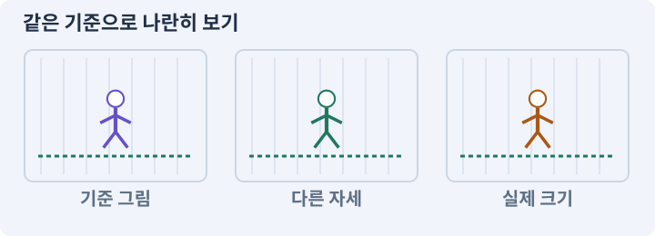

# 035. 앞뒤 가림과 PC 조작 다듬기

**목표:** 벽 뒤에 있어도 내 캐릭터와 선택 대상을 찾습니다.

**시작 상태:** 기본 아트·애니메이션

## 한눈에 보는 기능의 흐름

발 위치 정렬 → 벽 가림 처리 → 선택 우선순위 → UI와 월드 분리



**경계:** 잘 보이게 한 처리로 공격 대상이 바뀌지 않기

그림은 실제 게임 실행 결과가 아닙니다. 값·규칙과 예제를 필요한 때 펼쳐 읽고 현재 단계의 메시지를 한 번씩 보냅니다.

## 1. 지금 상태 확인하기

첫 메시지를 보내 현재 준비 상태를 확인합니다. AI가 읽어 온 실제 프로젝트가 맞는지 보고, 없는 준비나 다른 상태가 있으면 먼저 알려 주세요. 아직 기능을 만들지 않는 단계입니다.

### AI에게 보낼 요구와 이유

#### 01. 작업 대상부터 확인

**“앞뒤 가림과 PC 조작 다듬기” 작업을 시작하기 전에 현재 상태를 읽기 전용으로 확인해 줘.**

왜 이렇게 요청하나요? AI가 다른 프로젝트나 오래된 예제를 보고 작업할 수 있습니다. 실제 경로·파일·현재 기능을 읽게 하면 지금 이어서 작업할 대상을 먼저 맞출 수 있습니다.

#### 02. 작업 대상부터 확인

**필요한 시작 상태는 기본 아트·애니메이션야.**

왜 이렇게 요청하나요? AI가 다른 프로젝트나 오래된 예제를 보고 작업할 수 있습니다. 실제 경로·파일·현재 기능을 읽게 하면 지금 이어서 작업할 대상을 먼저 맞출 수 있습니다.

#### 03. 실제 사용 중인 구현 재사용

**실제 프로젝트와 작업 기록을 읽고 이것이 준비되어 있는지, 이미 같은 기능이 있는지 확인해 줘.**

왜 이렇게 요청하나요? 이름이 비슷한 새 클래스를 또 만들면 기존 화면은 여전히 옛 코드를 사용할 수 있습니다. 실제 호출되는 진입점을 찾아 연결해야 두 구현이 충돌하거나 수정이 반영되지 않는 문제를 막습니다.

#### 04. 현재 상태와 다음 확인 지점 구분

**이번 기능이 연결될 실제 파일·화면·도구와 보존할 기존 동작을 짧게 정리해 줘.**

왜 이렇게 요청하나요? 이미 준비된 기능과 아직 확인하지 못한 기능을 섞으면 불필요한 재설치나 성급한 완료 판정이 생깁니다. 현재 대상과 남은 준비를 나눠 가장 작은 다음 작업을 선택하게 합니다.

#### 05. 조사 단계에서 변경하지 않기

**아직 새 구현·설치·유료 호출·파일 변경은 하지 마.**

왜 이렇게 요청하나요? 현재 상태를 알아보기만 할 때 파일 변경이나 결제가 시작되면 검토 전의 환경이 바뀝니다. 준비 확인과 실제 구현을 나눠 되돌리기 어려운 작업이 먼저 실행되지 않게 합니다.

#### 06. 막힌 준비를 먼저 해결

**준비가 다르면 부족한 항목과 다음에 필요한 작업을 알려 줘.**

왜 이렇게 요청하나요? 빠진 파일·권한·패키지를 있다고 가정하면 다음 구현이 엉뚱한 대상을 만들게 됩니다. 무엇이 없고 무엇을 먼저 해야 하는지 분리하면 불필요한 재작업을 줄일 수 있습니다.

<details>
<summary>보낼 원문 전체 — 설명은 복사되지 않습니다</summary>

```text
“앞뒤 가림과 PC 조작 다듬기” 작업을 시작하기 전에 현재 상태를 읽기 전용으로 확인해 줘.
필요한 시작 상태는 기본 아트·애니메이션야. 실제 프로젝트와 작업 기록을 읽고 이것이 준비되어 있는지, 이미 같은 기능이 있는지 확인해 줘.
이번 기능이 연결될 실제 파일·화면·도구와 보존할 기존 동작을 짧게 정리해 줘. 아직 새 구현·설치·유료 호출·파일 변경은 하지 마. 준비가 다르면 부족한 항목과 다음에 필요한 작업을 알려 줘.
```

</details>

**기대 결과:** 가려지는 상황과 선택 우선순위

### 직접 확인하기

1. AI가 읽은 실제 프로젝트 또는 도구 경로를 확인합니다.
2. 필수 준비가 없다면 문제 해결 요청을 보내고, 준비됐을 때 다음으로 갑니다.

## 2. 필요한 기능 만들기

준비가 확인되면 아래 요청을 보냅니다. AI가 파일·설정·실행을 맡습니다. 변경 범위나 비용 승인이 나오면 내용을 읽고 결정하세요.

### AI에게 보낼 요구와 이유

#### 01. 작업 대상부터 확인

**현재 프로젝트의 실제 파일과 이미 결정한 규칙을 먼저 확인해 줘.**

왜 이렇게 요청하나요? AI가 다른 프로젝트나 오래된 예제를 보고 작업할 수 있습니다. 실제 경로·파일·현재 기능을 읽게 하면 지금 이어서 작업할 대상을 먼저 맞출 수 있습니다.

#### 02. 실제 사용 중인 코드에 연결

**이름이 다른 기존 구현이 있으면 새로 중복 제작하지 말고 그 구현에 연결해 줘.**

왜 이렇게 요청하나요? 예제와 이름이 다르더라도 현재 씬과 입력에서 호출하는 구현이 작업 대상입니다. 같은 기능을 새로 만들기보다 기존 진입점을 확인해 수정이 실제 게임에 반영되고 중복 실행되지 않게 합니다.

#### 03. 구현할 결과와 조건 고정

**PC 조작과 2D 정렬을 다듬어 줘.**

왜 이렇게 요청하나요? “PC 조작과 2D 정렬을 다듬어 줘”를 명시하면 AI가 무엇을 구현하거나 검사해야 하는지 범위를 좁힐 수 있습니다. 벽 뒤에 있어도 내 캐릭터와 선택 대상을 찾습니다. 이 결과를 확인할 때 이 조건이 실제로 반영됐는지 함께 봅니다.

#### 04. 앞뒤를 그리는 기준 정하기

**배우와 큰 장식은 동일World층에서 발Y로 정렬하고,Tilemap 한 덩어리가 배우를 전부 가리는 경우 외형만 분리해 줘.**

왜 이렇게 요청하나요? 2D 그림의 화면상 겹침 순서와 물리 충돌은 별개입니다. 바닥·배우·높은 장식의 정렬 기준을 나눠야 캐릭터가 기둥 앞뒤를 오갈 때 자연스럽게 가려집니다.

#### 05. 미확인을 완료와 분리

**가림 완화는 필요한 앞장식 alpha만 바꾸고 Collider2D/LOS/blocked는 유지해 줘.**

왜 이렇게 요청하나요? 만들어진 것, 검사에 실패한 것, 아직 확인하지 못한 것을 나눠야 다음 작업을 정확히 고를 수 있습니다. 실행할 조건이 없는 기능을 성공으로 기록하면 뒤에서 원인을 찾기 어려워집니다.

#### 06. 구현할 결과와 조건 고정

**플레이어를 무조건 최상위정렬로 올리거나 보이지 않는 적을 모두 보여 주지 마.**

왜 이렇게 요청하나요? “플레이어를 무조건 최상위정렬로 올리거나 보이지 않는 적을 모두 보여 주지 마”를 명시하면 AI가 무엇을 구현하거나 검사해야 하는지 범위를 좁힐 수 있습니다. 벽 뒤에 있어도 내 캐릭터와 선택 대상을 찾습니다. 이 결과를 확인할 때 이 조건이 실제로 반영됐는지 함께 봅니다.

#### 07. UI 입력과 월드 입력 분리

**UI→라벨/적→바닥의 포인터 우선순위와 UI 닫은 클릭 재사용을 검사해 줘.**

왜 이렇게 요청하나요? 가방 버튼을 누른 입력이 뒤의 바닥 클릭으로도 처리되면 캐릭터가 원치 않게 이동하거나 공격합니다. 입력이 시작된 대상을 구분해 한 행동이 서로 다른 명령으로 중복 처리되지 않게 합니다.

#### 08. 종료 이후의 상태까지 확인

**창모드/해상도/볼륨/흔들림감소를 연결하고 재실행 설정을 확인해 줘.**

왜 이렇게 요청하나요? 현재 화면에서 맞는 값도 저장하거나 다시 구성할 때 빠질 수 있습니다. 실제 종료·불러오기 전후에 ID·옵션·장착·진행을 비교해야 유지되는 범위를 확인할 수 있습니다.

#### 09. 아래 항목을 완료 조건으로 사용

**적용할 세부 규칙:**

왜 이렇게 요청하나요? 요구사항의 목록은 AI에게 참고 설명을 주는 것이 아니라 완료를 판단할 기준을 정합니다. 구현 뒤 각 항목을 실제 입력과 결과에 대응시켜 빠진 조건을 찾습니다.

#### 10. 프레임의 기준점 통일

**Ground<Telegraph<World<Overlay 순서를 쓰되, 배우와 앞뒤를 오가는 벽 윗부분·기둥은 같은 World에서 발 기준 정렬한다.**

왜 이렇게 요청하나요? 걷기·공격 그림의 몸통 크기가 달라도 발은 같은 위치에 있어야 합니다. 기준점이 다르면 몸체는 정지해 있는데 그림만 튀거나 바닥을 미끄러지는 것처럼 보입니다.

#### 11. 관찰 가능한 기준으로 확인

**전체 벽 Tilemap 한 덩어리와 캐릭터를 정확히 섞어 그릴 수 없다면 WallArt를 구역/개별 Sprite로 분리하거나 TilemapRenderer의 적절한 모드를 확인한다.**

왜 이렇게 요청하나요? 구현 완료라는 설명을 실제 결과로 바꾸기 위한 조건입니다. 요청에 나온 대상과 경계 상황을 확인해 정상 결과뿐 아니라 실패를 어떻게 구분했는지도 남깁니다.

#### 12. 구현할 결과와 조건 고정

**선택 윤곽과 가림 실루엣은 장식이다.**

왜 이렇게 요청하나요? “선택 윤곽과 가림 실루엣은 장식이다”를 명시하면 AI가 무엇을 구현하거나 검사해야 하는지 범위를 좁힐 수 있습니다. 벽 뒤에 있어도 내 캐릭터와 선택 대상을 찾습니다. 이 결과를 확인할 때 이 조건이 실제로 반영됐는지 함께 봅니다.

#### 13. 구현할 결과와 조건 고정

**항상 맵 전체 적을 보여 주는 투시로 바뀌지 않게 한다.**

왜 이렇게 요청하나요? “항상 맵 전체 적을 보여 주는 투시로 바뀌지 않게 한다”를 명시하면 AI가 무엇을 구현하거나 검사해야 하는지 범위를 좁힐 수 있습니다. 벽 뒤에 있어도 내 캐릭터와 선택 대상을 찾습니다. 이 결과를 확인할 때 이 조건이 실제로 반영됐는지 함께 봅니다.

#### 14. Collider와 몸체 경계의 적용 조건

**물리벽 Collider2D와 LOS Linecast는 그대로 남는다.**

왜 이렇게 요청하나요? Collider는 물리 검사에 사용하는 경계입니다. 보이는 그림과 같을 필요는 없습니다. 탑다운 캐릭터는 보통 발 주변에 작은 몸체 경계를 둡니다. 스프라이트를 크게 바꿨다고 몸체·사거리도 자동으로 키우지 않습니다.

#### 15. 실제 투명 데이터 확인

**플레이어 가림을 완화할 필요가 있는 가까운 앞장식만 낮은 alpha로 바꾼다.**

왜 이렇게 요청하나요? 바둑판이 그려진 이미지와 배경 픽셀의 알파가 투명한 파일은 다릅니다. 배경 위에 겹쳐 확인해야 사각 테두리나 번짐이 게임에 그대로 나타나는 것을 막습니다.

#### 16. 카메라로 조작 정보 보존

**PC 옵션은 창/전체 화면, 해상도, 마스터 볼륨, 카메라 흔들림 감소다.**

왜 이렇게 요청하나요? 카메라가 벽 안에 있거나 심하게 흔들리면 판정이 정상이어도 대상을 찾기 어렵습니다. 시야·선택·멀미 완화 설정을 확인해 화면 연출이 플레이를 방해하지 않게 합니다.

#### 17. 피할 수 있는 정보와 실제 판정 일치

**카메라 zoom을 바꾸면 공정한 예고 표시와 시야 밖 적의 공격 조건을 다시 확인한다.**

왜 이렇게 요청하나요? 표시한 위험 범위·시점과 실제 피해가 다르면 플레이어는 올바르게 반응해도 손해를 봅니다. 예고·판정·효과가 같은 규칙을 사용하게 해 공격을 학습할 수 있게 합니다.

#### 18. 구현과 실행은 AI에게 맡기기

**코드·설정·파일 생성·실행은 네가 맡고, 필요한 화면과 결과를 보여 줘.**

왜 이렇게 요청하나요? 설명이나 코드 조각만 받으면 실제 파일 생성·연결·실행이 빠질 수 있습니다. AI가 개발 작업까지 수행하고, 사람은 요구·승인·결과 판단을 맡도록 역할을 분명히 합니다.

#### 19. 막힌 준비를 먼저 해결

**수행하지 못한 작업과 필요한 승인·도구 연결은 구분해서 알려 줘.**

왜 이렇게 요청하나요? 빠진 파일·권한·패키지를 있다고 가정하면 다음 구현이 엉뚱한 대상을 만들게 됩니다. 무엇이 없고 무엇을 먼저 해야 하는지 분리하면 불필요한 재작업을 줄일 수 있습니다.

<details>
<summary>보낼 원문 전체 — 설명은 복사되지 않습니다</summary>

```text
현재 프로젝트의 실제 파일과 이미 결정한 규칙을 먼저 확인해 줘. 이름이 다른 기존 구현이 있으면 새로 중복 제작하지 말고 그 구현에 연결해 줘.

PC 조작과 2D 정렬을 다듬어 줘.
배우와 큰 장식은 동일World층에서 발Y로 정렬하고,Tilemap 한 덩어리가 배우를 전부 가리는 경우 외형만 분리해 줘.
가림 완화는 필요한 앞장식 alpha만 바꾸고 Collider2D/LOS/blocked는 유지해 줘.
플레이어를 무조건 최상위정렬로 올리거나 보이지 않는 적을 모두 보여 주지 마.
UI→라벨/적→바닥의 포인터 우선순위와 UI 닫은 클릭 재사용을 검사해 줘.
창모드/해상도/볼륨/흔들림감소를 연결하고 재실행 설정을 확인해 줘.

적용할 세부 규칙:
Ground<Telegraph<World<Overlay 순서를 쓰되, 배우와 앞뒤를 오가는 벽 윗부분·기둥은 같은 World에서 발 기준 정렬한다. 전체 벽 Tilemap 한 덩어리와 캐릭터를 정확히 섞어 그릴 수 없다면 WallArt를 구역/개별 Sprite로 분리하거나 TilemapRenderer의 적절한 모드를 확인한다.

선택 윤곽과 가림 실루엣은 장식이다. 항상 맵 전체 적을 보여 주는 투시로 바뀌지 않게 한다. 물리벽 Collider2D와 LOS Linecast는 그대로 남는다. 플레이어 가림을 완화할 필요가 있는 가까운 앞장식만 낮은 alpha로 바꾼다.

PC 옵션은 창/전체 화면, 해상도, 마스터 볼륨, 카메라 흔들림 감소다. 카메라 zoom을 바꾸면 공정한 예고 표시와 시야 밖 적의 공격 조건을 다시 확인한다.

코드·설정·파일 생성·실행은 네가 맡고, 필요한 화면과 결과를 보여 줘. 수행하지 못한 작업과 필요한 승인·도구 연결은 구분해서 알려 줘.
```

</details>

**기대 결과:** 확인할 결과: 가림과 클릭 우선순위를 확인함. AI가 이 상태를 확인할 실제 화면과 변경 내용을 준비합니다. 아직 실행하지 못한 부분은 따로 표시합니다.

### 직접 확인하기

1. 제안서만 반환됐다면 “설명으로 끝내지 말고 승인한 범위의 실제 작업을 수행해 줘”라고 보냅니다.
2. 코드나 설정을 직접 고치라는 안내가 나오면 “작성과 실행은 네가 맡아 줘”라고 요청합니다.

## 3. 결과를 직접 확인하기

먼저 확인 요청을 보내 AI가 검사와 화면을 준비하게 하세요. 그다음 아래 동작을 하나씩 확인합니다.

### AI에게 보낼 요구와 이유

#### 01. 검사할 입력과 관찰 지점 준비

**방금 구현한 기능의 자동 검사와 확인 화면을 준비해 줘.**

왜 이렇게 요청하나요? 정상 예 하나만 보면 실패 조건을 놓치기 쉽습니다. 정상·경계·반례를 실제 입력으로 준비하고 사람이 볼 화면도 맞춰 확인 범위를 분명하게 합니다.

#### 02. 결과를 재확인할 근거 남기기

**정상 동작과 아래 실패 조건을 실제로 검사하고 대상·실행 수·결과를 보여 줘.**

왜 이렇게 요청하나요? “잘 됩니다”라는 요약만으로는 어떤 입력과 버전을 검사했는지 알 수 없습니다. 대상·실행 수·실패 내용·파일을 함께 남겨 같은 조건으로 다시 확인할 수 있게 합니다.

#### 03. 구현할 결과와 조건 고정

**기둥과 캐릭터의 앞뒤가 맞고 필요한 경우에만 가림이 완화된다.**

왜 이렇게 요청하나요? “기둥과 캐릭터의 앞뒤가 맞고 필요한 경우에만 가림이 완화된다”를 명시하면 AI가 무엇을 구현하거나 검사해야 하는지 범위를 좁힐 수 있습니다. 벽 뒤에 있어도 내 캐릭터와 선택 대상을 찾습니다. 이 결과를 확인할 때 이 조건이 실제로 반영됐는지 함께 봅니다.

#### 04. 장애물이 실제 행동을 막게 하기

**벽 너머 공격은 계속 막힌다.**

왜 이렇게 요청하나요? 화면의 벽이 이동만 막고 공격이나 줍기는 통과시키면 플레이어가 예상하는 규칙과 달라집니다. 해당 행동의 시야·경로·거리를 함께 검사해 벽의 양쪽이 실제로 분리되게 합니다.

#### 05. UI 입력과 월드 입력 분리

**UI 닫기 클릭으로 캐릭터가 움직이지 않는다.**

왜 이렇게 요청하나요? 가방 버튼을 누른 입력이 뒤의 바닥 클릭으로도 처리되면 캐릭터가 원치 않게 이동하거나 공격합니다. 입력이 시작된 대상을 구분해 한 행동이 서로 다른 명령으로 중복 처리되지 않게 합니다.

#### 06. 사람 검사의 시작점 준비

**내가 조작해야 하는 부분은 실행할 화면과 시작 상태를 준비해 줘.**

왜 이렇게 요청하나요? 같은 기능이라도 시작 상태가 다르면 관찰 결과가 달라집니다. AI가 실행 화면과 재현 위치를 먼저 준비해야 사람이 이동·공격·소리·조작감을 같은 조건에서 확인할 수 있습니다.

#### 07. 사람이 실제로 본 것만 기록

**연결되지 않은 휴대폰의 터치나 사람이 보지 않은 재미·소리 품질을 대신 확인했다고 하지 마.**

왜 이렇게 요청하나요? AI가 준비한 검사와 사람이 직접 플레이하거나 들은 결과는 다른 근거입니다. 관찰하지 않은 조작감·소리·실기기 결과를 임의로 완료 처리하지 않게 합니다.

#### 08. 실제로 실행한 검사만 인정

**테스트 0개와 예전 소스 결과는 현재 성공으로 쓰지 마.**

왜 이렇게 요청하나요? 실행된 검사가 없거나 같은 결과를 중복 집계한 경우는 기능을 확인한 것이 아닙니다. 실행 수와 개별 결과를 함께 확인해야 형식적인 성공 표시를 걸러낼 수 있습니다.

<details>
<summary>보낼 원문 전체 — 설명은 복사되지 않습니다</summary>

```text
방금 구현한 기능의 자동 검사와 확인 화면을 준비해 줘. 정상 동작과 아래 실패 조건을 실제로 검사하고 대상·실행 수·결과를 보여 줘.

기둥과 캐릭터의 앞뒤가 맞고 필요한 경우에만 가림이 완화된다. 벽 너머 공격은 계속 막힌다. UI 닫기 클릭으로 캐릭터가 움직이지 않는다.

내가 조작해야 하는 부분은 실행할 화면과 시작 상태를 준비해 줘. 연결되지 않은 휴대폰의 터치나 사람이 보지 않은 재미·소리 품질을 대신 확인했다고 하지 마. 테스트 0개와 예전 소스 결과는 현재 성공으로 쓰지 마.
```

</details>

**기대 결과:** 가림과 클릭 우선순위를 확인함

### 직접 확인하기

1. 기둥과 벽 앞뒤로 움직입니다.
2. 아이템·적·바닥이 겹칠 때 선택 결과를 봅니다.
3. 가방을 열었다 닫아도 옛 클릭 이동이 살아나지 않는지 봅니다.

## 4. 결과를 남기고 마무리하기

실제로 본 결과를 아래 메모에 적고 AI에 전달합니다. 결과 저장 요청으로 현재 상태를 남긴 뒤 다음 페이지로 갑니다.

### AI에게 보낼 요구와 이유

#### 01. 결과를 재확인할 근거 남기기

**지금 작업한 “앞뒤 가림과 PC 조작 다듬기”의 실제 결과를 정리해 줘.**

왜 이렇게 요청하나요? “잘 됩니다”라는 요약만으로는 어떤 입력과 버전을 검사했는지 알 수 없습니다. 대상·실행 수·실패 내용·파일을 함께 남겨 같은 조건으로 다시 확인할 수 있게 합니다.

#### 02. 다음 작업이 읽을 인수인계

**변경한 기능·파일·현재 후보와 실제 실행한 검사, 남은 문제를 기능 이름으로 기록해 줘.**

왜 이렇게 요청하나요? 새 AI 세션은 이전 대화 전체를 알고 있다고 보장할 수 없습니다. 현재 후보·파일 위치·실행한 검사·남은 일을 남겨야 같은 작업을 반복하지 않고 이어갈 수 있습니다.

#### 03. 사람이 실제로 본 것만 기록

**자동 검사 결과와 내가 직접 확인한 결과를 구분하고, 내 관찰이 아직 없으면 미확인으로 남겨 줘.**

왜 이렇게 요청하나요? AI가 준비한 검사와 사람이 직접 플레이하거나 들은 결과는 다른 근거입니다. 관찰하지 않은 조작감·소리·실기기 결과를 임의로 완료 처리하지 않게 합니다.

#### 04. 다음 작업이 읽을 인수인계

**재시작하거나 다음 작업에서 읽을 기록의 실제 위치를 알려 줘.**

왜 이렇게 요청하나요? 새 AI 세션은 이전 대화 전체를 알고 있다고 보장할 수 없습니다. 현재 후보·파일 위치·실행한 검사·남은 일을 남겨야 같은 작업을 반복하지 않고 이어갈 수 있습니다.

#### 05. 미확인을 완료와 분리

**아직 확인하지 않은 결과를 완료로 채우지 마.**

왜 이렇게 요청하나요? 만들어진 것, 검사에 실패한 것, 아직 확인하지 못한 것을 나눠야 다음 작업을 정확히 고를 수 있습니다. 실행할 조건이 없는 기능을 성공으로 기록하면 뒤에서 원인을 찾기 어려워집니다.

<details>
<summary>보낼 원문 전체 — 설명은 복사되지 않습니다</summary>

```text
지금 작업한 “앞뒤 가림과 PC 조작 다듬기”의 실제 결과를 정리해 줘. 변경한 기능·파일·현재 후보와 실제 실행한 검사, 남은 문제를 기능 이름으로 기록해 줘.
자동 검사 결과와 내가 직접 확인한 결과를 구분하고, 내 관찰이 아직 없으면 미확인으로 남겨 줘. 재시작하거나 다음 작업에서 읽을 기록의 실제 위치를 알려 줘. 아직 확인하지 않은 결과를 완료로 채우지 마.
```

</details>

**기대 결과:** 현재 상태·검사 결과·남은 문제·다음에 읽을 기록을 확인할 수 있습니다.

### 직접 확인하기

1. 자동 검사와 내 관찰 결과가 섞이지 않았는지 봅니다.
2. 문제가 남았다면 해결 요청을 보내고 같은 동작을 다시 확인합니다.

## 이 작업에서 사용할 값과 규칙 전체

설계 시작값이며 측정된 성능·게임 성공 결과가 아닙니다. 구현은 AI가 수행합니다.

Ground<Telegraph<World<Overlay 순서를 쓰되, 배우와 앞뒤를 오가는 벽 윗부분·기둥은 같은 World에서 발 기준 정렬한다. 전체 벽 Tilemap 한 덩어리와 캐릭터를 정확히 섞어 그릴 수 없다면 WallArt를 구역/개별 Sprite로 분리하거나 TilemapRenderer의 적절한 모드를 확인한다.

선택 윤곽과 가림 실루엣은 장식이다. 항상 맵 전체 적을 보여 주는 투시로 바뀌지 않게 한다. 물리벽 Collider2D와 LOS Linecast는 그대로 남는다. 플레이어 가림을 완화할 필요가 있는 가까운 앞장식만 낮은 alpha로 바꾼다.

PC 옵션은 창/전체 화면, 해상도, 마스터 볼륨, 카메라 흔들림 감소다. 카메라 zoom을 바꾸면 공정한 예고 표시와 시야 밖 적의 공격 조건을 다시 확인한다.

## 문제가 있으면

### AI에게 보낼 요구와 이유

#### 01. 적이 아는 정보에 맞춰 행동

**벽 전체를 비활성화하지 말고 그림 투명도와 충돌·시야 판정을 분리해 줘.**

왜 이렇게 요청하나요? 적이 플레이어의 실제 위치를 항상 읽으면 벽 뒤에 숨는 행동에 의미가 없습니다. 감지·기억·추적·귀환을 나눠 실제 관측 정보가 행동을 결정하게 합니다.

#### 02. 원인 하나를 좁혀 수정

**새 기능을 추가하지 말고 현재 오류와 실제 로그를 먼저 읽어 줘.**

왜 이렇게 요청하나요? 오류 수정 중 새 기능까지 넣으면 어떤 변경이 문제를 해결하거나 악화했는지 알기 어렵습니다. 원래 재현을 보존하고 작은 변경 뒤 같은 입력과 주변 정상 동작을 다시 확인합니다.

#### 03. 원인 하나를 좁혀 수정

**최소 수정 뒤 같은 재현과 관련 정상 동작을 다시 검사해 줘.**

왜 이렇게 요청하나요? 오류 수정 중 새 기능까지 넣으면 어떤 변경이 문제를 해결하거나 악화했는지 알기 어렵습니다. 원래 재현을 보존하고 작은 변경 뒤 같은 입력과 주변 정상 동작을 다시 확인합니다.

#### 04. 실패도 재현 자료로 보존

**실패 기록은 지우지 마.**

왜 이렇게 요청하나요? 실패한 입력과 로그가 있어야 같은 문제가 다시 생겼을 때 비교할 수 있습니다. 성공 기록으로 덮어쓰지 않고 전후 자료를 남기면 무엇을 고쳤는지 확인할 수 있습니다.

<details>
<summary>보낼 원문 전체 — 설명은 복사되지 않습니다</summary>

```text
벽 전체를 비활성화하지 말고 그림 투명도와 충돌·시야 판정을 분리해 줘.
새 기능을 추가하지 말고 현재 오류와 실제 로그를 먼저 읽어 줘. 최소 수정 뒤 같은 재현과 관련 정상 동작을 다시 검사해 줘. 실패 기록은 지우지 마.
```

</details>

## 새 세션에서 이어가기

### AI에게 보낼 요구와 이유

#### 01. 이어서 할 작업 식별

**“앞뒤 가림과 PC 조작 다듬기” 작업을 이어가고 싶어.**

왜 이렇게 요청하나요? 이름으로 재개할 작업을 찾고, 뒤에 이어지는 요청으로 실제 파일·진행 중 작업·기록을 다시 읽게 합니다. 제목만 보고 이전 상태를 기억한다고 가정하지 않습니다.

#### 02. 조회는 상태를 바꾸지 않게

**실제 프로젝트와 내 도구의 작업 기록을 읽고 어디까지 구현·검사됐는지 확인해 줘.**

왜 이렇게 요청하나요? 진행 상황을 물을 때 새 구현이나 유료 호출이 시작되면 단순 확인이 실행 명령이 되어 버립니다. 저장된 근거를 읽어 완료·진행·승인 대기·미검증을 나누게 합니다.

#### 03. 재개 전 중복 작업 방지

**진행 중인 프로세스·승인·미저장 변경을 확인한 뒤 남은 가장 작은 작업부터 안내해 줘.**

왜 이렇게 요청하나요? 대화가 끊겨도 외부 작업은 끝났거나 아직 실행 중일 수 있습니다. 프로세스·승인·미저장 상태를 먼저 읽어 같은 생성·빌드·결제를 두 번 시작하지 않도록 합니다.

#### 04. 되돌아갈 원본 남기기

**기존 성공과 실패 기록은 보존해 줘.**

왜 이렇게 요청하나요? 새 구현이 실패해도 이전 게임과 저장을 복원할 수 있어야 합니다. 현재 내용을 먼저 조사하고 별도 후보에서 작업하면 실험이 유일한 정상본을 망가뜨리는 일을 피할 수 있습니다.

<details>
<summary>보낼 원문 전체 — 설명은 복사되지 않습니다</summary>

```text
“앞뒤 가림과 PC 조작 다듬기” 작업을 이어가고 싶어. 실제 프로젝트와 내 도구의 작업 기록을 읽고 어디까지 구현·검사됐는지 확인해 줘. 진행 중인 프로세스·승인·미저장 변경을 확인한 뒤 남은 가장 작은 작업부터 안내해 줘. 기존 성공과 실패 기록은 보존해 줘.
```

</details>

## 왜 이렇게 만드는가

탑다운 2D에서는 키 큰 벽이나 나무의 윗부분이 캐릭터를 가릴 수 있다. 물리벽을 없애지 않고 앞쪽 장식의 시각 표현만 조절한다. 배우와 큰 장식이 서로 다른 무조건 우선 Sorting Layer에 있으면 발Y 정렬만으로 문제가 해결되지 않는다.

UGUI 클릭, 아이템 라벨, 적 선택, 바닥 이동의 우선순위를 분리한다. 보이는 아이템 라벨을 눌렀는데 뒤의 바닥으로 이동하거나,UI를 닫는 클릭이 공격으로 이어지는 누출을 재검사한다.

## 공식 참고


## 실제 Unity Editor 화면 참고
공식 예시와 내 프로젝트 실행 결과를 구분하세요. 원본 사진은 온라인 연결이 필요합니다.

- [Input Actions — 입력 묶음·행동·값의 종류 읽기](../editor_references/input-actions.md)
