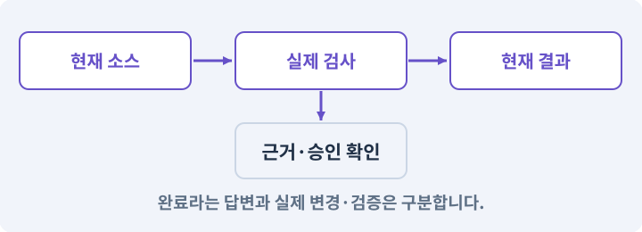

# 038. 테스트 결과와 실제 플레이 구분하기

**목표:** 완료·실패·아직 안 해 본 것을 구분합니다.

**시작 상태:** 기본 기능과 플랫폼별 검사

## 한눈에 보는 기능의 흐름

현재 소스 → 실제 검사 → 사람의 플레이 → 미검증 표시



**경계:** 서로 다른 버전의 PASS를 합치지 않기

그림은 실제 게임 실행 결과가 아닙니다. 값·규칙과 예제를 필요한 때 펼쳐 읽고 현재 단계의 메시지를 한 번씩 보냅니다.

## 1. 지금 상태 확인하기

첫 메시지를 보내 현재 준비 상태를 확인합니다. AI가 읽어 온 실제 프로젝트가 맞는지 보고, 없는 준비나 다른 상태가 있으면 먼저 알려 주세요. 아직 기능을 만들지 않는 단계입니다.

### AI에게 보낼 요구와 이유

#### 01. 작업 대상부터 확인

**“테스트 결과와 실제 플레이 구분하기” 작업을 시작하기 전에 현재 상태를 읽기 전용으로 확인해 줘.**

왜 이렇게 요청하나요? AI가 다른 프로젝트나 오래된 예제를 보고 작업할 수 있습니다. 실제 경로·파일·현재 기능을 읽게 하면 지금 이어서 작업할 대상을 먼저 맞출 수 있습니다.

#### 02. 작업 대상부터 확인

**필요한 시작 상태는 기본 기능과 플랫폼별 검사야.**

왜 이렇게 요청하나요? AI가 다른 프로젝트나 오래된 예제를 보고 작업할 수 있습니다. 실제 경로·파일·현재 기능을 읽게 하면 지금 이어서 작업할 대상을 먼저 맞출 수 있습니다.

#### 03. 실제 사용 중인 구현 재사용

**실제 프로젝트와 작업 기록을 읽고 이것이 준비되어 있는지, 이미 같은 기능이 있는지 확인해 줘.**

왜 이렇게 요청하나요? 이름이 비슷한 새 클래스를 또 만들면 기존 화면은 여전히 옛 코드를 사용할 수 있습니다. 실제 호출되는 진입점을 찾아 연결해야 두 구현이 충돌하거나 수정이 반영되지 않는 문제를 막습니다.

#### 04. 현재 상태와 다음 확인 지점 구분

**이번 기능이 연결될 실제 파일·화면·도구와 보존할 기존 동작을 짧게 정리해 줘.**

왜 이렇게 요청하나요? 이미 준비된 기능과 아직 확인하지 못한 기능을 섞으면 불필요한 재설치나 성급한 완료 판정이 생깁니다. 현재 대상과 남은 준비를 나눠 가장 작은 다음 작업을 선택하게 합니다.

#### 05. 조사 단계에서 변경하지 않기

**아직 새 구현·설치·유료 호출·파일 변경은 하지 마.**

왜 이렇게 요청하나요? 현재 상태를 알아보기만 할 때 파일 변경이나 결제가 시작되면 검토 전의 환경이 바뀝니다. 준비 확인과 실제 구현을 나눠 되돌리기 어려운 작업이 먼저 실행되지 않게 합니다.

#### 06. 막힌 준비를 먼저 해결

**준비가 다르면 부족한 항목과 다음에 필요한 작업을 알려 줘.**

왜 이렇게 요청하나요? 빠진 파일·권한·패키지를 있다고 가정하면 다음 구현이 엉뚱한 대상을 만들게 됩니다. 무엇이 없고 무엇을 먼저 해야 하는지 분리하면 불필요한 재작업을 줄일 수 있습니다.

<details>
<summary>보낼 원문 전체 — 설명은 복사되지 않습니다</summary>

```text
“테스트 결과와 실제 플레이 구분하기” 작업을 시작하기 전에 현재 상태를 읽기 전용으로 확인해 줘.
필요한 시작 상태는 기본 기능과 플랫폼별 검사야. 실제 프로젝트와 작업 기록을 읽고 이것이 준비되어 있는지, 이미 같은 기능이 있는지 확인해 줘.
이번 기능이 연결될 실제 파일·화면·도구와 보존할 기존 동작을 짧게 정리해 줘. 아직 새 구현·설치·유료 호출·파일 변경은 하지 마. 준비가 다르면 부족한 항목과 다음에 필요한 작업을 알려 줘.
```

</details>

**기대 결과:** 현재 소스와 연결된 검사표

### 직접 확인하기

1. AI가 읽은 실제 프로젝트 또는 도구 경로를 확인합니다.
2. 필수 준비가 없다면 문제 해결 요청을 보내고, 준비됐을 때 다음으로 갑니다.

## 2. 필요한 기능 만들기

준비가 확인되면 아래 요청을 보냅니다. AI가 파일·설정·실행을 맡습니다. 변경 범위나 비용 승인이 나오면 내용을 읽고 결정하세요.

### AI에게 보낼 요구와 이유

#### 01. 작업 대상부터 확인

**현재 프로젝트의 실제 파일과 이미 결정한 규칙을 먼저 확인해 줘.**

왜 이렇게 요청하나요? AI가 다른 프로젝트나 오래된 예제를 보고 작업할 수 있습니다. 실제 경로·파일·현재 기능을 읽게 하면 지금 이어서 작업할 대상을 먼저 맞출 수 있습니다.

#### 02. 실제 사용 중인 코드에 연결

**이름이 다른 기존 구현이 있으면 새로 중복 제작하지 말고 그 구현에 연결해 줘.**

왜 이렇게 요청하나요? 예제와 이름이 다르더라도 현재 씬과 입력에서 호출하는 구현이 작업 대상입니다. 같은 기능을 새로 만들기보다 기존 진입점을 확인해 수정이 실제 게임에 반영되고 중복 실행되지 않게 합니다.

#### 03. 관찰 가능한 기준으로 확인

**현재 코드와 아래 완료 기준을 대조해 회귀 검증 묶음을 만들어 줘.**

왜 이렇게 요청하나요? 구현 완료라는 설명을 실제 결과로 바꾸기 위한 조건입니다. 요청에 나온 대상과 경계 상황을 확인해 정상 결과뿐 아니라 실패를 어떻게 구분했는지도 남깁니다.

#### 04. 거래·보상의 전체 성공 보장

**EditMode에는 피해/레벨/인벤토리/장비/드롭/저장DTO/거래/퀘스트를 포함해 줘.**

왜 이렇게 요청하나요? 재료 차감과 결과 지급이 따로 성공하면 손해나 복제가 생깁니다. 조건을 먼저 검사하고 한 거래로 반영하며 같은 요청을 다시 받아도 두 번 지급하지 않게 합니다.

#### 05. 전투 수치를 한 규칙으로 계산

**PlayMode에는 실제 Player 입력→공격→Health→Death→XP/Loot 연결,**

왜 이렇게 요청하나요? 표시와 실제 피해 계산이 다르면 장비·레벨·스킬 효과를 믿을 수 없습니다. 경계값과 사망·회복 조건을 명확히 정하고 숫자와 체력바를 함께 비교합니다.

#### 06. 스크립트와 실제 씬 연결

**씬 초기화1회, 스킬취소,UI 입력차단, 프리팹 참조를 포함해 줘.**

왜 이렇게 요청하나요? 코드 파일을 만들어도 씬의 오브젝트에 붙지 않거나 참조가 비어 있으면 플레이에 반영되지 않습니다. 실제 사용하는 프리팹과 컴포넌트까지 연결해 동작을 확인하게 합니다.

#### 07. 테스트가 바꾼 전역 시간 복구

**프레임/시간 관련 검사는 timeScale 등 전역 상태를 종료 시 원상복구해 줘.**

왜 이렇게 요청하나요? 시간 배속을 바꾼 테스트가 원래 값을 돌려놓지 않으면 다음 테스트가 다른 조건에서 실행됩니다. 성공·실패·중단 경로 모두에서 이전 값을 복원해야 테스트끼리 영향을 주지 않습니다.

#### 08. 관찰 가능한 기준으로 확인

**테스트가 실제 0개 실행되면 실패로 다뤄 줘.**

왜 이렇게 요청하나요? 구현 완료라는 설명을 실제 결과로 바꾸기 위한 조건입니다. 요청에 나온 대상과 경계 상황을 확인해 정상 결과뿐 아니라 실패를 어떻게 구분했는지도 남깁니다.

#### 09. 실패를 숨기지 않기

**테스트 실패를 기대값 완화·삭제·Ignore 처리로 해결하지 마.**

왜 이렇게 요청하나요? 검사 조건을 약하게 만들면 결함이 남아 있어도 통과 표시가 나올 수 있습니다. 구현을 고친 뒤 원래 기준으로 다시 검사해야 실제 문제가 해결됐는지 알 수 있습니다.

#### 10. 길찾기와 실제 도달을 구분

**데이터 검사에는 Catalog ID,Missing Script, 끊긴 참조, 필수 A* 완전 경로와 실제 Collider2D 통과,**

왜 이렇게 요청하나요? 목적지 표시나 경로 목록이 있다고 캐릭터가 끝까지 갈 수 있는 것은 아닙니다. 이동 가능한 경로와 실제 몸체의 진행을 확인하고 막힌 지점을 성공으로 표시하지 않게 합니다.

#### 11. Play 모드·편집 모드·런타임의 적용 조건

**릴리스 씬의 디버그 오브젝트·Pipeline 런타임 노출을 포함해 줘.**

왜 이렇게 요청하나요? 편집 모드는 제작 상태이고 Play 모드는 게임 로직을 실행해 보는 상태입니다. 런타임은 게임이 실제로 실행되는 시간과 환경을 뜻합니다. Play에서 보인 상태만 보고 저장·재개방까지 통과했다고 기록하지 않습니다.

#### 12. 구현할 결과와 조건 고정

**프로젝트용 CourseValidate 도구와 Editor 메뉴를 만들 수 있지만**

왜 이렇게 요청하나요? “프로젝트용 CourseValidate 도구와 Editor 메뉴를 만들 수 있지만”를 명시하면 AI가 무엇을 구현하거나 검사해야 하는지 범위를 좁힐 수 있습니다. 완료·실패·아직 안 해 본 것을 구분합니다. 이 결과를 확인할 때 이 조건이 실제로 반영됐는지 함께 봅니다.

#### 13. 터미널과 Editor가 같은 대상을 보게

**그 이름이 Unity CLI 기본 명령인 것처럼 쓰지 마.**

왜 이렇게 요청하나요? 여러 Unity 프로젝트나 실행 파일이 있으면 명령이 다른 Editor로 전달될 수 있습니다. 실행 파일·연결된 프로젝트·씬의 실제 응답을 대조해 올바른 작업 대상을 고정합니다.

#### 14. 관찰 가능한 기준으로 확인

**실제 등록 후 목록을 확인해 줘.**

왜 이렇게 요청하나요? 구현 완료라는 설명을 실제 결과로 바꾸기 위한 조건입니다. 요청에 나온 대상과 경계 상황을 확인해 정상 결과뿐 아니라 실패를 어떻게 구분했는지도 남깁니다.

#### 15. 관찰 가능한 기준으로 확인

**자동 테스트/실제 화면/Windows 실행/Android 기기 검사를 각각 다른 상태로 보고해 줘.**

왜 이렇게 요청하나요? 구현 완료라는 설명을 실제 결과로 바꾸기 위한 조건입니다. 요청에 나온 대상과 경계 상황을 확인해 정상 결과뿐 아니라 실패를 어떻게 구분했는지도 남깁니다.

#### 16. 기계가 읽을 값의 형식 검사

**reports에 실제 결과 XML/JSON·로그·캡처 경로·commit 또는 소스 해시를 남겨 줘.**

왜 이렇게 요청하나요? 문자열이 JSON으로 읽힌다고 업무 규칙까지 올바른 것은 아닙니다. 필드·타입·범위·참조를 검사해 잘못된 값이 실제 코드·저장·편집기로 들어오지 않게 합니다.

#### 17. 인증 정보 노출 방지

**민감한 토큰·계정 식별자는 로그에 남기지 마.**

왜 이렇게 요청하나요? 인증 정보가 프롬프트·로그·저장소에 남으면 다른 사람이 재사용할 수 있습니다. 로그인은 공식 경로에서 처리하고, AI에는 키 자체가 아니라 연결 성공 여부만 확인시킵니다.

#### 18. 미확인을 완료와 분리

**현재 실패와 미실행을 숨기지 않는 검증 요약을 만들어 줘.**

왜 이렇게 요청하나요? 만들어진 것, 검사에 실패한 것, 아직 확인하지 못한 것을 나눠야 다음 작업을 정확히 고를 수 있습니다. 실행할 조건이 없는 기능을 성공으로 기록하면 뒤에서 원인을 찾기 어려워집니다.

#### 19. 구현과 실행은 AI에게 맡기기

**코드·설정·파일 생성·실행은 네가 맡고, 필요한 화면과 결과를 보여 줘.**

왜 이렇게 요청하나요? 설명이나 코드 조각만 받으면 실제 파일 생성·연결·실행이 빠질 수 있습니다. AI가 개발 작업까지 수행하고, 사람은 요구·승인·결과 판단을 맡도록 역할을 분명히 합니다.

#### 20. 막힌 준비를 먼저 해결

**수행하지 못한 작업과 필요한 승인·도구 연결은 구분해서 알려 줘.**

왜 이렇게 요청하나요? 빠진 파일·권한·패키지를 있다고 가정하면 다음 구현이 엉뚱한 대상을 만들게 됩니다. 무엇이 없고 무엇을 먼저 해야 하는지 분리하면 불필요한 재작업을 줄일 수 있습니다.

<details>
<summary>보낼 원문 전체 — 설명은 복사되지 않습니다</summary>

```text
현재 프로젝트의 실제 파일과 이미 결정한 규칙을 먼저 확인해 줘. 이름이 다른 기존 구현이 있으면 새로 중복 제작하지 말고 그 구현에 연결해 줘.

현재 코드와 아래 완료 기준을 대조해 회귀 검증 묶음을 만들어 줘.
EditMode에는 피해/레벨/인벤토리/장비/드롭/저장DTO/거래/퀘스트를 포함해 줘.
PlayMode에는 실제 Player 입력→공격→Health→Death→XP/Loot 연결,
씬 초기화1회, 스킬취소,UI 입력차단, 프리팹 참조를 포함해 줘.
프레임/시간 관련 검사는 timeScale 등 전역 상태를 종료 시 원상복구해 줘.
테스트가 실제 0개 실행되면 실패로 다뤄 줘.
테스트 실패를 기대값 완화·삭제·Ignore 처리로 해결하지 마.
데이터 검사에는 Catalog ID,Missing Script, 끊긴 참조, 필수 A* 완전 경로와 실제 Collider2D 통과,
릴리스 씬의 디버그 오브젝트·Pipeline 런타임 노출을 포함해 줘.
프로젝트용 CourseValidate 도구와 Editor 메뉴를 만들 수 있지만
그 이름이 Unity CLI 기본 명령인 것처럼 쓰지 마. 실제 등록 후 목록을 확인해 줘.
자동 테스트/실제 화면/Windows 실행/Android 기기 검사를 각각 다른 상태로 보고해 줘.
reports에 실제 결과 XML/JSON·로그·캡처 경로·commit 또는 소스 해시를 남겨 줘.
민감한 토큰·계정 식별자는 로그에 남기지 마.
현재 실패와 미실행을 숨기지 않는 검증 요약을 만들어 줘.

코드·설정·파일 생성·실행은 네가 맡고, 필요한 화면과 결과를 보여 줘. 수행하지 못한 작업과 필요한 승인·도구 연결은 구분해서 알려 줘.
```

</details>

**기대 결과:** 확인할 결과: 실행한 검사와 미검증을 구분함. AI가 이 상태를 확인할 실제 화면과 변경 내용을 준비합니다. 아직 실행하지 못한 부분은 따로 표시합니다.

### 직접 확인하기

1. 제안서만 반환됐다면 “설명으로 끝내지 말고 승인한 범위의 실제 작업을 수행해 줘”라고 보냅니다.
2. 코드나 설정을 직접 고치라는 안내가 나오면 “작성과 실행은 네가 맡아 줘”라고 요청합니다.

## 3. 결과를 직접 확인하기

먼저 확인 요청을 보내 AI가 검사와 화면을 준비하게 하세요. 그다음 아래 동작을 하나씩 확인합니다.

### AI에게 보낼 요구와 이유

#### 01. 검사할 입력과 관찰 지점 준비

**방금 구현한 기능의 자동 검사와 확인 화면을 준비해 줘.**

왜 이렇게 요청하나요? 정상 예 하나만 보면 실패 조건을 놓치기 쉽습니다. 정상·경계·반례를 실제 입력으로 준비하고 사람이 볼 화면도 맞춰 확인 범위를 분명하게 합니다.

#### 02. 결과를 재확인할 근거 남기기

**정상 동작과 아래 실패 조건을 실제로 검사하고 대상·실행 수·결과를 보여 줘.**

왜 이렇게 요청하나요? “잘 됩니다”라는 요약만으로는 어떤 입력과 버전을 검사했는지 알 수 없습니다. 대상·실행 수·실패 내용·파일을 함께 남겨 같은 조건으로 다시 확인할 수 있게 합니다.

#### 03. 관찰 가능한 기준으로 확인

**테스트 총수가 0보다 크다.**

왜 이렇게 요청하나요? 구현 완료라는 설명을 실제 결과로 바꾸기 위한 조건입니다. 요청에 나온 대상과 경계 상황을 확인해 정상 결과뿐 아니라 실패를 어떻게 구분했는지도 남깁니다.

#### 04. 관찰 가능한 기준으로 확인

**실제 테스트 결과 파일이 있다.**

왜 이렇게 요청하나요? 구현 완료라는 설명을 실제 결과로 바꾸기 위한 조건입니다. 요청에 나온 대상과 경계 상황을 확인해 정상 결과뿐 아니라 실패를 어떻게 구분했는지도 남깁니다.

#### 05. 미확인을 완료와 분리

**자동 통과와 수동 미실행이 구분된다.**

왜 이렇게 요청하나요? 만들어진 것, 검사에 실패한 것, 아직 확인하지 못한 것을 나눠야 다음 작업을 정확히 고를 수 있습니다. 실행할 조건이 없는 기능을 성공으로 기록하면 뒤에서 원인을 찾기 어려워집니다.

#### 06. 구현할 결과와 조건 고정

**이미지 캡처의 소스 버전이 현재 코드와 맞다.**

왜 이렇게 요청하나요? “이미지 캡처의 소스 버전이 현재 코드와 맞다”를 명시하면 AI가 무엇을 구현하거나 검사해야 하는지 범위를 좁힐 수 있습니다. 완료·실패·아직 안 해 본 것을 구분합니다. 이 결과를 확인할 때 이 조건이 실제로 반영됐는지 함께 봅니다.

#### 07. 실패를 숨기지 않기

**실패를 테스트 삭제로 없애지 않는다.**

왜 이렇게 요청하나요? 검사 조건을 약하게 만들면 결함이 남아 있어도 통과 표시가 나올 수 있습니다. 구현을 고친 뒤 원래 기준으로 다시 검사해야 실제 문제가 해결됐는지 알 수 있습니다.

#### 08. 종료 이후의 상태까지 확인

**같은 검증을 다시 실행할 수 있다.**

왜 이렇게 요청하나요? 현재 화면에서 맞는 값도 저장하거나 다시 구성할 때 빠질 수 있습니다. 실제 종료·불러오기 전후에 ID·옵션·장착·진행을 비교해야 유지되는 범위를 확인할 수 있습니다.

#### 09. 사람 검사의 시작점 준비

**내가 조작해야 하는 부분은 실행할 화면과 시작 상태를 준비해 줘.**

왜 이렇게 요청하나요? 같은 기능이라도 시작 상태가 다르면 관찰 결과가 달라집니다. AI가 실행 화면과 재현 위치를 먼저 준비해야 사람이 이동·공격·소리·조작감을 같은 조건에서 확인할 수 있습니다.

#### 10. 사람이 실제로 본 것만 기록

**연결되지 않은 휴대폰의 터치나 사람이 보지 않은 재미·소리 품질을 대신 확인했다고 하지 마.**

왜 이렇게 요청하나요? AI가 준비한 검사와 사람이 직접 플레이하거나 들은 결과는 다른 근거입니다. 관찰하지 않은 조작감·소리·실기기 결과를 임의로 완료 처리하지 않게 합니다.

#### 11. 실제로 실행한 검사만 인정

**테스트 0개와 예전 소스 결과는 현재 성공으로 쓰지 마.**

왜 이렇게 요청하나요? 실행된 검사가 없거나 같은 결과를 중복 집계한 경우는 기능을 확인한 것이 아닙니다. 실행 수와 개별 결과를 함께 확인해야 형식적인 성공 표시를 걸러낼 수 있습니다.

<details>
<summary>보낼 원문 전체 — 설명은 복사되지 않습니다</summary>

```text
방금 구현한 기능의 자동 검사와 확인 화면을 준비해 줘. 정상 동작과 아래 실패 조건을 실제로 검사하고 대상·실행 수·결과를 보여 줘.

테스트 총수가 0보다 크다. 실제 테스트 결과 파일이 있다. 자동 통과와 수동 미실행이 구분된다. 이미지 캡처의 소스 버전이 현재 코드와 맞다. 실패를 테스트 삭제로 없애지 않는다. 같은 검증을 다시 실행할 수 있다.

내가 조작해야 하는 부분은 실행할 화면과 시작 상태를 준비해 줘. 연결되지 않은 휴대폰의 터치나 사람이 보지 않은 재미·소리 품질을 대신 확인했다고 하지 마. 테스트 0개와 예전 소스 결과는 현재 성공으로 쓰지 마.
```

</details>

**기대 결과:** 실행한 검사와 미검증을 구분함

### 직접 확인하기

1. 테스트가 실제 몇 개 실행됐는지 봅니다.
2. 별도 사본 변경 후 이전 결과가 낡은 것으로 표시되는지 봅니다.
3. 휴대폰 미검사가 PC 성공에 합쳐지지 않는지 확인합니다.

## 4. 결과를 남기고 마무리하기

실제로 본 결과를 아래 메모에 적고 AI에 전달합니다. 결과 저장 요청으로 현재 상태를 남긴 뒤 다음 페이지로 갑니다.

### AI에게 보낼 요구와 이유

#### 01. 결과를 재확인할 근거 남기기

**지금 작업한 “테스트 결과와 실제 플레이 구분하기”의 실제 결과를 정리해 줘.**

왜 이렇게 요청하나요? “잘 됩니다”라는 요약만으로는 어떤 입력과 버전을 검사했는지 알 수 없습니다. 대상·실행 수·실패 내용·파일을 함께 남겨 같은 조건으로 다시 확인할 수 있게 합니다.

#### 02. 다음 작업이 읽을 인수인계

**변경한 기능·파일·현재 후보와 실제 실행한 검사, 남은 문제를 기능 이름으로 기록해 줘.**

왜 이렇게 요청하나요? 새 AI 세션은 이전 대화 전체를 알고 있다고 보장할 수 없습니다. 현재 후보·파일 위치·실행한 검사·남은 일을 남겨야 같은 작업을 반복하지 않고 이어갈 수 있습니다.

#### 03. 사람이 실제로 본 것만 기록

**자동 검사 결과와 내가 직접 확인한 결과를 구분하고, 내 관찰이 아직 없으면 미확인으로 남겨 줘.**

왜 이렇게 요청하나요? AI가 준비한 검사와 사람이 직접 플레이하거나 들은 결과는 다른 근거입니다. 관찰하지 않은 조작감·소리·실기기 결과를 임의로 완료 처리하지 않게 합니다.

#### 04. 다음 작업이 읽을 인수인계

**재시작하거나 다음 작업에서 읽을 기록의 실제 위치를 알려 줘.**

왜 이렇게 요청하나요? 새 AI 세션은 이전 대화 전체를 알고 있다고 보장할 수 없습니다. 현재 후보·파일 위치·실행한 검사·남은 일을 남겨야 같은 작업을 반복하지 않고 이어갈 수 있습니다.

#### 05. 미확인을 완료와 분리

**아직 확인하지 않은 결과를 완료로 채우지 마.**

왜 이렇게 요청하나요? 만들어진 것, 검사에 실패한 것, 아직 확인하지 못한 것을 나눠야 다음 작업을 정확히 고를 수 있습니다. 실행할 조건이 없는 기능을 성공으로 기록하면 뒤에서 원인을 찾기 어려워집니다.

<details>
<summary>보낼 원문 전체 — 설명은 복사되지 않습니다</summary>

```text
지금 작업한 “테스트 결과와 실제 플레이 구분하기”의 실제 결과를 정리해 줘. 변경한 기능·파일·현재 후보와 실제 실행한 검사, 남은 문제를 기능 이름으로 기록해 줘.
자동 검사 결과와 내가 직접 확인한 결과를 구분하고, 내 관찰이 아직 없으면 미확인으로 남겨 줘. 재시작하거나 다음 작업에서 읽을 기록의 실제 위치를 알려 줘. 아직 확인하지 않은 결과를 완료로 채우지 마.
```

</details>

**기대 결과:** 현재 상태·검사 결과·남은 문제·다음에 읽을 기록을 확인할 수 있습니다.

### 직접 확인하기

1. 자동 검사와 내 관찰 결과가 섞이지 않았는지 봅니다.
2. 문제가 남았다면 해결 요청을 보내고 같은 동작을 다시 확인합니다.

## 문제가 있으면

### AI에게 보낼 요구와 이유

#### 01. 관찰 가능한 기준으로 확인

**PASS 문구만 읽지 말고 결과 파일·테스트 ID·현재 소스·실행 대상을 대조해 줘.**

왜 이렇게 요청하나요? 구현 완료라는 설명을 실제 결과로 바꾸기 위한 조건입니다. 요청에 나온 대상과 경계 상황을 확인해 정상 결과뿐 아니라 실패를 어떻게 구분했는지도 남깁니다.

#### 02. 원인 하나를 좁혀 수정

**새 기능을 추가하지 말고 현재 오류와 실제 로그를 먼저 읽어 줘.**

왜 이렇게 요청하나요? 오류 수정 중 새 기능까지 넣으면 어떤 변경이 문제를 해결하거나 악화했는지 알기 어렵습니다. 원래 재현을 보존하고 작은 변경 뒤 같은 입력과 주변 정상 동작을 다시 확인합니다.

#### 03. 원인 하나를 좁혀 수정

**최소 수정 뒤 같은 재현과 관련 정상 동작을 다시 검사해 줘.**

왜 이렇게 요청하나요? 오류 수정 중 새 기능까지 넣으면 어떤 변경이 문제를 해결하거나 악화했는지 알기 어렵습니다. 원래 재현을 보존하고 작은 변경 뒤 같은 입력과 주변 정상 동작을 다시 확인합니다.

#### 04. 실패도 재현 자료로 보존

**실패 기록은 지우지 마.**

왜 이렇게 요청하나요? 실패한 입력과 로그가 있어야 같은 문제가 다시 생겼을 때 비교할 수 있습니다. 성공 기록으로 덮어쓰지 않고 전후 자료를 남기면 무엇을 고쳤는지 확인할 수 있습니다.

<details>
<summary>보낼 원문 전체 — 설명은 복사되지 않습니다</summary>

```text
PASS 문구만 읽지 말고 결과 파일·테스트 ID·현재 소스·실행 대상을 대조해 줘.
새 기능을 추가하지 말고 현재 오류와 실제 로그를 먼저 읽어 줘. 최소 수정 뒤 같은 재현과 관련 정상 동작을 다시 검사해 줘. 실패 기록은 지우지 마.
```

</details>

## 새 세션에서 이어가기

### AI에게 보낼 요구와 이유

#### 01. 이어서 할 작업 식별

**“테스트 결과와 실제 플레이 구분하기” 작업을 이어가고 싶어.**

왜 이렇게 요청하나요? 이름으로 재개할 작업을 찾고, 뒤에 이어지는 요청으로 실제 파일·진행 중 작업·기록을 다시 읽게 합니다. 제목만 보고 이전 상태를 기억한다고 가정하지 않습니다.

#### 02. 조회는 상태를 바꾸지 않게

**실제 프로젝트와 내 도구의 작업 기록을 읽고 어디까지 구현·검사됐는지 확인해 줘.**

왜 이렇게 요청하나요? 진행 상황을 물을 때 새 구현이나 유료 호출이 시작되면 단순 확인이 실행 명령이 되어 버립니다. 저장된 근거를 읽어 완료·진행·승인 대기·미검증을 나누게 합니다.

#### 03. 재개 전 중복 작업 방지

**진행 중인 프로세스·승인·미저장 변경을 확인한 뒤 남은 가장 작은 작업부터 안내해 줘.**

왜 이렇게 요청하나요? 대화가 끊겨도 외부 작업은 끝났거나 아직 실행 중일 수 있습니다. 프로세스·승인·미저장 상태를 먼저 읽어 같은 생성·빌드·결제를 두 번 시작하지 않도록 합니다.

#### 04. 되돌아갈 원본 남기기

**기존 성공과 실패 기록은 보존해 줘.**

왜 이렇게 요청하나요? 새 구현이 실패해도 이전 게임과 저장을 복원할 수 있어야 합니다. 현재 내용을 먼저 조사하고 별도 후보에서 작업하면 실험이 유일한 정상본을 망가뜨리는 일을 피할 수 있습니다.

<details>
<summary>보낼 원문 전체 — 설명은 복사되지 않습니다</summary>

```text
“테스트 결과와 실제 플레이 구분하기” 작업을 이어가고 싶어. 실제 프로젝트와 내 도구의 작업 기록을 읽고 어디까지 구현·검사됐는지 확인해 줘. 진행 중인 프로세스·승인·미저장 변경을 확인한 뒤 남은 가장 작은 작업부터 안내해 줘. 기존 성공과 실패 기록은 보존해 줘.
```

</details>

## 왜 이렇게 만드는가

자동 테스트는 질문에 대한 답이다. DamageCalculator만 테스트하면 실제 공격 입력이 그 계산기를 호출하는지는 알 수 없다. 계산 테스트와 실제 경로의 통합 테스트를 모두 둔다.

CLI 명령의 성공 종료와 테스트 전체 통과도 다를 수 있다. 테스트 개수·실패·건너뜀·결과 파일을 읽고, 비동기 실행이면 작업 완료까지 확인한다. 설치 버전의 Unity Test Framework 및 CLI 도움말을 기준으로 자동화를 연결한다. [S03][S18]

## 공식 참고

- [Unity CLI reference](https://docs.unity.com/en-us/unity-cli/unity-cli-reference)
- [Unity Test Framework command line](https://docs.unity3d.com/Packages/com.unity.test-framework@1.4/manual/reference-command-line.html)


## 실제 Unity Editor 화면 참고
공식 예시와 내 프로젝트 실행 결과를 구분하세요. 원본 사진은 온라인 연결이 필요합니다.

- [Console — 오류 줄과 상세 원인을 함께 읽기](../editor_references/console.md)
