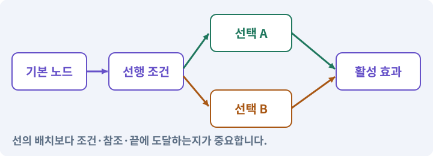

# 042. 트리에서 투자하고 저장하기

**목표:** 버튼으로 배운 스킬이 재실행 뒤에도 유지됩니다.

**시작 상태:** 검사된9노드 트리 규칙

## 한눈에 보는 기능의 흐름

노드 선택 → 조건·포인트 검사 → 투자 저장 → 재실행 후 복원



**경계:** 잠긴 노드 클릭에서 포인트를 쓰지 않기

그림은 실제 게임 실행 결과가 아닙니다. 값·규칙과 예제를 필요한 때 펼쳐 읽고 현재 단계의 메시지를 한 번씩 보냅니다.

## 1. 지금 상태 확인하기

첫 메시지를 보내 현재 준비 상태를 확인합니다. AI가 읽어 온 실제 프로젝트가 맞는지 보고, 없는 준비나 다른 상태가 있으면 먼저 알려 주세요. 아직 기능을 만들지 않는 단계입니다.

### AI에게 보낼 요구와 이유

#### 01. 작업 대상부터 확인

**“트리에서 투자하고 저장하기” 작업을 시작하기 전에 현재 상태를 읽기 전용으로 확인해 줘.**

왜 이렇게 요청하나요? AI가 다른 프로젝트나 오래된 예제를 보고 작업할 수 있습니다. 실제 경로·파일·현재 기능을 읽게 하면 지금 이어서 작업할 대상을 먼저 맞출 수 있습니다.

#### 02. 작업 대상부터 확인

**필요한 시작 상태는 검사된9노드 트리 규칙야.**

왜 이렇게 요청하나요? AI가 다른 프로젝트나 오래된 예제를 보고 작업할 수 있습니다. 실제 경로·파일·현재 기능을 읽게 하면 지금 이어서 작업할 대상을 먼저 맞출 수 있습니다.

#### 03. 실제 사용 중인 구현 재사용

**실제 프로젝트와 작업 기록을 읽고 이것이 준비되어 있는지, 이미 같은 기능이 있는지 확인해 줘.**

왜 이렇게 요청하나요? 이름이 비슷한 새 클래스를 또 만들면 기존 화면은 여전히 옛 코드를 사용할 수 있습니다. 실제 호출되는 진입점을 찾아 연결해야 두 구현이 충돌하거나 수정이 반영되지 않는 문제를 막습니다.

#### 04. 현재 상태와 다음 확인 지점 구분

**이번 기능이 연결될 실제 파일·화면·도구와 보존할 기존 동작을 짧게 정리해 줘.**

왜 이렇게 요청하나요? 이미 준비된 기능과 아직 확인하지 못한 기능을 섞으면 불필요한 재설치나 성급한 완료 판정이 생깁니다. 현재 대상과 남은 준비를 나눠 가장 작은 다음 작업을 선택하게 합니다.

#### 05. 조사 단계에서 변경하지 않기

**아직 새 구현·설치·유료 호출·파일 변경은 하지 마.**

왜 이렇게 요청하나요? 현재 상태를 알아보기만 할 때 파일 변경이나 결제가 시작되면 검토 전의 환경이 바뀝니다. 준비 확인과 실제 구현을 나눠 되돌리기 어려운 작업이 먼저 실행되지 않게 합니다.

#### 06. 막힌 준비를 먼저 해결

**준비가 다르면 부족한 항목과 다음에 필요한 작업을 알려 줘.**

왜 이렇게 요청하나요? 빠진 파일·권한·패키지를 있다고 가정하면 다음 구현이 엉뚱한 대상을 만들게 됩니다. 무엇이 없고 무엇을 먼저 해야 하는지 분리하면 불필요한 재작업을 줄일 수 있습니다.

<details>
<summary>보낼 원문 전체 — 설명은 복사되지 않습니다</summary>

```text
“트리에서 투자하고 저장하기” 작업을 시작하기 전에 현재 상태를 읽기 전용으로 확인해 줘.
필요한 시작 상태는 검사된9노드 트리 규칙야. 실제 프로젝트와 작업 기록을 읽고 이것이 준비되어 있는지, 이미 같은 기능이 있는지 확인해 줘.
이번 기능이 연결될 실제 파일·화면·도구와 보존할 기존 동작을 짧게 정리해 줘. 아직 새 구현·설치·유료 호출·파일 변경은 하지 마. 준비가 다르면 부족한 항목과 다음에 필요한 작업을 알려 줘.
```

</details>

**기대 결과:** 버튼 상태와 이전 저장의 포인트 변환 예

### 직접 확인하기

1. AI가 읽은 실제 프로젝트 또는 도구 경로를 확인합니다.
2. 필수 준비가 없다면 문제 해결 요청을 보내고, 준비됐을 때 다음으로 갑니다.

## 2. 필요한 기능 만들기

준비가 확인되면 아래 요청을 보냅니다. AI가 파일·설정·실행을 맡습니다. 변경 범위나 비용 승인이 나오면 내용을 읽고 결정하세요.

### AI에게 보낼 요구와 이유

#### 01. 작업 대상부터 확인

**현재 프로젝트의 실제 파일과 이미 결정한 규칙을 먼저 확인해 줘.**

왜 이렇게 요청하나요? AI가 다른 프로젝트나 오래된 예제를 보고 작업할 수 있습니다. 실제 경로·파일·현재 기능을 읽게 하면 지금 이어서 작업할 대상을 먼저 맞출 수 있습니다.

#### 02. 실제 사용 중인 코드에 연결

**이름이 다른 기존 구현이 있으면 새로 중복 제작하지 말고 그 구현에 연결해 줘.**

왜 이렇게 요청하나요? 예제와 이름이 다르더라도 현재 씬과 입력에서 호출하는 구현이 작업 대상입니다. 같은 기능을 새로 만들기보다 기존 진입점을 확인해 수정이 실제 게임에 반영되고 중복 실행되지 않게 합니다.

#### 03. 선택 조건과 실제 능력 연결

**현재 스킬트리 규칙을 실제 UI·스킬 사용·저장에 연결해 줘.**

왜 이렇게 요청하나요? 트리에 선이 그려져 있어도 선행 조건·포인트·실제 사용 가능 상태는 따로 구현해야 합니다. 투자 전후와 저장 복원에서 같은 선택 결과가 유지되도록 만듭니다.

#### 04. 스킬트리·노드·선행 조건의 적용 조건

**PC의 K와 모바일 메뉴로 열고, 선택한 노드의 효과·요구 레벨·선행 조건·남은 포인트를 보여 줘.**

왜 이렇게 요청하나요? 스킬트리는 포인트와 선행 조건을 통해 능력을 선택하는 구조입니다. 노드는 해금·강화 한 항목이고 랭크는 같은 항목의 투자 단계입니다. AI 도구의 Skill은 이 스킬트리의 공격 기술과 다른 뜻입니다.

#### 05. 종료 이후의 상태까지 확인

**투자 요청은 조건 확인→랭크 변경→능력 갱신→저장 요청으로 한 번만 처리해 줘.**

왜 이렇게 요청하나요? 현재 화면에서 맞는 값도 저장하거나 다시 구성할 때 빠질 수 있습니다. 실제 종료·불러오기 전후에 ID·옵션·장착·진행을 비교해야 유지되는 범위를 확인할 수 있습니다.

#### 06. 설정과 실제 사용 결과 연결

**버튼뿐 아니라 스킬 실행도 해금 노드의 랭크를 확인해야 해.**

왜 이렇게 요청하나요? 데이터에 수치를 넣어도 사용 조건·UI·실제 전투가 그 값을 읽지 않으면 기능이 완성되지 않습니다. 선택 전후의 계산과 저장을 함께 확인합니다.

#### 07. 저장 형식 변화에 대응

**기존 schema1 저장을 schema2로 옮길 때 이전 레벨에서 자동 해금한 시작 노드만 배운 상태로 이전하고 해당 포인트를 사용한 것으로 계산해 줘.**

왜 이렇게 요청하나요? 새 기능의 필드를 추가했다고 예전 저장에 그 값이 생기지는 않습니다. 이전·기본값·불명 ID 처리 규칙을 정해야 업데이트 후 장비나 퀘스트 진행을 잃지 않습니다.

#### 08. 같은 요청의 반복 처리 정의

**이전을 반복 적용하지 마.**

왜 이렇게 요청하나요? 클릭 연타·재연결·중복 이벤트는 개발과 플레이 중 모두 발생할 수 있습니다. 반복돼도 한 번 처리해야 하는 결과와 매번 새로 처리할 결과를 나눠 데이터가 누적되지 않게 합니다.

#### 09. 구현할 결과와 조건 고정

**레벨4에서는 베기·마력탄 시작 노드를 가지고 획득3·사용2·남음1이어야 해.**

왜 이렇게 요청하나요? “레벨4에서는 베기·마력탄 시작 노드를 가지고 획득3·사용2·남음1이어야 해”를 명시하면 AI가 무엇을 구현하거나 검사해야 하는지 범위를 좁힐 수 있습니다. 버튼으로 배운 스킬이 재실행 뒤에도 유지됩니다. 이 결과를 확인할 때 이 조건이 실제로 반영됐는지 함께 봅니다.

#### 10. 기존 결과를 보호

**아이템의 ID·옵션·레벨·퀘스트·HP/MP는 보존해 줘.**

왜 이렇게 요청하나요? 새 작업이 이미 정상인 기능이나 자산까지 바꾸면 원인을 추적하기 어렵습니다. 유지할 대상을 명시해 변경 전후를 비교하고 원치 않은 영향을 찾습니다.

#### 11. 빠른 반응과 허용 행동 구분

**새 게임과 이전 저장 사본으로 투자·연타·저장·재실행을 확인해 줘.**

왜 이렇게 요청하나요? 다음 입력을 받는 것과 현재 공격을 무조건 취소하는 것은 다릅니다. 입력 저장 시간과 취소 가능한 시점을 정해야 조작은 이어지면서 비정상적인 빠른 연타는 막을 수 있습니다.

#### 12. 종료 이후의 상태까지 확인

**정상 변환을 확인하기 전 실제 원본 저장은 덮어쓰지 마.**

왜 이렇게 요청하나요? 현재 화면에서 맞는 값도 저장하거나 다시 구성할 때 빠질 수 있습니다. 실제 종료·불러오기 전후에 ID·옵션·장착·진행을 비교해야 유지되는 범위를 확인할 수 있습니다.

#### 13. 구현과 실행은 AI에게 맡기기

**코드·설정·파일 생성·실행은 네가 맡고, 필요한 화면과 결과를 보여 줘.**

왜 이렇게 요청하나요? 설명이나 코드 조각만 받으면 실제 파일 생성·연결·실행이 빠질 수 있습니다. AI가 개발 작업까지 수행하고, 사람은 요구·승인·결과 판단을 맡도록 역할을 분명히 합니다.

#### 14. 막힌 준비를 먼저 해결

**수행하지 못한 작업과 필요한 승인·도구 연결은 구분해서 알려 줘.**

왜 이렇게 요청하나요? 빠진 파일·권한·패키지를 있다고 가정하면 다음 구현이 엉뚱한 대상을 만들게 됩니다. 무엇이 없고 무엇을 먼저 해야 하는지 분리하면 불필요한 재작업을 줄일 수 있습니다.

<details>
<summary>보낼 원문 전체 — 설명은 복사되지 않습니다</summary>

```text
현재 프로젝트의 실제 파일과 이미 결정한 규칙을 먼저 확인해 줘. 이름이 다른 기존 구현이 있으면 새로 중복 제작하지 말고 그 구현에 연결해 줘.

현재 스킬트리 규칙을 실제 UI·스킬 사용·저장에 연결해 줘. PC의 K와 모바일 메뉴로 열고, 선택한 노드의 효과·요구 레벨·선행 조건·남은 포인트를 보여 줘.
투자 요청은 조건 확인→랭크 변경→능력 갱신→저장 요청으로 한 번만 처리해 줘. 버튼뿐 아니라 스킬 실행도 해금 노드의 랭크를 확인해야 해.
기존 schema1 저장을 schema2로 옮길 때 이전 레벨에서 자동 해금한 시작 노드만 배운 상태로 이전하고 해당 포인트를 사용한 것으로 계산해 줘. 이전을 반복 적용하지 마.
레벨4에서는 베기·마력탄 시작 노드를 가지고 획득3·사용2·남음1이어야 해. 아이템의 ID·옵션·레벨·퀘스트·HP/MP는 보존해 줘.
새 게임과 이전 저장 사본으로 투자·연타·저장·재실행을 확인해 줘. 정상 변환을 확인하기 전 실제 원본 저장은 덮어쓰지 마.

코드·설정·파일 생성·실행은 네가 맡고, 필요한 화면과 결과를 보여 줘. 수행하지 못한 작업과 필요한 승인·도구 연결은 구분해서 알려 줘.
```

</details>

**기대 결과:** 확인할 결과: 투자·실행 권한·저장 이전을 확인함. AI가 이 상태를 확인할 실제 화면과 변경 내용을 준비합니다. 아직 실행하지 못한 부분은 따로 표시합니다.

### 직접 확인하기

1. 제안서만 반환됐다면 “설명으로 끝내지 말고 승인한 범위의 실제 작업을 수행해 줘”라고 보냅니다.
2. 코드나 설정을 직접 고치라는 안내가 나오면 “작성과 실행은 네가 맡아 줘”라고 요청합니다.

## 3. 결과를 직접 확인하기

먼저 확인 요청을 보내 AI가 검사와 화면을 준비하게 하세요. 그다음 아래 동작을 하나씩 확인합니다.

### AI에게 보낼 요구와 이유

#### 01. 검사할 입력과 관찰 지점 준비

**방금 구현한 기능의 자동 검사와 확인 화면을 준비해 줘.**

왜 이렇게 요청하나요? 정상 예 하나만 보면 실패 조건을 놓치기 쉽습니다. 정상·경계·반례를 실제 입력으로 준비하고 사람이 볼 화면도 맞춰 확인 범위를 분명하게 합니다.

#### 02. 결과를 재확인할 근거 남기기

**정상 동작과 아래 실패 조건을 실제로 검사하고 대상·실행 수·결과를 보여 줘.**

왜 이렇게 요청하나요? “잘 됩니다”라는 요약만으로는 어떤 입력과 버전을 검사했는지 알 수 없습니다. 대상·실행 수·실패 내용·파일을 함께 남겨 같은 조건으로 다시 확인할 수 있게 합니다.

#### 03. 같은 요청의 반복 처리 정의

**자동 검사: 레벨4 변환이 두 번 실행되어도 결과는 같다.**

왜 이렇게 요청하나요? 클릭 연타·재연결·중복 이벤트는 개발과 플레이 중 모두 발생할 수 있습니다. 반복돼도 한 번 처리해야 하는 결과와 매번 새로 처리할 결과를 나눠 데이터가 누적되지 않게 합니다.

#### 04. 기존 결과를 보호

**미래 schema는 덮어쓰지 않는다.**

왜 이렇게 요청하나요? 새 작업이 이미 정상인 기능이나 자산까지 바꾸면 원인을 추적하기 어렵습니다. 유지할 대상을 명시해 변경 전후를 비교하고 원치 않은 영향을 찾습니다.

#### 05. 빠른 반응과 허용 행동 구분

**배우기 버튼 10회 연타에서 랭크 상한·포인트 불변식이 지켜진다.**

왜 이렇게 요청하나요? 다음 입력을 받는 것과 현재 공격을 무조건 취소하는 것은 다릅니다. 입력 저장 시간과 취소 가능한 시점을 정해야 조작은 이어지면서 비정상적인 빠른 연타는 막을 수 있습니다.

#### 06. 설정과 실제 사용 결과 연결

**직접 검사: 미습득 스킬은 키보드와 터치 양쪽에서 발동하지 않는다.**

왜 이렇게 요청하나요? 데이터에 수치를 넣어도 사용 조건·UI·실제 전투가 그 값을 읽지 않으면 기능이 완성되지 않습니다. 선택 전후의 계산과 저장을 함께 확인합니다.

#### 07. 게임 시간·실시간·일시정지의 적용 조건

**트리 창을 닫으면 이동이 정상 복귀하며, 가방과 동시에 열었다 닫아도 일시정지가 남지 않는다.**

왜 이렇게 요청하나요? 게임 시간은 일시정지나 느린 연출에 따라 흐름을 조절할 수 있습니다. 실시간은 그와 별개로 흐르며 메뉴·다운로드·일부 UI에 필요합니다. timeScale=0이 모든 코드를 자동 정지시키지는 않습니다. Update 호출과 비동기 작업·실시간 UI 등은 별도로 봅니다.

#### 08. 사람 검사의 시작점 준비

**내가 조작해야 하는 부분은 실행할 화면과 시작 상태를 준비해 줘.**

왜 이렇게 요청하나요? 같은 기능이라도 시작 상태가 다르면 관찰 결과가 달라집니다. AI가 실행 화면과 재현 위치를 먼저 준비해야 사람이 이동·공격·소리·조작감을 같은 조건에서 확인할 수 있습니다.

#### 09. 사람이 실제로 본 것만 기록

**연결되지 않은 휴대폰의 터치나 사람이 보지 않은 재미·소리 품질을 대신 확인했다고 하지 마.**

왜 이렇게 요청하나요? AI가 준비한 검사와 사람이 직접 플레이하거나 들은 결과는 다른 근거입니다. 관찰하지 않은 조작감·소리·실기기 결과를 임의로 완료 처리하지 않게 합니다.

#### 10. 실제로 실행한 검사만 인정

**테스트 0개와 예전 소스 결과는 현재 성공으로 쓰지 마.**

왜 이렇게 요청하나요? 실행된 검사가 없거나 같은 결과를 중복 집계한 경우는 기능을 확인한 것이 아닙니다. 실행 수와 개별 결과를 함께 확인해야 형식적인 성공 표시를 걸러낼 수 있습니다.

<details>
<summary>보낼 원문 전체 — 설명은 복사되지 않습니다</summary>

```text
방금 구현한 기능의 자동 검사와 확인 화면을 준비해 줘. 정상 동작과 아래 실패 조건을 실제로 검사하고 대상·실행 수·결과를 보여 줘.

자동 검사: 레벨4 변환이 두 번 실행되어도 결과는 같다. 미래 schema는 덮어쓰지 않는다. 배우기 버튼 10회 연타에서 랭크 상한·포인트 불변식이 지켜진다.

직접 검사: 미습득 스킬은 키보드와 터치 양쪽에서 발동하지 않는다. 트리 창을 닫으면 이동이 정상 복귀하며, 가방과 동시에 열었다 닫아도 일시정지가 남지 않는다.

내가 조작해야 하는 부분은 실행할 화면과 시작 상태를 준비해 줘. 연결되지 않은 휴대폰의 터치나 사람이 보지 않은 재미·소리 품질을 대신 확인했다고 하지 마. 테스트 0개와 예전 소스 결과는 현재 성공으로 쓰지 마.
```

</details>

**기대 결과:** 획득 3·사용 2·남음 1포인트가 됩니다. 이미 schema 2이면 이전을 다시 적용하지 않습니다.

### 직접 확인하기

1. 포인트를 투자하고 스킬을 사용합니다.
2. 조건이 안 되는 노드를 눌러 봅니다.
3. 재실행 뒤 선택과 남은 포인트를 비교합니다.

## 4. 결과를 남기고 마무리하기

실제로 본 결과를 아래 메모에 적고 AI에 전달합니다. 결과 저장 요청으로 현재 상태를 남긴 뒤 다음 페이지로 갑니다.

### AI에게 보낼 요구와 이유

#### 01. 결과를 재확인할 근거 남기기

**지금 작업한 “트리에서 투자하고 저장하기”의 실제 결과를 정리해 줘.**

왜 이렇게 요청하나요? “잘 됩니다”라는 요약만으로는 어떤 입력과 버전을 검사했는지 알 수 없습니다. 대상·실행 수·실패 내용·파일을 함께 남겨 같은 조건으로 다시 확인할 수 있게 합니다.

#### 02. 다음 작업이 읽을 인수인계

**변경한 기능·파일·현재 후보와 실제 실행한 검사, 남은 문제를 기능 이름으로 기록해 줘.**

왜 이렇게 요청하나요? 새 AI 세션은 이전 대화 전체를 알고 있다고 보장할 수 없습니다. 현재 후보·파일 위치·실행한 검사·남은 일을 남겨야 같은 작업을 반복하지 않고 이어갈 수 있습니다.

#### 03. 사람이 실제로 본 것만 기록

**자동 검사 결과와 내가 직접 확인한 결과를 구분하고, 내 관찰이 아직 없으면 미확인으로 남겨 줘.**

왜 이렇게 요청하나요? AI가 준비한 검사와 사람이 직접 플레이하거나 들은 결과는 다른 근거입니다. 관찰하지 않은 조작감·소리·실기기 결과를 임의로 완료 처리하지 않게 합니다.

#### 04. 다음 작업이 읽을 인수인계

**재시작하거나 다음 작업에서 읽을 기록의 실제 위치를 알려 줘.**

왜 이렇게 요청하나요? 새 AI 세션은 이전 대화 전체를 알고 있다고 보장할 수 없습니다. 현재 후보·파일 위치·실행한 검사·남은 일을 남겨야 같은 작업을 반복하지 않고 이어갈 수 있습니다.

#### 05. 미확인을 완료와 분리

**아직 확인하지 않은 결과를 완료로 채우지 마.**

왜 이렇게 요청하나요? 만들어진 것, 검사에 실패한 것, 아직 확인하지 못한 것을 나눠야 다음 작업을 정확히 고를 수 있습니다. 실행할 조건이 없는 기능을 성공으로 기록하면 뒤에서 원인을 찾기 어려워집니다.

<details>
<summary>보낼 원문 전체 — 설명은 복사되지 않습니다</summary>

```text
지금 작업한 “트리에서 투자하고 저장하기”의 실제 결과를 정리해 줘. 변경한 기능·파일·현재 후보와 실제 실행한 검사, 남은 문제를 기능 이름으로 기록해 줘.
자동 검사 결과와 내가 직접 확인한 결과를 구분하고, 내 관찰이 아직 없으면 미확인으로 남겨 줘. 재시작하거나 다음 작업에서 읽을 기록의 실제 위치를 알려 줘. 아직 확인하지 않은 결과를 완료로 채우지 마.
```

</details>

**기대 결과:** 현재 상태·검사 결과·남은 문제·다음에 읽을 기록을 확인할 수 있습니다.

### 직접 확인하기

1. 자동 검사와 내 관찰 결과가 섞이지 않았는지 봅니다.
2. 문제가 남았다면 해결 요청을 보내고 같은 동작을 다시 확인합니다.

## 구체적인 예로 이해하기

### 레벨 4 저장을 새 트리로 옮기기

새 게임과 이전 자동 해금 저장은 다른 출발 상태입니다. 이전 보유 스킬을 보존하면서 이미 쓴 포인트로 환산합니다.

**시작 상태:** schema 1의 레벨 4 캐릭터가 베기와 마력탄을 사용하고 있습니다.

**직접 해 볼 동작:** 저장 사본을 새 구조로 한 번 이전하고 다시 불러옵니다.

**보여야 하는 결과:** 획득 3·사용 2·남음 1포인트가 됩니다. 이미 schema 2이면 이전을 다시 적용하지 않습니다.

**이렇게 되면 아직 안 됩니다:** 재접속마다 포인트를 새로 지급하거나 새 게임에도 이전 해금 보상을 줍니다.

**생각해 보기:** 같은 파일을 두 번 불러왔는데 남은 포인트가 2가 되었다면?

<details><summary>해설 보기</summary>

이전 과정이 멱등적이지 않습니다. 저장 버전과 이전 완료 조건을 확인하고 재실행으로 포인트가 늘지 않게 합니다.

</details>

## 이 작업에서 사용할 값과 규칙 전체

설계 시작값이며 측정된 성능·게임 성공 결과가 아닙니다. 구현은 AI가 수행합니다.

| 이전 레벨 | 이전할 뿌리 | 획득 / 사용 / 남음 |
|---:|---|---|
| 1 | 없음 | 0 / 0 / 0 |
| 2 | 베기 | 1 / 1 / 0 |
| 4 | 베기, 마력탄 | 3 / 2 / 1 |
| 6 | 베기, 마력탄, 회전 | 5 / 3 / 2 |
| 10 | 베기, 마력탄, 회전 | 9 / 3 / 6 |

새 게임은 아무 노드도 찍지 않은 상태다. 이전 코드를 플레이하던 사람만 위 이전 규칙을 적용한다. 이미 schema 2인 파일에 다시 이전을 적용하지 않는다. 원본 복사 → 메모리 변환 → 전체 검증 → 임시 파일 저장 → 검증된 저장 교체 순서로 진행한다. 프로젝트 Git과 실제 저장 폴더는 별개이므로 둘 다 백업한다.

화면은 세로 열 3개, 열당 노드 3개로 시작한다. 선택하면 설명과 현재/다음 랭크, 필요한 레벨, 남은 포인트가 보인다. 터치에서 작은 노드를 두 번 누르는 대신 노드 선택 후 하단 ‘배우기’ 버튼으로 확정한다. PC `K`와 모바일 메뉴에 진입 버튼을 붙이고 PauseService를 함께 사용한다.

## 문제가 있으면

### AI에게 보낼 요구와 이유

#### 01. 설정과 실제 사용 결과 연결

**UI 만 잠그지 말고 스킬 실행 함수도 같은 해금 질의를 사용하게 해 줘.**

왜 이렇게 요청하나요? 데이터에 수치를 넣어도 사용 조건·UI·실제 전투가 그 값을 읽지 않으면 기능이 완성되지 않습니다. 선택 전후의 계산과 저장을 함께 확인합니다.

#### 02. 저장 형식 변화에 대응

**이전 저장 사본으로 포인트 계산을 다시 검사해 줘.**

왜 이렇게 요청하나요? 새 기능의 필드를 추가했다고 예전 저장에 그 값이 생기지는 않습니다. 이전·기본값·불명 ID 처리 규칙을 정해야 업데이트 후 장비나 퀘스트 진행을 잃지 않습니다.

#### 03. 원인 하나를 좁혀 수정

**새 기능을 추가하지 말고 현재 오류와 실제 로그를 먼저 읽어 줘.**

왜 이렇게 요청하나요? 오류 수정 중 새 기능까지 넣으면 어떤 변경이 문제를 해결하거나 악화했는지 알기 어렵습니다. 원래 재현을 보존하고 작은 변경 뒤 같은 입력과 주변 정상 동작을 다시 확인합니다.

#### 04. 원인 하나를 좁혀 수정

**최소 수정 뒤 같은 재현과 관련 정상 동작을 다시 검사해 줘.**

왜 이렇게 요청하나요? 오류 수정 중 새 기능까지 넣으면 어떤 변경이 문제를 해결하거나 악화했는지 알기 어렵습니다. 원래 재현을 보존하고 작은 변경 뒤 같은 입력과 주변 정상 동작을 다시 확인합니다.

#### 05. 실패도 재현 자료로 보존

**실패 기록은 지우지 마.**

왜 이렇게 요청하나요? 실패한 입력과 로그가 있어야 같은 문제가 다시 생겼을 때 비교할 수 있습니다. 성공 기록으로 덮어쓰지 않고 전후 자료를 남기면 무엇을 고쳤는지 확인할 수 있습니다.

<details>
<summary>보낼 원문 전체 — 설명은 복사되지 않습니다</summary>

```text
UI 만 잠그지 말고 스킬 실행 함수도 같은 해금 질의를 사용하게 해 줘. 이전 저장 사본으로 포인트 계산을 다시 검사해 줘.
새 기능을 추가하지 말고 현재 오류와 실제 로그를 먼저 읽어 줘. 최소 수정 뒤 같은 재현과 관련 정상 동작을 다시 검사해 줘. 실패 기록은 지우지 마.
```

</details>

## 새 세션에서 이어가기

### AI에게 보낼 요구와 이유

#### 01. 이어서 할 작업 식별

**“트리에서 투자하고 저장하기” 작업을 이어가고 싶어.**

왜 이렇게 요청하나요? 이름으로 재개할 작업을 찾고, 뒤에 이어지는 요청으로 실제 파일·진행 중 작업·기록을 다시 읽게 합니다. 제목만 보고 이전 상태를 기억한다고 가정하지 않습니다.

#### 02. 조회는 상태를 바꾸지 않게

**실제 프로젝트와 내 도구의 작업 기록을 읽고 어디까지 구현·검사됐는지 확인해 줘.**

왜 이렇게 요청하나요? 진행 상황을 물을 때 새 구현이나 유료 호출이 시작되면 단순 확인이 실행 명령이 되어 버립니다. 저장된 근거를 읽어 완료·진행·승인 대기·미검증을 나누게 합니다.

#### 03. 재개 전 중복 작업 방지

**진행 중인 프로세스·승인·미저장 변경을 확인한 뒤 남은 가장 작은 작업부터 안내해 줘.**

왜 이렇게 요청하나요? 대화가 끊겨도 외부 작업은 끝났거나 아직 실행 중일 수 있습니다. 프로세스·승인·미저장 상태를 먼저 읽어 같은 생성·빌드·결제를 두 번 시작하지 않도록 합니다.

#### 04. 되돌아갈 원본 남기기

**기존 성공과 실패 기록은 보존해 줘.**

왜 이렇게 요청하나요? 새 구현이 실패해도 이전 게임과 저장을 복원할 수 있어야 합니다. 현재 내용을 먼저 조사하고 별도 후보에서 작업하면 실험이 유일한 정상본을 망가뜨리는 일을 피할 수 있습니다.

<details>
<summary>보낼 원문 전체 — 설명은 복사되지 않습니다</summary>

```text
“트리에서 투자하고 저장하기” 작업을 이어가고 싶어. 실제 프로젝트와 내 도구의 작업 기록을 읽고 어디까지 구현·검사됐는지 확인해 줘. 진행 중인 프로세스·승인·미저장 변경을 확인한 뒤 남은 가장 작은 작업부터 안내해 줘. 기존 성공과 실패 기록은 보존해 줘.
```

</details>

## 왜 이렇게 만드는가

UI가 포인트를 직접 차감하면 두 번 눌렀을 때 중복 차감되기 쉽다. UI는 `TryLearn(nodeId)`를 한 번 요청하고 성공한 새 상태를 표시한다. 서버가 없는 게임이어도 **상태 변경을 한 곳에서 처리하는 원칙**은 필요하다.

저장 구조는 schemaVersion 2로 올린다. 이전 저장의 레벨에 따라 이미 자동 해금된 스킬은 뿌리 노드로 옮긴다. 이 뿌리도 정상 포인트를 사용한다. 레벨 4이면 얻은 3포인트 중 베기와 마력탄 2포인트를 사용하고 1이 남는다. 기존 경험치·장비 GUID·옵션·퀘스트·HP는 그대로 보존한다.

## 공식 참고

