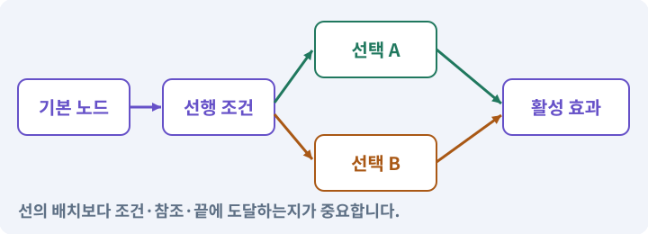

# 043. 빌드를 바꾸며 전투 비교하기

**목표:** 투자 방식의 차이와 안전한 초기화를 경험합니다.

**시작 상태:** 트리 UI와 저장

## 한눈에 보는 기능의 흐름

구성 A → 같은 전투 → 마을 초기화 → 구성 B 비교



**경계:** 초기화로 체력·마나·대기시간을 회복하지 않기

그림은 실제 게임 실행 결과가 아닙니다. 값·규칙과 예제를 필요한 때 펼쳐 읽고 현재 단계의 메시지를 한 번씩 보냅니다.

## 1. 지금 상태 확인하기

첫 메시지를 보내 현재 준비 상태를 확인합니다. AI가 읽어 온 실제 프로젝트가 맞는지 보고, 없는 준비나 다른 상태가 있으면 먼저 알려 주세요. 아직 기능을 만들지 않는 단계입니다.

### AI에게 보낼 요구와 이유

#### 01. 작업 대상부터 확인

**“빌드를 바꾸며 전투 비교하기” 작업을 시작하기 전에 현재 상태를 읽기 전용으로 확인해 줘.**

왜 이렇게 요청하나요? AI가 다른 프로젝트나 오래된 예제를 보고 작업할 수 있습니다. 실제 경로·파일·현재 기능을 읽게 하면 지금 이어서 작업할 대상을 먼저 맞출 수 있습니다.

#### 02. 작업 대상부터 확인

**필요한 시작 상태는 트리 UI와 저장야.**

왜 이렇게 요청하나요? AI가 다른 프로젝트나 오래된 예제를 보고 작업할 수 있습니다. 실제 경로·파일·현재 기능을 읽게 하면 지금 이어서 작업할 대상을 먼저 맞출 수 있습니다.

#### 03. 실제 사용 중인 구현 재사용

**실제 프로젝트와 작업 기록을 읽고 이것이 준비되어 있는지, 이미 같은 기능이 있는지 확인해 줘.**

왜 이렇게 요청하나요? 이름이 비슷한 새 클래스를 또 만들면 기존 화면은 여전히 옛 코드를 사용할 수 있습니다. 실제 호출되는 진입점을 찾아 연결해야 두 구현이 충돌하거나 수정이 반영되지 않는 문제를 막습니다.

#### 04. 현재 상태와 다음 확인 지점 구분

**이번 기능이 연결될 실제 파일·화면·도구와 보존할 기존 동작을 짧게 정리해 줘.**

왜 이렇게 요청하나요? 이미 준비된 기능과 아직 확인하지 못한 기능을 섞으면 불필요한 재설치나 성급한 완료 판정이 생깁니다. 현재 대상과 남은 준비를 나눠 가장 작은 다음 작업을 선택하게 합니다.

#### 05. 조사 단계에서 변경하지 않기

**아직 새 구현·설치·유료 호출·파일 변경은 하지 마.**

왜 이렇게 요청하나요? 현재 상태를 알아보기만 할 때 파일 변경이나 결제가 시작되면 검토 전의 환경이 바뀝니다. 준비 확인과 실제 구현을 나눠 되돌리기 어려운 작업이 먼저 실행되지 않게 합니다.

#### 06. 막힌 준비를 먼저 해결

**준비가 다르면 부족한 항목과 다음에 필요한 작업을 알려 줘.**

왜 이렇게 요청하나요? 빠진 파일·권한·패키지를 있다고 가정하면 다음 구현이 엉뚱한 대상을 만들게 됩니다. 무엇이 없고 무엇을 먼저 해야 하는지 분리하면 불필요한 재작업을 줄일 수 있습니다.

<details>
<summary>보낼 원문 전체 — 설명은 복사되지 않습니다</summary>

```text
“빌드를 바꾸며 전투 비교하기” 작업을 시작하기 전에 현재 상태를 읽기 전용으로 확인해 줘.
필요한 시작 상태는 트리 UI와 저장야. 실제 프로젝트와 작업 기록을 읽고 이것이 준비되어 있는지, 이미 같은 기능이 있는지 확인해 줘.
이번 기능이 연결될 실제 파일·화면·도구와 보존할 기존 동작을 짧게 정리해 줘. 아직 새 구현·설치·유료 호출·파일 변경은 하지 마. 준비가 다르면 부족한 항목과 다음에 필요한 작업을 알려 줘.
```

</details>

**기대 결과:** 세 구성의 비용·피해·기동성 차이

### 직접 확인하기

1. AI가 읽은 실제 프로젝트 또는 도구 경로를 확인합니다.
2. 필수 준비가 없다면 문제 해결 요청을 보내고, 준비됐을 때 다음으로 갑니다.

## 2. 필요한 기능 만들기

준비가 확인되면 아래 요청을 보냅니다. AI가 파일·설정·실행을 맡습니다. 변경 범위나 비용 승인이 나오면 내용을 읽고 결정하세요.

### AI에게 보낼 요구와 이유

#### 01. 작업 대상부터 확인

**현재 프로젝트의 실제 파일과 이미 결정한 규칙을 먼저 확인해 줘.**

왜 이렇게 요청하나요? AI가 다른 프로젝트나 오래된 예제를 보고 작업할 수 있습니다. 실제 경로·파일·현재 기능을 읽게 하면 지금 이어서 작업할 대상을 먼저 맞출 수 있습니다.

#### 02. 실제 사용 중인 코드에 연결

**이름이 다른 기존 구현이 있으면 새로 중복 제작하지 말고 그 구현에 연결해 줘.**

왜 이렇게 요청하나요? 예제와 이름이 다르더라도 현재 씬과 입력에서 호출하는 구현이 작업 대상입니다. 같은 기능을 새로 만들기보다 기존 진입점을 확인해 수정이 실제 게임에 반영되고 중복 실행되지 않게 합니다.

#### 03. 사용 성공과 자원 소비 묶기

**투자한 스킬 랭크를 실제 피해·마나·이동에 연결하고 마을에서 초기화할 수 있게 해 줘.**

왜 이렇게 요청하나요? 실패한 사용에서 자원이 줄거나 연타로 여러 번 차감되면 표시와 실제 행동이 어긋납니다. 사용 조건·비용·대기시간을 함께 처리하고 실패 시 바뀌지 않아야 할 값을 확인합니다.

#### 04. 사용 성공과 자원 소비 묶기

**베기 계수는1.6+강화랭크×0.15, 마나는10-절약랭크, 마력탄 계수는1.3+강화랭크×0.15, 마나는6-절약랭크다.**

왜 이렇게 요청하나요? 실패한 사용에서 자원이 줄거나 연타로 여러 번 차감되면 표시와 실제 행동이 어긋납니다. 사용 조건·비용·대기시간을 함께 처리하고 실패 시 바뀌지 않아야 할 값을 확인합니다.

#### 05. 구현할 결과와 조건 고정

**회전의 틱당 계수는0.45+강화랭크×0.05, 이동 비율은0.40+이동강화랭크×0.10이다.**

왜 이렇게 요청하나요? “회전의 틱당 계수는0.45+강화랭크×0.05, 이동 비율은0.40+이동강화랭크×0.10이다”를 명시하면 AI가 무엇을 구현하거나 검사해야 하는지 범위를 좁힐 수 있습니다. 투자 방식의 차이와 안전한 초기화를 경험합니다. 이 결과를 확인할 때 이 조건이 실제로 반영됐는지 함께 봅니다.

#### 06. 설정·기본값·검증·환경 변수의 적용 조건

**현재 계산 결과에 계속 더하지 말고 기본값과 현재 랭크로 다시 계산해 줘.**

왜 이렇게 요청하나요? 설정은 프로그램의 동작을 바꾸는 입력입니다. 코드와 분리할 수 있지만 잘못된 값은 위험하므로 형식·범위·경로·권한을 검증해야 합니다. 환경 변수는 실행 환경에서 전달하는 이름과 값입니다. 설정을 바꾸는 것도 게임·하네스의 동작 변경입니다. 코드가 그대로라고 재검사가 필요 없지는 않습니다.

#### 07. 구현할 결과와 조건 고정

**UI 설명과 실제 시전은 같은 계산 결과를 써야 해.**

왜 이렇게 요청하나요? “UI 설명과 실제 시전은 같은 계산 결과를 써야 해”를 명시하면 AI가 무엇을 구현하거나 검사해야 하는지 범위를 좁힐 수 있습니다. 투자 방식의 차이와 안전한 초기화를 경험합니다. 이 결과를 확인할 때 이 조건이 실제로 반영됐는지 함께 봅니다.

#### 08. 전투 수치를 한 규칙으로 계산

**초기화는 마을에서만 허용하고 포인트를 되돌리되 체력·마나·쿨다운은 회복하지 마.**

왜 이렇게 요청하나요? 표시와 실제 피해 계산이 다르면 장비·레벨·스킬 효과를 믿을 수 없습니다. 경계값과 사망·회복 조건을 명확히 정하고 숫자와 체력바를 함께 비교합니다.

#### 09. 종료 이후의 상태까지 확인

**반복 초기화와 저장 재실행에서도 스탯이 누적되지 않게 해 줘.**

왜 이렇게 요청하나요? 현재 화면에서 맞는 값도 저장하거나 다시 구성할 때 빠질 수 있습니다. 실제 종료·불러오기 전후에 ID·옵션·장착·진행을 비교해야 유지되는 범위를 확인할 수 있습니다.

#### 10. 비교할 조건 고정

**같은 레벨과 장비로 베기 중심·마력탄 중심·회전 중심 구성을 비교할 테스트 상태를 준비하고 직접 플레이할 화면을 열어 줘.**

왜 이렇게 요청하나요? 여러 수치와 화면을 동시에 바꾸면 어떤 선택이 전투를 바꿨는지 알기 어렵습니다. 같은 조건에서 한 요소씩 조정하고 조작 실수·규칙 오류·주관적인 재미를 따로 관찰합니다.

#### 11. 구현과 실행은 AI에게 맡기기

**코드·설정·파일 생성·실행은 네가 맡고, 필요한 화면과 결과를 보여 줘.**

왜 이렇게 요청하나요? 설명이나 코드 조각만 받으면 실제 파일 생성·연결·실행이 빠질 수 있습니다. AI가 개발 작업까지 수행하고, 사람은 요구·승인·결과 판단을 맡도록 역할을 분명히 합니다.

#### 12. 막힌 준비를 먼저 해결

**수행하지 못한 작업과 필요한 승인·도구 연결은 구분해서 알려 줘.**

왜 이렇게 요청하나요? 빠진 파일·권한·패키지를 있다고 가정하면 다음 구현이 엉뚱한 대상을 만들게 됩니다. 무엇이 없고 무엇을 먼저 해야 하는지 분리하면 불필요한 재작업을 줄일 수 있습니다.

<details>
<summary>보낼 원문 전체 — 설명은 복사되지 않습니다</summary>

```text
현재 프로젝트의 실제 파일과 이미 결정한 규칙을 먼저 확인해 줘. 이름이 다른 기존 구현이 있으면 새로 중복 제작하지 말고 그 구현에 연결해 줘.

투자한 스킬 랭크를 실제 피해·마나·이동에 연결하고 마을에서 초기화할 수 있게 해 줘.
베기 계수는1.6+강화랭크×0.15, 마나는10-절약랭크, 마력탄 계수는1.3+강화랭크×0.15, 마나는6-절약랭크다. 회전의 틱당 계수는0.45+강화랭크×0.05, 이동 비율은0.40+이동강화랭크×0.10이다.
현재 계산 결과에 계속 더하지 말고 기본값과 현재 랭크로 다시 계산해 줘. UI 설명과 실제 시전은 같은 계산 결과를 써야 해.
초기화는 마을에서만 허용하고 포인트를 되돌리되 체력·마나·쿨다운은 회복하지 마. 반복 초기화와 저장 재실행에서도 스탯이 누적되지 않게 해 줘.
같은 레벨과 장비로 베기 중심·마력탄 중심·회전 중심 구성을 비교할 테스트 상태를 준비하고 직접 플레이할 화면을 열어 줘.

코드·설정·파일 생성·실행은 네가 맡고, 필요한 화면과 결과를 보여 줘. 수행하지 못한 작업과 필요한 승인·도구 연결은 구분해서 알려 줘.
```

</details>

**기대 결과:** 확인할 결과: 세 구성의 차이와 초기화 제한을 확인함. AI가 이 상태를 확인할 실제 화면과 변경 내용을 준비합니다. 아직 실행하지 못한 부분은 따로 표시합니다.

### 직접 확인하기

1. 제안서만 반환됐다면 “설명으로 끝내지 말고 승인한 범위의 실제 작업을 수행해 줘”라고 보냅니다.
2. 코드나 설정을 직접 고치라는 안내가 나오면 “작성과 실행은 네가 맡아 줘”라고 요청합니다.

## 3. 결과를 직접 확인하기

먼저 확인 요청을 보내 AI가 검사와 화면을 준비하게 하세요. 그다음 아래 동작을 하나씩 확인합니다.

### AI에게 보낼 요구와 이유

#### 01. 검사할 입력과 관찰 지점 준비

**방금 구현한 기능의 자동 검사와 확인 화면을 준비해 줘.**

왜 이렇게 요청하나요? 정상 예 하나만 보면 실패 조건을 놓치기 쉽습니다. 정상·경계·반례를 실제 입력으로 준비하고 사람이 볼 화면도 맞춰 확인 범위를 분명하게 합니다.

#### 02. 결과를 재확인할 근거 남기기

**정상 동작과 아래 실패 조건을 실제로 검사하고 대상·실행 수·결과를 보여 줘.**

왜 이렇게 요청하나요? “잘 됩니다”라는 요약만으로는 어떤 입력과 버전을 검사했는지 알 수 없습니다. 대상·실행 수·실패 내용·파일을 함께 남겨 같은 조건으로 다시 확인할 수 있게 합니다.

#### 03. 관찰 가능한 기준으로 확인

**자동 검사: 초기화 100회 후 투자0, 남은9, 아이템·골드 불변이다.**

왜 이렇게 요청하나요? 구현 완료라는 설명을 실제 결과로 바꾸기 위한 조건입니다. 요청에 나온 대상과 경계 상황을 확인해 정상 결과뿐 아니라 실패를 어떻게 구분했는지도 남깁니다.

#### 04. 구현할 결과와 조건 고정

**회전 취소 시 속도 정상, 틱 수≤8이다.**

왜 이렇게 요청하나요? “회전 취소 시 속도 정상, 틱 수≤8이다”를 명시하면 AI가 무엇을 구현하거나 검사해야 하는지 범위를 좁힐 수 있습니다. 투자 방식의 차이와 안전한 초기화를 경험합니다. 이 결과를 확인할 때 이 조건이 실제로 반영됐는지 함께 봅니다.

#### 05. 관찰 가능한 기준으로 확인

**투자 없이 장비만 쓰는 기존 공격력12↔16 테스트도 유지한다.**

왜 이렇게 요청하나요? 구현 완료라는 설명을 실제 결과로 바꾸기 위한 조건입니다. 요청에 나온 대상과 경계 상황을 확인해 정상 결과뿐 아니라 실패를 어떻게 구분했는지도 남깁니다.

#### 06. 관찰 가능한 기준으로 확인

**직접 검사: 세 빌드 중 적 배치에 따라 편해지는 상황을 각각 한 가지 설명한다.**

왜 이렇게 요청하나요? 구현 완료라는 설명을 실제 결과로 바꾸기 위한 조건입니다. 요청에 나온 대상과 경계 상황을 확인해 정상 결과뿐 아니라 실패를 어떻게 구분했는지도 남깁니다.

#### 07. 비교할 조건 고정

**빠른 처치가 재미의 유일한 지표는 아니므로 ‘선택할 이유가 없던 노드’도 기록한다.**

왜 이렇게 요청하나요? 여러 수치와 화면을 동시에 바꾸면 어떤 선택이 전투를 바꿨는지 알기 어렵습니다. 같은 조건에서 한 요소씩 조정하고 조작 실수·규칙 오류·주관적인 재미를 따로 관찰합니다.

#### 08. 사람 검사의 시작점 준비

**내가 조작해야 하는 부분은 실행할 화면과 시작 상태를 준비해 줘.**

왜 이렇게 요청하나요? 같은 기능이라도 시작 상태가 다르면 관찰 결과가 달라집니다. AI가 실행 화면과 재현 위치를 먼저 준비해야 사람이 이동·공격·소리·조작감을 같은 조건에서 확인할 수 있습니다.

#### 09. 사람이 실제로 본 것만 기록

**연결되지 않은 휴대폰의 터치나 사람이 보지 않은 재미·소리 품질을 대신 확인했다고 하지 마.**

왜 이렇게 요청하나요? AI가 준비한 검사와 사람이 직접 플레이하거나 들은 결과는 다른 근거입니다. 관찰하지 않은 조작감·소리·실기기 결과를 임의로 완료 처리하지 않게 합니다.

#### 10. 실제로 실행한 검사만 인정

**테스트 0개와 예전 소스 결과는 현재 성공으로 쓰지 마.**

왜 이렇게 요청하나요? 실행된 검사가 없거나 같은 결과를 중복 집계한 경우는 기능을 확인한 것이 아닙니다. 실행 수와 개별 결과를 함께 확인해야 형식적인 성공 표시를 걸러낼 수 있습니다.

<details>
<summary>보낼 원문 전체 — 설명은 복사되지 않습니다</summary>

```text
방금 구현한 기능의 자동 검사와 확인 화면을 준비해 줘. 정상 동작과 아래 실패 조건을 실제로 검사하고 대상·실행 수·결과를 보여 줘.

자동 검사: 초기화 100회 후 투자0, 남은9, 아이템·골드 불변이다. 회전 취소 시 속도 정상, 틱 수≤8이다. 투자 없이 장비만 쓰는 기존 공격력12↔16 테스트도 유지한다.

직접 검사: 세 빌드 중 적 배치에 따라 편해지는 상황을 각각 한 가지 설명한다. 빠른 처치가 재미의 유일한 지표는 아니므로 ‘선택할 이유가 없던 노드’도 기록한다.

내가 조작해야 하는 부분은 실행할 화면과 시작 상태를 준비해 줘. 연결되지 않은 휴대폰의 터치나 사람이 보지 않은 재미·소리 품질을 대신 확인했다고 하지 마. 테스트 0개와 예전 소스 결과는 현재 성공으로 쓰지 마.
```

</details>

**기대 결과:** 세 구성의 차이와 초기화 제한을 확인함

### 직접 확인하기

1. 같은 방을 세 구성으로 플레이합니다.
2. 마을에서 초기화하고 포인트가 돌아오는지 봅니다.
3. 초기화로 체력·마나·쿨다운이 회복되지 않는지 봅니다.

## 4. 결과를 남기고 마무리하기

실제로 본 결과를 아래 메모에 적고 AI에 전달합니다. 결과 저장 요청으로 현재 상태를 남긴 뒤 다음 페이지로 갑니다.

### AI에게 보낼 요구와 이유

#### 01. 결과를 재확인할 근거 남기기

**지금 작업한 “빌드를 바꾸며 전투 비교하기”의 실제 결과를 정리해 줘.**

왜 이렇게 요청하나요? “잘 됩니다”라는 요약만으로는 어떤 입력과 버전을 검사했는지 알 수 없습니다. 대상·실행 수·실패 내용·파일을 함께 남겨 같은 조건으로 다시 확인할 수 있게 합니다.

#### 02. 다음 작업이 읽을 인수인계

**변경한 기능·파일·현재 후보와 실제 실행한 검사, 남은 문제를 기능 이름으로 기록해 줘.**

왜 이렇게 요청하나요? 새 AI 세션은 이전 대화 전체를 알고 있다고 보장할 수 없습니다. 현재 후보·파일 위치·실행한 검사·남은 일을 남겨야 같은 작업을 반복하지 않고 이어갈 수 있습니다.

#### 03. 사람이 실제로 본 것만 기록

**자동 검사 결과와 내가 직접 확인한 결과를 구분하고, 내 관찰이 아직 없으면 미확인으로 남겨 줘.**

왜 이렇게 요청하나요? AI가 준비한 검사와 사람이 직접 플레이하거나 들은 결과는 다른 근거입니다. 관찰하지 않은 조작감·소리·실기기 결과를 임의로 완료 처리하지 않게 합니다.

#### 04. 다음 작업이 읽을 인수인계

**재시작하거나 다음 작업에서 읽을 기록의 실제 위치를 알려 줘.**

왜 이렇게 요청하나요? 새 AI 세션은 이전 대화 전체를 알고 있다고 보장할 수 없습니다. 현재 후보·파일 위치·실행한 검사·남은 일을 남겨야 같은 작업을 반복하지 않고 이어갈 수 있습니다.

#### 05. 미확인을 완료와 분리

**아직 확인하지 않은 결과를 완료로 채우지 마.**

왜 이렇게 요청하나요? 만들어진 것, 검사에 실패한 것, 아직 확인하지 못한 것을 나눠야 다음 작업을 정확히 고를 수 있습니다. 실행할 조건이 없는 기능을 성공으로 기록하면 뒤에서 원인을 찾기 어려워집니다.

<details>
<summary>보낼 원문 전체 — 설명은 복사되지 않습니다</summary>

```text
지금 작업한 “빌드를 바꾸며 전투 비교하기”의 실제 결과를 정리해 줘. 변경한 기능·파일·현재 후보와 실제 실행한 검사, 남은 문제를 기능 이름으로 기록해 줘.
자동 검사 결과와 내가 직접 확인한 결과를 구분하고, 내 관찰이 아직 없으면 미확인으로 남겨 줘. 재시작하거나 다음 작업에서 읽을 기록의 실제 위치를 알려 줘. 아직 확인하지 않은 결과를 완료로 채우지 마.
```

</details>

**기대 결과:** 현재 상태·검사 결과·남은 문제·다음에 읽을 기록을 확인할 수 있습니다.

### 직접 확인하기

1. 자동 검사와 내 관찰 결과가 섞이지 않았는지 봅니다.
2. 문제가 남았다면 해결 요청을 보내고 같은 동작을 다시 확인합니다.

## 이 작업에서 사용할 값과 규칙 전체

설계 시작값이며 측정된 성능·게임 성공 결과가 아닙니다. 구현은 AI가 수행합니다.

레벨10 비교용 9포인트 예시:

| 빌드 | 투자 | 관찰할 차이 |
|---|---|---|
| 베기 중심 | 베기1/힘2/절약2 + 마력탄1/힘2 + 회전1 | 짧은 거리의 다수 적을 효율적으로 처리하는가 |
| 마력탄 중심 | 마력탄1/힘2/절약2 + 베기1/힘2 + 회전1 | 거리를 유지하면서 마나가 오래 버티는가 |
| 회전 중심 | 회전1/힘2/기동2 + 베기1/힘2 + 마력탄1 | 근접 위험을 감수하고 이동하며 싸울 이유가 있는가 |

강화 전 베기는 1.6배, 힘2는 1.9배다. 공격력20인 플레이어가 방어력0인 적에게 최종 반올림 후 각각32와38 피해가 기대된다. 회전 힘2는 틱당0.55배, 총8틱이고 **틱 수는 늘어나지 않는다**. 재사용 대기시간과 발동 순간의 효과 값은 시전 시작에 스냅샷으로 확정한다.

초기화 시 모든 랭크를 지우고 획득 포인트만큼 되돌린다. 쿨다운·현재 HP·MP를 회복하지 않으며 없는 스킬의 단축키 표시를 잠근다. 시전 중·던전·사망 상태에서는 거부한다. 원래 얻은 포인트보다 더 돌려주지 않는다.

## 문제가 있으면

### AI에게 보낼 요구와 이유

#### 01. 구현할 결과와 조건 고정

**강화 수치를 원래 값에 계속 더하지 마.**

왜 이렇게 요청하나요? “강화 수치를 원래 값에 계속 더하지 마”를 명시하면 AI가 무엇을 구현하거나 검사해야 하는지 범위를 좁힐 수 있습니다. 투자 방식의 차이와 안전한 초기화를 경험합니다. 이 결과를 확인할 때 이 조건이 실제로 반영됐는지 함께 봅니다.

#### 02. 수명주기·초기화·정리의 적용 조건

**시전 시작의 값을 고정하고 초기화가 자원 회복 수단이 되지 않게 해 줘.**

왜 이렇게 요청하나요? 객체는 생성·준비·활성·비활성·파괴의 단계를 거칩니다. 각 단계에서 구독·타이머·자원·참조를 준비하고 정리해야 합니다. “안 보임”과 “완전히 없어짐”도 다릅니다. OnDisable과 파괴는 같은 사건이 아닙니다. 다시 활성화될 수 있는지에 따라 정리·초기화 규칙을 맞춥니다.

#### 03. 원인 하나를 좁혀 수정

**새 기능을 추가하지 말고 현재 오류와 실제 로그를 먼저 읽어 줘.**

왜 이렇게 요청하나요? 오류 수정 중 새 기능까지 넣으면 어떤 변경이 문제를 해결하거나 악화했는지 알기 어렵습니다. 원래 재현을 보존하고 작은 변경 뒤 같은 입력과 주변 정상 동작을 다시 확인합니다.

#### 04. 원인 하나를 좁혀 수정

**최소 수정 뒤 같은 재현과 관련 정상 동작을 다시 검사해 줘.**

왜 이렇게 요청하나요? 오류 수정 중 새 기능까지 넣으면 어떤 변경이 문제를 해결하거나 악화했는지 알기 어렵습니다. 원래 재현을 보존하고 작은 변경 뒤 같은 입력과 주변 정상 동작을 다시 확인합니다.

#### 05. 실패도 재현 자료로 보존

**실패 기록은 지우지 마.**

왜 이렇게 요청하나요? 실패한 입력과 로그가 있어야 같은 문제가 다시 생겼을 때 비교할 수 있습니다. 성공 기록으로 덮어쓰지 않고 전후 자료를 남기면 무엇을 고쳤는지 확인할 수 있습니다.

<details>
<summary>보낼 원문 전체 — 설명은 복사되지 않습니다</summary>

```text
강화 수치를 원래 값에 계속 더하지 마. 시전 시작의 값을 고정하고 초기화가 자원 회복 수단이 되지 않게 해 줘.
새 기능을 추가하지 말고 현재 오류와 실제 로그를 먼저 읽어 줘. 최소 수정 뒤 같은 재현과 관련 정상 동작을 다시 검사해 줘. 실패 기록은 지우지 마.
```

</details>

## 새 세션에서 이어가기

### AI에게 보낼 요구와 이유

#### 01. 이어서 할 작업 식별

**“빌드를 바꾸며 전투 비교하기” 작업을 이어가고 싶어.**

왜 이렇게 요청하나요? 이름으로 재개할 작업을 찾고, 뒤에 이어지는 요청으로 실제 파일·진행 중 작업·기록을 다시 읽게 합니다. 제목만 보고 이전 상태를 기억한다고 가정하지 않습니다.

#### 02. 조회는 상태를 바꾸지 않게

**실제 프로젝트와 내 도구의 작업 기록을 읽고 어디까지 구현·검사됐는지 확인해 줘.**

왜 이렇게 요청하나요? 진행 상황을 물을 때 새 구현이나 유료 호출이 시작되면 단순 확인이 실행 명령이 되어 버립니다. 저장된 근거를 읽어 완료·진행·승인 대기·미검증을 나누게 합니다.

#### 03. 재개 전 중복 작업 방지

**진행 중인 프로세스·승인·미저장 변경을 확인한 뒤 남은 가장 작은 작업부터 안내해 줘.**

왜 이렇게 요청하나요? 대화가 끊겨도 외부 작업은 끝났거나 아직 실행 중일 수 있습니다. 프로세스·승인·미저장 상태를 먼저 읽어 같은 생성·빌드·결제를 두 번 시작하지 않도록 합니다.

#### 04. 되돌아갈 원본 남기기

**기존 성공과 실패 기록은 보존해 줘.**

왜 이렇게 요청하나요? 새 구현이 실패해도 이전 게임과 저장을 복원할 수 있어야 합니다. 현재 내용을 먼저 조사하고 별도 후보에서 작업하면 실험이 유일한 정상본을 망가뜨리는 일을 피할 수 있습니다.

<details>
<summary>보낼 원문 전체 — 설명은 복사되지 않습니다</summary>

```text
“빌드를 바꾸며 전투 비교하기” 작업을 이어가고 싶어. 실제 프로젝트와 내 도구의 작업 기록을 읽고 어디까지 구현·검사됐는지 확인해 줘. 진행 중인 프로세스·승인·미저장 변경을 확인한 뒤 남은 가장 작은 작업부터 안내해 줘. 기존 성공과 실패 기록은 보존해 줘.
```

</details>

## 왜 이렇게 만드는가

같은 피해량 증가를 세 번 고르는 것만으로는 선택의 차이가 잘 드러나지 않는다. 이 과정에서는 근접 범위 공격의 효율, 마력탄의 지속 사용, 회전 중 기동성이라는 차이를 직접 시험한다. 어느 빌드가 반드시 더 재미있다는 결론을 미리 정하지 않는다.

능력치는 원래 값에 계속 더하고 빼지 않는다. 베기 계수는 `1.6 + 0.15×slash_power`, 비용은 `10-slash_economy`다. 회전의 이동 비율은 `0.4+0.1×spin_stride`이며, 죽거나 취소되면 항상 정상 이동 상태로 돌아간다. 초기화는 강의에서는 무료, 마을에서만 허용한다.

## 공식 참고

