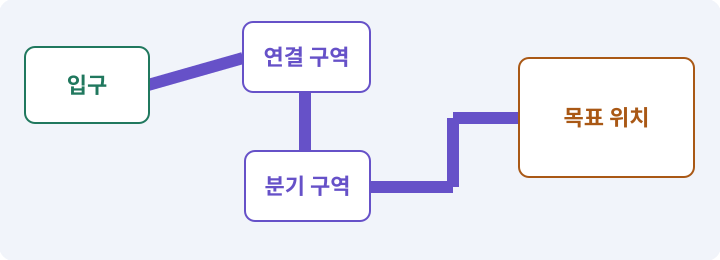

# 044. 시드로 같은 던전 다시 만들기

**목표:** 같은 숫자로 같은 방 연결을 재현합니다.

**시작 상태:** 고정 던전과 길찾기

## 한눈에 보는 기능의 흐름

시드·생성 버전 → 방 배치 난수 → 전리품 난수 → 장식 난수



**경계:** 장식 변경이 방과 보상을 다시 뽑지 않기

그림은 실제 게임 실행 결과가 아닙니다. 값·규칙과 예제를 필요한 때 펼쳐 읽고 현재 단계의 메시지를 한 번씩 보냅니다.

## 1. 지금 상태 확인하기

첫 메시지를 보내 현재 준비 상태를 확인합니다. AI가 읽어 온 실제 프로젝트가 맞는지 보고, 없는 준비나 다른 상태가 있으면 먼저 알려 주세요. 아직 기능을 만들지 않는 단계입니다.

### AI에게 보낼 요구와 이유

#### 01. 작업 대상부터 확인

**“시드로 같은 던전 다시 만들기” 작업을 시작하기 전에 현재 상태를 읽기 전용으로 확인해 줘.**

왜 이렇게 요청하나요? AI가 다른 프로젝트나 오래된 예제를 보고 작업할 수 있습니다. 실제 경로·파일·현재 기능을 읽게 하면 지금 이어서 작업할 대상을 먼저 맞출 수 있습니다.

#### 02. 작업 대상부터 확인

**필요한 시작 상태는 고정 던전과 길찾기야.**

왜 이렇게 요청하나요? AI가 다른 프로젝트나 오래된 예제를 보고 작업할 수 있습니다. 실제 경로·파일·현재 기능을 읽게 하면 지금 이어서 작업할 대상을 먼저 맞출 수 있습니다.

#### 03. 실제 사용 중인 구현 재사용

**실제 프로젝트와 작업 기록을 읽고 이것이 준비되어 있는지, 이미 같은 기능이 있는지 확인해 줘.**

왜 이렇게 요청하나요? 이름이 비슷한 새 클래스를 또 만들면 기존 화면은 여전히 옛 코드를 사용할 수 있습니다. 실제 호출되는 진입점을 찾아 연결해야 두 구현이 충돌하거나 수정이 반영되지 않는 문제를 막습니다.

#### 04. 현재 상태와 다음 확인 지점 구분

**이번 기능이 연결될 실제 파일·화면·도구와 보존할 기존 동작을 짧게 정리해 줘.**

왜 이렇게 요청하나요? 이미 준비된 기능과 아직 확인하지 못한 기능을 섞으면 불필요한 재설치나 성급한 완료 판정이 생깁니다. 현재 대상과 남은 준비를 나눠 가장 작은 다음 작업을 선택하게 합니다.

#### 05. 조사 단계에서 변경하지 않기

**아직 새 구현·설치·유료 호출·파일 변경은 하지 마.**

왜 이렇게 요청하나요? 현재 상태를 알아보기만 할 때 파일 변경이나 결제가 시작되면 검토 전의 환경이 바뀝니다. 준비 확인과 실제 구현을 나눠 되돌리기 어려운 작업이 먼저 실행되지 않게 합니다.

#### 06. 막힌 준비를 먼저 해결

**준비가 다르면 부족한 항목과 다음에 필요한 작업을 알려 줘.**

왜 이렇게 요청하나요? 빠진 파일·권한·패키지를 있다고 가정하면 다음 구현이 엉뚱한 대상을 만들게 됩니다. 무엇이 없고 무엇을 먼저 해야 하는지 분리하면 불필요한 재작업을 줄일 수 있습니다.

<details>
<summary>보낼 원문 전체 — 설명은 복사되지 않습니다</summary>

```text
“시드로 같은 던전 다시 만들기” 작업을 시작하기 전에 현재 상태를 읽기 전용으로 확인해 줘.
필요한 시작 상태는 고정 던전과 길찾기야. 실제 프로젝트와 작업 기록을 읽고 이것이 준비되어 있는지, 이미 같은 기능이 있는지 확인해 줘.
이번 기능이 연결될 실제 파일·화면·도구와 보존할 기존 동작을 짧게 정리해 줘. 아직 새 구현·설치·유료 호출·파일 변경은 하지 마. 준비가 다르면 부족한 항목과 다음에 필요한 작업을 알려 줘.
```

</details>

**기대 결과:** 시드와 생성 버전이 적힌 방 연결도

### 직접 확인하기

1. AI가 읽은 실제 프로젝트 또는 도구 경로를 확인합니다.
2. 필수 준비가 없다면 문제 해결 요청을 보내고, 준비됐을 때 다음으로 갑니다.

## 2. 필요한 기능 만들기

준비가 확인되면 아래 요청을 보냅니다. AI가 파일·설정·실행을 맡습니다. 변경 범위나 비용 승인이 나오면 내용을 읽고 결정하세요.

### AI에게 보낼 요구와 이유

#### 01. 작업 대상부터 확인

**현재 프로젝트의 실제 파일과 이미 결정한 규칙을 먼저 확인해 줘.**

왜 이렇게 요청하나요? AI가 다른 프로젝트나 오래된 예제를 보고 작업할 수 있습니다. 실제 경로·파일·현재 기능을 읽게 하면 지금 이어서 작업할 대상을 먼저 맞출 수 있습니다.

#### 02. 실제 사용 중인 코드에 연결

**이름이 다른 기존 구현이 있으면 새로 중복 제작하지 말고 그 구현에 연결해 줘.**

왜 이렇게 요청하나요? 예제와 이름이 다르더라도 현재 씬과 입력에서 호출하는 구현이 작업 대상입니다. 같은 기능을 새로 만들기보다 기존 진입점을 확인해 수정이 실제 게임에 반영되고 중복 실행되지 않게 합니다.

#### 03. 무작위 결과를 재현 가능하게

**고정 던전과 별도로 시드 기반 던전 생성의 논리 데이터를 만들어 줘.**

왜 이렇게 요청하나요? 실패한 맵이나 전리품 결과를 다시 만들 수 있어야 원인을 고칠 수 있습니다. 생성 버전·설정·시드를 함께 기록하고 지형·장식·보상 난수를 분리해 작은 변경의 파급을 줄입니다.

#### 04. 조사 단계에서 변경하지 않기

**아직 실제 타일과 충돌은 바꾸지 마.**

왜 이렇게 요청하나요? 현재 상태를 알아보기만 할 때 파일 변경이나 결제가 시작되면 검토 전의 환경이 바뀝니다. 준비 확인과 실제 구현을 나눠 되돌리기 어려운 작업이 먼저 실행되지 않게 합니다.

#### 05. 무작위 결과를 재현 가능하게

**입구1·전투5·보물1·보스1의 방8개와 연결도를 만들고 같은 생성 버전·설정·시드에서 같은 결과가 나오게 해 줘.**

왜 이렇게 요청하나요? 실패한 맵이나 전리품 결과를 다시 만들 수 있어야 원인을 고칠 수 있습니다. 생성 버전·설정·시드를 함께 기록하고 지형·장식·보상 난수를 분리해 작은 변경의 파급을 줄입니다.

#### 06. 무작위 결과를 재현 가능하게

**지도·적 배치·전리품·장식의 난수를 분리해 장식 추가가 지도와 전리품을 바꾸지 않게 해 줘.**

왜 이렇게 요청하나요? 실패한 맵이나 전리품 결과를 다시 만들 수 있어야 원인을 고칠 수 있습니다. 생성 버전·설정·시드를 함께 기록하고 지형·장식·보상 난수를 분리해 작은 변경의 파급을 줄입니다.

#### 07. 무작위 결과를 재현 가능하게

**문자열 해시가 플랫폼마다 달라지는 방식은 시드 파생에 쓰지 마.**

왜 이렇게 요청하나요? 실패한 맵이나 전리품 결과를 다시 만들 수 있어야 원인을 고칠 수 있습니다. 생성 버전·설정·시드를 함께 기록하고 지형·장식·보상 난수를 분리해 작은 변경의 파급을 줄입니다.

#### 08. 종류와 실제 소유 물건 구분

**매 입장의 runId와 아이템 고유 ID는 지도 시드만으로 만들지 마.**

왜 이렇게 요청하나요? 같은 종류의 검 두 자루도 옵션과 소유 위치는 별개입니다. 정의 데이터와 개별 아이템을 나누면 한 물건을 수정했을 때 다른 물건과 원본 규격까지 바뀌지 않습니다.

#### 09. 무작위 결과를 재현 가능하게

**같은 시드로 두 번 들어가도 소유 아이템이 충돌하지 않아야 해.**

왜 이렇게 요청하나요? 실패한 맵이나 전리품 결과를 다시 만들 수 있어야 원인을 고칠 수 있습니다. 생성 버전·설정·시드를 함께 기록하고 지형·장식·보상 난수를 분리해 작은 변경의 파급을 줄입니다.

#### 10. 무작위 결과를 재현 가능하게

**방과 연결도를 표시하는 미리보기를 만들고 동일 시드 반복·다른 시드·잘못된 설정·고립된 방을 검사해 줘.**

왜 이렇게 요청하나요? 실패한 맵이나 전리품 결과를 다시 만들 수 있어야 원인을 고칠 수 있습니다. 생성 버전·설정·시드를 함께 기록하고 지형·장식·보상 난수를 분리해 작은 변경의 파급을 줄입니다.

#### 11. 그림 크기와 월드 크기 연결

**공통 설정은 64×64, 1셀=1게임 단위, 방 8개, 내부 크기 10~14셀, 방 간 여유 3셀, 통로 폭 4셀, 방 배치 시도 상한 400회, 지도 후보 최대 5개다.**

왜 이렇게 요청하나요? 픽셀 수만 정하면 게임 안에서의 크기는 정해지지 않습니다. PPU와 배율을 함께 고정해야 자산을 바꿔도 캐릭터·바닥·UI의 크기 관계를 비교할 수 있습니다.

#### 12. 무작위 결과를 재현 가능하게

**입구1·전투5·보물1·보스1로 정하고 설정과 생성 버전·시드를 기록해 줘.**

왜 이렇게 요청하나요? 실패한 맵이나 전리품 결과를 다시 만들 수 있어야 원인을 고칠 수 있습니다. 생성 버전·설정·시드를 함께 기록하고 지형·장식·보상 난수를 분리해 작은 변경의 파급을 줄입니다.

#### 13. 구현과 실행은 AI에게 맡기기

**코드·설정·파일 생성·실행은 네가 맡고, 필요한 화면과 결과를 보여 줘.**

왜 이렇게 요청하나요? 설명이나 코드 조각만 받으면 실제 파일 생성·연결·실행이 빠질 수 있습니다. AI가 개발 작업까지 수행하고, 사람은 요구·승인·결과 판단을 맡도록 역할을 분명히 합니다.

#### 14. 막힌 준비를 먼저 해결

**수행하지 못한 작업과 필요한 승인·도구 연결은 구분해서 알려 줘.**

왜 이렇게 요청하나요? 빠진 파일·권한·패키지를 있다고 가정하면 다음 구현이 엉뚱한 대상을 만들게 됩니다. 무엇이 없고 무엇을 먼저 해야 하는지 분리하면 불필요한 재작업을 줄일 수 있습니다.

<details>
<summary>보낼 원문 전체 — 설명은 복사되지 않습니다</summary>

```text
현재 프로젝트의 실제 파일과 이미 결정한 규칙을 먼저 확인해 줘. 이름이 다른 기존 구현이 있으면 새로 중복 제작하지 말고 그 구현에 연결해 줘.

고정 던전과 별도로 시드 기반 던전 생성의 논리 데이터를 만들어 줘. 아직 실제 타일과 충돌은 바꾸지 마.
입구1·전투5·보물1·보스1의 방8개와 연결도를 만들고 같은 생성 버전·설정·시드에서 같은 결과가 나오게 해 줘.
지도·적 배치·전리품·장식의 난수를 분리해 장식 추가가 지도와 전리품을 바꾸지 않게 해 줘. 문자열 해시가 플랫폼마다 달라지는 방식은 시드 파생에 쓰지 마.
매 입장의 runId와 아이템 고유 ID는 지도 시드만으로 만들지 마. 같은 시드로 두 번 들어가도 소유 아이템이 충돌하지 않아야 해.
방과 연결도를 표시하는 미리보기를 만들고 동일 시드 반복·다른 시드·잘못된 설정·고립된 방을 검사해 줘.

공통 설정은 64×64, 1셀=1게임 단위, 방 8개, 내부 크기 10~14셀, 방 간 여유 3셀, 통로 폭 4셀, 방 배치 시도 상한 400회, 지도 후보 최대 5개다. 입구1·전투5·보물1·보스1로 정하고 설정과 생성 버전·시드를 기록해 줘.

코드·설정·파일 생성·실행은 네가 맡고, 필요한 화면과 결과를 보여 줘. 수행하지 못한 작업과 필요한 승인·도구 연결은 구분해서 알려 줘.
```

</details>

**기대 결과:** 확인할 결과: 지도 재현과 난수 분리를 확인함. AI가 이 상태를 확인할 실제 화면과 변경 내용을 준비합니다. 아직 실행하지 못한 부분은 따로 표시합니다.

### 직접 확인하기

1. 제안서만 반환됐다면 “설명으로 끝내지 말고 승인한 범위의 실제 작업을 수행해 줘”라고 보냅니다.
2. 코드나 설정을 직접 고치라는 안내가 나오면 “작성과 실행은 네가 맡아 줘”라고 요청합니다.

## 3. 결과를 직접 확인하기

먼저 확인 요청을 보내 AI가 검사와 화면을 준비하게 하세요. 그다음 아래 동작을 하나씩 확인합니다.

### AI에게 보낼 요구와 이유

#### 01. 검사할 입력과 관찰 지점 준비

**방금 구현한 기능의 자동 검사와 확인 화면을 준비해 줘.**

왜 이렇게 요청하나요? 정상 예 하나만 보면 실패 조건을 놓치기 쉽습니다. 정상·경계·반례를 실제 입력으로 준비하고 사람이 볼 화면도 맞춰 확인 범위를 분명하게 합니다.

#### 02. 결과를 재확인할 근거 남기기

**정상 동작과 아래 실패 조건을 실제로 검사하고 대상·실행 수·결과를 보여 줘.**

왜 이렇게 요청하나요? “잘 됩니다”라는 요약만으로는 어떤 입력과 버전을 검사했는지 알 수 없습니다. 대상·실행 수·실패 내용·파일을 함께 남겨 같은 조건으로 다시 확인할 수 있게 합니다.

#### 03. 무작위 결과를 재현 가능하게

**자동 검사: 동일 시드의 논리 데이터가 일치한다.**

왜 이렇게 요청하나요? 실패한 맵이나 전리품 결과를 다시 만들 수 있어야 원인을 고칠 수 있습니다. 생성 버전·설정·시드를 함께 기록하고 지형·장식·보상 난수를 분리해 작은 변경의 파급을 줄입니다.

#### 04. 무작위 결과를 재현 가능하게

**다른 시드 표본에서 항상 같은 맵만 나오는 퇴행은 없다.**

왜 이렇게 요청하나요? 실패한 맵이나 전리품 결과를 다시 만들 수 있어야 원인을 고칠 수 있습니다. 생성 버전·설정·시드를 함께 기록하고 지형·장식·보상 난수를 분리해 작은 변경의 파급을 줄입니다.

#### 05. 무작위 결과를 재현 가능하게

**음수/큰 정수 시드의 지원 범위와 변환 규칙이 명확하다.**

왜 이렇게 요청하나요? 실패한 맵이나 전리품 결과를 다시 만들 수 있어야 원인을 고칠 수 있습니다. 생성 버전·설정·시드를 함께 기록하고 지형·장식·보상 난수를 분리해 작은 변경의 파급을 줄입니다.

#### 06. 무작위 결과를 재현 가능하게

**직접 검사: 지도에 시드·버전·입구·방 ID가 표시된다.**

왜 이렇게 요청하나요? 실패한 맵이나 전리품 결과를 다시 만들 수 있어야 원인을 고칠 수 있습니다. 생성 버전·설정·시드를 함께 기록하고 지형·장식·보상 난수를 분리해 작은 변경의 파급을 줄입니다.

#### 07. 구현할 결과와 조건 고정

**기존 고정 던전은 정상 진입 가능하며 새 실험은 별도 장면에서 실행된다.**

왜 이렇게 요청하나요? “기존 고정 던전은 정상 진입 가능하며 새 실험은 별도 장면에서 실행된다”를 명시하면 AI가 무엇을 구현하거나 검사해야 하는지 범위를 좁힐 수 있습니다. 같은 숫자로 같은 방 연결을 재현합니다. 이 결과를 확인할 때 이 조건이 실제로 반영됐는지 함께 봅니다.

#### 08. 사람 검사의 시작점 준비

**내가 조작해야 하는 부분은 실행할 화면과 시작 상태를 준비해 줘.**

왜 이렇게 요청하나요? 같은 기능이라도 시작 상태가 다르면 관찰 결과가 달라집니다. AI가 실행 화면과 재현 위치를 먼저 준비해야 사람이 이동·공격·소리·조작감을 같은 조건에서 확인할 수 있습니다.

#### 09. 사람이 실제로 본 것만 기록

**연결되지 않은 휴대폰의 터치나 사람이 보지 않은 재미·소리 품질을 대신 확인했다고 하지 마.**

왜 이렇게 요청하나요? AI가 준비한 검사와 사람이 직접 플레이하거나 들은 결과는 다른 근거입니다. 관찰하지 않은 조작감·소리·실기기 결과를 임의로 완료 처리하지 않게 합니다.

#### 10. 실제로 실행한 검사만 인정

**테스트 0개와 예전 소스 결과는 현재 성공으로 쓰지 마.**

왜 이렇게 요청하나요? 실행된 검사가 없거나 같은 결과를 중복 집계한 경우는 기능을 확인한 것이 아닙니다. 실행 수와 개별 결과를 함께 확인해야 형식적인 성공 표시를 걸러낼 수 있습니다.

<details>
<summary>보낼 원문 전체 — 설명은 복사되지 않습니다</summary>

```text
방금 구현한 기능의 자동 검사와 확인 화면을 준비해 줘. 정상 동작과 아래 실패 조건을 실제로 검사하고 대상·실행 수·결과를 보여 줘.

자동 검사: 동일 시드의 논리 데이터가 일치한다. 다른 시드 표본에서 항상 같은 맵만 나오는 퇴행은 없다. 음수/큰 정수 시드의 지원 범위와 변환 규칙이 명확하다.

직접 검사: 지도에 시드·버전·입구·방 ID가 표시된다. 기존 고정 던전은 정상 진입 가능하며 새 실험은 별도 장면에서 실행된다.

내가 조작해야 하는 부분은 실행할 화면과 시작 상태를 준비해 줘. 연결되지 않은 휴대폰의 터치나 사람이 보지 않은 재미·소리 품질을 대신 확인했다고 하지 마. 테스트 0개와 예전 소스 결과는 현재 성공으로 쓰지 마.
```

</details>

**기대 결과:** 지도 재현과 난수 분리를 확인함

### 직접 확인하기

1. 같은 시드 두 결과를 비교합니다.
2. 다른 시드에서 배치가 달라지는지 봅니다.
3. 장식만 바꿔도 방과 전리품 결과가 유지되는지 봅니다.

## 4. 결과를 남기고 마무리하기

실제로 본 결과를 아래 메모에 적고 AI에 전달합니다. 결과 저장 요청으로 현재 상태를 남긴 뒤 다음 페이지로 갑니다.

### AI에게 보낼 요구와 이유

#### 01. 결과를 재확인할 근거 남기기

**지금 작업한 “시드로 같은 던전 다시 만들기”의 실제 결과를 정리해 줘.**

왜 이렇게 요청하나요? “잘 됩니다”라는 요약만으로는 어떤 입력과 버전을 검사했는지 알 수 없습니다. 대상·실행 수·실패 내용·파일을 함께 남겨 같은 조건으로 다시 확인할 수 있게 합니다.

#### 02. 다음 작업이 읽을 인수인계

**변경한 기능·파일·현재 후보와 실제 실행한 검사, 남은 문제를 기능 이름으로 기록해 줘.**

왜 이렇게 요청하나요? 새 AI 세션은 이전 대화 전체를 알고 있다고 보장할 수 없습니다. 현재 후보·파일 위치·실행한 검사·남은 일을 남겨야 같은 작업을 반복하지 않고 이어갈 수 있습니다.

#### 03. 사람이 실제로 본 것만 기록

**자동 검사 결과와 내가 직접 확인한 결과를 구분하고, 내 관찰이 아직 없으면 미확인으로 남겨 줘.**

왜 이렇게 요청하나요? AI가 준비한 검사와 사람이 직접 플레이하거나 들은 결과는 다른 근거입니다. 관찰하지 않은 조작감·소리·실기기 결과를 임의로 완료 처리하지 않게 합니다.

#### 04. 다음 작업이 읽을 인수인계

**재시작하거나 다음 작업에서 읽을 기록의 실제 위치를 알려 줘.**

왜 이렇게 요청하나요? 새 AI 세션은 이전 대화 전체를 알고 있다고 보장할 수 없습니다. 현재 후보·파일 위치·실행한 검사·남은 일을 남겨야 같은 작업을 반복하지 않고 이어갈 수 있습니다.

#### 05. 미확인을 완료와 분리

**아직 확인하지 않은 결과를 완료로 채우지 마.**

왜 이렇게 요청하나요? 만들어진 것, 검사에 실패한 것, 아직 확인하지 못한 것을 나눠야 다음 작업을 정확히 고를 수 있습니다. 실행할 조건이 없는 기능을 성공으로 기록하면 뒤에서 원인을 찾기 어려워집니다.

<details>
<summary>보낼 원문 전체 — 설명은 복사되지 않습니다</summary>

```text
지금 작업한 “시드로 같은 던전 다시 만들기”의 실제 결과를 정리해 줘. 변경한 기능·파일·현재 후보와 실제 실행한 검사, 남은 문제를 기능 이름으로 기록해 줘.
자동 검사 결과와 내가 직접 확인한 결과를 구분하고, 내 관찰이 아직 없으면 미확인으로 남겨 줘. 재시작하거나 다음 작업에서 읽을 기록의 실제 위치를 알려 줘. 아직 확인하지 않은 결과를 완료로 채우지 마.
```

</details>

**기대 결과:** 현재 상태·검사 결과·남은 문제·다음에 읽을 기록을 확인할 수 있습니다.

### 직접 확인하기

1. 자동 검사와 내 관찰 결과가 섞이지 않았는지 봅니다.
2. 문제가 남았다면 해결 요청을 보내고 같은 동작을 다시 확인합니다.

## 이 작업에서 사용할 값과 규칙 전체

설계 시작값이며 측정된 성능·게임 성공 결과가 아닙니다. 구현은 AI가 수행합니다.

2D v3 기본 규격: 64×64 셀, 1셀=1m, 방 8개, 방 내부10~14셀, 통로 폭 4셀. 입구1·전투5·보물1·보스1을 유지한다. 월드 기준은 XY, Z=0이다. 데이터 좌표 `(column,row)`에서 `(origin.x+(column+0.5)*cellSize, origin.y+(row+0.5)*cellSize, 0)`으로 변환한다. CellToWorld(셀 모서리)와 중심 변환을 섞지 않는다.

시드 예시는 20260925다. 레이아웃·적 배치·전리품·장식은 서로 다른 난수 스트림을 쓴다. 장식 하나가 추가되었다고 상자의 내용까지 바뀌면 안 된다. 언어 런타임에 따라 달라질 수 있는 문자열 해시나 전역 Unity Random 상태에 결과를 맡기지 않는다. 고정 알고리즘의 정수 PRNG와 명시적 seed 파생 규칙을 테스트한다.

재현 계약은 **같은 생성기 버전+같은 시드+같은 설정이면 같은 논리 셀과 역할**이다. Physics2D 내부 상태나 모든 GPU 픽셀이 두 플랫폼에서 비트 단위로 동일하다는 계약은 아니다. runId는 매 입장 별개이며, item instanceId를 시드만으로 생성하지 않는다.

## 문제가 있으면

### AI에게 보낼 요구와 이유

#### 01. 무작위 결과를 재현 가능하게

**전역 난수 한 개를 모든 기능이 소비하지 않게 해 줘.**

왜 이렇게 요청하나요? 실패한 맵이나 전리품 결과를 다시 만들 수 있어야 원인을 고칠 수 있습니다. 생성 버전·설정·시드를 함께 기록하고 지형·장식·보상 난수를 분리해 작은 변경의 파급을 줄입니다.

#### 02. 무작위 결과를 재현 가능하게

**생성 버전·설정·시드를 함께 비교해 줘.**

왜 이렇게 요청하나요? 실패한 맵이나 전리품 결과를 다시 만들 수 있어야 원인을 고칠 수 있습니다. 생성 버전·설정·시드를 함께 기록하고 지형·장식·보상 난수를 분리해 작은 변경의 파급을 줄입니다.

#### 03. 원인 하나를 좁혀 수정

**새 기능을 추가하지 말고 현재 오류와 실제 로그를 먼저 읽어 줘.**

왜 이렇게 요청하나요? 오류 수정 중 새 기능까지 넣으면 어떤 변경이 문제를 해결하거나 악화했는지 알기 어렵습니다. 원래 재현을 보존하고 작은 변경 뒤 같은 입력과 주변 정상 동작을 다시 확인합니다.

#### 04. 원인 하나를 좁혀 수정

**최소 수정 뒤 같은 재현과 관련 정상 동작을 다시 검사해 줘.**

왜 이렇게 요청하나요? 오류 수정 중 새 기능까지 넣으면 어떤 변경이 문제를 해결하거나 악화했는지 알기 어렵습니다. 원래 재현을 보존하고 작은 변경 뒤 같은 입력과 주변 정상 동작을 다시 확인합니다.

#### 05. 실패도 재현 자료로 보존

**실패 기록은 지우지 마.**

왜 이렇게 요청하나요? 실패한 입력과 로그가 있어야 같은 문제가 다시 생겼을 때 비교할 수 있습니다. 성공 기록으로 덮어쓰지 않고 전후 자료를 남기면 무엇을 고쳤는지 확인할 수 있습니다.

<details>
<summary>보낼 원문 전체 — 설명은 복사되지 않습니다</summary>

```text
전역 난수 한 개를 모든 기능이 소비하지 않게 해 줘. 생성 버전·설정·시드를 함께 비교해 줘.
새 기능을 추가하지 말고 현재 오류와 실제 로그를 먼저 읽어 줘. 최소 수정 뒤 같은 재현과 관련 정상 동작을 다시 검사해 줘. 실패 기록은 지우지 마.
```

</details>

## 새 세션에서 이어가기

### AI에게 보낼 요구와 이유

#### 01. 이어서 할 작업 식별

**“시드로 같은 던전 다시 만들기” 작업을 이어가고 싶어.**

왜 이렇게 요청하나요? 이름으로 재개할 작업을 찾고, 뒤에 이어지는 요청으로 실제 파일·진행 중 작업·기록을 다시 읽게 합니다. 제목만 보고 이전 상태를 기억한다고 가정하지 않습니다.

#### 02. 조회는 상태를 바꾸지 않게

**실제 프로젝트와 내 도구의 작업 기록을 읽고 어디까지 구현·검사됐는지 확인해 줘.**

왜 이렇게 요청하나요? 진행 상황을 물을 때 새 구현이나 유료 호출이 시작되면 단순 확인이 실행 명령이 되어 버립니다. 저장된 근거를 읽어 완료·진행·승인 대기·미검증을 나누게 합니다.

#### 03. 재개 전 중복 작업 방지

**진행 중인 프로세스·승인·미저장 변경을 확인한 뒤 남은 가장 작은 작업부터 안내해 줘.**

왜 이렇게 요청하나요? 대화가 끊겨도 외부 작업은 끝났거나 아직 실행 중일 수 있습니다. 프로세스·승인·미저장 상태를 먼저 읽어 같은 생성·빌드·결제를 두 번 시작하지 않도록 합니다.

#### 04. 되돌아갈 원본 남기기

**기존 성공과 실패 기록은 보존해 줘.**

왜 이렇게 요청하나요? 새 구현이 실패해도 이전 게임과 저장을 복원할 수 있어야 합니다. 현재 내용을 먼저 조사하고 별도 후보에서 작업하면 실험이 유일한 정상본을 망가뜨리는 일을 피할 수 있습니다.

<details>
<summary>보낼 원문 전체 — 설명은 복사되지 않습니다</summary>

```text
“시드로 같은 던전 다시 만들기” 작업을 이어가고 싶어. 실제 프로젝트와 내 도구의 작업 기록을 읽고 어디까지 구현·검사됐는지 확인해 줘. 진행 중인 프로세스·승인·미저장 변경을 확인한 뒤 남은 가장 작은 작업부터 안내해 줘. 기존 성공과 실패 기록은 보존해 줘.
```

</details>

## 왜 이렇게 만드는가

무작위 지형은 생성형 AI가 실행 때마다 지도를 그려 주는 기능이 아니다. AI는 개발 중 알고리즘을 작성하고, 게임 실행 중에는 가벼운 규칙 기반 생성기가 동작한다. 이 방식은 인터넷 없이도 사용할 수 있다.

먼저 ‘어떤 방들이 어떻게 연결되는가’를 데이터로 만든다. 그다음 데이터에서 바닥·벽·문을 만들고 마지막에 적과 소품을 배치한다. 렌더링부터 시작하면 연결이 끊긴 원인이 지형인지 소품인지 찾기 어렵다. 고정 던전은 삭제하지 않고 비교용 및 생성 실패 복구용으로 남긴다.

## 공식 참고

