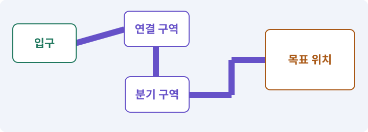

# 045. 무작위 방과 통로 만들기

**목표:** 겹치지 않는 방이 통로로 이어집니다.

**시작 상태:** 시드와 논리 Layout 데이터

## 한눈에 보는 기능의 흐름

방 배치 → 겹침 검사 → 통로 연결 → 입구·보스 배정



**경계:** 연결이 끊긴 방은 유효한 던전이 아님

그림은 실제 게임 실행 결과가 아닙니다. 값·규칙과 예제를 필요한 때 펼쳐 읽고 현재 단계의 메시지를 한 번씩 보냅니다.

## 1. 지금 상태 확인하기

첫 메시지를 보내 현재 준비 상태를 확인합니다. AI가 읽어 온 실제 프로젝트가 맞는지 보고, 없는 준비나 다른 상태가 있으면 먼저 알려 주세요. 아직 기능을 만들지 않는 단계입니다.

### AI에게 보낼 요구와 이유

#### 01. 작업 대상부터 확인

**“무작위 방과 통로 만들기” 작업을 시작하기 전에 현재 상태를 읽기 전용으로 확인해 줘.**

왜 이렇게 요청하나요? AI가 다른 프로젝트나 오래된 예제를 보고 작업할 수 있습니다. 실제 경로·파일·현재 기능을 읽게 하면 지금 이어서 작업할 대상을 먼저 맞출 수 있습니다.

#### 02. 작업 대상부터 확인

**필요한 시작 상태는 시드와 논리 Layout 데이터야.**

왜 이렇게 요청하나요? AI가 다른 프로젝트나 오래된 예제를 보고 작업할 수 있습니다. 실제 경로·파일·현재 기능을 읽게 하면 지금 이어서 작업할 대상을 먼저 맞출 수 있습니다.

#### 03. 실제 사용 중인 구현 재사용

**실제 프로젝트와 작업 기록을 읽고 이것이 준비되어 있는지, 이미 같은 기능이 있는지 확인해 줘.**

왜 이렇게 요청하나요? 이름이 비슷한 새 클래스를 또 만들면 기존 화면은 여전히 옛 코드를 사용할 수 있습니다. 실제 호출되는 진입점을 찾아 연결해야 두 구현이 충돌하거나 수정이 반영되지 않는 문제를 막습니다.

#### 04. 현재 상태와 다음 확인 지점 구분

**이번 기능이 연결될 실제 파일·화면·도구와 보존할 기존 동작을 짧게 정리해 줘.**

왜 이렇게 요청하나요? 이미 준비된 기능과 아직 확인하지 못한 기능을 섞으면 불필요한 재설치나 성급한 완료 판정이 생깁니다. 현재 대상과 남은 준비를 나눠 가장 작은 다음 작업을 선택하게 합니다.

#### 05. 조사 단계에서 변경하지 않기

**아직 새 구현·설치·유료 호출·파일 변경은 하지 마.**

왜 이렇게 요청하나요? 현재 상태를 알아보기만 할 때 파일 변경이나 결제가 시작되면 검토 전의 환경이 바뀝니다. 준비 확인과 실제 구현을 나눠 되돌리기 어려운 작업이 먼저 실행되지 않게 합니다.

#### 06. 막힌 준비를 먼저 해결

**준비가 다르면 부족한 항목과 다음에 필요한 작업을 알려 줘.**

왜 이렇게 요청하나요? 빠진 파일·권한·패키지를 있다고 가정하면 다음 구현이 엉뚱한 대상을 만들게 됩니다. 무엇이 없고 무엇을 먼저 해야 하는지 분리하면 불필요한 재작업을 줄일 수 있습니다.

<details>
<summary>보낼 원문 전체 — 설명은 복사되지 않습니다</summary>

```text
“무작위 방과 통로 만들기” 작업을 시작하기 전에 현재 상태를 읽기 전용으로 확인해 줘.
필요한 시작 상태는 시드와 논리 Layout 데이터야. 실제 프로젝트와 작업 기록을 읽고 이것이 준비되어 있는지, 이미 같은 기능이 있는지 확인해 줘.
이번 기능이 연결될 실제 파일·화면·도구와 보존할 기존 동작을 짧게 정리해 줘. 아직 새 구현·설치·유료 호출·파일 변경은 하지 마. 준비가 다르면 부족한 항목과 다음에 필요한 작업을 알려 줘.
```

</details>

**기대 결과:** 실제 바뀌는 방과 통로의 격자 미리보기

### 직접 확인하기

1. AI가 읽은 실제 프로젝트 또는 도구 경로를 확인합니다.
2. 필수 준비가 없다면 문제 해결 요청을 보내고, 준비됐을 때 다음으로 갑니다.

## 2. 필요한 기능 만들기

준비가 확인되면 아래 요청을 보냅니다. AI가 파일·설정·실행을 맡습니다. 변경 범위나 비용 승인이 나오면 내용을 읽고 결정하세요.

### AI에게 보낼 요구와 이유

#### 01. 작업 대상부터 확인

**현재 프로젝트의 실제 파일과 이미 결정한 규칙을 먼저 확인해 줘.**

왜 이렇게 요청하나요? AI가 다른 프로젝트나 오래된 예제를 보고 작업할 수 있습니다. 실제 경로·파일·현재 기능을 읽게 하면 지금 이어서 작업할 대상을 먼저 맞출 수 있습니다.

#### 02. 실제 사용 중인 코드에 연결

**이름이 다른 기존 구현이 있으면 새로 중복 제작하지 말고 그 구현에 연결해 줘.**

왜 이렇게 요청하나요? 예제와 이름이 다르더라도 현재 씬과 입력에서 호출하는 구현이 작업 대상입니다. 같은 기능을 새로 만들기보다 기존 진입점을 확인해 수정이 실제 게임에 반영되고 중복 실행되지 않게 합니다.

#### 03. 논리 지형과 플레이 가능한 지형 검사

**논리 연결도를 실제 격자의 방과 통로로 바꾸는 생성기를 만들어 줘.**

왜 이렇게 요청하나요? 방이 보기 좋게 놓였어도 통로가 끊기거나 출구가 막히면 완주할 수 없습니다. 연결성과 스폰·몸체 이동을 검사하고 실패한 생성은 재현 정보와 함께 복구합니다.

#### 04. 되돌아갈 원본 남기기

**기존 고정 맵은 보존해 줘.**

왜 이렇게 요청하나요? 새 구현이 실패해도 이전 게임과 저장을 복원할 수 있어야 합니다. 현재 내용을 먼저 조사하고 별도 후보에서 작업하면 실험이 유일한 정상본을 망가뜨리는 일을 피할 수 있습니다.

#### 05. 그림 크기와 월드 크기 연결

**64×64 격자에 내부10~14셀의 방8개를 서로3셀 여유를 두고 배치하고, 방들을 잇는 폭4셀 통로를 파 줘.**

왜 이렇게 요청하나요? 픽셀 수만 정하면 게임 안에서의 크기는 정해지지 않습니다. PPU와 배율을 함께 고정해야 자산을 바꿔도 캐릭터·바닥·UI의 크기 관계를 비교할 수 있습니다.

#### 06. 구현할 결과와 조건 고정

**방 배치 시도는400회, 지도 후보는5개를 상한으로 해 줘.**

왜 이렇게 요청하나요? “방 배치 시도는400회, 지도 후보는5개를 상한으로 해 줘”를 명시하면 AI가 무엇을 구현하거나 검사해야 하는지 범위를 좁힐 수 있습니다. 겹치지 않는 방이 통로로 이어집니다. 이 결과를 확인할 때 이 조건이 실제로 반영됐는지 함께 봅니다.

#### 07. 관찰 가능한 기준으로 확인

**방 연결도만 이어졌다고 끝내지 말고 실제 바닥 셀에서 입구→모든 방→보물→보스가 이어지는지 검사해 줘.**

왜 이렇게 요청하나요? 구현 완료라는 설명을 실제 결과로 바꾸기 위한 조건입니다. 요청에 나온 대상과 경계 상황을 확인해 정상 결과뿐 아니라 실패를 어떻게 구분했는지도 남깁니다.

#### 08. 구현할 결과와 조건 고정

**통로가 다른 방의 용도를 침범하는 상황과 지도 바깥으로 나가는 경우를 거부해 줘.**

왜 이렇게 요청하나요? “통로가 다른 방의 용도를 침범하는 상황과 지도 바깥으로 나가는 경우를 거부해 줘”를 명시하면 AI가 무엇을 구현하거나 검사해야 하는지 범위를 좁힐 수 있습니다. 겹치지 않는 방이 통로로 이어집니다. 이 결과를 확인할 때 이 조건이 실제로 반영됐는지 함께 봅니다.

#### 09. 무작위 결과를 재현 가능하게

**생성 결과를 미리보기로 보여 주고 실패 시드·실패 단계·재시도 수를 기록해 줘.**

왜 이렇게 요청하나요? 실패한 맵이나 전리품 결과를 다시 만들 수 있어야 원인을 고칠 수 있습니다. 생성 버전·설정·시드를 함께 기록하고 지형·장식·보상 난수를 분리해 작은 변경의 파급을 줄입니다.

#### 10. 같은 요청의 반복 처리 정의

**끝없는 반복으로 성공을 기다리지 마.**

왜 이렇게 요청하나요? 클릭 연타·재연결·중복 이벤트는 개발과 플레이 중 모두 발생할 수 있습니다. 반복돼도 한 번 처리해야 하는 결과와 매번 새로 처리할 결과를 나눠 데이터가 누적되지 않게 합니다.

#### 11. 점이 아니라 몸체가 지나가게 하기

**아직 Collider2D와 실제 몸체 통과를 확인했다고 하지 마.**

왜 이렇게 요청하나요? 길의 중심점이 연결돼 있어도 반경이 있는 캐릭터는 모서리나 좁은 문에 걸릴 수 있습니다. 실제 몸체 크기로 통과·차단을 확인해야 길찾기 그림과 플레이 결과가 맞습니다.

#### 12. 그림 크기와 월드 크기 연결

**64×64 격자에 내부 크기 10~14셀의 방 8개, 방 간 여유 3셀, 통로 폭 4셀을 적용해 줘.**

왜 이렇게 요청하나요? 픽셀 수만 정하면 게임 안에서의 크기는 정해지지 않습니다. PPU와 배율을 함께 고정해야 자산을 바꿔도 캐릭터·바닥·UI의 크기 관계를 비교할 수 있습니다.

#### 13. 기존 결과를 보호

**최대 배치 시도 400회와 지도 후보 5회의 종료 조건을 유지해 줘.**

왜 이렇게 요청하나요? 새 작업이 이미 정상인 기능이나 자산까지 바꾸면 원인을 추적하기 어렵습니다. 유지할 대상을 명시해 변경 전후를 비교하고 원치 않은 영향을 찾습니다.

#### 14. 구현과 실행은 AI에게 맡기기

**코드·설정·파일 생성·실행은 네가 맡고, 필요한 화면과 결과를 보여 줘.**

왜 이렇게 요청하나요? 설명이나 코드 조각만 받으면 실제 파일 생성·연결·실행이 빠질 수 있습니다. AI가 개발 작업까지 수행하고, 사람은 요구·승인·결과 판단을 맡도록 역할을 분명히 합니다.

#### 15. 막힌 준비를 먼저 해결

**수행하지 못한 작업과 필요한 승인·도구 연결은 구분해서 알려 줘.**

왜 이렇게 요청하나요? 빠진 파일·권한·패키지를 있다고 가정하면 다음 구현이 엉뚱한 대상을 만들게 됩니다. 무엇이 없고 무엇을 먼저 해야 하는지 분리하면 불필요한 재작업을 줄일 수 있습니다.

<details>
<summary>보낼 원문 전체 — 설명은 복사되지 않습니다</summary>

```text
현재 프로젝트의 실제 파일과 이미 결정한 규칙을 먼저 확인해 줘. 이름이 다른 기존 구현이 있으면 새로 중복 제작하지 말고 그 구현에 연결해 줘.

논리 연결도를 실제 격자의 방과 통로로 바꾸는 생성기를 만들어 줘. 기존 고정 맵은 보존해 줘.
64×64 격자에 내부10~14셀의 방8개를 서로3셀 여유를 두고 배치하고, 방들을 잇는 폭4셀 통로를 파 줘. 방 배치 시도는400회, 지도 후보는5개를 상한으로 해 줘.
방 연결도만 이어졌다고 끝내지 말고 실제 바닥 셀에서 입구→모든 방→보물→보스가 이어지는지 검사해 줘. 통로가 다른 방의 용도를 침범하는 상황과 지도 바깥으로 나가는 경우를 거부해 줘.
생성 결과를 미리보기로 보여 주고 실패 시드·실패 단계·재시도 수를 기록해 줘. 끝없는 반복으로 성공을 기다리지 마. 아직 Collider2D와 실제 몸체 통과를 확인했다고 하지 마.

64×64 격자에 내부 크기 10~14셀의 방 8개, 방 간 여유 3셀, 통로 폭 4셀을 적용해 줘. 최대 배치 시도 400회와 지도 후보 5회의 종료 조건을 유지해 줘.

코드·설정·파일 생성·실행은 네가 맡고, 필요한 화면과 결과를 보여 줘. 수행하지 못한 작업과 필요한 승인·도구 연결은 구분해서 알려 줘.
```

</details>

**기대 결과:** 확인할 결과: 방 배치·연결·실패 검사를 확인함. AI가 이 상태를 확인할 실제 화면과 변경 내용을 준비합니다. 아직 실행하지 못한 부분은 따로 표시합니다.

### 직접 확인하기

1. 제안서만 반환됐다면 “설명으로 끝내지 말고 승인한 범위의 실제 작업을 수행해 줘”라고 보냅니다.
2. 코드나 설정을 직접 고치라는 안내가 나오면 “작성과 실행은 네가 맡아 줘”라고 요청합니다.

## 3. 결과를 직접 확인하기

먼저 확인 요청을 보내 AI가 검사와 화면을 준비하게 하세요. 그다음 아래 동작을 하나씩 확인합니다.

### AI에게 보낼 요구와 이유

#### 01. 검사할 입력과 관찰 지점 준비

**방금 구현한 기능의 자동 검사와 확인 화면을 준비해 줘.**

왜 이렇게 요청하나요? 정상 예 하나만 보면 실패 조건을 놓치기 쉽습니다. 정상·경계·반례를 실제 입력으로 준비하고 사람이 볼 화면도 맞춰 확인 범위를 분명하게 합니다.

#### 02. 결과를 재확인할 근거 남기기

**정상 동작과 아래 실패 조건을 실제로 검사하고 대상·실행 수·결과를 보여 줘.**

왜 이렇게 요청하나요? “잘 됩니다”라는 요약만으로는 어떤 입력과 버전을 검사했는지 알 수 없습니다. 대상·실행 수·실패 내용·파일을 함께 남겨 같은 조건으로 다시 확인할 수 있게 합니다.

#### 03. 길찾기와 실제 도달을 구분

**자동 검사: 방 역할 합계8, MST 간선7, 모든 필수 목적지 도달 가능이다.**

왜 이렇게 요청하나요? 목적지 표시나 경로 목록이 있다고 캐릭터가 끝까지 갈 수 있는 것은 아닙니다. 이동 가능한 경로와 실제 몸체의 진행을 확인하고 막힌 지점을 성공으로 표시하지 않게 합니다.

#### 04. 같은 요청의 반복 처리 정의

**400회 실패 시 즉시 오류 결과가 나오며 무한 반복하지 않는다.**

왜 이렇게 요청하나요? 클릭 연타·재연결·중복 이벤트는 개발과 플레이 중 모두 발생할 수 있습니다. 반복돼도 한 번 처리해야 하는 결과와 매번 새로 처리할 결과를 나눠 데이터가 누적되지 않게 합니다.

#### 05. 관찰 가능한 기준으로 확인

**끊긴 테스트 맵은 반드시 FAIL 이다.**

왜 이렇게 요청하나요? 구현 완료라는 설명을 실제 결과로 바꾸기 위한 조건입니다. 요청에 나온 대상과 경계 상황을 확인해 정상 결과뿐 아니라 실패를 어떻게 구분했는지도 남깁니다.

#### 06. 무작위 결과를 재현 가능하게

**직접 검사: 시드를 바꾸면 방 위치와 복도가 달라진다.**

왜 이렇게 요청하나요? 실패한 맵이나 전리품 결과를 다시 만들 수 있어야 원인을 고칠 수 있습니다. 생성 버전·설정·시드를 함께 기록하고 지형·장식·보상 난수를 분리해 작은 변경의 파급을 줄입니다.

#### 07. 종료 이후의 상태까지 확인

**출입구가 벽 안에 있거나 보스가 입구 바로 위에 배치되는 사례를 찾고 실패 데이터로 저장한다.**

왜 이렇게 요청하나요? 현재 화면에서 맞는 값도 저장하거나 다시 구성할 때 빠질 수 있습니다. 실제 종료·불러오기 전후에 ID·옵션·장착·진행을 비교해야 유지되는 범위를 확인할 수 있습니다.

#### 08. 사람 검사의 시작점 준비

**내가 조작해야 하는 부분은 실행할 화면과 시작 상태를 준비해 줘.**

왜 이렇게 요청하나요? 같은 기능이라도 시작 상태가 다르면 관찰 결과가 달라집니다. AI가 실행 화면과 재현 위치를 먼저 준비해야 사람이 이동·공격·소리·조작감을 같은 조건에서 확인할 수 있습니다.

#### 09. 사람이 실제로 본 것만 기록

**연결되지 않은 휴대폰의 터치나 사람이 보지 않은 재미·소리 품질을 대신 확인했다고 하지 마.**

왜 이렇게 요청하나요? AI가 준비한 검사와 사람이 직접 플레이하거나 들은 결과는 다른 근거입니다. 관찰하지 않은 조작감·소리·실기기 결과를 임의로 완료 처리하지 않게 합니다.

#### 10. 실제로 실행한 검사만 인정

**테스트 0개와 예전 소스 결과는 현재 성공으로 쓰지 마.**

왜 이렇게 요청하나요? 실행된 검사가 없거나 같은 결과를 중복 집계한 경우는 기능을 확인한 것이 아닙니다. 실행 수와 개별 결과를 함께 확인해야 형식적인 성공 표시를 걸러낼 수 있습니다.

<details>
<summary>보낼 원문 전체 — 설명은 복사되지 않습니다</summary>

```text
방금 구현한 기능의 자동 검사와 확인 화면을 준비해 줘. 정상 동작과 아래 실패 조건을 실제로 검사하고 대상·실행 수·결과를 보여 줘.

자동 검사: 방 역할 합계8, MST 간선7, 모든 필수 목적지 도달 가능이다. 400회 실패 시 즉시 오류 결과가 나오며 무한 반복하지 않는다. 끊긴 테스트 맵은 반드시 FAIL 이다.

직접 검사: 시드를 바꾸면 방 위치와 복도가 달라진다. 출입구가 벽 안에 있거나 보스가 입구 바로 위에 배치되는 사례를 찾고 실패 데이터로 저장한다.

내가 조작해야 하는 부분은 실행할 화면과 시작 상태를 준비해 줘. 연결되지 않은 휴대폰의 터치나 사람이 보지 않은 재미·소리 품질을 대신 확인했다고 하지 마. 테스트 0개와 예전 소스 결과는 현재 성공으로 쓰지 마.
```

</details>

**기대 결과:** 방 배치·연결·실패 검사를 확인함

### 직접 확인하기

1. 다른 시드의 지도를 나란히 봅니다.
2. 막다른 방과 입구·보스 위치를 확인합니다.
3. 일부러 연결을 끊은 지도는 거부되는지 봅니다.

## 4. 결과를 남기고 마무리하기

실제로 본 결과를 아래 메모에 적고 AI에 전달합니다. 결과 저장 요청으로 현재 상태를 남긴 뒤 다음 페이지로 갑니다.

### AI에게 보낼 요구와 이유

#### 01. 결과를 재확인할 근거 남기기

**지금 작업한 “무작위 방과 통로 만들기”의 실제 결과를 정리해 줘.**

왜 이렇게 요청하나요? “잘 됩니다”라는 요약만으로는 어떤 입력과 버전을 검사했는지 알 수 없습니다. 대상·실행 수·실패 내용·파일을 함께 남겨 같은 조건으로 다시 확인할 수 있게 합니다.

#### 02. 다음 작업이 읽을 인수인계

**변경한 기능·파일·현재 후보와 실제 실행한 검사, 남은 문제를 기능 이름으로 기록해 줘.**

왜 이렇게 요청하나요? 새 AI 세션은 이전 대화 전체를 알고 있다고 보장할 수 없습니다. 현재 후보·파일 위치·실행한 검사·남은 일을 남겨야 같은 작업을 반복하지 않고 이어갈 수 있습니다.

#### 03. 사람이 실제로 본 것만 기록

**자동 검사 결과와 내가 직접 확인한 결과를 구분하고, 내 관찰이 아직 없으면 미확인으로 남겨 줘.**

왜 이렇게 요청하나요? AI가 준비한 검사와 사람이 직접 플레이하거나 들은 결과는 다른 근거입니다. 관찰하지 않은 조작감·소리·실기기 결과를 임의로 완료 처리하지 않게 합니다.

#### 04. 다음 작업이 읽을 인수인계

**재시작하거나 다음 작업에서 읽을 기록의 실제 위치를 알려 줘.**

왜 이렇게 요청하나요? 새 AI 세션은 이전 대화 전체를 알고 있다고 보장할 수 없습니다. 현재 후보·파일 위치·실행한 검사·남은 일을 남겨야 같은 작업을 반복하지 않고 이어갈 수 있습니다.

#### 05. 미확인을 완료와 분리

**아직 확인하지 않은 결과를 완료로 채우지 마.**

왜 이렇게 요청하나요? 만들어진 것, 검사에 실패한 것, 아직 확인하지 못한 것을 나눠야 다음 작업을 정확히 고를 수 있습니다. 실행할 조건이 없는 기능을 성공으로 기록하면 뒤에서 원인을 찾기 어려워집니다.

<details>
<summary>보낼 원문 전체 — 설명은 복사되지 않습니다</summary>

```text
지금 작업한 “무작위 방과 통로 만들기”의 실제 결과를 정리해 줘. 변경한 기능·파일·현재 후보와 실제 실행한 검사, 남은 문제를 기능 이름으로 기록해 줘.
자동 검사 결과와 내가 직접 확인한 결과를 구분하고, 내 관찰이 아직 없으면 미확인으로 남겨 줘. 재시작하거나 다음 작업에서 읽을 기록의 실제 위치를 알려 줘. 아직 확인하지 않은 결과를 완료로 채우지 마.
```

</details>

**기대 결과:** 현재 상태·검사 결과·남은 문제·다음에 읽을 기록을 확인할 수 있습니다.

### 직접 확인하기

1. 자동 검사와 내 관찰 결과가 섞이지 않았는지 봅니다.
2. 문제가 남았다면 해결 요청을 보내고 같은 동작을 다시 확인합니다.

## 이 작업에서 사용할 값과 규칙 전체

설계 시작값이며 측정된 성능·게임 성공 결과가 아닙니다. 구현은 AI가 수행합니다.

생성 절차의 강의용 의사코드:

처음에는 루프 간선을 추가하지 않는다. 통과 후 선택 과제로 간선 하나를 더한다. 루프가 생겼을 때 보스 문을 우회할 수 없게 문·벽·방 트리거를 다시 검사한다. 보물방을 항상 막다른 길로 만드는 것은 기본 보장이 아니라 추가 제약이다. 제약을 켰는데 만족하지 못하면 명시적으로 재시도한다.

방의 최소 크기는 벽 바깥이 아니라 플레이 가능한 내부 크기다. 통로 폭은 표시된 바닥뿐 아니라 충돌체와 가장 큰 일반 적의 반지름까지 고려한다. 셀 안에 그려진 장식은 이동 가능 여부를 정하지 않는다. 최종 walkable/blocked 마스크가 정본이다.

## 문제가 있으면

### AI에게 보낼 요구와 이유

#### 01. 논리 지형과 플레이 가능한 지형 검사

**장식만 무작위로 바꾸지 말고 방과 통로 좌표가 달라지는지 보여 줘.**

왜 이렇게 요청하나요? 방이 보기 좋게 놓였어도 통로가 끊기거나 출구가 막히면 완주할 수 없습니다. 연결성과 스폰·몸체 이동을 검사하고 실패한 생성은 재현 정보와 함께 복구합니다.

#### 02. 같은 요청의 반복 처리 정의

**생성 실패를 무한 반복으로 숨기지 마.**

왜 이렇게 요청하나요? 클릭 연타·재연결·중복 이벤트는 개발과 플레이 중 모두 발생할 수 있습니다. 반복돼도 한 번 처리해야 하는 결과와 매번 새로 처리할 결과를 나눠 데이터가 누적되지 않게 합니다.

#### 03. 원인 하나를 좁혀 수정

**새 기능을 추가하지 말고 현재 오류와 실제 로그를 먼저 읽어 줘.**

왜 이렇게 요청하나요? 오류 수정 중 새 기능까지 넣으면 어떤 변경이 문제를 해결하거나 악화했는지 알기 어렵습니다. 원래 재현을 보존하고 작은 변경 뒤 같은 입력과 주변 정상 동작을 다시 확인합니다.

#### 04. 원인 하나를 좁혀 수정

**최소 수정 뒤 같은 재현과 관련 정상 동작을 다시 검사해 줘.**

왜 이렇게 요청하나요? 오류 수정 중 새 기능까지 넣으면 어떤 변경이 문제를 해결하거나 악화했는지 알기 어렵습니다. 원래 재현을 보존하고 작은 변경 뒤 같은 입력과 주변 정상 동작을 다시 확인합니다.

#### 05. 실패도 재현 자료로 보존

**실패 기록은 지우지 마.**

왜 이렇게 요청하나요? 실패한 입력과 로그가 있어야 같은 문제가 다시 생겼을 때 비교할 수 있습니다. 성공 기록으로 덮어쓰지 않고 전후 자료를 남기면 무엇을 고쳤는지 확인할 수 있습니다.

<details>
<summary>보낼 원문 전체 — 설명은 복사되지 않습니다</summary>

```text
장식만 무작위로 바꾸지 말고 방과 통로 좌표가 달라지는지 보여 줘. 생성 실패를 무한 반복으로 숨기지 마.
새 기능을 추가하지 말고 현재 오류와 실제 로그를 먼저 읽어 줘. 최소 수정 뒤 같은 재현과 관련 정상 동작을 다시 검사해 줘. 실패 기록은 지우지 마.
```

</details>

## 새 세션에서 이어가기

### AI에게 보낼 요구와 이유

#### 01. 이어서 할 작업 식별

**“무작위 방과 통로 만들기” 작업을 이어가고 싶어.**

왜 이렇게 요청하나요? 이름으로 재개할 작업을 찾고, 뒤에 이어지는 요청으로 실제 파일·진행 중 작업·기록을 다시 읽게 합니다. 제목만 보고 이전 상태를 기억한다고 가정하지 않습니다.

#### 02. 조회는 상태를 바꾸지 않게

**실제 프로젝트와 내 도구의 작업 기록을 읽고 어디까지 구현·검사됐는지 확인해 줘.**

왜 이렇게 요청하나요? 진행 상황을 물을 때 새 구현이나 유료 호출이 시작되면 단순 확인이 실행 명령이 되어 버립니다. 저장된 근거를 읽어 완료·진행·승인 대기·미검증을 나누게 합니다.

#### 03. 재개 전 중복 작업 방지

**진행 중인 프로세스·승인·미저장 변경을 확인한 뒤 남은 가장 작은 작업부터 안내해 줘.**

왜 이렇게 요청하나요? 대화가 끊겨도 외부 작업은 끝났거나 아직 실행 중일 수 있습니다. 프로세스·승인·미저장 상태를 먼저 읽어 같은 생성·빌드·결제를 두 번 시작하지 않도록 합니다.

#### 04. 되돌아갈 원본 남기기

**기존 성공과 실패 기록은 보존해 줘.**

왜 이렇게 요청하나요? 새 구현이 실패해도 이전 게임과 저장을 복원할 수 있어야 합니다. 현재 내용을 먼저 조사하고 별도 후보에서 작업하면 실험이 유일한 정상본을 망가뜨리는 일을 피할 수 있습니다.

<details>
<summary>보낼 원문 전체 — 설명은 복사되지 않습니다</summary>

```text
“무작위 방과 통로 만들기” 작업을 이어가고 싶어. 실제 프로젝트와 내 도구의 작업 기록을 읽고 어디까지 구현·검사됐는지 확인해 줘. 진행 중인 프로세스·승인·미저장 변경을 확인한 뒤 남은 가장 작은 작업부터 안내해 줘. 기존 성공과 실패 기록은 보존해 줘.
```

</details>

## 왜 이렇게 만드는가

이 장의 첫 구현은 무한한 동굴이 아니라 사각형 방과 복도다. 공간이 달라지는 효과를 얻으면서도 오류를 재현하기 쉽다. ‘랜덤’을 이유로 모든 결과를 허용하지 않는다. 통로가 막히거나 보스방에 갈 수 없으면 생성 실패다.

방을 놓는 작업과 연결하는 작업을 나눈다. 먼저 제한 횟수만큼 사각형을 샘플링하고, 겹치지 않는 방을 모은다. 다음으로 방 중심 사이의 최소 연결 트리로 모든 방을 연결한다. 각 간선을 직각 복도로 파되 복도가 다른 방을 통과하면 실제 통행 연결을 다시 계산한다. 설계 그래프만 검사해서는 안 된다.

## 공식 참고

