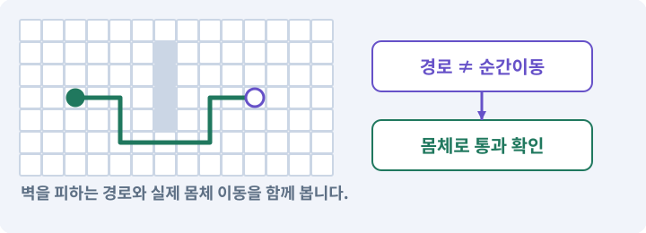

# 046. 랜덤 지도 위를 실제로 걷기

**목표:** 랜덤 던전에서도 벽과 길찾기가 맞습니다.

**시작 상태:** 방·통로 Layout 생성기

## 한눈에 보는 기능의 흐름

논리 격자 → Tilemap·충돌 → 몸체 경로 검사 → 안전한 스폰



**경계:** 새 지형에 이전 경로를 적용하지 않기

그림은 실제 게임 실행 결과가 아닙니다. 값·규칙과 예제를 필요한 때 펼쳐 읽고 현재 단계의 메시지를 한 번씩 보냅니다.

## 1. 지금 상태 확인하기

첫 메시지를 보내 현재 준비 상태를 확인합니다. AI가 읽어 온 실제 프로젝트가 맞는지 보고, 없는 준비나 다른 상태가 있으면 먼저 알려 주세요. 아직 기능을 만들지 않는 단계입니다.

### AI에게 보낼 요구와 이유

#### 01. 작업 대상부터 확인

**“랜덤 지도 위를 실제로 걷기” 작업을 시작하기 전에 현재 상태를 읽기 전용으로 확인해 줘.**

왜 이렇게 요청하나요? AI가 다른 프로젝트나 오래된 예제를 보고 작업할 수 있습니다. 실제 경로·파일·현재 기능을 읽게 하면 지금 이어서 작업할 대상을 먼저 맞출 수 있습니다.

#### 02. 작업 대상부터 확인

**필요한 시작 상태는 방·통로 Layout 생성기야.**

왜 이렇게 요청하나요? AI가 다른 프로젝트나 오래된 예제를 보고 작업할 수 있습니다. 실제 경로·파일·현재 기능을 읽게 하면 지금 이어서 작업할 대상을 먼저 맞출 수 있습니다.

#### 03. 실제 사용 중인 구현 재사용

**실제 프로젝트와 작업 기록을 읽고 이것이 준비되어 있는지, 이미 같은 기능이 있는지 확인해 줘.**

왜 이렇게 요청하나요? 이름이 비슷한 새 클래스를 또 만들면 기존 화면은 여전히 옛 코드를 사용할 수 있습니다. 실제 호출되는 진입점을 찾아 연결해야 두 구현이 충돌하거나 수정이 반영되지 않는 문제를 막습니다.

#### 04. 현재 상태와 다음 확인 지점 구분

**이번 기능이 연결될 실제 파일·화면·도구와 보존할 기존 동작을 짧게 정리해 줘.**

왜 이렇게 요청하나요? 이미 준비된 기능과 아직 확인하지 못한 기능을 섞으면 불필요한 재설치나 성급한 완료 판정이 생깁니다. 현재 대상과 남은 준비를 나눠 가장 작은 다음 작업을 선택하게 합니다.

#### 05. 조사 단계에서 변경하지 않기

**아직 새 구현·설치·유료 호출·파일 변경은 하지 마.**

왜 이렇게 요청하나요? 현재 상태를 알아보기만 할 때 파일 변경이나 결제가 시작되면 검토 전의 환경이 바뀝니다. 준비 확인과 실제 구현을 나눠 되돌리기 어려운 작업이 먼저 실행되지 않게 합니다.

#### 06. 막힌 준비를 먼저 해결

**준비가 다르면 부족한 항목과 다음에 필요한 작업을 알려 줘.**

왜 이렇게 요청하나요? 빠진 파일·권한·패키지를 있다고 가정하면 다음 구현이 엉뚱한 대상을 만들게 됩니다. 무엇이 없고 무엇을 먼저 해야 하는지 분리하면 불필요한 재작업을 줄일 수 있습니다.

<details>
<summary>보낼 원문 전체 — 설명은 복사되지 않습니다</summary>

```text
“랜덤 지도 위를 실제로 걷기” 작업을 시작하기 전에 현재 상태를 읽기 전용으로 확인해 줘.
필요한 시작 상태는 방·통로 Layout 생성기야. 실제 프로젝트와 작업 기록을 읽고 이것이 준비되어 있는지, 이미 같은 기능이 있는지 확인해 줘.
이번 기능이 연결될 실제 파일·화면·도구와 보존할 기존 동작을 짧게 정리해 줘. 아직 새 구현·설치·유료 호출·파일 변경은 하지 마. 준비가 다르면 부족한 항목과 다음에 필요한 작업을 알려 줘.
```

</details>

**기대 결과:** 지도 데이터와 실제 타일·충돌의 연결 상태

### 직접 확인하기

1. AI가 읽은 실제 프로젝트 또는 도구 경로를 확인합니다.
2. 필수 준비가 없다면 문제 해결 요청을 보내고, 준비됐을 때 다음으로 갑니다.

## 2. 필요한 기능 만들기

준비가 확인되면 아래 요청을 보냅니다. AI가 파일·설정·실행을 맡습니다. 변경 범위나 비용 승인이 나오면 내용을 읽고 결정하세요.

### AI에게 보낼 요구와 이유

#### 01. 작업 대상부터 확인

**현재 프로젝트의 실제 파일과 이미 결정한 규칙을 먼저 확인해 줘.**

왜 이렇게 요청하나요? AI가 다른 프로젝트나 오래된 예제를 보고 작업할 수 있습니다. 실제 경로·파일·현재 기능을 읽게 하면 지금 이어서 작업할 대상을 먼저 맞출 수 있습니다.

#### 02. 실제 사용 중인 코드에 연결

**이름이 다른 기존 구현이 있으면 새로 중복 제작하지 말고 그 구현에 연결해 줘.**

왜 이렇게 요청하나요? 예제와 이름이 다르더라도 현재 씬과 입력에서 호출하는 구현이 작업 대상입니다. 같은 기능을 새로 만들기보다 기존 진입점을 확인해 수정이 실제 게임에 반영되고 중복 실행되지 않게 합니다.

#### 03. 논리 지도·DungeonLayout의 적용 조건

**생성한 논리 지도를 실제 2D 던전으로 연결해 줘.**

왜 이렇게 요청하나요? 논리 지도는 그림과 상관없이 방·통로·문·스폰 후보를 표현한 데이터입니다. 이를 2D Tilemap과 3D 메시가 각각 화면과 충돌로 바꿉니다. Layout이라는 단어는 UI 배치에도 쓰입니다. 여기서는 던전의 논리 배치 데이터입니다.

#### 04. 길찾기와 실제 도달을 구분

**Floor·WallsCollision·WallArt·Decor를 나누고 같은 바닥·차단 셀을 Tilemap과 A*가 사용하게 해 줘.**

왜 이렇게 요청하나요? 목적지 표시나 경로 목록이 있다고 캐릭터가 끝까지 갈 수 있는 것은 아닙니다. 이동 가능한 경로와 실제 몸체의 진행을 확인하고 막힌 지점을 성공으로 표시하지 않게 합니다.

#### 05. 관찰 가능한 기준으로 확인

**타일과 Collider2D 갱신이 끝난 뒤 플레이어 반경0.35와 여유0.02로 실제 통과를 검사해 줘.**

왜 이렇게 요청하나요? 구현 완료라는 설명을 실제 결과로 바꾸기 위한 조건입니다. 요청에 나온 대상과 경계 상황을 확인해 정상 결과뿐 아니라 실패를 어떻게 구분했는지도 남깁니다.

#### 06. 점이 아니라 몸체가 지나가게 하기

**문·통로·모서리·보스 접근이 유효한 위치에만 스폰해 줘.**

왜 이렇게 요청하나요? 길의 중심점이 연결돼 있어도 반경이 있는 캐릭터는 모서리나 좁은 문에 걸릴 수 있습니다. 실제 몸체 크기로 통과·차단을 확인해야 길찾기 그림과 플레이 결과가 맞습니다.

#### 07. 구현할 결과와 조건 고정

**장식 그림의 외곽을 이동 충돌로 사용하지 말고, 지형 생성이 끝나기 전에 플레이어나 적을 활성화하지 마.**

왜 이렇게 요청하나요? “장식 그림의 외곽을 이동 충돌로 사용하지 말고, 지형 생성이 끝나기 전에 플레이어나 적을 활성화하지 마”를 명시하면 AI가 무엇을 구현하거나 검사해야 하는지 범위를 좁힐 수 있습니다. 랜덤 던전에서도 벽과 길찾기가 맞습니다. 이 결과를 확인할 때 이 조건이 실제로 반영됐는지 함께 봅니다.

#### 08. 늦게 온 결과가 최신 작업을 덮지 않기

**생성마다 ID와 소유 Root를 두어 취소한 이전 작업의 늦은 완료가 새 맵을 덮지 않게 해 줘.**

왜 이렇게 요청하나요? AI 생성이나 다운로드가 진행되는 동안 원본과 선택이 바뀔 수 있습니다. 요청 ID·기준 버전·취소 상태를 대조해야 이전 결과가 최신 편집을 덮어쓰지 않습니다.

#### 09. 같은 요청의 반복 처리 정의

**반복 입장 뒤 이전 타일·충돌·경로가 남지 않는지 확인해 줘.**

왜 이렇게 요청하나요? 클릭 연타·재연결·중복 이벤트는 개발과 플레이 중 모두 발생할 수 있습니다. 반복돼도 한 번 처리해야 하는 결과와 매번 새로 처리할 결과를 나눠 데이터가 누적되지 않게 합니다.

#### 10. 무작위 결과를 재현 가능하게

**같은 시드의 논리 미리보기와 실제 걸을 수 있는 던전을 함께 보여 줘.**

왜 이렇게 요청하나요? 실패한 맵이나 전리품 결과를 다시 만들 수 있어야 원인을 고칠 수 있습니다. 생성 버전·설정·시드를 함께 기록하고 지형·장식·보상 난수를 분리해 작은 변경의 파급을 줄입니다.

#### 11. 구현과 실행은 AI에게 맡기기

**코드·설정·파일 생성·실행은 네가 맡고, 필요한 화면과 결과를 보여 줘.**

왜 이렇게 요청하나요? 설명이나 코드 조각만 받으면 실제 파일 생성·연결·실행이 빠질 수 있습니다. AI가 개발 작업까지 수행하고, 사람은 요구·승인·결과 판단을 맡도록 역할을 분명히 합니다.

#### 12. 막힌 준비를 먼저 해결

**수행하지 못한 작업과 필요한 승인·도구 연결은 구분해서 알려 줘.**

왜 이렇게 요청하나요? 빠진 파일·권한·패키지를 있다고 가정하면 다음 구현이 엉뚱한 대상을 만들게 됩니다. 무엇이 없고 무엇을 먼저 해야 하는지 분리하면 불필요한 재작업을 줄일 수 있습니다.

<details>
<summary>보낼 원문 전체 — 설명은 복사되지 않습니다</summary>

```text
현재 프로젝트의 실제 파일과 이미 결정한 규칙을 먼저 확인해 줘. 이름이 다른 기존 구현이 있으면 새로 중복 제작하지 말고 그 구현에 연결해 줘.

생성한 논리 지도를 실제 2D 던전으로 연결해 줘. Floor·WallsCollision·WallArt·Decor를 나누고 같은 바닥·차단 셀을 Tilemap과 A*가 사용하게 해 줘.
타일과 Collider2D 갱신이 끝난 뒤 플레이어 반경0.35와 여유0.02로 실제 통과를 검사해 줘. 문·통로·모서리·보스 접근이 유효한 위치에만 스폰해 줘.
장식 그림의 외곽을 이동 충돌로 사용하지 말고, 지형 생성이 끝나기 전에 플레이어나 적을 활성화하지 마.
생성마다 ID와 소유 Root를 두어 취소한 이전 작업의 늦은 완료가 새 맵을 덮지 않게 해 줘. 반복 입장 뒤 이전 타일·충돌·경로가 남지 않는지 확인해 줘.
같은 시드의 논리 미리보기와 실제 걸을 수 있는 던전을 함께 보여 줘.

코드·설정·파일 생성·실행은 네가 맡고, 필요한 화면과 결과를 보여 줘. 수행하지 못한 작업과 필요한 승인·도구 연결은 구분해서 알려 줘.
```

</details>

**기대 결과:** 확인할 결과: 실제 몸체 이동과 재생성을 확인함. AI가 이 상태를 확인할 실제 화면과 변경 내용을 준비합니다. 아직 실행하지 못한 부분은 따로 표시합니다.

### 직접 확인하기

1. 제안서만 반환됐다면 “설명으로 끝내지 말고 승인한 범위의 실제 작업을 수행해 줘”라고 보냅니다.
2. 코드나 설정을 직접 고치라는 안내가 나오면 “작성과 실행은 네가 맡아 줘”라고 요청합니다.

## 3. 결과를 직접 확인하기

먼저 확인 요청을 보내 AI가 검사와 화면을 준비하게 하세요. 그다음 아래 동작을 하나씩 확인합니다.

### AI에게 보낼 요구와 이유

#### 01. 검사할 입력과 관찰 지점 준비

**방금 구현한 기능의 자동 검사와 확인 화면을 준비해 줘.**

왜 이렇게 요청하나요? 정상 예 하나만 보면 실패 조건을 놓치기 쉽습니다. 정상·경계·반례를 실제 입력으로 준비하고 사람이 볼 화면도 맞춰 확인 범위를 분명하게 합니다.

#### 02. 결과를 재확인할 근거 남기기

**정상 동작과 아래 실패 조건을 실제로 검사하고 대상·실행 수·결과를 보여 줘.**

왜 이렇게 요청하나요? “잘 됩니다”라는 요약만으로는 어떤 입력과 버전을 검사했는지 알 수 없습니다. 대상·실행 수·실패 내용·파일을 함께 남겨 같은 조건으로 다시 확인할 수 있게 합니다.

#### 03. Tilemap·Tile·타일 팔레트의 적용 조건

**논리셀과 실제 Tilemap/벽shape가 일치한다.**

왜 이렇게 요청하나요? Tile은 칸에 놓을 그림과 속성을 가진 자료이고, Tilemap은 많은 칸의 타일 배치를 관리하는 컴포넌트입니다. 팔레트는 타일을 고르는 목록이며 생성 규칙 자체는 아닙니다. 예쁜 바닥 그림을 놓았다고 A*의 이동 가능 칸도 자동 갱신되지는 않습니다.

#### 04. 구현할 결과와 조건 고정

**새 지형이 준비되기 전 캐릭터가 움직이지 않는다.**

왜 이렇게 요청하나요? “새 지형이 준비되기 전 캐릭터가 움직이지 않는다”를 명시하면 AI가 무엇을 구현하거나 검사해야 하는지 범위를 좁힐 수 있습니다. 랜덤 던전에서도 벽과 길찾기가 맞습니다. 이 결과를 확인할 때 이 조건이 실제로 반영됐는지 함께 봅니다.

#### 05. 구현할 결과와 조건 고정

**적 27마리와 보물·보스에 접근할 수 있다.**

왜 이렇게 요청하나요? “적 27마리와 보물·보스에 접근할 수 있다”를 명시하면 AI가 무엇을 구현하거나 검사해야 하는지 범위를 좁힐 수 있습니다. 랜덤 던전에서도 벽과 길찾기가 맞습니다. 이 결과를 확인할 때 이 조건이 실제로 반영됐는지 함께 봅니다.

#### 06. 구현할 결과와 조건 고정

**취소한 맵의 적이 나중에 나타나지 않는다.**

왜 이렇게 요청하나요? “취소한 맵의 적이 나중에 나타나지 않는다”를 명시하면 AI가 무엇을 구현하거나 검사해야 하는지 범위를 좁힐 수 있습니다. 랜덤 던전에서도 벽과 길찾기가 맞습니다. 이 결과를 확인할 때 이 조건이 실제로 반영됐는지 함께 봅니다.

#### 07. 사람 검사의 시작점 준비

**내가 조작해야 하는 부분은 실행할 화면과 시작 상태를 준비해 줘.**

왜 이렇게 요청하나요? 같은 기능이라도 시작 상태가 다르면 관찰 결과가 달라집니다. AI가 실행 화면과 재현 위치를 먼저 준비해야 사람이 이동·공격·소리·조작감을 같은 조건에서 확인할 수 있습니다.

#### 08. 사람이 실제로 본 것만 기록

**연결되지 않은 휴대폰의 터치나 사람이 보지 않은 재미·소리 품질을 대신 확인했다고 하지 마.**

왜 이렇게 요청하나요? AI가 준비한 검사와 사람이 직접 플레이하거나 들은 결과는 다른 근거입니다. 관찰하지 않은 조작감·소리·실기기 결과를 임의로 완료 처리하지 않게 합니다.

#### 09. 실제로 실행한 검사만 인정

**테스트 0개와 예전 소스 결과는 현재 성공으로 쓰지 마.**

왜 이렇게 요청하나요? 실행된 검사가 없거나 같은 결과를 중복 집계한 경우는 기능을 확인한 것이 아닙니다. 실행 수와 개별 결과를 함께 확인해야 형식적인 성공 표시를 걸러낼 수 있습니다.

<details>
<summary>보낼 원문 전체 — 설명은 복사되지 않습니다</summary>

```text
방금 구현한 기능의 자동 검사와 확인 화면을 준비해 줘. 정상 동작과 아래 실패 조건을 실제로 검사하고 대상·실행 수·결과를 보여 줘.

논리셀과 실제 Tilemap/벽shape가 일치한다. 새 지형이 준비되기 전 캐릭터가 움직이지 않는다. 적 27마리와 보물·보스에 접근할 수 있다. 취소한 맵의 적이 나중에 나타나지 않는다.

내가 조작해야 하는 부분은 실행할 화면과 시작 상태를 준비해 줘. 연결되지 않은 휴대폰의 터치나 사람이 보지 않은 재미·소리 품질을 대신 확인했다고 하지 마. 테스트 0개와 예전 소스 결과는 현재 성공으로 쓰지 마.
```

</details>

**기대 결과:** 벽 그림과 충돌·경로가 일치하고, 목적지뿐 아니라 몸체 전체가 통과합니다.

### 직접 확인하기

1. 생성된 던전의 입구에서 보스방까지 걸어갑니다.
2. 좁은 모서리와 문 주변을 통과해 봅니다.
3. 다시 생성한 뒤 옛 경로와 충돌이 남지 않는지 봅니다.

## 4. 결과를 남기고 마무리하기

실제로 본 결과를 아래 메모에 적고 AI에 전달합니다. 결과 저장 요청으로 현재 상태를 남긴 뒤 다음 페이지로 갑니다.

### AI에게 보낼 요구와 이유

#### 01. 결과를 재확인할 근거 남기기

**지금 작업한 “랜덤 지도 위를 실제로 걷기”의 실제 결과를 정리해 줘.**

왜 이렇게 요청하나요? “잘 됩니다”라는 요약만으로는 어떤 입력과 버전을 검사했는지 알 수 없습니다. 대상·실행 수·실패 내용·파일을 함께 남겨 같은 조건으로 다시 확인할 수 있게 합니다.

#### 02. 다음 작업이 읽을 인수인계

**변경한 기능·파일·현재 후보와 실제 실행한 검사, 남은 문제를 기능 이름으로 기록해 줘.**

왜 이렇게 요청하나요? 새 AI 세션은 이전 대화 전체를 알고 있다고 보장할 수 없습니다. 현재 후보·파일 위치·실행한 검사·남은 일을 남겨야 같은 작업을 반복하지 않고 이어갈 수 있습니다.

#### 03. 사람이 실제로 본 것만 기록

**자동 검사 결과와 내가 직접 확인한 결과를 구분하고, 내 관찰이 아직 없으면 미확인으로 남겨 줘.**

왜 이렇게 요청하나요? AI가 준비한 검사와 사람이 직접 플레이하거나 들은 결과는 다른 근거입니다. 관찰하지 않은 조작감·소리·실기기 결과를 임의로 완료 처리하지 않게 합니다.

#### 04. 다음 작업이 읽을 인수인계

**재시작하거나 다음 작업에서 읽을 기록의 실제 위치를 알려 줘.**

왜 이렇게 요청하나요? 새 AI 세션은 이전 대화 전체를 알고 있다고 보장할 수 없습니다. 현재 후보·파일 위치·실행한 검사·남은 일을 남겨야 같은 작업을 반복하지 않고 이어갈 수 있습니다.

#### 05. 미확인을 완료와 분리

**아직 확인하지 않은 결과를 완료로 채우지 마.**

왜 이렇게 요청하나요? 만들어진 것, 검사에 실패한 것, 아직 확인하지 못한 것을 나눠야 다음 작업을 정확히 고를 수 있습니다. 실행할 조건이 없는 기능을 성공으로 기록하면 뒤에서 원인을 찾기 어려워집니다.

<details>
<summary>보낼 원문 전체 — 설명은 복사되지 않습니다</summary>

```text
지금 작업한 “랜덤 지도 위를 실제로 걷기”의 실제 결과를 정리해 줘. 변경한 기능·파일·현재 후보와 실제 실행한 검사, 남은 문제를 기능 이름으로 기록해 줘.
자동 검사 결과와 내가 직접 확인한 결과를 구분하고, 내 관찰이 아직 없으면 미확인으로 남겨 줘. 재시작하거나 다음 작업에서 읽을 기록의 실제 위치를 알려 줘. 아직 확인하지 않은 결과를 완료로 채우지 마.
```

</details>

**기대 결과:** 현재 상태·검사 결과·남은 문제·다음에 읽을 기록을 확인할 수 있습니다.

### 직접 확인하기

1. 자동 검사와 내 관찰 결과가 섞이지 않았는지 봅니다.
2. 문제가 남았다면 해결 요청을 보내고 같은 동작을 다시 확인합니다.

## 구체적인 예로 이해하기

### 타일 그림·충돌·경로의 일치

무작위 지도는 그림, 몸체가 막히는 곳, 길찾기 격자가 같은 Layout을 해석해야 합니다.

**시작 상태:** 같은 시드와 생성 버전으로 방과 통로 데이터가 준비되어 있습니다.

**직접 해 볼 동작:** 바닥·벽을 만든 뒤 실제 몸체로 입구에서 보스방까지 이동하고 필수 상호작용 지점에 접근합니다.

**보여야 하는 결과:** 벽 그림과 충돌·경로가 일치하고, 목적지뿐 아니라 몸체 전체가 통과합니다.

**이렇게 되면 아직 안 됩니다:** 통로 타일은 바뀌었지만 이전 콜라이더나 캐시된 경로가 남습니다.

**생각해 보기:** 같은 시드라면 생성 알고리즘을 바꿔도 지도가 같을까요?

<details><summary>해설 보기</summary>

보장되지 않습니다. 시드뿐 아니라 알고리즘 버전·설정·난수 소비 순서도 결과의 일부입니다.

</details>

## 이 작업에서 사용할 값과 규칙 전체

설계 시작값이며 측정된 성능·게임 성공 결과가 아닙니다. 구현은 AI가 수행합니다.

준비 단계는 `Preparing → PaintingTiles → UpdatingColliders → BuildingPathGrid → Validating → Spawning → Ready`다. 실패는 Failed로 보내고 새 후보/고정 맵 복구/마을 안내를 선택한다. Ready 전에는 이동·공격·적 AI·입장연출을 활성화하지 않는다.

Floor Tilemap에는 Collider가 없다. WallsCollision은 blocked 셀 사각형,WallArt/Decor는 표시용이다. 한셀마다 GameObject를 만들기보다 Tilemap에 묶어 넣는다. Grid 원점·cellSize·tile anchor는 좌표 변환 함수와 맞춘다.64×64 범위 밖은 blocked로 취급한다.

스폰은 플레이어반경0.35와 거구반경의 실제값을 검사한다. 단순 빈cell 검사뿐 아니라 OverlapCircle, 연결 영역, 문/상자 접근점의 여유를 확인한다. 출입구에서 보스까지 A\* 완전경로와 실제 모터 통과를 검사한다.

재생성은 generationId를 사용한다. 이전 세대가 늦게 준비완료를 보내도 현재 맵에 적을 소환하지 않는다. 이전 Tilemap, 경로캐시, 적, 구독을 제거하되 영구플레이어 데이터는 보존한다.

## 문제가 있으면

### AI에게 보낼 요구와 이유

#### 01. 점이 아니라 몸체가 지나가게 하기

**그래프 연결만 확인하지 말고 첫 통과 실패 구간의 타일·충돌·반경 여유를 겹쳐 표시해 줘.**

왜 이렇게 요청하나요? 길의 중심점이 연결돼 있어도 반경이 있는 캐릭터는 모서리나 좁은 문에 걸릴 수 있습니다. 실제 몸체 크기로 통과·차단을 확인해야 길찾기 그림과 플레이 결과가 맞습니다.

#### 02. 원인 하나를 좁혀 수정

**새 기능을 추가하지 말고 현재 오류와 실제 로그를 먼저 읽어 줘.**

왜 이렇게 요청하나요? 오류 수정 중 새 기능까지 넣으면 어떤 변경이 문제를 해결하거나 악화했는지 알기 어렵습니다. 원래 재현을 보존하고 작은 변경 뒤 같은 입력과 주변 정상 동작을 다시 확인합니다.

#### 03. 원인 하나를 좁혀 수정

**최소 수정 뒤 같은 재현과 관련 정상 동작을 다시 검사해 줘.**

왜 이렇게 요청하나요? 오류 수정 중 새 기능까지 넣으면 어떤 변경이 문제를 해결하거나 악화했는지 알기 어렵습니다. 원래 재현을 보존하고 작은 변경 뒤 같은 입력과 주변 정상 동작을 다시 확인합니다.

#### 04. 실패도 재현 자료로 보존

**실패 기록은 지우지 마.**

왜 이렇게 요청하나요? 실패한 입력과 로그가 있어야 같은 문제가 다시 생겼을 때 비교할 수 있습니다. 성공 기록으로 덮어쓰지 않고 전후 자료를 남기면 무엇을 고쳤는지 확인할 수 있습니다.

<details>
<summary>보낼 원문 전체 — 설명은 복사되지 않습니다</summary>

```text
그래프 연결만 확인하지 말고 첫 통과 실패 구간의 타일·충돌·반경 여유를 겹쳐 표시해 줘.
새 기능을 추가하지 말고 현재 오류와 실제 로그를 먼저 읽어 줘. 최소 수정 뒤 같은 재현과 관련 정상 동작을 다시 검사해 줘. 실패 기록은 지우지 마.
```

</details>

## 새 세션에서 이어가기

### AI에게 보낼 요구와 이유

#### 01. 이어서 할 작업 식별

**“랜덤 지도 위를 실제로 걷기” 작업을 이어가고 싶어.**

왜 이렇게 요청하나요? 이름으로 재개할 작업을 찾고, 뒤에 이어지는 요청으로 실제 파일·진행 중 작업·기록을 다시 읽게 합니다. 제목만 보고 이전 상태를 기억한다고 가정하지 않습니다.

#### 02. 조회는 상태를 바꾸지 않게

**실제 프로젝트와 내 도구의 작업 기록을 읽고 어디까지 구현·검사됐는지 확인해 줘.**

왜 이렇게 요청하나요? 진행 상황을 물을 때 새 구현이나 유료 호출이 시작되면 단순 확인이 실행 명령이 되어 버립니다. 저장된 근거를 읽어 완료·진행·승인 대기·미검증을 나누게 합니다.

#### 03. 재개 전 중복 작업 방지

**진행 중인 프로세스·승인·미저장 변경을 확인한 뒤 남은 가장 작은 작업부터 안내해 줘.**

왜 이렇게 요청하나요? 대화가 끊겨도 외부 작업은 끝났거나 아직 실행 중일 수 있습니다. 프로세스·승인·미저장 상태를 먼저 읽어 같은 생성·빌드·결제를 두 번 시작하지 않도록 합니다.

#### 04. 되돌아갈 원본 남기기

**기존 성공과 실패 기록은 보존해 줘.**

왜 이렇게 요청하나요? 새 구현이 실패해도 이전 게임과 저장을 복원할 수 있어야 합니다. 현재 내용을 먼저 조사하고 별도 후보에서 작업하면 실험이 유일한 정상본을 망가뜨리는 일을 피할 수 있습니다.

<details>
<summary>보낼 원문 전체 — 설명은 복사되지 않습니다</summary>

```text
“랜덤 지도 위를 실제로 걷기” 작업을 이어가고 싶어. 실제 프로젝트와 내 도구의 작업 기록을 읽고 어디까지 구현·검사됐는지 확인해 줘. 진행 중인 프로세스·승인·미저장 변경을 확인한 뒤 남은 가장 작은 작업부터 안내해 줘. 기존 성공과 실패 기록은 보존해 줘.
```

</details>

## 왜 이렇게 만드는가

논리 지도는 아직 게임 공간이 아니다. Tilemap·Collider2D·clearance·A\*를 한 LayoutData에서 만든다. 서로 다른 난수로 벽표시와 이동영역을 만들지 않는다. 가장 중요한 준비 완료 조건은 **보이는 길·막힌셀·실제 몸체가 일치한다**는 것이다.

Tilemap의 collider 형상 갱신은 타일을 넣는 함수가 끝난 즉시 반영된다고 가정하지 않는다. TilemapCollider2D의 변경 처리를 확인하고 필요하면 ProcessTilemapChanges를 호출한다. CompositeCollider2D를 사용한다면 그 형상도 현재 버전의 설정에 따라 갱신한 뒤 조회한다. [D08][D09]

## 공식 참고

- [Tilemap Collider 2D and pending tile changes](https://docs.unity3d.com/6000.3/Documentation/Manual/tilemaps/work-with-tilemaps/tilemap-collider-2d.html)
- [Composite Collider 2D reference](https://docs.unity3d.com/6000.3/Documentation/Manual/2d-physics/collider/composite-collider/composite-collider-2d-reference.html)
