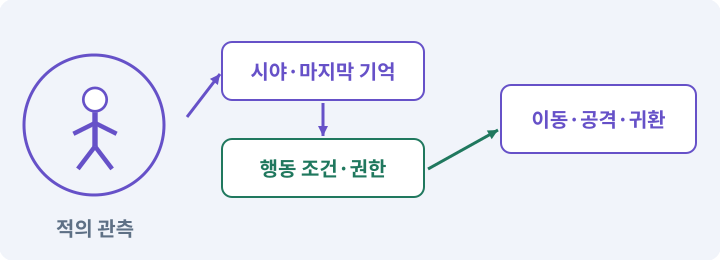

# 051. 전투 전체의 압박 조절하기

**목표:** 적 조합과 보스 행동을 이해하고 조정합니다.

**시작 상태:** 개별 적 AI와 공격권

## 한눈에 보는 기능의 흐름

조우 역할 조합 → 압박 예산 → 보스 패턴 선택 → 예약·종료 정리



**경계:** 제거된 적의 예약이 전투를 멈추지 않기

그림은 실제 게임 실행 결과가 아닙니다. 값·규칙과 예제를 필요한 때 펼쳐 읽고 현재 단계의 메시지를 한 번씩 보냅니다.

## 1. 지금 상태 확인하기

첫 메시지를 보내 현재 준비 상태를 확인합니다. AI가 읽어 온 실제 프로젝트가 맞는지 보고, 없는 준비나 다른 상태가 있으면 먼저 알려 주세요. 아직 기능을 만들지 않는 단계입니다.

### AI에게 보낼 요구와 이유

#### 01. 작업 대상부터 확인

**“전투 전체의 압박 조절하기” 작업을 시작하기 전에 현재 상태를 읽기 전용으로 확인해 줘.**

왜 이렇게 요청하나요? AI가 다른 프로젝트나 오래된 예제를 보고 작업할 수 있습니다. 실제 경로·파일·현재 기능을 읽게 하면 지금 이어서 작업할 대상을 먼저 맞출 수 있습니다.

#### 02. 적의 접근과 동시 공격을 배분

**필요한 시작 상태는 개별 적 AI와 공격권야.**

왜 이렇게 요청하나요? 여러 적이 같은 위치로 겹쳐 한꺼번에 공격하면 회피할 여지가 줄어듭니다. 접근 위치와 공격 권한을 배분하고 죽거나 취소할 때 반환해야 다른 적도 막힘 없이 행동합니다.

#### 03. 실제 사용 중인 구현 재사용

**실제 프로젝트와 작업 기록을 읽고 이것이 준비되어 있는지, 이미 같은 기능이 있는지 확인해 줘.**

왜 이렇게 요청하나요? 이름이 비슷한 새 클래스를 또 만들면 기존 화면은 여전히 옛 코드를 사용할 수 있습니다. 실제 호출되는 진입점을 찾아 연결해야 두 구현이 충돌하거나 수정이 반영되지 않는 문제를 막습니다.

#### 04. 현재 상태와 다음 확인 지점 구분

**이번 기능이 연결될 실제 파일·화면·도구와 보존할 기존 동작을 짧게 정리해 줘.**

왜 이렇게 요청하나요? 이미 준비된 기능과 아직 확인하지 못한 기능을 섞으면 불필요한 재설치나 성급한 완료 판정이 생깁니다. 현재 대상과 남은 준비를 나눠 가장 작은 다음 작업을 선택하게 합니다.

#### 05. 조사 단계에서 변경하지 않기

**아직 새 구현·설치·유료 호출·파일 변경은 하지 마.**

왜 이렇게 요청하나요? 현재 상태를 알아보기만 할 때 파일 변경이나 결제가 시작되면 검토 전의 환경이 바뀝니다. 준비 확인과 실제 구현을 나눠 되돌리기 어려운 작업이 먼저 실행되지 않게 합니다.

#### 06. 막힌 준비를 먼저 해결

**준비가 다르면 부족한 항목과 다음에 필요한 작업을 알려 줘.**

왜 이렇게 요청하나요? 빠진 파일·권한·패키지를 있다고 가정하면 다음 구현이 엉뚱한 대상을 만들게 됩니다. 무엇이 없고 무엇을 먼저 해야 하는지 분리하면 불필요한 재작업을 줄일 수 있습니다.

<details>
<summary>보낼 원문 전체 — 설명은 복사되지 않습니다</summary>

```text
“전투 전체의 압박 조절하기” 작업을 시작하기 전에 현재 상태를 읽기 전용으로 확인해 줘.
필요한 시작 상태는 개별 적 AI와 공격권야. 실제 프로젝트와 작업 기록을 읽고 이것이 준비되어 있는지, 이미 같은 기능이 있는지 확인해 줘.
이번 기능이 연결될 실제 파일·화면·도구와 보존할 기존 동작을 짧게 정리해 줘. 아직 새 구현·설치·유료 호출·파일 변경은 하지 마. 준비가 다르면 부족한 항목과 다음에 필요한 작업을 알려 줘.
```

</details>

**기대 결과:** 전투 예산과 현재 공격·대기 상태

### 직접 확인하기

1. AI가 읽은 실제 프로젝트 또는 도구 경로를 확인합니다.
2. 필수 준비가 없다면 문제 해결 요청을 보내고, 준비됐을 때 다음으로 갑니다.

## 2. 필요한 기능 만들기

준비가 확인되면 아래 요청을 보냅니다. AI가 파일·설정·실행을 맡습니다. 변경 범위나 비용 승인이 나오면 내용을 읽고 결정하세요.

### AI에게 보낼 요구와 이유

#### 01. 작업 대상부터 확인

**현재 프로젝트의 실제 파일과 이미 결정한 규칙을 먼저 확인해 줘.**

왜 이렇게 요청하나요? AI가 다른 프로젝트나 오래된 예제를 보고 작업할 수 있습니다. 실제 경로·파일·현재 기능을 읽게 하면 지금 이어서 작업할 대상을 먼저 맞출 수 있습니다.

#### 02. 실제 사용 중인 코드에 연결

**이름이 다른 기존 구현이 있으면 새로 중복 제작하지 말고 그 구현에 연결해 줘.**

왜 이렇게 요청하나요? 예제와 이름이 다르더라도 현재 씬과 입력에서 호출하는 구현이 작업 대상입니다. 같은 기능을 새로 만들기보다 기존 진입점을 확인해 수정이 실제 게임에 반영되고 중복 실행되지 않게 합니다.

#### 03. 조우·전투 감독·페이즈의 적용 조건

**전투 방의 적 조합과 보스 행동을 조율하는 전투 감독을 만들어 줘.**

왜 이렇게 요청하나요? 조우는 하나의 전투 상황에 배치된 적·공간·보상·위험의 묶음입니다. 전투 감독은 전체 압박을 조절하고, 보스 페이즈는 체력·사건 등에 따라 달라지는 행동 구간입니다. 적 수를 늘리는 것만으로 재미가 늘지는 않습니다. 회피 공간·예고·반격 기회가 있어야 합니다.

#### 04. 기존 결과를 보호

**적 개별 판단과 피해 규칙은 유지해 줘.**

왜 이렇게 요청하나요? 새 작업이 이미 정상인 기능이나 자산까지 바꾸면 원인을 추적하기 어렵습니다. 유지할 대상을 명시해 변경 전후를 비교하고 원치 않은 영향을 찾습니다.

#### 05. 적의 접근과 동시 공격을 배분

**근접 압박·원거리 사격·거구 예고가 한 화면에서 읽히도록 활성 수·공격권·경로 요청 예산을 데이터로 정해 줘.**

왜 이렇게 요청하나요? 여러 적이 같은 위치로 겹쳐 한꺼번에 공격하면 회피할 여지가 줄어듭니다. 접근 위치와 공격 권한을 배분하고 죽거나 취소할 때 반환해야 다른 적도 막힘 없이 행동합니다.

#### 06. 구현할 결과와 조건 고정

**다른 방의 적을 무제한 활성화하지 마.**

왜 이렇게 요청하나요? “다른 방의 적을 무제한 활성화하지 마”를 명시하면 AI가 무엇을 구현하거나 검사해야 하는지 범위를 좁힐 수 있습니다. 적 조합과 보스 행동을 이해하고 조정합니다. 이 결과를 확인할 때 이 조건이 실제로 반영됐는지 함께 봅니다.

#### 07. 사용 성공과 자원 소비 묶기

**보스는 사용할 수 있는 패턴 중 거리·쿨다운·최근 사용을 보고 선택하고 같은 패턴만 반복하지 않게 해 줘.**

왜 이렇게 요청하나요? 실패한 사용에서 자원이 줄거나 연타로 여러 번 차감되면 표시와 실제 행동이 어긋납니다. 사용 조건·비용·대기시간을 함께 처리하고 실패 시 바뀌지 않아야 할 값을 확인합니다.

#### 08. 피할 수 있는 정보와 실제 판정 일치

**선택한 패턴의 예고·실행·회복 순서는 중간에 임의로 바꾸지 마.**

왜 이렇게 요청하나요? 표시한 위험 범위·시점과 실제 피해가 다르면 플레이어는 올바르게 반응해도 손해를 봅니다. 예고·판정·효과가 같은 규칙을 사용하게 해 공격을 학습할 수 있게 합니다.

#### 09. 관찰 가능한 기준으로 확인

**현재 역할별 적 수, 대기 중인 공격과 경로, 보스가 선택한 이유를 확인할 화면을 만들어 줘.**

왜 이렇게 요청하나요? 구현 완료라는 설명을 실제 결과로 바꾸기 위한 조건입니다. 요청에 나온 대상과 경계 상황을 확인해 정상 결과뿐 아니라 실패를 어떻게 구분했는지도 남깁니다.

#### 10. 관찰 가능한 기준으로 확인

**플레이어 사망·방 종료·보스 사망 때 예약이 남지 않는지 검사해 줘.**

왜 이렇게 요청하나요? 구현 완료라는 설명을 실제 결과로 바꾸기 위한 조건입니다. 요청에 나온 대상과 경계 상황을 확인해 정상 결과뿐 아니라 실패를 어떻게 구분했는지도 남깁니다.

#### 11. 구현과 실행은 AI에게 맡기기

**코드·설정·파일 생성·실행은 네가 맡고, 필요한 화면과 결과를 보여 줘.**

왜 이렇게 요청하나요? 설명이나 코드 조각만 받으면 실제 파일 생성·연결·실행이 빠질 수 있습니다. AI가 개발 작업까지 수행하고, 사람은 요구·승인·결과 판단을 맡도록 역할을 분명히 합니다.

#### 12. 막힌 준비를 먼저 해결

**수행하지 못한 작업과 필요한 승인·도구 연결은 구분해서 알려 줘.**

왜 이렇게 요청하나요? 빠진 파일·권한·패키지를 있다고 가정하면 다음 구현이 엉뚱한 대상을 만들게 됩니다. 무엇이 없고 무엇을 먼저 해야 하는지 분리하면 불필요한 재작업을 줄일 수 있습니다.

<details>
<summary>보낼 원문 전체 — 설명은 복사되지 않습니다</summary>

```text
현재 프로젝트의 실제 파일과 이미 결정한 규칙을 먼저 확인해 줘. 이름이 다른 기존 구현이 있으면 새로 중복 제작하지 말고 그 구현에 연결해 줘.

전투 방의 적 조합과 보스 행동을 조율하는 전투 감독을 만들어 줘. 적 개별 판단과 피해 규칙은 유지해 줘.
근접 압박·원거리 사격·거구 예고가 한 화면에서 읽히도록 활성 수·공격권·경로 요청 예산을 데이터로 정해 줘. 다른 방의 적을 무제한 활성화하지 마.
보스는 사용할 수 있는 패턴 중 거리·쿨다운·최근 사용을 보고 선택하고 같은 패턴만 반복하지 않게 해 줘. 선택한 패턴의 예고·실행·회복 순서는 중간에 임의로 바꾸지 마.
현재 역할별 적 수, 대기 중인 공격과 경로, 보스가 선택한 이유를 확인할 화면을 만들어 줘. 플레이어 사망·방 종료·보스 사망 때 예약이 남지 않는지 검사해 줘.

코드·설정·파일 생성·실행은 네가 맡고, 필요한 화면과 결과를 보여 줘. 수행하지 못한 작업과 필요한 승인·도구 연결은 구분해서 알려 줘.
```

</details>

**기대 결과:** 확인할 결과: 조합·패턴·정리를 확인함. AI가 이 상태를 확인할 실제 화면과 변경 내용을 준비합니다. 아직 실행하지 못한 부분은 따로 표시합니다.

### 직접 확인하기

1. 제안서만 반환됐다면 “설명으로 끝내지 말고 승인한 범위의 실제 작업을 수행해 줘”라고 보냅니다.
2. 코드나 설정을 직접 고치라는 안내가 나오면 “작성과 실행은 네가 맡아 줘”라고 요청합니다.

## 3. 결과를 직접 확인하기

먼저 확인 요청을 보내 AI가 검사와 화면을 준비하게 하세요. 그다음 아래 동작을 하나씩 확인합니다.

### AI에게 보낼 요구와 이유

#### 01. 검사할 입력과 관찰 지점 준비

**방금 구현한 기능의 자동 검사와 확인 화면을 준비해 줘.**

왜 이렇게 요청하나요? 정상 예 하나만 보면 실패 조건을 놓치기 쉽습니다. 정상·경계·반례를 실제 입력으로 준비하고 사람이 볼 화면도 맞춰 확인 범위를 분명하게 합니다.

#### 02. 결과를 재확인할 근거 남기기

**정상 동작과 아래 실패 조건을 실제로 검사하고 대상·실행 수·결과를 보여 줘.**

왜 이렇게 요청하나요? “잘 됩니다”라는 요약만으로는 어떤 입력과 버전을 검사했는지 알 수 없습니다. 대상·실행 수·실패 내용·파일을 함께 남겨 같은 조건으로 다시 확인할 수 있게 합니다.

#### 03. 전투 단계 전환을 한 번씩 처리

**자동 검사: 보스 패턴 동시 실행≤1, Dead 뒤 신규 피해0, 보상1회다.**

왜 이렇게 요청하나요? 큰 피해·취소·사망으로 단계를 건너뛰거나 여러 조건이 함께 참이 되면 공격이 겹칠 수 있습니다. 진입·종료·보상을 분리해 끝난 단계의 예약이 남지 않도록 합니다.

#### 04. 이벤트·콜백·구독·이벤트 버스의 적용 조건

**오래된 lifetimeId 이벤트는 무시한다.**

왜 이렇게 요청하나요? 이벤트는 어떤 일이 일어났다는 알림입니다. 구독자는 관심 있는 알림을 받아 콜백을 실행합니다. 이벤트 버스는 여러 기능 사이의 알림 전달을 모으는 구조입니다. 모든 것을 전역 이벤트로 만들면 흐름을 추적하기 어려워집니다. 소유권·발행 시점·순서를 명시합니다.

#### 05. 게임 시간·실시간·일시정지의 적용 조건

**Pause 중 공격 타이머가 진행되지 않는다.**

왜 이렇게 요청하나요? 게임 시간은 일시정지나 느린 연출에 따라 흐름을 조절할 수 있습니다. 실시간은 그와 별개로 흐르며 메뉴·다운로드·일부 UI에 필요합니다. timeScale=0이 모든 코드를 자동 정지시키지는 않습니다. Update 호출과 비동기 작업·실시간 UI 등은 별도로 봅니다.

#### 06. 관찰 가능한 기준으로 확인

**직접 검사: 적 종류가 섞였을 때 먼저 처리할 대상을 판단할 수 있다.**

왜 이렇게 요청하나요? 구현 완료라는 설명을 실제 결과로 바꾸기 위한 조건입니다. 요청에 나온 대상과 경계 상황을 확인해 정상 결과뿐 아니라 실패를 어떻게 구분했는지도 남깁니다.

#### 07. 적의 접근과 동시 공격을 배분

**보스 예고가 다른 이펙트에 가려지지 않고, 공격권 제한 때문에 보스가 영원히 대기하지 않는다.**

왜 이렇게 요청하나요? 여러 적이 같은 위치로 겹쳐 한꺼번에 공격하면 회피할 여지가 줄어듭니다. 접근 위치와 공격 권한을 배분하고 죽거나 취소할 때 반환해야 다른 적도 막힘 없이 행동합니다.

#### 08. 사람 검사의 시작점 준비

**내가 조작해야 하는 부분은 실행할 화면과 시작 상태를 준비해 줘.**

왜 이렇게 요청하나요? 같은 기능이라도 시작 상태가 다르면 관찰 결과가 달라집니다. AI가 실행 화면과 재현 위치를 먼저 준비해야 사람이 이동·공격·소리·조작감을 같은 조건에서 확인할 수 있습니다.

#### 09. 사람이 실제로 본 것만 기록

**연결되지 않은 휴대폰의 터치나 사람이 보지 않은 재미·소리 품질을 대신 확인했다고 하지 마.**

왜 이렇게 요청하나요? AI가 준비한 검사와 사람이 직접 플레이하거나 들은 결과는 다른 근거입니다. 관찰하지 않은 조작감·소리·실기기 결과를 임의로 완료 처리하지 않게 합니다.

#### 10. 실제로 실행한 검사만 인정

**테스트 0개와 예전 소스 결과는 현재 성공으로 쓰지 마.**

왜 이렇게 요청하나요? 실행된 검사가 없거나 같은 결과를 중복 집계한 경우는 기능을 확인한 것이 아닙니다. 실행 수와 개별 결과를 함께 확인해야 형식적인 성공 표시를 걸러낼 수 있습니다.

<details>
<summary>보낼 원문 전체 — 설명은 복사되지 않습니다</summary>

```text
방금 구현한 기능의 자동 검사와 확인 화면을 준비해 줘. 정상 동작과 아래 실패 조건을 실제로 검사하고 대상·실행 수·결과를 보여 줘.

자동 검사: 보스 패턴 동시 실행≤1, Dead 뒤 신규 피해0, 보상1회다. 오래된 lifetimeId 이벤트는 무시한다. Pause 중 공격 타이머가 진행되지 않는다.

직접 검사: 적 종류가 섞였을 때 먼저 처리할 대상을 판단할 수 있다. 보스 예고가 다른 이펙트에 가려지지 않고, 공격권 제한 때문에 보스가 영원히 대기하지 않는다.

내가 조작해야 하는 부분은 실행할 화면과 시작 상태를 준비해 줘. 연결되지 않은 휴대폰의 터치나 사람이 보지 않은 재미·소리 품질을 대신 확인했다고 하지 마. 테스트 0개와 예전 소스 결과는 현재 성공으로 쓰지 마.
```

</details>

**기대 결과:** 조합·패턴·정리를 확인함

### 직접 확인하기

1. 근접·원거리·거구 조합을 비교합니다.
2. 보스가 같은 패턴만 반복하는지 관찰합니다.
3. 적을 제거하거나 방을 나가도 남은 예약이 없는지 봅니다.

## 4. 결과를 남기고 마무리하기

실제로 본 결과를 아래 메모에 적고 AI에 전달합니다. 결과 저장 요청으로 현재 상태를 남긴 뒤 다음 페이지로 갑니다.

### AI에게 보낼 요구와 이유

#### 01. 결과를 재확인할 근거 남기기

**지금 작업한 “전투 전체의 압박 조절하기”의 실제 결과를 정리해 줘.**

왜 이렇게 요청하나요? “잘 됩니다”라는 요약만으로는 어떤 입력과 버전을 검사했는지 알 수 없습니다. 대상·실행 수·실패 내용·파일을 함께 남겨 같은 조건으로 다시 확인할 수 있게 합니다.

#### 02. 다음 작업이 읽을 인수인계

**변경한 기능·파일·현재 후보와 실제 실행한 검사, 남은 문제를 기능 이름으로 기록해 줘.**

왜 이렇게 요청하나요? 새 AI 세션은 이전 대화 전체를 알고 있다고 보장할 수 없습니다. 현재 후보·파일 위치·실행한 검사·남은 일을 남겨야 같은 작업을 반복하지 않고 이어갈 수 있습니다.

#### 03. 사람이 실제로 본 것만 기록

**자동 검사 결과와 내가 직접 확인한 결과를 구분하고, 내 관찰이 아직 없으면 미확인으로 남겨 줘.**

왜 이렇게 요청하나요? AI가 준비한 검사와 사람이 직접 플레이하거나 들은 결과는 다른 근거입니다. 관찰하지 않은 조작감·소리·실기기 결과를 임의로 완료 처리하지 않게 합니다.

#### 04. 다음 작업이 읽을 인수인계

**재시작하거나 다음 작업에서 읽을 기록의 실제 위치를 알려 줘.**

왜 이렇게 요청하나요? 새 AI 세션은 이전 대화 전체를 알고 있다고 보장할 수 없습니다. 현재 후보·파일 위치·실행한 검사·남은 일을 남겨야 같은 작업을 반복하지 않고 이어갈 수 있습니다.

#### 05. 미확인을 완료와 분리

**아직 확인하지 않은 결과를 완료로 채우지 마.**

왜 이렇게 요청하나요? 만들어진 것, 검사에 실패한 것, 아직 확인하지 못한 것을 나눠야 다음 작업을 정확히 고를 수 있습니다. 실행할 조건이 없는 기능을 성공으로 기록하면 뒤에서 원인을 찾기 어려워집니다.

<details>
<summary>보낼 원문 전체 — 설명은 복사되지 않습니다</summary>

```text
지금 작업한 “전투 전체의 압박 조절하기”의 실제 결과를 정리해 줘. 변경한 기능·파일·현재 후보와 실제 실행한 검사, 남은 문제를 기능 이름으로 기록해 줘.
자동 검사 결과와 내가 직접 확인한 결과를 구분하고, 내 관찰이 아직 없으면 미확인으로 남겨 줘. 재시작하거나 다음 작업에서 읽을 기록의 실제 위치를 알려 줘. 아직 확인하지 않은 결과를 완료로 채우지 마.
```

</details>

**기대 결과:** 현재 상태·검사 결과·남은 문제·다음에 읽을 기록을 확인할 수 있습니다.

### 직접 확인하기

1. 자동 검사와 내 관찰 결과가 섞이지 않았는지 봅니다.
2. 문제가 남았다면 해결 요청을 보내고 같은 동작을 다시 확인합니다.

## 이 작업에서 사용할 값과 규칙 전체

설계 시작값이며 측정된 성능·게임 성공 결과가 아닙니다. 구현은 AI가 수행합니다.

보스 상태는 `Enter → Choose → Telegraph → Execute → Recover`와 `Dead`다. 패턴 A는 전방 부채꼴, B는 예고 시작의 플레이어 위치에 고정 원, C는 투사체다. 패턴 선택은 같은 패턴3회 연속을 피하는 가중 선택으로 시작한다. 이것은 초기 설계 규칙이지 확률적으로 가장 좋은 AI라는 주장은 아니다.

동시에 살아 있는 일반 적의 기본 상한은 현재 방 편성 수다. 추가 증원은 기본 게임에서는 만들지 않는다. AI 사고 갱신은 적마다 분산하고, 경로 요청 수·감지 Raycast 수·후보 검사 수를 개발 통계로 기록한다. 프레임마다 모든 적을 전체 검색하는 코드를 추가하지 않는다.

필수 장애 주입: 표적이 예고 도중 죽음, 보스가 Execute 직전 사망, 플레이어와 보스 동시 사망, 풀 반환 후 재사용, 랜덤맵 재생성 직후 오래된 콜백 호출. 공격 이벤트는 `runId/actorLifetimeId/attackSequenceId`를 검증하고 오래된 세대의 이벤트를 무시한다.

## 문제가 있으면

### AI에게 보낼 요구와 이유

#### 01. 구현할 결과와 조건 고정

**적 수를 임의로 줄여 해결하지 말고 중첩 공격과 대기 원인을 보여 줘.**

왜 이렇게 요청하나요? “적 수를 임의로 줄여 해결하지 말고 중첩 공격과 대기 원인을 보여 줘”를 명시하면 AI가 무엇을 구현하거나 검사해야 하는지 범위를 좁힐 수 있습니다. 적 조합과 보스 행동을 이해하고 조정합니다. 이 결과를 확인할 때 이 조건이 실제로 반영됐는지 함께 봅니다.

#### 02. 구현할 결과와 조건 고정

**비활성 적의 예약도 정리해 줘.**

왜 이렇게 요청하나요? “비활성 적의 예약도 정리해 줘”를 명시하면 AI가 무엇을 구현하거나 검사해야 하는지 범위를 좁힐 수 있습니다. 적 조합과 보스 행동을 이해하고 조정합니다. 이 결과를 확인할 때 이 조건이 실제로 반영됐는지 함께 봅니다.

#### 03. 원인 하나를 좁혀 수정

**새 기능을 추가하지 말고 현재 오류와 실제 로그를 먼저 읽어 줘.**

왜 이렇게 요청하나요? 오류 수정 중 새 기능까지 넣으면 어떤 변경이 문제를 해결하거나 악화했는지 알기 어렵습니다. 원래 재현을 보존하고 작은 변경 뒤 같은 입력과 주변 정상 동작을 다시 확인합니다.

#### 04. 원인 하나를 좁혀 수정

**최소 수정 뒤 같은 재현과 관련 정상 동작을 다시 검사해 줘.**

왜 이렇게 요청하나요? 오류 수정 중 새 기능까지 넣으면 어떤 변경이 문제를 해결하거나 악화했는지 알기 어렵습니다. 원래 재현을 보존하고 작은 변경 뒤 같은 입력과 주변 정상 동작을 다시 확인합니다.

#### 05. 실패도 재현 자료로 보존

**실패 기록은 지우지 마.**

왜 이렇게 요청하나요? 실패한 입력과 로그가 있어야 같은 문제가 다시 생겼을 때 비교할 수 있습니다. 성공 기록으로 덮어쓰지 않고 전후 자료를 남기면 무엇을 고쳤는지 확인할 수 있습니다.

<details>
<summary>보낼 원문 전체 — 설명은 복사되지 않습니다</summary>

```text
적 수를 임의로 줄여 해결하지 말고 중첩 공격과 대기 원인을 보여 줘. 비활성 적의 예약도 정리해 줘.
새 기능을 추가하지 말고 현재 오류와 실제 로그를 먼저 읽어 줘. 최소 수정 뒤 같은 재현과 관련 정상 동작을 다시 검사해 줘. 실패 기록은 지우지 마.
```

</details>

## 새 세션에서 이어가기

### AI에게 보낼 요구와 이유

#### 01. 이어서 할 작업 식별

**“전투 전체의 압박 조절하기” 작업을 이어가고 싶어.**

왜 이렇게 요청하나요? 이름으로 재개할 작업을 찾고, 뒤에 이어지는 요청으로 실제 파일·진행 중 작업·기록을 다시 읽게 합니다. 제목만 보고 이전 상태를 기억한다고 가정하지 않습니다.

#### 02. 조회는 상태를 바꾸지 않게

**실제 프로젝트와 내 도구의 작업 기록을 읽고 어디까지 구현·검사됐는지 확인해 줘.**

왜 이렇게 요청하나요? 진행 상황을 물을 때 새 구현이나 유료 호출이 시작되면 단순 확인이 실행 명령이 되어 버립니다. 저장된 근거를 읽어 완료·진행·승인 대기·미검증을 나누게 합니다.

#### 03. 재개 전 중복 작업 방지

**진행 중인 프로세스·승인·미저장 변경을 확인한 뒤 남은 가장 작은 작업부터 안내해 줘.**

왜 이렇게 요청하나요? 대화가 끊겨도 외부 작업은 끝났거나 아직 실행 중일 수 있습니다. 프로세스·승인·미저장 상태를 먼저 읽어 같은 생성·빌드·결제를 두 번 시작하지 않도록 합니다.

#### 04. 되돌아갈 원본 남기기

**기존 성공과 실패 기록은 보존해 줘.**

왜 이렇게 요청하나요? 새 구현이 실패해도 이전 게임과 저장을 복원할 수 있어야 합니다. 현재 내용을 먼저 조사하고 별도 후보에서 작업하면 실험이 유일한 정상본을 망가뜨리는 일을 피할 수 있습니다.

<details>
<summary>보낼 원문 전체 — 설명은 복사되지 않습니다</summary>

```text
“전투 전체의 압박 조절하기” 작업을 이어가고 싶어. 실제 프로젝트와 내 도구의 작업 기록을 읽고 어디까지 구현·검사됐는지 확인해 줘. 진행 중인 프로세스·승인·미저장 변경을 확인한 뒤 남은 가장 작은 작업부터 안내해 줘. 기존 성공과 실패 기록은 보존해 줘.
```

</details>

## 왜 이렇게 만드는가

각 적이 잘 동작해도 모든 적이 동시에 같은 행동을 하면 전투가 읽기 어려울 수 있다. 전투 감독은 플레이어를 몰래 조작하는 시스템이 아니라 적의 역할 배치·활성 수·공격 예약을 조절하는 작은 규칙이다. 난이도를 높이려고 경고 시간을 예고 없이 줄이거나 화면 밖에서 피해를 주는 방식은 쓰지 않는다.

기본 편성과 총 27마리는 유지한다. 방마다 근접 압박, 원거리 위치 압박, 거구의 큰 예고를 조합한다. 보스는 원래 A/B/C 패턴을 유지하면서 패턴 선택·취소·복구 상태를 관찰 가능하게 만든다.

## 공식 참고

