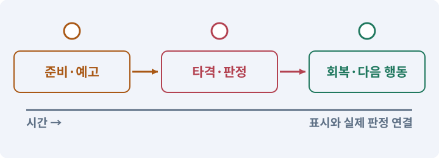

# 053. 입력은 빠르게, 취소 규칙은 명확하게

**목표:** 다음 입력이 자연스럽게 이어지고 편법 연타는 막힙니다.

**시작 상태:** 전투 선택과 기본 조작

## 한눈에 보는 기능의 흐름

다음 입력 저장 → 취소 가능한 구간 → 실제 타격 → 다음 행동 시작



**경계:** 취소 반복이 공격 간격을 우회하지 않기

그림은 실제 게임 실행 결과가 아닙니다. 값·규칙과 예제를 필요한 때 펼쳐 읽고 현재 단계의 메시지를 한 번씩 보냅니다.

## 1. 지금 상태 확인하기

첫 메시지를 보내 현재 준비 상태를 확인합니다. AI가 읽어 온 실제 프로젝트가 맞는지 보고, 없는 준비나 다른 상태가 있으면 먼저 알려 주세요. 아직 기능을 만들지 않는 단계입니다.

### AI에게 보낼 요구와 이유

#### 01. 작업 대상부터 확인

**“입력은 빠르게, 취소 규칙은 명확하게” 작업을 시작하기 전에 현재 상태를 읽기 전용으로 확인해 줘.**

왜 이렇게 요청하나요? AI가 다른 프로젝트나 오래된 예제를 보고 작업할 수 있습니다. 실제 경로·파일·현재 기능을 읽게 하면 지금 이어서 작업할 대상을 먼저 맞출 수 있습니다.

#### 02. 작업 대상부터 확인

**필요한 시작 상태는 전투 선택과 기본 조작야.**

왜 이렇게 요청하나요? AI가 다른 프로젝트나 오래된 예제를 보고 작업할 수 있습니다. 실제 경로·파일·현재 기능을 읽게 하면 지금 이어서 작업할 대상을 먼저 맞출 수 있습니다.

#### 03. 실제 사용 중인 구현 재사용

**실제 프로젝트와 작업 기록을 읽고 이것이 준비되어 있는지, 이미 같은 기능이 있는지 확인해 줘.**

왜 이렇게 요청하나요? 이름이 비슷한 새 클래스를 또 만들면 기존 화면은 여전히 옛 코드를 사용할 수 있습니다. 실제 호출되는 진입점을 찾아 연결해야 두 구현이 충돌하거나 수정이 반영되지 않는 문제를 막습니다.

#### 04. 현재 상태와 다음 확인 지점 구분

**이번 기능이 연결될 실제 파일·화면·도구와 보존할 기존 동작을 짧게 정리해 줘.**

왜 이렇게 요청하나요? 이미 준비된 기능과 아직 확인하지 못한 기능을 섞으면 불필요한 재설치나 성급한 완료 판정이 생깁니다. 현재 대상과 남은 준비를 나눠 가장 작은 다음 작업을 선택하게 합니다.

#### 05. 조사 단계에서 변경하지 않기

**아직 새 구현·설치·유료 호출·파일 변경은 하지 마.**

왜 이렇게 요청하나요? 현재 상태를 알아보기만 할 때 파일 변경이나 결제가 시작되면 검토 전의 환경이 바뀝니다. 준비 확인과 실제 구현을 나눠 되돌리기 어려운 작업이 먼저 실행되지 않게 합니다.

#### 06. 막힌 준비를 먼저 해결

**준비가 다르면 부족한 항목과 다음에 필요한 작업을 알려 줘.**

왜 이렇게 요청하나요? 빠진 파일·권한·패키지를 있다고 가정하면 다음 구현이 엉뚱한 대상을 만들게 됩니다. 무엇이 없고 무엇을 먼저 해야 하는지 분리하면 불필요한 재작업을 줄일 수 있습니다.

<details>
<summary>보낼 원문 전체 — 설명은 복사되지 않습니다</summary>

```text
“입력은 빠르게, 취소 규칙은 명확하게” 작업을 시작하기 전에 현재 상태를 읽기 전용으로 확인해 줘.
필요한 시작 상태는 전투 선택과 기본 조작야. 실제 프로젝트와 작업 기록을 읽고 이것이 준비되어 있는지, 이미 같은 기능이 있는지 확인해 줘.
이번 기능이 연결될 실제 파일·화면·도구와 보존할 기존 동작을 짧게 정리해 줘. 아직 새 구현·설치·유료 호출·파일 변경은 하지 마. 준비가 다르면 부족한 항목과 다음에 필요한 작업을 알려 줘.
```

</details>

**기대 결과:** 입력·예고·타격·회복·취소 구간

### 직접 확인하기

1. AI가 읽은 실제 프로젝트 또는 도구 경로를 확인합니다.
2. 필수 준비가 없다면 문제 해결 요청을 보내고, 준비됐을 때 다음으로 갑니다.

## 2. 필요한 기능 만들기

준비가 확인되면 아래 요청을 보냅니다. AI가 파일·설정·실행을 맡습니다. 변경 범위나 비용 승인이 나오면 내용을 읽고 결정하세요.

### AI에게 보낼 요구와 이유

#### 01. 작업 대상부터 확인

**현재 프로젝트의 실제 파일과 이미 결정한 규칙을 먼저 확인해 줘.**

왜 이렇게 요청하나요? AI가 다른 프로젝트나 오래된 예제를 보고 작업할 수 있습니다. 실제 경로·파일·현재 기능을 읽게 하면 지금 이어서 작업할 대상을 먼저 맞출 수 있습니다.

#### 02. 실제 사용 중인 코드에 연결

**이름이 다른 기존 구현이 있으면 새로 중복 제작하지 말고 그 구현에 연결해 줘.**

왜 이렇게 요청하나요? 예제와 이름이 다르더라도 현재 씬과 입력에서 호출하는 구현이 작업 대상입니다. 같은 기능을 새로 만들기보다 기존 진입점을 확인해 수정이 실제 게임에 반영되고 중복 실행되지 않게 합니다.

#### 03. 빠른 반응과 허용 행동 구분

**전투 입력 버퍼와 취소 규칙을 정리해 줘.**

왜 이렇게 요청하나요? 다음 입력을 받는 것과 현재 공격을 무조건 취소하는 것은 다릅니다. 입력 저장 시간과 취소 가능한 시점을 정해야 조작은 이어지면서 비정상적인 빠른 연타는 막을 수 있습니다.

#### 04. 빠른 반응과 허용 행동 구분

**공격 버튼을 눌렀는데 입력이 사라지는 문제와 취소로 연속 공격을 늘리는 편법을 함께 막아 줘.**

왜 이렇게 요청하나요? 다음 입력을 받는 것과 현재 공격을 무조건 취소하는 것은 다릅니다. 입력 저장 시간과 취소 가능한 시점을 정해야 조작은 이어지면서 비정상적인 빠른 연타는 막을 수 있습니다.

#### 05. 빠른 반응과 허용 행동 구분

**입력 버퍼는100ms로 시작해 유효한 다음 시점에 한 번 소비해 줘.**

왜 이렇게 요청하나요? 다음 입력을 받는 것과 현재 공격을 무조건 취소하는 것은 다릅니다. 입력 저장 시간과 취소 가능한 시점을 정해야 조작은 이어지면서 비정상적인 빠른 연타는 막을 수 있습니다.

#### 06. 끊긴 입력과 작업 정리

**포커스 상실·사망·메뉴 전환에서는 남은 입력을 지워 줘.**

왜 이렇게 요청하나요? 앱 전환이나 창 닫기에서는 정상적인 손 떼기 이벤트가 오지 않을 수 있습니다. 중단 시 눌림·예약·임시 효과를 정리해야 복귀 후 멋대로 움직이거나 공격하지 않습니다.

#### 07. 공격의 거리·시간을 명시

**기본 공격 간격0.7초·피해 시점0.2초를 유지해 줘.**

왜 이렇게 요청하나요? 그림이 닿아 보이는 순간과 실제 판정 시간은 다를 수 있습니다. 사거리·각도·공격 간격·타격 시점을 고정하면 회피 가능한 구간과 실제 피해 결과를 같은 조건으로 검사할 수 있습니다.

#### 08. 공격의 거리·시간을 명시

**피해 전 이동은 공격을 취소하고, 피해 후에는0.15초 뒤 이동을 허용하되 다음 공격 가능 시각은 원래 간격을 지켜 줘.**

왜 이렇게 요청하나요? 그림이 닿아 보이는 순간과 실제 판정 시간은 다를 수 있습니다. 사거리·각도·공격 간격·타격 시점을 고정하면 회피 가능한 구간과 실제 피해 결과를 같은 조건으로 검사할 수 있습니다.

#### 09. 사용 성공과 자원 소비 묶기

**마나·쿨다운·피해가 한 번만 확정되도록 하고 PC·모바일의 길게 누르기와 연타를 구분해 줘.**

왜 이렇게 요청하나요? 실패한 사용에서 자원이 줄거나 연타로 여러 번 차감되면 표시와 실제 행동이 어긋납니다. 사용 조건·비용·대기시간을 함께 처리하고 실패 시 바뀌지 않아야 할 값을 확인합니다.

#### 10. 프레임률에 따른 판정 누락 검사

**낮은 프레임에서도 같은 판정인지 검사해 줘.**

왜 이렇게 요청하나요? 낮은 프레임률에서는 한 번의 업데이트 사이에 타격 구간 전체를 지나칠 수 있습니다. 프레임 개수에 기대지 않고 경과 시간과 구간 통과를 처리하는지 같은 공격으로 비교합니다.

#### 11. 구현과 실행은 AI에게 맡기기

**코드·설정·파일 생성·실행은 네가 맡고, 필요한 화면과 결과를 보여 줘.**

왜 이렇게 요청하나요? 설명이나 코드 조각만 받으면 실제 파일 생성·연결·실행이 빠질 수 있습니다. AI가 개발 작업까지 수행하고, 사람은 요구·승인·결과 판단을 맡도록 역할을 분명히 합니다.

#### 12. 막힌 준비를 먼저 해결

**수행하지 못한 작업과 필요한 승인·도구 연결은 구분해서 알려 줘.**

왜 이렇게 요청하나요? 빠진 파일·권한·패키지를 있다고 가정하면 다음 구현이 엉뚱한 대상을 만들게 됩니다. 무엇이 없고 무엇을 먼저 해야 하는지 분리하면 불필요한 재작업을 줄일 수 있습니다.

<details>
<summary>보낼 원문 전체 — 설명은 복사되지 않습니다</summary>

```text
현재 프로젝트의 실제 파일과 이미 결정한 규칙을 먼저 확인해 줘. 이름이 다른 기존 구현이 있으면 새로 중복 제작하지 말고 그 구현에 연결해 줘.

전투 입력 버퍼와 취소 규칙을 정리해 줘. 공격 버튼을 눌렀는데 입력이 사라지는 문제와 취소로 연속 공격을 늘리는 편법을 함께 막아 줘.
입력 버퍼는100ms로 시작해 유효한 다음 시점에 한 번 소비해 줘. 포커스 상실·사망·메뉴 전환에서는 남은 입력을 지워 줘.
기본 공격 간격0.7초·피해 시점0.2초를 유지해 줘. 피해 전 이동은 공격을 취소하고, 피해 후에는0.15초 뒤 이동을 허용하되 다음 공격 가능 시각은 원래 간격을 지켜 줘.
마나·쿨다운·피해가 한 번만 확정되도록 하고 PC·모바일의 길게 누르기와 연타를 구분해 줘. 낮은 프레임에서도 같은 판정인지 검사해 줘.

코드·설정·파일 생성·실행은 네가 맡고, 필요한 화면과 결과를 보여 줘. 수행하지 못한 작업과 필요한 승인·도구 연결은 구분해서 알려 줘.
```

</details>

**기대 결과:** 확인할 결과: 응답성과 취소 악용 방지를 확인함. AI가 이 상태를 확인할 실제 화면과 변경 내용을 준비합니다. 아직 실행하지 못한 부분은 따로 표시합니다.

### 직접 확인하기

1. 제안서만 반환됐다면 “설명으로 끝내지 말고 승인한 범위의 실제 작업을 수행해 줘”라고 보냅니다.
2. 코드나 설정을 직접 고치라는 안내가 나오면 “작성과 실행은 네가 맡아 줘”라고 요청합니다.

## 3. 결과를 직접 확인하기

먼저 확인 요청을 보내 AI가 검사와 화면을 준비하게 하세요. 그다음 아래 동작을 하나씩 확인합니다.

### AI에게 보낼 요구와 이유

#### 01. 검사할 입력과 관찰 지점 준비

**방금 구현한 기능의 자동 검사와 확인 화면을 준비해 줘.**

왜 이렇게 요청하나요? 정상 예 하나만 보면 실패 조건을 놓치기 쉽습니다. 정상·경계·반례를 실제 입력으로 준비하고 사람이 볼 화면도 맞춰 확인 범위를 분명하게 합니다.

#### 02. 결과를 재확인할 근거 남기기

**정상 동작과 아래 실패 조건을 실제로 검사하고 대상·실행 수·결과를 보여 줘.**

왜 이렇게 요청하나요? “잘 됩니다”라는 요약만으로는 어떤 입력과 버전을 검사했는지 알 수 없습니다. 대상·실행 수·실패 내용·파일을 함께 남겨 같은 조건으로 다시 확인할 수 있게 합니다.

#### 03. 같은 요청의 반복 처리 정의

**자동 검사: 버퍼 만료 후 발동0회, 사망 후0회, 취소 반복으로 공격 빈도 증가 없음이다.**

왜 이렇게 요청하나요? 클릭 연타·재연결·중복 이벤트는 개발과 플레이 중 모두 발생할 수 있습니다. 반복돼도 한 번 처리해야 하는 결과와 매번 새로 처리할 결과를 나눠 데이터가 누적되지 않게 합니다.

#### 04. 사용 성공과 자원 소비 묶기

**물약 실패가 공격 버퍼를 지우는 등 불필요한 간섭이 없다.**

왜 이렇게 요청하나요? 실패한 사용에서 자원이 줄거나 연타로 여러 번 차감되면 표시와 실제 행동이 어긋납니다. 사용 조건·비용·대기시간을 함께 처리하고 실패 시 바뀌지 않아야 할 값을 확인합니다.

#### 05. 관찰 가능한 기준으로 확인

**직접 검사: 공격 종료 직전 입력이 의도대로 이어지고, 버튼을 놓은 뒤 긴 자동 공격이 남지 않는다.**

왜 이렇게 요청하나요? 구현 완료라는 설명을 실제 결과로 바꾸기 위한 조건입니다. 요청에 나온 대상과 경계 상황을 확인해 정상 결과뿐 아니라 실패를 어떻게 구분했는지도 남깁니다.

#### 06. 피할 수 있는 정보와 실제 판정 일치

**공격 예고와 실제 움직일 수 있는 시점이 이해된다.**

왜 이렇게 요청하나요? 표시한 위험 범위·시점과 실제 피해가 다르면 플레이어는 올바르게 반응해도 손해를 봅니다. 예고·판정·효과가 같은 규칙을 사용하게 해 공격을 학습할 수 있게 합니다.

#### 07. 사람 검사의 시작점 준비

**내가 조작해야 하는 부분은 실행할 화면과 시작 상태를 준비해 줘.**

왜 이렇게 요청하나요? 같은 기능이라도 시작 상태가 다르면 관찰 결과가 달라집니다. AI가 실행 화면과 재현 위치를 먼저 준비해야 사람이 이동·공격·소리·조작감을 같은 조건에서 확인할 수 있습니다.

#### 08. 사람이 실제로 본 것만 기록

**연결되지 않은 휴대폰의 터치나 사람이 보지 않은 재미·소리 품질을 대신 확인했다고 하지 마.**

왜 이렇게 요청하나요? AI가 준비한 검사와 사람이 직접 플레이하거나 들은 결과는 다른 근거입니다. 관찰하지 않은 조작감·소리·실기기 결과를 임의로 완료 처리하지 않게 합니다.

#### 09. 실제로 실행한 검사만 인정

**테스트 0개와 예전 소스 결과는 현재 성공으로 쓰지 마.**

왜 이렇게 요청하나요? 실행된 검사가 없거나 같은 결과를 중복 집계한 경우는 기능을 확인한 것이 아닙니다. 실행 수와 개별 결과를 함께 확인해야 형식적인 성공 표시를 걸러낼 수 있습니다.

<details>
<summary>보낼 원문 전체 — 설명은 복사되지 않습니다</summary>

```text
방금 구현한 기능의 자동 검사와 확인 화면을 준비해 줘. 정상 동작과 아래 실패 조건을 실제로 검사하고 대상·실행 수·결과를 보여 줘.

자동 검사: 버퍼 만료 후 발동0회, 사망 후0회, 취소 반복으로 공격 빈도 증가 없음이다. 물약 실패가 공격 버퍼를 지우는 등 불필요한 간섭이 없다.

직접 검사: 공격 종료 직전 입력이 의도대로 이어지고, 버튼을 놓은 뒤 긴 자동 공격이 남지 않는다. 공격 예고와 실제 움직일 수 있는 시점이 이해된다.

내가 조작해야 하는 부분은 실행할 화면과 시작 상태를 준비해 줘. 연결되지 않은 휴대폰의 터치나 사람이 보지 않은 재미·소리 품질을 대신 확인했다고 하지 마. 테스트 0개와 예전 소스 결과는 현재 성공으로 쓰지 마.
```

</details>

**기대 결과:** 응답성과 취소 악용 방지를 확인함

### 직접 확인하기

1. 공격 끝나기 직전에 다음 공격을 누릅니다.
2. 공격 시작과 타격 직후에 이동해 차이를 봅니다.
3. 반복 취소가 비정상 빠른 연타가 되지 않는지 봅니다.

## 4. 결과를 남기고 마무리하기

실제로 본 결과를 아래 메모에 적고 AI에 전달합니다. 결과 저장 요청으로 현재 상태를 남긴 뒤 다음 페이지로 갑니다.

### AI에게 보낼 요구와 이유

#### 01. 결과를 재확인할 근거 남기기

**지금 작업한 “입력은 빠르게, 취소 규칙은 명확하게”의 실제 결과를 정리해 줘.**

왜 이렇게 요청하나요? “잘 됩니다”라는 요약만으로는 어떤 입력과 버전을 검사했는지 알 수 없습니다. 대상·실행 수·실패 내용·파일을 함께 남겨 같은 조건으로 다시 확인할 수 있게 합니다.

#### 02. 다음 작업이 읽을 인수인계

**변경한 기능·파일·현재 후보와 실제 실행한 검사, 남은 문제를 기능 이름으로 기록해 줘.**

왜 이렇게 요청하나요? 새 AI 세션은 이전 대화 전체를 알고 있다고 보장할 수 없습니다. 현재 후보·파일 위치·실행한 검사·남은 일을 남겨야 같은 작업을 반복하지 않고 이어갈 수 있습니다.

#### 03. 사람이 실제로 본 것만 기록

**자동 검사 결과와 내가 직접 확인한 결과를 구분하고, 내 관찰이 아직 없으면 미확인으로 남겨 줘.**

왜 이렇게 요청하나요? AI가 준비한 검사와 사람이 직접 플레이하거나 들은 결과는 다른 근거입니다. 관찰하지 않은 조작감·소리·실기기 결과를 임의로 완료 처리하지 않게 합니다.

#### 04. 다음 작업이 읽을 인수인계

**재시작하거나 다음 작업에서 읽을 기록의 실제 위치를 알려 줘.**

왜 이렇게 요청하나요? 새 AI 세션은 이전 대화 전체를 알고 있다고 보장할 수 없습니다. 현재 후보·파일 위치·실행한 검사·남은 일을 남겨야 같은 작업을 반복하지 않고 이어갈 수 있습니다.

#### 05. 미확인을 완료와 분리

**아직 확인하지 않은 결과를 완료로 채우지 마.**

왜 이렇게 요청하나요? 만들어진 것, 검사에 실패한 것, 아직 확인하지 못한 것을 나눠야 다음 작업을 정확히 고를 수 있습니다. 실행할 조건이 없는 기능을 성공으로 기록하면 뒤에서 원인을 찾기 어려워집니다.

<details>
<summary>보낼 원문 전체 — 설명은 복사되지 않습니다</summary>

```text
지금 작업한 “입력은 빠르게, 취소 규칙은 명확하게”의 실제 결과를 정리해 줘. 변경한 기능·파일·현재 후보와 실제 실행한 검사, 남은 문제를 기능 이름으로 기록해 줘.
자동 검사 결과와 내가 직접 확인한 결과를 구분하고, 내 관찰이 아직 없으면 미확인으로 남겨 줘. 재시작하거나 다음 작업에서 읽을 기록의 실제 위치를 알려 줘. 아직 확인하지 않은 결과를 완료로 채우지 마.
```

</details>

**기대 결과:** 현재 상태·검사 결과·남은 문제·다음에 읽을 기록을 확인할 수 있습니다.

### 직접 확인하기

1. 자동 검사와 내 관찰 결과가 섞이지 않았는지 봅니다.
2. 문제가 남았다면 해결 요청을 보내고 같은 동작을 다시 확인합니다.

## 이 작업에서 사용할 값과 규칙 전체

설계 시작값이며 측정된 성능·게임 성공 결과가 아닙니다. 구현은 AI가 수행합니다.

강의 초기 타이밍:

| 동작 | 초기 규칙 |
|---|---|
| 기본 공격 | 전체0.7초, 피해0.2초. 피해 전 이동 취소 허용, 피해 후0.15초 뒤 이동 허용 |
| 베기·마력탄 | 승인 시 마나·쿨다운 확정. 이동 취소로 공짜 재시도하지 않음 |
| 회전 | 중단하면 남은 틱 취소, 이동 속도 복원. 사용한 마나는 환불하지 않음 |
| 물약 | 공격 버퍼와 별도 요청. 실패하면 수량·쿨다운 불변 |
| UI 열기·사망·홈 복귀 | 대기 입력을 비움. 새 입력 없이 재실행하지 않음 |

기본 공격의 피해 전 이동 취소는 무료지만 다음 공격 시작 가능 시각은 원래 공격 간격 계약을 따른다. 취소를 반복해서 초당 공격 수를 늘리지 않는다. 입력 버퍼의 만료는 실제 경과 시간으로 판단하고 Pause 진입 때 비운다. 전투 진행 시간은 PauseService 정책을 따른다.

난이도는 우선 공격권 수·적 조합·플레이어가 읽을 시간으로 조절한다. 접근성/쉬움 옵션에서는 예고를 늘리거나 피해를 낮출 수 있지만 표시와 실제 판정이 달라져서는 안 된다. 난이도 변경이 전리품·저장과 어떤 관계인지 문서에 적는다. 기이 작업은 보상 동일이다.

## 문제가 있으면

### AI에게 보낼 요구와 이유

#### 01. 구현할 결과와 조건 고정

**키를 누른 시각과 실제 실행 시각을 함께 기록해 줘.**

왜 이렇게 요청하나요? “키를 누른 시각과 실제 실행 시각을 함께 기록해 줘”를 명시하면 AI가 무엇을 구현하거나 검사해야 하는지 범위를 좁힐 수 있습니다. 다음 입력이 자연스럽게 이어지고 편법 연타는 막힙니다. 이 결과를 확인할 때 이 조건이 실제로 반영됐는지 함께 봅니다.

#### 02. 사용 성공과 자원 소비 묶기

**버퍼를 무제한 쌓거나 취소로 쿨다운을 초기화하지 마.**

왜 이렇게 요청하나요? 실패한 사용에서 자원이 줄거나 연타로 여러 번 차감되면 표시와 실제 행동이 어긋납니다. 사용 조건·비용·대기시간을 함께 처리하고 실패 시 바뀌지 않아야 할 값을 확인합니다.

#### 03. 원인 하나를 좁혀 수정

**새 기능을 추가하지 말고 현재 오류와 실제 로그를 먼저 읽어 줘.**

왜 이렇게 요청하나요? 오류 수정 중 새 기능까지 넣으면 어떤 변경이 문제를 해결하거나 악화했는지 알기 어렵습니다. 원래 재현을 보존하고 작은 변경 뒤 같은 입력과 주변 정상 동작을 다시 확인합니다.

#### 04. 원인 하나를 좁혀 수정

**최소 수정 뒤 같은 재현과 관련 정상 동작을 다시 검사해 줘.**

왜 이렇게 요청하나요? 오류 수정 중 새 기능까지 넣으면 어떤 변경이 문제를 해결하거나 악화했는지 알기 어렵습니다. 원래 재현을 보존하고 작은 변경 뒤 같은 입력과 주변 정상 동작을 다시 확인합니다.

#### 05. 실패도 재현 자료로 보존

**실패 기록은 지우지 마.**

왜 이렇게 요청하나요? 실패한 입력과 로그가 있어야 같은 문제가 다시 생겼을 때 비교할 수 있습니다. 성공 기록으로 덮어쓰지 않고 전후 자료를 남기면 무엇을 고쳤는지 확인할 수 있습니다.

<details>
<summary>보낼 원문 전체 — 설명은 복사되지 않습니다</summary>

```text
키를 누른 시각과 실제 실행 시각을 함께 기록해 줘. 버퍼를 무제한 쌓거나 취소로 쿨다운을 초기화하지 마.
새 기능을 추가하지 말고 현재 오류와 실제 로그를 먼저 읽어 줘. 최소 수정 뒤 같은 재현과 관련 정상 동작을 다시 검사해 줘. 실패 기록은 지우지 마.
```

</details>

## 새 세션에서 이어가기

### AI에게 보낼 요구와 이유

#### 01. 이어서 할 작업 식별

**“입력은 빠르게, 취소 규칙은 명확하게” 작업을 이어가고 싶어.**

왜 이렇게 요청하나요? 이름으로 재개할 작업을 찾고, 뒤에 이어지는 요청으로 실제 파일·진행 중 작업·기록을 다시 읽게 합니다. 제목만 보고 이전 상태를 기억한다고 가정하지 않습니다.

#### 02. 조회는 상태를 바꾸지 않게

**실제 프로젝트와 내 도구의 작업 기록을 읽고 어디까지 구현·검사됐는지 확인해 줘.**

왜 이렇게 요청하나요? 진행 상황을 물을 때 새 구현이나 유료 호출이 시작되면 단순 확인이 실행 명령이 되어 버립니다. 저장된 근거를 읽어 완료·진행·승인 대기·미검증을 나누게 합니다.

#### 03. 재개 전 중복 작업 방지

**진행 중인 프로세스·승인·미저장 변경을 확인한 뒤 남은 가장 작은 작업부터 안내해 줘.**

왜 이렇게 요청하나요? 대화가 끊겨도 외부 작업은 끝났거나 아직 실행 중일 수 있습니다. 프로세스·승인·미저장 상태를 먼저 읽어 같은 생성·빌드·결제를 두 번 시작하지 않도록 합니다.

#### 04. 되돌아갈 원본 남기기

**기존 성공과 실패 기록은 보존해 줘.**

왜 이렇게 요청하나요? 새 구현이 실패해도 이전 게임과 저장을 복원할 수 있어야 합니다. 현재 내용을 먼저 조사하고 별도 후보에서 작업하면 실험이 유일한 정상본을 망가뜨리는 일을 피할 수 있습니다.

<details>
<summary>보낼 원문 전체 — 설명은 복사되지 않습니다</summary>

```text
“입력은 빠르게, 취소 규칙은 명확하게” 작업을 이어가고 싶어. 실제 프로젝트와 내 도구의 작업 기록을 읽고 어디까지 구현·검사됐는지 확인해 줘. 진행 중인 프로세스·승인·미저장 변경을 확인한 뒤 남은 가장 작은 작업부터 안내해 줘. 기존 성공과 실패 기록은 보존해 줘.
```

</details>

## 왜 이렇게 만드는가

조작이 답답한 원인은 시각 효과가 아니라 입력이 사라지는 것일 수 있다. 공격 종료 직전에 누른 버튼을 짧게 기억하는 입력 버퍼를 만든다. 그러나 버퍼가 긴 명령 대기열이 되면 버튼에서 손을 떼도 계속 공격한다. 이번에는 최대 1개 명령,100ms 유효 시간으로 시작한다.

취소는 모든 행동에서 허용하는 기능이 아니다. 기본 공격은 피해 순간 전후의 규칙을 명확히 하고, 스킬과 물약도 각각 다른 조건을 둔다. 전투 시간과 UI 시간을 구분한다. 일시정지 중 버퍼가 쌓였다가 창을 닫는 순간 발동하지 않아야 한다.

## 공식 참고


## 실제 Unity Editor 화면 참고
공식 예시와 내 프로젝트 실행 결과를 구분하세요. 원본 사진은 온라인 연결이 필요합니다.

- [Input Actions — 입력 묶음·행동·값의 종류 읽기](../editor_references/input-actions.md)
