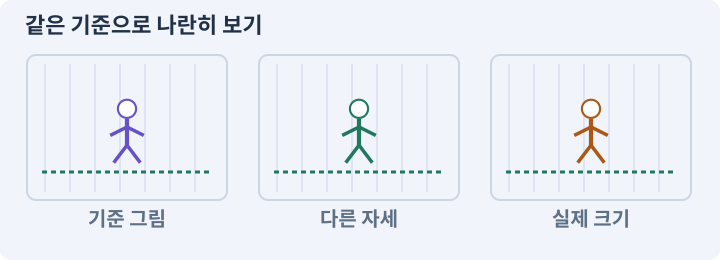

# 060. Scenario로 스타일과 동작 유지하기

**목표:** 기준 이미지에서 방향·동작 샘플을 얻습니다.

**시작 상태:** 아트 규격과 Scenario 선택

## 한눈에 보는 기능의 흐름

기준 이미지 → 방향 확장 → 동작 샘플 → 프레임 추출



**경계:** 동작 중 얼굴·장비가 다른 것으로 변하지 않기

그림은 실제 게임 실행 결과가 아닙니다. 값·규칙과 예제를 필요한 때 펼쳐 읽고 현재 단계의 메시지를 한 번씩 보냅니다.

## 1. 지금 상태 확인하기

첫 메시지를 보내 현재 준비 상태를 확인합니다. AI가 읽어 온 실제 프로젝트가 맞는지 보고, 없는 준비나 다른 상태가 있으면 먼저 알려 주세요. 아직 기능을 만들지 않는 단계입니다.

### AI에게 보낼 요구와 이유

#### 01. 작업 대상부터 확인

**“Scenario로 스타일과 동작 유지하기” 작업을 시작하기 전에 현재 상태를 읽기 전용으로 확인해 줘.**

왜 이렇게 요청하나요? AI가 다른 프로젝트나 오래된 예제를 보고 작업할 수 있습니다. 실제 경로·파일·현재 기능을 읽게 하면 지금 이어서 작업할 대상을 먼저 맞출 수 있습니다.

#### 02. 작업 대상부터 확인

**필요한 시작 상태는 아트 규격과 Scenario 선택야.**

왜 이렇게 요청하나요? AI가 다른 프로젝트나 오래된 예제를 보고 작업할 수 있습니다. 실제 경로·파일·현재 기능을 읽게 하면 지금 이어서 작업할 대상을 먼저 맞출 수 있습니다.

#### 03. 실제 사용 중인 구현 재사용

**실제 프로젝트와 작업 기록을 읽고 이것이 준비되어 있는지, 이미 같은 기능이 있는지 확인해 줘.**

왜 이렇게 요청하나요? 이름이 비슷한 새 클래스를 또 만들면 기존 화면은 여전히 옛 코드를 사용할 수 있습니다. 실제 호출되는 진입점을 찾아 연결해야 두 구현이 충돌하거나 수정이 반영되지 않는 문제를 막습니다.

#### 04. 현재 상태와 다음 확인 지점 구분

**이번 기능이 연결될 실제 파일·화면·도구와 보존할 기존 동작을 짧게 정리해 줘.**

왜 이렇게 요청하나요? 이미 준비된 기능과 아직 확인하지 못한 기능을 섞으면 불필요한 재설치나 성급한 완료 판정이 생깁니다. 현재 대상과 남은 준비를 나눠 가장 작은 다음 작업을 선택하게 합니다.

#### 05. 조사 단계에서 변경하지 않기

**아직 새 구현·설치·유료 호출·파일 변경은 하지 마.**

왜 이렇게 요청하나요? 현재 상태를 알아보기만 할 때 파일 변경이나 결제가 시작되면 검토 전의 환경이 바뀝니다. 준비 확인과 실제 구현을 나눠 되돌리기 어려운 작업이 먼저 실행되지 않게 합니다.

#### 06. 막힌 준비를 먼저 해결

**준비가 다르면 부족한 항목과 다음에 필요한 작업을 알려 줘.**

왜 이렇게 요청하나요? 빠진 파일·권한·패키지를 있다고 가정하면 다음 구현이 엉뚱한 대상을 만들게 됩니다. 무엇이 없고 무엇을 먼저 해야 하는지 분리하면 불필요한 재작업을 줄일 수 있습니다.

<details>
<summary>보낼 원문 전체 — 설명은 복사되지 않습니다</summary>

```text
“Scenario로 스타일과 동작 유지하기” 작업을 시작하기 전에 현재 상태를 읽기 전용으로 확인해 줘.
필요한 시작 상태는 아트 규격과 Scenario 선택야. 실제 프로젝트와 작업 기록을 읽고 이것이 준비되어 있는지, 이미 같은 기능이 있는지 확인해 줘.
이번 기능이 연결될 실제 파일·화면·도구와 보존할 기존 동작을 짧게 정리해 줘. 아직 새 구현·설치·유료 호출·파일 변경은 하지 마. 준비가 다르면 부족한 항목과 다음에 필요한 작업을 알려 줘.
```

</details>

**기대 결과:** 정지 이미지 생성과 동작 추출의 구분

### 직접 확인하기

1. AI가 읽은 실제 프로젝트 또는 도구 경로를 확인합니다.
2. 필수 준비가 없다면 문제 해결 요청을 보내고, 준비됐을 때 다음으로 갑니다.

## 2. 필요한 기능 만들기

준비가 확인되면 아래 요청을 보냅니다. AI가 파일·설정·실행을 맡습니다. 변경 범위나 비용 승인이 나오면 내용을 읽고 결정하세요.

### AI에게 보낼 요구와 이유

#### 01. 작업 대상부터 확인

**현재 프로젝트의 실제 파일과 이미 결정한 규칙을 먼저 확인해 줘.**

왜 이렇게 요청하나요? AI가 다른 프로젝트나 오래된 예제를 보고 작업할 수 있습니다. 실제 경로·파일·현재 기능을 읽게 하면 지금 이어서 작업할 대상을 먼저 맞출 수 있습니다.

#### 02. 실제 사용 중인 코드에 연결

**이름이 다른 기존 구현이 있으면 새로 중복 제작하지 말고 그 구현에 연결해 줘.**

왜 이렇게 요청하나요? 예제와 이름이 다르더라도 현재 씬과 입력에서 호출하는 구현이 작업 대상입니다. 같은 기능을 새로 만들기보다 기존 진입점을 확인해 수정이 실제 게임에 반영되고 중복 실행되지 않게 합니다.

#### 03. 서로 다른 자산의 정체성 유지

**Scenario에서 스타일 참조를 유지하며 캐릭터와 동작 후보를 만들어 줘.**

왜 이렇게 요청하나요? 프레임·방향·모델마다 무기 손이나 장비 형태가 달라지면 같은 캐릭터로 읽히지 않습니다. 기준을 먼저 고정하고 실제 작은 화면에서 나란히 비교해 채택할 결과를 고릅니다.

#### 04. 비용과 외부 작업은 별도 승인

**현재 지원 모델·자동화·이용 조건·비용을 확인한 뒤 승인받은 작은 작업만 실행해 줘.**

왜 이렇게 요청하나요? 로컬 파일을 고치는 것과 외부 서비스에 자료를 보내거나 비용을 지불하는 것은 영향이 다릅니다. 대상·내용·비용 범위를 확인한 승인 없이 요청이 확대되지 않도록 합니다.

#### 05. 기존 결과를 보호

**회색 갑옷·청록색 망토·오른손 검의 기준 그림을 만들고, 내가 선택한 그림을 다음 방향과 동작의 참조로 유지해 줘.**

왜 이렇게 요청하나요? 새 작업이 이미 정상인 기능이나 자산까지 바꾸면 원인을 추적하기 어렵습니다. 유지할 대상을 명시해 변경 전후를 비교하고 원치 않은 영향을 찾습니다.

#### 06. 구현할 결과와 조건 고정

**모델이나 제작 경로가 바뀌면 기록해 줘.**

왜 이렇게 요청하나요? “모델이나 제작 경로가 바뀌면 기록해 줘”를 명시하면 AI가 무엇을 구현하거나 검사해야 하는지 범위를 좁힐 수 있습니다. 기준 이미지에서 방향·동작 샘플을 얻습니다. 이 결과를 확인할 때 이 조건이 실제로 반영됐는지 함께 봅니다.

#### 07. 프레임의 순서와 시간 맞추기

**스프라이트 출력 경로가 있으면 사용하고, 영상 기반이라면 카메라가 고정된 짧은 걷기·공격을 각각 만들어 프레임을 추출해 줘.**

왜 이렇게 요청하나요? 이미지나 동작 파일이 있어도 순서·속도·전환 기준이 맞지 않으면 끊기거나 타격 시점과 어긋납니다. 실제 사용 크기와 반복 재생에서 연결이 자연스러운지 확인합니다.

#### 08. 구현할 결과와 조건 고정

**영상 파일이 있다는 이유로 정합한 시트라고 판단하지 마.**

왜 이렇게 요청하나요? “영상 파일이 있다는 이유로 정합한 시트라고 판단하지 마”를 명시하면 AI가 무엇을 구현하거나 검사해야 하는지 범위를 좁힐 수 있습니다. 기준 이미지에서 방향·동작 샘플을 얻습니다. 이 결과를 확인할 때 이 조건이 실제로 반영됐는지 함께 봅니다.

#### 09. 앞뒤를 그리는 기준 정하기

**생성·파일 수신·배경 분리·프레임 선택·발 정렬을 직접 맡아 줘.**

왜 이렇게 요청하나요? 2D 그림의 화면상 겹침 순서와 물리 충돌은 별개입니다. 바닥·배우·높은 장식의 정렬 기준을 나눠야 캐릭터가 기둥 앞뒤를 오갈 때 자연스럽게 가려집니다.

#### 10. 그림 크기와 월드 크기 연결

**64×64 RGBA의 고정 캔버스에 남쪽 걷기 6프레임과 공격 6프레임을 먼저 구성해 줘.**

왜 이렇게 요청하나요? 픽셀 수만 정하면 게임 안에서의 크기는 정해지지 않습니다. PPU와 배율을 함께 고정해야 자산을 바꿔도 캐릭터·바닥·UI의 크기 관계를 비교할 수 있습니다.

#### 11. 되돌아갈 원본 남기기

**원본과 중간 결과를 보존하고 흔들림·신체 변형·검 손·카메라 이동을 검사해 줘.**

왜 이렇게 요청하나요? 새 구현이 실패해도 이전 게임과 저장을 복원할 수 있어야 합니다. 현재 내용을 먼저 조사하고 별도 후보에서 작업하면 실험이 유일한 정상본을 망가뜨리는 일을 피할 수 있습니다.

#### 12. 프레임의 순서와 시간 맞추기

**실제 ArtLab2D에서 재생하고 타격 타이밍은 기존 전투 로직이 소유하게 해 줘.**

왜 이렇게 요청하나요? 이미지나 동작 파일이 있어도 순서·속도·전환 기준이 맞지 않으면 끊기거나 타격 시점과 어긋납니다. 실제 사용 크기와 반복 재생에서 연결이 자연스러운지 확인합니다.

#### 13. 구현과 실행은 AI에게 맡기기

**코드·설정·파일 생성·실행은 네가 맡고, 필요한 화면과 결과를 보여 줘.**

왜 이렇게 요청하나요? 설명이나 코드 조각만 받으면 실제 파일 생성·연결·실행이 빠질 수 있습니다. AI가 개발 작업까지 수행하고, 사람은 요구·승인·결과 판단을 맡도록 역할을 분명히 합니다.

#### 14. 막힌 준비를 먼저 해결

**수행하지 못한 작업과 필요한 승인·도구 연결은 구분해서 알려 줘.**

왜 이렇게 요청하나요? 빠진 파일·권한·패키지를 있다고 가정하면 다음 구현이 엉뚱한 대상을 만들게 됩니다. 무엇이 없고 무엇을 먼저 해야 하는지 분리하면 불필요한 재작업을 줄일 수 있습니다.

<details>
<summary>보낼 원문 전체 — 설명은 복사되지 않습니다</summary>

```text
현재 프로젝트의 실제 파일과 이미 결정한 규칙을 먼저 확인해 줘. 이름이 다른 기존 구현이 있으면 새로 중복 제작하지 말고 그 구현에 연결해 줘.

Scenario에서 스타일 참조를 유지하며 캐릭터와 동작 후보를 만들어 줘. 현재 지원 모델·자동화·이용 조건·비용을 확인한 뒤 승인받은 작은 작업만 실행해 줘.
회색 갑옷·청록색 망토·오른손 검의 기준 그림을 만들고, 내가 선택한 그림을 다음 방향과 동작의 참조로 유지해 줘. 모델이나 제작 경로가 바뀌면 기록해 줘.
스프라이트 출력 경로가 있으면 사용하고, 영상 기반이라면 카메라가 고정된 짧은 걷기·공격을 각각 만들어 프레임을 추출해 줘. 영상 파일이 있다는 이유로 정합한 시트라고 판단하지 마.
생성·파일 수신·배경 분리·프레임 선택·발 정렬을 직접 맡아 줘. 64×64 RGBA의 고정 캔버스에 남쪽 걷기 6프레임과 공격 6프레임을 먼저 구성해 줘.
원본과 중간 결과를 보존하고 흔들림·신체 변형·검 손·카메라 이동을 검사해 줘. 실제 ArtLab2D에서 재생하고 타격 타이밍은 기존 전투 로직이 소유하게 해 줘.

코드·설정·파일 생성·실행은 네가 맡고, 필요한 화면과 결과를 보여 줘. 수행하지 못한 작업과 필요한 승인·도구 연결은 구분해서 알려 줘.
```

</details>

**기대 결과:** 확인할 결과: 스타일 유지와 동작 추출 결과를 확인함. AI가 이 상태를 확인할 실제 화면과 변경 내용을 준비합니다. 아직 실행하지 못한 부분은 따로 표시합니다.

### 직접 확인하기

1. 제안서만 반환됐다면 “설명으로 끝내지 말고 승인한 범위의 실제 작업을 수행해 줘”라고 보냅니다.
2. 코드나 설정을 직접 고치라는 안내가 나오면 “작성과 실행은 네가 맡아 줘”라고 요청합니다.

## 3. 결과를 직접 확인하기

먼저 확인 요청을 보내 AI가 검사와 화면을 준비하게 하세요. 그다음 아래 동작을 하나씩 확인합니다.

### AI에게 보낼 요구와 이유

#### 01. 검사할 입력과 관찰 지점 준비

**방금 구현한 기능의 자동 검사와 확인 화면을 준비해 줘.**

왜 이렇게 요청하나요? 정상 예 하나만 보면 실패 조건을 놓치기 쉽습니다. 정상·경계·반례를 실제 입력으로 준비하고 사람이 볼 화면도 맞춰 확인 범위를 분명하게 합니다.

#### 02. 결과를 재확인할 근거 남기기

**정상 동작과 아래 실패 조건을 실제로 검사하고 대상·실행 수·결과를 보여 줘.**

왜 이렇게 요청하나요? “잘 됩니다”라는 요약만으로는 어떤 입력과 버전을 검사했는지 알 수 없습니다. 대상·실행 수·실패 내용·파일을 함께 남겨 같은 조건으로 다시 확인할 수 있게 합니다.

#### 03. AI 응답을 검증 가능한 데이터로 받기

**자동 검사: 추출 프레임의 출처 타임코드와 이미지 경로가 존재한다.**

왜 이렇게 요청하나요? 자연어 설명이나 임의의 실행 코드를 그대로 적용하면 허용 범위를 확인하기 어렵습니다. 정해진 필드·타입·연산으로 응답을 받아 프로그램이 검사한 뒤 적용합니다.

#### 04. 알파·RGBA·투명 배경의 적용 조건

**투명도·크기·순서가 일치한다.**

왜 이렇게 요청하나요? RGBA는 빨강·초록·파랑의 색 채널과 투명도를 나타내는 알파 채널입니다. 흰 배경이나 체크무늬가 그려진 이미지가 실제 투명 이미지인 것은 아닙니다. 알파 0인 픽셀의 색값과 필터링이 가장자리 후광에 영향을 줄 수 있습니다. 한 배경에서만 검사하지 않습니다.

#### 05. 프레임의 순서와 시간 맞추기

**직접 검사: 영상에서는 자연스러워도 6프레임으로 줄였을 때 읽히는지 확인한다.**

왜 이렇게 요청하나요? 이미지나 동작 파일이 있어도 순서·속도·전환 기준이 맞지 않으면 끊기거나 타격 시점과 어긋납니다. 실제 사용 크기와 반복 재생에서 연결이 자연스러운지 확인합니다.

#### 06. 프레임의 순서와 시간 맞추기

**카메라 이동·과한 잔상·손발 변형이 있는 프레임은 제외 또는 수정 대상으로 남긴다.**

왜 이렇게 요청하나요? 이미지나 동작 파일이 있어도 순서·속도·전환 기준이 맞지 않으면 끊기거나 타격 시점과 어긋납니다. 실제 사용 크기와 반복 재생에서 연결이 자연스러운지 확인합니다.

#### 07. 사람 검사의 시작점 준비

**내가 조작해야 하는 부분은 실행할 화면과 시작 상태를 준비해 줘.**

왜 이렇게 요청하나요? 같은 기능이라도 시작 상태가 다르면 관찰 결과가 달라집니다. AI가 실행 화면과 재현 위치를 먼저 준비해야 사람이 이동·공격·소리·조작감을 같은 조건에서 확인할 수 있습니다.

#### 08. 사람이 실제로 본 것만 기록

**연결되지 않은 휴대폰의 터치나 사람이 보지 않은 재미·소리 품질을 대신 확인했다고 하지 마.**

왜 이렇게 요청하나요? AI가 준비한 검사와 사람이 직접 플레이하거나 들은 결과는 다른 근거입니다. 관찰하지 않은 조작감·소리·실기기 결과를 임의로 완료 처리하지 않게 합니다.

#### 09. 실제로 실행한 검사만 인정

**테스트 0개와 예전 소스 결과는 현재 성공으로 쓰지 마.**

왜 이렇게 요청하나요? 실행된 검사가 없거나 같은 결과를 중복 집계한 경우는 기능을 확인한 것이 아닙니다. 실행 수와 개별 결과를 함께 확인해야 형식적인 성공 표시를 걸러낼 수 있습니다.

<details>
<summary>보낼 원문 전체 — 설명은 복사되지 않습니다</summary>

```text
방금 구현한 기능의 자동 검사와 확인 화면을 준비해 줘. 정상 동작과 아래 실패 조건을 실제로 검사하고 대상·실행 수·결과를 보여 줘.

자동 검사: 추출 프레임의 출처 타임코드와 이미지 경로가 존재한다. 투명도·크기·순서가 일치한다.

직접 검사: 영상에서는 자연스러워도 6프레임으로 줄였을 때 읽히는지 확인한다. 카메라 이동·과한 잔상·손발 변형이 있는 프레임은 제외 또는 수정 대상으로 남긴다.

내가 조작해야 하는 부분은 실행할 화면과 시작 상태를 준비해 줘. 연결되지 않은 휴대폰의 터치나 사람이 보지 않은 재미·소리 품질을 대신 확인했다고 하지 마. 테스트 0개와 예전 소스 결과는 현재 성공으로 쓰지 마.
```

</details>

**기대 결과:** 스타일 유지와 동작 추출 결과를 확인함

### 직접 확인하기

1. 기준 이미지와 방향별 결과를 비교합니다.
2. 동작 중 얼굴과 장비가 변하지 않는지 봅니다.
3. 영상에서 잘라낸 프레임의 시간 간격을 확인합니다.

## 4. 결과를 남기고 마무리하기

실제로 본 결과를 아래 메모에 적고 AI에 전달합니다. 결과 저장 요청으로 현재 상태를 남긴 뒤 다음 페이지로 갑니다.

### AI에게 보낼 요구와 이유

#### 01. 결과를 재확인할 근거 남기기

**지금 작업한 “Scenario로 스타일과 동작 유지하기”의 실제 결과를 정리해 줘.**

왜 이렇게 요청하나요? “잘 됩니다”라는 요약만으로는 어떤 입력과 버전을 검사했는지 알 수 없습니다. 대상·실행 수·실패 내용·파일을 함께 남겨 같은 조건으로 다시 확인할 수 있게 합니다.

#### 02. 다음 작업이 읽을 인수인계

**변경한 기능·파일·현재 후보와 실제 실행한 검사, 남은 문제를 기능 이름으로 기록해 줘.**

왜 이렇게 요청하나요? 새 AI 세션은 이전 대화 전체를 알고 있다고 보장할 수 없습니다. 현재 후보·파일 위치·실행한 검사·남은 일을 남겨야 같은 작업을 반복하지 않고 이어갈 수 있습니다.

#### 03. 사람이 실제로 본 것만 기록

**자동 검사 결과와 내가 직접 확인한 결과를 구분하고, 내 관찰이 아직 없으면 미확인으로 남겨 줘.**

왜 이렇게 요청하나요? AI가 준비한 검사와 사람이 직접 플레이하거나 들은 결과는 다른 근거입니다. 관찰하지 않은 조작감·소리·실기기 결과를 임의로 완료 처리하지 않게 합니다.

#### 04. 다음 작업이 읽을 인수인계

**재시작하거나 다음 작업에서 읽을 기록의 실제 위치를 알려 줘.**

왜 이렇게 요청하나요? 새 AI 세션은 이전 대화 전체를 알고 있다고 보장할 수 없습니다. 현재 후보·파일 위치·실행한 검사·남은 일을 남겨야 같은 작업을 반복하지 않고 이어갈 수 있습니다.

#### 05. 미확인을 완료와 분리

**아직 확인하지 않은 결과를 완료로 채우지 마.**

왜 이렇게 요청하나요? 만들어진 것, 검사에 실패한 것, 아직 확인하지 못한 것을 나눠야 다음 작업을 정확히 고를 수 있습니다. 실행할 조건이 없는 기능을 성공으로 기록하면 뒤에서 원인을 찾기 어려워집니다.

<details>
<summary>보낼 원문 전체 — 설명은 복사되지 않습니다</summary>

```text
지금 작업한 “Scenario로 스타일과 동작 유지하기”의 실제 결과를 정리해 줘. 변경한 기능·파일·현재 후보와 실제 실행한 검사, 남은 문제를 기능 이름으로 기록해 줘.
자동 검사 결과와 내가 직접 확인한 결과를 구분하고, 내 관찰이 아직 없으면 미확인으로 남겨 줘. 재시작하거나 다음 작업에서 읽을 기록의 실제 위치를 알려 줘. 아직 확인하지 않은 결과를 완료로 채우지 마.
```

</details>

**기대 결과:** 현재 상태·검사 결과·남은 문제·다음에 읽을 기록을 확인할 수 있습니다.

### 직접 확인하기

1. 자동 검사와 내 관찰 결과가 섞이지 않았는지 봅니다.
2. 문제가 남았다면 해결 요청을 보내고 같은 동작을 다시 확인합니다.

## 문제가 있으면

### AI에게 보낼 요구와 이유

#### 01. 구현할 결과와 조건 고정

**영상 한 장면을 시트 완성으로 처리하지 마.**

왜 이렇게 요청하나요? “영상 한 장면을 시트 완성으로 처리하지 마”를 명시하면 AI가 무엇을 구현하거나 검사해야 하는지 범위를 좁힐 수 있습니다. 기준 이미지에서 방향·동작 샘플을 얻습니다. 이 결과를 확인할 때 이 조건이 실제로 반영됐는지 함께 봅니다.

#### 02. 프레임의 순서와 시간 맞추기

**실제 프레임 수·배경·시간 간격을 확인해 줘.**

왜 이렇게 요청하나요? 이미지나 동작 파일이 있어도 순서·속도·전환 기준이 맞지 않으면 끊기거나 타격 시점과 어긋납니다. 실제 사용 크기와 반복 재생에서 연결이 자연스러운지 확인합니다.

#### 03. 원인 하나를 좁혀 수정

**새 기능을 추가하지 말고 현재 오류와 실제 로그를 먼저 읽어 줘.**

왜 이렇게 요청하나요? 오류 수정 중 새 기능까지 넣으면 어떤 변경이 문제를 해결하거나 악화했는지 알기 어렵습니다. 원래 재현을 보존하고 작은 변경 뒤 같은 입력과 주변 정상 동작을 다시 확인합니다.

#### 04. 원인 하나를 좁혀 수정

**최소 수정 뒤 같은 재현과 관련 정상 동작을 다시 검사해 줘.**

왜 이렇게 요청하나요? 오류 수정 중 새 기능까지 넣으면 어떤 변경이 문제를 해결하거나 악화했는지 알기 어렵습니다. 원래 재현을 보존하고 작은 변경 뒤 같은 입력과 주변 정상 동작을 다시 확인합니다.

#### 05. 실패도 재현 자료로 보존

**실패 기록은 지우지 마.**

왜 이렇게 요청하나요? 실패한 입력과 로그가 있어야 같은 문제가 다시 생겼을 때 비교할 수 있습니다. 성공 기록으로 덮어쓰지 않고 전후 자료를 남기면 무엇을 고쳤는지 확인할 수 있습니다.

<details>
<summary>보낼 원문 전체 — 설명은 복사되지 않습니다</summary>

```text
영상 한 장면을 시트 완성으로 처리하지 마. 실제 프레임 수·배경·시간 간격을 확인해 줘.
새 기능을 추가하지 말고 현재 오류와 실제 로그를 먼저 읽어 줘. 최소 수정 뒤 같은 재현과 관련 정상 동작을 다시 검사해 줘. 실패 기록은 지우지 마.
```

</details>

## 새 세션에서 이어가기

### AI에게 보낼 요구와 이유

#### 01. 이어서 할 작업 식별

**“Scenario로 스타일과 동작 유지하기” 작업을 이어가고 싶어.**

왜 이렇게 요청하나요? 이름으로 재개할 작업을 찾고, 뒤에 이어지는 요청으로 실제 파일·진행 중 작업·기록을 다시 읽게 합니다. 제목만 보고 이전 상태를 기억한다고 가정하지 않습니다.

#### 02. 조회는 상태를 바꾸지 않게

**실제 프로젝트와 내 도구의 작업 기록을 읽고 어디까지 구현·검사됐는지 확인해 줘.**

왜 이렇게 요청하나요? 진행 상황을 물을 때 새 구현이나 유료 호출이 시작되면 단순 확인이 실행 명령이 되어 버립니다. 저장된 근거를 읽어 완료·진행·승인 대기·미검증을 나누게 합니다.

#### 03. 재개 전 중복 작업 방지

**진행 중인 프로세스·승인·미저장 변경을 확인한 뒤 남은 가장 작은 작업부터 안내해 줘.**

왜 이렇게 요청하나요? 대화가 끊겨도 외부 작업은 끝났거나 아직 실행 중일 수 있습니다. 프로세스·승인·미저장 상태를 먼저 읽어 같은 생성·빌드·결제를 두 번 시작하지 않도록 합니다.

#### 04. 되돌아갈 원본 남기기

**기존 성공과 실패 기록은 보존해 줘.**

왜 이렇게 요청하나요? 새 구현이 실패해도 이전 게임과 저장을 복원할 수 있어야 합니다. 현재 내용을 먼저 조사하고 별도 후보에서 작업하면 실험이 유일한 정상본을 망가뜨리는 일을 피할 수 있습니다.

<details>
<summary>보낼 원문 전체 — 설명은 복사되지 않습니다</summary>

```text
“Scenario로 스타일과 동작 유지하기” 작업을 이어가고 싶어. 실제 프로젝트와 내 도구의 작업 기록을 읽고 어디까지 구현·검사됐는지 확인해 줘. 진행 중인 프로세스·승인·미저장 변경을 확인한 뒤 남은 가장 작은 작업부터 안내해 줘. 기존 성공과 실패 기록은 보존해 줘.
```

</details>

## 왜 이렇게 만드는가

**서비스 확인 범위:** 아래 서비스별 기능·가격 예시는 아래 조사 자료다. 이번 개정의 실습 변경과 최신 요금 확인은 별개이며, AI는 실제 호출 전에 공식 지원·계정·단가·자동화 경로를 다시 확인한다. 비용 승인은 현재 확인한 값으로 받는다.

Scenario는 게임 아트 작업을 위한 여러 생성·편집 경로를 제공한다. 공식 spritesheet 안내는 기준 캐릭터 이미지를 영상으로 움직인 뒤 핵심 포즈를 추출해 시트로 묶는 방법을 설명한다. 별도의 방향 변환 및 픽셀 애니메이션 모델 경로도 있으므로 현재 작업공간에서 지원되는 방식을 확인한다. [N09][N10][N33]

## 공식 참고

- [Scenario](https://help.scenario.com/articles/9088582240-create-spritesheets-with-scenario)
- [Scenario](https://help.scenario.com/articles/2974691727-scenario-apps-for-gaming)
- [Scenario](https://help.scenario.com/articles/4202673551-retro-diffusion-models-the-essentials)
- [Scenario](https://www.scenario.com/pricing)


## 실제 Unity Editor 화면 참고
공식 예시와 내 프로젝트 실행 결과를 구분하세요. 원본 사진은 온라인 연결이 필요합니다.

- [Sprite Editor — 그림 경계·테두리·기준점 구분하기](../editor_references/sprite-editor.md)
