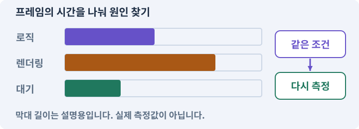

# 067. 내 게임의 아트 제작 경로 선택하기

**목표:** 비용과 후처리를 보고 한 경로를 고릅니다.

**시작 상태:** 공통 아트 규격

## 한눈에 보는 기능의 흐름

같은 작은 자산 → 실제 생성 시도 → 채택·수정 시간 → 총비용 비교



**경계:** 가격표만으로 사용 가능한 결과의 비용 판단 금지

그림은 실제 게임 실행 결과가 아닙니다. 값·규칙과 예제를 필요한 때 펼쳐 읽고 현재 단계의 메시지를 한 번씩 보냅니다.

## 1. 지금 상태 확인하기

첫 메시지를 보내 현재 준비 상태를 확인합니다. AI가 읽어 온 실제 프로젝트가 맞는지 보고, 없는 준비나 다른 상태가 있으면 먼저 알려 주세요. 아직 기능을 만들지 않는 단계입니다.

### AI에게 보낼 요구와 이유

#### 01. 작업 대상부터 확인

**“내 게임의 아트 제작 경로 선택하기” 작업을 시작하기 전에 현재 상태를 읽기 전용으로 확인해 줘.**

왜 이렇게 요청하나요? AI가 다른 프로젝트나 오래된 예제를 보고 작업할 수 있습니다. 실제 경로·파일·현재 기능을 읽게 하면 지금 이어서 작업할 대상을 먼저 맞출 수 있습니다.

#### 02. 작업 대상부터 확인

**필요한 시작 상태는 공통 아트 규격야.**

왜 이렇게 요청하나요? AI가 다른 프로젝트나 오래된 예제를 보고 작업할 수 있습니다. 실제 경로·파일·현재 기능을 읽게 하면 지금 이어서 작업할 대상을 먼저 맞출 수 있습니다.

#### 03. 실제 사용 중인 구현 재사용

**실제 프로젝트와 작업 기록을 읽고 이것이 준비되어 있는지, 이미 같은 기능이 있는지 확인해 줘.**

왜 이렇게 요청하나요? 이름이 비슷한 새 클래스를 또 만들면 기존 화면은 여전히 옛 코드를 사용할 수 있습니다. 실제 호출되는 진입점을 찾아 연결해야 두 구현이 충돌하거나 수정이 반영되지 않는 문제를 막습니다.

#### 04. 현재 상태와 다음 확인 지점 구분

**이번 기능이 연결될 실제 파일·화면·도구와 보존할 기존 동작을 짧게 정리해 줘.**

왜 이렇게 요청하나요? 이미 준비된 기능과 아직 확인하지 못한 기능을 섞으면 불필요한 재설치나 성급한 완료 판정이 생깁니다. 현재 대상과 남은 준비를 나눠 가장 작은 다음 작업을 선택하게 합니다.

#### 05. 조사 단계에서 변경하지 않기

**아직 새 구현·설치·유료 호출·파일 변경은 하지 마.**

왜 이렇게 요청하나요? 현재 상태를 알아보기만 할 때 파일 변경이나 결제가 시작되면 검토 전의 환경이 바뀝니다. 준비 확인과 실제 구현을 나눠 되돌리기 어려운 작업이 먼저 실행되지 않게 합니다.

#### 06. 막힌 준비를 먼저 해결

**준비가 다르면 부족한 항목과 다음에 필요한 작업을 알려 줘.**

왜 이렇게 요청하나요? 빠진 파일·권한·패키지를 있다고 가정하면 다음 구현이 엉뚱한 대상을 만들게 됩니다. 무엇이 없고 무엇을 먼저 해야 하는지 분리하면 불필요한 재작업을 줄일 수 있습니다.

<details>
<summary>보낼 원문 전체 — 설명은 복사되지 않습니다</summary>

```text
“내 게임의 아트 제작 경로 선택하기” 작업을 시작하기 전에 현재 상태를 읽기 전용으로 확인해 줘.
필요한 시작 상태는 공통 아트 규격야. 실제 프로젝트와 작업 기록을 읽고 이것이 준비되어 있는지, 이미 같은 기능이 있는지 확인해 줘.
이번 기능이 연결될 실제 파일·화면·도구와 보존할 기존 동작을 짧게 정리해 줘. 아직 새 구현·설치·유료 호출·파일 변경은 하지 마. 준비가 다르면 부족한 항목과 다음에 필요한 작업을 알려 줘.
```

</details>

**기대 결과:** 미확인 조건을 구분한 비교표

### 직접 확인하기

1. AI가 읽은 실제 프로젝트 또는 도구 경로를 확인합니다.
2. 필수 준비가 없다면 문제 해결 요청을 보내고, 준비됐을 때 다음으로 갑니다.

## 2. 요청한 작업 진행하기

준비가 확인되면 아래 요청을 보냅니다. AI가 파일·설정·실행을 맡습니다. 변경 범위나 비용 승인이 나오면 내용을 읽고 결정하세요.

### AI에게 보낼 요구와 이유

#### 01. 작업 대상부터 확인

**현재 프로젝트의 실제 파일과 이미 결정한 규칙을 먼저 확인해 줘.**

왜 이렇게 요청하나요? AI가 다른 프로젝트나 오래된 예제를 보고 작업할 수 있습니다. 실제 경로·파일·현재 기능을 읽게 하면 지금 이어서 작업할 대상을 먼저 맞출 수 있습니다.

#### 02. 실제 사용 중인 코드에 연결

**이름이 다른 기존 구현이 있으면 새로 중복 제작하지 말고 그 구현에 연결해 줘.**

왜 이렇게 요청하나요? 예제와 이름이 다르더라도 현재 씬과 입력에서 호출하는 구현이 작업 대상입니다. 같은 기능을 새로 만들기보다 기존 진입점을 확인해 수정이 실제 게임에 반영되고 중복 실행되지 않게 합니다.

#### 03. 관찰 가능한 기준으로 확인

**이 게임에 쓸 2D 캐릭터·몬스터·타일 제작 경로를 비교해 줘.**

왜 이렇게 요청하나요? 구현 완료라는 설명을 실제 결과로 바꾸기 위한 조건입니다. 요청에 나온 대상과 경계 상황을 확인해 정상 결과뿐 아니라 실패를 어떻게 구분했는지도 남깁니다.

#### 04. 서비스 결과를 게임용 자산으로 확인

**대상은 Unity AI, PixelLab, Retro Diffusion, Scenario, Ludo.ai, OpenAI 이미지 생성, Grok/xAI, 추가 생성 서비스 없이 직접 프레임을 만드는 경로야.**

왜 이렇게 요청하나요? 이미지를 생성하는 것과 규격에 맞는 프레임·투명도·크기의 게임 자산을 얻는 것은 다릅니다. 지원 기능·실제 출력 파일·후처리를 확인하고 서비스가 하지 못한 작업을 완료로 표시하지 않습니다.

#### 05. 관찰 가능한 기준으로 확인

**각 공식 문서에서 현재 지원하는 방향·동작·타일·투명도·내보내기·자동화 경로를 확인해 줘.**

왜 이렇게 요청하나요? 구현 완료라는 설명을 실제 결과로 바꾸기 위한 조건입니다. 요청에 나온 대상과 경계 상황을 확인해 정상 결과뿐 아니라 실패를 어떻게 구분했는지도 남깁니다.

#### 06. 관찰 가능한 기준으로 확인

**가격은 조회 시점과 월/연 결제·웹/API·단위·추가 비용을 함께 적고 확인하지 못한 항목은 모른다고 써 줘.**

왜 이렇게 요청하나요? 구현 완료라는 설명을 실제 결과로 바꾸기 위한 조건입니다. 요청에 나온 대상과 경계 상황을 확인해 정상 결과뿐 아니라 실패를 어떻게 구분했는지도 남깁니다.

#### 07. 관찰 가능한 기준으로 확인

**실제로 생성해 본 출력과 공식 설명만 확인한 기능을 구분해 줘.**

왜 이렇게 요청하나요? 구현 완료라는 설명을 실제 결과로 바꾸기 위한 조건입니다. 요청에 나온 대상과 경계 상황을 확인해 정상 결과뿐 아니라 실패를 어떻게 구분했는지도 남깁니다.

#### 08. 구현할 결과와 조건 고정

**모든 서비스를 결제해 시험하지 말고, 남쪽 걷기 6·공격 6·근접병 기준 1·돌타일 3종을 만들기 위한 한 경로를 선택할 수 있게 정리해 줘.**

왜 이렇게 요청하나요? “모든 서비스를 결제해 시험하지 말고, 남쪽 걷기 6·공격 6·근접병 기준 1·돌타일 3종을 만들기 위한 한 경로를 선택할 수 있게 정리해 줘”를 명시하면 AI가 무엇을 구현하거나 검사해야 하는지 범위를 좁힐 수 있습니다. 비용과 후처리를 보고 한 경로를 고릅니다. 이 결과를 확인할 때 이 조건이 실제로 반영됐는지 함께 봅니다.

#### 09. 관찰 가능한 기준으로 확인

**생성 비용 외에 실패한 요청·후처리·파일 연결·채택률도 비교해 줘.**

왜 이렇게 요청하나요? 구현 완료라는 설명을 실제 결과로 바꾸기 위한 조건입니다. 요청에 나온 대상과 경계 상황을 확인해 정상 결과뿐 아니라 실패를 어떻게 구분했는지도 남깁니다.

#### 10. 구현할 결과와 조건 고정

**실제 채택 수가 0이면 자산당 비용을 0원으로 쓰지 마.**

왜 이렇게 요청하나요? “실제 채택 수가 0이면 자산당 비용을 0원으로 쓰지 마”를 명시하면 AI가 무엇을 구현하거나 검사해야 하는지 범위를 좁힐 수 있습니다. 비용과 후처리를 보고 한 경로를 고릅니다. 이 결과를 확인할 때 이 조건이 실제로 반영됐는지 함께 봅니다.

#### 11. 구현할 결과와 조건 고정

**추천 이유와 자동화 불가 시 대안을 보여 줘.**

왜 이렇게 요청하나요? “추천 이유와 자동화 불가 시 대안을 보여 줘”를 명시하면 AI가 무엇을 구현하거나 검사해야 하는지 범위를 좁힐 수 있습니다. 비용과 후처리를 보고 한 경로를 고릅니다. 이 결과를 확인할 때 이 조건이 실제로 반영됐는지 함께 봅니다.

#### 12. 비용과 외부 작업은 별도 승인

**선택과 비용 승인은 나에게 남기고 이 요청만으로 유료 호출하지 마.**

왜 이렇게 요청하나요? 로컬 파일을 고치는 것과 외부 서비스에 자료를 보내거나 비용을 지불하는 것은 영향이 다릅니다. 대상·내용·비용 범위를 확인한 승인 없이 요청이 확대되지 않도록 합니다.

#### 13. 구현과 실행은 AI에게 맡기기

**코드·설정·파일 생성·실행은 네가 맡고, 필요한 화면과 결과를 보여 줘.**

왜 이렇게 요청하나요? 설명이나 코드 조각만 받으면 실제 파일 생성·연결·실행이 빠질 수 있습니다. AI가 개발 작업까지 수행하고, 사람은 요구·승인·결과 판단을 맡도록 역할을 분명히 합니다.

#### 14. 막힌 준비를 먼저 해결

**수행하지 못한 작업과 필요한 승인·도구 연결은 구분해서 알려 줘.**

왜 이렇게 요청하나요? 빠진 파일·권한·패키지를 있다고 가정하면 다음 구현이 엉뚱한 대상을 만들게 됩니다. 무엇이 없고 무엇을 먼저 해야 하는지 분리하면 불필요한 재작업을 줄일 수 있습니다.

<details>
<summary>보낼 원문 전체 — 설명은 복사되지 않습니다</summary>

```text
현재 프로젝트의 실제 파일과 이미 결정한 규칙을 먼저 확인해 줘. 이름이 다른 기존 구현이 있으면 새로 중복 제작하지 말고 그 구현에 연결해 줘.

이 게임에 쓸 2D 캐릭터·몬스터·타일 제작 경로를 비교해 줘. 대상은 Unity AI, PixelLab, Retro Diffusion, Scenario, Ludo.ai, OpenAI 이미지 생성, Grok/xAI, 추가 생성 서비스 없이 직접 프레임을 만드는 경로야.
각 공식 문서에서 현재 지원하는 방향·동작·타일·투명도·내보내기·자동화 경로를 확인해 줘. 가격은 조회 시점과 월/연 결제·웹/API·단위·추가 비용을 함께 적고 확인하지 못한 항목은 모른다고 써 줘.
실제로 생성해 본 출력과 공식 설명만 확인한 기능을 구분해 줘. 모든 서비스를 결제해 시험하지 말고, 남쪽 걷기 6·공격 6·근접병 기준 1·돌타일 3종을 만들기 위한 한 경로를 선택할 수 있게 정리해 줘.
생성 비용 외에 실패한 요청·후처리·파일 연결·채택률도 비교해 줘. 실제 채택 수가 0이면 자산당 비용을 0원으로 쓰지 마.
추천 이유와 자동화 불가 시 대안을 보여 줘. 선택과 비용 승인은 나에게 남기고 이 요청만으로 유료 호출하지 마.

코드·설정·파일 생성·실행은 네가 맡고, 필요한 화면과 결과를 보여 줘. 수행하지 못한 작업과 필요한 승인·도구 연결은 구분해서 알려 줘.
```

</details>

**기대 결과:** 확인할 결과: 필요와 예산에 맞는 한 경로를 선택함. AI가 이 상태를 확인할 실제 화면과 변경 내용을 준비합니다. 아직 실행하지 못한 부분은 따로 표시합니다.

### 직접 확인하기

1. 제안서만 반환됐다면 “설명으로 끝내지 말고 승인한 범위의 실제 작업을 수행해 줘”라고 보냅니다.
2. 코드나 설정을 직접 고치라는 안내가 나오면 “작성과 실행은 네가 맡아 줘”라고 요청합니다.

## 3. 결과를 직접 확인하기

먼저 확인 요청을 보내 AI가 검사와 화면을 준비하게 하세요. 그다음 아래 동작을 하나씩 확인합니다.

### AI에게 보낼 요구와 이유

#### 01. 검사할 입력과 관찰 지점 준비

**방금 구현한 기능의 자동 검사와 확인 화면을 준비해 줘.**

왜 이렇게 요청하나요? 정상 예 하나만 보면 실패 조건을 놓치기 쉽습니다. 정상·경계·반례를 실제 입력으로 준비하고 사람이 볼 화면도 맞춰 확인 범위를 분명하게 합니다.

#### 02. 결과를 재확인할 근거 남기기

**정상 동작과 아래 실패 조건을 실제로 검사하고 대상·실행 수·결과를 보여 줘.**

왜 이렇게 요청하나요? “잘 됩니다”라는 요약만으로는 어떤 입력과 버전을 검사했는지 알 수 없습니다. 대상·실행 수·실패 내용·파일을 함께 남겨 같은 조건으로 다시 확인할 수 있게 합니다.

#### 03. 구현할 결과와 조건 고정

**선택 이유가 요구 기능·실제 출력·비용에 연결된다.**

왜 이렇게 요청하나요? “선택 이유가 요구 기능·실제 출력·비용에 연결된다”를 명시하면 AI가 무엇을 구현하거나 검사해야 하는지 범위를 좁힐 수 있습니다. 비용과 후처리를 보고 한 경로를 고릅니다. 이 결과를 확인할 때 이 조건이 실제로 반영됐는지 함께 봅니다.

#### 04. 미확인을 완료와 분리

**미실행 서비스는 미실행이다.**

왜 이렇게 요청하나요? 만들어진 것, 검사에 실패한 것, 아직 확인하지 못한 것을 나눠야 다음 작업을 정확히 고를 수 있습니다. 실행할 조건이 없는 기능을 성공으로 기록하면 뒤에서 원인을 찾기 어려워집니다.

#### 05. 기존 결과를 보호

**경로를 바꿔도 기본 게임이 유지된다.**

왜 이렇게 요청하나요? 새 작업이 이미 정상인 기능이나 자산까지 바꾸면 원인을 추적하기 어렵습니다. 유지할 대상을 명시해 변경 전후를 비교하고 원치 않은 영향을 찾습니다.

#### 06. 사람 검사의 시작점 준비

**내가 조작해야 하는 부분은 실행할 화면과 시작 상태를 준비해 줘.**

왜 이렇게 요청하나요? 같은 기능이라도 시작 상태가 다르면 관찰 결과가 달라집니다. AI가 실행 화면과 재현 위치를 먼저 준비해야 사람이 이동·공격·소리·조작감을 같은 조건에서 확인할 수 있습니다.

#### 07. 사람이 실제로 본 것만 기록

**연결되지 않은 휴대폰의 터치나 사람이 보지 않은 재미·소리 품질을 대신 확인했다고 하지 마.**

왜 이렇게 요청하나요? AI가 준비한 검사와 사람이 직접 플레이하거나 들은 결과는 다른 근거입니다. 관찰하지 않은 조작감·소리·실기기 결과를 임의로 완료 처리하지 않게 합니다.

#### 08. 실제로 실행한 검사만 인정

**테스트 0개와 예전 소스 결과는 현재 성공으로 쓰지 마.**

왜 이렇게 요청하나요? 실행된 검사가 없거나 같은 결과를 중복 집계한 경우는 기능을 확인한 것이 아닙니다. 실행 수와 개별 결과를 함께 확인해야 형식적인 성공 표시를 걸러낼 수 있습니다.

<details>
<summary>보낼 원문 전체 — 설명은 복사되지 않습니다</summary>

```text
방금 구현한 기능의 자동 검사와 확인 화면을 준비해 줘. 정상 동작과 아래 실패 조건을 실제로 검사하고 대상·실행 수·결과를 보여 줘.

선택 이유가 요구 기능·실제 출력·비용에 연결된다. 미실행 서비스는 미실행이다. 경로를 바꿔도 기본 게임이 유지된다.

내가 조작해야 하는 부분은 실행할 화면과 시작 상태를 준비해 줘. 연결되지 않은 휴대폰의 터치나 사람이 보지 않은 재미·소리 품질을 대신 확인했다고 하지 마. 테스트 0개와 예전 소스 결과는 현재 성공으로 쓰지 마.
```

</details>

**기대 결과:** 필요와 예산에 맞는 한 경로를 선택함

### 직접 확인하기

1. 필요한 방향·동작·타일이 지원되는지 봅니다.
2. 추가 비용과 반복 수정 비용을 구분합니다.
3. 주 제작 경로 하나와 비용 없는 대체 경로를 선택해 말합니다.

## 4. 결과를 남기고 마무리하기

실제로 본 결과를 아래 메모에 적고 AI에 전달합니다. 결과 저장 요청으로 현재 상태를 남긴 뒤 다음 페이지로 갑니다.

### AI에게 보낼 요구와 이유

#### 01. 결과를 재확인할 근거 남기기

**지금 작업한 “내 게임의 아트 제작 경로 선택하기”의 실제 결과를 정리해 줘.**

왜 이렇게 요청하나요? “잘 됩니다”라는 요약만으로는 어떤 입력과 버전을 검사했는지 알 수 없습니다. 대상·실행 수·실패 내용·파일을 함께 남겨 같은 조건으로 다시 확인할 수 있게 합니다.

#### 02. 다음 작업이 읽을 인수인계

**변경한 기능·파일·현재 후보와 실제 실행한 검사, 남은 문제를 기능 이름으로 기록해 줘.**

왜 이렇게 요청하나요? 새 AI 세션은 이전 대화 전체를 알고 있다고 보장할 수 없습니다. 현재 후보·파일 위치·실행한 검사·남은 일을 남겨야 같은 작업을 반복하지 않고 이어갈 수 있습니다.

#### 03. 사람이 실제로 본 것만 기록

**자동 검사 결과와 내가 직접 확인한 결과를 구분하고, 내 관찰이 아직 없으면 미확인으로 남겨 줘.**

왜 이렇게 요청하나요? AI가 준비한 검사와 사람이 직접 플레이하거나 들은 결과는 다른 근거입니다. 관찰하지 않은 조작감·소리·실기기 결과를 임의로 완료 처리하지 않게 합니다.

#### 04. 다음 작업이 읽을 인수인계

**재시작하거나 다음 작업에서 읽을 기록의 실제 위치를 알려 줘.**

왜 이렇게 요청하나요? 새 AI 세션은 이전 대화 전체를 알고 있다고 보장할 수 없습니다. 현재 후보·파일 위치·실행한 검사·남은 일을 남겨야 같은 작업을 반복하지 않고 이어갈 수 있습니다.

#### 05. 미확인을 완료와 분리

**아직 확인하지 않은 결과를 완료로 채우지 마.**

왜 이렇게 요청하나요? 만들어진 것, 검사에 실패한 것, 아직 확인하지 못한 것을 나눠야 다음 작업을 정확히 고를 수 있습니다. 실행할 조건이 없는 기능을 성공으로 기록하면 뒤에서 원인을 찾기 어려워집니다.

<details>
<summary>보낼 원문 전체 — 설명은 복사되지 않습니다</summary>

```text
지금 작업한 “내 게임의 아트 제작 경로 선택하기”의 실제 결과를 정리해 줘. 변경한 기능·파일·현재 후보와 실제 실행한 검사, 남은 문제를 기능 이름으로 기록해 줘.
자동 검사 결과와 내가 직접 확인한 결과를 구분하고, 내 관찰이 아직 없으면 미확인으로 남겨 줘. 재시작하거나 다음 작업에서 읽을 기록의 실제 위치를 알려 줘. 아직 확인하지 않은 결과를 완료로 채우지 마.
```

</details>

**기대 결과:** 현재 상태·검사 결과·남은 문제·다음에 읽을 기록을 확인할 수 있습니다.

### 직접 확인하기

1. 자동 검사와 내 관찰 결과가 섞이지 않았는지 봅니다.
2. 문제가 남았다면 해결 요청을 보내고 같은 동작을 다시 확인합니다.

## 이 작업에서 사용할 값과 규칙 전체

설계 시작값이며 측정된 성능·게임 성공 결과가 아닙니다. 구현은 AI가 수행합니다.

| 경로 | 적합한 작업 | 장점으로 활용할 점 | 직접 확인할 한계 | 근거 |
|---|---|---|---|---|
| Unity의 AI 도구(56~57) | Editor 안 Sprite·시트·타일 | 프로젝트 연결 과정이 짧음 | 실제 패키지 메뉴·계정·크레딧·프레임 정합 | [N01][N02][N03] |
| PixelLab(58) | 방향별 픽셀 캐릭터·동작·타일 | 게임용 픽셀 제작 기능 | 방향별 무기/발/크기와 지원 출력 | [N04][N05][N06] |
| Retro Diffusion(59) | 전용 픽셀 프리셋 | 픽셀 스타일과 출력 경로 선택 | 프리셋마다 해상도·동작 기능 차이 | [N07][N08] |
| Scenario(60) | 스타일 참조·방향·영상에서 시트 | 여러 제작 단계를 조합 | 사용 모델 차이·영상 흔들림·후처리 | [N09][N10] |
| Ludo.ai(61) | 모션 프리셋·키 포즈·참조 동작 | 애니메이션 지시와 내보내기 | 배경제거·트리밍·메타데이터 확인 | [N12] |
| OpenAI/ChatGPT(62) | 기준 디자인·아이콘·타일·참조 편집 | 자연어로 디자인을 반복 | 범용 결과를 정확한 시트로 간주하지 않음 | [N14] |
| Grok/xAI(63) | 이미지 생성·참조 편집 | 다양한 디자인 후보 | 프레임/alpha/정확한 셀 정렬은 별도 | [N16] |
| 기본 PNG·2D 편집/뼈대(33·64) | 기본 외형·프레임 수정·cutout | 생성 서비스 없이 수정 가능 | AI의 프레임·관절·방향 수정 시간과 사람의 관찰 시간 | [D10] |
| 별도 3D 원형→2D 베이크(97, 선택) | 여러 방향의 통일된 원형 | 동일 원형·카메라 통제 | 먼저 모델과 동작을 만들어야 함 | 자체 실습 |

채택 자산 1개당 비용은 **(이번 제작에 배분한 구독 비용 + 모든 종량 요청 비용 + 승인된 외주 비용) ÷ 실제 채택 자산 수**다. 탈락한 결과의 생성 비용도 분자에 포함한다. 채택 수가 0이면 1개당 비용은 계산하지 못한 것으로 표시하며 0원으로 쓰지 않는다. AI 처리 시간과 사람의 승인·관찰 시간은 금액과 별도 열로 남기고 임의 시간당 단가를 사실로 제시하지 않는다. 월결제/연결제 할인/웹구독/API의 비용을 섞지 않는다. ChatGPT와 OpenAI API 결제는 별도다. [N34]

공정한 비교 샘플은 같은 모험가의S걷기6·공격6, 근접병 기준1장, 돌타일3종이다. 실제 계정에서 없는 기능은 미지원 또는 미확인으로 기록한다. 오래된 광고 이미지로 게임용 적합성을 확정하지 않는다.

## 문제가 있으면

### AI에게 보낼 요구와 이유

#### 01. 실패의 시간·비용 상한 두기

**월 요금만 비교하지 말고 채택 자산당 재시도와 후처리를 포함해 줘.**

왜 이렇게 요청하나요? 실패를 자동으로 반복하면 같은 원인으로 비용과 시간이 계속 들 수 있습니다. 종료·사용량·확인 불가 상태를 기록하고 정한 한도에서 멈춘 뒤 원인을 판단하게 합니다.

#### 02. 구현할 결과와 조건 고정

**실제 시험하지 않은 품질에 순위를 붙이지 마.**

왜 이렇게 요청하나요? “실제 시험하지 않은 품질에 순위를 붙이지 마”를 명시하면 AI가 무엇을 구현하거나 검사해야 하는지 범위를 좁힐 수 있습니다. 비용과 후처리를 보고 한 경로를 고릅니다. 이 결과를 확인할 때 이 조건이 실제로 반영됐는지 함께 봅니다.

#### 03. 원인 하나를 좁혀 수정

**새 기능을 추가하지 말고 현재 오류와 실제 로그를 먼저 읽어 줘.**

왜 이렇게 요청하나요? 오류 수정 중 새 기능까지 넣으면 어떤 변경이 문제를 해결하거나 악화했는지 알기 어렵습니다. 원래 재현을 보존하고 작은 변경 뒤 같은 입력과 주변 정상 동작을 다시 확인합니다.

#### 04. 원인 하나를 좁혀 수정

**최소 수정 뒤 같은 재현과 관련 정상 동작을 다시 검사해 줘.**

왜 이렇게 요청하나요? 오류 수정 중 새 기능까지 넣으면 어떤 변경이 문제를 해결하거나 악화했는지 알기 어렵습니다. 원래 재현을 보존하고 작은 변경 뒤 같은 입력과 주변 정상 동작을 다시 확인합니다.

#### 05. 실패도 재현 자료로 보존

**실패 기록은 지우지 마.**

왜 이렇게 요청하나요? 실패한 입력과 로그가 있어야 같은 문제가 다시 생겼을 때 비교할 수 있습니다. 성공 기록으로 덮어쓰지 않고 전후 자료를 남기면 무엇을 고쳤는지 확인할 수 있습니다.

<details>
<summary>보낼 원문 전체 — 설명은 복사되지 않습니다</summary>

```text
월 요금만 비교하지 말고 채택 자산당 재시도와 후처리를 포함해 줘. 실제 시험하지 않은 품질에 순위를 붙이지 마.
새 기능을 추가하지 말고 현재 오류와 실제 로그를 먼저 읽어 줘. 최소 수정 뒤 같은 재현과 관련 정상 동작을 다시 검사해 줘. 실패 기록은 지우지 마.
```

</details>

## 새 세션에서 이어가기

### AI에게 보낼 요구와 이유

#### 01. 이어서 할 작업 식별

**“내 게임의 아트 제작 경로 선택하기” 작업을 이어가고 싶어.**

왜 이렇게 요청하나요? 이름으로 재개할 작업을 찾고, 뒤에 이어지는 요청으로 실제 파일·진행 중 작업·기록을 다시 읽게 합니다. 제목만 보고 이전 상태를 기억한다고 가정하지 않습니다.

#### 02. 조회는 상태를 바꾸지 않게

**실제 프로젝트와 내 도구의 작업 기록을 읽고 어디까지 구현·검사됐는지 확인해 줘.**

왜 이렇게 요청하나요? 진행 상황을 물을 때 새 구현이나 유료 호출이 시작되면 단순 확인이 실행 명령이 되어 버립니다. 저장된 근거를 읽어 완료·진행·승인 대기·미검증을 나누게 합니다.

#### 03. 재개 전 중복 작업 방지

**진행 중인 프로세스·승인·미저장 변경을 확인한 뒤 남은 가장 작은 작업부터 안내해 줘.**

왜 이렇게 요청하나요? 대화가 끊겨도 외부 작업은 끝났거나 아직 실행 중일 수 있습니다. 프로세스·승인·미저장 상태를 먼저 읽어 같은 생성·빌드·결제를 두 번 시작하지 않도록 합니다.

#### 04. 되돌아갈 원본 남기기

**기존 성공과 실패 기록은 보존해 줘.**

왜 이렇게 요청하나요? 새 구현이 실패해도 이전 게임과 저장을 복원할 수 있어야 합니다. 현재 내용을 먼저 조사하고 별도 후보에서 작업하면 실험이 유일한 정상본을 망가뜨리는 일을 피할 수 있습니다.

<details>
<summary>보낼 원문 전체 — 설명은 복사되지 않습니다</summary>

```text
“내 게임의 아트 제작 경로 선택하기” 작업을 이어가고 싶어. 실제 프로젝트와 내 도구의 작업 기록을 읽고 어디까지 구현·검사됐는지 확인해 줘. 진행 중인 프로세스·승인·미저장 변경을 확인한 뒤 남은 가장 작은 작업부터 안내해 줘. 기존 성공과 실패 기록은 보존해 줘.
```

</details>

## 왜 이렇게 만드는가

**서비스 확인 범위:** 아래 서비스별 기능·가격 예시는 아래 조사 자료다. 이번 개정의 실습 변경과 최신 요금 확인은 별개이며, AI는 실제 호출 전에 공식 지원·계정·단가·자동화 경로를 다시 확인한다. 비용 승인은 현재 확인한 값으로 받는다.

아트 서비스의 기능표와 결과 품질은 다르다. 아래는 공식 지원 기능을 바탕으로 한 제작 경로 비교이며 동일 캐릭터를 모든 유료 서비스에서 생성해 측정한 순위가 아니다. 선택지는 대안이다. 기본 2D PNG와 편집 경로만으로도 게임은 완성할 수 있다.

## 공식 참고

- [Unity AI](https://unity.com/features/ai)
- [Unity Assistant](https://docs.unity3d.com/Packages/com.unity.ai.assistant@2.1/manual/Sprite/spritesheet-assistant.html)
- [Unity Assistant](https://docs.unity3d.com/Packages/com.unity.ai.assistant@2.9/manual/Sprite/generate-sprite.html)
- [PixelLab](https://www.pixellab.ai/)
- [PixelLab](https://www.pixellab.ai/docs/tools/animate-with-text-pro)
