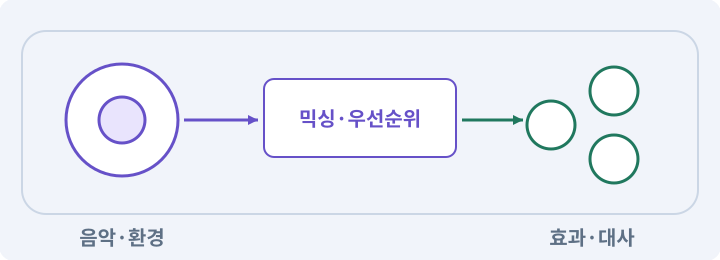

# 071. 카메라·소리·피해 숫자 맞추기

**목표:** 한 타격에 반응이 함께 전달됩니다.

**시작 상태:** 전투 효과와 소리

## 한눈에 보는 기능의 흐름

타격 사건 → 소리·숫자 → 카메라 반응 → 접근성 설정



**경계:** 장식 피드백이 위험을 가리지 않기

그림은 실제 게임 실행 결과가 아닙니다. 값·규칙과 예제를 필요한 때 펼쳐 읽고 현재 단계의 메시지를 한 번씩 보냅니다.

## 1. 지금 상태 확인하기

첫 메시지를 보내 현재 준비 상태를 확인합니다. AI가 읽어 온 실제 프로젝트가 맞는지 보고, 없는 준비나 다른 상태가 있으면 먼저 알려 주세요. 아직 기능을 만들지 않는 단계입니다.

### AI에게 보낼 요구와 이유

#### 01. 작업 대상부터 확인

**“카메라·소리·피해 숫자 맞추기” 작업을 시작하기 전에 현재 상태를 읽기 전용으로 확인해 줘.**

왜 이렇게 요청하나요? AI가 다른 프로젝트나 오래된 예제를 보고 작업할 수 있습니다. 실제 경로·파일·현재 기능을 읽게 하면 지금 이어서 작업할 대상을 먼저 맞출 수 있습니다.

#### 02. 작업 대상부터 확인

**필요한 시작 상태는 전투 효과와 소리야.**

왜 이렇게 요청하나요? AI가 다른 프로젝트나 오래된 예제를 보고 작업할 수 있습니다. 실제 경로·파일·현재 기능을 읽게 하면 지금 이어서 작업할 대상을 먼저 맞출 수 있습니다.

#### 03. 실제 사용 중인 구현 재사용

**실제 프로젝트와 작업 기록을 읽고 이것이 준비되어 있는지, 이미 같은 기능이 있는지 확인해 줘.**

왜 이렇게 요청하나요? 이름이 비슷한 새 클래스를 또 만들면 기존 화면은 여전히 옛 코드를 사용할 수 있습니다. 실제 호출되는 진입점을 찾아 연결해야 두 구현이 충돌하거나 수정이 반영되지 않는 문제를 막습니다.

#### 04. 현재 상태와 다음 확인 지점 구분

**이번 기능이 연결될 실제 파일·화면·도구와 보존할 기존 동작을 짧게 정리해 줘.**

왜 이렇게 요청하나요? 이미 준비된 기능과 아직 확인하지 못한 기능을 섞으면 불필요한 재설치나 성급한 완료 판정이 생깁니다. 현재 대상과 남은 준비를 나눠 가장 작은 다음 작업을 선택하게 합니다.

#### 05. 조사 단계에서 변경하지 않기

**아직 새 구현·설치·유료 호출·파일 변경은 하지 마.**

왜 이렇게 요청하나요? 현재 상태를 알아보기만 할 때 파일 변경이나 결제가 시작되면 검토 전의 환경이 바뀝니다. 준비 확인과 실제 구현을 나눠 되돌리기 어려운 작업이 먼저 실행되지 않게 합니다.

#### 06. 막힌 준비를 먼저 해결

**준비가 다르면 부족한 항목과 다음에 필요한 작업을 알려 줘.**

왜 이렇게 요청하나요? 빠진 파일·권한·패키지를 있다고 가정하면 다음 구현이 엉뚱한 대상을 만들게 됩니다. 무엇이 없고 무엇을 먼저 해야 하는지 분리하면 불필요한 재작업을 줄일 수 있습니다.

<details>
<summary>보낼 원문 전체 — 설명은 복사되지 않습니다</summary>

```text
“카메라·소리·피해 숫자 맞추기” 작업을 시작하기 전에 현재 상태를 읽기 전용으로 확인해 줘.
필요한 시작 상태는 전투 효과와 소리야. 실제 프로젝트와 작업 기록을 읽고 이것이 준비되어 있는지, 이미 같은 기능이 있는지 확인해 줘.
이번 기능이 연결될 실제 파일·화면·도구와 보존할 기존 동작을 짧게 정리해 줘. 아직 새 구현·설치·유료 호출·파일 변경은 하지 마. 준비가 다르면 부족한 항목과 다음에 필요한 작업을 알려 줘.
```

</details>

**기대 결과:** 사건과 피드백의 연결표

### 직접 확인하기

1. AI가 읽은 실제 프로젝트 또는 도구 경로를 확인합니다.
2. 필수 준비가 없다면 문제 해결 요청을 보내고, 준비됐을 때 다음으로 갑니다.

## 2. 필요한 기능 만들기

준비가 확인되면 아래 요청을 보냅니다. AI가 파일·설정·실행을 맡습니다. 변경 범위나 비용 승인이 나오면 내용을 읽고 결정하세요.

### AI에게 보낼 요구와 이유

#### 01. 작업 대상부터 확인

**현재 프로젝트의 실제 파일과 이미 결정한 규칙을 먼저 확인해 줘.**

왜 이렇게 요청하나요? AI가 다른 프로젝트나 오래된 예제를 보고 작업할 수 있습니다. 실제 경로·파일·현재 기능을 읽게 하면 지금 이어서 작업할 대상을 먼저 맞출 수 있습니다.

#### 02. 실제 사용 중인 코드에 연결

**이름이 다른 기존 구현이 있으면 새로 중복 제작하지 말고 그 구현에 연결해 줘.**

왜 이렇게 요청하나요? 예제와 이름이 다르더라도 현재 씬과 입력에서 호출하는 구현이 작업 대상입니다. 같은 기능을 새로 만들기보다 기존 진입점을 확인해 수정이 실제 게임에 반영되고 중복 실행되지 않게 합니다.

#### 03. 그림의 동작과 게임 판정 분리

**타격 이벤트에 카메라 반응·효과음·피해 숫자·UI 반응을 연결해 줘.**

왜 이렇게 요청하나요? 모델 동작이 이동이나 피해를 또 적용하면 기존 모터·전투 타이머와 충돌할 수 있습니다. 위치와 피해를 책임지는 주체를 하나로 두고 애니메이션은 정해진 사건을 표현하게 합니다.

#### 04. 소리 재생과 사용 경험 검사

**실제 피해와 같은 이벤트를 쓰되 화면과 소리에서 피해를 재적용하지 마.**

왜 이렇게 요청하나요? 한 번 들리는 효과음도 많은 적이 함께 재생하면 겹쳐 중요한 신호를 가릴 수 있습니다. 재생 수·볼륨·중단·접근성을 확인하고 실제 듣기 결과는 사람이 판단하게 합니다.

#### 05. 소리 재생과 사용 경험 검사

**큰 타격과 작은 타격의 차이를 제한된 크기·음량·우선순위로 표현하고 여러 적을 동시에 때렸을 때 카메라 흔들림과 소리가 누적 폭주하지 않게 해 줘.**

왜 이렇게 요청하나요? 한 번 들리는 효과음도 많은 적이 함께 재생하면 겹쳐 중요한 신호를 가릴 수 있습니다. 재생 수·볼륨·중단·접근성을 확인하고 실제 듣기 결과는 사람이 판단하게 합니다.

#### 06. 소리 재생과 사용 경험 검사

**카메라 흔들림·플래시·음량을 줄이거나 끄는 설정을 만들고, 소리를 꺼도 위험 정보가 남게 해 줘.**

왜 이렇게 요청하나요? 한 번 들리는 효과음도 많은 적이 함께 재생하면 겹쳐 중요한 신호를 가릴 수 있습니다. 재생 수·볼륨·중단·접근성을 확인하고 실제 듣기 결과는 사람이 판단하게 합니다.

#### 07. 사용 성공과 자원 소비 묶기

**마나 부족과 물약 없음은 서로 다른 UI 피드백으로 보여 줘.**

왜 이렇게 요청하나요? 실패한 사용에서 자원이 줄거나 연타로 여러 번 차감되면 표시와 실제 행동이 어긋납니다. 사용 조건·비용·대기시간을 함께 처리하고 실패 시 바뀌지 않아야 할 값을 확인합니다.

#### 08. 사람이 들어 보고 느낄 화면 준비

**재생과 기록은 네가 준비하고 실제 들리는 느낌과 멀미 여부는 내가 판단할 수 있게 해 줘.**

왜 이렇게 요청하나요? 카메라 흔들림의 불편함이나 소리의 느낌을 파일명과 로그만으로 판단할 수 없습니다. 실제 재생 상태를 준비하고 사람이 보고 들은 내용을 자동 검사와 나눠 기록합니다.

#### 09. 구현할 결과와 조건 고정

**헤드폰이나 실제 휴대폰을 대신 경험했다고 하지 마.**

왜 이렇게 요청하나요? “헤드폰이나 실제 휴대폰을 대신 경험했다고 하지 마”를 명시하면 AI가 무엇을 구현하거나 검사해야 하는지 범위를 좁힐 수 있습니다. 한 타격에 반응이 함께 전달됩니다. 이 결과를 확인할 때 이 조건이 실제로 반영됐는지 함께 봅니다.

#### 10. 구현과 실행은 AI에게 맡기기

**코드·설정·파일 생성·실행은 네가 맡고, 필요한 화면과 결과를 보여 줘.**

왜 이렇게 요청하나요? 설명이나 코드 조각만 받으면 실제 파일 생성·연결·실행이 빠질 수 있습니다. AI가 개발 작업까지 수행하고, 사람은 요구·승인·결과 판단을 맡도록 역할을 분명히 합니다.

#### 11. 막힌 준비를 먼저 해결

**수행하지 못한 작업과 필요한 승인·도구 연결은 구분해서 알려 줘.**

왜 이렇게 요청하나요? 빠진 파일·권한·패키지를 있다고 가정하면 다음 구현이 엉뚱한 대상을 만들게 됩니다. 무엇이 없고 무엇을 먼저 해야 하는지 분리하면 불필요한 재작업을 줄일 수 있습니다.

<details>
<summary>보낼 원문 전체 — 설명은 복사되지 않습니다</summary>

```text
현재 프로젝트의 실제 파일과 이미 결정한 규칙을 먼저 확인해 줘. 이름이 다른 기존 구현이 있으면 새로 중복 제작하지 말고 그 구현에 연결해 줘.

타격 이벤트에 카메라 반응·효과음·피해 숫자·UI 반응을 연결해 줘. 실제 피해와 같은 이벤트를 쓰되 화면과 소리에서 피해를 재적용하지 마.
큰 타격과 작은 타격의 차이를 제한된 크기·음량·우선순위로 표현하고 여러 적을 동시에 때렸을 때 카메라 흔들림과 소리가 누적 폭주하지 않게 해 줘.
카메라 흔들림·플래시·음량을 줄이거나 끄는 설정을 만들고, 소리를 꺼도 위험 정보가 남게 해 줘. 마나 부족과 물약 없음은 서로 다른 UI 피드백으로 보여 줘.
재생과 기록은 네가 준비하고 실제 들리는 느낌과 멀미 여부는 내가 판단할 수 있게 해 줘. 헤드폰이나 실제 휴대폰을 대신 경험했다고 하지 마.

코드·설정·파일 생성·실행은 네가 맡고, 필요한 화면과 결과를 보여 줘. 수행하지 못한 작업과 필요한 승인·도구 연결은 구분해서 알려 줘.
```

</details>

**기대 결과:** 확인할 결과: 타격 반응과 접근성 옵션을 확인함. AI가 이 상태를 확인할 실제 화면과 변경 내용을 준비합니다. 아직 실행하지 못한 부분은 따로 표시합니다.

### 직접 확인하기

1. 제안서만 반환됐다면 “설명으로 끝내지 말고 승인한 범위의 실제 작업을 수행해 줘”라고 보냅니다.
2. 코드나 설정을 직접 고치라는 안내가 나오면 “작성과 실행은 네가 맡아 줘”라고 요청합니다.

## 3. 결과를 직접 확인하기

먼저 확인 요청을 보내 AI가 검사와 화면을 준비하게 하세요. 그다음 아래 동작을 하나씩 확인합니다.

### AI에게 보낼 요구와 이유

#### 01. 검사할 입력과 관찰 지점 준비

**방금 구현한 기능의 자동 검사와 확인 화면을 준비해 줘.**

왜 이렇게 요청하나요? 정상 예 하나만 보면 실패 조건을 놓치기 쉽습니다. 정상·경계·반례를 실제 입력으로 준비하고 사람이 볼 화면도 맞춰 확인 범위를 분명하게 합니다.

#### 02. 결과를 재확인할 근거 남기기

**정상 동작과 아래 실패 조건을 실제로 검사하고 대상·실행 수·결과를 보여 줘.**

왜 이렇게 요청하나요? “잘 됩니다”라는 요약만으로는 어떤 입력과 버전을 검사했는지 알 수 없습니다. 대상·실행 수·실패 내용·파일을 함께 남겨 같은 조건으로 다시 확인할 수 있게 합니다.

#### 03. 관찰 가능한 기준으로 확인

**자동 검사: Pause가 히트스톱 종료로 풀리지 않는다.**

왜 이렇게 요청하나요? 구현 완료라는 설명을 실제 결과로 바꾸기 위한 조건입니다. 요청에 나온 대상과 경계 상황을 확인해 정상 결과뿐 아니라 실패를 어떻게 구분했는지도 남깁니다.

#### 04. 사용 성공과 자원 소비 묶기

**피드백 OFF에서 피해·쿨다운 동일이다.**

왜 이렇게 요청하나요? 실패한 사용에서 자원이 줄거나 연타로 여러 번 차감되면 표시와 실제 행동이 어긋납니다. 사용 조건·비용·대기시간을 함께 처리하고 실패 시 바뀌지 않아야 할 값을 확인합니다.

#### 05. 종료 이후의 상태까지 확인

**볼륨0 설정이 재실행 후 유지된다.**

왜 이렇게 요청하나요? 현재 화면에서 맞는 값도 저장하거나 다시 구성할 때 빠질 수 있습니다. 실제 종료·불러오기 전후에 ID·옵션·장착·진행을 비교해야 유지되는 범위를 확인할 수 있습니다.

#### 06. 소리 재생과 사용 경험 검사

**직접 검사: 시끄러운 소리가 다른 경고를 덮지 않는다.**

왜 이렇게 요청하나요? 한 번 들리는 효과음도 많은 적이 함께 재생하면 겹쳐 중요한 신호를 가릴 수 있습니다. 재생 수·볼륨·중단·접근성을 확인하고 실제 듣기 결과는 사람이 판단하게 합니다.

#### 07. 구현할 결과와 조건 고정

**흔들림을 껐을 때 더 편한 사람도 전투 정보를 잃지 않는다.**

왜 이렇게 요청하나요? “흔들림을 껐을 때 더 편한 사람도 전투 정보를 잃지 않는다”를 명시하면 AI가 무엇을 구현하거나 검사해야 하는지 범위를 좁힐 수 있습니다. 한 타격에 반응이 함께 전달됩니다. 이 결과를 확인할 때 이 조건이 실제로 반영됐는지 함께 봅니다.

#### 08. 사람 검사의 시작점 준비

**내가 조작해야 하는 부분은 실행할 화면과 시작 상태를 준비해 줘.**

왜 이렇게 요청하나요? 같은 기능이라도 시작 상태가 다르면 관찰 결과가 달라집니다. AI가 실행 화면과 재현 위치를 먼저 준비해야 사람이 이동·공격·소리·조작감을 같은 조건에서 확인할 수 있습니다.

#### 09. 사람이 실제로 본 것만 기록

**연결되지 않은 휴대폰의 터치나 사람이 보지 않은 재미·소리 품질을 대신 확인했다고 하지 마.**

왜 이렇게 요청하나요? AI가 준비한 검사와 사람이 직접 플레이하거나 들은 결과는 다른 근거입니다. 관찰하지 않은 조작감·소리·실기기 결과를 임의로 완료 처리하지 않게 합니다.

#### 10. 실제로 실행한 검사만 인정

**테스트 0개와 예전 소스 결과는 현재 성공으로 쓰지 마.**

왜 이렇게 요청하나요? 실행된 검사가 없거나 같은 결과를 중복 집계한 경우는 기능을 확인한 것이 아닙니다. 실행 수와 개별 결과를 함께 확인해야 형식적인 성공 표시를 걸러낼 수 있습니다.

<details>
<summary>보낼 원문 전체 — 설명은 복사되지 않습니다</summary>

```text
방금 구현한 기능의 자동 검사와 확인 화면을 준비해 줘. 정상 동작과 아래 실패 조건을 실제로 검사하고 대상·실행 수·결과를 보여 줘.

자동 검사: Pause가 히트스톱 종료로 풀리지 않는다. 피드백 OFF에서 피해·쿨다운 동일이다. 볼륨0 설정이 재실행 후 유지된다.

직접 검사: 시끄러운 소리가 다른 경고를 덮지 않는다. 흔들림을 껐을 때 더 편한 사람도 전투 정보를 잃지 않는다.

내가 조작해야 하는 부분은 실행할 화면과 시작 상태를 준비해 줘. 연결되지 않은 휴대폰의 터치나 사람이 보지 않은 재미·소리 품질을 대신 확인했다고 하지 마. 테스트 0개와 예전 소스 결과는 현재 성공으로 쓰지 마.
```

</details>

**기대 결과:** 타격 반응과 접근성 옵션을 확인함

### 직접 확인하기

1. 한 번 타격의 소리·숫자·흔들림을 비교합니다.
2. 여러 적을 맞혀도 너무 시끄럽거나 어지럽지 않은지 봅니다.
3. 감소 옵션과 음량0에서도 위험을 읽을 수 있는지 봅니다.

## 4. 결과를 남기고 마무리하기

실제로 본 결과를 아래 메모에 적고 AI에 전달합니다. 결과 저장 요청으로 현재 상태를 남긴 뒤 다음 페이지로 갑니다.

### AI에게 보낼 요구와 이유

#### 01. 결과를 재확인할 근거 남기기

**지금 작업한 “카메라·소리·피해 숫자 맞추기”의 실제 결과를 정리해 줘.**

왜 이렇게 요청하나요? “잘 됩니다”라는 요약만으로는 어떤 입력과 버전을 검사했는지 알 수 없습니다. 대상·실행 수·실패 내용·파일을 함께 남겨 같은 조건으로 다시 확인할 수 있게 합니다.

#### 02. 다음 작업이 읽을 인수인계

**변경한 기능·파일·현재 후보와 실제 실행한 검사, 남은 문제를 기능 이름으로 기록해 줘.**

왜 이렇게 요청하나요? 새 AI 세션은 이전 대화 전체를 알고 있다고 보장할 수 없습니다. 현재 후보·파일 위치·실행한 검사·남은 일을 남겨야 같은 작업을 반복하지 않고 이어갈 수 있습니다.

#### 03. 사람이 실제로 본 것만 기록

**자동 검사 결과와 내가 직접 확인한 결과를 구분하고, 내 관찰이 아직 없으면 미확인으로 남겨 줘.**

왜 이렇게 요청하나요? AI가 준비한 검사와 사람이 직접 플레이하거나 들은 결과는 다른 근거입니다. 관찰하지 않은 조작감·소리·실기기 결과를 임의로 완료 처리하지 않게 합니다.

#### 04. 다음 작업이 읽을 인수인계

**재시작하거나 다음 작업에서 읽을 기록의 실제 위치를 알려 줘.**

왜 이렇게 요청하나요? 새 AI 세션은 이전 대화 전체를 알고 있다고 보장할 수 없습니다. 현재 후보·파일 위치·실행한 검사·남은 일을 남겨야 같은 작업을 반복하지 않고 이어갈 수 있습니다.

#### 05. 미확인을 완료와 분리

**아직 확인하지 않은 결과를 완료로 채우지 마.**

왜 이렇게 요청하나요? 만들어진 것, 검사에 실패한 것, 아직 확인하지 못한 것을 나눠야 다음 작업을 정확히 고를 수 있습니다. 실행할 조건이 없는 기능을 성공으로 기록하면 뒤에서 원인을 찾기 어려워집니다.

<details>
<summary>보낼 원문 전체 — 설명은 복사되지 않습니다</summary>

```text
지금 작업한 “카메라·소리·피해 숫자 맞추기”의 실제 결과를 정리해 줘. 변경한 기능·파일·현재 후보와 실제 실행한 검사, 남은 문제를 기능 이름으로 기록해 줘.
자동 검사 결과와 내가 직접 확인한 결과를 구분하고, 내 관찰이 아직 없으면 미확인으로 남겨 줘. 재시작하거나 다음 작업에서 읽을 기록의 실제 위치를 알려 줘. 아직 확인하지 않은 결과를 완료로 채우지 마.
```

</details>

**기대 결과:** 현재 상태·검사 결과·남은 문제·다음에 읽을 기록을 확인할 수 있습니다.

### 직접 확인하기

1. 자동 검사와 내 관찰 결과가 섞이지 않았는지 봅니다.
2. 문제가 남았다면 해결 요청을 보내고 같은 동작을 다시 확인합니다.

## 이 작업에서 사용할 값과 규칙 전체

설계 시작값이며 측정된 성능·게임 성공 결과가 아닙니다. 구현은 AI가 수행합니다.

| 사건 | 시각/카메라 | 소리/UI |
|---|---|---|
| 일반 명중 | 작은 접점 불꽃, 흔들림 기본없음 | 짧은 피격음, 피해숫자 |
| 강한 베기 명중 | 선택적0.04m/0.1초 감쇠 흔들림 | 낮고 짧은 타격음 |
| 플레이어 큰 피해 | 약한 국소 강조 | 별도 피격음, 체력바변화 |
| 스킬 불가 | 화면 흔들림없음 | 부족이유 텍스트, 낮은 경고음 |
| 희귀 전리품 | 아이콘+짧은광채 | 구별되는획득음 |

수치는 첫 실험값이다. 카메라 흔들림을 꺼도 모든 정보를 이해할 수 있어야 한다. 피해 숫자는 풀로 재사용하고 동일 공격의 숫자를 중복 표시하지 않는다. 회전8틱의 숫자가 화면을 덮으면 짧은 구간 합산 표시를 선택하되 실제 로그 피해량과 구분한다.

AudioMixer에서 Music/SFX/UI를 나누고 음량0도 지원한다. 같은 음이 한 프레임에 20개 재생되어 크게 폭발하지 않게 voice 수와 재생 빈도를 제한한다. 한 적이 맞을 때 다른 적들의 소리까지 모두 끊는 전역Stop은 하지 않는다. 짧은 무작위 피치 변화는 선택이며 게임 RNG와 분리한다.

## 문제가 있으면

### AI에게 보낼 요구와 이유

#### 01. 구현할 결과와 조건 고정

**원인을 모르는 강한 흔들림을 추가하지 마.**

왜 이렇게 요청하나요? “원인을 모르는 강한 흔들림을 추가하지 마”를 명시하면 AI가 무엇을 구현하거나 검사해야 하는지 범위를 좁힐 수 있습니다. 한 타격에 반응이 함께 전달됩니다. 이 결과를 확인할 때 이 조건이 실제로 반영됐는지 함께 봅니다.

#### 02. 여러 시스템이 같은 진행 상태 사용

**같은 사건의 중복 재생과 최대 동시 수를 먼저 확인해 줘.**

왜 이렇게 요청하나요? 대화·지도·보상이 각자 진행을 기억하면 서로 다른 단계를 표시할 수 있습니다. 사건과 세계 사실을 공통 데이터로 처리해 선택의 결과가 일관되게 반영되도록 합니다.

#### 03. 원인 하나를 좁혀 수정

**새 기능을 추가하지 말고 현재 오류와 실제 로그를 먼저 읽어 줘.**

왜 이렇게 요청하나요? 오류 수정 중 새 기능까지 넣으면 어떤 변경이 문제를 해결하거나 악화했는지 알기 어렵습니다. 원래 재현을 보존하고 작은 변경 뒤 같은 입력과 주변 정상 동작을 다시 확인합니다.

#### 04. 원인 하나를 좁혀 수정

**최소 수정 뒤 같은 재현과 관련 정상 동작을 다시 검사해 줘.**

왜 이렇게 요청하나요? 오류 수정 중 새 기능까지 넣으면 어떤 변경이 문제를 해결하거나 악화했는지 알기 어렵습니다. 원래 재현을 보존하고 작은 변경 뒤 같은 입력과 주변 정상 동작을 다시 확인합니다.

#### 05. 실패도 재현 자료로 보존

**실패 기록은 지우지 마.**

왜 이렇게 요청하나요? 실패한 입력과 로그가 있어야 같은 문제가 다시 생겼을 때 비교할 수 있습니다. 성공 기록으로 덮어쓰지 않고 전후 자료를 남기면 무엇을 고쳤는지 확인할 수 있습니다.

<details>
<summary>보낼 원문 전체 — 설명은 복사되지 않습니다</summary>

```text
원인을 모르는 강한 흔들림을 추가하지 마. 같은 사건의 중복 재생과 최대 동시 수를 먼저 확인해 줘.
새 기능을 추가하지 말고 현재 오류와 실제 로그를 먼저 읽어 줘. 최소 수정 뒤 같은 재현과 관련 정상 동작을 다시 검사해 줘. 실패 기록은 지우지 마.
```

</details>

## 새 세션에서 이어가기

### AI에게 보낼 요구와 이유

#### 01. 이어서 할 작업 식별

**“카메라·소리·피해 숫자 맞추기” 작업을 이어가고 싶어.**

왜 이렇게 요청하나요? 이름으로 재개할 작업을 찾고, 뒤에 이어지는 요청으로 실제 파일·진행 중 작업·기록을 다시 읽게 합니다. 제목만 보고 이전 상태를 기억한다고 가정하지 않습니다.

#### 02. 조회는 상태를 바꾸지 않게

**실제 프로젝트와 내 도구의 작업 기록을 읽고 어디까지 구현·검사됐는지 확인해 줘.**

왜 이렇게 요청하나요? 진행 상황을 물을 때 새 구현이나 유료 호출이 시작되면 단순 확인이 실행 명령이 되어 버립니다. 저장된 근거를 읽어 완료·진행·승인 대기·미검증을 나누게 합니다.

#### 03. 재개 전 중복 작업 방지

**진행 중인 프로세스·승인·미저장 변경을 확인한 뒤 남은 가장 작은 작업부터 안내해 줘.**

왜 이렇게 요청하나요? 대화가 끊겨도 외부 작업은 끝났거나 아직 실행 중일 수 있습니다. 프로세스·승인·미저장 상태를 먼저 읽어 같은 생성·빌드·결제를 두 번 시작하지 않도록 합니다.

#### 04. 되돌아갈 원본 남기기

**기존 성공과 실패 기록은 보존해 줘.**

왜 이렇게 요청하나요? 새 구현이 실패해도 이전 게임과 저장을 복원할 수 있어야 합니다. 현재 내용을 먼저 조사하고 별도 후보에서 작업하면 실험이 유일한 정상본을 망가뜨리는 일을 피할 수 있습니다.

<details>
<summary>보낼 원문 전체 — 설명은 복사되지 않습니다</summary>

```text
“카메라·소리·피해 숫자 맞추기” 작업을 이어가고 싶어. 실제 프로젝트와 내 도구의 작업 기록을 읽고 어디까지 구현·검사됐는지 확인해 줘. 진행 중인 프로세스·승인·미저장 변경을 확인한 뒤 남은 가장 작은 작업부터 안내해 줘. 기존 성공과 실패 기록은 보존해 줘.
```

</details>

## 왜 이렇게 만드는가

타격감은 화면 흔들림 하나가 아니다. 공격 시작, 명중, 실패, 큰 피해, 아이템 획득에 서로 다른 피드백을 주고 과한 피드백을 줄이는 작업이다. 카메라 기본 위치 계산과 흔들림을 같은 두 컴포넌트가 동시에 덮어쓰지 않게 한다.

히트스톱은 선택 기능이다. 초급 기본값은 꺼 두고, 실험할 때만 매우 짧은 정지나 느려짐을 적용한다. Time.timeScale을 이펙트마다 임의로 바꾸면 일시정지가 풀리거나 게임이0에 멈출 수 있으므로 중앙 시간 서비스의 명시적 요청으로 다룬다.

## 공식 참고

