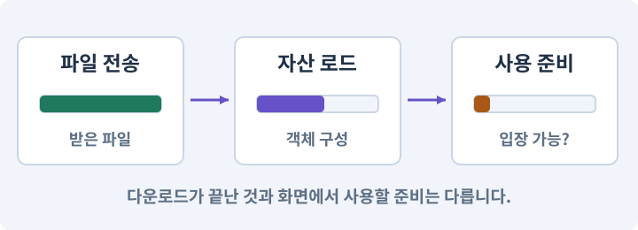

# 073. 주소로 에셋 불러오기

**목표:** 필요할 때 불러오고 사용 후 해제합니다.

**시작 상태:** 기본 게임과 분리 가능한 외형

## 한눈에 보는 기능의 흐름

주소로 요청 → 비동기 로드 → 인스턴스 사용 → 해제와 오류 처리



**경계:** 화면을 떠난 뒤 받은 결과의 소유권 정리

그림은 실제 게임 실행 결과가 아닙니다. 값·규칙과 예제를 필요한 때 펼쳐 읽고 현재 단계의 메시지를 한 번씩 보냅니다.

## 1. 지금 상태 확인하기

첫 메시지를 보내 현재 준비 상태를 확인합니다. AI가 읽어 온 실제 프로젝트가 맞는지 보고, 없는 준비나 다른 상태가 있으면 먼저 알려 주세요. 아직 기능을 만들지 않는 단계입니다.

### AI에게 보낼 요구와 이유

#### 01. 작업 대상부터 확인

**“주소로 에셋 불러오기” 작업을 시작하기 전에 현재 상태를 읽기 전용으로 확인해 줘.**

왜 이렇게 요청하나요? AI가 다른 프로젝트나 오래된 예제를 보고 작업할 수 있습니다. 실제 경로·파일·현재 기능을 읽게 하면 지금 이어서 작업할 대상을 먼저 맞출 수 있습니다.

#### 02. 작업 대상부터 확인

**필요한 시작 상태는 기본 게임과 분리 가능한 외형야.**

왜 이렇게 요청하나요? AI가 다른 프로젝트나 오래된 예제를 보고 작업할 수 있습니다. 실제 경로·파일·현재 기능을 읽게 하면 지금 이어서 작업할 대상을 먼저 맞출 수 있습니다.

#### 03. 실제 사용 중인 구현 재사용

**실제 프로젝트와 작업 기록을 읽고 이것이 준비되어 있는지, 이미 같은 기능이 있는지 확인해 줘.**

왜 이렇게 요청하나요? 이름이 비슷한 새 클래스를 또 만들면 기존 화면은 여전히 옛 코드를 사용할 수 있습니다. 실제 호출되는 진입점을 찾아 연결해야 두 구현이 충돌하거나 수정이 반영되지 않는 문제를 막습니다.

#### 04. 현재 상태와 다음 확인 지점 구분

**이번 기능이 연결될 실제 파일·화면·도구와 보존할 기존 동작을 짧게 정리해 줘.**

왜 이렇게 요청하나요? 이미 준비된 기능과 아직 확인하지 못한 기능을 섞으면 불필요한 재설치나 성급한 완료 판정이 생깁니다. 현재 대상과 남은 준비를 나눠 가장 작은 다음 작업을 선택하게 합니다.

#### 05. 조사 단계에서 변경하지 않기

**아직 새 구현·설치·유료 호출·파일 변경은 하지 마.**

왜 이렇게 요청하나요? 현재 상태를 알아보기만 할 때 파일 변경이나 결제가 시작되면 검토 전의 환경이 바뀝니다. 준비 확인과 실제 구현을 나눠 되돌리기 어려운 작업이 먼저 실행되지 않게 합니다.

#### 06. 막힌 준비를 먼저 해결

**준비가 다르면 부족한 항목과 다음에 필요한 작업을 알려 줘.**

왜 이렇게 요청하나요? 빠진 파일·권한·패키지를 있다고 가정하면 다음 구현이 엉뚱한 대상을 만들게 됩니다. 무엇이 없고 무엇을 먼저 해야 하는지 분리하면 불필요한 재작업을 줄일 수 있습니다.

<details>
<summary>보낼 원문 전체 — 설명은 복사되지 않습니다</summary>

```text
“주소로 에셋 불러오기” 작업을 시작하기 전에 현재 상태를 읽기 전용으로 확인해 줘.
필요한 시작 상태는 기본 게임과 분리 가능한 외형야. 실제 프로젝트와 작업 기록을 읽고 이것이 준비되어 있는지, 이미 같은 기능이 있는지 확인해 줘.
이번 기능이 연결될 실제 파일·화면·도구와 보존할 기존 동작을 짧게 정리해 줘. 아직 새 구현·설치·유료 호출·파일 변경은 하지 마. 준비가 다르면 부족한 항목과 다음에 필요한 작업을 알려 줘.
```

</details>

**기대 결과:** 로드 시작·준비 완료·해제의 상태

### 직접 확인하기

1. AI가 읽은 실제 프로젝트 또는 도구 경로를 확인합니다.
2. 필수 준비가 없다면 문제 해결 요청을 보내고, 준비됐을 때 다음으로 갑니다.

## 2. 필요한 기능 만들기

준비가 확인되면 아래 요청을 보냅니다. AI가 파일·설정·실행을 맡습니다. 변경 범위나 비용 승인이 나오면 내용을 읽고 결정하세요.

### AI에게 보낼 요구와 이유

#### 01. 작업 대상부터 확인

**현재 프로젝트의 실제 파일과 이미 결정한 규칙을 먼저 확인해 줘.**

왜 이렇게 요청하나요? AI가 다른 프로젝트나 오래된 예제를 보고 작업할 수 있습니다. 실제 경로·파일·현재 기능을 읽게 하면 지금 이어서 작업할 대상을 먼저 맞출 수 있습니다.

#### 02. 실제 사용 중인 코드에 연결

**이름이 다른 기존 구현이 있으면 새로 중복 제작하지 말고 그 구현에 연결해 줘.**

왜 이렇게 요청하나요? 예제와 이름이 다르더라도 현재 씬과 입력에서 호출하는 구현이 작업 대상입니다. 같은 기능을 새로 만들기보다 기존 진입점을 확인해 수정이 실제 게임에 반영되고 중복 실행되지 않게 합니다.

#### 03. 불러온 자산의 소유와 해제 관리

**먼저 로컬 Addressables 로딩을 만들어 줘.**

왜 이렇게 요청하나요? 비동기로 받은 자산은 누가 쓰고 언제 해제하는지 분명해야 합니다. 실패·취소·씬 이탈에서도 소유권을 정리해야 중복 인스턴스·해제 후 사용·메모리 잔류를 막습니다.

#### 04. 스크립트와 실제 씬 연결

**현재 Editor와 호환되는 패키지를 확인하고 작은 선택 외형 프리팹 하나를 theme_crypt 주소로 로드해 줘.**

왜 이렇게 요청하나요? 코드 파일을 만들어도 씬의 오브젝트에 붙지 않거나 참조가 비어 있으면 플레이에 반영되지 않습니다. 실제 사용하는 프리팹과 컴포넌트까지 연결해 동작을 확인하게 합니다.

#### 05. 설정과 실제 사용 결과 연결

**기본 게임과 필수 아이템·스킬·퀘스트 데이터는 LocalCore에 남겨 줘.**

왜 이렇게 요청하나요? 데이터에 수치를 넣어도 사용 조건·UI·실제 전투가 그 값을 읽지 않으면 기능이 완성되지 않습니다. 선택 전후의 계산과 저장을 함께 확인합니다.

#### 06. 종료 이후의 상태까지 확인

**저장 ID를 파일 경로나 번들 주소로 바꾸지 마.**

왜 이렇게 요청하나요? 현재 화면에서 맞는 값도 저장하거나 다시 구성할 때 빠질 수 있습니다. 실제 종료·불러오기 전후에 ID·옵션·장착·진행을 비교해야 유지되는 범위를 확인할 수 있습니다.

#### 07. 구현할 결과와 조건 고정

**아직 원격 서버는 만들지 마.**

왜 이렇게 요청하나요? “아직 원격 서버는 만들지 마”를 명시하면 AI가 무엇을 구현하거나 검사해야 하는지 범위를 좁힐 수 있습니다. 필요할 때 불러오고 사용 후 해제합니다. 이 결과를 확인할 때 이 조건이 실제로 반영됐는지 함께 봅니다.

#### 08. 불러온 자산의 소유와 해제 관리

**로드 핸들과 인스턴스의 소유자를 명확히 하고, 사용 중인 인스턴스의 자산을 먼저 해제하지 마.**

왜 이렇게 요청하나요? 비동기로 받은 자산은 누가 쓰고 언제 해제하는지 분명해야 합니다. 실패·취소·씬 이탈에서도 소유권을 정리해야 중복 인스턴스·해제 후 사용·메모리 잔류를 막습니다.

#### 09. 종료 이후 남는 상태 방지

**중복 클릭과 취소·씬 종료에서 한 번만 정리해 줘.**

왜 이렇게 요청하나요? 기능을 켜는 것만큼 끝낼 때 입력·예약·효과를 정리하는 것도 중요합니다. 취소나 사망 같은 중간 종료에서도 이전 상태가 다음 행동으로 넘어가지 않게 합니다.

#### 10. 앱과 맞는 콘텐츠만 연결

**실제 번들을 쓰는 로컬 플레이 모드에서 성공·없는 주소·반복 로드20회·씬 종료를 검사해 줘.**

왜 이렇게 요청하나요? 주소가 같아도 플랫폼·앱 버전·콘텐츠 규격이 다르면 사용할 수 없습니다. 카탈로그와 번들의 대상·호환성을 확인하고 새 버전 적용 실패에 대비해 이전 자료를 보존합니다.

#### 11. 앱과 맞는 콘텐츠만 연결

**AssetDatabase로 읽은 것을 번들 검사로 보고하지 마.**

왜 이렇게 요청하나요? 주소가 같아도 플랫폼·앱 버전·콘텐츠 규격이 다르면 사용할 수 없습니다. 카탈로그와 번들의 대상·호환성을 확인하고 새 버전 적용 실패에 대비해 이전 자료를 보존합니다.

#### 12. 스크립트와 실제 씬 연결

**현재 프로젝트의 스프라이트·타일·프리팹을 사용해 LocalCore와 선택 팩 theme_crypt를 구분해 줘.**

왜 이렇게 요청하나요? 코드 파일을 만들어도 씬의 오브젝트에 붙지 않거나 참조가 비어 있으면 플레이에 반영되지 않습니다. 실제 사용하는 프리팹과 컴포넌트까지 연결해 동작을 확인하게 합니다.

#### 13. CDN·원본 서버·HTTPS의 적용 조건

**네트워크 서비스는 아직 만들지 마.**

왜 이렇게 요청하나요? CDN은 사용자 가까운 서버 등에 콘텐츠 사본을 두어 파일을 전달하는 서비스입니다. HTTPS는 통신을 보호하는 방식이지 다운로드한 내용의 게임 호환성을 보장하는 기능은 아닙니다. 서버가 200 응답을 보냈어도 파일이 올바른 번들인지 별도로 검사해야 합니다.

#### 14. 구현과 실행은 AI에게 맡기기

**코드·설정·파일 생성·실행은 네가 맡고, 필요한 화면과 결과를 보여 줘.**

왜 이렇게 요청하나요? 설명이나 코드 조각만 받으면 실제 파일 생성·연결·실행이 빠질 수 있습니다. AI가 개발 작업까지 수행하고, 사람은 요구·승인·결과 판단을 맡도록 역할을 분명히 합니다.

#### 15. 막힌 준비를 먼저 해결

**수행하지 못한 작업과 필요한 승인·도구 연결은 구분해서 알려 줘.**

왜 이렇게 요청하나요? 빠진 파일·권한·패키지를 있다고 가정하면 다음 구현이 엉뚱한 대상을 만들게 됩니다. 무엇이 없고 무엇을 먼저 해야 하는지 분리하면 불필요한 재작업을 줄일 수 있습니다.

<details>
<summary>보낼 원문 전체 — 설명은 복사되지 않습니다</summary>

```text
현재 프로젝트의 실제 파일과 이미 결정한 규칙을 먼저 확인해 줘. 이름이 다른 기존 구현이 있으면 새로 중복 제작하지 말고 그 구현에 연결해 줘.

먼저 로컬 Addressables 로딩을 만들어 줘. 현재 Editor와 호환되는 패키지를 확인하고 작은 선택 외형 프리팹 하나를 theme_crypt 주소로 로드해 줘.
기본 게임과 필수 아이템·스킬·퀘스트 데이터는 LocalCore에 남겨 줘. 저장 ID를 파일 경로나 번들 주소로 바꾸지 마. 아직 원격 서버는 만들지 마.
로드 핸들과 인스턴스의 소유자를 명확히 하고, 사용 중인 인스턴스의 자산을 먼저 해제하지 마. 중복 클릭과 취소·씬 종료에서 한 번만 정리해 줘.
실제 번들을 쓰는 로컬 플레이 모드에서 성공·없는 주소·반복 로드20회·씬 종료를 검사해 줘. AssetDatabase로 읽은 것을 번들 검사로 보고하지 마.

현재 프로젝트의 스프라이트·타일·프리팹을 사용해 LocalCore와 선택 팩 theme_crypt를 구분해 줘. 네트워크 서비스는 아직 만들지 마.

코드·설정·파일 생성·실행은 네가 맡고, 필요한 화면과 결과를 보여 줘. 수행하지 못한 작업과 필요한 승인·도구 연결은 구분해서 알려 줘.
```

</details>

**기대 결과:** 확인할 결과: 비동기 로드와 수명 정리를 확인함. AI가 이 상태를 확인할 실제 화면과 변경 내용을 준비합니다. 아직 실행하지 못한 부분은 따로 표시합니다.

### 직접 확인하기

1. 제안서만 반환됐다면 “설명으로 끝내지 말고 승인한 범위의 실제 작업을 수행해 줘”라고 보냅니다.
2. 코드나 설정을 직접 고치라는 안내가 나오면 “작성과 실행은 네가 맡아 줘”라고 요청합니다.

## 3. 결과를 직접 확인하기

먼저 확인 요청을 보내 AI가 검사와 화면을 준비하게 하세요. 그다음 아래 동작을 하나씩 확인합니다.

### AI에게 보낼 요구와 이유

#### 01. 검사할 입력과 관찰 지점 준비

**방금 구현한 기능의 자동 검사와 확인 화면을 준비해 줘.**

왜 이렇게 요청하나요? 정상 예 하나만 보면 실패 조건을 놓치기 쉽습니다. 정상·경계·반례를 실제 입력으로 준비하고 사람이 볼 화면도 맞춰 확인 범위를 분명하게 합니다.

#### 02. 결과를 재확인할 근거 남기기

**정상 동작과 아래 실패 조건을 실제로 검사하고 대상·실행 수·결과를 보여 줘.**

왜 이렇게 요청하나요? “잘 됩니다”라는 요약만으로는 어떤 입력과 버전을 검사했는지 알 수 없습니다. 대상·실행 수·실패 내용·파일을 함께 남겨 같은 조건으로 다시 확인할 수 있게 합니다.

#### 03. 같은 요청의 반복 처리 정의

**자동 검사: 실패한 로드도 적절히 정리하고 동일 요청이 중복 인스턴스를 만들지 않는다.**

왜 이렇게 요청하나요? 클릭 연타·재연결·중복 이벤트는 개발과 플레이 중 모두 발생할 수 있습니다. 반복돼도 한 번 처리해야 하는 결과와 매번 새로 처리할 결과를 나눠 데이터가 누적되지 않게 합니다.

#### 04. 불러온 자산의 소유와 해제 관리

**객체 사용 중 원본 핸들을 해제하지 않는다.**

왜 이렇게 요청하나요? 비동기로 받은 자산은 누가 쓰고 언제 해제하는지 분명해야 합니다. 실패·취소·씬 이탈에서도 소유권을 정리해야 중복 인스턴스·해제 후 사용·메모리 잔류를 막습니다.

#### 05. 관찰 가능한 기준으로 확인

**직접 검사: 인터넷을 끈 상태에서 기본 게임을 완주할 수 있다.**

왜 이렇게 요청하나요? 구현 완료라는 설명을 실제 결과로 바꾸기 위한 조건입니다. 요청에 나온 대상과 경계 상황을 확인해 정상 결과뿐 아니라 실패를 어떻게 구분했는지도 남깁니다.

#### 06. 앱과 맞는 콘텐츠만 연결

**번들 모드로 읽은 테스트 외형이 보이고, 제거 후 관련 객체가 남지 않는다.**

왜 이렇게 요청하나요? 주소가 같아도 플랫폼·앱 버전·콘텐츠 규격이 다르면 사용할 수 없습니다. 카탈로그와 번들의 대상·호환성을 확인하고 새 버전 적용 실패에 대비해 이전 자료를 보존합니다.

#### 07. 사람 검사의 시작점 준비

**내가 조작해야 하는 부분은 실행할 화면과 시작 상태를 준비해 줘.**

왜 이렇게 요청하나요? 같은 기능이라도 시작 상태가 다르면 관찰 결과가 달라집니다. AI가 실행 화면과 재현 위치를 먼저 준비해야 사람이 이동·공격·소리·조작감을 같은 조건에서 확인할 수 있습니다.

#### 08. 사람이 실제로 본 것만 기록

**연결되지 않은 휴대폰의 터치나 사람이 보지 않은 재미·소리 품질을 대신 확인했다고 하지 마.**

왜 이렇게 요청하나요? AI가 준비한 검사와 사람이 직접 플레이하거나 들은 결과는 다른 근거입니다. 관찰하지 않은 조작감·소리·실기기 결과를 임의로 완료 처리하지 않게 합니다.

#### 09. 실제로 실행한 검사만 인정

**테스트 0개와 예전 소스 결과는 현재 성공으로 쓰지 마.**

왜 이렇게 요청하나요? 실행된 검사가 없거나 같은 결과를 중복 집계한 경우는 기능을 확인한 것이 아닙니다. 실행 수와 개별 결과를 함께 확인해야 형식적인 성공 표시를 걸러낼 수 있습니다.

<details>
<summary>보낼 원문 전체 — 설명은 복사되지 않습니다</summary>

```text
방금 구현한 기능의 자동 검사와 확인 화면을 준비해 줘. 정상 동작과 아래 실패 조건을 실제로 검사하고 대상·실행 수·결과를 보여 줘.

자동 검사: 실패한 로드도 적절히 정리하고 동일 요청이 중복 인스턴스를 만들지 않는다. 객체 사용 중 원본 핸들을 해제하지 않는다.

직접 검사: 인터넷을 끈 상태에서 기본 게임을 완주할 수 있다. 번들 모드로 읽은 테스트 외형이 보이고, 제거 후 관련 객체가 남지 않는다.

내가 조작해야 하는 부분은 실행할 화면과 시작 상태를 준비해 줘. 연결되지 않은 휴대폰의 터치나 사람이 보지 않은 재미·소리 품질을 대신 확인했다고 하지 마. 테스트 0개와 예전 소스 결과는 현재 성공으로 쓰지 마.
```

</details>

**기대 결과:** 늦게 도착한 결과가 닫힌 화면에 붙지 않고, 소유한 핸들은 정확히 한 번 해제됩니다.

### 직접 확인하기

1. 외형을 불러온 뒤 화면에 나타나는지 봅니다.
2. 여러 번 들어갔다 나와 중복이 없는지 봅니다.
3. 없는 주소의 오류가 정상 게임을 멈추지 않는지 봅니다.

## 4. 결과를 남기고 마무리하기

실제로 본 결과를 아래 메모에 적고 AI에 전달합니다. 결과 저장 요청으로 현재 상태를 남긴 뒤 다음 페이지로 갑니다.

### AI에게 보낼 요구와 이유

#### 01. 결과를 재확인할 근거 남기기

**지금 작업한 “주소로 에셋 불러오기”의 실제 결과를 정리해 줘.**

왜 이렇게 요청하나요? “잘 됩니다”라는 요약만으로는 어떤 입력과 버전을 검사했는지 알 수 없습니다. 대상·실행 수·실패 내용·파일을 함께 남겨 같은 조건으로 다시 확인할 수 있게 합니다.

#### 02. 다음 작업이 읽을 인수인계

**변경한 기능·파일·현재 후보와 실제 실행한 검사, 남은 문제를 기능 이름으로 기록해 줘.**

왜 이렇게 요청하나요? 새 AI 세션은 이전 대화 전체를 알고 있다고 보장할 수 없습니다. 현재 후보·파일 위치·실행한 검사·남은 일을 남겨야 같은 작업을 반복하지 않고 이어갈 수 있습니다.

#### 03. 사람이 실제로 본 것만 기록

**자동 검사 결과와 내가 직접 확인한 결과를 구분하고, 내 관찰이 아직 없으면 미확인으로 남겨 줘.**

왜 이렇게 요청하나요? AI가 준비한 검사와 사람이 직접 플레이하거나 들은 결과는 다른 근거입니다. 관찰하지 않은 조작감·소리·실기기 결과를 임의로 완료 처리하지 않게 합니다.

#### 04. 다음 작업이 읽을 인수인계

**재시작하거나 다음 작업에서 읽을 기록의 실제 위치를 알려 줘.**

왜 이렇게 요청하나요? 새 AI 세션은 이전 대화 전체를 알고 있다고 보장할 수 없습니다. 현재 후보·파일 위치·실행한 검사·남은 일을 남겨야 같은 작업을 반복하지 않고 이어갈 수 있습니다.

#### 05. 미확인을 완료와 분리

**아직 확인하지 않은 결과를 완료로 채우지 마.**

왜 이렇게 요청하나요? 만들어진 것, 검사에 실패한 것, 아직 확인하지 못한 것을 나눠야 다음 작업을 정확히 고를 수 있습니다. 실행할 조건이 없는 기능을 성공으로 기록하면 뒤에서 원인을 찾기 어려워집니다.

<details>
<summary>보낼 원문 전체 — 설명은 복사되지 않습니다</summary>

```text
지금 작업한 “주소로 에셋 불러오기”의 실제 결과를 정리해 줘. 변경한 기능·파일·현재 후보와 실제 실행한 검사, 남은 문제를 기능 이름으로 기록해 줘.
자동 검사 결과와 내가 직접 확인한 결과를 구분하고, 내 관찰이 아직 없으면 미확인으로 남겨 줘. 재시작하거나 다음 작업에서 읽을 기록의 실제 위치를 알려 줘. 아직 확인하지 않은 결과를 완료로 채우지 마.
```

</details>

**기대 결과:** 현재 상태·검사 결과·남은 문제·다음에 읽을 기록을 확인할 수 있습니다.

### 직접 확인하기

1. 자동 검사와 내 관찰 결과가 섞이지 않았는지 봅니다.
2. 문제가 남았다면 해결 요청을 보내고 같은 동작을 다시 확인합니다.

## 구체적인 예로 이해하기

### 로드한 자원을 누가 해제하나

주소로 불러온 자산은 소유자가 해제 시점을 책임져야 합니다. 화면이 사라졌다는 사실과 메모리에서 해제된 것은 다릅니다.

**시작 상태:** 로컬 Addressables 프리팹 하나를 비동기 로드합니다.

**직접 해 볼 동작:** 완료 전에 화면을 닫고, 완료 후에도 닫았다 여는 과정을 반복합니다.

**보여야 하는 결과:** 늦게 도착한 결과가 닫힌 화면에 붙지 않고, 소유한 핸들은 정확히 한 번 해제됩니다.

**이렇게 되면 아직 안 됩니다:** 취소를 요청했으니 내부 다운로드도 반드시 취소됐다고 가정하거나 핸들을 두 번 해제합니다.

**생각해 보기:** 이미 캐시된 파일이면 로드를 기다릴 필요가 없나요?

<details><summary>해설 보기</summary>

있습니다. 전송할 바이트가 0이어도 자산 로드·검증·참조 연결은 별도 단계입니다.

</details>

## 이 작업에서 사용할 값과 규칙 전체

설계 시작값이며 측정된 성능·게임 성공 결과가 아닙니다. 구현은 AI가 수행합니다.

첫 팩은 `theme_crypt`다. 새 직업 코드가 아니라 2D 바닥/벽 Tile asset·SpriteAtlas, 몬스터 Sprite/클립, 아이콘, 선택 효과 같은 시각 자산을 담는다. 코드는 이미 Player에 있어야 하고, 저장의 itemId/skillId를 파일 경로나 번들 해시로 바꾸지 않는다.

| 구분 | 포함 내용 | 수명 |
|---|---|---|
| LocalCore | Boot/메뉴/마을/기본던전/핵심정의/기본외형 | 앱 실행·기본 플레이 |
| ThemeCrypt | 선택형 지하묘지 아트 팩 | 선택한 던전 사용 동안 |
| 실습장 | 로드/인스턴스/해제 버튼 | 개발 전용 |

주소는 `themes/crypt/definition`처럼 의미가 안정적인 문자열 또는 AssetReference를 사용한다. 로드 후 `Object.Instantiate`한 경우 원본 로드 핸들을 인스턴스가 모두 끝날 때까지 유지한다. `Addressables.InstantiateAsync` 경로를 쓰면 대응하는 인스턴스 해제를 사용한다. 두 방식의 수명 규칙을 섞지 않는다. [N23]

직접 씬 참조가 남아 있으면 원격 그룹으로 옮긴 자산도 기본 빌드에 딸려 들어갈 수 있다. 처음에는 동작을 확인한 뒤 Analyze/빌드 레이아웃으로 중복과 의존성을 확인한다. Addressable 체크만으로 앱 크기가 줄었다고 주장하지 않는다.

## 문제가 있으면

### AI에게 보낼 요구와 이유

#### 01. 구현할 결과와 조건 고정

**로드 요청과 준비 완료를 혼동하지 마.**

왜 이렇게 요청하나요? “로드 요청과 준비 완료를 혼동하지 마”를 명시하면 AI가 무엇을 구현하거나 검사해야 하는지 범위를 좁힐 수 있습니다. 필요할 때 불러오고 사용 후 해제합니다. 이 결과를 확인할 때 이 조건이 실제로 반영됐는지 함께 봅니다.

#### 02. 불러온 자산의 소유와 해제 관리

**참조 중인 자산을 먼저 해제하거나 핸들을 잃어버리는 경로를 찾아 줘.**

왜 이렇게 요청하나요? 비동기로 받은 자산은 누가 쓰고 언제 해제하는지 분명해야 합니다. 실패·취소·씬 이탈에서도 소유권을 정리해야 중복 인스턴스·해제 후 사용·메모리 잔류를 막습니다.

#### 03. 원인 하나를 좁혀 수정

**새 기능을 추가하지 말고 현재 오류와 실제 로그를 먼저 읽어 줘.**

왜 이렇게 요청하나요? 오류 수정 중 새 기능까지 넣으면 어떤 변경이 문제를 해결하거나 악화했는지 알기 어렵습니다. 원래 재현을 보존하고 작은 변경 뒤 같은 입력과 주변 정상 동작을 다시 확인합니다.

#### 04. 원인 하나를 좁혀 수정

**최소 수정 뒤 같은 재현과 관련 정상 동작을 다시 검사해 줘.**

왜 이렇게 요청하나요? 오류 수정 중 새 기능까지 넣으면 어떤 변경이 문제를 해결하거나 악화했는지 알기 어렵습니다. 원래 재현을 보존하고 작은 변경 뒤 같은 입력과 주변 정상 동작을 다시 확인합니다.

#### 05. 실패도 재현 자료로 보존

**실패 기록은 지우지 마.**

왜 이렇게 요청하나요? 실패한 입력과 로그가 있어야 같은 문제가 다시 생겼을 때 비교할 수 있습니다. 성공 기록으로 덮어쓰지 않고 전후 자료를 남기면 무엇을 고쳤는지 확인할 수 있습니다.

<details>
<summary>보낼 원문 전체 — 설명은 복사되지 않습니다</summary>

```text
로드 요청과 준비 완료를 혼동하지 마. 참조 중인 자산을 먼저 해제하거나 핸들을 잃어버리는 경로를 찾아 줘.
새 기능을 추가하지 말고 현재 오류와 실제 로그를 먼저 읽어 줘. 최소 수정 뒤 같은 재현과 관련 정상 동작을 다시 검사해 줘. 실패 기록은 지우지 마.
```

</details>

## 새 세션에서 이어가기

### AI에게 보낼 요구와 이유

#### 01. 이어서 할 작업 식별

**“주소로 에셋 불러오기” 작업을 이어가고 싶어.**

왜 이렇게 요청하나요? 이름으로 재개할 작업을 찾고, 뒤에 이어지는 요청으로 실제 파일·진행 중 작업·기록을 다시 읽게 합니다. 제목만 보고 이전 상태를 기억한다고 가정하지 않습니다.

#### 02. 조회는 상태를 바꾸지 않게

**실제 프로젝트와 내 도구의 작업 기록을 읽고 어디까지 구현·검사됐는지 확인해 줘.**

왜 이렇게 요청하나요? 진행 상황을 물을 때 새 구현이나 유료 호출이 시작되면 단순 확인이 실행 명령이 되어 버립니다. 저장된 근거를 읽어 완료·진행·승인 대기·미검증을 나누게 합니다.

#### 03. 재개 전 중복 작업 방지

**진행 중인 프로세스·승인·미저장 변경을 확인한 뒤 남은 가장 작은 작업부터 안내해 줘.**

왜 이렇게 요청하나요? 대화가 끊겨도 외부 작업은 끝났거나 아직 실행 중일 수 있습니다. 프로세스·승인·미저장 상태를 먼저 읽어 같은 생성·빌드·결제를 두 번 시작하지 않도록 합니다.

#### 04. 되돌아갈 원본 남기기

**기존 성공과 실패 기록은 보존해 줘.**

왜 이렇게 요청하나요? 새 구현이 실패해도 이전 게임과 저장을 복원할 수 있어야 합니다. 현재 내용을 먼저 조사하고 별도 후보에서 작업하면 실험이 유일한 정상본을 망가뜨리는 일을 피할 수 있습니다.

<details>
<summary>보낼 원문 전체 — 설명은 복사되지 않습니다</summary>

```text
“주소로 에셋 불러오기” 작업을 이어가고 싶어. 실제 프로젝트와 내 도구의 작업 기록을 읽고 어디까지 구현·검사됐는지 확인해 줘. 진행 중인 프로세스·승인·미저장 변경을 확인한 뒤 남은 가장 작은 작업부터 안내해 줘. 기존 성공과 실패 기록은 보존해 줘.
```

</details>

## 왜 이렇게 만드는가

Addressables는 에셋을 주소나 라벨로 찾아 비동기로 준비하는 체계다. 원격 다운로드부터 붙이면 파일 위치·카탈로그·로딩·인스턴스 수명 문제가 한꺼번에 나타난다. 먼저 로컬 번들에서 프리팹 하나를 읽고 사용 후 해제하는 실습을 한다. 로딩 핸들의 소유자와 해제 책임을 명확히 해야 한다. [N23]

멀티플레이는 추가하지 않는다. 완성 게임의 전투·저장·생성기는 계속 오프라인이다. 연결된 기능 추가되는 네트워크는 **선택한 아트 팩을 받는 콘텐츠 전달**이다. 기본 마을·기본 던전·필수 플레이어/적/보스·핵심 데이터는 앱에 포함해 인터넷 없이도 완주할 수 있게 유지한다.

## 공식 참고

- [Addressables](https://docs.unity3d.com/Packages/com.unity.addressables@2.7/manual/MemoryManagement.html)


## 실제 Unity Editor 화면 참고
공식 예시와 내 프로젝트 실행 결과를 구분하세요. 원본 사진은 온라인 연결이 필요합니다.

- [Editor 전체 배치 — 어디를 보고 있는지 구분하기](../editor_references/editor-layout.md)
