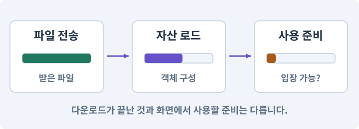

# 074. 추가 외형을 서버에서 받게 준비하기

**목표:** 플랫폼별 원격 콘텐츠를 실제 경로에서 받습니다.

**시작 상태:** 로컬 Addressables 로드

## 한눈에 보는 기능의 흐름

플랫폼 콘텐츠 → 원격 저장소 → 카탈로그·번들 → 실제 URL 수신



**경계:** 다른 플랫폼의 번들을 받지 않기

그림은 실제 게임 실행 결과가 아닙니다. 값·규칙과 예제를 필요한 때 펼쳐 읽고 현재 단계의 메시지를 한 번씩 보냅니다.

## 1. 지금 상태 확인하기

첫 메시지를 보내 현재 준비 상태를 확인합니다. AI가 읽어 온 실제 프로젝트가 맞는지 보고, 없는 준비나 다른 상태가 있으면 먼저 알려 주세요. 아직 기능을 만들지 않는 단계입니다.

### AI에게 보낼 요구와 이유

#### 01. 작업 대상부터 확인

**“추가 외형을 서버에서 받게 준비하기” 작업을 시작하기 전에 현재 상태를 읽기 전용으로 확인해 줘.**

왜 이렇게 요청하나요? AI가 다른 프로젝트나 오래된 예제를 보고 작업할 수 있습니다. 실제 경로·파일·현재 기능을 읽게 하면 지금 이어서 작업할 대상을 먼저 맞출 수 있습니다.

#### 02. 작업 대상부터 확인

**필요한 시작 상태는 로컬 Addressables 로드야.**

왜 이렇게 요청하나요? AI가 다른 프로젝트나 오래된 예제를 보고 작업할 수 있습니다. 실제 경로·파일·현재 기능을 읽게 하면 지금 이어서 작업할 대상을 먼저 맞출 수 있습니다.

#### 03. 실제 사용 중인 구현 재사용

**실제 프로젝트와 작업 기록을 읽고 이것이 준비되어 있는지, 이미 같은 기능이 있는지 확인해 줘.**

왜 이렇게 요청하나요? 이름이 비슷한 새 클래스를 또 만들면 기존 화면은 여전히 옛 코드를 사용할 수 있습니다. 실제 호출되는 진입점을 찾아 연결해야 두 구현이 충돌하거나 수정이 반영되지 않는 문제를 막습니다.

#### 04. 현재 상태와 다음 확인 지점 구분

**이번 기능이 연결될 실제 파일·화면·도구와 보존할 기존 동작을 짧게 정리해 줘.**

왜 이렇게 요청하나요? 이미 준비된 기능과 아직 확인하지 못한 기능을 섞으면 불필요한 재설치나 성급한 완료 판정이 생깁니다. 현재 대상과 남은 준비를 나눠 가장 작은 다음 작업을 선택하게 합니다.

#### 05. 조사 단계에서 변경하지 않기

**아직 새 구현·설치·유료 호출·파일 변경은 하지 마.**

왜 이렇게 요청하나요? 현재 상태를 알아보기만 할 때 파일 변경이나 결제가 시작되면 검토 전의 환경이 바뀝니다. 준비 확인과 실제 구현을 나눠 되돌리기 어려운 작업이 먼저 실행되지 않게 합니다.

#### 06. 막힌 준비를 먼저 해결

**준비가 다르면 부족한 항목과 다음에 필요한 작업을 알려 줘.**

왜 이렇게 요청하나요? 빠진 파일·권한·패키지를 있다고 가정하면 다음 구현이 엉뚱한 대상을 만들게 됩니다. 무엇이 없고 무엇을 먼저 해야 하는지 분리하면 불필요한 재작업을 줄일 수 있습니다.

<details>
<summary>보낼 원문 전체 — 설명은 복사되지 않습니다</summary>

```text
“추가 외형을 서버에서 받게 준비하기” 작업을 시작하기 전에 현재 상태를 읽기 전용으로 확인해 줘.
필요한 시작 상태는 로컬 Addressables 로드야. 실제 프로젝트와 작업 기록을 읽고 이것이 준비되어 있는지, 이미 같은 기능이 있는지 확인해 줘.
이번 기능이 연결될 실제 파일·화면·도구와 보존할 기존 동작을 짧게 정리해 줘. 아직 새 구현·설치·유료 호출·파일 변경은 하지 마. 준비가 다르면 부족한 항목과 다음에 필요한 작업을 알려 줘.
```

</details>

**기대 결과:** 호스팅 경로와 게시 승인 범위

### 직접 확인하기

1. AI가 읽은 실제 프로젝트 또는 도구 경로를 확인합니다.
2. 필수 준비가 없다면 문제 해결 요청을 보내고, 준비됐을 때 다음으로 갑니다.

## 2. 필요한 기능 만들기

준비가 확인되면 아래 요청을 보냅니다. AI가 파일·설정·실행을 맡습니다. 변경 범위나 비용 승인이 나오면 내용을 읽고 결정하세요.

### AI에게 보낼 요구와 이유

#### 01. 작업 대상부터 확인

**현재 프로젝트의 실제 파일과 이미 결정한 규칙을 먼저 확인해 줘.**

왜 이렇게 요청하나요? AI가 다른 프로젝트나 오래된 예제를 보고 작업할 수 있습니다. 실제 경로·파일·현재 기능을 읽게 하면 지금 이어서 작업할 대상을 먼저 맞출 수 있습니다.

#### 02. 실제 사용 중인 코드에 연결

**이름이 다른 기존 구현이 있으면 새로 중복 제작하지 말고 그 구현에 연결해 줘.**

왜 이렇게 요청하나요? 예제와 이름이 다르더라도 현재 씬과 입력에서 호출하는 구현이 작업 대상입니다. 같은 기능을 새로 만들기보다 기존 진입점을 확인해 수정이 실제 게임에 반영되고 중복 실행되지 않게 합니다.

#### 03. 앱과 맞는 콘텐츠만 연결

**선택 외형 팩을 원격에서 받을 수 있도록 CCD 또는 HTTPS CDN 경로 하나를 구성해 줘.**

왜 이렇게 요청하나요? 주소가 같아도 플랫폼·앱 버전·콘텐츠 규격이 다르면 사용할 수 없습니다. 카탈로그와 번들의 대상·호환성을 확인하고 새 버전 적용 실패에 대비해 이전 자료를 보존합니다.

#### 04. 비용과 외부 작업은 별도 승인

**현재 계정·권한·비용·배포 지역을 조사하고 내 승인을 받은 대상만 사용해 줘.**

왜 이렇게 요청하나요? 로컬 파일을 고치는 것과 외부 서비스에 자료를 보내거나 비용을 지불하는 것은 영향이 다릅니다. 대상·내용·비용 범위를 확인한 승인 없이 요청이 확대되지 않도록 합니다.

#### 05. 스프라이트와 SpriteRenderer의 적용 조건

**기본 게임과 필수 규칙은 앱에 남기고 theme_crypt의 스프라이트·타일·재질·선택 효과만 원격 그룹으로 분리해 줘.**

왜 이렇게 요청하나요? Sprite는 2D 그림에서 사용할 영역과 기준점을 나타내는 에셋이고, SpriteRenderer는 그것을 게임 세계에 그리는 컴포넌트입니다. PNG 전체와 화면의 캐릭터가 항상 같은 개념은 아닙니다. SpriteRenderer는 이동이나 체력을 자동으로 만들지 않습니다. 그림과 몸체는 분리합니다.

#### 06. 앱과 맞는 콘텐츠만 연결

**Windows 와 Android 번들·카탈로그 주소를 구분해 줘.**

왜 이렇게 요청하나요? 주소가 같아도 플랫폼·앱 버전·콘텐츠 규격이 다르면 사용할 수 없습니다. 카탈로그와 번들의 대상·호환성을 확인하고 새 버전 적용 실패에 대비해 이전 자료를 보존합니다.

#### 07. 앱과 맞는 콘텐츠만 연결

**먼저 로컬 번들·카탈로그·해시를 만들고 staging 배포 후보를 확인해 줘.**

왜 이렇게 요청하나요? 주소가 같아도 플랫폼·앱 버전·콘텐츠 규격이 다르면 사용할 수 없습니다. 카탈로그와 번들의 대상·호환성을 확인하고 새 버전 적용 실패에 대비해 이전 자료를 보존합니다.

#### 08. 비용과 외부 작업은 별도 승인

**업로드 대상과 예상 비용을 보여 주고 승인 전 외부 게시하지 마.**

왜 이렇게 요청하나요? 로컬 파일을 고치는 것과 외부 서비스에 자료를 보내거나 비용을 지불하는 것은 영향이 다릅니다. 대상·내용·비용 범위를 확인한 승인 없이 요청이 확대되지 않도록 합니다.

#### 09. 비용과 외부 작업은 별도 승인

**승인 후 실제 파일을 업로드하고 해당 URL에서 내려받는지 확인해 줘.**

왜 이렇게 요청하나요? 로컬 파일을 고치는 것과 외부 서비스에 자료를 보내거나 비용을 지불하는 것은 영향이 다릅니다. 대상·내용·비용 범위를 확인한 승인 없이 요청이 확대되지 않도록 합니다.

#### 10. 전송·로드·사용 준비를 나누기

**로컬 빌드 성공·서버 업로드·기기 다운로드는 따로 기록해 줘.**

왜 이렇게 요청하나요? 캐시에 파일이 있거나 전송이 끝났어도 게임에서 사용할 객체가 준비된 것은 아닙니다. 용량 확인·동의·다운로드·로드 완료를 구분하고 실패해도 기본 게임이 남도록 합니다.

#### 11. 인증 정보 노출 방지

**비밀 배포 키는 앱과 저장소에 넣지 마.**

왜 이렇게 요청하나요? 인증 정보가 프롬프트·로그·저장소에 남으면 다른 사람이 재사용할 수 있습니다. 로그인은 공식 경로에서 처리하고, AI에는 키 자체가 아니라 연결 성공 여부만 확인시킵니다.

#### 12. 구현과 실행은 AI에게 맡기기

**코드·설정·파일 생성·실행은 네가 맡고, 필요한 화면과 결과를 보여 줘.**

왜 이렇게 요청하나요? 설명이나 코드 조각만 받으면 실제 파일 생성·연결·실행이 빠질 수 있습니다. AI가 개발 작업까지 수행하고, 사람은 요구·승인·결과 판단을 맡도록 역할을 분명히 합니다.

#### 13. 막힌 준비를 먼저 해결

**수행하지 못한 작업과 필요한 승인·도구 연결은 구분해서 알려 줘.**

왜 이렇게 요청하나요? 빠진 파일·권한·패키지를 있다고 가정하면 다음 구현이 엉뚱한 대상을 만들게 됩니다. 무엇이 없고 무엇을 먼저 해야 하는지 분리하면 불필요한 재작업을 줄일 수 있습니다.

<details>
<summary>보낼 원문 전체 — 설명은 복사되지 않습니다</summary>

```text
현재 프로젝트의 실제 파일과 이미 결정한 규칙을 먼저 확인해 줘. 이름이 다른 기존 구현이 있으면 새로 중복 제작하지 말고 그 구현에 연결해 줘.

선택 외형 팩을 원격에서 받을 수 있도록 CCD 또는 HTTPS CDN 경로 하나를 구성해 줘. 현재 계정·권한·비용·배포 지역을 조사하고 내 승인을 받은 대상만 사용해 줘.
기본 게임과 필수 규칙은 앱에 남기고 theme_crypt의 스프라이트·타일·재질·선택 효과만 원격 그룹으로 분리해 줘. Windows 와 Android 번들·카탈로그 주소를 구분해 줘.
먼저 로컬 번들·카탈로그·해시를 만들고 staging 배포 후보를 확인해 줘. 업로드 대상과 예상 비용을 보여 주고 승인 전 외부 게시하지 마.
승인 후 실제 파일을 업로드하고 해당 URL에서 내려받는지 확인해 줘. 로컬 빌드 성공·서버 업로드·기기 다운로드는 따로 기록해 줘. 비밀 배포 키는 앱과 저장소에 넣지 마.

코드·설정·파일 생성·실행은 네가 맡고, 필요한 화면과 결과를 보여 줘. 수행하지 못한 작업과 필요한 승인·도구 연결은 구분해서 알려 줘.
```

</details>

**기대 결과:** 확인할 결과: 실제 호스팅과 플랫폼 분리를 확인함. AI가 이 상태를 확인할 실제 화면과 변경 내용을 준비합니다. 아직 실행하지 못한 부분은 따로 표시합니다.

### 직접 확인하기

1. 제안서만 반환됐다면 “설명으로 끝내지 말고 승인한 범위의 실제 작업을 수행해 줘”라고 보냅니다.
2. 코드나 설정을 직접 고치라는 안내가 나오면 “작성과 실행은 네가 맡아 줘”라고 요청합니다.

## 3. 결과를 직접 확인하기

먼저 확인 요청을 보내 AI가 검사와 화면을 준비하게 하세요. 그다음 아래 동작을 하나씩 확인합니다.

### AI에게 보낼 요구와 이유

#### 01. 검사할 입력과 관찰 지점 준비

**방금 구현한 기능의 자동 검사와 확인 화면을 준비해 줘.**

왜 이렇게 요청하나요? 정상 예 하나만 보면 실패 조건을 놓치기 쉽습니다. 정상·경계·반례를 실제 입력으로 준비하고 사람이 볼 화면도 맞춰 확인 범위를 분명하게 합니다.

#### 02. 결과를 재확인할 근거 남기기

**정상 동작과 아래 실패 조건을 실제로 검사하고 대상·실행 수·결과를 보여 줘.**

왜 이렇게 요청하나요? “잘 됩니다”라는 요약만으로는 어떤 입력과 버전을 검사했는지 알 수 없습니다. 대상·실행 수·실패 내용·파일을 함께 남겨 같은 조건으로 다시 확인할 수 있게 합니다.

#### 03. 관찰 가능한 기준으로 확인

**자동 검사: 원격 Load Path에 로컬 경로·인증키·잘못된 플랫폼이 없다.**

왜 이렇게 요청하나요? 구현 완료라는 설명을 실제 결과로 바꾸기 위한 조건입니다. 요청에 나온 대상과 경계 상황을 확인해 정상 결과뿐 아니라 실패를 어떻게 구분했는지도 남깁니다.

#### 04. 매니페스트·패키지 목록·빌드 기록의 적용 조건

**산출물의 실제 파일과 manifest가 일치한다.**

왜 이렇게 요청하나요? 매니페스트는 어떤 구성요소와 설정이 포함되어 있는지 설명하는 목록입니다. Unity Packages의 manifest, Android Manifest, 실습 자료의 파일 목록은 이름이 같아도 역할이 다릅니다. 모든 manifest 파일을 같은 구조의 JSON으로 읽으려 하면 안 됩니다.

#### 05. 관찰 가능한 기준으로 확인

**직접 검사: staging URL에서 기기가 실제 콘텐츠를 받고 로드한다.**

왜 이렇게 요청하나요? 구현 완료라는 설명을 실제 결과로 바꾸기 위한 조건입니다. 요청에 나온 대상과 경계 상황을 확인해 정상 결과뿐 아니라 실패를 어떻게 구분했는지도 남깁니다.

#### 06. CDN·원본 서버·HTTPS의 적용 조건

**잘못된 URL은 명확한 오류를 보인다.**

왜 이렇게 요청하나요? CDN은 사용자 가까운 서버 등에 콘텐츠 사본을 두어 파일을 전달하는 서비스입니다. HTTPS는 통신을 보호하는 방식이지 다운로드한 내용의 게임 호환성을 보장하는 기능은 아닙니다. 서버가 200 응답을 보냈어도 파일이 올바른 번들인지 별도로 검사해야 합니다.

#### 07. 미확인을 완료와 분리

**호스팅 계정이 없으면 배포는 BLOCKED로 기록한다.**

왜 이렇게 요청하나요? 만들어진 것, 검사에 실패한 것, 아직 확인하지 못한 것을 나눠야 다음 작업을 정확히 고를 수 있습니다. 실행할 조건이 없는 기능을 성공으로 기록하면 뒤에서 원인을 찾기 어려워집니다.

#### 08. 사람 검사의 시작점 준비

**내가 조작해야 하는 부분은 실행할 화면과 시작 상태를 준비해 줘.**

왜 이렇게 요청하나요? 같은 기능이라도 시작 상태가 다르면 관찰 결과가 달라집니다. AI가 실행 화면과 재현 위치를 먼저 준비해야 사람이 이동·공격·소리·조작감을 같은 조건에서 확인할 수 있습니다.

#### 09. 사람이 실제로 본 것만 기록

**연결되지 않은 휴대폰의 터치나 사람이 보지 않은 재미·소리 품질을 대신 확인했다고 하지 마.**

왜 이렇게 요청하나요? AI가 준비한 검사와 사람이 직접 플레이하거나 들은 결과는 다른 근거입니다. 관찰하지 않은 조작감·소리·실기기 결과를 임의로 완료 처리하지 않게 합니다.

#### 10. 실제로 실행한 검사만 인정

**테스트 0개와 예전 소스 결과는 현재 성공으로 쓰지 마.**

왜 이렇게 요청하나요? 실행된 검사가 없거나 같은 결과를 중복 집계한 경우는 기능을 확인한 것이 아닙니다. 실행 수와 개별 결과를 함께 확인해야 형식적인 성공 표시를 걸러낼 수 있습니다.

<details>
<summary>보낼 원문 전체 — 설명은 복사되지 않습니다</summary>

```text
방금 구현한 기능의 자동 검사와 확인 화면을 준비해 줘. 정상 동작과 아래 실패 조건을 실제로 검사하고 대상·실행 수·결과를 보여 줘.

자동 검사: 원격 Load Path에 로컬 경로·인증키·잘못된 플랫폼이 없다. 산출물의 실제 파일과 manifest가 일치한다.

직접 검사: staging URL에서 기기가 실제 콘텐츠를 받고 로드한다. 잘못된 URL은 명확한 오류를 보인다. 호스팅 계정이 없으면 배포는 BLOCKED로 기록한다.

내가 조작해야 하는 부분은 실행할 화면과 시작 상태를 준비해 줘. 연결되지 않은 휴대폰의 터치나 사람이 보지 않은 재미·소리 품질을 대신 확인했다고 하지 마. 테스트 0개와 예전 소스 결과는 현재 성공으로 쓰지 마.
```

</details>

**기대 결과:** 실제 호스팅과 플랫폼 분리를 확인함

### 직접 확인하기

1. 업로드 전 파일과 비용 범위를 확인합니다.
2. 승인한 뒤 실제 원격 자산을 받는 결과를 봅니다.
3. Windows 가 Android 번들을 받지 않는지 확인합니다.

## 4. 결과를 남기고 마무리하기

실제로 본 결과를 아래 메모에 적고 AI에 전달합니다. 결과 저장 요청으로 현재 상태를 남긴 뒤 다음 페이지로 갑니다.

### AI에게 보낼 요구와 이유

#### 01. 결과를 재확인할 근거 남기기

**지금 작업한 “추가 외형을 서버에서 받게 준비하기”의 실제 결과를 정리해 줘.**

왜 이렇게 요청하나요? “잘 됩니다”라는 요약만으로는 어떤 입력과 버전을 검사했는지 알 수 없습니다. 대상·실행 수·실패 내용·파일을 함께 남겨 같은 조건으로 다시 확인할 수 있게 합니다.

#### 02. 다음 작업이 읽을 인수인계

**변경한 기능·파일·현재 후보와 실제 실행한 검사, 남은 문제를 기능 이름으로 기록해 줘.**

왜 이렇게 요청하나요? 새 AI 세션은 이전 대화 전체를 알고 있다고 보장할 수 없습니다. 현재 후보·파일 위치·실행한 검사·남은 일을 남겨야 같은 작업을 반복하지 않고 이어갈 수 있습니다.

#### 03. 사람이 실제로 본 것만 기록

**자동 검사 결과와 내가 직접 확인한 결과를 구분하고, 내 관찰이 아직 없으면 미확인으로 남겨 줘.**

왜 이렇게 요청하나요? AI가 준비한 검사와 사람이 직접 플레이하거나 들은 결과는 다른 근거입니다. 관찰하지 않은 조작감·소리·실기기 결과를 임의로 완료 처리하지 않게 합니다.

#### 04. 다음 작업이 읽을 인수인계

**재시작하거나 다음 작업에서 읽을 기록의 실제 위치를 알려 줘.**

왜 이렇게 요청하나요? 새 AI 세션은 이전 대화 전체를 알고 있다고 보장할 수 없습니다. 현재 후보·파일 위치·실행한 검사·남은 일을 남겨야 같은 작업을 반복하지 않고 이어갈 수 있습니다.

#### 05. 미확인을 완료와 분리

**아직 확인하지 않은 결과를 완료로 채우지 마.**

왜 이렇게 요청하나요? 만들어진 것, 검사에 실패한 것, 아직 확인하지 못한 것을 나눠야 다음 작업을 정확히 고를 수 있습니다. 실행할 조건이 없는 기능을 성공으로 기록하면 뒤에서 원인을 찾기 어려워집니다.

<details>
<summary>보낼 원문 전체 — 설명은 복사되지 않습니다</summary>

```text
지금 작업한 “추가 외형을 서버에서 받게 준비하기”의 실제 결과를 정리해 줘. 변경한 기능·파일·현재 후보와 실제 실행한 검사, 남은 문제를 기능 이름으로 기록해 줘.
자동 검사 결과와 내가 직접 확인한 결과를 구분하고, 내 관찰이 아직 없으면 미확인으로 남겨 줘. 재시작하거나 다음 작업에서 읽을 기록의 실제 위치를 알려 줘. 아직 확인하지 않은 결과를 완료로 채우지 마.
```

</details>

**기대 결과:** 현재 상태·검사 결과·남은 문제·다음에 읽을 기록을 확인할 수 있습니다.

### 직접 확인하기

1. 자동 검사와 내 관찰 결과가 섞이지 않았는지 봅니다.
2. 문제가 남았다면 해결 요청을 보내고 같은 동작을 다시 확인합니다.

## 이 작업에서 사용할 값과 규칙 전체

설계 시작값이며 측정된 성능·게임 성공 결과가 아닙니다. 구현은 AI가 수행합니다.

권장 분리 예:

번들은 대상 플랫폼별로 빌드한다. Windows 에서 만든 번들을 Android 에 재사용하지 않는다. 서명 키와 업로드 토큰은 개발 환경에만 둔다. 클라이언트는 허용된 읽기 경로만 알아야 하고 업로드 권한을 가지면 안 된다.

CCD 경로: Dashboard에서 환경/버킷 생성→플랫폼 확인→Addressables의 원격 Load Path에 실제 제공 URL 복사→콘텐츠 빌드→산출물 업로드→릴리스 생성→staging 배지/릴리스 URL로 테스트. 일반 CDN 경로: 버전 폴더 준비→번들 업로드→카탈로그/해시 업로드→읽기 URL 검사→별도 staging 앱으로 테스트. 카탈로그 파일 확장자나 이름을 추정하지 말고 실제 산출물 목록을 사용한다.

최초 실습은 staging 공개 읽기 경로의 작은 자산으로 한다. 과금 한도·트래픽 경보·공개 범위를 먼저 확인한다. 제품 배포나 다른 계정의 파일 덮어쓰기는 자동으로 승인된 것이 아니다. HTTPS를 사용하고 테스트를 편하게 하려고 제품 앱의 네트워크 보안을 전역 해제하지 않는다.

## 문제가 있으면

### AI에게 보낼 요구와 이유

#### 01. CDN·원본 서버·HTTPS의 적용 조건

**업로드되지 않은 URL을 완성 경로로 쓰지 마.**

왜 이렇게 요청하나요? CDN은 사용자 가까운 서버 등에 콘텐츠 사본을 두어 파일을 전달하는 서비스입니다. HTTPS는 통신을 보호하는 방식이지 다운로드한 내용의 게임 호환성을 보장하는 기능은 아닙니다. 서버가 200 응답을 보냈어도 파일이 올바른 번들인지 별도로 검사해야 합니다.

#### 02. 플랫폼별 실제 실행물 검사

**코드와 서명키는 에셋 팩에 넣지 말고 게시 실패를 따로 보고해 줘.**

왜 이렇게 요청하나요? Editor Play와 배포 앱은 빌드·파일·실행 환경이 다릅니다. 설치 형식과 대상 플랫폼을 구분하고 각 실제 실행물에서 메뉴·입력·저장·콘텐츠를 다시 확인합니다.

#### 03. 원인 하나를 좁혀 수정

**새 기능을 추가하지 말고 현재 오류와 실제 로그를 먼저 읽어 줘.**

왜 이렇게 요청하나요? 오류 수정 중 새 기능까지 넣으면 어떤 변경이 문제를 해결하거나 악화했는지 알기 어렵습니다. 원래 재현을 보존하고 작은 변경 뒤 같은 입력과 주변 정상 동작을 다시 확인합니다.

#### 04. 원인 하나를 좁혀 수정

**최소 수정 뒤 같은 재현과 관련 정상 동작을 다시 검사해 줘.**

왜 이렇게 요청하나요? 오류 수정 중 새 기능까지 넣으면 어떤 변경이 문제를 해결하거나 악화했는지 알기 어렵습니다. 원래 재현을 보존하고 작은 변경 뒤 같은 입력과 주변 정상 동작을 다시 확인합니다.

#### 05. 실패도 재현 자료로 보존

**실패 기록은 지우지 마.**

왜 이렇게 요청하나요? 실패한 입력과 로그가 있어야 같은 문제가 다시 생겼을 때 비교할 수 있습니다. 성공 기록으로 덮어쓰지 않고 전후 자료를 남기면 무엇을 고쳤는지 확인할 수 있습니다.

<details>
<summary>보낼 원문 전체 — 설명은 복사되지 않습니다</summary>

```text
업로드되지 않은 URL을 완성 경로로 쓰지 마. 코드와 서명키는 에셋 팩에 넣지 말고 게시 실패를 따로 보고해 줘.
새 기능을 추가하지 말고 현재 오류와 실제 로그를 먼저 읽어 줘. 최소 수정 뒤 같은 재현과 관련 정상 동작을 다시 검사해 줘. 실패 기록은 지우지 마.
```

</details>

## 새 세션에서 이어가기

### AI에게 보낼 요구와 이유

#### 01. 이어서 할 작업 식별

**“추가 외형을 서버에서 받게 준비하기” 작업을 이어가고 싶어.**

왜 이렇게 요청하나요? 이름으로 재개할 작업을 찾고, 뒤에 이어지는 요청으로 실제 파일·진행 중 작업·기록을 다시 읽게 합니다. 제목만 보고 이전 상태를 기억한다고 가정하지 않습니다.

#### 02. 조회는 상태를 바꾸지 않게

**실제 프로젝트와 내 도구의 작업 기록을 읽고 어디까지 구현·검사됐는지 확인해 줘.**

왜 이렇게 요청하나요? 진행 상황을 물을 때 새 구현이나 유료 호출이 시작되면 단순 확인이 실행 명령이 되어 버립니다. 저장된 근거를 읽어 완료·진행·승인 대기·미검증을 나누게 합니다.

#### 03. 재개 전 중복 작업 방지

**진행 중인 프로세스·승인·미저장 변경을 확인한 뒤 남은 가장 작은 작업부터 안내해 줘.**

왜 이렇게 요청하나요? 대화가 끊겨도 외부 작업은 끝났거나 아직 실행 중일 수 있습니다. 프로세스·승인·미저장 상태를 먼저 읽어 같은 생성·빌드·결제를 두 번 시작하지 않도록 합니다.

#### 04. 되돌아갈 원본 남기기

**기존 성공과 실패 기록은 보존해 줘.**

왜 이렇게 요청하나요? 새 구현이 실패해도 이전 게임과 저장을 복원할 수 있어야 합니다. 현재 내용을 먼저 조사하고 별도 후보에서 작업하면 실험이 유일한 정상본을 망가뜨리는 일을 피할 수 있습니다.

<details>
<summary>보낼 원문 전체 — 설명은 복사되지 않습니다</summary>

```text
“추가 외형을 서버에서 받게 준비하기” 작업을 이어가고 싶어. 실제 프로젝트와 내 도구의 작업 기록을 읽고 어디까지 구현·검사됐는지 확인해 줘. 진행 중인 프로세스·승인·미저장 변경을 확인한 뒤 남은 가장 작은 작업부터 안내해 줘. 기존 성공과 실패 기록은 보존해 줘.
```

</details>

## 왜 이렇게 만드는가

원격 배포는 크게 번들(실제 자산), 카탈로그(주소→위치 정보), 해시 등 생성 산출물을 올리는 작업이다. Unity 문서는 Build Remote Catalog 활성화와 원격 그룹의 Build/Load Path 설정을 안내한다. 로컬 디스크의 Build Path와 플레이어가 접근할 HTTPS Load Path를 혼동하지 않는다. [N24]

호스팅 선택지는 Unity Cloud Content Delivery(CCD) 또는 정적 파일을 HTTPS로 제공하는 CDN/오브젝트 스토리지다. 이 장의 완주에는 하나만 필요하다. CCD는 버킷·릴리스·배지로 콘텐츠 버전을 관리하는 경로를 제공한다. Editor 자동화에 쓰는 Unity CLI와 UGS/CCD 관리 명령은 동일한 명령 체계라고 가정하지 않는다. [N29]

## 공식 참고

- [Addressables](https://docs.unity3d.com/Packages/com.unity.addressables@2.7/manual/remote-content-enable.html)
- [Unity CCD](https://docs.unity.com/en-us/ccd/cli-walkthrough)
