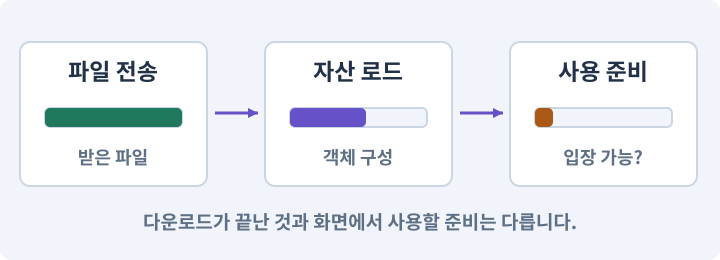

# 076. 연결이 끊겨도 게임 계속하기

**목표:** 취소·오프라인·앱 복귀에서 저장을 지킵니다.

**시작 상태:** 다운로드와 기본 오프라인 게임

## 한눈에 보는 기능의 흐름

요청 실행 → 취소·연결 단절 → 기본 자산 유지 → 복귀 뒤 새 요청



**경계:** 옛 완료 콜백이 새 선택을 덮지 않기

그림은 실제 게임 실행 결과가 아닙니다. 값·규칙과 예제를 필요한 때 펼쳐 읽고 현재 단계의 메시지를 한 번씩 보냅니다.

## 1. 지금 상태 확인하기

첫 메시지를 보내 현재 준비 상태를 확인합니다. AI가 읽어 온 실제 프로젝트가 맞는지 보고, 없는 준비나 다른 상태가 있으면 먼저 알려 주세요. 아직 기능을 만들지 않는 단계입니다.

### AI에게 보낼 요구와 이유

#### 01. 작업 대상부터 확인

**“연결이 끊겨도 게임 계속하기” 작업을 시작하기 전에 현재 상태를 읽기 전용으로 확인해 줘.**

왜 이렇게 요청하나요? AI가 다른 프로젝트나 오래된 예제를 보고 작업할 수 있습니다. 실제 경로·파일·현재 기능을 읽게 하면 지금 이어서 작업할 대상을 먼저 맞출 수 있습니다.

#### 02. 작업 대상부터 확인

**필요한 시작 상태는 다운로드와 기본 오프라인 게임야.**

왜 이렇게 요청하나요? AI가 다른 프로젝트나 오래된 예제를 보고 작업할 수 있습니다. 실제 경로·파일·현재 기능을 읽게 하면 지금 이어서 작업할 대상을 먼저 맞출 수 있습니다.

#### 03. 실제 사용 중인 구현 재사용

**실제 프로젝트와 작업 기록을 읽고 이것이 준비되어 있는지, 이미 같은 기능이 있는지 확인해 줘.**

왜 이렇게 요청하나요? 이름이 비슷한 새 클래스를 또 만들면 기존 화면은 여전히 옛 코드를 사용할 수 있습니다. 실제 호출되는 진입점을 찾아 연결해야 두 구현이 충돌하거나 수정이 반영되지 않는 문제를 막습니다.

#### 04. 현재 상태와 다음 확인 지점 구분

**이번 기능이 연결될 실제 파일·화면·도구와 보존할 기존 동작을 짧게 정리해 줘.**

왜 이렇게 요청하나요? 이미 준비된 기능과 아직 확인하지 못한 기능을 섞으면 불필요한 재설치나 성급한 완료 판정이 생깁니다. 현재 대상과 남은 준비를 나눠 가장 작은 다음 작업을 선택하게 합니다.

#### 05. 조사 단계에서 변경하지 않기

**아직 새 구현·설치·유료 호출·파일 변경은 하지 마.**

왜 이렇게 요청하나요? 현재 상태를 알아보기만 할 때 파일 변경이나 결제가 시작되면 검토 전의 환경이 바뀝니다. 준비 확인과 실제 구현을 나눠 되돌리기 어려운 작업이 먼저 실행되지 않게 합니다.

#### 06. 막힌 준비를 먼저 해결

**준비가 다르면 부족한 항목과 다음에 필요한 작업을 알려 줘.**

왜 이렇게 요청하나요? 빠진 파일·권한·패키지를 있다고 가정하면 다음 구현이 엉뚱한 대상을 만들게 됩니다. 무엇이 없고 무엇을 먼저 해야 하는지 분리하면 불필요한 재작업을 줄일 수 있습니다.

<details>
<summary>보낼 원문 전체 — 설명은 복사되지 않습니다</summary>

```text
“연결이 끊겨도 게임 계속하기” 작업을 시작하기 전에 현재 상태를 읽기 전용으로 확인해 줘.
필요한 시작 상태는 다운로드와 기본 오프라인 게임야. 실제 프로젝트와 작업 기록을 읽고 이것이 준비되어 있는지, 이미 같은 기능이 있는지 확인해 줘.
이번 기능이 연결될 실제 파일·화면·도구와 보존할 기존 동작을 짧게 정리해 줘. 아직 새 구현·설치·유료 호출·파일 변경은 하지 마. 준비가 다르면 부족한 항목과 다음에 필요한 작업을 알려 줘.
```

</details>

**기대 결과:** 실패별 안내와 재시도·기본팩 선택

### 직접 확인하기

1. AI가 읽은 실제 프로젝트 또는 도구 경로를 확인합니다.
2. 필수 준비가 없다면 문제 해결 요청을 보내고, 준비됐을 때 다음으로 갑니다.

## 2. 필요한 기능 만들기

준비가 확인되면 아래 요청을 보냅니다. AI가 파일·설정·실행을 맡습니다. 변경 범위나 비용 승인이 나오면 내용을 읽고 결정하세요.

### AI에게 보낼 요구와 이유

#### 01. 작업 대상부터 확인

**현재 프로젝트의 실제 파일과 이미 결정한 규칙을 먼저 확인해 줘.**

왜 이렇게 요청하나요? AI가 다른 프로젝트나 오래된 예제를 보고 작업할 수 있습니다. 실제 경로·파일·현재 기능을 읽게 하면 지금 이어서 작업할 대상을 먼저 맞출 수 있습니다.

#### 02. 실제 사용 중인 코드에 연결

**이름이 다른 기존 구현이 있으면 새로 중복 제작하지 말고 그 구현에 연결해 줘.**

왜 이렇게 요청하나요? 예제와 이름이 다르더라도 현재 씬과 입력에서 호출하는 구현이 작업 대상입니다. 같은 기능을 새로 만들기보다 기존 진입점을 확인해 수정이 실제 게임에 반영되고 중복 실행되지 않게 합니다.

#### 03. 전송·로드·사용 준비를 나누기

**다운로드 실패·취소·오프라인·앱 중단에서 기본 게임을 계속할 수 있게 해 줘.**

왜 이렇게 요청하나요? 캐시에 파일이 있거나 전송이 끝났어도 게임에서 사용할 객체가 준비된 것은 아닙니다. 용량 확인·동의·다운로드·로드 완료를 구분하고 실패해도 기본 게임이 남도록 합니다.

#### 04. 불러온 자산의 소유와 해제 관리

**현재 다운로드 상태기계와 핸들 소유권을 유지해 줘.**

왜 이렇게 요청하나요? 비동기로 받은 자산은 누가 쓰고 언제 해제하는지 분명해야 합니다. 실패·취소·씬 이탈에서도 소유권을 정리해야 중복 인스턴스·해제 후 사용·메모리 잔류를 막습니다.

#### 05. 늦게 온 결과가 최신 작업을 덮지 않기

**요청마다 세대 ID를 두고 취소한 이전 요청의 늦은 콜백이 새 UI 나 던전을 덮지 않게 해 줘.**

왜 이렇게 요청하나요? AI 생성이나 다운로드가 진행되는 동안 원본과 선택이 바뀔 수 있습니다. 요청 ID·기준 버전·취소 상태를 대조해야 이전 결과가 최신 편집을 덮어쓰지 않습니다.

#### 06. 취소한 화면에 늦은 결과를 붙이지 않기

**중복 취소와 부분 다운로드를 안전하게 정리하고 무제한 재시도하지 마.**

왜 이렇게 요청하나요? 비동기 요청을 취소해도 이미 진행 중인 완료 응답이 도착할 수 있습니다. 현재 요청과 화면의 수명을 검사해 사용하지 않을 자산을 연결하지 않고 정리하게 합니다.

#### 07. 끊긴 입력과 작업 정리

**처음 설치 후 오프라인, 전송 중 연결 단절, 홈 화면 복귀, 캐시 손상, 서버 오류를 구분해서 확인해 줘.**

왜 이렇게 요청하나요? 앱 전환이나 창 닫기에서는 정상적인 손 떼기 이벤트가 오지 않을 수 있습니다. 중단 시 눌림·예약·임시 효과를 정리해야 복귀 후 멋대로 움직이거나 공격하지 않습니다.

#### 08. 스크립트와 실제 씬 연결

**번들 전송 완료와 프리팹 로드 완료는 따로 처리해 줘.**

왜 이렇게 요청하나요? 코드 파일을 만들어도 씬의 오브젝트에 붙지 않거나 참조가 비어 있으면 플레이에 반영되지 않습니다. 실제 사용하는 프리팹과 컴포넌트까지 연결해 동작을 확인하게 합니다.

#### 09. CDN·원본 서버·HTTPS의 적용 조건

**실제 기기에서 필요한 네트워크·앱 조작은 내가 할 수 있게 상태를 준비해 줘.**

왜 이렇게 요청하나요? CDN은 사용자 가까운 서버 등에 콘텐츠 사본을 두어 파일을 전달하는 서비스입니다. HTTPS는 통신을 보호하는 방식이지 다운로드한 내용의 게임 호환성을 보장하는 기능은 아닙니다. 서버가 200 응답을 보냈어도 파일이 올바른 번들인지 별도로 검사해야 합니다.

#### 10. 관찰 가능한 기준으로 확인

**네가 자동으로 수행한 부분과 내 확인을 구분하고 기본 외형으로 돌아갈 경로를 보여 줘.**

왜 이렇게 요청하나요? 구현 완료라는 설명을 실제 결과로 바꾸기 위한 조건입니다. 요청에 나온 대상과 경계 상황을 확인해 정상 결과뿐 아니라 실패를 어떻게 구분했는지도 남깁니다.

#### 11. 구현과 실행은 AI에게 맡기기

**코드·설정·파일 생성·실행은 네가 맡고, 필요한 화면과 결과를 보여 줘.**

왜 이렇게 요청하나요? 설명이나 코드 조각만 받으면 실제 파일 생성·연결·실행이 빠질 수 있습니다. AI가 개발 작업까지 수행하고, 사람은 요구·승인·결과 판단을 맡도록 역할을 분명히 합니다.

#### 12. 막힌 준비를 먼저 해결

**수행하지 못한 작업과 필요한 승인·도구 연결은 구분해서 알려 줘.**

왜 이렇게 요청하나요? 빠진 파일·권한·패키지를 있다고 가정하면 다음 구현이 엉뚱한 대상을 만들게 됩니다. 무엇이 없고 무엇을 먼저 해야 하는지 분리하면 불필요한 재작업을 줄일 수 있습니다.

<details>
<summary>보낼 원문 전체 — 설명은 복사되지 않습니다</summary>

```text
현재 프로젝트의 실제 파일과 이미 결정한 규칙을 먼저 확인해 줘. 이름이 다른 기존 구현이 있으면 새로 중복 제작하지 말고 그 구현에 연결해 줘.

다운로드 실패·취소·오프라인·앱 중단에서 기본 게임을 계속할 수 있게 해 줘. 현재 다운로드 상태기계와 핸들 소유권을 유지해 줘.
요청마다 세대 ID를 두고 취소한 이전 요청의 늦은 콜백이 새 UI 나 던전을 덮지 않게 해 줘. 중복 취소와 부분 다운로드를 안전하게 정리하고 무제한 재시도하지 마.
처음 설치 후 오프라인, 전송 중 연결 단절, 홈 화면 복귀, 캐시 손상, 서버 오류를 구분해서 확인해 줘. 번들 전송 완료와 프리팹 로드 완료는 따로 처리해 줘.
실제 기기에서 필요한 네트워크·앱 조작은 내가 할 수 있게 상태를 준비해 줘. 네가 자동으로 수행한 부분과 내 확인을 구분하고 기본 외형으로 돌아갈 경로를 보여 줘.

코드·설정·파일 생성·실행은 네가 맡고, 필요한 화면과 결과를 보여 줘. 수행하지 못한 작업과 필요한 승인·도구 연결은 구분해서 알려 줘.
```

</details>

**기대 결과:** 확인할 결과: 오프라인과 취소 후 정상 복구를 확인함. AI가 이 상태를 확인할 실제 화면과 변경 내용을 준비합니다. 아직 실행하지 못한 부분은 따로 표시합니다.

### 직접 확인하기

1. 제안서만 반환됐다면 “설명으로 끝내지 말고 승인한 범위의 실제 작업을 수행해 줘”라고 보냅니다.
2. 코드나 설정을 직접 고치라는 안내가 나오면 “작성과 실행은 네가 맡아 줘”라고 요청합니다.

## 3. 결과를 직접 확인하기

먼저 확인 요청을 보내 AI가 검사와 화면을 준비하게 하세요. 그다음 아래 동작을 하나씩 확인합니다.

### AI에게 보낼 요구와 이유

#### 01. 검사할 입력과 관찰 지점 준비

**방금 구현한 기능의 자동 검사와 확인 화면을 준비해 줘.**

왜 이렇게 요청하나요? 정상 예 하나만 보면 실패 조건을 놓치기 쉽습니다. 정상·경계·반례를 실제 입력으로 준비하고 사람이 볼 화면도 맞춰 확인 범위를 분명하게 합니다.

#### 02. 결과를 재확인할 근거 남기기

**정상 동작과 아래 실패 조건을 실제로 검사하고 대상·실행 수·결과를 보여 줘.**

왜 이렇게 요청하나요? “잘 됩니다”라는 요약만으로는 어떤 입력과 버전을 검사했는지 알 수 없습니다. 대상·실행 수·실패 내용·파일을 함께 남겨 같은 조건으로 다시 확인할 수 있게 합니다.

#### 03. 종료 이후의 상태까지 확인

**자동 검사: 취소 후 완료 콜백은 입장0회, 재시도 상한 유지, 실제 저장 불변이다.**

왜 이렇게 요청하나요? 현재 화면에서 맞는 값도 저장하거나 다시 구성할 때 빠질 수 있습니다. 실제 종료·불러오기 전후에 ID·옵션·장착·진행을 비교해야 유지되는 범위를 확인할 수 있습니다.

#### 04. 구현할 결과와 조건 고정

**실패한 상태가 Ready로 전이하지 않는다.**

왜 이렇게 요청하나요? “실패한 상태가 Ready로 전이하지 않는다”를 명시하면 AI가 무엇을 구현하거나 검사해야 하는지 범위를 좁힐 수 있습니다. 취소·오프라인·앱 복귀에서 저장을 지킵니다. 이 결과를 확인할 때 이 조건이 실제로 반영됐는지 함께 봅니다.

#### 05. 관찰 가능한 기준으로 확인

**직접 검사: 비행기 모드 첫 실행에서 기본 보스까지 진행 가능하다.**

왜 이렇게 요청하나요? 구현 완료라는 설명을 실제 결과로 바꾸기 위한 조건입니다. 요청에 나온 대상과 경계 상황을 확인해 정상 결과뿐 아니라 실패를 어떻게 구분했는지도 남깁니다.

#### 06. 전송·로드·사용 준비를 나누기

**앱을 닫았다 열어도 ‘다운로드됨’이라는 거짓 표시로 깨진 테마에 들어가지 않는다.**

왜 이렇게 요청하나요? 캐시에 파일이 있거나 전송이 끝났어도 게임에서 사용할 객체가 준비된 것은 아닙니다. 용량 확인·동의·다운로드·로드 완료를 구분하고 실패해도 기본 게임이 남도록 합니다.

#### 07. 사람 검사의 시작점 준비

**내가 조작해야 하는 부분은 실행할 화면과 시작 상태를 준비해 줘.**

왜 이렇게 요청하나요? 같은 기능이라도 시작 상태가 다르면 관찰 결과가 달라집니다. AI가 실행 화면과 재현 위치를 먼저 준비해야 사람이 이동·공격·소리·조작감을 같은 조건에서 확인할 수 있습니다.

#### 08. 사람이 실제로 본 것만 기록

**연결되지 않은 휴대폰의 터치나 사람이 보지 않은 재미·소리 품질을 대신 확인했다고 하지 마.**

왜 이렇게 요청하나요? AI가 준비한 검사와 사람이 직접 플레이하거나 들은 결과는 다른 근거입니다. 관찰하지 않은 조작감·소리·실기기 결과를 임의로 완료 처리하지 않게 합니다.

#### 09. 실제로 실행한 검사만 인정

**테스트 0개와 예전 소스 결과는 현재 성공으로 쓰지 마.**

왜 이렇게 요청하나요? 실행된 검사가 없거나 같은 결과를 중복 집계한 경우는 기능을 확인한 것이 아닙니다. 실행 수와 개별 결과를 함께 확인해야 형식적인 성공 표시를 걸러낼 수 있습니다.

<details>
<summary>보낼 원문 전체 — 설명은 복사되지 않습니다</summary>

```text
방금 구현한 기능의 자동 검사와 확인 화면을 준비해 줘. 정상 동작과 아래 실패 조건을 실제로 검사하고 대상·실행 수·결과를 보여 줘.

자동 검사: 취소 후 완료 콜백은 입장0회, 재시도 상한 유지, 실제 저장 불변이다. 실패한 상태가 Ready로 전이하지 않는다.

직접 검사: 비행기 모드 첫 실행에서 기본 보스까지 진행 가능하다. 앱을 닫았다 열어도 ‘다운로드됨’이라는 거짓 표시로 깨진 테마에 들어가지 않는다.

내가 조작해야 하는 부분은 실행할 화면과 시작 상태를 준비해 줘. 연결되지 않은 휴대폰의 터치나 사람이 보지 않은 재미·소리 품질을 대신 확인했다고 하지 마. 테스트 0개와 예전 소스 결과는 현재 성공으로 쓰지 마.
```

</details>

**기대 결과:** 오프라인과 취소 후 정상 복구를 확인함

### 직접 확인하기

1. 다운로드 중 취소합니다.
2. 네트워크가 없는 기기에서 기본 게임을 시작합니다.
3. 홈 화면 복귀 후 새 요청에 옛 결과가 덮이지 않는지 봅니다.

## 4. 결과를 남기고 마무리하기

실제로 본 결과를 아래 메모에 적고 AI에 전달합니다. 결과 저장 요청으로 현재 상태를 남긴 뒤 다음 페이지로 갑니다.

### AI에게 보낼 요구와 이유

#### 01. 결과를 재확인할 근거 남기기

**지금 작업한 “연결이 끊겨도 게임 계속하기”의 실제 결과를 정리해 줘.**

왜 이렇게 요청하나요? “잘 됩니다”라는 요약만으로는 어떤 입력과 버전을 검사했는지 알 수 없습니다. 대상·실행 수·실패 내용·파일을 함께 남겨 같은 조건으로 다시 확인할 수 있게 합니다.

#### 02. 다음 작업이 읽을 인수인계

**변경한 기능·파일·현재 후보와 실제 실행한 검사, 남은 문제를 기능 이름으로 기록해 줘.**

왜 이렇게 요청하나요? 새 AI 세션은 이전 대화 전체를 알고 있다고 보장할 수 없습니다. 현재 후보·파일 위치·실행한 검사·남은 일을 남겨야 같은 작업을 반복하지 않고 이어갈 수 있습니다.

#### 03. 사람이 실제로 본 것만 기록

**자동 검사 결과와 내가 직접 확인한 결과를 구분하고, 내 관찰이 아직 없으면 미확인으로 남겨 줘.**

왜 이렇게 요청하나요? AI가 준비한 검사와 사람이 직접 플레이하거나 들은 결과는 다른 근거입니다. 관찰하지 않은 조작감·소리·실기기 결과를 임의로 완료 처리하지 않게 합니다.

#### 04. 다음 작업이 읽을 인수인계

**재시작하거나 다음 작업에서 읽을 기록의 실제 위치를 알려 줘.**

왜 이렇게 요청하나요? 새 AI 세션은 이전 대화 전체를 알고 있다고 보장할 수 없습니다. 현재 후보·파일 위치·실행한 검사·남은 일을 남겨야 같은 작업을 반복하지 않고 이어갈 수 있습니다.

#### 05. 미확인을 완료와 분리

**아직 확인하지 않은 결과를 완료로 채우지 마.**

왜 이렇게 요청하나요? 만들어진 것, 검사에 실패한 것, 아직 확인하지 못한 것을 나눠야 다음 작업을 정확히 고를 수 있습니다. 실행할 조건이 없는 기능을 성공으로 기록하면 뒤에서 원인을 찾기 어려워집니다.

<details>
<summary>보낼 원문 전체 — 설명은 복사되지 않습니다</summary>

```text
지금 작업한 “연결이 끊겨도 게임 계속하기”의 실제 결과를 정리해 줘. 변경한 기능·파일·현재 후보와 실제 실행한 검사, 남은 문제를 기능 이름으로 기록해 줘.
자동 검사 결과와 내가 직접 확인한 결과를 구분하고, 내 관찰이 아직 없으면 미확인으로 남겨 줘. 재시작하거나 다음 작업에서 읽을 기록의 실제 위치를 알려 줘. 아직 확인하지 않은 결과를 완료로 채우지 마.
```

</details>

**기대 결과:** 현재 상태·검사 결과·남은 문제·다음에 읽을 기록을 확인할 수 있습니다.

### 직접 확인하기

1. 자동 검사와 내 관찰 결과가 섞이지 않았는지 봅니다.
2. 문제가 남았다면 해결 요청을 보내고 같은 동작을 다시 확인합니다.

## 이 작업에서 사용할 값과 규칙 전체

설계 시작값이며 측정된 성능·게임 성공 결과가 아닙니다. 구현은 AI가 수행합니다.

실패 정책:

| 상황 | 사용자에게 보일 선택 | 데이터/자원 처리 |
|---|---|---|
| 최초실행오프라인 | 기본게임계속/나중에다시 | 로컬필수콘텐츠로완주 |
| 크기/카탈로그조회실패 | 재시도/취소 | 조회핸들정리, 입장안함 |
| 전송중연결끊김 | 오류이유/재시도/기본게임 | 완성캐시보존, 불완전팩Ready금지 |
| 공간부족 | 공간확보안내/취소 | 실제저장삭제안함 |
| UI 닫기/홈이동 | 복귀시현재상태확인 | 늦은콜백의자동입장차단 |
| 앱종료후재실행 | 크기다시조회 | 단순installed플래그를믿지않음 |

시작 시 로컬 카탈로그로 기본 게임을 준비하고, 원격 카탈로그 확인은 명시적인 선택 팩 경로에서 한다. 설치된 설정의 자동 카탈로그 갱신 동작을 확인해 최초 오프라인 실행을 실제로 시험한다. 필요하면 시작 자동 갱신을 억제하고 명시적 검사로 옮긴다. UI 만 로컬처럼 보여 주고 뒤에서는 원격 초기화 완료를 무기한 기다리면 안 된다.

자동 재시도는 기본 최대2회, 대기 1초→3초 같은 제한된 정책으로 시작한다. 계속 실패하면 사람에게 선택을 돌려준다. 캐시 전체 삭제로 매번 고치지 않는다. 캐시 지우기는 다운로드 관리 화면에서 선택 팩별로, 현재 사용하지 않을 때만 실행한다. 저장 파일과 캐시는 별개다.

## 문제가 있으면

### AI에게 보낼 요구와 이유

#### 01. 늦게 온 결과가 최신 작업을 덮지 않기

**취소된 요청 ID의 늦은 결과를 적용하지 마.**

왜 이렇게 요청하나요? AI 생성이나 다운로드가 진행되는 동안 원본과 선택이 바뀔 수 있습니다. 요청 ID·기준 버전·취소 상태를 대조해야 이전 결과가 최신 편집을 덮어쓰지 않습니다.

#### 02. 종료 이후의 상태까지 확인

**캐시·선택팩·게임 저장을 함께 지워 해결하지 마.**

왜 이렇게 요청하나요? 현재 화면에서 맞는 값도 저장하거나 다시 구성할 때 빠질 수 있습니다. 실제 종료·불러오기 전후에 ID·옵션·장착·진행을 비교해야 유지되는 범위를 확인할 수 있습니다.

#### 03. 원인 하나를 좁혀 수정

**새 기능을 추가하지 말고 현재 오류와 실제 로그를 먼저 읽어 줘.**

왜 이렇게 요청하나요? 오류 수정 중 새 기능까지 넣으면 어떤 변경이 문제를 해결하거나 악화했는지 알기 어렵습니다. 원래 재현을 보존하고 작은 변경 뒤 같은 입력과 주변 정상 동작을 다시 확인합니다.

#### 04. 원인 하나를 좁혀 수정

**최소 수정 뒤 같은 재현과 관련 정상 동작을 다시 검사해 줘.**

왜 이렇게 요청하나요? 오류 수정 중 새 기능까지 넣으면 어떤 변경이 문제를 해결하거나 악화했는지 알기 어렵습니다. 원래 재현을 보존하고 작은 변경 뒤 같은 입력과 주변 정상 동작을 다시 확인합니다.

#### 05. 실패도 재현 자료로 보존

**실패 기록은 지우지 마.**

왜 이렇게 요청하나요? 실패한 입력과 로그가 있어야 같은 문제가 다시 생겼을 때 비교할 수 있습니다. 성공 기록으로 덮어쓰지 않고 전후 자료를 남기면 무엇을 고쳤는지 확인할 수 있습니다.

<details>
<summary>보낼 원문 전체 — 설명은 복사되지 않습니다</summary>

```text
취소된 요청 ID의 늦은 결과를 적용하지 마. 캐시·선택팩·게임 저장을 함께 지워 해결하지 마.
새 기능을 추가하지 말고 현재 오류와 실제 로그를 먼저 읽어 줘. 최소 수정 뒤 같은 재현과 관련 정상 동작을 다시 검사해 줘. 실패 기록은 지우지 마.
```

</details>

## 새 세션에서 이어가기

### AI에게 보낼 요구와 이유

#### 01. 이어서 할 작업 식별

**“연결이 끊겨도 게임 계속하기” 작업을 이어가고 싶어.**

왜 이렇게 요청하나요? 이름으로 재개할 작업을 찾고, 뒤에 이어지는 요청으로 실제 파일·진행 중 작업·기록을 다시 읽게 합니다. 제목만 보고 이전 상태를 기억한다고 가정하지 않습니다.

#### 02. 조회는 상태를 바꾸지 않게

**실제 프로젝트와 내 도구의 작업 기록을 읽고 어디까지 구현·검사됐는지 확인해 줘.**

왜 이렇게 요청하나요? 진행 상황을 물을 때 새 구현이나 유료 호출이 시작되면 단순 확인이 실행 명령이 되어 버립니다. 저장된 근거를 읽어 완료·진행·승인 대기·미검증을 나누게 합니다.

#### 03. 재개 전 중복 작업 방지

**진행 중인 프로세스·승인·미저장 변경을 확인한 뒤 남은 가장 작은 작업부터 안내해 줘.**

왜 이렇게 요청하나요? 대화가 끊겨도 외부 작업은 끝났거나 아직 실행 중일 수 있습니다. 프로세스·승인·미저장 상태를 먼저 읽어 같은 생성·빌드·결제를 두 번 시작하지 않도록 합니다.

#### 04. 되돌아갈 원본 남기기

**기존 성공과 실패 기록은 보존해 줘.**

왜 이렇게 요청하나요? 새 구현이 실패해도 이전 게임과 저장을 복원할 수 있어야 합니다. 현재 내용을 먼저 조사하고 별도 후보에서 작업하면 실험이 유일한 정상본을 망가뜨리는 일을 피할 수 있습니다.

<details>
<summary>보낼 원문 전체 — 설명은 복사되지 않습니다</summary>

```text
“연결이 끊겨도 게임 계속하기” 작업을 이어가고 싶어. 실제 프로젝트와 내 도구의 작업 기록을 읽고 어디까지 구현·검사됐는지 확인해 줘. 진행 중인 프로세스·승인·미저장 변경을 확인한 뒤 남은 가장 작은 작업부터 안내해 줘. 기존 성공과 실패 기록은 보존해 줘.
```

</details>

## 왜 이렇게 만드는가

에셋 다운로드는 실패할 수 있다. 인터넷이 없거나 저장공간이 부족하거나 앱이 종료될 수 있다. 캐시된 완성 번들은 다시 쓰일 수 있지만, 중간까지 받은 파일이 항상 그 바이트부터 이어받기 되는 것은 아니다. UI의 ‘나중에’는 논리적 취소이며 네트워크 요청이 즉시 중단된다는 보장도 별개다. [N27]

Addressables 핸들을 Release하는 것을 다운로드 취소 API 처럼 설명하지 않는다. 작업 소유자는 앱 세션에 두고, 화면이 닫혀도 진행 중 작업의 완료/오류와 정리를 처리한다. UI 세대 ID를 바꿔 오래된 완료가 닫힌 화면을 조작하거나 던전을 자동으로 열지 못하게 한다.

## 공식 참고

- [Addressables](https://docs.unity3d.com/Packages/com.unity.addressables@2.7/manual/remote-content-assetbundle-cache.html)
