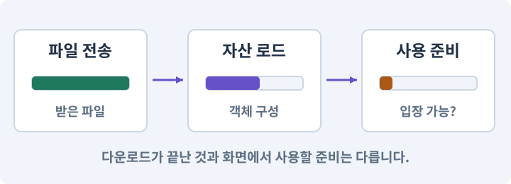

# 077. 앱을 바꾸지 않고 외형 업데이트하기

**목표:** 새 팩을 받고 문제 생기면 이전 팩으로 돌아갑니다.

**시작 상태:** 원격 콘텐츠와 실패 복구

## 한눈에 보는 기능의 흐름

기존 앱·팩 → 새 콘텐츠 → 호환 확인 → 적용 또는 롤백



**경계:** 팩 업데이트가 저장 규칙을 임의로 바꾸지 않기

그림은 실제 게임 실행 결과가 아닙니다. 값·규칙과 예제를 필요한 때 펼쳐 읽고 현재 단계의 메시지를 한 번씩 보냅니다.

## 1. 지금 상태 확인하기

첫 메시지를 보내 현재 준비 상태를 확인합니다. AI가 읽어 온 실제 프로젝트가 맞는지 보고, 없는 준비나 다른 상태가 있으면 먼저 알려 주세요. 아직 기능을 만들지 않는 단계입니다.

### AI에게 보낼 요구와 이유

#### 01. 작업 대상부터 확인

**“앱을 바꾸지 않고 외형 업데이트하기” 작업을 시작하기 전에 현재 상태를 읽기 전용으로 확인해 줘.**

왜 이렇게 요청하나요? AI가 다른 프로젝트나 오래된 예제를 보고 작업할 수 있습니다. 실제 경로·파일·현재 기능을 읽게 하면 지금 이어서 작업할 대상을 먼저 맞출 수 있습니다.

#### 02. 작업 대상부터 확인

**필요한 시작 상태는 원격 콘텐츠와 실패 복구야.**

왜 이렇게 요청하나요? AI가 다른 프로젝트나 오래된 예제를 보고 작업할 수 있습니다. 실제 경로·파일·현재 기능을 읽게 하면 지금 이어서 작업할 대상을 먼저 맞출 수 있습니다.

#### 03. 실제 사용 중인 구현 재사용

**실제 프로젝트와 작업 기록을 읽고 이것이 준비되어 있는지, 이미 같은 기능이 있는지 확인해 줘.**

왜 이렇게 요청하나요? 이름이 비슷한 새 클래스를 또 만들면 기존 화면은 여전히 옛 코드를 사용할 수 있습니다. 실제 호출되는 진입점을 찾아 연결해야 두 구현이 충돌하거나 수정이 반영되지 않는 문제를 막습니다.

#### 04. 현재 상태와 다음 확인 지점 구분

**이번 기능이 연결될 실제 파일·화면·도구와 보존할 기존 동작을 짧게 정리해 줘.**

왜 이렇게 요청하나요? 이미 준비된 기능과 아직 확인하지 못한 기능을 섞으면 불필요한 재설치나 성급한 완료 판정이 생깁니다. 현재 대상과 남은 준비를 나눠 가장 작은 다음 작업을 선택하게 합니다.

#### 05. 조사 단계에서 변경하지 않기

**아직 새 구현·설치·유료 호출·파일 변경은 하지 마.**

왜 이렇게 요청하나요? 현재 상태를 알아보기만 할 때 파일 변경이나 결제가 시작되면 검토 전의 환경이 바뀝니다. 준비 확인과 실제 구현을 나눠 되돌리기 어려운 작업이 먼저 실행되지 않게 합니다.

#### 06. 막힌 준비를 먼저 해결

**준비가 다르면 부족한 항목과 다음에 필요한 작업을 알려 줘.**

왜 이렇게 요청하나요? 빠진 파일·권한·패키지를 있다고 가정하면 다음 구현이 엉뚱한 대상을 만들게 됩니다. 무엇이 없고 무엇을 먼저 해야 하는지 분리하면 불필요한 재작업을 줄일 수 있습니다.

<details>
<summary>보낼 원문 전체 — 설명은 복사되지 않습니다</summary>

```text
“앱을 바꾸지 않고 외형 업데이트하기” 작업을 시작하기 전에 현재 상태를 읽기 전용으로 확인해 줘.
필요한 시작 상태는 원격 콘텐츠와 실패 복구야. 실제 프로젝트와 작업 기록을 읽고 이것이 준비되어 있는지, 이미 같은 기능이 있는지 확인해 줘.
이번 기능이 연결될 실제 파일·화면·도구와 보존할 기존 동작을 짧게 정리해 줘. 아직 새 구현·설치·유료 호출·파일 변경은 하지 마. 준비가 다르면 부족한 항목과 다음에 필요한 작업을 알려 줘.
```

</details>

**기대 결과:** 앱·카탈로그·팩 버전의 호환표

### 직접 확인하기

1. AI가 읽은 실제 프로젝트 또는 도구 경로를 확인합니다.
2. 필수 준비가 없다면 문제 해결 요청을 보내고, 준비됐을 때 다음으로 갑니다.

## 2. 필요한 기능 만들기

준비가 확인되면 아래 요청을 보냅니다. AI가 파일·설정·실행을 맡습니다. 변경 범위나 비용 승인이 나오면 내용을 읽고 결정하세요.

### AI에게 보낼 요구와 이유

#### 01. 작업 대상부터 확인

**현재 프로젝트의 실제 파일과 이미 결정한 규칙을 먼저 확인해 줘.**

왜 이렇게 요청하나요? AI가 다른 프로젝트나 오래된 예제를 보고 작업할 수 있습니다. 실제 경로·파일·현재 기능을 읽게 하면 지금 이어서 작업할 대상을 먼저 맞출 수 있습니다.

#### 02. 실제 사용 중인 코드에 연결

**이름이 다른 기존 구현이 있으면 새로 중복 제작하지 말고 그 구현에 연결해 줘.**

왜 이렇게 요청하나요? 예제와 이름이 다르더라도 현재 씬과 입력에서 호출하는 구현이 작업 대상입니다. 같은 기능을 새로 만들기보다 기존 진입점을 확인해 수정이 실제 게임에 반영되고 중복 실행되지 않게 합니다.

#### 03. 저장 형식 변화에 대응

**앱 호환성·저장 버전·콘텐츠 릴리스를 분리해 관리하고 선택 팩 업데이트와 롤백을 만들어 줘.**

왜 이렇게 요청하나요? 새 기능의 필드를 추가했다고 예전 저장에 그 값이 생기지는 않습니다. 이전·기본값·불명 ID 처리 규칙을 정해야 업데이트 후 장비나 퀘스트 진행을 잃지 않습니다.

#### 04. 앱과 맞는 콘텐츠만 연결

**현재 crypt-001의 Player·카탈로그·번들·content state를 보존하고 텍스처 하나만 바꾼 crypt-002를 기존 콘텐츠 업데이트 경로로 빌드해 줘.**

왜 이렇게 요청하나요? 주소가 같아도 플랫폼·앱 버전·콘텐츠 규격이 다르면 사용할 수 없습니다. 카탈로그와 번들의 대상·호환성을 확인하고 새 버전 적용 실패에 대비해 이전 자료를 보존합니다.

#### 05. 불러온 자산의 소유와 해제 관리

**설치된 Addressables 버전의 실제 절차를 확인해 줘.**

왜 이렇게 요청하나요? 비동기로 받은 자산은 누가 쓰고 언제 해제하는지 분명해야 합니다. 실패·취소·씬 이탈에서도 소유권을 정리해야 중복 인스턴스·해제 후 사용·메모리 잔류를 막습니다.

#### 06. 앱과 맞는 콘텐츠만 연결

**새 번들을 먼저 준비하고 카탈로그·해시·필수 주소를 검사한 뒤 staging에서 확인해 줘.**

왜 이렇게 요청하나요? 주소가 같아도 플랫폼·앱 버전·콘텐츠 규격이 다르면 사용할 수 없습니다. 카탈로그와 번들의 대상·호환성을 확인하고 새 버전 적용 실패에 대비해 이전 자료를 보존합니다.

#### 07. 비용과 외부 작업은 별도 승인

**외부 업로드와 활성 버전 전환은 대상과 비용을 설명하고 따로 승인받아 줘.**

왜 이렇게 요청하나요? 로컬 파일을 고치는 것과 외부 서비스에 자료를 보내거나 비용을 지불하는 것은 영향이 다릅니다. 대상·내용·비용 범위를 확인한 승인 없이 요청이 확대되지 않도록 합니다.

#### 08. 앱과 맞는 콘텐츠만 연결

**진행 중인 다운로드는 선택한 릴리스를 유지하고 던전 중 카탈로그를 바꾸지 마.**

왜 이렇게 요청하나요? 주소가 같아도 플랫폼·앱 버전·콘텐츠 규격이 다르면 사용할 수 없습니다. 카탈로그와 번들의 대상·호환성을 확인하고 새 버전 적용 실패에 대비해 이전 자료를 보존합니다.

#### 09. 전송·로드·사용 준비를 나누기

**이전 버전과 캐시는 복구 확인 전 삭제하지 마.**

왜 이렇게 요청하나요? 캐시에 파일이 있거나 전송이 끝났어도 게임에서 사용할 객체가 준비된 것은 아닙니다. 용량 확인·동의·다운로드·로드 완료를 구분하고 실패해도 기본 게임이 남도록 합니다.

#### 10. 되돌아갈 원본 남기기

**기존 앱에서 새 팩 받기·호환 불일치·필수 주소 누락·001로 롤백·저장 보존을 실제 수행 범위대로 기록해 줘.**

왜 이렇게 요청하나요? 새 구현이 실패해도 이전 게임과 저장을 복원할 수 있어야 합니다. 현재 내용을 먼저 조사하고 별도 후보에서 작업하면 실험이 유일한 정상본을 망가뜨리는 일을 피할 수 있습니다.

#### 11. 구현과 실행은 AI에게 맡기기

**코드·설정·파일 생성·실행은 네가 맡고, 필요한 화면과 결과를 보여 줘.**

왜 이렇게 요청하나요? 설명이나 코드 조각만 받으면 실제 파일 생성·연결·실행이 빠질 수 있습니다. AI가 개발 작업까지 수행하고, 사람은 요구·승인·결과 판단을 맡도록 역할을 분명히 합니다.

#### 12. 막힌 준비를 먼저 해결

**수행하지 못한 작업과 필요한 승인·도구 연결은 구분해서 알려 줘.**

왜 이렇게 요청하나요? 빠진 파일·권한·패키지를 있다고 가정하면 다음 구현이 엉뚱한 대상을 만들게 됩니다. 무엇이 없고 무엇을 먼저 해야 하는지 분리하면 불필요한 재작업을 줄일 수 있습니다.

<details>
<summary>보낼 원문 전체 — 설명은 복사되지 않습니다</summary>

```text
현재 프로젝트의 실제 파일과 이미 결정한 규칙을 먼저 확인해 줘. 이름이 다른 기존 구현이 있으면 새로 중복 제작하지 말고 그 구현에 연결해 줘.

앱 호환성·저장 버전·콘텐츠 릴리스를 분리해 관리하고 선택 팩 업데이트와 롤백을 만들어 줘.
현재 crypt-001의 Player·카탈로그·번들·content state를 보존하고 텍스처 하나만 바꾼 crypt-002를 기존 콘텐츠 업데이트 경로로 빌드해 줘. 설치된 Addressables 버전의 실제 절차를 확인해 줘.
새 번들을 먼저 준비하고 카탈로그·해시·필수 주소를 검사한 뒤 staging에서 확인해 줘. 외부 업로드와 활성 버전 전환은 대상과 비용을 설명하고 따로 승인받아 줘.
진행 중인 다운로드는 선택한 릴리스를 유지하고 던전 중 카탈로그를 바꾸지 마. 이전 버전과 캐시는 복구 확인 전 삭제하지 마.
기존 앱에서 새 팩 받기·호환 불일치·필수 주소 누락·001로 롤백·저장 보존을 실제 수행 범위대로 기록해 줘.

코드·설정·파일 생성·실행은 네가 맡고, 필요한 화면과 결과를 보여 줘. 수행하지 못한 작업과 필요한 승인·도구 연결은 구분해서 알려 줘.
```

</details>

**기대 결과:** 확인할 결과: 업데이트·거부·롤백을 확인함. AI가 이 상태를 확인할 실제 화면과 변경 내용을 준비합니다. 아직 실행하지 못한 부분은 따로 표시합니다.

### 직접 확인하기

1. 제안서만 반환됐다면 “설명으로 끝내지 말고 승인한 범위의 실제 작업을 수행해 줘”라고 보냅니다.
2. 코드나 설정을 직접 고치라는 안내가 나오면 “작성과 실행은 네가 맡아 줘”라고 요청합니다.

## 3. 결과를 직접 확인하기

먼저 확인 요청을 보내 AI가 검사와 화면을 준비하게 하세요. 그다음 아래 동작을 하나씩 확인합니다.

### AI에게 보낼 요구와 이유

#### 01. 검사할 입력과 관찰 지점 준비

**방금 구현한 기능의 자동 검사와 확인 화면을 준비해 줘.**

왜 이렇게 요청하나요? 정상 예 하나만 보면 실패 조건을 놓치기 쉽습니다. 정상·경계·반례를 실제 입력으로 준비하고 사람이 볼 화면도 맞춰 확인 범위를 분명하게 합니다.

#### 02. 결과를 재확인할 근거 남기기

**정상 동작과 아래 실패 조건을 실제로 검사하고 대상·실행 수·결과를 보여 줘.**

왜 이렇게 요청하나요? “잘 됩니다”라는 요약만으로는 어떤 입력과 버전을 검사했는지 알 수 없습니다. 대상·실행 수·실패 내용·파일을 함께 남겨 같은 조건으로 다시 확인할 수 있게 합니다.

#### 03. 관찰 가능한 기준으로 확인

**자동 검사: 플랫폼/호환 lane 불일치 거부, 필수 주소 누락 시 활성화 거부, itemId/skillId 보존이다.**

왜 이렇게 요청하나요? 구현 완료라는 설명을 실제 결과로 바꾸기 위한 조건입니다. 요청에 나온 대상과 경계 상황을 확인해 정상 결과뿐 아니라 실패를 어떻게 구분했는지도 남깁니다.

#### 04. 저장 중단과 손상에 대비

**릴리스 바뀜이 세이브 포인트를 초기화하지 않는다.**

왜 이렇게 요청하나요? 파일 쓰기가 중단되거나 읽을 수 없는 값이 있으면 정상 진행을 잃을 수 있습니다. 완성된 데이터 검증·교체·백업 복구를 나눠 손상된 자료가 정상본을 덮지 않게 합니다.

#### 05. 플랫폼별 실제 실행물 검사

**직접 검사: 재설치하지 않은 기존 APK에 새 바닥이 나타난다.**

왜 이렇게 요청하나요? Editor Play와 배포 앱은 빌드·파일·실행 환경이 다릅니다. 설치 형식과 대상 플랫폼을 구분하고 각 실제 실행물에서 메뉴·입력·저장·콘텐츠를 다시 확인합니다.

#### 06. 구현할 결과와 조건 고정

**롤백 후 다음 안전한 진입에서 이전 테마가 복구된다.**

왜 이렇게 요청하나요? “롤백 후 다음 안전한 진입에서 이전 테마가 복구된다”를 명시하면 AI가 무엇을 구현하거나 검사해야 하는지 범위를 좁힐 수 있습니다. 새 팩을 받고 문제 생기면 이전 팩으로 돌아갑니다. 이 결과를 확인할 때 이 조건이 실제로 반영됐는지 함께 봅니다.

#### 07. 반복 사용 뒤 자원 회수 확인

**이미 로드된 메모리와 원격 배지의 상태를 혼동하지 않는다.**

왜 이렇게 요청하나요? 한 번 실행했을 때 정상이어도 반복 입장·생성·닫기에서 자원이 계속 남을 수 있습니다. 사용 전후와 반복 후를 비교해 의도한 캐시와 누수·과도한 할당을 구분합니다.

#### 08. 사람 검사의 시작점 준비

**내가 조작해야 하는 부분은 실행할 화면과 시작 상태를 준비해 줘.**

왜 이렇게 요청하나요? 같은 기능이라도 시작 상태가 다르면 관찰 결과가 달라집니다. AI가 실행 화면과 재현 위치를 먼저 준비해야 사람이 이동·공격·소리·조작감을 같은 조건에서 확인할 수 있습니다.

#### 09. 사람이 실제로 본 것만 기록

**연결되지 않은 휴대폰의 터치나 사람이 보지 않은 재미·소리 품질을 대신 확인했다고 하지 마.**

왜 이렇게 요청하나요? AI가 준비한 검사와 사람이 직접 플레이하거나 들은 결과는 다른 근거입니다. 관찰하지 않은 조작감·소리·실기기 결과를 임의로 완료 처리하지 않게 합니다.

#### 10. 실제로 실행한 검사만 인정

**테스트 0개와 예전 소스 결과는 현재 성공으로 쓰지 마.**

왜 이렇게 요청하나요? 실행된 검사가 없거나 같은 결과를 중복 집계한 경우는 기능을 확인한 것이 아닙니다. 실행 수와 개별 결과를 함께 확인해야 형식적인 성공 표시를 걸러낼 수 있습니다.

<details>
<summary>보낼 원문 전체 — 설명은 복사되지 않습니다</summary>

```text
방금 구현한 기능의 자동 검사와 확인 화면을 준비해 줘. 정상 동작과 아래 실패 조건을 실제로 검사하고 대상·실행 수·결과를 보여 줘.

자동 검사: 플랫폼/호환 lane 불일치 거부, 필수 주소 누락 시 활성화 거부, itemId/skillId 보존이다. 릴리스 바뀜이 세이브 포인트를 초기화하지 않는다.

직접 검사: 재설치하지 않은 기존 APK에 새 바닥이 나타난다. 롤백 후 다음 안전한 진입에서 이전 테마가 복구된다. 이미 로드된 메모리와 원격 배지의 상태를 혼동하지 않는다.

내가 조작해야 하는 부분은 실행할 화면과 시작 상태를 준비해 줘. 연결되지 않은 휴대폰의 터치나 사람이 보지 않은 재미·소리 품질을 대신 확인했다고 하지 마. 테스트 0개와 예전 소스 결과는 현재 성공으로 쓰지 마.
```

</details>

**기대 결과:** 업데이트·거부·롤백을 확인함

### 직접 확인하기

1. 이전 앱에서 새 외형을 받아 봅니다.
2. 호환되지 않는 팩이 거부되는지 봅니다.
3. 롤백 뒤 저장과 기존 자산이 유지되는지 봅니다.

## 4. 결과를 남기고 마무리하기

실제로 본 결과를 아래 메모에 적고 AI에 전달합니다. 결과 저장 요청으로 현재 상태를 남긴 뒤 다음 페이지로 갑니다.

### AI에게 보낼 요구와 이유

#### 01. 결과를 재확인할 근거 남기기

**지금 작업한 “앱을 바꾸지 않고 외형 업데이트하기”의 실제 결과를 정리해 줘.**

왜 이렇게 요청하나요? “잘 됩니다”라는 요약만으로는 어떤 입력과 버전을 검사했는지 알 수 없습니다. 대상·실행 수·실패 내용·파일을 함께 남겨 같은 조건으로 다시 확인할 수 있게 합니다.

#### 02. 다음 작업이 읽을 인수인계

**변경한 기능·파일·현재 후보와 실제 실행한 검사, 남은 문제를 기능 이름으로 기록해 줘.**

왜 이렇게 요청하나요? 새 AI 세션은 이전 대화 전체를 알고 있다고 보장할 수 없습니다. 현재 후보·파일 위치·실행한 검사·남은 일을 남겨야 같은 작업을 반복하지 않고 이어갈 수 있습니다.

#### 03. 사람이 실제로 본 것만 기록

**자동 검사 결과와 내가 직접 확인한 결과를 구분하고, 내 관찰이 아직 없으면 미확인으로 남겨 줘.**

왜 이렇게 요청하나요? AI가 준비한 검사와 사람이 직접 플레이하거나 들은 결과는 다른 근거입니다. 관찰하지 않은 조작감·소리·실기기 결과를 임의로 완료 처리하지 않게 합니다.

#### 04. 다음 작업이 읽을 인수인계

**재시작하거나 다음 작업에서 읽을 기록의 실제 위치를 알려 줘.**

왜 이렇게 요청하나요? 새 AI 세션은 이전 대화 전체를 알고 있다고 보장할 수 없습니다. 현재 후보·파일 위치·실행한 검사·남은 일을 남겨야 같은 작업을 반복하지 않고 이어갈 수 있습니다.

#### 05. 미확인을 완료와 분리

**아직 확인하지 않은 결과를 완료로 채우지 마.**

왜 이렇게 요청하나요? 만들어진 것, 검사에 실패한 것, 아직 확인하지 못한 것을 나눠야 다음 작업을 정확히 고를 수 있습니다. 실행할 조건이 없는 기능을 성공으로 기록하면 뒤에서 원인을 찾기 어려워집니다.

<details>
<summary>보낼 원문 전체 — 설명은 복사되지 않습니다</summary>

```text
지금 작업한 “앱을 바꾸지 않고 외형 업데이트하기”의 실제 결과를 정리해 줘. 변경한 기능·파일·현재 후보와 실제 실행한 검사, 남은 문제를 기능 이름으로 기록해 줘.
자동 검사 결과와 내가 직접 확인한 결과를 구분하고, 내 관찰이 아직 없으면 미확인으로 남겨 줘. 재시작하거나 다음 작업에서 읽을 기록의 실제 위치를 알려 줘. 아직 확인하지 않은 결과를 완료로 채우지 마.
```

</details>

**기대 결과:** 현재 상태·검사 결과·남은 문제·다음에 읽을 기록을 확인할 수 있습니다.

### 직접 확인하기

1. 자동 검사와 내 관찰 결과가 섞이지 않았는지 봅니다.
2. 문제가 남았다면 해결 요청을 보내고 같은 동작을 다시 확인합니다.

## 이 작업에서 사용할 값과 규칙 전체

설계 시작값이며 측정된 성능·게임 성공 결과가 아닙니다. 구현은 AI가 수행합니다.

릴리스 기록 예(설계 데이터이며 자동으로 실행되는 공식 형식은 아님):

플랫폼·호환 lane별로 이전 전체 빌드의 `addressables_content_state.bin`, 소스버전, 패키지버전,Player 빌드, 카탈로그를 보존한다. 업데이트에 맞지 않는 다른 파일을 선택하지 않는다. 텍스처 하나를 바꾸고 업데이트 빌드를 만들어 실제 바뀐 번들을 비교한다. 매번 전체 새 빌드를 만든 뒤 그것을 증분 업데이트라고 부르지 않는다. [N28]

배포는 번들 업로드→파일검사→카탈로그/해시 준비→staging검증→승인 후 활성 릴리스 전환 순서다. 릴리스 파일은 가능한 불변 경로로 보존하고 같은 번들 이름의 바이트를 덮어쓰지 않는다. CCD badge 이동 또는 CDN manifest 전환이 진행 중 클라이언트 요청 전체를 자동으로 원자화해 주는 것은 아니다. 한 콘텐츠 준비 작업은 선택한 releaseId/카탈로그를 고정하고 완료 전 다른 릴리스를 섞지 않도록 설계한다.

기본 구현은 안전한 마을/메뉴에서만 업데이트를 적용한다. 던전 사용 중에는 카탈로그와 사용 중 자산을 교체하지 않는다. 잘못된 crypt-002를 발견하면 서버의 활성 릴리스를001로 되돌리고, 클라이언트는 다음 안전한 초기화에서 재검증한다. 이미 열린 에셋을 단지 배지만 바꿔 되돌렸다고 주장하지 않는다. 이전 파일/캐시는 복구 확인 전 삭제하지 않는다.

## 문제가 있으면

### AI에게 보낼 요구와 이유

#### 01. 구현할 결과와 조건 고정

**C# 코드 업데이트를 에셋 교체처럼 취급하지 마.**

왜 이렇게 요청하나요? “C# 코드 업데이트를 에셋 교체처럼 취급하지 마”를 명시하면 AI가 무엇을 구현하거나 검사해야 하는지 범위를 좁힐 수 있습니다. 새 팩을 받고 문제 생기면 이전 팩으로 돌아갑니다. 이 결과를 확인할 때 이 조건이 실제로 반영됐는지 함께 봅니다.

#### 02. 앱과 맞는 콘텐츠만 연결

**이전 상태 파일과 주소를 확인해 의존 번들을 다시 검사해 줘.**

왜 이렇게 요청하나요? 주소가 같아도 플랫폼·앱 버전·콘텐츠 규격이 다르면 사용할 수 없습니다. 카탈로그와 번들의 대상·호환성을 확인하고 새 버전 적용 실패에 대비해 이전 자료를 보존합니다.

#### 03. 원인 하나를 좁혀 수정

**새 기능을 추가하지 말고 현재 오류와 실제 로그를 먼저 읽어 줘.**

왜 이렇게 요청하나요? 오류 수정 중 새 기능까지 넣으면 어떤 변경이 문제를 해결하거나 악화했는지 알기 어렵습니다. 원래 재현을 보존하고 작은 변경 뒤 같은 입력과 주변 정상 동작을 다시 확인합니다.

#### 04. 원인 하나를 좁혀 수정

**최소 수정 뒤 같은 재현과 관련 정상 동작을 다시 검사해 줘.**

왜 이렇게 요청하나요? 오류 수정 중 새 기능까지 넣으면 어떤 변경이 문제를 해결하거나 악화했는지 알기 어렵습니다. 원래 재현을 보존하고 작은 변경 뒤 같은 입력과 주변 정상 동작을 다시 확인합니다.

#### 05. 실패도 재현 자료로 보존

**실패 기록은 지우지 마.**

왜 이렇게 요청하나요? 실패한 입력과 로그가 있어야 같은 문제가 다시 생겼을 때 비교할 수 있습니다. 성공 기록으로 덮어쓰지 않고 전후 자료를 남기면 무엇을 고쳤는지 확인할 수 있습니다.

<details>
<summary>보낼 원문 전체 — 설명은 복사되지 않습니다</summary>

```text
C# 코드 업데이트를 에셋 교체처럼 취급하지 마. 이전 상태 파일과 주소를 확인해 의존 번들을 다시 검사해 줘.
새 기능을 추가하지 말고 현재 오류와 실제 로그를 먼저 읽어 줘. 최소 수정 뒤 같은 재현과 관련 정상 동작을 다시 검사해 줘. 실패 기록은 지우지 마.
```

</details>

## 새 세션에서 이어가기

### AI에게 보낼 요구와 이유

#### 01. 이어서 할 작업 식별

**“앱을 바꾸지 않고 외형 업데이트하기” 작업을 이어가고 싶어.**

왜 이렇게 요청하나요? 이름으로 재개할 작업을 찾고, 뒤에 이어지는 요청으로 실제 파일·진행 중 작업·기록을 다시 읽게 합니다. 제목만 보고 이전 상태를 기억한다고 가정하지 않습니다.

#### 02. 조회는 상태를 바꾸지 않게

**실제 프로젝트와 내 도구의 작업 기록을 읽고 어디까지 구현·검사됐는지 확인해 줘.**

왜 이렇게 요청하나요? 진행 상황을 물을 때 새 구현이나 유료 호출이 시작되면 단순 확인이 실행 명령이 되어 버립니다. 저장된 근거를 읽어 완료·진행·승인 대기·미검증을 나누게 합니다.

#### 03. 재개 전 중복 작업 방지

**진행 중인 프로세스·승인·미저장 변경을 확인한 뒤 남은 가장 작은 작업부터 안내해 줘.**

왜 이렇게 요청하나요? 대화가 끊겨도 외부 작업은 끝났거나 아직 실행 중일 수 있습니다. 프로세스·승인·미저장 상태를 먼저 읽어 같은 생성·빌드·결제를 두 번 시작하지 않도록 합니다.

#### 04. 되돌아갈 원본 남기기

**기존 성공과 실패 기록은 보존해 줘.**

왜 이렇게 요청하나요? 새 구현이 실패해도 이전 게임과 저장을 복원할 수 있어야 합니다. 현재 내용을 먼저 조사하고 별도 후보에서 작업하면 실험이 유일한 정상본을 망가뜨리는 일을 피할 수 있습니다.

<details>
<summary>보낼 원문 전체 — 설명은 복사되지 않습니다</summary>

```text
“앱을 바꾸지 않고 외형 업데이트하기” 작업을 이어가고 싶어. 실제 프로젝트와 내 도구의 작업 기록을 읽고 어디까지 구현·검사됐는지 확인해 줘. 진행 중인 프로세스·승인·미저장 변경을 확인한 뒤 남은 가장 작은 작업부터 안내해 줘. 기존 성공과 실패 기록은 보존해 줘.
```

</details>

## 왜 이렇게 만드는가

콘텐츠 업데이트는 앱의 실행 코드 업데이트와 다르다. 이 강의의 원격 팩은 이미 앱이 이해하는 데이터·프리팹·텍스처·소리만 사용한다. 새로운 C# 타입이나 바뀐 직렬화 구조가 필요하면 해당 앱과 콘텐츠의 새 빌드가 필요하다. Addressables의 Update a Previous Build와 이전 content state 파일을 이용하는 경로를 공식 문서에 맞춰 사용한다. [N28]

앱 버전, 세이브 버전, 콘텐츠 릴리스는 세 개의 축이다. 예를 들어 appCompatibility=v1, saveSchema=2, contentRelease=crypt-002가 동시에 존재할 수 있다. 아트 업데이트 때문에 세이브 schema를 무조건 올리지 않는다.

## 공식 참고

- [Addressables](https://docs.unity3d.com/Packages/com.unity.addressables@2.7/manual/builds-update-build.html)
