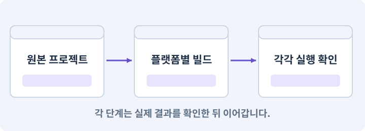

# 078. 선택: Google Play 에셋 전달 사용하기

**목표:** 스토어 전달 방식의 실제 조건을 확인합니다.

**시작 상태:** 기본 다운로드 완성 및 Play 배포 권한

## 한눈에 보는 기능의 흐름

스토어용 팩 → 전달 시점 → 테스트 배포 → 실제 설치 확인



**경계:** AAB를 APK처럼 직접 설치하는 것으로 가정 금지

그림은 실제 게임 실행 결과가 아닙니다. 값·규칙과 예제를 필요한 때 펼쳐 읽고 현재 단계의 메시지를 한 번씩 보냅니다.

## 1. 지금 상태 확인하기

첫 메시지를 보내 현재 준비 상태를 확인합니다. AI가 읽어 온 실제 프로젝트가 맞는지 보고, 없는 준비나 다른 상태가 있으면 먼저 알려 주세요. 아직 기능을 만들지 않는 단계입니다.

### AI에게 보낼 요구와 이유

#### 01. 작업 대상부터 확인

**“선택: Google Play 에셋 전달 사용하기” 작업을 시작하기 전에 현재 상태를 읽기 전용으로 확인해 줘.**

왜 이렇게 요청하나요? AI가 다른 프로젝트나 오래된 예제를 보고 작업할 수 있습니다. 실제 경로·파일·현재 기능을 읽게 하면 지금 이어서 작업할 대상을 먼저 맞출 수 있습니다.

#### 02. 작업 대상부터 확인

**필요한 시작 상태는 기본 다운로드 완성 및 Play 배포 권한야.**

왜 이렇게 요청하나요? AI가 다른 프로젝트나 오래된 예제를 보고 작업할 수 있습니다. 실제 경로·파일·현재 기능을 읽게 하면 지금 이어서 작업할 대상을 먼저 맞출 수 있습니다.

#### 03. 실제 사용 중인 구현 재사용

**실제 프로젝트와 작업 기록을 읽고 이것이 준비되어 있는지, 이미 같은 기능이 있는지 확인해 줘.**

왜 이렇게 요청하나요? 이름이 비슷한 새 클래스를 또 만들면 기존 화면은 여전히 옛 코드를 사용할 수 있습니다. 실제 호출되는 진입점을 찾아 연결해야 두 구현이 충돌하거나 수정이 반영되지 않는 문제를 막습니다.

#### 04. 현재 상태와 다음 확인 지점 구분

**이번 기능이 연결될 실제 파일·화면·도구와 보존할 기존 동작을 짧게 정리해 줘.**

왜 이렇게 요청하나요? 이미 준비된 기능과 아직 확인하지 못한 기능을 섞으면 불필요한 재설치나 성급한 완료 판정이 생깁니다. 현재 대상과 남은 준비를 나눠 가장 작은 다음 작업을 선택하게 합니다.

#### 05. 조사 단계에서 변경하지 않기

**아직 새 구현·설치·유료 호출·파일 변경은 하지 마.**

왜 이렇게 요청하나요? 현재 상태를 알아보기만 할 때 파일 변경이나 결제가 시작되면 검토 전의 환경이 바뀝니다. 준비 확인과 실제 구현을 나눠 되돌리기 어려운 작업이 먼저 실행되지 않게 합니다.

#### 06. 막힌 준비를 먼저 해결

**준비가 다르면 부족한 항목과 다음에 필요한 작업을 알려 줘.**

왜 이렇게 요청하나요? 빠진 파일·권한·패키지를 있다고 가정하면 다음 구현이 엉뚱한 대상을 만들게 됩니다. 무엇이 없고 무엇을 먼저 해야 하는지 분리하면 불필요한 재작업을 줄일 수 있습니다.

<details>
<summary>보낼 원문 전체 — 설명은 복사되지 않습니다</summary>

```text
“선택: Google Play 에셋 전달 사용하기” 작업을 시작하기 전에 현재 상태를 읽기 전용으로 확인해 줘.
필요한 시작 상태는 기본 다운로드 완성 및 Play 배포 권한야. 실제 프로젝트와 작업 기록을 읽고 이것이 준비되어 있는지, 이미 같은 기능이 있는지 확인해 줘.
이번 기능이 연결될 실제 파일·화면·도구와 보존할 기존 동작을 짧게 정리해 줘. 아직 새 구현·설치·유료 호출·파일 변경은 하지 마. 준비가 다르면 부족한 항목과 다음에 필요한 작업을 알려 줘.
```

</details>

**기대 결과:** 스토어 권한과 테스트 배포 조건

### 직접 확인하기

1. AI가 읽은 실제 프로젝트 또는 도구 경로를 확인합니다.
2. 필수 준비가 없다면 문제 해결 요청을 보내고, 준비됐을 때 다음으로 갑니다.

## 2. 필요한 기능 만들기

준비가 확인되면 아래 요청을 보냅니다. AI가 파일·설정·실행을 맡습니다. 변경 범위나 비용 승인이 나오면 내용을 읽고 결정하세요.

### AI에게 보낼 요구와 이유

#### 01. 작업 대상부터 확인

**현재 프로젝트의 실제 파일과 이미 결정한 규칙을 먼저 확인해 줘.**

왜 이렇게 요청하나요? AI가 다른 프로젝트나 오래된 예제를 보고 작업할 수 있습니다. 실제 경로·파일·현재 기능을 읽게 하면 지금 이어서 작업할 대상을 먼저 맞출 수 있습니다.

#### 02. 실제 사용 중인 코드에 연결

**이름이 다른 기존 구현이 있으면 새로 중복 제작하지 말고 그 구현에 연결해 줘.**

왜 이렇게 요청하나요? 예제와 이름이 다르더라도 현재 씬과 입력에서 호출하는 구현이 작업 대상입니다. 같은 기능을 새로 만들기보다 기존 진입점을 확인해 수정이 실제 게임에 반영되고 중복 실행되지 않게 합니다.

#### 03. 플랫폼별 실제 실행물 검사

**Android 의 선택 에셋을 Google Play Asset Delivery로 배포하는 경로를 별도 사본에서 준비해 줘.**

왜 이렇게 요청하나요? Editor Play와 배포 앱은 빌드·파일·실행 환경이 다릅니다. 설치 형식과 대상 플랫폼을 구분하고 각 실제 실행물에서 메뉴·입력·저장·콘텐츠를 다시 확인합니다.

#### 04. 플랫폼별 실제 실행물 검사

**현재 Play 계정·배포 조건·Unity 패키지·AAB 서명과 비용·권한을 먼저 확인해 줘.**

왜 이렇게 요청하나요? Editor Play와 배포 앱은 빌드·파일·실행 환경이 다릅니다. 설치 형식과 대상 플랫폼을 구분하고 각 실제 실행물에서 메뉴·입력·저장·콘텐츠를 다시 확인합니다.

#### 05. 전송·로드·사용 준비를 나누기

**기본 게임은 install-time 또는 앱 본체에 남겨 최초 오프라인 완주를 유지해 줘.**

왜 이렇게 요청하나요? 캐시에 파일이 있거나 전송이 끝났어도 게임에서 사용할 객체가 준비된 것은 아닙니다. 용량 확인·동의·다운로드·로드 완료를 구분하고 실패해도 기본 게임이 남도록 합니다.

#### 06. 불러온 자산의 소유와 해제 관리

**추가 팩의 전달 모드와 Addressables 연동 여부를 실제 지원 기능으로 결정해 줘.**

왜 이렇게 요청하나요? 비동기로 받은 자산은 누가 쓰고 언제 해제하는지 분명해야 합니다. 실패·취소·씬 이탈에서도 소유권을 정리해야 중복 인스턴스·해제 후 사용·메모리 잔류를 막습니다.

#### 07. 플랫폼별 실제 실행물 검사

**AAB를 APK처럼 직접 설치하는 안내를 하지 마.**

왜 이렇게 요청하나요? Editor Play와 배포 앱은 빌드·파일·실행 환경이 다릅니다. 설치 형식과 대상 플랫폼을 구분하고 각 실제 실행물에서 메뉴·입력·저장·콘텐츠를 다시 확인합니다.

#### 08. 비용과 외부 작업은 별도 승인

**Play 테스트 배포가 필요하면 대상과 게시 범위를 따로 승인받아 줘.**

왜 이렇게 요청하나요? 로컬 파일을 고치는 것과 외부 서비스에 자료를 보내거나 비용을 지불하는 것은 영향이 다릅니다. 대상·내용·비용 범위를 확인한 승인 없이 요청이 확대되지 않도록 합니다.

#### 09. 구현할 결과와 조건 고정

**승인 전에는 로컬 준비까지만 해 줘.**

왜 이렇게 요청하나요? “승인 전에는 로컬 준비까지만 해 줘”를 명시하면 AI가 무엇을 구현하거나 검사해야 하는지 범위를 좁힐 수 있습니다. 스토어 전달 방식의 실제 조건을 확인합니다. 이 결과를 확인할 때 이 조건이 실제로 반영됐는지 함께 봅니다.

#### 10. 관찰 가능한 기준으로 확인

**팩 미수신·진행 중·완료·실패·앱 업데이트를 기기에서 구분해 검사해 줘.**

왜 이렇게 요청하나요? 구현 완료라는 설명을 실제 결과로 바꾸기 위한 조건입니다. 요청에 나온 대상과 경계 상황을 확인해 정상 결과뿐 아니라 실패를 어떻게 구분했는지도 남깁니다.

#### 11. 전송·로드·사용 준비를 나누기

**이 경로를 선택하지 않아도 기존 HTTPS 다운로드 게임은 유지해 줘.**

왜 이렇게 요청하나요? 캐시에 파일이 있거나 전송이 끝났어도 게임에서 사용할 객체가 준비된 것은 아닙니다. 용량 확인·동의·다운로드·로드 완료를 구분하고 실패해도 기본 게임이 남도록 합니다.

#### 12. 구현과 실행은 AI에게 맡기기

**코드·설정·파일 생성·실행은 네가 맡고, 필요한 화면과 결과를 보여 줘.**

왜 이렇게 요청하나요? 설명이나 코드 조각만 받으면 실제 파일 생성·연결·실행이 빠질 수 있습니다. AI가 개발 작업까지 수행하고, 사람은 요구·승인·결과 판단을 맡도록 역할을 분명히 합니다.

#### 13. 막힌 준비를 먼저 해결

**수행하지 못한 작업과 필요한 승인·도구 연결은 구분해서 알려 줘.**

왜 이렇게 요청하나요? 빠진 파일·권한·패키지를 있다고 가정하면 다음 구현이 엉뚱한 대상을 만들게 됩니다. 무엇이 없고 무엇을 먼저 해야 하는지 분리하면 불필요한 재작업을 줄일 수 있습니다.

<details>
<summary>보낼 원문 전체 — 설명은 복사되지 않습니다</summary>

```text
현재 프로젝트의 실제 파일과 이미 결정한 규칙을 먼저 확인해 줘. 이름이 다른 기존 구현이 있으면 새로 중복 제작하지 말고 그 구현에 연결해 줘.

Android 의 선택 에셋을 Google Play Asset Delivery로 배포하는 경로를 별도 사본에서 준비해 줘. 현재 Play 계정·배포 조건·Unity 패키지·AAB 서명과 비용·권한을 먼저 확인해 줘.
기본 게임은 install-time 또는 앱 본체에 남겨 최초 오프라인 완주를 유지해 줘. 추가 팩의 전달 모드와 Addressables 연동 여부를 실제 지원 기능으로 결정해 줘.
AAB를 APK처럼 직접 설치하는 안내를 하지 마. Play 테스트 배포가 필요하면 대상과 게시 범위를 따로 승인받아 줘. 승인 전에는 로컬 준비까지만 해 줘.
팩 미수신·진행 중·완료·실패·앱 업데이트를 기기에서 구분해 검사해 줘. 이 경로를 선택하지 않아도 기존 HTTPS 다운로드 게임은 유지해 줘.

코드·설정·파일 생성·실행은 네가 맡고, 필요한 화면과 결과를 보여 줘. 수행하지 못한 작업과 필요한 승인·도구 연결은 구분해서 알려 줘.
```

</details>

**기대 결과:** 확인할 결과: 선택한 경우 실제 스토어 전달을 확인함. AI가 이 상태를 확인할 실제 화면과 변경 내용을 준비합니다. 아직 실행하지 못한 부분은 따로 표시합니다.

### 직접 확인하기

1. 제안서만 반환됐다면 “설명으로 끝내지 말고 승인한 범위의 실제 작업을 수행해 줘”라고 보냅니다.
2. 코드나 설정을 직접 고치라는 안내가 나오면 “작성과 실행은 네가 맡아 줘”라고 요청합니다.

## 3. 결과를 직접 확인하기

먼저 확인 요청을 보내 AI가 검사와 화면을 준비하게 하세요. 그다음 아래 동작을 하나씩 확인합니다.

### AI에게 보낼 요구와 이유

#### 01. 플랫폼별 실제 실행물 검사

**현재 구현한 “Google Play 에셋 전달 사용하기”의 자동 검사와 확인 화면을 준비해 줘.**

왜 이렇게 요청하나요? Editor Play와 배포 앱은 빌드·파일·실행 환경이 다릅니다. 설치 형식과 대상 플랫폼을 구분하고 각 실제 실행물에서 메뉴·입력·저장·콘텐츠를 다시 확인합니다.

#### 02. 결과를 재확인할 근거 남기기

**정상 동작과 아래 실패 조건을 실제로 검사하고 대상·실행 수·결과를 보여 줘.**

왜 이렇게 요청하나요? “잘 됩니다”라는 요약만으로는 어떤 입력과 버전을 검사했는지 알 수 없습니다. 대상·실행 수·실패 내용·파일을 함께 남겨 같은 조건으로 다시 확인할 수 있게 합니다.

#### 03. 관찰 가능한 기준으로 확인

**자동 검사: 선택하지 않은 공급자 의존성은 해당 빌드에 불필요하게 포함되지 않는다.**

왜 이렇게 요청하나요? 구현 완료라는 설명을 실제 결과로 바꾸기 위한 조건입니다. 요청에 나온 대상과 경계 상황을 확인해 정상 결과뿐 아니라 실패를 어떻게 구분했는지도 남깁니다.

#### 04. 구현할 결과와 조건 고정

**실패 상태에서 입장하지 않는다.**

왜 이렇게 요청하나요? “실패 상태에서 입장하지 않는다”를 명시하면 AI가 무엇을 구현하거나 검사해야 하는지 범위를 좁힐 수 있습니다. 스토어 전달 방식의 실제 조건을 확인합니다. 이 결과를 확인할 때 이 조건이 실제로 반영됐는지 함께 봅니다.

#### 05. 관찰 가능한 기준으로 확인

**직접 검사: 실제 Play 테스트 설치 경로에서 on-demand 팩을 받아 표시한다.**

왜 이렇게 요청하나요? 구현 완료라는 설명을 실제 결과로 바꾸기 위한 조건입니다. 요청에 나온 대상과 경계 상황을 확인해 정상 결과뿐 아니라 실패를 어떻게 구분했는지도 남깁니다.

#### 06. 미확인을 완료와 분리

**계정/기기가 없으면 BLOCKED이며 자체 CDN 결과와 구분한다.**

왜 이렇게 요청하나요? 만들어진 것, 검사에 실패한 것, 아직 확인하지 못한 것을 나눠야 다음 작업을 정확히 고를 수 있습니다. 실행할 조건이 없는 기능을 성공으로 기록하면 뒤에서 원인을 찾기 어려워집니다.

#### 07. 사람 검사의 시작점 준비

**내가 조작해야 하는 부분은 실행할 화면과 시작 상태를 준비해 줘.**

왜 이렇게 요청하나요? 같은 기능이라도 시작 상태가 다르면 관찰 결과가 달라집니다. AI가 실행 화면과 재현 위치를 먼저 준비해야 사람이 이동·공격·소리·조작감을 같은 조건에서 확인할 수 있습니다.

#### 08. 사람이 실제로 본 것만 기록

**연결되지 않은 휴대폰의 터치나 사람이 보지 않은 재미·소리 품질을 대신 확인했다고 하지 마.**

왜 이렇게 요청하나요? AI가 준비한 검사와 사람이 직접 플레이하거나 들은 결과는 다른 근거입니다. 관찰하지 않은 조작감·소리·실기기 결과를 임의로 완료 처리하지 않게 합니다.

#### 09. 실제로 실행한 검사만 인정

**테스트 0개와 예전 소스 결과는 현재 성공으로 쓰지 마.**

왜 이렇게 요청하나요? 실행된 검사가 없거나 같은 결과를 중복 집계한 경우는 기능을 확인한 것이 아닙니다. 실행 수와 개별 결과를 함께 확인해야 형식적인 성공 표시를 걸러낼 수 있습니다.

<details>
<summary>보낼 원문 전체 — 설명은 복사되지 않습니다</summary>

```text
현재 구현한 “Google Play 에셋 전달 사용하기”의 자동 검사와 확인 화면을 준비해 줘. 정상 동작과 아래 실패 조건을 실제로 검사하고 대상·실행 수·결과를 보여 줘.

자동 검사: 선택하지 않은 공급자 의존성은 해당 빌드에 불필요하게 포함되지 않는다. 실패 상태에서 입장하지 않는다.

직접 검사: 실제 Play 테스트 설치 경로에서 on-demand 팩을 받아 표시한다. 계정/기기가 없으면 BLOCKED이며 자체 CDN 결과와 구분한다.

내가 조작해야 하는 부분은 실행할 화면과 시작 상태를 준비해 줘. 연결되지 않은 휴대폰의 터치나 사람이 보지 않은 재미·소리 품질을 대신 확인했다고 하지 마. 테스트 0개와 예전 소스 결과는 현재 성공으로 쓰지 마.
```

</details>

**기대 결과:** 선택한 경우 실제 스토어 전달을 확인함

### 직접 확인하기

1. 선택한 팩의 전달 시점을 봅니다.
2. 실제 테스트 배포에서 설치·추가 다운로드를 확인합니다.
3. 미선택이면 자체 CDN 경로로 계속 진행합니다.

## 4. 결과를 남기고 마무리하기

실제로 본 결과를 아래 메모에 적고 AI에 전달합니다. 결과 저장 요청으로 현재 상태를 남긴 뒤 다음 페이지로 갑니다.

### AI에게 보낼 요구와 이유

#### 01. 결과를 재확인할 근거 남기기

**지금 작업한 “선택: Google Play 에셋 전달 사용하기”의 실제 결과를 정리해 줘.**

왜 이렇게 요청하나요? “잘 됩니다”라는 요약만으로는 어떤 입력과 버전을 검사했는지 알 수 없습니다. 대상·실행 수·실패 내용·파일을 함께 남겨 같은 조건으로 다시 확인할 수 있게 합니다.

#### 02. 다음 작업이 읽을 인수인계

**변경한 기능·파일·현재 후보와 실제 실행한 검사, 남은 문제를 기능 이름으로 기록해 줘.**

왜 이렇게 요청하나요? 새 AI 세션은 이전 대화 전체를 알고 있다고 보장할 수 없습니다. 현재 후보·파일 위치·실행한 검사·남은 일을 남겨야 같은 작업을 반복하지 않고 이어갈 수 있습니다.

#### 03. 사람이 실제로 본 것만 기록

**자동 검사 결과와 내가 직접 확인한 결과를 구분하고, 내 관찰이 아직 없으면 미확인으로 남겨 줘.**

왜 이렇게 요청하나요? AI가 준비한 검사와 사람이 직접 플레이하거나 들은 결과는 다른 근거입니다. 관찰하지 않은 조작감·소리·실기기 결과를 임의로 완료 처리하지 않게 합니다.

#### 04. 다음 작업이 읽을 인수인계

**재시작하거나 다음 작업에서 읽을 기록의 실제 위치를 알려 줘.**

왜 이렇게 요청하나요? 새 AI 세션은 이전 대화 전체를 알고 있다고 보장할 수 없습니다. 현재 후보·파일 위치·실행한 검사·남은 일을 남겨야 같은 작업을 반복하지 않고 이어갈 수 있습니다.

#### 05. 미확인을 완료와 분리

**아직 확인하지 않은 결과를 완료로 채우지 마.**

왜 이렇게 요청하나요? 만들어진 것, 검사에 실패한 것, 아직 확인하지 못한 것을 나눠야 다음 작업을 정확히 고를 수 있습니다. 실행할 조건이 없는 기능을 성공으로 기록하면 뒤에서 원인을 찾기 어려워집니다.

<details>
<summary>보낼 원문 전체 — 설명은 복사되지 않습니다</summary>

```text
지금 작업한 “선택: Google Play 에셋 전달 사용하기”의 실제 결과를 정리해 줘. 변경한 기능·파일·현재 후보와 실제 실행한 검사, 남은 문제를 기능 이름으로 기록해 줘.
자동 검사 결과와 내가 직접 확인한 결과를 구분하고, 내 관찰이 아직 없으면 미확인으로 남겨 줘. 재시작하거나 다음 작업에서 읽을 기록의 실제 위치를 알려 줘. 아직 확인하지 않은 결과를 완료로 채우지 마.
```

</details>

**기대 결과:** 현재 상태·검사 결과·남은 문제·다음에 읽을 기록을 확인할 수 있습니다.

### 직접 확인하기

1. 자동 검사와 내 관찰 결과가 섞이지 않았는지 봅니다.
2. 문제가 남았다면 해결 요청을 보내고 같은 동작을 다시 확인합니다.

## 이 작업에서 사용할 값과 규칙 전체

설계 시작값이며 측정된 성능·게임 성공 결과가 아닙니다. 구현은 AI가 수행합니다.

실습 구성은 Core=install-time, ThemeCrypt=on-demand다. 게임의 ContentService 인터페이스는 같게 유지하고 전달 어댑터만 바꾼다. 에셋이 다운로드되어 디스크에 있다는 사실과 실제 AssetBundle/프리팹 로드 완료를 구분한다.

선택 기준: 자체 CDN은 호스팅과 콘텐츠 릴리스를 직접 관리하고 Windows 에도 같은 개념을 적용한다. PAD는 Google Play 전달 경로를 사용하는 Android 용 선택지다. 구체적인 용량 제한·사용자 확인 UI·패키지 지원 범위는 변할 수 있으므로 수업 시점의 공식 문서와 Play Console에서 확인한다. 현재 프로젝트는 오래된 제한 숫자를 고정하지 않는다.

개발용 서명·업로드 키·계정 권한은 코드와 교재 공유 폴더에 넣지 않는다. 내부 테스트 트랙의 대상자와 업로드 내용을 확인한 뒤 실제 권한으로 진행한다. 스토어 공개 출시가 자동 승인된 것은 아니다.

## 문제가 있으면

### AI에게 보낼 요구와 이유

#### 01. 플랫폼별 실제 실행물 검사

**AAB를 APK처럼 직접 설치해 성공이라고 하지 마.**

왜 이렇게 요청하나요? Editor Play와 배포 앱은 빌드·파일·실행 환경이 다릅니다. 설치 형식과 대상 플랫폼을 구분하고 각 실제 실행물에서 메뉴·입력·저장·콘텐츠를 다시 확인합니다.

#### 02. 구현할 결과와 조건 고정

**계정·트랙·기기 조건이 없으면 미진행으로 구분해 줘.**

왜 이렇게 요청하나요? “계정·트랙·기기 조건이 없으면 미진행으로 구분해 줘”를 명시하면 AI가 무엇을 구현하거나 검사해야 하는지 범위를 좁힐 수 있습니다. 스토어 전달 방식의 실제 조건을 확인합니다. 이 결과를 확인할 때 이 조건이 실제로 반영됐는지 함께 봅니다.

#### 03. 원인 하나를 좁혀 수정

**새 기능을 추가하지 말고 현재 오류와 실제 로그를 먼저 읽어 줘.**

왜 이렇게 요청하나요? 오류 수정 중 새 기능까지 넣으면 어떤 변경이 문제를 해결하거나 악화했는지 알기 어렵습니다. 원래 재현을 보존하고 작은 변경 뒤 같은 입력과 주변 정상 동작을 다시 확인합니다.

#### 04. 원인 하나를 좁혀 수정

**최소 수정 뒤 같은 재현과 관련 정상 동작을 다시 검사해 줘.**

왜 이렇게 요청하나요? 오류 수정 중 새 기능까지 넣으면 어떤 변경이 문제를 해결하거나 악화했는지 알기 어렵습니다. 원래 재현을 보존하고 작은 변경 뒤 같은 입력과 주변 정상 동작을 다시 확인합니다.

#### 05. 실패도 재현 자료로 보존

**실패 기록은 지우지 마.**

왜 이렇게 요청하나요? 실패한 입력과 로그가 있어야 같은 문제가 다시 생겼을 때 비교할 수 있습니다. 성공 기록으로 덮어쓰지 않고 전후 자료를 남기면 무엇을 고쳤는지 확인할 수 있습니다.

<details>
<summary>보낼 원문 전체 — 설명은 복사되지 않습니다</summary>

```text
AAB를 APK처럼 직접 설치해 성공이라고 하지 마. 계정·트랙·기기 조건이 없으면 미진행으로 구분해 줘.
새 기능을 추가하지 말고 현재 오류와 실제 로그를 먼저 읽어 줘. 최소 수정 뒤 같은 재현과 관련 정상 동작을 다시 검사해 줘. 실패 기록은 지우지 마.
```

</details>

## 새 세션에서 이어가기

### AI에게 보낼 요구와 이유

#### 01. 이어서 할 작업 식별

**“선택: Google Play 에셋 전달 사용하기” 작업을 이어가고 싶어.**

왜 이렇게 요청하나요? 이름으로 재개할 작업을 찾고, 뒤에 이어지는 요청으로 실제 파일·진행 중 작업·기록을 다시 읽게 합니다. 제목만 보고 이전 상태를 기억한다고 가정하지 않습니다.

#### 02. 조회는 상태를 바꾸지 않게

**실제 프로젝트와 내 도구의 작업 기록을 읽고 어디까지 구현·검사됐는지 확인해 줘.**

왜 이렇게 요청하나요? 진행 상황을 물을 때 새 구현이나 유료 호출이 시작되면 단순 확인이 실행 명령이 되어 버립니다. 저장된 근거를 읽어 완료·진행·승인 대기·미검증을 나누게 합니다.

#### 03. 재개 전 중복 작업 방지

**진행 중인 프로세스·승인·미저장 변경을 확인한 뒤 남은 가장 작은 작업부터 안내해 줘.**

왜 이렇게 요청하나요? 대화가 끊겨도 외부 작업은 끝났거나 아직 실행 중일 수 있습니다. 프로세스·승인·미저장 상태를 먼저 읽어 같은 생성·빌드·결제를 두 번 시작하지 않도록 합니다.

#### 04. 되돌아갈 원본 남기기

**기존 성공과 실패 기록은 보존해 줘.**

왜 이렇게 요청하나요? 새 구현이 실패해도 이전 게임과 저장을 복원할 수 있어야 합니다. 현재 내용을 먼저 조사하고 별도 후보에서 작업하면 실험이 유일한 정상본을 망가뜨리는 일을 피할 수 있습니다.

<details>
<summary>보낼 원문 전체 — 설명은 복사되지 않습니다</summary>

```text
“선택: Google Play 에셋 전달 사용하기” 작업을 이어가고 싶어. 실제 프로젝트와 내 도구의 작업 기록을 읽고 어디까지 구현·검사됐는지 확인해 줘. 진행 중인 프로세스·승인·미저장 변경을 확인한 뒤 남은 가장 작은 작업부터 안내해 줘. 기존 성공과 실패 기록은 보존해 줘.
```

</details>

## 왜 이렇게 만드는가

Google Play Asset Delivery(PAD)는 Google Play를 통한 자산 팩 전달 경로다. 설치 시 함께 받는 install-time, 설치 후 받는 fast-follow, 필요할 때 요청하는 on-demand 방식을 구분한다. Google의 Unity 안내는 Addressables와 연결하는 경로를 포함한다. 패키지 조합은 현재 공식 안내와 설치된 Unity 버전에 맞춘다. [N30]

이 작업은연결된 기능 CDN을 대체하거나 비교하는 선택 장이다. 두 공급자를 같은 팩에 동시에 연결하지 않는다. APK를 USB로 설치하는 것만으로 Play의 on-demand 전달을 검증한 것은 아니다. AAB와 Play 테스트 배포 경로를 구분한다.

## 공식 참고

- [Google Play Asset Delivery](https://developer.android.com/guide/playcore/asset-delivery/integrate-unity)


## 실제 Unity Editor 화면 참고
공식 예시와 내 프로젝트 실행 결과를 구분하세요. 원본 사진은 온라인 연결이 필요합니다.

- [Project 창의 Build Profiles — 플랫폼 설정도 자산으로 찾기](../editor_references/build-profiles.md)
