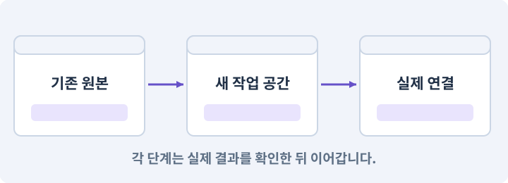

# 081. 2D 게임을 남기고 3D 작업 시작하기

**목표:** 2D 원본과 별도의 3D 프로젝트를 구분합니다.

**시작 상태:** 완주되는 2D 게임

## 한눈에 보는 기능의 흐름

2D 기준본 → 별도 3D 프로젝트 → 경로·저장 분리 → 두 프로젝트 확인



**경계:** 3D를 만들며 2D 원본을 덮지 않기

그림은 실제 게임 실행 결과가 아닙니다. 값·규칙과 예제를 필요한 때 펼쳐 읽고 현재 단계의 메시지를 한 번씩 보냅니다.

## 1. 지금 상태 확인하기

첫 메시지를 보내 현재 준비 상태를 확인합니다. AI가 읽어 온 실제 프로젝트가 맞는지 보고, 없는 준비나 다른 상태가 있으면 먼저 알려 주세요. 아직 기능을 만들지 않는 단계입니다.

### AI에게 보낼 요구와 이유

#### 01. 기존 결과를 보호

**완성한 2D 게임은 보존하고 같은 규칙의 3D 버전을 별도로 만들려고 해.**

왜 이렇게 요청하나요? 새 작업이 이미 정상인 기능이나 자산까지 바꾸면 원인을 추적하기 어렵습니다. 유지할 대상을 명시해 변경 전후를 비교하고 원치 않은 영향을 찾습니다.

#### 02. 작업 대상부터 확인

**현재 2D 프로젝트·패키지·저장 사본·빌드·테스트 결과를 읽기 전용으로 조사해 줘.**

왜 이렇게 요청하나요? AI가 다른 프로젝트나 오래된 예제를 보고 작업할 수 있습니다. 실제 경로·파일·현재 기능을 읽게 하면 지금 이어서 작업할 대상을 먼저 맞출 수 있습니다.

#### 03. 관찰 가능한 기준으로 확인

**3D 프로젝트가 이미 있다면 상태와 경로를 확인하고, 없으면 새로 만들 안전한 위치를 알려 줘.**

왜 이렇게 요청하나요? 구현 완료라는 설명을 실제 결과로 바꾸기 위한 조건입니다. 요청에 나온 대상과 경계 상황을 확인해 정상 결과뿐 아니라 실패를 어떻게 구분했는지도 남깁니다.

#### 04. 구현할 결과와 조건 고정

**아직 파일 복사·프로젝트 생성·렌더러 변경은 하지 마.**

왜 이렇게 요청하나요? “아직 파일 복사·프로젝트 생성·렌더러 변경은 하지 마”를 명시하면 AI가 무엇을 구현하거나 검사해야 하는지 범위를 좁힐 수 있습니다. 2D 원본과 별도의 3D 프로젝트를 구분합니다. 이 결과를 확인할 때 이 조건이 실제로 반영됐는지 함께 봅니다.

<details>
<summary>보낼 원문 전체 — 설명은 복사되지 않습니다</summary>

```text
완성한 2D 게임은 보존하고 같은 규칙의 3D 버전을 별도로 만들려고 해. 현재 2D 프로젝트·패키지·저장 사본·빌드·테스트 결과를 읽기 전용으로 조사해 줘.
3D 프로젝트가 이미 있다면 상태와 경로를 확인하고, 없으면 새로 만들 안전한 위치를 알려 줘. 아직 파일 복사·프로젝트 생성·렌더러 변경은 하지 마.
```

</details>

**기대 결과:** 원본·3D 작업 공간·저장 경로의 분리

### 직접 확인하기

1. AI가 읽은 실제 프로젝트 또는 도구 경로를 확인합니다.
2. 필수 준비가 없다면 문제 해결 요청을 보내고, 준비됐을 때 다음으로 갑니다.

## 2. 필요한 기능 만들기

준비가 확인되면 아래 요청을 보냅니다. AI가 파일·설정·실행을 맡습니다. 변경 범위나 비용 승인이 나오면 내용을 읽고 결정하세요.

### AI에게 보낼 요구와 이유

#### 01. 작업 대상부터 확인

**현재 프로젝트의 실제 파일과 이미 결정한 규칙을 먼저 확인해 줘.**

왜 이렇게 요청하나요? AI가 다른 프로젝트나 오래된 예제를 보고 작업할 수 있습니다. 실제 경로·파일·현재 기능을 읽게 하면 지금 이어서 작업할 대상을 먼저 맞출 수 있습니다.

#### 02. 실제 사용 중인 코드에 연결

**이름이 다른 기존 구현이 있으면 새로 중복 제작하지 말고 그 구현에 연결해 줘.**

왜 이렇게 요청하나요? 예제와 이름이 다르더라도 현재 씬과 입력에서 호출하는 구현이 작업 대상입니다. 같은 기능을 새로 만들기보다 기존 진입점을 확인해 수정이 실제 게임에 반영되고 중복 실행되지 않게 합니다.

#### 03. 구현할 결과와 조건 고정

**시작해 줘.**

왜 이렇게 요청하나요? “시작해 줘”를 명시하면 AI가 무엇을 구현하거나 검사해야 하는지 범위를 좁힐 수 있습니다. 2D 원본과 별도의 3D 프로젝트를 구분합니다. 이 결과를 확인할 때 이 조건이 실제로 반영됐는지 함께 봅니다.

#### 04. 변경 단위를 다시 찾고 되돌리기

**먼저 2D 완성본의 경로, Git diff, 실제 검증 상태를 읽어 줘.**

왜 이렇게 요청하나요? 무엇을 어느 상태에서 바꿨는지 남기면 AI가 실수해도 변경 범위를 비교할 수 있습니다. 소스 기록과 빌드·세이브 백업은 별개이므로 함께 확인합니다.

#### 05. 되돌아갈 원본 남기기

**원본을 보존하고 별도 AshfallRPG3D 작업 폴더를 만들어 줘.**

왜 이렇게 요청하나요? 새 구현이 실패해도 이전 게임과 저장을 복원할 수 있어야 합니다. 현재 내용을 먼저 조사하고 별도 후보에서 작업하면 실험이 유일한 정상본을 망가뜨리는 일을 피할 수 있습니다.

#### 06. 종료 이후의 상태까지 확인

**Library, 빌드, 비밀 키, 개인 저장은 복사하지 마.**

왜 이렇게 요청하나요? 현재 화면에서 맞는 값도 저장하거나 다시 구성할 때 빠질 수 있습니다. 실제 종료·불러오기 전후에 ID·옵션·장착·진행을 비교해야 유지되는 범위를 확인할 수 있습니다.

#### 07. 자산 참조의 정체성 보존

**Assets의 .meta와 데이터 ID는 보존해 줘.**

왜 이렇게 요청하나요? Unity는 자산을 파일 이름만으로 식별하지 않습니다. 메타 정보가 바뀌면 같은 이름의 파일이 있어도 참조가 끊길 수 있어 파일과 식별자를 함께 관리해야 합니다.

#### 08. 기존 결과를 보호

**자동 리셋이나 원본 프로젝트 덮어쓰기는 하지 마.**

왜 이렇게 요청하나요? 새 작업이 이미 정상인 기능이나 자산까지 바꾸면 원인을 추적하기 어렵습니다. 유지할 대상을 명시해 변경 전후를 비교하고 원치 않은 영향을 찾습니다.

#### 09. 종료 이후의 상태까지 확인

**2D와 3D의 앱 ID, 빌드 경로, 저장 하위 폴더, 원격 콘텐츠 namespace를 분리해 줘.**

왜 이렇게 요청하나요? 현재 화면에서 맞는 값도 저장하거나 다시 구성할 때 빠질 수 있습니다. 실제 종료·불러오기 전후에 ID·옵션·장착·진행을 비교해야 유지되는 범위를 확인할 수 있습니다.

#### 10. 설정과 실제 사용 결과 연결

**아이템, 스킬, 트리, 퀘스트, 27마리 편성, Layout fixture를 동일 게임의 기준선으로 기록해 줘.**

왜 이렇게 요청하나요? 데이터에 수치를 넣어도 사용 조건·UI·실제 전투가 그 값을 읽지 않으면 기능이 완성되지 않습니다. 선택 전후의 계산과 저장을 함께 확인합니다.

#### 11. 같은 요청의 반복 처리 정의

**원본과 사본이 같은 디렉터리를 가리키거나 같은 프로젝트를 중복해서 열지 않도록 확인해 줘.**

왜 이렇게 요청하나요? 클릭 연타·재연결·중복 이벤트는 개발과 플레이 중 모두 발생할 수 있습니다. 반복돼도 한 번 처리해야 하는 결과와 매번 새로 처리할 결과를 나눠 데이터가 누적되지 않게 합니다.

#### 12. 관찰 가능한 기준으로 확인

**원본 2D 실행 가능 여부와 사본 구성 검사는 별도로 기록해 줘.**

왜 이렇게 요청하나요? 구현 완료라는 설명을 실제 결과로 바꾸기 위한 조건입니다. 요청에 나온 대상과 경계 상황을 확인해 정상 결과뿐 아니라 실패를 어떻게 구분했는지도 남깁니다.

#### 13. 아래 항목을 완료 조건으로 사용

**적용할 세부 규칙:**

왜 이렇게 요청하나요? 요구사항의 목록은 AI에게 참고 설명을 주는 것이 아니라 완료를 판단할 기준을 정합니다. 구현 뒤 각 항목을 실제 입력과 결과에 대응시켜 빠진 조건을 찾습니다.

#### 14. 기존 결과를 보호

**• 구분: 폴더 예시 / 2D 보존본: C:\AIProjects\AshfallRPG2D / 3D 작업본: C:\AIProjects\AshfallRPG3D**

왜 이렇게 요청하나요? 새 작업이 이미 정상인 기능이나 자산까지 바꾸면 원인을 추적하기 어렵습니다. 유지할 대상을 명시해 변경 전후를 비교하고 원치 않은 영향을 찾습니다.

#### 15. 변경 단위를 다시 찾고 되돌리기

**• 구분: 소스 체크포인트 / 2D 보존본: 2D 완주를 실제 확인한 커밋 / 3D 작업본: 해당 커밋에서 파생한 작업본**

왜 이렇게 요청하나요? 무엇을 어느 상태에서 바꿨는지 남기면 AI가 실수해도 변경 범위를 비교할 수 있습니다. 소스 기록과 빌드·세이브 백업은 별개이므로 함께 확인합니다.

#### 16. 기존 결과를 보호

**• 구분: 앱 식별자 예시 / 2D 보존본: com.yourstudio.ashfall2d / 3D 작업본: com.yourstudio.ashfall3d**

왜 이렇게 요청하나요? 새 작업이 이미 정상인 기능이나 자산까지 바꾸면 원인을 추적하기 어렵습니다. 유지할 대상을 명시해 변경 전후를 비교하고 원치 않은 영향을 찾습니다.

#### 17. 종료 이후의 상태까지 확인

**• 구분: 개발 저장 하위 폴더 / 2D 보존본: saves/2d / 3D 작업본: saves/3d**

왜 이렇게 요청하나요? 현재 화면에서 맞는 값도 저장하거나 다시 구성할 때 빠질 수 있습니다. 실제 종료·불러오기 전후에 ID·옵션·장착·진행을 비교해야 유지되는 범위를 확인할 수 있습니다.

#### 18. 기존 결과를 보호

**• 구분: 콘텐츠 경로 / 2D 보존본: 2d/platform/release / 3D 작업본: 3d/platform/release**

왜 이렇게 요청하나요? 새 작업이 이미 정상인 기능이나 자산까지 바꾸면 원인을 추적하기 어렵습니다. 유지할 대상을 명시해 변경 전후를 비교하고 원치 않은 영향을 찾습니다.

#### 19. 자산 참조의 정체성 보존

**복사 대상은 Assets와 그 안의 .meta, Packages, ProjectSettings, 문서와 소스다.**

왜 이렇게 요청하나요? Unity는 자산을 파일 이름만으로 식별하지 않습니다. 메타 정보가 바뀌면 같은 이름의 파일이 있어도 참조가 끊길 수 있어 파일과 식별자를 함께 관리해야 합니다.

#### 20. 종료 이후의 상태까지 확인

**Library·Temp·Obj·Logs·빌드 산출물·비밀 키·개인 저장은 복사하지 않는다.**

왜 이렇게 요청하나요? 현재 화면에서 맞는 값도 저장하거나 다시 구성할 때 빠질 수 있습니다. 실제 종료·불러오기 전후에 ID·옵션·장착·진행을 비교해야 유지되는 범위를 확인할 수 있습니다.

#### 21. 변경 단위를 다시 찾고 되돌리기

**Git을 사용한다면 미커밋 변경을 먼저 보존하고, 별도 worktree나 브랜치에서 작업 사본을 만든다.**

왜 이렇게 요청하나요? 무엇을 어느 상태에서 바꿨는지 남기면 AI가 실수해도 변경 범위를 비교할 수 있습니다. 소스 기록과 빌드·세이브 백업은 별개이므로 함께 확인합니다.

#### 22. 종료 이후의 상태까지 확인

**실제 저장소와 대상 경로를 확인하지 않고 clone 명령부터 실행하지 않는다.**

왜 이렇게 요청하나요? 현재 화면에서 맞는 값도 저장하거나 다시 구성할 때 빠질 수 있습니다. 실제 종료·불러오기 전후에 ID·옵션·장착·진행을 비교해야 유지되는 범위를 확인할 수 있습니다.

#### 23. 전투 단계 전환을 한 번씩 처리

**기준선에는 일반·정예 27마리의 편성, 아이템 18종, 스킬과 트리, 퀘스트, 전리품 정책, 합성 저장 fixture, 고정 맵과 랜덤 시드의 Layout 해시를 포함한다.**

왜 이렇게 요청하나요? 큰 피해·취소·사망으로 단계를 건너뛰거나 여러 조건이 함께 참이 되면 공격이 겹칠 수 있습니다. 진입·종료·보상을 분리해 끝난 단계의 예약이 남지 않도록 합니다.

#### 24. 종료 이후의 상태까지 확인

**실제 개인 저장을 자동으로 작업 사본에 주입하지 않는다.**

왜 이렇게 요청하나요? 현재 화면에서 맞는 값도 저장하거나 다시 구성할 때 빠질 수 있습니다. 실제 종료·불러오기 전후에 ID·옵션·장착·진행을 비교해야 유지되는 범위를 확인할 수 있습니다.

#### 25. 구현과 실행은 AI에게 맡기기

**코드·설정·파일 생성·실행은 네가 맡고, 필요한 화면과 결과를 보여 줘.**

왜 이렇게 요청하나요? 설명이나 코드 조각만 받으면 실제 파일 생성·연결·실행이 빠질 수 있습니다. AI가 개발 작업까지 수행하고, 사람은 요구·승인·결과 판단을 맡도록 역할을 분명히 합니다.

#### 26. 막힌 준비를 먼저 해결

**수행하지 못한 작업과 필요한 승인·도구 연결은 구분해서 알려 줘.**

왜 이렇게 요청하나요? 빠진 파일·권한·패키지를 있다고 가정하면 다음 구현이 엉뚱한 대상을 만들게 됩니다. 무엇이 없고 무엇을 먼저 해야 하는지 분리하면 불필요한 재작업을 줄일 수 있습니다.

<details>
<summary>보낼 원문 전체 — 설명은 복사되지 않습니다</summary>

```text
현재 프로젝트의 실제 파일과 이미 결정한 규칙을 먼저 확인해 줘. 이름이 다른 기존 구현이 있으면 새로 중복 제작하지 말고 그 구현에 연결해 줘.

시작해 줘. 먼저 2D 완성본의 경로, Git diff, 실제 검증 상태를 읽어 줘.
원본을 보존하고 별도 AshfallRPG3D 작업 폴더를 만들어 줘. Library, 빌드, 비밀 키, 개인 저장은 복사하지 마.
Assets의 .meta와 데이터 ID는 보존해 줘. 자동 리셋이나 원본 프로젝트 덮어쓰기는 하지 마.
2D와 3D의 앱 ID, 빌드 경로, 저장 하위 폴더, 원격 콘텐츠 namespace를 분리해 줘.
아이템, 스킬, 트리, 퀘스트, 27마리 편성, Layout fixture를 동일 게임의 기준선으로 기록해 줘.
원본과 사본이 같은 디렉터리를 가리키거나 같은 프로젝트를 중복해서 열지 않도록 확인해 줘.
원본 2D 실행 가능 여부와 사본 구성 검사는 별도로 기록해 줘.

적용할 세부 규칙:
• 구분: 폴더 예시 / 2D 보존본: C:\AIProjects\AshfallRPG2D / 3D 작업본: C:\AIProjects\AshfallRPG3D
• 구분: 소스 체크포인트 / 2D 보존본: 2D 완주를 실제 확인한 커밋 / 3D 작업본: 해당 커밋에서 파생한 작업본
• 구분: 앱 식별자 예시 / 2D 보존본: com.yourstudio.ashfall2d / 3D 작업본: com.yourstudio.ashfall3d
• 구분: 개발 저장 하위 폴더 / 2D 보존본: saves/2d / 3D 작업본: saves/3d
• 구분: 콘텐츠 경로 / 2D 보존본: 2d/platform/release / 3D 작업본: 3d/platform/release

복사 대상은 Assets와 그 안의 .meta, Packages, ProjectSettings, 문서와 소스다. Library·Temp·Obj·Logs·빌드 산출물·비밀 키·개인 저장은 복사하지 않는다. Git을 사용한다면 미커밋 변경을 먼저 보존하고, 별도 worktree나 브랜치에서 작업 사본을 만든다. 실제 저장소와 대상 경로를 확인하지 않고 clone 명령부터 실행하지 않는다.

기준선에는 일반·정예 27마리의 편성, 아이템 18종, 스킬과 트리, 퀘스트, 전리품 정책, 합성 저장 fixture, 고정 맵과 랜덤 시드의 Layout 해시를 포함한다. 실제 개인 저장을 자동으로 작업 사본에 주입하지 않는다.

코드·설정·파일 생성·실행은 네가 맡고, 필요한 화면과 결과를 보여 줘. 수행하지 못한 작업과 필요한 승인·도구 연결은 구분해서 알려 줘.
```

</details>

**기대 결과:** 확인할 결과: 2D 보존과 별도 3D 출발점을 확인함. AI가 이 상태를 확인할 실제 화면과 변경 내용을 준비합니다. 아직 실행하지 못한 부분은 따로 표시합니다.

### 직접 확인하기

1. 제안서만 반환됐다면 “설명으로 끝내지 말고 승인한 범위의 실제 작업을 수행해 줘”라고 보냅니다.
2. 코드나 설정을 직접 고치라는 안내가 나오면 “작성과 실행은 네가 맡아 줘”라고 요청합니다.

## 3. 결과를 직접 확인하기

먼저 확인 요청을 보내 AI가 검사와 화면을 준비하게 하세요. 그다음 아래 동작을 하나씩 확인합니다.

### AI에게 보낼 요구와 이유

#### 01. 검사할 입력과 관찰 지점 준비

**방금 구현한 기능의 자동 검사와 확인 화면을 준비해 줘.**

왜 이렇게 요청하나요? 정상 예 하나만 보면 실패 조건을 놓치기 쉽습니다. 정상·경계·반례를 실제 입력으로 준비하고 사람이 볼 화면도 맞춰 확인 범위를 분명하게 합니다.

#### 02. 결과를 재확인할 근거 남기기

**정상 동작과 아래 실패 조건을 실제로 검사하고 대상·실행 수·결과를 보여 줘.**

왜 이렇게 요청하나요? “잘 됩니다”라는 요약만으로는 어떤 입력과 버전을 검사했는지 알 수 없습니다. 대상·실행 수·실패 내용·파일을 함께 남겨 같은 조건으로 다시 확인할 수 있게 합니다.

#### 03. 기존 결과를 보호

**두 프로젝트 경로가 구분되고 원본 2D가 실행된다.**

왜 이렇게 요청하나요? 새 작업이 이미 정상인 기능이나 자산까지 바꾸면 원인을 추적하기 어렵습니다. 유지할 대상을 명시해 변경 전후를 비교하고 원치 않은 영향을 찾습니다.

#### 04. 종료 이후의 상태까지 확인

**소스와 ID는 보존되며, 사본에 개인 저장이나 비밀 키가 없다.**

왜 이렇게 요청하나요? 현재 화면에서 맞는 값도 저장하거나 다시 구성할 때 빠질 수 있습니다. 실제 종료·불러오기 전후에 ID·옵션·장착·진행을 비교해야 유지되는 범위를 확인할 수 있습니다.

#### 05. 검토한 변경과 적용한 변경 일치

**기준선 해시와 실제 2D 미검증 범위가 남아 있다.**

왜 이렇게 요청하나요? 승인 전에 본 내용과 실제 적용 내용이 달라지면 승인의 의미가 없어집니다. 후보와 기준 해시를 묶고 바뀐 경우 다시 검토하게 해 의도하지 않은 변경을 막습니다.

#### 06. 사람 검사의 시작점 준비

**내가 조작해야 하는 부분은 실행할 화면과 시작 상태를 준비해 줘.**

왜 이렇게 요청하나요? 같은 기능이라도 시작 상태가 다르면 관찰 결과가 달라집니다. AI가 실행 화면과 재현 위치를 먼저 준비해야 사람이 이동·공격·소리·조작감을 같은 조건에서 확인할 수 있습니다.

#### 07. 사람이 실제로 본 것만 기록

**연결되지 않은 휴대폰의 터치나 사람이 보지 않은 재미·소리 품질을 대신 확인했다고 하지 마.**

왜 이렇게 요청하나요? AI가 준비한 검사와 사람이 직접 플레이하거나 들은 결과는 다른 근거입니다. 관찰하지 않은 조작감·소리·실기기 결과를 임의로 완료 처리하지 않게 합니다.

#### 08. 실제로 실행한 검사만 인정

**테스트 0개와 예전 소스 결과는 현재 성공으로 쓰지 마.**

왜 이렇게 요청하나요? 실행된 검사가 없거나 같은 결과를 중복 집계한 경우는 기능을 확인한 것이 아닙니다. 실행 수와 개별 결과를 함께 확인해야 형식적인 성공 표시를 걸러낼 수 있습니다.

<details>
<summary>보낼 원문 전체 — 설명은 복사되지 않습니다</summary>

```text
방금 구현한 기능의 자동 검사와 확인 화면을 준비해 줘. 정상 동작과 아래 실패 조건을 실제로 검사하고 대상·실행 수·결과를 보여 줘.

두 프로젝트 경로가 구분되고 원본 2D가 실행된다. 소스와 ID는 보존되며, 사본에 개인 저장이나 비밀 키가 없다. 기준선 해시와 실제 2D 미검증 범위가 남아 있다.

내가 조작해야 하는 부분은 실행할 화면과 시작 상태를 준비해 줘. 연결되지 않은 휴대폰의 터치나 사람이 보지 않은 재미·소리 품질을 대신 확인했다고 하지 마. 테스트 0개와 예전 소스 결과는 현재 성공으로 쓰지 마.
```

</details>

**기대 결과:** 2D 보존과 별도 3D 출발점을 확인함

### 직접 확인하기

1. 두 프로젝트의 경로와 이름을 비교합니다.
2. 기존 2D 게임을 다시 실행해 그대로인지 봅니다.
3. 3D가 아직 빈 상태라는 점을 확인합니다.

## 4. 결과를 남기고 마무리하기

실제로 본 결과를 아래 메모에 적고 AI에 전달합니다. 결과 저장 요청으로 현재 상태를 남긴 뒤 다음 페이지로 갑니다.

### AI에게 보낼 요구와 이유

#### 01. 결과를 재확인할 근거 남기기

**지금 작업한 “2D 게임을 남기고 3D 작업 시작하기”의 실제 결과를 정리해 줘.**

왜 이렇게 요청하나요? “잘 됩니다”라는 요약만으로는 어떤 입력과 버전을 검사했는지 알 수 없습니다. 대상·실행 수·실패 내용·파일을 함께 남겨 같은 조건으로 다시 확인할 수 있게 합니다.

#### 02. 다음 작업이 읽을 인수인계

**변경한 기능·파일·현재 후보와 실제 실행한 검사, 남은 문제를 기능 이름으로 기록해 줘.**

왜 이렇게 요청하나요? 새 AI 세션은 이전 대화 전체를 알고 있다고 보장할 수 없습니다. 현재 후보·파일 위치·실행한 검사·남은 일을 남겨야 같은 작업을 반복하지 않고 이어갈 수 있습니다.

#### 03. 사람이 실제로 본 것만 기록

**자동 검사 결과와 내가 직접 확인한 결과를 구분하고, 내 관찰이 아직 없으면 미확인으로 남겨 줘.**

왜 이렇게 요청하나요? AI가 준비한 검사와 사람이 직접 플레이하거나 들은 결과는 다른 근거입니다. 관찰하지 않은 조작감·소리·실기기 결과를 임의로 완료 처리하지 않게 합니다.

#### 04. 다음 작업이 읽을 인수인계

**재시작하거나 다음 작업에서 읽을 기록의 실제 위치를 알려 줘.**

왜 이렇게 요청하나요? 새 AI 세션은 이전 대화 전체를 알고 있다고 보장할 수 없습니다. 현재 후보·파일 위치·실행한 검사·남은 일을 남겨야 같은 작업을 반복하지 않고 이어갈 수 있습니다.

#### 05. 미확인을 완료와 분리

**아직 확인하지 않은 결과를 완료로 채우지 마.**

왜 이렇게 요청하나요? 만들어진 것, 검사에 실패한 것, 아직 확인하지 못한 것을 나눠야 다음 작업을 정확히 고를 수 있습니다. 실행할 조건이 없는 기능을 성공으로 기록하면 뒤에서 원인을 찾기 어려워집니다.

<details>
<summary>보낼 원문 전체 — 설명은 복사되지 않습니다</summary>

```text
지금 작업한 “2D 게임을 남기고 3D 작업 시작하기”의 실제 결과를 정리해 줘. 변경한 기능·파일·현재 후보와 실제 실행한 검사, 남은 문제를 기능 이름으로 기록해 줘.
자동 검사 결과와 내가 직접 확인한 결과를 구분하고, 내 관찰이 아직 없으면 미확인으로 남겨 줘. 재시작하거나 다음 작업에서 읽을 기록의 실제 위치를 알려 줘. 아직 확인하지 않은 결과를 완료로 채우지 마.
```

</details>

**기대 결과:** 현재 상태·검사 결과·남은 문제·다음에 읽을 기록을 확인할 수 있습니다.

### 직접 확인하기

1. 자동 검사와 내 관찰 결과가 섞이지 않았는지 봅니다.
2. 문제가 남았다면 해결 요청을 보내고 같은 동작을 다시 확인합니다.

## 이 작업에서 사용할 값과 규칙 전체

설계 시작값이며 측정된 성능·게임 성공 결과가 아닙니다. 구현은 AI가 수행합니다.

| 구분 | 2D 보존본 | 3D 작업본 |
|---|---|---|
| 폴더 예시 | `C:\AIProjects\AshfallRPG2D` | `C:\AIProjects\AshfallRPG3D` |
| 소스 체크포인트 | 2D 완주를 실제 확인한 커밋 | 해당 커밋에서 파생한 작업본 |
| 앱 식별자 예시 | `com.yourstudio.ashfall2d` | `com.yourstudio.ashfall3d` |
| 개발 저장 하위 폴더 | `saves/2d` | `saves/3d` |
| 콘텐츠 경로 | `2d/platform/release` | `3d/platform/release` |

복사 대상은 Assets와 그 안의 `.meta`, Packages, ProjectSettings, 문서와 소스다. Library·Temp·Obj·Logs·빌드 산출물·비밀 키·개인 저장은 복사하지 않는다. Git을 사용한다면 미커밋 변경을 먼저 보존하고, 별도 worktree나 브랜치에서 작업 사본을 만든다. 실제 저장소와 대상 경로를 확인하지 않고 clone 명령부터 실행하지 않는다.

기준선에는 일반·정예 27마리의 편성, 아이템 18종, 스킬과 트리, 퀘스트, 전리품 정책, 합성 저장 fixture, 고정 맵과 랜덤 시드의 Layout 해시를 포함한다. 실제 개인 저장을 자동으로 작업 사본에 주입하지 않는다.

## 문제가 있으면

### AI에게 보낼 요구와 이유

#### 01. Physics2D와 3D Physics의 적용 조건

**유일한 2D 프로젝트의 Renderer와 Physics를 바꾸지 마.**

왜 이렇게 요청하나요? Physics2D는 2D 몸체와 충돌을 다루는 물리 시스템·조회 API입니다. Physics는 3D 쪽에 사용됩니다. 그림이 2D처럼 보여도 어떤 시스템을 쓰는지는 컴포넌트로 결정됩니다. 렌더링 정렬 순서가 물리 충돌 순서를 결정하지 않습니다.

#### 02. 종료 이후의 상태까지 확인

**별도 사본과 앱·저장 식별자부터 분리해 줘.**

왜 이렇게 요청하나요? 현재 화면에서 맞는 값도 저장하거나 다시 구성할 때 빠질 수 있습니다. 실제 종료·불러오기 전후에 ID·옵션·장착·진행을 비교해야 유지되는 범위를 확인할 수 있습니다.

#### 03. 원인 하나를 좁혀 수정

**새 기능을 추가하지 말고 현재 오류와 실제 로그를 먼저 읽어 줘.**

왜 이렇게 요청하나요? 오류 수정 중 새 기능까지 넣으면 어떤 변경이 문제를 해결하거나 악화했는지 알기 어렵습니다. 원래 재현을 보존하고 작은 변경 뒤 같은 입력과 주변 정상 동작을 다시 확인합니다.

#### 04. 원인 하나를 좁혀 수정

**최소 수정 뒤 같은 재현과 관련 정상 동작을 다시 검사해 줘.**

왜 이렇게 요청하나요? 오류 수정 중 새 기능까지 넣으면 어떤 변경이 문제를 해결하거나 악화했는지 알기 어렵습니다. 원래 재현을 보존하고 작은 변경 뒤 같은 입력과 주변 정상 동작을 다시 확인합니다.

#### 05. 실패도 재현 자료로 보존

**실패 기록은 지우지 마.**

왜 이렇게 요청하나요? 실패한 입력과 로그가 있어야 같은 문제가 다시 생겼을 때 비교할 수 있습니다. 성공 기록으로 덮어쓰지 않고 전후 자료를 남기면 무엇을 고쳤는지 확인할 수 있습니다.

<details>
<summary>보낼 원문 전체 — 설명은 복사되지 않습니다</summary>

```text
유일한 2D 프로젝트의 Renderer와 Physics를 바꾸지 마. 별도 사본과 앱·저장 식별자부터 분리해 줘.
새 기능을 추가하지 말고 현재 오류와 실제 로그를 먼저 읽어 줘. 최소 수정 뒤 같은 재현과 관련 정상 동작을 다시 검사해 줘. 실패 기록은 지우지 마.
```

</details>

## 새 세션에서 이어가기

### AI에게 보낼 요구와 이유

#### 01. 이어서 할 작업 식별

**“2D 게임을 남기고 3D 작업 시작하기” 작업을 이어가고 싶어.**

왜 이렇게 요청하나요? 이름으로 재개할 작업을 찾고, 뒤에 이어지는 요청으로 실제 파일·진행 중 작업·기록을 다시 읽게 합니다. 제목만 보고 이전 상태를 기억한다고 가정하지 않습니다.

#### 02. 조회는 상태를 바꾸지 않게

**실제 프로젝트와 내 도구의 작업 기록을 읽고 어디까지 구현·검사됐는지 확인해 줘.**

왜 이렇게 요청하나요? 진행 상황을 물을 때 새 구현이나 유료 호출이 시작되면 단순 확인이 실행 명령이 되어 버립니다. 저장된 근거를 읽어 완료·진행·승인 대기·미검증을 나누게 합니다.

#### 03. 재개 전 중복 작업 방지

**진행 중인 프로세스·승인·미저장 변경을 확인한 뒤 남은 가장 작은 작업부터 안내해 줘.**

왜 이렇게 요청하나요? 대화가 끊겨도 외부 작업은 끝났거나 아직 실행 중일 수 있습니다. 프로세스·승인·미저장 상태를 먼저 읽어 같은 생성·빌드·결제를 두 번 시작하지 않도록 합니다.

#### 04. 되돌아갈 원본 남기기

**기존 성공과 실패 기록은 보존해 줘.**

왜 이렇게 요청하나요? 새 구현이 실패해도 이전 게임과 저장을 복원할 수 있어야 합니다. 현재 내용을 먼저 조사하고 별도 후보에서 작업하면 실험이 유일한 정상본을 망가뜨리는 일을 피할 수 있습니다.

<details>
<summary>보낼 원문 전체 — 설명은 복사되지 않습니다</summary>

```text
“2D 게임을 남기고 3D 작업 시작하기” 작업을 이어가고 싶어. 실제 프로젝트와 내 도구의 작업 기록을 읽고 어디까지 구현·검사됐는지 확인해 줘. 진행 중인 프로세스·승인·미저장 변경을 확인한 뒤 남은 가장 작은 작업부터 안내해 줘. 기존 성공과 실패 기록은 보존해 줘.
```

</details>

## 왜 이렇게 만드는가

3D 제작은 2D 프로젝트의 카메라를 돌리는 한 번의 설정 변경이 아니다. 렌더러·지면 평면·이동 모터·물리 조회·모델·조명을 바꾸되 게임 규칙을 보존하는 별도 과정이다. 2D 완성본은 그대로 실행할 수 있게 남긴다.

이 과정에서는 완성된 2D 소스에서 파생한 별도 폴더와 브랜치를 사용한다. 처음부터 공통 패키지를 배포하거나 두 프로젝트를 자동 병합하는 구조는 만들지 않는다. 코드와 데이터가 같은지는 아래 기준선과 비교 검사로 확인한다.

## 공식 참고


## 실제 Unity Editor 화면 참고
공식 예시와 내 프로젝트 실행 결과를 구분하세요. 원본 사진은 온라인 연결이 필요합니다.

- [Editor 전체 배치 — 어디를 보고 있는지 구분하기](../editor_references/editor-layout.md)
