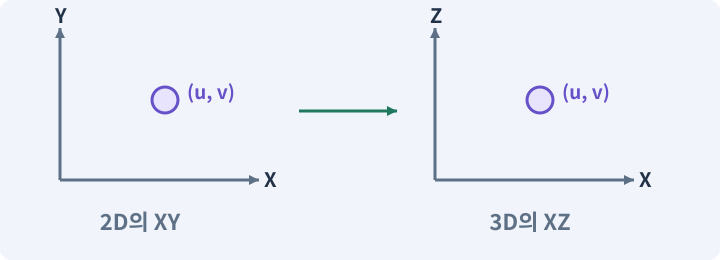

# 082. 게임 규칙은 재사용하고 공간만 바꾸기

**목표:** 피해·아이템·저장이 같은 규칙을 사용합니다.

**시작 상태:** 보존된 2D와 별도 3D 프로젝트

## 한눈에 보는 기능의 흐름

공통 규칙 → 2D의 XY → 논리 위치 → 3D의 XZ



**경계:** 공간만 바꾸고 ID·피해 규칙은 유지

그림은 실제 게임 실행 결과가 아닙니다. 값·규칙과 예제를 필요한 때 펼쳐 읽고 현재 단계의 메시지를 한 번씩 보냅니다.

## 1. 지금 상태 확인하기

첫 메시지를 보내 현재 준비 상태를 확인합니다. AI가 읽어 온 실제 프로젝트가 맞는지 보고, 없는 준비나 다른 상태가 있으면 먼저 알려 주세요. 아직 기능을 만들지 않는 단계입니다.

### AI에게 보낼 요구와 이유

#### 01. 작업 대상부터 확인

**“게임 규칙은 재사용하고 공간만 바꾸기” 작업을 시작하기 전에 현재 상태를 읽기 전용으로 확인해 줘.**

왜 이렇게 요청하나요? AI가 다른 프로젝트나 오래된 예제를 보고 작업할 수 있습니다. 실제 경로·파일·현재 기능을 읽게 하면 지금 이어서 작업할 대상을 먼저 맞출 수 있습니다.

#### 02. 작업 대상부터 확인

**필요한 시작 상태는 보존된 2D와 별도 3D 프로젝트야.**

왜 이렇게 요청하나요? AI가 다른 프로젝트나 오래된 예제를 보고 작업할 수 있습니다. 실제 경로·파일·현재 기능을 읽게 하면 지금 이어서 작업할 대상을 먼저 맞출 수 있습니다.

#### 03. 실제 사용 중인 구현 재사용

**실제 프로젝트와 작업 기록을 읽고 이것이 준비되어 있는지, 이미 같은 기능이 있는지 확인해 줘.**

왜 이렇게 요청하나요? 이름이 비슷한 새 클래스를 또 만들면 기존 화면은 여전히 옛 코드를 사용할 수 있습니다. 실제 호출되는 진입점을 찾아 연결해야 두 구현이 충돌하거나 수정이 반영되지 않는 문제를 막습니다.

#### 04. 현재 상태와 다음 확인 지점 구분

**이번 기능이 연결될 실제 파일·화면·도구와 보존할 기존 동작을 짧게 정리해 줘.**

왜 이렇게 요청하나요? 이미 준비된 기능과 아직 확인하지 못한 기능을 섞으면 불필요한 재설치나 성급한 완료 판정이 생깁니다. 현재 대상과 남은 준비를 나눠 가장 작은 다음 작업을 선택하게 합니다.

#### 05. 조사 단계에서 변경하지 않기

**아직 새 구현·설치·유료 호출·파일 변경은 하지 마.**

왜 이렇게 요청하나요? 현재 상태를 알아보기만 할 때 파일 변경이나 결제가 시작되면 검토 전의 환경이 바뀝니다. 준비 확인과 실제 구현을 나눠 되돌리기 어려운 작업이 먼저 실행되지 않게 합니다.

#### 06. 막힌 준비를 먼저 해결

**준비가 다르면 부족한 항목과 다음에 필요한 작업을 알려 줘.**

왜 이렇게 요청하나요? 빠진 파일·권한·패키지를 있다고 가정하면 다음 구현이 엉뚱한 대상을 만들게 됩니다. 무엇이 없고 무엇을 먼저 해야 하는지 분리하면 불필요한 재작업을 줄일 수 있습니다.

<details>
<summary>보낼 원문 전체 — 설명은 복사되지 않습니다</summary>

```text
“게임 규칙은 재사용하고 공간만 바꾸기” 작업을 시작하기 전에 현재 상태를 읽기 전용으로 확인해 줘.
필요한 시작 상태는 보존된 2D와 별도 3D 프로젝트야. 실제 프로젝트와 작업 기록을 읽고 이것이 준비되어 있는지, 이미 같은 기능이 있는지 확인해 줘.
이번 기능이 연결될 실제 파일·화면·도구와 보존할 기존 동작을 짧게 정리해 줘. 아직 새 구현·설치·유료 호출·파일 변경은 하지 마. 준비가 다르면 부족한 항목과 다음에 필요한 작업을 알려 줘.
```

</details>

**기대 결과:** 재사용 Core와 바꿀 공간 어댑터 목록

### 직접 확인하기

1. AI가 읽은 실제 프로젝트 또는 도구 경로를 확인합니다.
2. 필수 준비가 없다면 문제 해결 요청을 보내고, 준비됐을 때 다음으로 갑니다.

## 2. 필요한 기능 만들기

준비가 확인되면 아래 요청을 보냅니다. AI가 파일·설정·실행을 맡습니다. 변경 범위나 비용 승인이 나오면 내용을 읽고 결정하세요.

### AI에게 보낼 요구와 이유

#### 01. 작업 대상부터 확인

**현재 프로젝트의 실제 파일과 이미 결정한 규칙을 먼저 확인해 줘.**

왜 이렇게 요청하나요? AI가 다른 프로젝트나 오래된 예제를 보고 작업할 수 있습니다. 실제 경로·파일·현재 기능을 읽게 하면 지금 이어서 작업할 대상을 먼저 맞출 수 있습니다.

#### 02. 실제 사용 중인 코드에 연결

**이름이 다른 기존 구현이 있으면 새로 중복 제작하지 말고 그 구현에 연결해 줘.**

왜 이렇게 요청하나요? 예제와 이름이 다르더라도 현재 씬과 입력에서 호출하는 구현이 작업 대상입니다. 같은 기능을 새로 만들기보다 기존 진입점을 확인해 수정이 실제 게임에 반영되고 중복 실행되지 않게 합니다.

#### 03. 공통 규칙과 공간별 연결을 나누기

**공통 Core와 3D 연결부를 정리해 줘.**

왜 이렇게 요청하나요? 피해 계산·소유 데이터는 유지하고 좌표·물리·화면 연결만 바꾸려는 요청입니다. 같은 규칙을 재사용하면 2D와 3D 사이의 차이가 기능 변경인지 공간 표현의 차이인지 비교할 수 있습니다.

#### 04. 선택 조건과 실제 능력 연결

**피해, 아이템, 스킬트리, 퀘스트, 저장 DTO, PRNG, 논리 Layout은 재사용해 줘.**

왜 이렇게 요청하나요? 트리에 선이 그려져 있어도 선행 조건·포인트·실제 사용 가능 상태는 따로 구현해야 합니다. 투자 전후와 저장 복원에서 같은 선택 결과가 유지되도록 만듭니다.

#### 05. 좌표계 혼동 방지

**논리 (u,v) → 2D (u,v,0), 3D (u,0,v)의 변환, 셀 중심 계산, 역변환을 한 곳에 구현해 줘.**

왜 이렇게 요청하나요? 2D의 XY와 3D의 XZ는 같은 이동 의미라도 축 배치가 다릅니다. 변환 위치를 한 곳으로 모아야 지도·물리·카메라가 서로 다른 축을 높이나 전진 방향으로 해석하지 않습니다.

#### 06. 이동 책임과 경계값 고정

**ActorMotor, WorldQuery, PathService, ActorView 중 필요한 경계만 만들고 빈 프레임워크를 늘리지 마.**

왜 이렇게 요청하나요? 캐릭터 이동은 입력뿐 아니라 시간·충돌·초기 위치를 함께 처리해야 합니다. 하나의 모터가 정해진 속도와 우선순위로 움직이게 하고 겹친 시작 위치는 별도 복구해 결과를 비교합니다.

#### 07. Physics2D와 3D Physics의 적용 조건

**Physics2D 호출을 전역 검색 치환으로 Physics로 바꾸지 말고, 의미별 어댑터로 분리해 줘.**

왜 이렇게 요청하나요? Physics2D는 2D 몸체와 충돌을 다루는 물리 시스템·조회 API입니다. Physics는 3D 쪽에 사용됩니다. 그림이 2D처럼 보여도 어떤 시스템을 쓰는지는 컴포넌트로 결정됩니다. 렌더링 정렬 순서가 물리 충돌 순서를 결정하지 않습니다.

#### 08. 관찰 가능한 기준으로 확인

**좌표 왕복, 음수, 경계와 기존 순수 규칙 테스트를 실행해 줘.**

왜 이렇게 요청하나요? 구현 완료라는 설명을 실제 결과로 바꾸기 위한 조건입니다. 요청에 나온 대상과 경계 상황을 확인해 정상 결과뿐 아니라 실패를 어떻게 구분했는지도 남깁니다.

#### 09. 설정과 실제 사용 결과 연결

**3D 화면을 만들기 위해 전리품이나 스킬 수치를 바꾸지 마.**

왜 이렇게 요청하나요? 데이터에 수치를 넣어도 사용 조건·UI·실제 전투가 그 값을 읽지 않으면 기능이 완성되지 않습니다. 선택 전후의 계산과 저장을 함께 확인합니다.

#### 10. 아래 항목을 완료 조건으로 사용

**적용할 세부 규칙:**

왜 이렇게 요청하나요? 요구사항의 목록은 AI에게 참고 설명을 주는 것이 아니라 완료를 판단할 기준을 정합니다. 구현 뒤 각 항목을 실제 입력과 결과에 대응시켜 빠진 조건을 찾습니다.

#### 11. 전투 수치를 한 규칙으로 계산

**• 재사용하는 규칙·데이터: DamageCalculator·Health 규칙 / 교체하는 연결부: WorldQuery2D → WorldQuery3D**

왜 이렇게 요청하나요? 표시와 실제 피해 계산이 다르면 장비·레벨·스킬 효과를 믿을 수 없습니다. 경계값과 사망·회복 조건을 명확히 정하고 숫자와 체력바를 함께 비교합니다.

#### 12. 사용 성공과 자원 소비 묶기

**• 재사용하는 규칙·데이터: 스킬 효과·쿨다운·AttackSnapshot / 교체하는 연결부: 논리 평면 좌표 → 3D 공간 조회**

왜 이렇게 요청하나요? 실패한 사용에서 자원이 줄거나 연타로 여러 번 차감되면 표시와 실제 행동이 어긋납니다. 사용 조건·비용·대기시간을 함께 처리하고 실패 시 바뀌지 않아야 할 값을 확인합니다.

#### 13. 종류와 실제 소유 물건 구분

**• 재사용하는 규칙·데이터: ItemDefinition·ItemInstance·Inventory / 교체하는 연결부: 장비와 전리품 외형**

왜 이렇게 요청하나요? 같은 종류의 검 두 자루도 옵션과 소유 위치는 별개입니다. 정의 데이터와 개별 아이템을 나누면 한 물건을 수정했을 때 다른 물건과 원본 규격까지 바뀌지 않습니다.

#### 14. 종료 이후의 상태까지 확인

**• 재사용하는 규칙·데이터: SkillTree·Quest·Save DTO / 교체하는 연결부: 화면 표시와 저장 경로 공급자**

왜 이렇게 요청하나요? 현재 화면에서 맞는 값도 저장하거나 다시 구성할 때 빠질 수 있습니다. 실제 종료·불러오기 전후에 ID·옵션·장착·진행을 비교해야 유지되는 범위를 확인할 수 있습니다.

#### 15. 논리 지도·DungeonLayout의 적용 조건

**• 재사용하는 규칙·데이터: DungeonLayout·PRNG·SpawnPlan / 교체하는 연결부: TilemapBuilder → MeshDungeonBuilder**

왜 이렇게 요청하나요? 논리 지도는 그림과 상관없이 방·통로·문·스폰 후보를 표현한 데이터입니다. 이를 2D Tilemap과 3D 메시가 각각 화면과 충돌로 바꿉니다. Layout이라는 단어는 UI 배치에도 쓰입니다. 여기서는 던전의 논리 배치 데이터입니다.

#### 16. 좌표계 혼동 방지

**좌표는 논리 평면 (u,v)로 생각한다.**

왜 이렇게 요청하나요? 2D의 XY와 3D의 XZ는 같은 이동 의미라도 축 배치가 다릅니다. 변환 위치를 한 곳으로 모아야 지도·물리·카메라가 서로 다른 축을 높이나 전진 방향으로 해석하지 않습니다.

#### 17. 좌표계 혼동 방지

**2D는 (u,v,0), 3D는 (u,0,v)로 변환한다.**

왜 이렇게 요청하나요? 2D의 XY와 3D의 XZ는 같은 이동 의미라도 축 배치가 다릅니다. 변환 위치를 한 곳으로 모아야 지도·물리·카메라가 서로 다른 축을 높이나 전진 방향으로 해석하지 않습니다.

#### 18. Grid·셀·격자 좌표의 적용 조건

**셀 중심 (column+0.5,row+0.5)에 원점과 cellSize를 적용하는 규칙은 같다.**

왜 이렇게 요청하나요? 격자는 공간을 일정한 칸으로 나눈 표현입니다. 셀 좌표는 몇 번째 칸인지, 월드 좌표는 실제 위치가 어디인지 나타냅니다. 셀 크기에 따라 둘의 변환이 달라집니다. 셀 하나가 언제나 1m인 것은 아닙니다. 프로젝트의 cellSize와 Transform 크기에 달려 있습니다.

#### 19. 공격의 거리·시간을 명시

**3D의 Y는 높이이므로, 기본 공격 거리와 원형 반경은 XZ 평면에 투영해서 계산한다.**

왜 이렇게 요청하나요? 그림이 닿아 보이는 순간과 실제 판정 시간은 다를 수 있습니다. 사거리·각도·공격 간격·타격 시점을 고정하면 회피 가능한 구간과 실제 피해 결과를 같은 조건으로 검사할 수 있습니다.

#### 20. 적이 아는 정보에 맞춰 행동

**작은 연결부의 예시는 ActorMotor(이동 요청과 현재 논리 위치), WorldQuery(시야와 피격 후보), PathService(경로), ActorView(표시)다.**

왜 이렇게 요청하나요? 적이 플레이어의 실제 위치를 항상 읽으면 벽 뒤에 숨는 행동에 의미가 없습니다. 감지·기억·추적·귀환을 나눠 실제 관측 정보가 행동을 결정하게 합니다.

#### 21. 어댑터·인터페이스·의존성 분리의 적용 조건

**여기에 수십 개의 미구현 인터페이스를 추가하지 않는다.**

왜 이렇게 요청하나요? 인터페이스는 기능에 요구하는 약속이고 어댑터는 서로 다른 구현을 그 약속에 맞춰 연결하는 구성요소입니다. 의존성 주입은 사용할 구현을 외부에서 지정하는 방식입니다. 모든 작은 함수를 인터페이스로 만들 필요는 없습니다. 실제 교체·검사 경계에 사용합니다.

#### 22. 좌표계 혼동 방지

**Unity에 의존하지 않는 Core 좌표와 Unity Vector2/Vector3 사이의 변환은 연결 경계에서만 수행한다.**

왜 이렇게 요청하나요? 2D의 XY와 3D의 XZ는 같은 이동 의미라도 축 배치가 다릅니다. 변환 위치를 한 곳으로 모아야 지도·물리·카메라가 서로 다른 축을 높이나 전진 방향으로 해석하지 않습니다.

#### 23. 구현과 실행은 AI에게 맡기기

**코드·설정·파일 생성·실행은 네가 맡고, 필요한 화면과 결과를 보여 줘.**

왜 이렇게 요청하나요? 설명이나 코드 조각만 받으면 실제 파일 생성·연결·실행이 빠질 수 있습니다. AI가 개발 작업까지 수행하고, 사람은 요구·승인·결과 판단을 맡도록 역할을 분명히 합니다.

#### 24. 막힌 준비를 먼저 해결

**수행하지 못한 작업과 필요한 승인·도구 연결은 구분해서 알려 줘.**

왜 이렇게 요청하나요? 빠진 파일·권한·패키지를 있다고 가정하면 다음 구현이 엉뚱한 대상을 만들게 됩니다. 무엇이 없고 무엇을 먼저 해야 하는지 분리하면 불필요한 재작업을 줄일 수 있습니다.

<details>
<summary>보낼 원문 전체 — 설명은 복사되지 않습니다</summary>

```text
현재 프로젝트의 실제 파일과 이미 결정한 규칙을 먼저 확인해 줘. 이름이 다른 기존 구현이 있으면 새로 중복 제작하지 말고 그 구현에 연결해 줘.

공통 Core와 3D 연결부를 정리해 줘.
피해, 아이템, 스킬트리, 퀘스트, 저장 DTO, PRNG, 논리 Layout은 재사용해 줘.
논리 (u,v) → 2D (u,v,0), 3D (u,0,v)의 변환, 셀 중심 계산, 역변환을 한 곳에 구현해 줘.
ActorMotor, WorldQuery, PathService, ActorView 중 필요한 경계만 만들고 빈 프레임워크를 늘리지 마.
Physics2D 호출을 전역 검색 치환으로 Physics로 바꾸지 말고, 의미별 어댑터로 분리해 줘.
좌표 왕복, 음수, 경계와 기존 순수 규칙 테스트를 실행해 줘.
3D 화면을 만들기 위해 전리품이나 스킬 수치를 바꾸지 마.

적용할 세부 규칙:
• 재사용하는 규칙·데이터: DamageCalculator·Health 규칙 / 교체하는 연결부: WorldQuery2D → WorldQuery3D
• 재사용하는 규칙·데이터: 스킬 효과·쿨다운·AttackSnapshot / 교체하는 연결부: 논리 평면 좌표 → 3D 공간 조회
• 재사용하는 규칙·데이터: ItemDefinition·ItemInstance·Inventory / 교체하는 연결부: 장비와 전리품 외형
• 재사용하는 규칙·데이터: SkillTree·Quest·Save DTO / 교체하는 연결부: 화면 표시와 저장 경로 공급자
• 재사용하는 규칙·데이터: DungeonLayout·PRNG·SpawnPlan / 교체하는 연결부: TilemapBuilder → MeshDungeonBuilder

좌표는 논리 평면 (u,v)로 생각한다. 2D는 (u,v,0), 3D는 (u,0,v)로 변환한다. 셀 중심 (column+0.5,row+0.5)에 원점과 cellSize를 적용하는 규칙은 같다. 3D의 Y는 높이이므로, 기본 공격 거리와 원형 반경은 XZ 평면에 투영해서 계산한다.

작은 연결부의 예시는 ActorMotor(이동 요청과 현재 논리 위치), WorldQuery(시야와 피격 후보), PathService(경로), ActorView(표시)다. 여기에 수십 개의 미구현 인터페이스를 추가하지 않는다. Unity에 의존하지 않는 Core 좌표와 Unity Vector2/Vector3 사이의 변환은 연결 경계에서만 수행한다.

코드·설정·파일 생성·실행은 네가 맡고, 필요한 화면과 결과를 보여 줘. 수행하지 못한 작업과 필요한 승인·도구 연결은 구분해서 알려 줘.
```

</details>

**기대 결과:** 확인할 결과: 공통 규칙과 좌표 연결부를 확인함. AI가 이 상태를 확인할 실제 화면과 변경 내용을 준비합니다. 아직 실행하지 못한 부분은 따로 표시합니다.

### 직접 확인하기

1. 제안서만 반환됐다면 “설명으로 끝내지 말고 승인한 범위의 실제 작업을 수행해 줘”라고 보냅니다.
2. 코드나 설정을 직접 고치라는 안내가 나오면 “작성과 실행은 네가 맡아 줘”라고 요청합니다.

## 3. 결과를 직접 확인하기

먼저 확인 요청을 보내 AI가 검사와 화면을 준비하게 하세요. 그다음 아래 동작을 하나씩 확인합니다.

### AI에게 보낼 요구와 이유

#### 01. 검사할 입력과 관찰 지점 준비

**방금 구현한 기능의 자동 검사와 확인 화면을 준비해 줘.**

왜 이렇게 요청하나요? 정상 예 하나만 보면 실패 조건을 놓치기 쉽습니다. 정상·경계·반례를 실제 입력으로 준비하고 사람이 볼 화면도 맞춰 확인 범위를 분명하게 합니다.

#### 02. 결과를 재확인할 근거 남기기

**정상 동작과 아래 실패 조건을 실제로 검사하고 대상·실행 수·결과를 보여 줘.**

왜 이렇게 요청하나요? “잘 됩니다”라는 요약만으로는 어떤 입력과 버전을 검사했는지 알 수 없습니다. 대상·실행 수·실패 내용·파일을 함께 남겨 같은 조건으로 다시 확인할 수 있게 합니다.

#### 03. 관찰 가능한 기준으로 확인

**Core 규칙 테스트가 유지된다.**

왜 이렇게 요청하나요? 구현 완료라는 설명을 실제 결과로 바꾸기 위한 조건입니다. 요청에 나온 대상과 경계 상황을 확인해 정상 결과뿐 아니라 실패를 어떻게 구분했는지도 남깁니다.

#### 04. 좌표계 혼동 방지

**논리 좌표가 정확히 왕복 변환되고, 2D의 Y를 3D 높이로 잘못 해석하지 않는다.**

왜 이렇게 요청하나요? 2D의 XY와 3D의 XZ는 같은 이동 의미라도 축 배치가 다릅니다. 변환 위치를 한 곳으로 모아야 지도·물리·카메라가 서로 다른 축을 높이나 전진 방향으로 해석하지 않습니다.

#### 05. 구현할 결과와 조건 고정

**필요한 연결부만 존재한다.**

왜 이렇게 요청하나요? “필요한 연결부만 존재한다”를 명시하면 AI가 무엇을 구현하거나 검사해야 하는지 범위를 좁힐 수 있습니다. 피해·아이템·저장이 같은 규칙을 사용합니다. 이 결과를 확인할 때 이 조건이 실제로 반영됐는지 함께 봅니다.

#### 06. 사람 검사의 시작점 준비

**내가 조작해야 하는 부분은 실행할 화면과 시작 상태를 준비해 줘.**

왜 이렇게 요청하나요? 같은 기능이라도 시작 상태가 다르면 관찰 결과가 달라집니다. AI가 실행 화면과 재현 위치를 먼저 준비해야 사람이 이동·공격·소리·조작감을 같은 조건에서 확인할 수 있습니다.

#### 07. 사람이 실제로 본 것만 기록

**연결되지 않은 휴대폰의 터치나 사람이 보지 않은 재미·소리 품질을 대신 확인했다고 하지 마.**

왜 이렇게 요청하나요? AI가 준비한 검사와 사람이 직접 플레이하거나 들은 결과는 다른 근거입니다. 관찰하지 않은 조작감·소리·실기기 결과를 임의로 완료 처리하지 않게 합니다.

#### 08. 실제로 실행한 검사만 인정

**테스트 0개와 예전 소스 결과는 현재 성공으로 쓰지 마.**

왜 이렇게 요청하나요? 실행된 검사가 없거나 같은 결과를 중복 집계한 경우는 기능을 확인한 것이 아닙니다. 실행 수와 개별 결과를 함께 확인해야 형식적인 성공 표시를 걸러낼 수 있습니다.

<details>
<summary>보낼 원문 전체 — 설명은 복사되지 않습니다</summary>

```text
방금 구현한 기능의 자동 검사와 확인 화면을 준비해 줘. 정상 동작과 아래 실패 조건을 실제로 검사하고 대상·실행 수·결과를 보여 줘.

Core 규칙 테스트가 유지된다. 논리 좌표가 정확히 왕복 변환되고, 2D의 Y를 3D 높이로 잘못 해석하지 않는다. 필요한 연결부만 존재한다.

내가 조작해야 하는 부분은 실행할 화면과 시작 상태를 준비해 줘. 연결되지 않은 휴대폰의 터치나 사람이 보지 않은 재미·소리 품질을 대신 확인했다고 하지 마. 테스트 0개와 예전 소스 결과는 현재 성공으로 쓰지 마.
```

</details>

**기대 결과:** 공통 규칙과 좌표 연결부를 확인함

### 직접 확인하기

1. 같은 피해 입력의 2D·3D 결과를 비교합니다.
2. 아이템 ID와 저장 필드가 바뀌지 않았는지 봅니다.
3. 좌표를 왕복 변환한 결과를 확인합니다.

## 4. 결과를 남기고 마무리하기

실제로 본 결과를 아래 메모에 적고 AI에 전달합니다. 결과 저장 요청으로 현재 상태를 남긴 뒤 다음 페이지로 갑니다.

### AI에게 보낼 요구와 이유

#### 01. 결과를 재확인할 근거 남기기

**지금 작업한 “게임 규칙은 재사용하고 공간만 바꾸기”의 실제 결과를 정리해 줘.**

왜 이렇게 요청하나요? “잘 됩니다”라는 요약만으로는 어떤 입력과 버전을 검사했는지 알 수 없습니다. 대상·실행 수·실패 내용·파일을 함께 남겨 같은 조건으로 다시 확인할 수 있게 합니다.

#### 02. 다음 작업이 읽을 인수인계

**변경한 기능·파일·현재 후보와 실제 실행한 검사, 남은 문제를 기능 이름으로 기록해 줘.**

왜 이렇게 요청하나요? 새 AI 세션은 이전 대화 전체를 알고 있다고 보장할 수 없습니다. 현재 후보·파일 위치·실행한 검사·남은 일을 남겨야 같은 작업을 반복하지 않고 이어갈 수 있습니다.

#### 03. 사람이 실제로 본 것만 기록

**자동 검사 결과와 내가 직접 확인한 결과를 구분하고, 내 관찰이 아직 없으면 미확인으로 남겨 줘.**

왜 이렇게 요청하나요? AI가 준비한 검사와 사람이 직접 플레이하거나 들은 결과는 다른 근거입니다. 관찰하지 않은 조작감·소리·실기기 결과를 임의로 완료 처리하지 않게 합니다.

#### 04. 다음 작업이 읽을 인수인계

**재시작하거나 다음 작업에서 읽을 기록의 실제 위치를 알려 줘.**

왜 이렇게 요청하나요? 새 AI 세션은 이전 대화 전체를 알고 있다고 보장할 수 없습니다. 현재 후보·파일 위치·실행한 검사·남은 일을 남겨야 같은 작업을 반복하지 않고 이어갈 수 있습니다.

#### 05. 미확인을 완료와 분리

**아직 확인하지 않은 결과를 완료로 채우지 마.**

왜 이렇게 요청하나요? 만들어진 것, 검사에 실패한 것, 아직 확인하지 못한 것을 나눠야 다음 작업을 정확히 고를 수 있습니다. 실행할 조건이 없는 기능을 성공으로 기록하면 뒤에서 원인을 찾기 어려워집니다.

<details>
<summary>보낼 원문 전체 — 설명은 복사되지 않습니다</summary>

```text
지금 작업한 “게임 규칙은 재사용하고 공간만 바꾸기”의 실제 결과를 정리해 줘. 변경한 기능·파일·현재 후보와 실제 실행한 검사, 남은 문제를 기능 이름으로 기록해 줘.
자동 검사 결과와 내가 직접 확인한 결과를 구분하고, 내 관찰이 아직 없으면 미확인으로 남겨 줘. 재시작하거나 다음 작업에서 읽을 기록의 실제 위치를 알려 줘. 아직 확인하지 않은 결과를 완료로 채우지 마.
```

</details>

**기대 결과:** 현재 상태·검사 결과·남은 문제·다음에 읽을 기록을 확인할 수 있습니다.

### 직접 확인하기

1. 자동 검사와 내 관찰 결과가 섞이지 않았는지 봅니다.
2. 문제가 남았다면 해결 요청을 보내고 같은 동작을 다시 확인합니다.

## 이 작업에서 사용할 값과 규칙 전체

설계 시작값이며 측정된 성능·게임 성공 결과가 아닙니다. 구현은 AI가 수행합니다.

| 재사용하는 규칙·데이터 | 교체하는 연결부 |
|---|---|
| DamageCalculator·Health 규칙 | WorldQuery2D → WorldQuery3D |
| 스킬 효과·쿨다운·AttackSnapshot | 논리 평면 좌표 → 3D 공간 조회 |
| ItemDefinition·ItemInstance·Inventory | 장비와 전리품 외형 |
| SkillTree·Quest·Save DTO | 화면 표시와 저장 경로 공급자 |
| DungeonLayout·PRNG·SpawnPlan | TilemapBuilder → MeshDungeonBuilder |

좌표는 논리 평면 `(u,v)`로 생각한다. 2D는 `(u,v,0)`, 3D는 `(u,0,v)`로 변환한다. 셀 중심 `(column+0.5,row+0.5)`에 원점과 cellSize를 적용하는 규칙은 같다. 3D의 Y는 높이이므로, 기본 공격 거리와 원형 반경은 XZ 평면에 투영해서 계산한다.

작은 연결부의 예시는 ActorMotor(이동 요청과 현재 논리 위치), WorldQuery(시야와 피격 후보), PathService(경로), ActorView(표시)다. 여기에 수십 개의 미구현 인터페이스를 추가하지 않는다. Unity에 의존하지 않는 Core 좌표와 Unity Vector2/Vector3 사이의 변환은 연결 경계에서만 수행한다.

## 문제가 있으면

### AI에게 보낼 요구와 이유

#### 01. 순수 함수·불변 조건·결정적 계산의 적용 조건

**모든 코드를 복사해서 따로 고치지 말고 순수 규칙부터 공유해 줘.**

왜 이렇게 요청하나요? 순수 함수는 같은 입력에서 같은 결과를 만들고 외부 상태를 몰래 바꾸지 않는 계산입니다. 게임 규칙을 이런 형태로 분리하면 씬·기기 없이도 검사하기 쉬워집니다. 함수 안에서 현재 시간·전역 난수·싱글톤을 몰래 읽으면 입력만으로 재현하기 어렵습니다.

#### 02. 순수 함수·불변 조건·결정적 계산의 적용 조건

**Unity 공간 API가 Core 로 새어 들어오는 곳을 찾아 줘.**

왜 이렇게 요청하나요? 순수 함수는 같은 입력에서 같은 결과를 만들고 외부 상태를 몰래 바꾸지 않는 계산입니다. 게임 규칙을 이런 형태로 분리하면 씬·기기 없이도 검사하기 쉬워집니다. 함수 안에서 현재 시간·전역 난수·싱글톤을 몰래 읽으면 입력만으로 재현하기 어렵습니다.

#### 03. 원인 하나를 좁혀 수정

**새 기능을 추가하지 말고 현재 오류와 실제 로그를 먼저 읽어 줘.**

왜 이렇게 요청하나요? 오류 수정 중 새 기능까지 넣으면 어떤 변경이 문제를 해결하거나 악화했는지 알기 어렵습니다. 원래 재현을 보존하고 작은 변경 뒤 같은 입력과 주변 정상 동작을 다시 확인합니다.

#### 04. 원인 하나를 좁혀 수정

**최소 수정 뒤 같은 재현과 관련 정상 동작을 다시 검사해 줘.**

왜 이렇게 요청하나요? 오류 수정 중 새 기능까지 넣으면 어떤 변경이 문제를 해결하거나 악화했는지 알기 어렵습니다. 원래 재현을 보존하고 작은 변경 뒤 같은 입력과 주변 정상 동작을 다시 확인합니다.

#### 05. 실패도 재현 자료로 보존

**실패 기록은 지우지 마.**

왜 이렇게 요청하나요? 실패한 입력과 로그가 있어야 같은 문제가 다시 생겼을 때 비교할 수 있습니다. 성공 기록으로 덮어쓰지 않고 전후 자료를 남기면 무엇을 고쳤는지 확인할 수 있습니다.

<details>
<summary>보낼 원문 전체 — 설명은 복사되지 않습니다</summary>

```text
모든 코드를 복사해서 따로 고치지 말고 순수 규칙부터 공유해 줘. Unity 공간 API가 Core 로 새어 들어오는 곳을 찾아 줘.
새 기능을 추가하지 말고 현재 오류와 실제 로그를 먼저 읽어 줘. 최소 수정 뒤 같은 재현과 관련 정상 동작을 다시 검사해 줘. 실패 기록은 지우지 마.
```

</details>

## 새 세션에서 이어가기

### AI에게 보낼 요구와 이유

#### 01. 이어서 할 작업 식별

**“게임 규칙은 재사용하고 공간만 바꾸기” 작업을 이어가고 싶어.**

왜 이렇게 요청하나요? 이름으로 재개할 작업을 찾고, 뒤에 이어지는 요청으로 실제 파일·진행 중 작업·기록을 다시 읽게 합니다. 제목만 보고 이전 상태를 기억한다고 가정하지 않습니다.

#### 02. 조회는 상태를 바꾸지 않게

**실제 프로젝트와 내 도구의 작업 기록을 읽고 어디까지 구현·검사됐는지 확인해 줘.**

왜 이렇게 요청하나요? 진행 상황을 물을 때 새 구현이나 유료 호출이 시작되면 단순 확인이 실행 명령이 되어 버립니다. 저장된 근거를 읽어 완료·진행·승인 대기·미검증을 나누게 합니다.

#### 03. 재개 전 중복 작업 방지

**진행 중인 프로세스·승인·미저장 변경을 확인한 뒤 남은 가장 작은 작업부터 안내해 줘.**

왜 이렇게 요청하나요? 대화가 끊겨도 외부 작업은 끝났거나 아직 실행 중일 수 있습니다. 프로세스·승인·미저장 상태를 먼저 읽어 같은 생성·빌드·결제를 두 번 시작하지 않도록 합니다.

#### 04. 되돌아갈 원본 남기기

**기존 성공과 실패 기록은 보존해 줘.**

왜 이렇게 요청하나요? 새 구현이 실패해도 이전 게임과 저장을 복원할 수 있어야 합니다. 현재 내용을 먼저 조사하고 별도 후보에서 작업하면 실험이 유일한 정상본을 망가뜨리는 일을 피할 수 있습니다.

<details>
<summary>보낼 원문 전체 — 설명은 복사되지 않습니다</summary>

```text
“게임 규칙은 재사용하고 공간만 바꾸기” 작업을 이어가고 싶어. 실제 프로젝트와 내 도구의 작업 기록을 읽고 어디까지 구현·검사됐는지 확인해 줘. 진행 중인 프로세스·승인·미저장 변경을 확인한 뒤 남은 가장 작은 작업부터 안내해 줘. 기존 성공과 실패 기록은 보존해 줘.
```

</details>

## 왜 이렇게 만드는가

같은 게임이라는 것은 코드 파일 이름이 같다는 뜻이 아니다. 같은 공격력과 방어력에서 같은 피해가 나고, 같은 장비 인스턴스와 트리 랭크가 보존되며, 같은 지도 설정에서 같은 방 역할이 나와야 한다.

Core는 화면의 평면을 몰라도 동작하게 한다. 월드와 접촉하는 지점만 작은 어댑터로 분리한다. 기존 구조가 이미 잘 나뉘어 있다면 대규모 리팩터링을 하지 않는다. 3D 개발을 위해 클래스 이름을 일괄 변경해 2D 프리팹 참조를 깨뜨리지 않는다.

## 공식 참고

