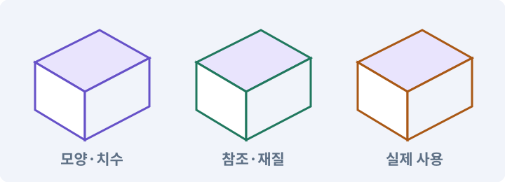

# 083. 3D 카메라와 재질로 공간 보기

**목표:** 사선 카메라로 실제 메시를 봅니다.

**시작 상태:** 별도 3D 프로젝트와 공통 규칙

## 한눈에 보는 기능의 흐름

실제 메시 → 재질·조명 → 사선 카메라 → 화면 크기 비교



**경계:** 2D Renderer 설정을 3D에 그대로 쓰지 않기

그림은 실제 게임 실행 결과가 아닙니다. 값·규칙과 예제를 필요한 때 펼쳐 읽고 현재 단계의 메시지를 한 번씩 보냅니다.

## 1. 지금 상태 확인하기

첫 메시지를 보내 현재 준비 상태를 확인합니다. AI가 읽어 온 실제 프로젝트가 맞는지 보고, 없는 준비나 다른 상태가 있으면 먼저 알려 주세요. 아직 기능을 만들지 않는 단계입니다.

### AI에게 보낼 요구와 이유

#### 01. 작업 대상부터 확인

**“3D 카메라와 재질로 공간 보기” 작업을 시작하기 전에 현재 상태를 읽기 전용으로 확인해 줘.**

왜 이렇게 요청하나요? AI가 다른 프로젝트나 오래된 예제를 보고 작업할 수 있습니다. 실제 경로·파일·현재 기능을 읽게 하면 지금 이어서 작업할 대상을 먼저 맞출 수 있습니다.

#### 02. 작업 대상부터 확인

**필요한 시작 상태는 별도 3D 프로젝트와 공통 규칙야.**

왜 이렇게 요청하나요? AI가 다른 프로젝트나 오래된 예제를 보고 작업할 수 있습니다. 실제 경로·파일·현재 기능을 읽게 하면 지금 이어서 작업할 대상을 먼저 맞출 수 있습니다.

#### 03. 실제 사용 중인 구현 재사용

**실제 프로젝트와 작업 기록을 읽고 이것이 준비되어 있는지, 이미 같은 기능이 있는지 확인해 줘.**

왜 이렇게 요청하나요? 이름이 비슷한 새 클래스를 또 만들면 기존 화면은 여전히 옛 코드를 사용할 수 있습니다. 실제 호출되는 진입점을 찾아 연결해야 두 구현이 충돌하거나 수정이 반영되지 않는 문제를 막습니다.

#### 04. 현재 상태와 다음 확인 지점 구분

**이번 기능이 연결될 실제 파일·화면·도구와 보존할 기존 동작을 짧게 정리해 줘.**

왜 이렇게 요청하나요? 이미 준비된 기능과 아직 확인하지 못한 기능을 섞으면 불필요한 재설치나 성급한 완료 판정이 생깁니다. 현재 대상과 남은 준비를 나눠 가장 작은 다음 작업을 선택하게 합니다.

#### 05. 조사 단계에서 변경하지 않기

**아직 새 구현·설치·유료 호출·파일 변경은 하지 마.**

왜 이렇게 요청하나요? 현재 상태를 알아보기만 할 때 파일 변경이나 결제가 시작되면 검토 전의 환경이 바뀝니다. 준비 확인과 실제 구현을 나눠 되돌리기 어려운 작업이 먼저 실행되지 않게 합니다.

#### 06. 막힌 준비를 먼저 해결

**준비가 다르면 부족한 항목과 다음에 필요한 작업을 알려 줘.**

왜 이렇게 요청하나요? 빠진 파일·권한·패키지를 있다고 가정하면 다음 구현이 엉뚱한 대상을 만들게 됩니다. 무엇이 없고 무엇을 먼저 해야 하는지 분리하면 불필요한 재작업을 줄일 수 있습니다.

<details>
<summary>보낼 원문 전체 — 설명은 복사되지 않습니다</summary>

```text
“3D 카메라와 재질로 공간 보기” 작업을 시작하기 전에 현재 상태를 읽기 전용으로 확인해 줘.
필요한 시작 상태는 별도 3D 프로젝트와 공통 규칙야. 실제 프로젝트와 작업 기록을 읽고 이것이 준비되어 있는지, 이미 같은 기능이 있는지 확인해 줘.
이번 기능이 연결될 실제 파일·화면·도구와 보존할 기존 동작을 짧게 정리해 줘. 아직 새 구현·설치·유료 호출·파일 변경은 하지 마. 준비가 다르면 부족한 항목과 다음에 필요한 작업을 알려 줘.
```

</details>

**기대 결과:** 3D 메시와 사선 카메라의 확인 화면

### 직접 확인하기

1. AI가 읽은 실제 프로젝트 또는 도구 경로를 확인합니다.
2. 필수 준비가 없다면 문제 해결 요청을 보내고, 준비됐을 때 다음으로 갑니다.

## 2. 필요한 기능 만들기

준비가 확인되면 아래 요청을 보냅니다. AI가 파일·설정·실행을 맡습니다. 변경 범위나 비용 승인이 나오면 내용을 읽고 결정하세요.

### AI에게 보낼 요구와 이유

#### 01. 작업 대상부터 확인

**현재 프로젝트의 실제 파일과 이미 결정한 규칙을 먼저 확인해 줘.**

왜 이렇게 요청하나요? AI가 다른 프로젝트나 오래된 예제를 보고 작업할 수 있습니다. 실제 경로·파일·현재 기능을 읽게 하면 지금 이어서 작업할 대상을 먼저 맞출 수 있습니다.

#### 02. 실제 사용 중인 코드에 연결

**이름이 다른 기존 구현이 있으면 새로 중복 제작하지 말고 그 구현에 연결해 줘.**

왜 이렇게 요청하나요? 예제와 이름이 다르더라도 현재 씬과 입력에서 호출하는 구현이 작업 대상입니다. 같은 기능을 새로 만들기보다 기존 진입점을 확인해 수정이 실제 게임에 반영되고 중복 실행되지 않게 합니다.

#### 03. 구현할 결과와 조건 고정

**3D 사본에서만 작업해 줘.**

왜 이렇게 요청하나요? “3D 사본에서만 작업해 줘”를 명시하면 AI가 무엇을 구현하거나 검사해야 하는지 범위를 좁힐 수 있습니다. 사선 카메라로 실제 메시를 봅니다. 이 결과를 확인할 때 이 조건이 실제로 반영됐는지 함께 봅니다.

#### 04. 3D 표시 경로 명시

**Universal Renderer를 사용하는 URP 설정을 만들고 Graphics, Quality, Camera 참조를 실제로 확인해 줘.**

왜 이렇게 요청하나요? 프로젝트의 렌더러와 셰이더가 맞아야 모델과 효과가 의도대로 보입니다. 다른 버전의 설정을 그대로 가져오기보다 사용할 렌더 경로를 정해 자산과 조명을 연결합니다.

#### 05. 좌표계 혼동 방지

**TestArena3D의 바닥은 XZ 24×24, Y=0이고, 표시용 캡슐은 높이 1.8, 반경 0.35야.**

왜 이렇게 요청하나요? 2D의 XY와 3D의 XZ는 같은 이동 의미라도 축 배치가 다릅니다. 변환 위치를 한 곳으로 모아야 지도·물리·카메라가 서로 다른 축을 높이나 전진 방향으로 해석하지 않습니다.

#### 06. 시점과 화면 크기 기준 고정

**카메라는 target+(0,14,-10)에서 target을 바라보는 Orthographic size 8로 시작해 줘.**

왜 이렇게 요청하나요? 카메라 방식이 바뀌면 같은 물체도 화면에서 보이는 크기와 겹침이 달라집니다. 시점을 먼저 정해 캐릭터 크기·선택·위험 표시를 같은 조건으로 맞춥니다.

#### 07. 렌더러·재질·조명 조합 맞추기

**메시용 URP 재질과 Directional Light를 연결하고, 분홍색·검정색으로 보이는 오류를 검사해 줘.**

왜 이렇게 요청하나요? 현재 렌더러와 다른 재질을 쓰거나 필요한 2D 조명이 없으면 그림이 분홍색·검은색으로 보일 수 있습니다. 자산 생성뿐 아니라 실제 그리는 경로까지 맞추게 하는 조건입니다.

#### 08. 되돌아갈 원본 남기기

**원본 2D 프로젝트와 그 설정은 수정하지 마.**

왜 이렇게 요청하나요? 새 구현이 실패해도 이전 게임과 저장을 복원할 수 있어야 합니다. 현재 내용을 먼저 조사하고 별도 후보에서 작업하면 실험이 유일한 정상본을 망가뜨리는 일을 피할 수 있습니다.

#### 09. 관찰 가능한 기준으로 확인

**세 가지 가로 화면 비율과 실제 Renderer 유형을 확인한 결과를 남겨 줘.**

왜 이렇게 요청하나요? 구현 완료라는 설명을 실제 결과로 바꾸기 위한 조건입니다. 요청에 나온 대상과 경계 상황을 확인해 정상 결과뿐 아니라 실패를 어떻게 구분했는지도 남깁니다.

#### 10. 아래 항목을 완료 조건으로 사용

**적용할 세부 규칙:**

왜 이렇게 요청하나요? 요구사항의 목록은 AI에게 참고 설명을 주는 것이 아니라 완료를 판단할 기준을 정합니다. 구현 뒤 각 항목을 실제 입력과 결과에 대응시켜 빠진 조건을 찾습니다.

#### 11. 좌표계 혼동 방지

**첫 테스트 공간의 바닥은 XZ 24×24, 높이는 Y=0이다.**

왜 이렇게 요청하나요? 2D의 XY와 3D의 XZ는 같은 이동 의미라도 축 배치가 다릅니다. 변환 위치를 한 곳으로 모아야 지도·물리·카메라가 서로 다른 축을 높이나 전진 방향으로 해석하지 않습니다.

#### 12. 구현할 결과와 조건 고정

**플레이어 표시용 캡슐은 높이 1.8, 반경 0.35로 시작한다.**

왜 이렇게 요청하나요? “플레이어 표시용 캡슐은 높이 1.8, 반경 0.35로 시작한다”를 명시하면 AI가 무엇을 구현하거나 검사해야 하는지 범위를 좁힐 수 있습니다. 사선 카메라로 실제 메시를 봅니다. 이 결과를 확인할 때 이 조건이 실제로 반영됐는지 함께 봅니다.

#### 13. 시점과 화면 크기 기준 고정

**카메라는 target+(0,14,-10)에서 target을 바라보며, Orthographic size 8을 출발값으로 사용한다.**

왜 이렇게 요청하나요? 카메라 방식이 바뀌면 같은 물체도 화면에서 보이는 크기와 겹침이 달라집니다. 시점을 먼저 정해 캐릭터 크기·선택·위험 표시를 같은 조건으로 맞춥니다.

#### 14. 다른 화면에서도 읽고 누를 수 있게

**2D 카메라 값을 그대로 옮기지 않고 실제 화면에서 안전영역을 맞춘다.**

왜 이렇게 요청하나요? 개발용 해상도에서 맞는 UI가 작은 기기나 긴 문장에서는 잘리거나 겹칠 수 있습니다. 텍스트 길이·버튼 영역·안전영역을 실제 배치로 검사합니다.

#### 15. 3D 표시 경로 명시

**새 Universal Renderer Data와 URP Asset을 만들어 3D 사본의 Graphics와 Quality에 연결한다.**

왜 이렇게 요청하나요? 프로젝트의 렌더러와 셰이더가 맞아야 모델과 효과가 의도대로 보입니다. 다른 버전의 설정을 그대로 가져오기보다 사용할 렌더 경로를 정해 자산과 조명을 연결합니다.

#### 16. 3D 표시 경로 명시

**메시용 URP Lit과 Unlit 재질을 구분한다.**

왜 이렇게 요청하나요? 프로젝트의 렌더러와 셰이더가 맞아야 모델과 효과가 의도대로 보입니다. 다른 버전의 설정을 그대로 가져오기보다 사용할 렌더 경로를 정해 자산과 조명을 연결합니다.

#### 17. 렌더러·재질·조명 조합 맞추기

**처음에는 Directional Light 한 개와 약한 환경광으로 형상을 확인하고, 그림자 품질은 조절한다.**

왜 이렇게 요청하나요? 현재 렌더러와 다른 재질을 쓰거나 필요한 2D 조명이 없으면 그림이 분홍색·검은색으로 보일 수 있습니다. 자산 생성뿐 아니라 실제 그리는 경로까지 맞추게 하는 조건입니다.

#### 18. 관찰 가능한 기준으로 확인

**이전 2D 씬은 사본 안에서도 비교 자료로 보존할 수 있지만, 3D 출시 Build Profile에서는 제외한다.**

왜 이렇게 요청하나요? 구현 완료라는 설명을 실제 결과로 바꾸기 위한 조건입니다. 요청에 나온 대상과 경계 상황을 확인해 정상 결과뿐 아니라 실패를 어떻게 구분했는지도 남깁니다.

#### 19. 구현할 결과와 조건 고정

**모든 것이 일단 보이게 하려고 2D·3D 렌더러를 무작정 혼합하지 않는다.**

왜 이렇게 요청하나요? “모든 것이 일단 보이게 하려고 2D·3D 렌더러를 무작정 혼합하지 않는다”를 명시하면 AI가 무엇을 구현하거나 검사해야 하는지 범위를 좁힐 수 있습니다. 사선 카메라로 실제 메시를 봅니다. 이 결과를 확인할 때 이 조건이 실제로 반영됐는지 함께 봅니다.

#### 20. 구현과 실행은 AI에게 맡기기

**코드·설정·파일 생성·실행은 네가 맡고, 필요한 화면과 결과를 보여 줘.**

왜 이렇게 요청하나요? 설명이나 코드 조각만 받으면 실제 파일 생성·연결·실행이 빠질 수 있습니다. AI가 개발 작업까지 수행하고, 사람은 요구·승인·결과 판단을 맡도록 역할을 분명히 합니다.

#### 21. 막힌 준비를 먼저 해결

**수행하지 못한 작업과 필요한 승인·도구 연결은 구분해서 알려 줘.**

왜 이렇게 요청하나요? 빠진 파일·권한·패키지를 있다고 가정하면 다음 구현이 엉뚱한 대상을 만들게 됩니다. 무엇이 없고 무엇을 먼저 해야 하는지 분리하면 불필요한 재작업을 줄일 수 있습니다.

<details>
<summary>보낼 원문 전체 — 설명은 복사되지 않습니다</summary>

```text
현재 프로젝트의 실제 파일과 이미 결정한 규칙을 먼저 확인해 줘. 이름이 다른 기존 구현이 있으면 새로 중복 제작하지 말고 그 구현에 연결해 줘.

3D 사본에서만 작업해 줘.
Universal Renderer를 사용하는 URP 설정을 만들고 Graphics, Quality, Camera 참조를 실제로 확인해 줘.
TestArena3D의 바닥은 XZ 24×24, Y=0이고, 표시용 캡슐은 높이 1.8, 반경 0.35야.
카메라는 target+(0,14,-10)에서 target을 바라보는 Orthographic size 8로 시작해 줘.
메시용 URP 재질과 Directional Light를 연결하고, 분홍색·검정색으로 보이는 오류를 검사해 줘.
원본 2D 프로젝트와 그 설정은 수정하지 마.
세 가지 가로 화면 비율과 실제 Renderer 유형을 확인한 결과를 남겨 줘.

적용할 세부 규칙:
첫 테스트 공간의 바닥은 XZ 24×24, 높이는 Y=0이다. 플레이어 표시용 캡슐은 높이 1.8, 반경 0.35로 시작한다. 카메라는 target+(0,14,-10)에서 target을 바라보며, Orthographic size 8을 출발값으로 사용한다. 2D 카메라 값을 그대로 옮기지 않고 실제 화면에서 안전영역을 맞춘다.

새 Universal Renderer Data와 URP Asset을 만들어 3D 사본의 Graphics와 Quality에 연결한다. 메시용 URP Lit과 Unlit 재질을 구분한다. 처음에는 Directional Light 한 개와 약한 환경광으로 형상을 확인하고, 그림자 품질은 조절한다.

이전 2D 씬은 사본 안에서도 비교 자료로 보존할 수 있지만, 3D 출시 Build Profile에서는 제외한다. 모든 것이 일단 보이게 하려고 2D·3D 렌더러를 무작정 혼합하지 않는다.

코드·설정·파일 생성·실행은 네가 맡고, 필요한 화면과 결과를 보여 줘. 수행하지 못한 작업과 필요한 승인·도구 연결은 구분해서 알려 줘.
```

</details>

**기대 결과:** 확인할 결과: 실제 3D 렌더링과 2D 보존을 확인함. AI가 이 상태를 확인할 실제 화면과 변경 내용을 준비합니다. 아직 실행하지 못한 부분은 따로 표시합니다.

### 직접 확인하기

1. 제안서만 반환됐다면 “설명으로 끝내지 말고 승인한 범위의 실제 작업을 수행해 줘”라고 보냅니다.
2. 코드나 설정을 직접 고치라는 안내가 나오면 “작성과 실행은 네가 맡아 줘”라고 요청합니다.

## 3. 결과를 직접 확인하기

먼저 확인 요청을 보내 AI가 검사와 화면을 준비하게 하세요. 그다음 아래 동작을 하나씩 확인합니다.

### AI에게 보낼 요구와 이유

#### 01. 검사할 입력과 관찰 지점 준비

**방금 구현한 기능의 자동 검사와 확인 화면을 준비해 줘.**

왜 이렇게 요청하나요? 정상 예 하나만 보면 실패 조건을 놓치기 쉽습니다. 정상·경계·반례를 실제 입력으로 준비하고 사람이 볼 화면도 맞춰 확인 범위를 분명하게 합니다.

#### 02. 결과를 재확인할 근거 남기기

**정상 동작과 아래 실패 조건을 실제로 검사하고 대상·실행 수·결과를 보여 줘.**

왜 이렇게 요청하나요? “잘 됩니다”라는 요약만으로는 어떤 입력과 버전을 검사했는지 알 수 없습니다. 대상·실행 수·실패 내용·파일을 함께 남겨 같은 조건으로 다시 확인할 수 있게 합니다.

#### 03. 구현할 결과와 조건 고정

**실제 3D 바닥과 모델이 사선으로 보인다.**

왜 이렇게 요청하나요? “실제 3D 바닥과 모델이 사선으로 보인다”를 명시하면 AI가 무엇을 구현하거나 검사해야 하는지 범위를 좁힐 수 있습니다. 사선 카메라로 실제 메시를 봅니다. 이 결과를 확인할 때 이 조건이 실제로 반영됐는지 함께 봅니다.

#### 04. 카메라·직교·원근의 적용 조건

**카메라가 높이축을 올바르게 사용한다.**

왜 이렇게 요청하나요? 카메라는 게임 세계를 어떤 위치·방향·범위로 볼지 정합니다. 직교 투영은 거리에 따른 크기 감소가 없고, 원근 투영은 먼 물체가 작아 보이게 합니다. 카메라를 멀리 옮기는 것만으로 직교 화면의 캐릭터 크기가 줄지는 않습니다. 직교 크기를 봅니다.

#### 05. 되돌아갈 원본 남기기

**원본 2D 렌더러와 씬은 보존된다.**

왜 이렇게 요청하나요? 새 구현이 실패해도 이전 게임과 저장을 복원할 수 있어야 합니다. 현재 내용을 먼저 조사하고 별도 후보에서 작업하면 실험이 유일한 정상본을 망가뜨리는 일을 피할 수 있습니다.

#### 06. 사람 검사의 시작점 준비

**내가 조작해야 하는 부분은 실행할 화면과 시작 상태를 준비해 줘.**

왜 이렇게 요청하나요? 같은 기능이라도 시작 상태가 다르면 관찰 결과가 달라집니다. AI가 실행 화면과 재현 위치를 먼저 준비해야 사람이 이동·공격·소리·조작감을 같은 조건에서 확인할 수 있습니다.

#### 07. 사람이 실제로 본 것만 기록

**연결되지 않은 휴대폰의 터치나 사람이 보지 않은 재미·소리 품질을 대신 확인했다고 하지 마.**

왜 이렇게 요청하나요? AI가 준비한 검사와 사람이 직접 플레이하거나 들은 결과는 다른 근거입니다. 관찰하지 않은 조작감·소리·실기기 결과를 임의로 완료 처리하지 않게 합니다.

#### 08. 실제로 실행한 검사만 인정

**테스트 0개와 예전 소스 결과는 현재 성공으로 쓰지 마.**

왜 이렇게 요청하나요? 실행된 검사가 없거나 같은 결과를 중복 집계한 경우는 기능을 확인한 것이 아닙니다. 실행 수와 개별 결과를 함께 확인해야 형식적인 성공 표시를 걸러낼 수 있습니다.

<details>
<summary>보낼 원문 전체 — 설명은 복사되지 않습니다</summary>

```text
방금 구현한 기능의 자동 검사와 확인 화면을 준비해 줘. 정상 동작과 아래 실패 조건을 실제로 검사하고 대상·실행 수·결과를 보여 줘.

실제 3D 바닥과 모델이 사선으로 보인다. 카메라가 높이축을 올바르게 사용한다. 원본 2D 렌더러와 씬은 보존된다.

내가 조작해야 하는 부분은 실행할 화면과 시작 상태를 준비해 줘. 연결되지 않은 휴대폰의 터치나 사람이 보지 않은 재미·소리 품질을 대신 확인했다고 하지 마. 테스트 0개와 예전 소스 결과는 현재 성공으로 쓰지 마.
```

</details>

**기대 결과:** 실제 3D 렌더링과 2D 보존을 확인함

### 직접 확인하기

1. 바닥과 높이가 있는 상자를 비교합니다.
2. 캐릭터 크기와 카메라 범위를 봅니다.
3. 원본 2D 화면도 그대로인지 확인합니다.

## 4. 결과를 남기고 마무리하기

실제로 본 결과를 아래 메모에 적고 AI에 전달합니다. 결과 저장 요청으로 현재 상태를 남긴 뒤 다음 페이지로 갑니다.

### AI에게 보낼 요구와 이유

#### 01. 결과를 재확인할 근거 남기기

**지금 작업한 “3D 카메라와 재질로 공간 보기”의 실제 결과를 정리해 줘.**

왜 이렇게 요청하나요? “잘 됩니다”라는 요약만으로는 어떤 입력과 버전을 검사했는지 알 수 없습니다. 대상·실행 수·실패 내용·파일을 함께 남겨 같은 조건으로 다시 확인할 수 있게 합니다.

#### 02. 다음 작업이 읽을 인수인계

**변경한 기능·파일·현재 후보와 실제 실행한 검사, 남은 문제를 기능 이름으로 기록해 줘.**

왜 이렇게 요청하나요? 새 AI 세션은 이전 대화 전체를 알고 있다고 보장할 수 없습니다. 현재 후보·파일 위치·실행한 검사·남은 일을 남겨야 같은 작업을 반복하지 않고 이어갈 수 있습니다.

#### 03. 사람이 실제로 본 것만 기록

**자동 검사 결과와 내가 직접 확인한 결과를 구분하고, 내 관찰이 아직 없으면 미확인으로 남겨 줘.**

왜 이렇게 요청하나요? AI가 준비한 검사와 사람이 직접 플레이하거나 들은 결과는 다른 근거입니다. 관찰하지 않은 조작감·소리·실기기 결과를 임의로 완료 처리하지 않게 합니다.

#### 04. 다음 작업이 읽을 인수인계

**재시작하거나 다음 작업에서 읽을 기록의 실제 위치를 알려 줘.**

왜 이렇게 요청하나요? 새 AI 세션은 이전 대화 전체를 알고 있다고 보장할 수 없습니다. 현재 후보·파일 위치·실행한 검사·남은 일을 남겨야 같은 작업을 반복하지 않고 이어갈 수 있습니다.

#### 05. 미확인을 완료와 분리

**아직 확인하지 않은 결과를 완료로 채우지 마.**

왜 이렇게 요청하나요? 만들어진 것, 검사에 실패한 것, 아직 확인하지 못한 것을 나눠야 다음 작업을 정확히 고를 수 있습니다. 실행할 조건이 없는 기능을 성공으로 기록하면 뒤에서 원인을 찾기 어려워집니다.

<details>
<summary>보낼 원문 전체 — 설명은 복사되지 않습니다</summary>

```text
지금 작업한 “3D 카메라와 재질로 공간 보기”의 실제 결과를 정리해 줘. 변경한 기능·파일·현재 후보와 실제 실행한 검사, 남은 문제를 기능 이름으로 기록해 줘.
자동 검사 결과와 내가 직접 확인한 결과를 구분하고, 내 관찰이 아직 없으면 미확인으로 남겨 줘. 재시작하거나 다음 작업에서 읽을 기록의 실제 위치를 알려 줘. 아직 확인하지 않은 결과를 완료로 채우지 마.
```

</details>

**기대 결과:** 현재 상태·검사 결과·남은 문제·다음에 읽을 기록을 확인할 수 있습니다.

### 직접 확인하기

1. 자동 검사와 내 관찰 결과가 섞이지 않았는지 봅니다.
2. 문제가 남았다면 해결 요청을 보내고 같은 동작을 다시 확인합니다.

## 이 작업에서 사용할 값과 규칙 전체

설계 시작값이며 측정된 성능·게임 성공 결과가 아닙니다. 구현은 AI가 수행합니다.

첫 실습장의 바닥은 XZ 24×24, 높이는 Y=0이다. 플레이어 표시용 캡슐은 높이 1.8, 반경 0.35로 시작한다. 카메라는 `target+(0,14,-10)`에서 target을 바라보며, Orthographic size 8을 출발값으로 사용한다. 2D 카메라 값을 그대로 옮기지 않고 실제 화면에서 안전영역을 맞춘다.

새 Universal Renderer Data와 URP Asset을 만들어 3D 사본의 Graphics와 Quality에 연결한다. 메시용 URP Lit과 Unlit 재질을 구분한다. 처음에는 Directional Light 한 개와 약한 환경광으로 형상을 확인하고, 그림자 품질은 조절한다.

이전 2D 씬은 사본 안에서도 비교 자료로 보존할 수 있지만, 3D 출시 Build Profile에서는 제외한다. 모든 것이 일단 보이게 하려고 2D·3D 렌더러를 무작정 혼합하지 않는다.

## 문제가 있으면

### AI에게 보낼 요구와 이유

#### 01. 카메라·직교·원근의 적용 조건

**카메라만 기울인 2D 결과로 끝내지 마.**

왜 이렇게 요청하나요? 카메라는 게임 세계를 어떤 위치·방향·범위로 볼지 정합니다. 직교 투영은 거리에 따른 크기 감소가 없고, 원근 투영은 먼 물체가 작아 보이게 합니다. 카메라를 멀리 옮기는 것만으로 직교 화면의 캐릭터 크기가 줄지는 않습니다. 직교 크기를 봅니다.

#### 02. 관찰 가능한 기준으로 확인

**실제 MeshRenderer·3D 재질·렌더러 참조를 확인해 줘.**

왜 이렇게 요청하나요? 구현 완료라는 설명을 실제 결과로 바꾸기 위한 조건입니다. 요청에 나온 대상과 경계 상황을 확인해 정상 결과뿐 아니라 실패를 어떻게 구분했는지도 남깁니다.

#### 03. 원인 하나를 좁혀 수정

**새 기능을 추가하지 말고 현재 오류와 실제 로그를 먼저 읽어 줘.**

왜 이렇게 요청하나요? 오류 수정 중 새 기능까지 넣으면 어떤 변경이 문제를 해결하거나 악화했는지 알기 어렵습니다. 원래 재현을 보존하고 작은 변경 뒤 같은 입력과 주변 정상 동작을 다시 확인합니다.

#### 04. 원인 하나를 좁혀 수정

**최소 수정 뒤 같은 재현과 관련 정상 동작을 다시 검사해 줘.**

왜 이렇게 요청하나요? 오류 수정 중 새 기능까지 넣으면 어떤 변경이 문제를 해결하거나 악화했는지 알기 어렵습니다. 원래 재현을 보존하고 작은 변경 뒤 같은 입력과 주변 정상 동작을 다시 확인합니다.

#### 05. 실패도 재현 자료로 보존

**실패 기록은 지우지 마.**

왜 이렇게 요청하나요? 실패한 입력과 로그가 있어야 같은 문제가 다시 생겼을 때 비교할 수 있습니다. 성공 기록으로 덮어쓰지 않고 전후 자료를 남기면 무엇을 고쳤는지 확인할 수 있습니다.

<details>
<summary>보낼 원문 전체 — 설명은 복사되지 않습니다</summary>

```text
카메라만 기울인 2D 결과로 끝내지 마. 실제 MeshRenderer·3D 재질·렌더러 참조를 확인해 줘.
새 기능을 추가하지 말고 현재 오류와 실제 로그를 먼저 읽어 줘. 최소 수정 뒤 같은 재현과 관련 정상 동작을 다시 검사해 줘. 실패 기록은 지우지 마.
```

</details>

## 새 세션에서 이어가기

### AI에게 보낼 요구와 이유

#### 01. 이어서 할 작업 식별

**“3D 카메라와 재질로 공간 보기” 작업을 이어가고 싶어.**

왜 이렇게 요청하나요? 이름으로 재개할 작업을 찾고, 뒤에 이어지는 요청으로 실제 파일·진행 중 작업·기록을 다시 읽게 합니다. 제목만 보고 이전 상태를 기억한다고 가정하지 않습니다.

#### 02. 조회는 상태를 바꾸지 않게

**실제 프로젝트와 내 도구의 작업 기록을 읽고 어디까지 구현·검사됐는지 확인해 줘.**

왜 이렇게 요청하나요? 진행 상황을 물을 때 새 구현이나 유료 호출이 시작되면 단순 확인이 실행 명령이 되어 버립니다. 저장된 근거를 읽어 완료·진행·승인 대기·미검증을 나누게 합니다.

#### 03. 재개 전 중복 작업 방지

**진행 중인 프로세스·승인·미저장 변경을 확인한 뒤 남은 가장 작은 작업부터 안내해 줘.**

왜 이렇게 요청하나요? 대화가 끊겨도 외부 작업은 끝났거나 아직 실행 중일 수 있습니다. 프로세스·승인·미저장 상태를 먼저 읽어 같은 생성·빌드·결제를 두 번 시작하지 않도록 합니다.

#### 04. 되돌아갈 원본 남기기

**기존 성공과 실패 기록은 보존해 줘.**

왜 이렇게 요청하나요? 새 구현이 실패해도 이전 게임과 저장을 복원할 수 있어야 합니다. 현재 내용을 먼저 조사하고 별도 후보에서 작업하면 실험이 유일한 정상본을 망가뜨리는 일을 피할 수 있습니다.

<details>
<summary>보낼 원문 전체 — 설명은 복사되지 않습니다</summary>

```text
“3D 카메라와 재질로 공간 보기” 작업을 이어가고 싶어. 실제 프로젝트와 내 도구의 작업 기록을 읽고 어디까지 구현·검사됐는지 확인해 줘. 진행 중인 프로세스·승인·미저장 변경을 확인한 뒤 남은 가장 작은 작업부터 안내해 줘. 기존 성공과 실패 기록은 보존해 줘.
```

</details>

## 왜 이렇게 만드는가

URP의 2D Renderer와 Universal Renderer는 같은 설정이 아니다. 3D 사본에서는 메시·3D 조명·그림자를 다루는 Universal Renderer를 설정한다. Sprite용 재질이 자동으로 3D Lit 재질이 되지는 않는다. [D03][D11]

게임은 여전히 고정 사선 시점이다. 자유 회전 카메라나 점프, 고저차 전투를 추가하지 않는다. 시점과 장식의 변화만으로 새로운 게임 규칙이 생기지 않게 한다.

## 공식 참고

- [URP 2D Renderer Data](https://docs.unity3d.com/6000.3/Documentation/Manual/urp/2DRendererData-overview.html)
- [URP Universal Renderer](https://docs.unity3d.com/6000.3/Documentation/Manual/urp/urp-universal-renderer.html)


## 실제 Unity Editor 화면 참고
공식 예시와 내 프로젝트 실행 결과를 구분하세요. 원본 사진은 온라인 연결이 필요합니다.

- [Editor 전체 배치 — 어디를 보고 있는지 구분하기](../editor_references/editor-layout.md)
