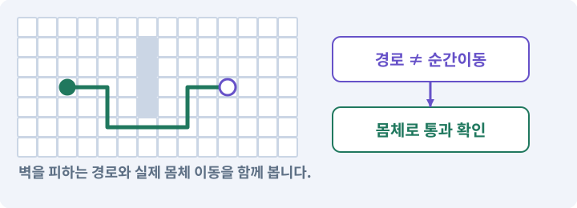

# 085. 3D 캐릭터를 한 모터로 움직이기

**목표:** 캐릭터가 같은 속도로 움직이고 벽에 막힙니다.

**시작 상태:** 3D 바닥과 충돌 벽

## 한눈에 보는 기능의 흐름

직접 입력 → 한 이동 모터 → 몸체 충돌 → 입력 해제



**경계:** 여러 컴포넌트가 위치를 동시에 쓰지 않기

그림은 실제 게임 실행 결과가 아닙니다. 값·규칙과 예제를 필요한 때 펼쳐 읽고 현재 단계의 메시지를 한 번씩 보냅니다.

## 1. 지금 상태 확인하기

첫 메시지를 보내 현재 준비 상태를 확인합니다. AI가 읽어 온 실제 프로젝트가 맞는지 보고, 없는 준비나 다른 상태가 있으면 먼저 알려 주세요. 아직 기능을 만들지 않는 단계입니다.

### AI에게 보낼 요구와 이유

#### 01. 작업 대상부터 확인

**“3D 캐릭터를 한 모터로 움직이기” 작업을 시작하기 전에 현재 상태를 읽기 전용으로 확인해 줘.**

왜 이렇게 요청하나요? AI가 다른 프로젝트나 오래된 예제를 보고 작업할 수 있습니다. 실제 경로·파일·현재 기능을 읽게 하면 지금 이어서 작업할 대상을 먼저 맞출 수 있습니다.

#### 02. 작업 대상부터 확인

**필요한 시작 상태는 3D 바닥과 충돌 벽야.**

왜 이렇게 요청하나요? AI가 다른 프로젝트나 오래된 예제를 보고 작업할 수 있습니다. 실제 경로·파일·현재 기능을 읽게 하면 지금 이어서 작업할 대상을 먼저 맞출 수 있습니다.

#### 03. 실제 사용 중인 구현 재사용

**실제 프로젝트와 작업 기록을 읽고 이것이 준비되어 있는지, 이미 같은 기능이 있는지 확인해 줘.**

왜 이렇게 요청하나요? 이름이 비슷한 새 클래스를 또 만들면 기존 화면은 여전히 옛 코드를 사용할 수 있습니다. 실제 호출되는 진입점을 찾아 연결해야 두 구현이 충돌하거나 수정이 반영되지 않는 문제를 막습니다.

#### 04. 현재 상태와 다음 확인 지점 구분

**이번 기능이 연결될 실제 파일·화면·도구와 보존할 기존 동작을 짧게 정리해 줘.**

왜 이렇게 요청하나요? 이미 준비된 기능과 아직 확인하지 못한 기능을 섞으면 불필요한 재설치나 성급한 완료 판정이 생깁니다. 현재 대상과 남은 준비를 나눠 가장 작은 다음 작업을 선택하게 합니다.

#### 05. 조사 단계에서 변경하지 않기

**아직 새 구현·설치·유료 호출·파일 변경은 하지 마.**

왜 이렇게 요청하나요? 현재 상태를 알아보기만 할 때 파일 변경이나 결제가 시작되면 검토 전의 환경이 바뀝니다. 준비 확인과 실제 구현을 나눠 되돌리기 어려운 작업이 먼저 실행되지 않게 합니다.

#### 06. 막힌 준비를 먼저 해결

**준비가 다르면 부족한 항목과 다음에 필요한 작업을 알려 줘.**

왜 이렇게 요청하나요? 빠진 파일·권한·패키지를 있다고 가정하면 다음 구현이 엉뚱한 대상을 만들게 됩니다. 무엇이 없고 무엇을 먼저 해야 하는지 분리하면 불필요한 재작업을 줄일 수 있습니다.

<details>
<summary>보낼 원문 전체 — 설명은 복사되지 않습니다</summary>

```text
“3D 캐릭터를 한 모터로 움직이기” 작업을 시작하기 전에 현재 상태를 읽기 전용으로 확인해 줘.
필요한 시작 상태는 3D 바닥과 충돌 벽야. 실제 프로젝트와 작업 기록을 읽고 이것이 준비되어 있는지, 이미 같은 기능이 있는지 확인해 줘.
이번 기능이 연결될 실제 파일·화면·도구와 보존할 기존 동작을 짧게 정리해 줘. 아직 새 구현·설치·유료 호출·파일 변경은 하지 마. 준비가 다르면 부족한 항목과 다음에 필요한 작업을 알려 줘.
```

</details>

**기대 결과:** 이동 권한과 카메라 기준 입력 설명

### 직접 확인하기

1. AI가 읽은 실제 프로젝트 또는 도구 경로를 확인합니다.
2. 필수 준비가 없다면 문제 해결 요청을 보내고, 준비됐을 때 다음으로 갑니다.

## 2. 필요한 기능 만들기

준비가 확인되면 아래 요청을 보냅니다. AI가 파일·설정·실행을 맡습니다. 변경 범위나 비용 승인이 나오면 내용을 읽고 결정하세요.

### AI에게 보낼 요구와 이유

#### 01. 작업 대상부터 확인

**현재 프로젝트의 실제 파일과 이미 결정한 규칙을 먼저 확인해 줘.**

왜 이렇게 요청하나요? AI가 다른 프로젝트나 오래된 예제를 보고 작업할 수 있습니다. 실제 경로·파일·현재 기능을 읽게 하면 지금 이어서 작업할 대상을 먼저 맞출 수 있습니다.

#### 02. 실제 사용 중인 코드에 연결

**이름이 다른 기존 구현이 있으면 새로 중복 제작하지 말고 그 구현에 연결해 줘.**

왜 이렇게 요청하나요? 예제와 이름이 다르더라도 현재 씬과 입력에서 호출하는 구현이 작업 대상입니다. 같은 기능을 새로 만들기보다 기존 진입점을 확인해 수정이 실제 게임에 반영되고 중복 실행되지 않게 합니다.

#### 03. 위치를 쓰는 주체 하나로 통일

**ActorMotor3D를 CharacterController 하나로 구현해 줘.**

왜 이렇게 요청하나요? 경로 추적·직접 입력·애니메이션이 각자 Transform을 바꾸면 흔들림과 순간이동이 생길 수 있습니다. 이동 결정을 모터 한 곳으로 모으고 다른 기능은 방향과 경로만 전달합니다.

#### 04. 구현할 결과와 조건 고정

**속도 4.5, 반경 0.35, 높이 1.8, centerY 0.9로 2D 논리 몸체를 대응시켜 줘.**

왜 이렇게 요청하나요? “속도 4.5, 반경 0.35, 높이 1.8, centerY 0.9로 2D 논리 몸체를 대응시켜 줘”를 명시하면 AI가 무엇을 구현하거나 검사해야 하는지 범위를 좁힐 수 있습니다. 캐릭터가 같은 속도로 움직이고 벽에 막힙니다. 이 결과를 확인할 때 이 조건이 실제로 반영됐는지 함께 봅니다.

#### 05. 좌표계 혼동 방지

**WASD와 조이스틱 입력을 카메라의 XZ 평면 방향으로 변환하고 대각선 속도를 제한해 줘.**

왜 이렇게 요청하나요? 2D의 XY와 3D의 XZ는 같은 이동 의미라도 축 배치가 다릅니다. 변환 위치를 한 곳으로 모아야 지도·물리·카메라가 서로 다른 축을 높이나 전진 방향으로 해석하지 않습니다.

#### 06. 구현할 결과와 조건 고정

**중력과 접지를 명시적으로 처리하고 점프나 높이 차 전투는 추가하지 마.**

왜 이렇게 요청하나요? “중력과 접지를 명시적으로 처리하고 점프나 높이 차 전투는 추가하지 마”를 명시하면 AI가 무엇을 구현하거나 검사해야 하는지 범위를 좁힐 수 있습니다. 캐릭터가 같은 속도로 움직이고 벽에 막힙니다. 이 결과를 확인할 때 이 조건이 실제로 반영됐는지 함께 봅니다.

#### 07. 길찾기와 실제 도달을 구분

**2D 모터, Transform 직접 쓰기, NavMeshAgent 위치 갱신, root motion을 동시에 사용하지 마.**

왜 이렇게 요청하나요? 목적지 표시나 경로 목록이 있다고 캐릭터가 끝까지 갈 수 있는 것은 아닙니다. 이동 가능한 경로와 실제 몸체의 진행을 확인하고 막힌 지점을 성공으로 표시하지 않게 합니다.

#### 08. 시간·방향과 물리 이동 일치

**벽, 모서리, 문, 직선·대각선, 포커스, Pause, 낙하 예외를 검사해 줘.**

왜 이렇게 요청하나요? 입력 방향의 길이와 프레임 간격을 그대로 이동량에 섞으면 대각선이나 기기 속도에 따라 이동이 달라집니다. 정해진 속도·시간 기준과 물리 이동 경로를 사용해 비교 가능한 움직임을 만듭니다.

#### 09. 구현할 결과와 조건 고정

**이동 거리의 오차를 원인별로 기록하고 게임 속도를 바꿔서 억지로 맞추지 마.**

왜 이렇게 요청하나요? “이동 거리의 오차를 원인별로 기록하고 게임 속도를 바꿔서 억지로 맞추지 마”를 명시하면 AI가 무엇을 구현하거나 검사해야 하는지 범위를 좁힐 수 있습니다. 캐릭터가 같은 속도로 움직이고 벽에 막힙니다. 이 결과를 확인할 때 이 조건이 실제로 반영됐는지 함께 봅니다.

#### 10. 아래 항목을 완료 조건으로 사용

**적용할 세부 규칙:**

왜 이렇게 요청하나요? 요구사항의 목록은 AI에게 참고 설명을 주는 것이 아니라 완료를 판단할 기준을 정합니다. 구현 뒤 각 항목을 실제 입력과 결과에 대응시켜 빠진 조건을 찾습니다.

#### 11. 구현할 결과와 조건 고정

**초기값은 속도 4.5, 반경 0.35, 높이 1.8, centerY 0.9, stepOffset 0.2, 기본 지면 Y=0이다.**

왜 이렇게 요청하나요? “초기값은 속도 4.5, 반경 0.35, 높이 1.8, centerY 0.9, stepOffset 0.2, 기본 지면 Y=0이다”를 명시하면 AI가 무엇을 구현하거나 검사해야 하는지 범위를 좁힐 수 있습니다. 캐릭터가 같은 속도로 움직이고 벽에 막힙니다. 이 결과를 확인할 때 이 조건이 실제로 반영됐는지 함께 봅니다.

#### 12. 구현할 결과와 조건 고정

**첫 버전에는 점프나 높이 차를 이용하는 전투가 없다.**

왜 이렇게 요청하나요? “첫 버전에는 점프나 높이 차를 이용하는 전투가 없다”를 명시하면 AI가 무엇을 구현하거나 검사해야 하는지 범위를 좁힐 수 있습니다. 캐릭터가 같은 속도로 움직이고 벽에 막힙니다. 이 결과를 확인할 때 이 조건이 실제로 반영됐는지 함께 봅니다.

#### 13. 기존 결과를 보호

**중력과 접지 속도를 명시적으로 통합하고, 접지 상태에서는 작은 하향 속도를 유지하는 등의 정책을 정한다.**

왜 이렇게 요청하나요? 새 작업이 이미 정상인 기능이나 자산까지 바꾸면 원인을 추적하기 어렵습니다. 유지할 대상을 명시해 변경 전후를 비교하고 원치 않은 영향을 찾습니다.

#### 14. 좌표계 혼동 방지

**WASD와 조이스틱 입력은 카메라의 right·forward를 XZ 평면에 투영한 기준으로 변환한다.**

왜 이렇게 요청하나요? 2D의 XY와 3D의 XZ는 같은 이동 의미라도 축 배치가 다릅니다. 변환 위치를 한 곳으로 모아야 지도·물리·카메라가 서로 다른 축을 높이나 전진 방향으로 해석하지 않습니다.

#### 15. 시점과 화면 크기 기준 고정

**투영한 두 축의 직교성과 길이를 확인하고, 대각선 입력 벡터의 크기를 제한한다.**

왜 이렇게 요청하나요? 카메라 방식이 바뀌면 같은 물체도 화면에서 보이는 크기와 겹침이 달라집니다. 시점을 먼저 정해 캐릭터 크기·선택·위험 표시를 같은 조건으로 맞춥니다.

#### 16. 벡터·방향·정규화의 적용 조건

**카메라가 거의 수직이어서 forward의 평면 투영이 0에 가까우면 고정된 평면 전방을 대체값으로 사용한다.**

왜 이렇게 요청하나요? 벡터는 방향과 크기를 함께 나타내는 값입니다. 위치 두 개의 차이는 목표로 향하는 벡터이며, 정규화는 방향을 유지하면서 길이를 1로 만드는 과정입니다. 0 벡터는 방향이 없습니다. 멈췄을 때 마지막 바라보는 방향을 별도로 보존할 수 있습니다.

#### 17. 이동 책임과 경계값 고정

**위치 적용은 ActorMotor3D 한 곳에서 처리한다.**

왜 이렇게 요청하나요? 캐릭터 이동은 입력뿐 아니라 시간·충돌·초기 위치를 함께 처리해야 합니다. 하나의 모터가 정해진 속도와 우선순위로 움직이게 하고 겹친 시작 위치는 별도 복구해 결과를 비교합니다.

#### 18. 시간·방향과 물리 이동 일치

**2D MovePosition 호출이나 애니메이션의 루트 이동 곡선이 남지 않게 한다.**

왜 이렇게 요청하나요? 입력 방향의 길이와 프레임 간격을 그대로 이동량에 섞으면 대각선이나 기기 속도에 따라 이동이 달라집니다. 정해진 속도·시간 기준과 물리 이동 경로를 사용해 비교 가능한 움직임을 만듭니다.

#### 19. 기존 결과를 보호

**배우 사이의 자동 물리 밀침을 새로 추가하지 않고 기존 접근 분산 정책을 유지한다.**

왜 이렇게 요청하나요? 새 작업이 이미 정상인 기능이나 자산까지 바꾸면 원인을 추적하기 어렵습니다. 유지할 대상을 명시해 변경 전후를 비교하고 원치 않은 영향을 찾습니다.

#### 20. 구현과 실행은 AI에게 맡기기

**코드·설정·파일 생성·실행은 네가 맡고, 필요한 화면과 결과를 보여 줘.**

왜 이렇게 요청하나요? 설명이나 코드 조각만 받으면 실제 파일 생성·연결·실행이 빠질 수 있습니다. AI가 개발 작업까지 수행하고, 사람은 요구·승인·결과 판단을 맡도록 역할을 분명히 합니다.

#### 21. 막힌 준비를 먼저 해결

**수행하지 못한 작업과 필요한 승인·도구 연결은 구분해서 알려 줘.**

왜 이렇게 요청하나요? 빠진 파일·권한·패키지를 있다고 가정하면 다음 구현이 엉뚱한 대상을 만들게 됩니다. 무엇이 없고 무엇을 먼저 해야 하는지 분리하면 불필요한 재작업을 줄일 수 있습니다.

<details>
<summary>보낼 원문 전체 — 설명은 복사되지 않습니다</summary>

```text
현재 프로젝트의 실제 파일과 이미 결정한 규칙을 먼저 확인해 줘. 이름이 다른 기존 구현이 있으면 새로 중복 제작하지 말고 그 구현에 연결해 줘.

ActorMotor3D를 CharacterController 하나로 구현해 줘.
속도 4.5, 반경 0.35, 높이 1.8, centerY 0.9로 2D 논리 몸체를 대응시켜 줘.
WASD와 조이스틱 입력을 카메라의 XZ 평면 방향으로 변환하고 대각선 속도를 제한해 줘.
중력과 접지를 명시적으로 처리하고 점프나 높이 차 전투는 추가하지 마.
2D 모터, Transform 직접 쓰기, NavMeshAgent 위치 갱신, root motion을 동시에 사용하지 마.
벽, 모서리, 문, 직선·대각선, 포커스, Pause, 낙하 예외를 검사해 줘.
이동 거리의 오차를 원인별로 기록하고 게임 속도를 바꿔서 억지로 맞추지 마.

적용할 세부 규칙:
초기값은 속도 4.5, 반경 0.35, 높이 1.8, centerY 0.9, stepOffset 0.2, 기본 지면 Y=0이다. 첫 버전에는 점프나 높이 차를 이용하는 전투가 없다. 중력과 접지 속도를 명시적으로 통합하고, 접지 상태에서는 작은 하향 속도를 유지하는 등의 정책을 정한다.

WASD와 조이스틱 입력은 카메라의 right·forward를 XZ 평면에 투영한 기준으로 변환한다. 투영한 두 축의 직교성과 길이를 확인하고, 대각선 입력 벡터의 크기를 제한한다. 카메라가 거의 수직이어서 forward의 평면 투영이 0에 가까우면 고정된 평면 전방을 대체값으로 사용한다.

위치 적용은 ActorMotor3D 한 곳에서 처리한다. 2D MovePosition 호출이나 애니메이션의 루트 이동 곡선이 남지 않게 한다. 배우 사이의 자동 물리 밀침을 새로 추가하지 않고 기존 접근 분산 정책을 유지한다.

코드·설정·파일 생성·실행은 네가 맡고, 필요한 화면과 결과를 보여 줘. 수행하지 못한 작업과 필요한 승인·도구 연결은 구분해서 알려 줘.
```

</details>

**기대 결과:** 확인할 결과: 3D 직접 이동과 충돌을 확인함. AI가 이 상태를 확인할 실제 화면과 변경 내용을 준비합니다. 아직 실행하지 못한 부분은 따로 표시합니다.

### 직접 확인하기

1. 제안서만 반환됐다면 “설명으로 끝내지 말고 승인한 범위의 실제 작업을 수행해 줘”라고 보냅니다.
2. 코드나 설정을 직접 고치라는 안내가 나오면 “작성과 실행은 네가 맡아 줘”라고 요청합니다.

## 3. 결과를 직접 확인하기

먼저 확인 요청을 보내 AI가 검사와 화면을 준비하게 하세요. 그다음 아래 동작을 하나씩 확인합니다.

### AI에게 보낼 요구와 이유

#### 01. 검사할 입력과 관찰 지점 준비

**방금 구현한 기능의 자동 검사와 확인 화면을 준비해 줘.**

왜 이렇게 요청하나요? 정상 예 하나만 보면 실패 조건을 놓치기 쉽습니다. 정상·경계·반례를 실제 입력으로 준비하고 사람이 볼 화면도 맞춰 확인 범위를 분명하게 합니다.

#### 02. 결과를 재확인할 근거 남기기

**정상 동작과 아래 실패 조건을 실제로 검사하고 대상·실행 수·결과를 보여 줘.**

왜 이렇게 요청하나요? “잘 됩니다”라는 요약만으로는 어떤 입력과 버전을 검사했는지 알 수 없습니다. 대상·실행 수·실패 내용·파일을 함께 남겨 같은 조건으로 다시 확인할 수 있게 합니다.

#### 03. 기존 결과를 보호

**기본 속도 4.5를 유지하고 벽을 뚫지 않는다.**

왜 이렇게 요청하나요? 새 작업이 이미 정상인 기능이나 자산까지 바꾸면 원인을 추적하기 어렵습니다. 유지할 대상을 명시해 변경 전후를 비교하고 원치 않은 영향을 찾습니다.

#### 04. 구현할 결과와 조건 고정

**화면 위 방향의 입력이 바닥 위 전방 이동으로 연결된다.**

왜 이렇게 요청하나요? “화면 위 방향의 입력이 바닥 위 전방 이동으로 연결된다”를 명시하면 AI가 무엇을 구현하거나 검사해야 하는지 범위를 좁힐 수 있습니다. 캐릭터가 같은 속도로 움직이고 벽에 막힙니다. 이 결과를 확인할 때 이 조건이 실제로 반영됐는지 함께 봅니다.

#### 05. 구현할 결과와 조건 고정

**중력과 접지가 동작하고 위치 소유자가 하나다.**

왜 이렇게 요청하나요? “중력과 접지가 동작하고 위치 소유자가 하나다”를 명시하면 AI가 무엇을 구현하거나 검사해야 하는지 범위를 좁힐 수 있습니다. 캐릭터가 같은 속도로 움직이고 벽에 막힙니다. 이 결과를 확인할 때 이 조건이 실제로 반영됐는지 함께 봅니다.

#### 06. 사람 검사의 시작점 준비

**내가 조작해야 하는 부분은 실행할 화면과 시작 상태를 준비해 줘.**

왜 이렇게 요청하나요? 같은 기능이라도 시작 상태가 다르면 관찰 결과가 달라집니다. AI가 실행 화면과 재현 위치를 먼저 준비해야 사람이 이동·공격·소리·조작감을 같은 조건에서 확인할 수 있습니다.

#### 07. 사람이 실제로 본 것만 기록

**연결되지 않은 휴대폰의 터치나 사람이 보지 않은 재미·소리 품질을 대신 확인했다고 하지 마.**

왜 이렇게 요청하나요? AI가 준비한 검사와 사람이 직접 플레이하거나 들은 결과는 다른 근거입니다. 관찰하지 않은 조작감·소리·실기기 결과를 임의로 완료 처리하지 않게 합니다.

#### 08. 실제로 실행한 검사만 인정

**테스트 0개와 예전 소스 결과는 현재 성공으로 쓰지 마.**

왜 이렇게 요청하나요? 실행된 검사가 없거나 같은 결과를 중복 집계한 경우는 기능을 확인한 것이 아닙니다. 실행 수와 개별 결과를 함께 확인해야 형식적인 성공 표시를 걸러낼 수 있습니다.

<details>
<summary>보낼 원문 전체 — 설명은 복사되지 않습니다</summary>

```text
방금 구현한 기능의 자동 검사와 확인 화면을 준비해 줘. 정상 동작과 아래 실패 조건을 실제로 검사하고 대상·실행 수·결과를 보여 줘.

기본 속도 4.5를 유지하고 벽을 뚫지 않는다. 화면 위 방향의 입력이 바닥 위 전방 이동으로 연결된다. 중력과 접지가 동작하고 위치 소유자가 하나다.

내가 조작해야 하는 부분은 실행할 화면과 시작 상태를 준비해 줘. 연결되지 않은 휴대폰의 터치나 사람이 보지 않은 재미·소리 품질을 대신 확인했다고 하지 마. 테스트 0개와 예전 소스 결과는 현재 성공으로 쓰지 마.
```

</details>

**기대 결과:** 모든 실제 위치 변경은 한 모터를 거치고, 경로 계산기는 방향만 제공합니다.

### 직접 확인하기

1. WASD와 조이스틱으로 움직입니다.
2. 대각선·벽·모서리 이동을 비교합니다.
3. 입력 해제 후 미끄러지거나 순간이동하지 않는지 봅니다.

## 4. 결과를 남기고 마무리하기

실제로 본 결과를 아래 메모에 적고 AI에 전달합니다. 결과 저장 요청으로 현재 상태를 남긴 뒤 다음 페이지로 갑니다.

### AI에게 보낼 요구와 이유

#### 01. 결과를 재확인할 근거 남기기

**지금 작업한 “3D 캐릭터를 한 모터로 움직이기”의 실제 결과를 정리해 줘.**

왜 이렇게 요청하나요? “잘 됩니다”라는 요약만으로는 어떤 입력과 버전을 검사했는지 알 수 없습니다. 대상·실행 수·실패 내용·파일을 함께 남겨 같은 조건으로 다시 확인할 수 있게 합니다.

#### 02. 다음 작업이 읽을 인수인계

**변경한 기능·파일·현재 후보와 실제 실행한 검사, 남은 문제를 기능 이름으로 기록해 줘.**

왜 이렇게 요청하나요? 새 AI 세션은 이전 대화 전체를 알고 있다고 보장할 수 없습니다. 현재 후보·파일 위치·실행한 검사·남은 일을 남겨야 같은 작업을 반복하지 않고 이어갈 수 있습니다.

#### 03. 사람이 실제로 본 것만 기록

**자동 검사 결과와 내가 직접 확인한 결과를 구분하고, 내 관찰이 아직 없으면 미확인으로 남겨 줘.**

왜 이렇게 요청하나요? AI가 준비한 검사와 사람이 직접 플레이하거나 들은 결과는 다른 근거입니다. 관찰하지 않은 조작감·소리·실기기 결과를 임의로 완료 처리하지 않게 합니다.

#### 04. 다음 작업이 읽을 인수인계

**재시작하거나 다음 작업에서 읽을 기록의 실제 위치를 알려 줘.**

왜 이렇게 요청하나요? 새 AI 세션은 이전 대화 전체를 알고 있다고 보장할 수 없습니다. 현재 후보·파일 위치·실행한 검사·남은 일을 남겨야 같은 작업을 반복하지 않고 이어갈 수 있습니다.

#### 05. 미확인을 완료와 분리

**아직 확인하지 않은 결과를 완료로 채우지 마.**

왜 이렇게 요청하나요? 만들어진 것, 검사에 실패한 것, 아직 확인하지 못한 것을 나눠야 다음 작업을 정확히 고를 수 있습니다. 실행할 조건이 없는 기능을 성공으로 기록하면 뒤에서 원인을 찾기 어려워집니다.

<details>
<summary>보낼 원문 전체 — 설명은 복사되지 않습니다</summary>

```text
지금 작업한 “3D 캐릭터를 한 모터로 움직이기”의 실제 결과를 정리해 줘. 변경한 기능·파일·현재 후보와 실제 실행한 검사, 남은 문제를 기능 이름으로 기록해 줘.
자동 검사 결과와 내가 직접 확인한 결과를 구분하고, 내 관찰이 아직 없으면 미확인으로 남겨 줘. 재시작하거나 다음 작업에서 읽을 기록의 실제 위치를 알려 줘. 아직 확인하지 않은 결과를 완료로 채우지 마.
```

</details>

**기대 결과:** 현재 상태·검사 결과·남은 문제·다음에 읽을 기록을 확인할 수 있습니다.

### 직접 확인하기

1. 자동 검사와 내 관찰 결과가 섞이지 않았는지 봅니다.
2. 문제가 남았다면 해결 요청을 보내고 같은 동작을 다시 확인합니다.

## 구체적인 예로 이해하기

### 3D 이동의 단일 담당

CharacterController와 NavMeshAgent가 동시에 위치를 갱신하면 서로 보정하며 떨리거나 순간이동할 수 있습니다.

**시작 상태:** 2D 완성본을 보존한 별도 3D 프로젝트입니다.

**직접 해 볼 동작:** 직접 이동과 클릭 경로를 번갈아 사용하고 이동 중 공격·넉백을 시험합니다.

**보여야 하는 결과:** 모든 실제 위치 변경은 한 모터를 거치고, 경로 계산기는 방향만 제공합니다.

**이렇게 되면 아직 안 됩니다:** 스프라이트를 메시로 바꾸면서 피해 공식·아이템 ID까지 새로 만듭니다.

**생각해 보기:** 같은 게임의 3D 버전에서 반드시 같아야 할 것은 무엇인가요?

<details><summary>해설 보기</summary>

규칙·진행 데이터·ID입니다. 화면과 물리 엔진 내부 결과까지 픽셀 단위로 같아야 한다는 뜻은 아닙니다.

</details>

## 이 작업에서 사용할 값과 규칙 전체

설계 시작값이며 측정된 성능·게임 성공 결과가 아닙니다. 구현은 AI가 수행합니다.

초기값은 속도 4.5, 반경 0.35, 높이 1.8, centerY 0.9, stepOffset 0.2, 기본 지면 Y=0이다. 첫 버전에는 점프나 높이 차를 이용하는 전투가 없다. 중력과 접지 속도를 명시적으로 통합하고, 접지 상태에서는 작은 하향 속도를 유지하는 등의 정책을 정한다.

WASD와 조이스틱 입력은 카메라의 right·forward를 XZ 평면에 투영한 기준으로 변환한다. 투영한 두 축의 직교성과 길이를 확인하고, 대각선 입력 벡터의 크기를 제한한다. 카메라가 거의 수직이어서 forward의 평면 투영이 0에 가까우면 고정된 평면 전방을 대체값으로 사용한다.

위치 적용은 ActorMotor3D 한 곳에서 처리한다. 2D MovePosition 호출이나 애니메이션의 루트 이동 곡선이 남지 않게 한다. 배우 사이의 자동 물리 밀침을 새로 추가하지 않고 기존 접근 분산 정책을 유지한다.

## 문제가 있으면

### AI에게 보낼 요구와 이유

#### 01. 위치를 쓰는 주체 하나로 통일

**NavMesh·Animator·Transform 코드가 동시에 위치를 바꾸는지 찾아 줘.**

왜 이렇게 요청하나요? 경로 추적·직접 입력·애니메이션이 각자 Transform을 바꾸면 흔들림과 순간이동이 생길 수 있습니다. 이동 결정을 모터 한 곳으로 모으고 다른 기능은 방향과 경로만 전달합니다.

#### 02. 이동 모터와 단일 위치 책임의 적용 조건

**단일 모터의 이동량으로 통일해 줘.**

왜 이렇게 요청하나요? 이동 모터는 걷기·클릭 경로·회피·밀려남 요청을 받아 최종 이동을 한 곳에서 처리하는 프로젝트의 구성요소입니다. Unity의 모든 프로젝트에 같은 이름으로 존재하는 기능은 아닙니다. NavMeshAgent·Transform·CharacterController가 동시에 위치를 갱신하게 두지 않습니다.

#### 03. 원인 하나를 좁혀 수정

**새 기능을 추가하지 말고 현재 오류와 실제 로그를 먼저 읽어 줘.**

왜 이렇게 요청하나요? 오류 수정 중 새 기능까지 넣으면 어떤 변경이 문제를 해결하거나 악화했는지 알기 어렵습니다. 원래 재현을 보존하고 작은 변경 뒤 같은 입력과 주변 정상 동작을 다시 확인합니다.

#### 04. 원인 하나를 좁혀 수정

**최소 수정 뒤 같은 재현과 관련 정상 동작을 다시 검사해 줘.**

왜 이렇게 요청하나요? 오류 수정 중 새 기능까지 넣으면 어떤 변경이 문제를 해결하거나 악화했는지 알기 어렵습니다. 원래 재현을 보존하고 작은 변경 뒤 같은 입력과 주변 정상 동작을 다시 확인합니다.

#### 05. 실패도 재현 자료로 보존

**실패 기록은 지우지 마.**

왜 이렇게 요청하나요? 실패한 입력과 로그가 있어야 같은 문제가 다시 생겼을 때 비교할 수 있습니다. 성공 기록으로 덮어쓰지 않고 전후 자료를 남기면 무엇을 고쳤는지 확인할 수 있습니다.

<details>
<summary>보낼 원문 전체 — 설명은 복사되지 않습니다</summary>

```text
NavMesh·Animator·Transform 코드가 동시에 위치를 바꾸는지 찾아 줘. 단일 모터의 이동량으로 통일해 줘.
새 기능을 추가하지 말고 현재 오류와 실제 로그를 먼저 읽어 줘. 최소 수정 뒤 같은 재현과 관련 정상 동작을 다시 검사해 줘. 실패 기록은 지우지 마.
```

</details>

## 새 세션에서 이어가기

### AI에게 보낼 요구와 이유

#### 01. 이어서 할 작업 식별

**“3D 캐릭터를 한 모터로 움직이기” 작업을 이어가고 싶어.**

왜 이렇게 요청하나요? 이름으로 재개할 작업을 찾고, 뒤에 이어지는 요청으로 실제 파일·진행 중 작업·기록을 다시 읽게 합니다. 제목만 보고 이전 상태를 기억한다고 가정하지 않습니다.

#### 02. 조회는 상태를 바꾸지 않게

**실제 프로젝트와 내 도구의 작업 기록을 읽고 어디까지 구현·검사됐는지 확인해 줘.**

왜 이렇게 요청하나요? 진행 상황을 물을 때 새 구현이나 유료 호출이 시작되면 단순 확인이 실행 명령이 되어 버립니다. 저장된 근거를 읽어 완료·진행·승인 대기·미검증을 나누게 합니다.

#### 03. 재개 전 중복 작업 방지

**진행 중인 프로세스·승인·미저장 변경을 확인한 뒤 남은 가장 작은 작업부터 안내해 줘.**

왜 이렇게 요청하나요? 대화가 끊겨도 외부 작업은 끝났거나 아직 실행 중일 수 있습니다. 프로세스·승인·미저장 상태를 먼저 읽어 같은 생성·빌드·결제를 두 번 시작하지 않도록 합니다.

#### 04. 되돌아갈 원본 남기기

**기존 성공과 실패 기록은 보존해 줘.**

왜 이렇게 요청하나요? 새 구현이 실패해도 이전 게임과 저장을 복원할 수 있어야 합니다. 현재 내용을 먼저 조사하고 별도 후보에서 작업하면 실험이 유일한 정상본을 망가뜨리는 일을 피할 수 있습니다.

<details>
<summary>보낼 원문 전체 — 설명은 복사되지 않습니다</summary>

```text
“3D 캐릭터를 한 모터로 움직이기” 작업을 이어가고 싶어. 실제 프로젝트와 내 도구의 작업 기록을 읽고 어디까지 구현·검사됐는지 확인해 줘. 진행 중인 프로세스·승인·미저장 변경을 확인한 뒤 남은 가장 작은 작업부터 안내해 줘. 기존 성공과 실패 기록은 보존해 줘.
```

</details>

## 왜 이렇게 만드는가

3D에서도 AI 입력·경로 이동·넉백은 하나의 모터로 모인다. 나중에 NavMesh를 추가하더라도 NavMeshAgent가 위치를 덮어쓰게 하지 않는다. 경로 계산과 실제 몸체 이동을 계속 구분한다.

## 공식 참고

- [Character Controller component](https://docs.unity3d.com/6000.3/Documentation/Manual/class-CharacterController.html)
- [CharacterController.Move](https://docs.unity3d.com/6000.3/Documentation/ScriptReference/CharacterController.Move.html)


## 실제 Unity Editor 화면 참고
공식 예시와 내 프로젝트 실행 결과를 구분하세요. 원본 사진은 온라인 연결이 필요합니다.

- [Input Actions — 입력 묶음·행동·값의 종류 읽기](../editor_references/input-actions.md)
