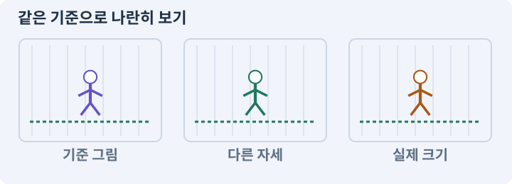

# 088. 3D 모델에 걷기와 공격 연결하기

**목표:** 모델은 움직이지만 전투 타이머는 유지됩니다.

**시작 상태:** 실제 3D 모델과 이동

## 한눈에 보는 기능의 흐름

관절·리그 → 걷기 클립 → 공격 클립 → 모터·타이머 연결



**경계:** 루트 모션과 모터가 위치를 이중 적용하지 않기

그림은 실제 게임 실행 결과가 아닙니다. 값·규칙과 예제를 필요한 때 펼쳐 읽고 현재 단계의 메시지를 한 번씩 보냅니다.

## 1. 지금 상태 확인하기

첫 메시지를 보내 현재 준비 상태를 확인합니다. AI가 읽어 온 실제 프로젝트가 맞는지 보고, 없는 준비나 다른 상태가 있으면 먼저 알려 주세요. 아직 기능을 만들지 않는 단계입니다.

### AI에게 보낼 요구와 이유

#### 01. 작업 대상부터 확인

**“3D 모델에 걷기와 공격 연결하기” 작업을 시작하기 전에 현재 상태를 읽기 전용으로 확인해 줘.**

왜 이렇게 요청하나요? AI가 다른 프로젝트나 오래된 예제를 보고 작업할 수 있습니다. 실제 경로·파일·현재 기능을 읽게 하면 지금 이어서 작업할 대상을 먼저 맞출 수 있습니다.

#### 02. 작업 대상부터 확인

**필요한 시작 상태는 실제 3D 모델과 이동야.**

왜 이렇게 요청하나요? AI가 다른 프로젝트나 오래된 예제를 보고 작업할 수 있습니다. 실제 경로·파일·현재 기능을 읽게 하면 지금 이어서 작업할 대상을 먼저 맞출 수 있습니다.

#### 03. 실제 사용 중인 구현 재사용

**실제 프로젝트와 작업 기록을 읽고 이것이 준비되어 있는지, 이미 같은 기능이 있는지 확인해 줘.**

왜 이렇게 요청하나요? 이름이 비슷한 새 클래스를 또 만들면 기존 화면은 여전히 옛 코드를 사용할 수 있습니다. 실제 호출되는 진입점을 찾아 연결해야 두 구현이 충돌하거나 수정이 반영되지 않는 문제를 막습니다.

#### 04. 현재 상태와 다음 확인 지점 구분

**이번 기능이 연결될 실제 파일·화면·도구와 보존할 기존 동작을 짧게 정리해 줘.**

왜 이렇게 요청하나요? 이미 준비된 기능과 아직 확인하지 못한 기능을 섞으면 불필요한 재설치나 성급한 완료 판정이 생깁니다. 현재 대상과 남은 준비를 나눠 가장 작은 다음 작업을 선택하게 합니다.

#### 05. 조사 단계에서 변경하지 않기

**아직 새 구현·설치·유료 호출·파일 변경은 하지 마.**

왜 이렇게 요청하나요? 현재 상태를 알아보기만 할 때 파일 변경이나 결제가 시작되면 검토 전의 환경이 바뀝니다. 준비 확인과 실제 구현을 나눠 되돌리기 어려운 작업이 먼저 실행되지 않게 합니다.

#### 06. 막힌 준비를 먼저 해결

**준비가 다르면 부족한 항목과 다음에 필요한 작업을 알려 줘.**

왜 이렇게 요청하나요? 빠진 파일·권한·패키지를 있다고 가정하면 다음 구현이 엉뚱한 대상을 만들게 됩니다. 무엇이 없고 무엇을 먼저 해야 하는지 분리하면 불필요한 재작업을 줄일 수 있습니다.

<details>
<summary>보낼 원문 전체 — 설명은 복사되지 않습니다</summary>

```text
“3D 모델에 걷기와 공격 연결하기” 작업을 시작하기 전에 현재 상태를 읽기 전용으로 확인해 줘.
필요한 시작 상태는 실제 3D 모델과 이동야. 실제 프로젝트와 작업 기록을 읽고 이것이 준비되어 있는지, 이미 같은 기능이 있는지 확인해 줘.
이번 기능이 연결될 실제 파일·화면·도구와 보존할 기존 동작을 짧게 정리해 줘. 아직 새 구현·설치·유료 호출·파일 변경은 하지 마. 준비가 다르면 부족한 항목과 다음에 필요한 작업을 알려 줘.
```

</details>

**기대 결과:** 동작과 기존 타격 시간의 대응표

### 직접 확인하기

1. AI가 읽은 실제 프로젝트 또는 도구 경로를 확인합니다.
2. 필수 준비가 없다면 문제 해결 요청을 보내고, 준비됐을 때 다음으로 갑니다.

## 2. 필요한 기능 만들기

준비가 확인되면 아래 요청을 보냅니다. AI가 파일·설정·실행을 맡습니다. 변경 범위나 비용 승인이 나오면 내용을 읽고 결정하세요.

### AI에게 보낼 요구와 이유

#### 01. 작업 대상부터 확인

**현재 프로젝트의 실제 파일과 이미 결정한 규칙을 먼저 확인해 줘.**

왜 이렇게 요청하나요? AI가 다른 프로젝트나 오래된 예제를 보고 작업할 수 있습니다. 실제 경로·파일·현재 기능을 읽게 하면 지금 이어서 작업할 대상을 먼저 맞출 수 있습니다.

#### 02. 실제 사용 중인 코드에 연결

**이름이 다른 기존 구현이 있으면 새로 중복 제작하지 말고 그 구현에 연결해 줘.**

왜 이렇게 요청하나요? 예제와 이름이 다르더라도 현재 씬과 입력에서 호출하는 구현이 작업 대상입니다. 같은 기능을 새로 만들기보다 기존 진입점을 확인해 수정이 실제 게임에 반영되고 중복 실행되지 않게 합니다.

#### 03. 그림의 동작과 게임 판정 분리

**3D Animator를 기존 게임 상태에 연결해 줘.**

왜 이렇게 요청하나요? 모델 동작이 이동이나 피해를 또 적용하면 기존 모터·전투 타이머와 충돌할 수 있습니다. 위치와 피해를 책임지는 주체를 하나로 두고 애니메이션은 정해진 사건을 표현하게 합니다.

#### 04. 그림의 동작과 게임 판정 분리

**Generic 단순 관절과 in-place 클립으로 시작하고, root motion을 끈 채 ActorMotor3D 만 이동시켜 줘.**

왜 이렇게 요청하나요? 모델 동작이 이동이나 피해를 또 적용하면 기존 모터·전투 타이머와 충돌할 수 있습니다. 위치와 피해를 책임지는 주체를 하나로 두고 애니메이션은 정해진 사건을 표현하게 합니다.

#### 05. 프레임의 순서와 시간 맞추기

**Idle, Walk, Attack, Hurt, Dead의 우선순위를 2D와 맞추고 실제 모터 속도를 사용해 줘.**

왜 이렇게 요청하나요? 이미지나 동작 파일이 있어도 순서·속도·전환 기준이 맞지 않으면 끊기거나 타격 시점과 어긋납니다. 실제 사용 크기와 반복 재생에서 연결이 자연스러운지 확인합니다.

#### 06. 공격의 거리·시간을 명시

**기본 공격의 타격 시점 0.2초와 간격 0.7초를 보존하고 Animation Event에서 추가 피해를 주지 마.**

왜 이렇게 요청하나요? 그림이 닿아 보이는 순간과 실제 판정 시간은 다를 수 있습니다. 사거리·각도·공격 간격·타격 시점을 고정하면 회피 가능한 구간과 실제 피해 결과를 같은 조건으로 검사할 수 있습니다.

#### 07. 소켓: 무기 부착점과 장비 홈의 적용 조건

**검은 WeaponSocket에 연결하고, 방향 표시는 ModelRoot를 회전시켜 처리해 줘.**

왜 이렇게 요청하나요? 소켓은 두 문맥으로 쓰입니다. 외형의 소켓은 검을 손에 붙일 기준점이고, 장비 시스템의 소켓은 룬을 끼우는 데이터상의 슬롯입니다. 이름은 같지만 책임이 다릅니다. 외형 소켓에 모델을 붙였다고 장비 데이터가 자동 장착되지는 않습니다.

#### 08. 형태에 맞는 관절과 변형 준비

**외부 Humanoid를 사용하면 Avatar, 리타게팅, 라이선스, 루트 곡선을 실제로 확인해 줘.**

왜 이렇게 요청하나요? 겉모양이 완성됐다고 애니메이션에 필요한 관절과 가중치가 준비된 것은 아닙니다. 형태와 도구 지원 범위를 확인하고 관절 변형·무기 연결을 실제 동작으로 검사합니다.

#### 09. 한 공격의 피해 중복 방지

**발 미끄러짐, 취소, 사망, Pause, 중복 피해를 검사해 줘.**

왜 이렇게 요청하나요? 한 적에 여러 피격 영역이 있거나 여러 프레임에서 겹치면 같은 공격이 반복 적용될 수 있습니다. 공격과 대상을 식별해 허용한 타격 횟수만 처리합니다.

#### 10. 아래 항목을 완료 조건으로 사용

**적용할 세부 규칙:**

왜 이렇게 요청하나요? 요구사항의 목록은 AI에게 참고 설명을 주는 것이 아니라 완료를 판단할 기준을 정합니다. 구현 뒤 각 항목을 실제 입력과 결과에 대응시켜 빠진 조건을 찾습니다.

#### 11. 프레임의 순서와 시간 맞추기

**Idle·Walk·Attack·Hurt·Dead의 우선순위는 2D와 같다.**

왜 이렇게 요청하나요? 이미지나 동작 파일이 있어도 순서·속도·전환 기준이 맞지 않으면 끊기거나 타격 시점과 어긋납니다. 실제 사용 크기와 반복 재생에서 연결이 자연스러운지 확인합니다.

#### 12. 블렌딩·알파 혼합·가산 합성의 적용 조건

**이동 blend에는 실제 모터 속도를 사용한다.**

왜 이렇게 요청하나요? 블렌딩은 새로 그리는 색을 이미 그려진 배경과 섞는 규칙입니다. 알파 혼합은 투명도를 사용하고, 가산 합성은 빛처럼 값을 더하는 표현에 자주 사용합니다. 알파 값을 낮추는 것과 발광·가산 강도를 낮추는 것은 항상 같은 결과가 아닙니다.

#### 13. 공격의 거리·시간을 명시

**기본 공격의 타격 시점 0.2초와 공격 간격 0.7초에 맞게 클립 속도와 타격 포즈를 조정하되, Animation Event에서 피해를 추가로 발행하지 않는다.**

왜 이렇게 요청하나요? 그림이 닿아 보이는 순간과 실제 판정 시간은 다를 수 있습니다. 사거리·각도·공격 간격·타격 시점을 고정하면 회피 가능한 구간과 실제 피해 결과를 같은 조건으로 검사할 수 있습니다.

#### 14. ActorRoot·VisualRoot·ModelRoot의 적용 조건

**ModelRoot를 회전시켜 Facing을 표현하고 몸체 캡슐은 불필요하게 기울이지 않는다.**

왜 이렇게 요청하나요? 이 이름들은 프로젝트에서 몸체·게임 규칙과 외형을 분리하기 위해 정한 오브젝트 이름입니다. ActorRoot는 실제 위치·생명·이동의 기준, VisualRoot나 ModelRoot는 그림·모델을 담는 하위 객체로 사용합니다. Root라는 이름만 붙인다고 이런 분리가 자동으로 생기지는 않습니다. 실제 컴포넌트와 호출 관계가 중요합니다.

#### 15. 소켓: 무기 부착점과 장비 홈의 적용 조건

**검은 WeaponSocket에 연결한다.**

왜 이렇게 요청하나요? 소켓은 두 문맥으로 쓰입니다. 외형의 소켓은 검을 손에 붙일 기준점이고, 장비 시스템의 소켓은 룬을 끼우는 데이터상의 슬롯입니다. 이름은 같지만 책임이 다릅니다. 외형 소켓에 모델을 붙였다고 장비 데이터가 자동 장착되지는 않습니다.

#### 16. 프레임의 기준점 통일

**공격 중 모델의 발이 밀린다면 루트 곡선·클립 import·Animator.applyRootMotion을 확인한다.**

왜 이렇게 요청하나요? 걷기·공격 그림의 몸통 크기가 달라도 발은 같은 위치에 있어야 합니다. 기준점이 다르면 몸체는 정지해 있는데 그림만 튀거나 바닥을 미끄러지는 것처럼 보입니다.

#### 17. 프레임의 순서와 시간 맞추기

**걷기 클립이 없다면 간단한 팔다리 키프레임으로 시작한다.**

왜 이렇게 요청하나요? 이미지나 동작 파일이 있어도 순서·속도·전환 기준이 맞지 않으면 끊기거나 타격 시점과 어긋납니다. 실제 사용 크기와 반복 재생에서 연결이 자연스러운지 확인합니다.

#### 18. 프레임의 순서와 시간 맞추기

**사용할 외부 클립이 없다는 이유로 작업을 멈추지 않고, 기본 도형 애니메이션으로 전투 연결을 먼저 통과한다.**

왜 이렇게 요청하나요? 이미지나 동작 파일이 있어도 순서·속도·전환 기준이 맞지 않으면 끊기거나 타격 시점과 어긋납니다. 실제 사용 크기와 반복 재생에서 연결이 자연스러운지 확인합니다.

#### 19. 구현과 실행은 AI에게 맡기기

**코드·설정·파일 생성·실행은 네가 맡고, 필요한 화면과 결과를 보여 줘.**

왜 이렇게 요청하나요? 설명이나 코드 조각만 받으면 실제 파일 생성·연결·실행이 빠질 수 있습니다. AI가 개발 작업까지 수행하고, 사람은 요구·승인·결과 판단을 맡도록 역할을 분명히 합니다.

#### 20. 막힌 준비를 먼저 해결

**수행하지 못한 작업과 필요한 승인·도구 연결은 구분해서 알려 줘.**

왜 이렇게 요청하나요? 빠진 파일·권한·패키지를 있다고 가정하면 다음 구현이 엉뚱한 대상을 만들게 됩니다. 무엇이 없고 무엇을 먼저 해야 하는지 분리하면 불필요한 재작업을 줄일 수 있습니다.

<details>
<summary>보낼 원문 전체 — 설명은 복사되지 않습니다</summary>

```text
현재 프로젝트의 실제 파일과 이미 결정한 규칙을 먼저 확인해 줘. 이름이 다른 기존 구현이 있으면 새로 중복 제작하지 말고 그 구현에 연결해 줘.

3D Animator를 기존 게임 상태에 연결해 줘.
Generic 단순 관절과 in-place 클립으로 시작하고, root motion을 끈 채 ActorMotor3D 만 이동시켜 줘.
Idle, Walk, Attack, Hurt, Dead의 우선순위를 2D와 맞추고 실제 모터 속도를 사용해 줘.
기본 공격의 타격 시점 0.2초와 간격 0.7초를 보존하고 Animation Event에서 추가 피해를 주지 마.
검은 WeaponSocket에 연결하고, 방향 표시는 ModelRoot를 회전시켜 처리해 줘.
외부 Humanoid를 사용하면 Avatar, 리타게팅, 라이선스, 루트 곡선을 실제로 확인해 줘.
발 미끄러짐, 취소, 사망, Pause, 중복 피해를 검사해 줘.

적용할 세부 규칙:
Idle·Walk·Attack·Hurt·Dead의 우선순위는 2D와 같다. 이동 blend에는 실제 모터 속도를 사용한다. 기본 공격의 타격 시점 0.2초와 공격 간격 0.7초에 맞게 클립 속도와 타격 포즈를 조정하되, Animation Event에서 피해를 추가로 발행하지 않는다.

ModelRoot를 회전시켜 Facing을 표현하고 몸체 캡슐은 불필요하게 기울이지 않는다. 검은 WeaponSocket에 연결한다. 공격 중 모델의 발이 밀린다면 루트 곡선·클립 import·Animator.applyRootMotion을 확인한다.

걷기 클립이 없다면 간단한 팔다리 키프레임으로 시작한다. 사용할 외부 클립이 없다는 이유로 작업을 멈추지 않고, 기본 도형 애니메이션으로 전투 연결을 먼저 통과한다.

코드·설정·파일 생성·실행은 네가 맡고, 필요한 화면과 결과를 보여 줘. 수행하지 못한 작업과 필요한 승인·도구 연결은 구분해서 알려 줘.
```

</details>

**기대 결과:** 확인할 결과: 애니메이션과 이동·피해 분리를 확인함. AI가 이 상태를 확인할 실제 화면과 변경 내용을 준비합니다. 아직 실행하지 못한 부분은 따로 표시합니다.

### 직접 확인하기

1. 제안서만 반환됐다면 “설명으로 끝내지 말고 승인한 범위의 실제 작업을 수행해 줘”라고 보냅니다.
2. 코드나 설정을 직접 고치라는 안내가 나오면 “작성과 실행은 네가 맡아 줘”라고 요청합니다.

## 3. 결과를 직접 확인하기

먼저 확인 요청을 보내 AI가 검사와 화면을 준비하게 하세요. 그다음 아래 동작을 하나씩 확인합니다.

### AI에게 보낼 요구와 이유

#### 01. 검사할 입력과 관찰 지점 준비

**방금 구현한 기능의 자동 검사와 확인 화면을 준비해 줘.**

왜 이렇게 요청하나요? 정상 예 하나만 보면 실패 조건을 놓치기 쉽습니다. 정상·경계·반례를 실제 입력으로 준비하고 사람이 볼 화면도 맞춰 확인 범위를 분명하게 합니다.

#### 02. 결과를 재확인할 근거 남기기

**정상 동작과 아래 실패 조건을 실제로 검사하고 대상·실행 수·결과를 보여 줘.**

왜 이렇게 요청하나요? “잘 됩니다”라는 요약만으로는 어떤 입력과 버전을 검사했는지 알 수 없습니다. 대상·실행 수·실패 내용·파일을 함께 남겨 같은 조건으로 다시 확인할 수 있게 합니다.

#### 03. 프레임의 기준점 통일

**발 기준점이 유지되고 몸체의 위치를 애니메이션이 변경하지 않는다.**

왜 이렇게 요청하나요? 걷기·공격 그림의 몸통 크기가 달라도 발은 같은 위치에 있어야 합니다. 기준점이 다르면 몸체는 정지해 있는데 그림만 튀거나 바닥을 미끄러지는 것처럼 보입니다.

#### 04. 프레임의 순서와 시간 맞추기

**클립의 타격 포즈와 실제 타격 시점이 맞는다.**

왜 이렇게 요청하나요? 이미지나 동작 파일이 있어도 순서·속도·전환 기준이 맞지 않으면 끊기거나 타격 시점과 어긋납니다. 실제 사용 크기와 반복 재생에서 연결이 자연스러운지 확인합니다.

#### 05. 빠른 반응과 허용 행동 구분

**사망 우선순위와 스킬 취소 규칙이 보존된다.**

왜 이렇게 요청하나요? 다음 입력을 받는 것과 현재 공격을 무조건 취소하는 것은 다릅니다. 입력 저장 시간과 취소 가능한 시점을 정해야 조작은 이어지면서 비정상적인 빠른 연타는 막을 수 있습니다.

#### 06. 사람 검사의 시작점 준비

**내가 조작해야 하는 부분은 실행할 화면과 시작 상태를 준비해 줘.**

왜 이렇게 요청하나요? 같은 기능이라도 시작 상태가 다르면 관찰 결과가 달라집니다. AI가 실행 화면과 재현 위치를 먼저 준비해야 사람이 이동·공격·소리·조작감을 같은 조건에서 확인할 수 있습니다.

#### 07. 사람이 실제로 본 것만 기록

**연결되지 않은 휴대폰의 터치나 사람이 보지 않은 재미·소리 품질을 대신 확인했다고 하지 마.**

왜 이렇게 요청하나요? AI가 준비한 검사와 사람이 직접 플레이하거나 들은 결과는 다른 근거입니다. 관찰하지 않은 조작감·소리·실기기 결과를 임의로 완료 처리하지 않게 합니다.

#### 08. 실제로 실행한 검사만 인정

**테스트 0개와 예전 소스 결과는 현재 성공으로 쓰지 마.**

왜 이렇게 요청하나요? 실행된 검사가 없거나 같은 결과를 중복 집계한 경우는 기능을 확인한 것이 아닙니다. 실행 수와 개별 결과를 함께 확인해야 형식적인 성공 표시를 걸러낼 수 있습니다.

<details>
<summary>보낼 원문 전체 — 설명은 복사되지 않습니다</summary>

```text
방금 구현한 기능의 자동 검사와 확인 화면을 준비해 줘. 정상 동작과 아래 실패 조건을 실제로 검사하고 대상·실행 수·결과를 보여 줘.

발 기준점이 유지되고 몸체의 위치를 애니메이션이 변경하지 않는다. 클립의 타격 포즈와 실제 타격 시점이 맞는다. 사망 우선순위와 스킬 취소 규칙이 보존된다.

내가 조작해야 하는 부분은 실행할 화면과 시작 상태를 준비해 줘. 연결되지 않은 휴대폰의 터치나 사람이 보지 않은 재미·소리 품질을 대신 확인했다고 하지 마. 테스트 0개와 예전 소스 결과는 현재 성공으로 쓰지 마.
```

</details>

**기대 결과:** 애니메이션과 이동·피해 분리를 확인함

### 직접 확인하기

1. 걷다가 방향을 바꾸고 발 미끄러짐을 봅니다.
2. 공격·피격·사망 동작을 확인합니다.
3. 공격 중 모델이 몸체에서 떨어지지 않는지 봅니다.

## 4. 결과를 남기고 마무리하기

실제로 본 결과를 아래 메모에 적고 AI에 전달합니다. 결과 저장 요청으로 현재 상태를 남긴 뒤 다음 페이지로 갑니다.

### AI에게 보낼 요구와 이유

#### 01. 결과를 재확인할 근거 남기기

**지금 작업한 “3D 모델에 걷기와 공격 연결하기”의 실제 결과를 정리해 줘.**

왜 이렇게 요청하나요? “잘 됩니다”라는 요약만으로는 어떤 입력과 버전을 검사했는지 알 수 없습니다. 대상·실행 수·실패 내용·파일을 함께 남겨 같은 조건으로 다시 확인할 수 있게 합니다.

#### 02. 다음 작업이 읽을 인수인계

**변경한 기능·파일·현재 후보와 실제 실행한 검사, 남은 문제를 기능 이름으로 기록해 줘.**

왜 이렇게 요청하나요? 새 AI 세션은 이전 대화 전체를 알고 있다고 보장할 수 없습니다. 현재 후보·파일 위치·실행한 검사·남은 일을 남겨야 같은 작업을 반복하지 않고 이어갈 수 있습니다.

#### 03. 사람이 실제로 본 것만 기록

**자동 검사 결과와 내가 직접 확인한 결과를 구분하고, 내 관찰이 아직 없으면 미확인으로 남겨 줘.**

왜 이렇게 요청하나요? AI가 준비한 검사와 사람이 직접 플레이하거나 들은 결과는 다른 근거입니다. 관찰하지 않은 조작감·소리·실기기 결과를 임의로 완료 처리하지 않게 합니다.

#### 04. 다음 작업이 읽을 인수인계

**재시작하거나 다음 작업에서 읽을 기록의 실제 위치를 알려 줘.**

왜 이렇게 요청하나요? 새 AI 세션은 이전 대화 전체를 알고 있다고 보장할 수 없습니다. 현재 후보·파일 위치·실행한 검사·남은 일을 남겨야 같은 작업을 반복하지 않고 이어갈 수 있습니다.

#### 05. 미확인을 완료와 분리

**아직 확인하지 않은 결과를 완료로 채우지 마.**

왜 이렇게 요청하나요? 만들어진 것, 검사에 실패한 것, 아직 확인하지 못한 것을 나눠야 다음 작업을 정확히 고를 수 있습니다. 실행할 조건이 없는 기능을 성공으로 기록하면 뒤에서 원인을 찾기 어려워집니다.

<details>
<summary>보낼 원문 전체 — 설명은 복사되지 않습니다</summary>

```text
지금 작업한 “3D 모델에 걷기와 공격 연결하기”의 실제 결과를 정리해 줘. 변경한 기능·파일·현재 후보와 실제 실행한 검사, 남은 문제를 기능 이름으로 기록해 줘.
자동 검사 결과와 내가 직접 확인한 결과를 구분하고, 내 관찰이 아직 없으면 미확인으로 남겨 줘. 재시작하거나 다음 작업에서 읽을 기록의 실제 위치를 알려 줘. 아직 확인하지 않은 결과를 완료로 채우지 마.
```

</details>

**기대 결과:** 현재 상태·검사 결과·남은 문제·다음에 읽을 기록을 확인할 수 있습니다.

### 직접 확인하기

1. 자동 검사와 내 관찰 결과가 섞이지 않았는지 봅니다.
2. 문제가 남았다면 해결 요청을 보내고 같은 동작을 다시 확인합니다.

## 이 작업에서 사용할 값과 규칙 전체

설계 시작값이며 측정된 성능·게임 성공 결과가 아닙니다. 구현은 AI가 수행합니다.

Idle·Walk·Attack·Hurt·Dead의 우선순위는 2D와 같다. 이동 blend에는 실제 모터 속도를 사용한다. 기본 공격의 타격 시점 0.2초와 공격 간격 0.7초에 맞게 클립 속도와 타격 포즈를 조정하되, Animation Event에서 피해를 추가로 발행하지 않는다.

ModelRoot를 회전시켜 Facing을 표현하고 몸체 캡슐은 불필요하게 기울이지 않는다. 검은 WeaponSocket에 연결한다. 공격 중 모델의 발이 밀린다면 루트 곡선·클립 import·Animator.applyRootMotion을 확인한다.

걷기 클립이 없다면 간단한 팔다리 키프레임으로 시작한다. 사용할 외부 클립이 없다는 이유로 강의를 멈추지 않고, 기본 도형 애니메이션으로 전투 연결을 먼저 통과한다.

## 문제가 있으면

### AI에게 보낼 요구와 이유

#### 01. 그림의 동작과 게임 판정 분리

**애니메이션 이벤트가 두 번 피해를 주는지 확인해 줘.**

왜 이렇게 요청하나요? 모델 동작이 이동이나 피해를 또 적용하면 기존 모터·전투 타이머와 충돌할 수 있습니다. 위치와 피해를 책임지는 주체를 하나로 두고 애니메이션은 정해진 사건을 표현하게 합니다.

#### 02. 구현할 결과와 조건 고정

**루트 이동은 모터 권한과 충돌하지 않게 처리해 줘.**

왜 이렇게 요청하나요? “루트 이동은 모터 권한과 충돌하지 않게 처리해 줘”를 명시하면 AI가 무엇을 구현하거나 검사해야 하는지 범위를 좁힐 수 있습니다. 모델은 움직이지만 전투 타이머는 유지됩니다. 이 결과를 확인할 때 이 조건이 실제로 반영됐는지 함께 봅니다.

#### 03. 원인 하나를 좁혀 수정

**새 기능을 추가하지 말고 현재 오류와 실제 로그를 먼저 읽어 줘.**

왜 이렇게 요청하나요? 오류 수정 중 새 기능까지 넣으면 어떤 변경이 문제를 해결하거나 악화했는지 알기 어렵습니다. 원래 재현을 보존하고 작은 변경 뒤 같은 입력과 주변 정상 동작을 다시 확인합니다.

#### 04. 원인 하나를 좁혀 수정

**최소 수정 뒤 같은 재현과 관련 정상 동작을 다시 검사해 줘.**

왜 이렇게 요청하나요? 오류 수정 중 새 기능까지 넣으면 어떤 변경이 문제를 해결하거나 악화했는지 알기 어렵습니다. 원래 재현을 보존하고 작은 변경 뒤 같은 입력과 주변 정상 동작을 다시 확인합니다.

#### 05. 실패도 재현 자료로 보존

**실패 기록은 지우지 마.**

왜 이렇게 요청하나요? 실패한 입력과 로그가 있어야 같은 문제가 다시 생겼을 때 비교할 수 있습니다. 성공 기록으로 덮어쓰지 않고 전후 자료를 남기면 무엇을 고쳤는지 확인할 수 있습니다.

<details>
<summary>보낼 원문 전체 — 설명은 복사되지 않습니다</summary>

```text
애니메이션 이벤트가 두 번 피해를 주는지 확인해 줘. 루트 이동은 모터 권한과 충돌하지 않게 처리해 줘.
새 기능을 추가하지 말고 현재 오류와 실제 로그를 먼저 읽어 줘. 최소 수정 뒤 같은 재현과 관련 정상 동작을 다시 검사해 줘. 실패 기록은 지우지 마.
```

</details>

## 새 세션에서 이어가기

### AI에게 보낼 요구와 이유

#### 01. 이어서 할 작업 식별

**“3D 모델에 걷기와 공격 연결하기” 작업을 이어가고 싶어.**

왜 이렇게 요청하나요? 이름으로 재개할 작업을 찾고, 뒤에 이어지는 요청으로 실제 파일·진행 중 작업·기록을 다시 읽게 합니다. 제목만 보고 이전 상태를 기억한다고 가정하지 않습니다.

#### 02. 조회는 상태를 바꾸지 않게

**실제 프로젝트와 내 도구의 작업 기록을 읽고 어디까지 구현·검사됐는지 확인해 줘.**

왜 이렇게 요청하나요? 진행 상황을 물을 때 새 구현이나 유료 호출이 시작되면 단순 확인이 실행 명령이 되어 버립니다. 저장된 근거를 읽어 완료·진행·승인 대기·미검증을 나누게 합니다.

#### 03. 재개 전 중복 작업 방지

**진행 중인 프로세스·승인·미저장 변경을 확인한 뒤 남은 가장 작은 작업부터 안내해 줘.**

왜 이렇게 요청하나요? 대화가 끊겨도 외부 작업은 끝났거나 아직 실행 중일 수 있습니다. 프로세스·승인·미저장 상태를 먼저 읽어 같은 생성·빌드·결제를 두 번 시작하지 않도록 합니다.

#### 04. 되돌아갈 원본 남기기

**기존 성공과 실패 기록은 보존해 줘.**

왜 이렇게 요청하나요? 새 구현이 실패해도 이전 게임과 저장을 복원할 수 있어야 합니다. 현재 내용을 먼저 조사하고 별도 후보에서 작업하면 실험이 유일한 정상본을 망가뜨리는 일을 피할 수 있습니다.

<details>
<summary>보낼 원문 전체 — 설명은 복사되지 않습니다</summary>

```text
“3D 모델에 걷기와 공격 연결하기” 작업을 이어가고 싶어. 실제 프로젝트와 내 도구의 작업 기록을 읽고 어디까지 구현·검사됐는지 확인해 줘. 진행 중인 프로세스·승인·미저장 변경을 확인한 뒤 남은 가장 작은 작업부터 안내해 줘. 기존 성공과 실패 기록은 보존해 줘.
```

</details>

## 왜 이렇게 만드는가

2D 클립의 Sprite 교체가 3D 관절 애니메이션으로 바뀐다. 하지만 이동과 피해의 권한은 바뀌지 않는다. 기본 게임은 제자리에서 재생하는 in-place 애니메이션을 사용하고 root motion을 끄는 것을 기본으로 한다.

직접 만든 단순 계층은 Generic 리그와 Transform 키프레임으로 시작할 수 있다. 외부 Humanoid 클립을 가져오면 Avatar 매핑과 사용 조건을 확인한다. 같은 Animator를 사용한다고 서로 다른 뼈대가 자동으로 정확히 맞는다고 가정하지 않는다. [D16][D17]

## 공식 참고

- [Root Motion, Generic and Humanoid behavior](https://docs.unity3d.com/6000.3/Documentation/Manual/RootMotion.html)
- [Introduction to Mecanim animation](https://docs.unity3d.com/6000.3/Documentation/Manual/AnimationOverview.html)


## 실제 Unity Editor 화면 참고
공식 예시와 내 프로젝트 실행 결과를 구분하세요. 원본 사진은 온라인 연결이 필요합니다.

- [Animator — 상태와 전환이 동작을 연결하는 방식](../editor_references/animator.md)
