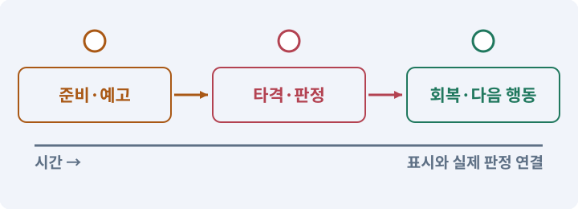

# 089. 같은 전투 규칙을 3D에 연결하기

**목표:** 같은 장비와 스킬이 같은 피해를 줍니다.

**시작 상태:** 3D 모터·모델·애니메이션

## 한눈에 보는 기능의 흐름

같은 장비 → 3D 범위·시야 → 공통 피해 규칙 → 2D 결과와 비교



**경계:** 콜라이더 수가 달라도 한 공격의 피해 유지

그림은 실제 게임 실행 결과가 아닙니다. 값·규칙과 예제를 필요한 때 펼쳐 읽고 현재 단계의 메시지를 한 번씩 보냅니다.

## 1. 지금 상태 확인하기

첫 메시지를 보내 현재 준비 상태를 확인합니다. AI가 읽어 온 실제 프로젝트가 맞는지 보고, 없는 준비나 다른 상태가 있으면 먼저 알려 주세요. 아직 기능을 만들지 않는 단계입니다.

### AI에게 보낼 요구와 이유

#### 01. 작업 대상부터 확인

**“같은 전투 규칙을 3D에 연결하기” 작업을 시작하기 전에 현재 상태를 읽기 전용으로 확인해 줘.**

왜 이렇게 요청하나요? AI가 다른 프로젝트나 오래된 예제를 보고 작업할 수 있습니다. 실제 경로·파일·현재 기능을 읽게 하면 지금 이어서 작업할 대상을 먼저 맞출 수 있습니다.

#### 02. 작업 대상부터 확인

**필요한 시작 상태는 3D 모터·모델·애니메이션야.**

왜 이렇게 요청하나요? AI가 다른 프로젝트나 오래된 예제를 보고 작업할 수 있습니다. 실제 경로·파일·현재 기능을 읽게 하면 지금 이어서 작업할 대상을 먼저 맞출 수 있습니다.

#### 03. 실제 사용 중인 구현 재사용

**실제 프로젝트와 작업 기록을 읽고 이것이 준비되어 있는지, 이미 같은 기능이 있는지 확인해 줘.**

왜 이렇게 요청하나요? 이름이 비슷한 새 클래스를 또 만들면 기존 화면은 여전히 옛 코드를 사용할 수 있습니다. 실제 호출되는 진입점을 찾아 연결해야 두 구현이 충돌하거나 수정이 반영되지 않는 문제를 막습니다.

#### 04. 현재 상태와 다음 확인 지점 구분

**이번 기능이 연결될 실제 파일·화면·도구와 보존할 기존 동작을 짧게 정리해 줘.**

왜 이렇게 요청하나요? 이미 준비된 기능과 아직 확인하지 못한 기능을 섞으면 불필요한 재설치나 성급한 완료 판정이 생깁니다. 현재 대상과 남은 준비를 나눠 가장 작은 다음 작업을 선택하게 합니다.

#### 05. 조사 단계에서 변경하지 않기

**아직 새 구현·설치·유료 호출·파일 변경은 하지 마.**

왜 이렇게 요청하나요? 현재 상태를 알아보기만 할 때 파일 변경이나 결제가 시작되면 검토 전의 환경이 바뀝니다. 준비 확인과 실제 구현을 나눠 되돌리기 어려운 작업이 먼저 실행되지 않게 합니다.

#### 06. 막힌 준비를 먼저 해결

**준비가 다르면 부족한 항목과 다음에 필요한 작업을 알려 줘.**

왜 이렇게 요청하나요? 빠진 파일·권한·패키지를 있다고 가정하면 다음 구현이 엉뚱한 대상을 만들게 됩니다. 무엇이 없고 무엇을 먼저 해야 하는지 분리하면 불필요한 재작업을 줄일 수 있습니다.

<details>
<summary>보낼 원문 전체 — 설명은 복사되지 않습니다</summary>

```text
“같은 전투 규칙을 3D에 연결하기” 작업을 시작하기 전에 현재 상태를 읽기 전용으로 확인해 줘.
필요한 시작 상태는 3D 모터·모델·애니메이션야. 실제 프로젝트와 작업 기록을 읽고 이것이 준비되어 있는지, 이미 같은 기능이 있는지 확인해 줘.
이번 기능이 연결될 실제 파일·화면·도구와 보존할 기존 동작을 짧게 정리해 줘. 아직 새 구현·설치·유료 호출·파일 변경은 하지 마. 준비가 다르면 부족한 항목과 다음에 필요한 작업을 알려 줘.
```

</details>

**기대 결과:** 같은 입력에서 기대하는 피해와 범위

### 직접 확인하기

1. AI가 읽은 실제 프로젝트 또는 도구 경로를 확인합니다.
2. 필수 준비가 없다면 문제 해결 요청을 보내고, 준비됐을 때 다음으로 갑니다.

## 2. 필요한 기능 만들기

준비가 확인되면 아래 요청을 보냅니다. AI가 파일·설정·실행을 맡습니다. 변경 범위나 비용 승인이 나오면 내용을 읽고 결정하세요.

### AI에게 보낼 요구와 이유

#### 01. 작업 대상부터 확인

**현재 프로젝트의 실제 파일과 이미 결정한 규칙을 먼저 확인해 줘.**

왜 이렇게 요청하나요? AI가 다른 프로젝트나 오래된 예제를 보고 작업할 수 있습니다. 실제 경로·파일·현재 기능을 읽게 하면 지금 이어서 작업할 대상을 먼저 맞출 수 있습니다.

#### 02. 실제 사용 중인 코드에 연결

**이름이 다른 기존 구현이 있으면 새로 중복 제작하지 말고 그 구현에 연결해 줘.**

왜 이렇게 요청하나요? 예제와 이름이 다르더라도 현재 씬과 입력에서 호출하는 구현이 작업 대상입니다. 같은 기능을 새로 만들기보다 기존 진입점을 확인해 수정이 실제 게임에 반영되고 중복 실행되지 않게 합니다.

#### 03. 어댑터·인터페이스·의존성 분리의 적용 조건

**3D 전투 어댑터를 구현해 줘.**

왜 이렇게 요청하나요? 인터페이스는 기능에 요구하는 약속이고 어댑터는 서로 다른 구현을 그 약속에 맞춰 연결하는 구성요소입니다. 의존성 주입은 사용할 구현을 외부에서 지정하는 방식입니다. 모든 작은 함수를 인터페이스로 만들 필요는 없습니다. 실제 교체·검사 경계에 사용합니다.

#### 04. 구성 변경으로 자원 회복하지 않기

**Core의 피해식·기본 공격·세 스킬·마나·쿨다운은 변경하지 마.**

왜 이렇게 요청하나요? 스킬이나 장비를 바꾸는 기능을 이용해 대기시간·체력·마나를 반복 초기화하면 전투 규칙을 우회할 수 있습니다. 재계산할 능력과 유지할 현재 자원을 구분합니다.

#### 05. 프레임의 기준점 통일

**후보 수집은 3D Physics로 하고 ActorId로 중복 제거한 뒤 발 위치 XZ 거리와 각도로 최종 판정해 줘.**

왜 이렇게 요청하나요? 걷기·공격 그림의 몸통 크기가 달라도 발은 같은 위치에 있어야 합니다. 기준점이 다르면 몸체는 정지해 있는데 그림만 튀거나 바닥을 미끄러지는 것처럼 보입니다.

#### 06. 보이는 장애물과 전투 판정 맞추기

**벽 시야는 Environment 전용 3D Linecast, 투사체는 이전→다음 위치 SphereCast로 가장 가까운 유효 충돌을 처리해 줘.**

왜 이렇게 요청하나요? 거리만 맞으면 벽 뒤에도 피해가 들어가거나 빠른 투사체가 얇은 벽을 지나칠 수 있습니다. 사선과 이동 구간을 검사해 장애물의 의미가 전투에서도 유지되게 합니다.

#### 07. 그림의 동작과 게임 판정 분리

**Animation Event·검 메시·VFX에서 추가 피해를 발생시키지 마.**

왜 이렇게 요청하나요? 모델 동작이 이동이나 피해를 또 적용하면 기존 모터·전투 타이머와 충돌할 수 있습니다. 위치와 피해를 책임지는 주체를 하나로 두고 애니메이션은 정해진 사건을 표현하게 합니다.

#### 08. 공격의 거리·시간을 명시

**기본 공격의 .2초 타격/.7초 간격/1.8거리/90도와 회전 공격 8틱을 보존해 줘.**

왜 이렇게 요청하나요? 그림이 닿아 보이는 순간과 실제 판정 시간은 다를 수 있습니다. 사거리·각도·공격 간격·타격 시점을 고정하면 회피 가능한 구간과 실제 피해 결과를 같은 조건으로 검사할 수 있습니다.

#### 09. 보이는 장애물과 전투 판정 맞추기

**정면/뒤/경계/벽/이중 Hurtbox/고속 투사체/Pause/사망 취소를 실제 검사해 줘.**

왜 이렇게 요청하나요? 거리만 맞으면 벽 뒤에도 피해가 들어가거나 빠른 투사체가 얇은 벽을 지나칠 수 있습니다. 사선과 이동 구간을 검사해 장애물의 의미가 전투에서도 유지되게 합니다.

#### 10. 아래 항목을 완료 조건으로 사용

**적용할 세부 규칙:**

왜 이렇게 요청하나요? 요구사항의 목록은 AI에게 참고 설명을 주는 것이 아니라 완료를 판단할 기준을 정합니다. 구현 뒤 각 항목을 실제 입력과 결과에 대응시켜 빠진 조건을 찾습니다.

#### 11. 프레임의 기준점 통일

**• 판정: 근접 후보 / 3D 구현 기준: 발 위치 주변의 OverlapSphere 등으로 넉넉히 수집하고 ActorId로 중복 제거**

왜 이렇게 요청하나요? 걷기·공격 그림의 몸통 크기가 달라도 발은 같은 위치에 있어야 합니다. 기준점이 다르면 몸체는 정지해 있는데 그림만 튀거나 바닥을 미끄러지는 것처럼 보입니다.

#### 12. 표적·팀·공격 주체·넉백의 적용 조건

**• 판정: 최종 사거리 / 3D 구현 기준: (target.x-source.x, target.z-source.z)의 길이**

왜 이렇게 요청하나요? 표적 선택은 어떤 대상을 공격할지 정하는 규칙입니다. 공격 주체·소유자·팀을 구분하면 동료 피해와 보상, 우호 피해, 중복 효과를 관리할 수 있습니다. 넉백은 피격 시 밀리는 이동 효과입니다. 넉백이 별도 스크립트로 위치를 무조건 덮으면 벽 통과나 이동 모터 충돌이 생길 수 있습니다.

#### 13. 관찰 가능한 기준으로 확인

**• 판정: 부채꼴 / 3D 구현 기준: 위 평면 방향과 Facing의 내적으로 반각 검사**

왜 이렇게 요청하나요? 구현 완료라는 설명을 실제 결과로 바꾸기 위한 조건입니다. 요청에 나온 대상과 경계 상황을 확인해 정상 결과뿐 아니라 실패를 어떻게 구분했는지도 남깁니다.

#### 14. Raycast·Linecast·Cast의 적용 조건

**• 판정: 벽 차단 / 3D 구현 기준: source/target의 가슴 높이 사이에서 Environment 전용 Linecast**

왜 이렇게 요청하나요? Raycast는 시작점에서 방향으로 가는 선의 충돌을 묻고, Linecast는 두 점 사이를 검사합니다. CircleCast·SphereCast 등은 두께가 있는 모양을 쓸어 이동 가능한 공간을 검사합니다. Cast는 질문입니다. 결과를 받았다고 객체가 자동으로 이동하거나 피해를 주지는 않습니다.

#### 15. Raycast·Linecast·Cast의 적용 조건

**• 판정: 투사체 / 3D 구현 기준: 이전 위치→이번 위치를 SphereCast하고 가장 가까운 유효 충돌 하나 처리**

왜 이렇게 요청하나요? Raycast는 시작점에서 방향으로 가는 선의 충돌을 묻고, Linecast는 두 점 사이를 검사합니다. CircleCast·SphereCast 등은 두께가 있는 모양을 쓸어 이동 가능한 공간을 검사합니다. Cast는 질문입니다. 결과를 받았다고 객체가 자동으로 이동하거나 피해를 주지는 않습니다.

#### 16. 공격의 거리·시간을 명시

**• 판정: 회전 공격 / 3D 구현 기준: 기존 0.25초 간격 8틱, 각 틱마다 대상 중복 제거**

왜 이렇게 요청하나요? 그림이 닿아 보이는 순간과 실제 판정 시간은 다를 수 있습니다. 사거리·각도·공격 간격·타격 시점을 고정하면 회피 가능한 구간과 실제 피해 결과를 같은 조건으로 검사할 수 있습니다.

#### 17. 공격의 거리·시간을 명시

**기본 공격은 사거리1.8·각도90도·타격0.2초·간격0.7초를 유지한다.**

왜 이렇게 요청하나요? 그림이 닿아 보이는 순간과 실제 판정 시간은 다를 수 있습니다. 사거리·각도·공격 간격·타격 시점을 고정하면 회피 가능한 구간과 실제 피해 결과를 같은 조건으로 검사할 수 있습니다.

#### 18. 구현할 결과와 조건 고정

**높이 차를 이용한 새로운 전투 규칙이나 점프는 이번 범위에 넣지 않는다.**

왜 이렇게 요청하나요? “높이 차를 이용한 새로운 전투 규칙이나 점프는 이번 범위에 넣지 않는다”를 명시하면 AI가 무엇을 구현하거나 검사해야 하는지 범위를 좁힐 수 있습니다. 같은 장비와 스킬이 같은 피해를 줍니다. 이 결과를 확인할 때 이 조건이 실제로 반영됐는지 함께 봅니다.

#### 19. 같은 요청의 반복 처리 정의

**모델의 여러 콜라이더에서 같은 ActorId가 나오면 한 번만 맞는다.**

왜 이렇게 요청하나요? 클릭 연타·재연결·중복 이벤트는 개발과 플레이 중 모두 발생할 수 있습니다. 반복돼도 한 번 처리해야 하는 결과와 매번 새로 처리할 결과를 나눠 데이터가 누적되지 않게 합니다.

#### 20. Collider와 몸체 경계의 적용 조건

**장식물의 Collider가 벽을 대신하지 않게 환경 차단 레이어를 분리한다.**

왜 이렇게 요청하나요? Collider는 물리 검사에 사용하는 경계입니다. 보이는 그림과 같을 필요는 없습니다. 탑다운 캐릭터는 보통 발 주변에 작은 몸체 경계를 둡니다. 스프라이트를 크게 바꿨다고 몸체·사거리도 자동으로 키우지 않습니다.

#### 21. 이동에 실패해도 아이템 보존

**피해가 없는 VFX 트리거와 아이템 줍기 트리거도 전투 후보에서 제외한다.**

왜 이렇게 요청하나요? 줍기·보관·장착은 한 물건의 위치를 바꾸는 작업입니다. 목적지 공간이 없거나 취소됐을 때 원래 위치를 먼저 지우지 않아야 아이템 분실과 복제를 막습니다.

#### 22. 구현과 실행은 AI에게 맡기기

**코드·설정·파일 생성·실행은 네가 맡고, 필요한 화면과 결과를 보여 줘.**

왜 이렇게 요청하나요? 설명이나 코드 조각만 받으면 실제 파일 생성·연결·실행이 빠질 수 있습니다. AI가 개발 작업까지 수행하고, 사람은 요구·승인·결과 판단을 맡도록 역할을 분명히 합니다.

#### 23. 막힌 준비를 먼저 해결

**수행하지 못한 작업과 필요한 승인·도구 연결은 구분해서 알려 줘.**

왜 이렇게 요청하나요? 빠진 파일·권한·패키지를 있다고 가정하면 다음 구현이 엉뚱한 대상을 만들게 됩니다. 무엇이 없고 무엇을 먼저 해야 하는지 분리하면 불필요한 재작업을 줄일 수 있습니다.

<details>
<summary>보낼 원문 전체 — 설명은 복사되지 않습니다</summary>

```text
현재 프로젝트의 실제 파일과 이미 결정한 규칙을 먼저 확인해 줘. 이름이 다른 기존 구현이 있으면 새로 중복 제작하지 말고 그 구현에 연결해 줘.

3D 전투 어댑터를 구현해 줘.
Core의 피해식·기본 공격·세 스킬·마나·쿨다운은 변경하지 마.
후보 수집은 3D Physics로 하고 ActorId로 중복 제거한 뒤 발 위치 XZ 거리와 각도로 최종 판정해 줘.
벽 시야는 Environment 전용 3D Linecast, 투사체는 이전→다음 위치 SphereCast로 가장 가까운 유효 충돌을 처리해 줘.
Animation Event·검 메시·VFX에서 추가 피해를 발생시키지 마.
기본 공격의 .2초 타격/.7초 간격/1.8거리/90도와 회전 공격 8틱을 보존해 줘.
정면/뒤/경계/벽/이중 Hurtbox/고속 투사체/Pause/사망 취소를 실제 검사해 줘.

적용할 세부 규칙:
• 판정: 근접 후보 / 3D 구현 기준: 발 위치 주변의 OverlapSphere 등으로 넉넉히 수집하고 ActorId로 중복 제거
• 판정: 최종 사거리 / 3D 구현 기준: (target.x-source.x, target.z-source.z)의 길이
• 판정: 부채꼴 / 3D 구현 기준: 위 평면 방향과 Facing의 내적으로 반각 검사
• 판정: 벽 차단 / 3D 구현 기준: source/target의 가슴 높이 사이에서 Environment 전용 Linecast
• 판정: 투사체 / 3D 구현 기준: 이전 위치→이번 위치를 SphereCast하고 가장 가까운 유효 충돌 하나 처리
• 판정: 회전 공격 / 3D 구현 기준: 기존 0.25초 간격 8틱, 각 틱마다 대상 중복 제거

기본 공격은 사거리1.8·각도90도·타격0.2초·간격0.7초를 유지한다. 높이 차를 이용한 새로운 전투 규칙이나 점프는 이번 범위에 넣지 않는다. 모델의 여러 콜라이더에서 같은 ActorId가 나오면 한 번만 맞는다.

장식물의 Collider가 벽을 대신하지 않게 환경 차단 레이어를 분리한다. 피해가 없는 VFX 트리거와 아이템 줍기 트리거도 전투 후보에서 제외한다.

코드·설정·파일 생성·실행은 네가 맡고, 필요한 화면과 결과를 보여 줘. 수행하지 못한 작업과 필요한 승인·도구 연결은 구분해서 알려 줘.
```

</details>

**기대 결과:** 확인할 결과: 규칙 일치와 3D 공간 판정을 확인함. AI가 이 상태를 확인할 실제 화면과 변경 내용을 준비합니다. 아직 실행하지 못한 부분은 따로 표시합니다.

### 직접 확인하기

1. 제안서만 반환됐다면 “설명으로 끝내지 말고 승인한 범위의 실제 작업을 수행해 줘”라고 보냅니다.
2. 코드나 설정을 직접 고치라는 안내가 나오면 “작성과 실행은 네가 맡아 줘”라고 요청합니다.

## 3. 결과를 직접 확인하기

먼저 확인 요청을 보내 AI가 검사와 화면을 준비하게 하세요. 그다음 아래 동작을 하나씩 확인합니다.

### AI에게 보낼 요구와 이유

#### 01. 검사할 입력과 관찰 지점 준비

**방금 구현한 기능의 자동 검사와 확인 화면을 준비해 줘.**

왜 이렇게 요청하나요? 정상 예 하나만 보면 실패 조건을 놓치기 쉽습니다. 정상·경계·반례를 실제 입력으로 준비하고 사람이 볼 화면도 맞춰 확인 범위를 분명하게 합니다.

#### 02. 결과를 재확인할 근거 남기기

**정상 동작과 아래 실패 조건을 실제로 검사하고 대상·실행 수·결과를 보여 줘.**

왜 이렇게 요청하나요? “잘 됩니다”라는 요약만으로는 어떤 입력과 버전을 검사했는지 알 수 없습니다. 대상·실행 수·실패 내용·파일을 함께 남겨 같은 조건으로 다시 확인할 수 있게 합니다.

#### 03. 구현할 결과와 조건 고정

**동일한 규칙 입력에서 2D와 3D의 피해·자원 변화가 같다.**

왜 이렇게 요청하나요? “동일한 규칙 입력에서 2D와 3D의 피해·자원 변화가 같다”를 명시하면 AI가 무엇을 구현하거나 검사해야 하는지 범위를 좁힐 수 있습니다. 같은 장비와 스킬이 같은 피해를 줍니다. 이 결과를 확인할 때 이 조건이 실제로 반영됐는지 함께 봅니다.

#### 04. 장애물이 실제 행동을 막게 하기

**실제 벽 뒤는 맞지 않는다.**

왜 이렇게 요청하나요? 화면의 벽이 이동만 막고 공격이나 줍기는 통과시키면 플레이어가 예상하는 규칙과 달라집니다. 해당 행동의 시야·경로·거리를 함께 검사해 벽의 양쪽이 실제로 분리되게 합니다.

#### 05. 한 공격의 피해를 대상별로 한 번만 처리

**한 공격에서 같은 적에게 중복 피해가 없다.**

왜 이렇게 요청하나요? 적의 몸에 충돌체가 여러 개 있거나 감지 이벤트가 반복되어도 같은 공격이 여러 번 적중한 것은 아닙니다. 공격과 대상 ID로 중복을 걸러 의도한 공격 횟수와 피해를 유지합니다.

#### 06. Trigger와 충돌 반응의 적용 조건

**스윕과 Trigger가 동시에 피해를 주지 않는다.**

왜 이렇게 요청하나요? Trigger는 겹침을 감지하되 일반적인 물리 밀어내기를 하지 않는 경계입니다. Overlap은 특정 공간과 겹친 대상을 묻는 조회 방식입니다. Trigger를 켜면 벽처럼 막힐 것이라고 기대하면 안 됩니다. 콜백은 물리 설정과 몸체 조합에도 영향을 받습니다.

#### 07. 사람 검사의 시작점 준비

**내가 조작해야 하는 부분은 실행할 화면과 시작 상태를 준비해 줘.**

왜 이렇게 요청하나요? 같은 기능이라도 시작 상태가 다르면 관찰 결과가 달라집니다. AI가 실행 화면과 재현 위치를 먼저 준비해야 사람이 이동·공격·소리·조작감을 같은 조건에서 확인할 수 있습니다.

#### 08. 사람이 실제로 본 것만 기록

**연결되지 않은 휴대폰의 터치나 사람이 보지 않은 재미·소리 품질을 대신 확인했다고 하지 마.**

왜 이렇게 요청하나요? AI가 준비한 검사와 사람이 직접 플레이하거나 들은 결과는 다른 근거입니다. 관찰하지 않은 조작감·소리·실기기 결과를 임의로 완료 처리하지 않게 합니다.

#### 09. 실제로 실행한 검사만 인정

**테스트 0개와 예전 소스 결과는 현재 성공으로 쓰지 마.**

왜 이렇게 요청하나요? 실행된 검사가 없거나 같은 결과를 중복 집계한 경우는 기능을 확인한 것이 아닙니다. 실행 수와 개별 결과를 함께 확인해야 형식적인 성공 표시를 걸러낼 수 있습니다.

<details>
<summary>보낼 원문 전체 — 설명은 복사되지 않습니다</summary>

```text
방금 구현한 기능의 자동 검사와 확인 화면을 준비해 줘. 정상 동작과 아래 실패 조건을 실제로 검사하고 대상·실행 수·결과를 보여 줘.

동일한 규칙 입력에서 2D와 3D의 피해·자원 변화가 같다. 실제 벽 뒤는 맞지 않는다. 한 공격에서 같은 적에게 중복 피해가 없다. 스윕과 Trigger가 동시에 피해를 주지 않는다.

내가 조작해야 하는 부분은 실행할 화면과 시작 상태를 준비해 줘. 연결되지 않은 휴대폰의 터치나 사람이 보지 않은 재미·소리 품질을 대신 확인했다고 하지 마. 테스트 0개와 예전 소스 결과는 현재 성공으로 쓰지 마.
```

</details>

**기대 결과:** 규칙 일치와 3D 공간 판정을 확인함

### 직접 확인하기

1. 벽 앞뒤에서 기본 공격과 베기를 씁니다.
2. 마력탄과 회전의 타격 수를 비교합니다.
3. 같은 장비에서 2D·3D 피해가 같은지 봅니다.

## 4. 결과를 남기고 마무리하기

실제로 본 결과를 아래 메모에 적고 AI에 전달합니다. 결과 저장 요청으로 현재 상태를 남긴 뒤 다음 페이지로 갑니다.

### AI에게 보낼 요구와 이유

#### 01. 결과를 재확인할 근거 남기기

**지금 작업한 “같은 전투 규칙을 3D에 연결하기”의 실제 결과를 정리해 줘.**

왜 이렇게 요청하나요? “잘 됩니다”라는 요약만으로는 어떤 입력과 버전을 검사했는지 알 수 없습니다. 대상·실행 수·실패 내용·파일을 함께 남겨 같은 조건으로 다시 확인할 수 있게 합니다.

#### 02. 다음 작업이 읽을 인수인계

**변경한 기능·파일·현재 후보와 실제 실행한 검사, 남은 문제를 기능 이름으로 기록해 줘.**

왜 이렇게 요청하나요? 새 AI 세션은 이전 대화 전체를 알고 있다고 보장할 수 없습니다. 현재 후보·파일 위치·실행한 검사·남은 일을 남겨야 같은 작업을 반복하지 않고 이어갈 수 있습니다.

#### 03. 사람이 실제로 본 것만 기록

**자동 검사 결과와 내가 직접 확인한 결과를 구분하고, 내 관찰이 아직 없으면 미확인으로 남겨 줘.**

왜 이렇게 요청하나요? AI가 준비한 검사와 사람이 직접 플레이하거나 들은 결과는 다른 근거입니다. 관찰하지 않은 조작감·소리·실기기 결과를 임의로 완료 처리하지 않게 합니다.

#### 04. 다음 작업이 읽을 인수인계

**재시작하거나 다음 작업에서 읽을 기록의 실제 위치를 알려 줘.**

왜 이렇게 요청하나요? 새 AI 세션은 이전 대화 전체를 알고 있다고 보장할 수 없습니다. 현재 후보·파일 위치·실행한 검사·남은 일을 남겨야 같은 작업을 반복하지 않고 이어갈 수 있습니다.

#### 05. 미확인을 완료와 분리

**아직 확인하지 않은 결과를 완료로 채우지 마.**

왜 이렇게 요청하나요? 만들어진 것, 검사에 실패한 것, 아직 확인하지 못한 것을 나눠야 다음 작업을 정확히 고를 수 있습니다. 실행할 조건이 없는 기능을 성공으로 기록하면 뒤에서 원인을 찾기 어려워집니다.

<details>
<summary>보낼 원문 전체 — 설명은 복사되지 않습니다</summary>

```text
지금 작업한 “같은 전투 규칙을 3D에 연결하기”의 실제 결과를 정리해 줘. 변경한 기능·파일·현재 후보와 실제 실행한 검사, 남은 문제를 기능 이름으로 기록해 줘.
자동 검사 결과와 내가 직접 확인한 결과를 구분하고, 내 관찰이 아직 없으면 미확인으로 남겨 줘. 재시작하거나 다음 작업에서 읽을 기록의 실제 위치를 알려 줘. 아직 확인하지 않은 결과를 완료로 채우지 마.
```

</details>

**기대 결과:** 현재 상태·검사 결과·남은 문제·다음에 읽을 기록을 확인할 수 있습니다.

### 직접 확인하기

1. 자동 검사와 내 관찰 결과가 섞이지 않았는지 봅니다.
2. 문제가 남았다면 해결 요청을 보내고 같은 동작을 다시 확인합니다.

## 이 작업에서 사용할 값과 규칙 전체

설계 시작값이며 측정된 성능·게임 성공 결과가 아닙니다. 구현은 AI가 수행합니다.

| 판정 | 3D 구현 기준 |
|---|---|
| 근접 후보 | 발 위치 주변의 OverlapSphere 등으로 넉넉히 수집하고 ActorId로 중복 제거 |
| 최종 사거리 | `(target.x-source.x, target.z-source.z)`의 길이 |
| 부채꼴 | 위 평면 방향과 Facing의 내적으로 반각 검사 |
| 벽 차단 | source/target의 가슴 높이 사이에서 Environment 전용 Linecast |
| 투사체 | 이전 위치→이번 위치를 SphereCast하고 가장 가까운 유효 충돌 하나 처리 |
| 회전 공격 | 기존 0.25초 간격 8틱, 각 틱마다 대상 중복 제거 |

기본 공격은 사거리1.8·각도90도·타격0.2초·간격0.7초를 유지한다. 높이 차를 이용한 새로운 전투 규칙이나 점프는 이번 범위에 넣지 않는다. 모델의 여러 콜라이더에서 같은 ActorId가 나오면 한 번만 맞는다.

장식물의 Collider가 벽을 대신하지 않게 환경 차단 레이어를 분리한다. 피해가 없는 VFX 트리거와 아이템 줍기 트리거도 전투 후보에서 제외한다.

## 문제가 있으면

### AI에게 보낼 요구와 이유

#### 01. 구현할 결과와 조건 고정

**새 피해 공식을 만들지 마.**

왜 이렇게 요청하나요? “새 피해 공식을 만들지 마”를 명시하면 AI가 무엇을 구현하거나 검사해야 하는지 범위를 좁힐 수 있습니다. 같은 장비와 스킬이 같은 피해를 줍니다. 이 결과를 확인할 때 이 조건이 실제로 반영됐는지 함께 봅니다.

#### 02. 공통 규칙과 공간별 연결을 나누기

**충돌 조회와 피격대상 중복 제거를 분리해 같은 Core에 전달해 줘.**

왜 이렇게 요청하나요? 피해 계산·소유 데이터는 유지하고 좌표·물리·화면 연결만 바꾸려는 요청입니다. 같은 규칙을 재사용하면 2D와 3D 사이의 차이가 기능 변경인지 공간 표현의 차이인지 비교할 수 있습니다.

#### 03. 원인 하나를 좁혀 수정

**새 기능을 추가하지 말고 현재 오류와 실제 로그를 먼저 읽어 줘.**

왜 이렇게 요청하나요? 오류 수정 중 새 기능까지 넣으면 어떤 변경이 문제를 해결하거나 악화했는지 알기 어렵습니다. 원래 재현을 보존하고 작은 변경 뒤 같은 입력과 주변 정상 동작을 다시 확인합니다.

#### 04. 원인 하나를 좁혀 수정

**최소 수정 뒤 같은 재현과 관련 정상 동작을 다시 검사해 줘.**

왜 이렇게 요청하나요? 오류 수정 중 새 기능까지 넣으면 어떤 변경이 문제를 해결하거나 악화했는지 알기 어렵습니다. 원래 재현을 보존하고 작은 변경 뒤 같은 입력과 주변 정상 동작을 다시 확인합니다.

#### 05. 실패도 재현 자료로 보존

**실패 기록은 지우지 마.**

왜 이렇게 요청하나요? 실패한 입력과 로그가 있어야 같은 문제가 다시 생겼을 때 비교할 수 있습니다. 성공 기록으로 덮어쓰지 않고 전후 자료를 남기면 무엇을 고쳤는지 확인할 수 있습니다.

<details>
<summary>보낼 원문 전체 — 설명은 복사되지 않습니다</summary>

```text
새 피해 공식을 만들지 마. 충돌 조회와 피격대상 중복 제거를 분리해 같은 Core에 전달해 줘.
새 기능을 추가하지 말고 현재 오류와 실제 로그를 먼저 읽어 줘. 최소 수정 뒤 같은 재현과 관련 정상 동작을 다시 검사해 줘. 실패 기록은 지우지 마.
```

</details>

## 새 세션에서 이어가기

### AI에게 보낼 요구와 이유

#### 01. 이어서 할 작업 식별

**“같은 전투 규칙을 3D에 연결하기” 작업을 이어가고 싶어.**

왜 이렇게 요청하나요? 이름으로 재개할 작업을 찾고, 뒤에 이어지는 요청으로 실제 파일·진행 중 작업·기록을 다시 읽게 합니다. 제목만 보고 이전 상태를 기억한다고 가정하지 않습니다.

#### 02. 조회는 상태를 바꾸지 않게

**실제 프로젝트와 내 도구의 작업 기록을 읽고 어디까지 구현·검사됐는지 확인해 줘.**

왜 이렇게 요청하나요? 진행 상황을 물을 때 새 구현이나 유료 호출이 시작되면 단순 확인이 실행 명령이 되어 버립니다. 저장된 근거를 읽어 완료·진행·승인 대기·미검증을 나누게 합니다.

#### 03. 재개 전 중복 작업 방지

**진행 중인 프로세스·승인·미저장 변경을 확인한 뒤 남은 가장 작은 작업부터 안내해 줘.**

왜 이렇게 요청하나요? 대화가 끊겨도 외부 작업은 끝났거나 아직 실행 중일 수 있습니다. 프로세스·승인·미저장 상태를 먼저 읽어 같은 생성·빌드·결제를 두 번 시작하지 않도록 합니다.

#### 04. 되돌아갈 원본 남기기

**기존 성공과 실패 기록은 보존해 줘.**

왜 이렇게 요청하나요? 새 구현이 실패해도 이전 게임과 저장을 복원할 수 있어야 합니다. 현재 내용을 먼저 조사하고 별도 후보에서 작업하면 실험이 유일한 정상본을 망가뜨리는 일을 피할 수 있습니다.

<details>
<summary>보낼 원문 전체 — 설명은 복사되지 않습니다</summary>

```text
“같은 전투 규칙을 3D에 연결하기” 작업을 이어가고 싶어. 실제 프로젝트와 내 도구의 작업 기록을 읽고 어디까지 구현·검사됐는지 확인해 줘. 진행 중인 프로세스·승인·미저장 변경을 확인한 뒤 남은 가장 작은 작업부터 안내해 줘. 기존 성공과 실패 기록은 보존해 줘.
```

</details>

## 왜 이렇게 만드는가

2D에서 검을 휘두르는 그림과 피해 계산을 분리한 이유가 여기서 드러난다. 3D로 바꿀 때 DamageCalculator와 SkillRuntime을 다시 만들지 않는다. 공격 위치와 방향, 후보를 찾는 물리 질의만 3D 어댑터가 제공한다.

기본 게임은 평평한 지면 위의 전투다. 거리와 각도는 발 위치의 XZ 평면에서 계산하고, 시야 검사는 가슴 높이의 실제 3D 벽을 대상으로 한다. 캐릭터 머리 높이 때문에 근접 사거리가 짧아지거나, 검 메시가 길다는 이유로 기본 사거리가 늘어나지 않아야 한다.

## 공식 참고

