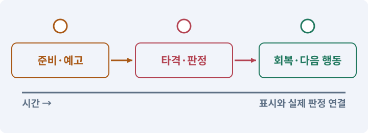

# 091. 보스 예고를 3D 바닥에 맞추기

**목표:** 예고한 바닥과 실제 피해가 일치합니다.

**시작 상태:** 3D 전투와 보스 규칙

## 한눈에 보는 기능의 흐름

바닥 예고 → 3D 범위 → 타격 시점 → 취소·사망 정리



**경계:** 기울어진 화면에서도 안전한 곳을 읽을 수 있게

그림은 실제 게임 실행 결과가 아닙니다. 값·규칙과 예제를 필요한 때 펼쳐 읽고 현재 단계의 메시지를 한 번씩 보냅니다.

## 1. 지금 상태 확인하기

첫 메시지를 보내 현재 준비 상태를 확인합니다. AI가 읽어 온 실제 프로젝트가 맞는지 보고, 없는 준비나 다른 상태가 있으면 먼저 알려 주세요. 아직 기능을 만들지 않는 단계입니다.

### AI에게 보낼 요구와 이유

#### 01. 작업 대상부터 확인

**“보스 예고를 3D 바닥에 맞추기” 작업을 시작하기 전에 현재 상태를 읽기 전용으로 확인해 줘.**

왜 이렇게 요청하나요? AI가 다른 프로젝트나 오래된 예제를 보고 작업할 수 있습니다. 실제 경로·파일·현재 기능을 읽게 하면 지금 이어서 작업할 대상을 먼저 맞출 수 있습니다.

#### 02. 작업 대상부터 확인

**필요한 시작 상태는 3D 전투와 보스 규칙야.**

왜 이렇게 요청하나요? AI가 다른 프로젝트나 오래된 예제를 보고 작업할 수 있습니다. 실제 경로·파일·현재 기능을 읽게 하면 지금 이어서 작업할 대상을 먼저 맞출 수 있습니다.

#### 03. 실제 사용 중인 구현 재사용

**실제 프로젝트와 작업 기록을 읽고 이것이 준비되어 있는지, 이미 같은 기능이 있는지 확인해 줘.**

왜 이렇게 요청하나요? 이름이 비슷한 새 클래스를 또 만들면 기존 화면은 여전히 옛 코드를 사용할 수 있습니다. 실제 호출되는 진입점을 찾아 연결해야 두 구현이 충돌하거나 수정이 반영되지 않는 문제를 막습니다.

#### 04. 현재 상태와 다음 확인 지점 구분

**이번 기능이 연결될 실제 파일·화면·도구와 보존할 기존 동작을 짧게 정리해 줘.**

왜 이렇게 요청하나요? 이미 준비된 기능과 아직 확인하지 못한 기능을 섞으면 불필요한 재설치나 성급한 완료 판정이 생깁니다. 현재 대상과 남은 준비를 나눠 가장 작은 다음 작업을 선택하게 합니다.

#### 05. 조사 단계에서 변경하지 않기

**아직 새 구현·설치·유료 호출·파일 변경은 하지 마.**

왜 이렇게 요청하나요? 현재 상태를 알아보기만 할 때 파일 변경이나 결제가 시작되면 검토 전의 환경이 바뀝니다. 준비 확인과 실제 구현을 나눠 되돌리기 어려운 작업이 먼저 실행되지 않게 합니다.

#### 06. 막힌 준비를 먼저 해결

**준비가 다르면 부족한 항목과 다음에 필요한 작업을 알려 줘.**

왜 이렇게 요청하나요? 빠진 파일·권한·패키지를 있다고 가정하면 다음 구현이 엉뚱한 대상을 만들게 됩니다. 무엇이 없고 무엇을 먼저 해야 하는지 분리하면 불필요한 재작업을 줄일 수 있습니다.

<details>
<summary>보낼 원문 전체 — 설명은 복사되지 않습니다</summary>

```text
“보스 예고를 3D 바닥에 맞추기” 작업을 시작하기 전에 현재 상태를 읽기 전용으로 확인해 줘.
필요한 시작 상태는 3D 전투와 보스 규칙야. 실제 프로젝트와 작업 기록을 읽고 이것이 준비되어 있는지, 이미 같은 기능이 있는지 확인해 줘.
이번 기능이 연결될 실제 파일·화면·도구와 보존할 기존 동작을 짧게 정리해 줘. 아직 새 구현·설치·유료 호출·파일 변경은 하지 마. 준비가 다르면 부족한 항목과 다음에 필요한 작업을 알려 줘.
```

</details>

**기대 결과:** 기존 패턴과 3D 표시의 비교

### 직접 확인하기

1. AI가 읽은 실제 프로젝트 또는 도구 경로를 확인합니다.
2. 필수 준비가 없다면 문제 해결 요청을 보내고, 준비됐을 때 다음으로 갑니다.

## 2. 필요한 기능 만들기

준비가 확인되면 아래 요청을 보냅니다. AI가 파일·설정·실행을 맡습니다. 변경 범위나 비용 승인이 나오면 내용을 읽고 결정하세요.

### AI에게 보낼 요구와 이유

#### 01. 작업 대상부터 확인

**현재 프로젝트의 실제 파일과 이미 결정한 규칙을 먼저 확인해 줘.**

왜 이렇게 요청하나요? AI가 다른 프로젝트나 오래된 예제를 보고 작업할 수 있습니다. 실제 경로·파일·현재 기능을 읽게 하면 지금 이어서 작업할 대상을 먼저 맞출 수 있습니다.

#### 02. 실제 사용 중인 코드에 연결

**이름이 다른 기존 구현이 있으면 새로 중복 제작하지 말고 그 구현에 연결해 줘.**

왜 이렇게 요청하나요? 예제와 이름이 다르더라도 현재 씬과 입력에서 호출하는 구현이 작업 대상입니다. 같은 기능을 새로 만들기보다 기존 진입점을 확인해 수정이 실제 게임에 반영되고 중복 실행되지 않게 합니다.

#### 03. 효과를 표현 계층에 연결

**3D 보스와 VFX를 구성해 줘.**

왜 이렇게 요청하나요? 피격·폭발·소멸은 게임 사건을 보여 주는 표현입니다. 효과가 사라지거나 반복 재생돼도 피해·보상 규칙이 달라지지 않도록 사건과 수명주기를 연결합니다.

#### 04. 되돌아갈 원본 남기기

**기존 세 패턴·수치·예고 시간을 보존하고 TelegraphSnapshot을 판정과 표시가 같이 읽게 해 줘.**

왜 이렇게 요청하나요? 새 구현이 실패해도 이전 게임과 저장을 복원할 수 있어야 합니다. 현재 내용을 먼저 조사하고 별도 후보에서 작업하면 실험이 유일한 정상본을 망가뜨리는 일을 피할 수 있습니다.

#### 05. 좌표계 혼동 방지

**지면 위험 표시는 XZ 평면의 실제 반경/각도로 만들고 카메라 정면 원판으로 대체하지 마.**

왜 이렇게 요청하나요? 2D의 XY와 3D의 XZ는 같은 이동 의미라도 축 배치가 다릅니다. 변환 위치를 한 곳으로 모아야 지도·물리·카메라가 서로 다른 축을 높이나 전진 방향으로 해석하지 않습니다.

#### 06. 피할 수 있는 정보와 실제 판정 일치

**강타 위치는 예고 시작 시 고정하고 HP50% 미만에서는 회복 간격만20% 단축해 줘.**

왜 이렇게 요청하나요? 표시한 위험 범위·시점과 실제 피해가 다르면 플레이어는 올바르게 반응해도 손해를 봅니다. 예고·판정·효과가 같은 규칙을 사용하게 해 공격을 학습할 수 있게 합니다.

#### 07. 효과를 표현 계층에 연결

**파티클·소리·카메라는 피해를 발생시키지 않게 하고 풀 재사용 시 이전 흔적을 지워 줘.**

왜 이렇게 요청하나요? 피격·폭발·소멸은 게임 사건을 보여 주는 표현입니다. 효과가 사라지거나 반복 재생돼도 피해·보상 규칙이 달라지지 않도록 사건과 수명주기를 연결합니다.

#### 08. 피할 수 있는 정보와 실제 판정 일치

**Low 설정에서도 예고를 보존하고 실제 경계·회피·사망·재시작을 확인해 줘.**

왜 이렇게 요청하나요? 표시한 위험 범위·시점과 실제 피해가 다르면 플레이어는 올바르게 반응해도 손해를 봅니다. 예고·판정·효과가 같은 규칙을 사용하게 해 공격을 학습할 수 있게 합니다.

#### 09. 아래 항목을 완료 조건으로 사용

**적용할 세부 규칙:**

왜 이렇게 요청하나요? 요구사항의 목록은 AI에게 참고 설명을 주는 것이 아니라 완료를 판단할 기준을 정합니다. 구현 뒤 각 항목을 실제 입력과 결과에 대응시켜 빠진 조건을 찾습니다.

#### 10. 기존 결과를 보호

**보스 HP700·공격20·방어12를 보존한다.**

왜 이렇게 요청하나요? 새 작업이 이미 정상인 기능이나 자산까지 바꾸면 원인을 추적하기 어렵습니다. 유지할 대상을 명시해 변경 전후를 비교하고 원치 않은 영향을 찾습니다.

#### 11. 피할 수 있는 정보와 실제 판정 일치

**전방100도/길이3/예고0.9초, 바닥 강타 반경2.5/예고1.2초, 세 갈래 투사체/예고 1초를 사용한다.**

왜 이렇게 요청하나요? 표시한 위험 범위·시점과 실제 피해가 다르면 플레이어는 올바르게 반응해도 손해를 봅니다. 예고·판정·효과가 같은 규칙을 사용하게 해 공격을 학습할 수 있게 합니다.

#### 12. 피할 수 있는 정보와 실제 판정 일치

**강타 중심은 예고 시작 때의 플레이어 위치를 복사하고 뒤늦게 따라오지 않는다.**

왜 이렇게 요청하나요? 표시한 위험 범위·시점과 실제 피해가 다르면 플레이어는 올바르게 반응해도 손해를 봅니다. 예고·판정·효과가 같은 규칙을 사용하게 해 공격을 학습할 수 있게 합니다.

#### 13. 피할 수 있는 정보와 실제 판정 일치

**TelegraphSnapshot은 공격 ID·논리 위치·방향·크기·시작/실행 시각을 가진다.**

왜 이렇게 요청하나요? 표시한 위험 범위·시점과 실제 피해가 다르면 플레이어는 올바르게 반응해도 손해를 봅니다. 예고·판정·효과가 같은 규칙을 사용하게 해 공격을 학습할 수 있게 합니다.

#### 14. 반복 사용 뒤 자원 회수 확인

**판정 어댑터와 View가 같은 스냅샷을 읽는다.**

왜 이렇게 요청하나요? 한 번 실행했을 때 정상이어도 반복 입장·생성·닫기에서 자원이 계속 남을 수 있습니다. 사용 전후와 반복 후를 비교해 의도한 캐시와 누수·과도한 할당을 구분합니다.

#### 15. 구현할 결과와 조건 고정

**지면 위 약간의 표시 높이는 시각적 겹침 방지일 뿐 피해의 높이 조건이 아니다.**

왜 이렇게 요청하나요? “지면 위 약간의 표시 높이는 시각적 겹침 방지일 뿐 피해의 높이 조건이 아니다”를 명시하면 AI가 무엇을 구현하거나 검사해야 하는지 범위를 좁힐 수 있습니다. 예고한 바닥과 실제 피해가 일치합니다. 이 결과를 확인할 때 이 조건이 실제로 반영됐는지 함께 봅니다.

#### 16. 효과를 표현 계층에 연결

**3D 메시 링, 단순 부채꼴 메시, Particle System을 먼저 사용한다.**

왜 이렇게 요청하나요? 피격·폭발·소멸은 게임 사건을 보여 주는 표현입니다. 효과가 사라지거나 반복 재생돼도 피해·보상 규칙이 달라지지 않도록 사건과 수명주기를 연결합니다.

#### 17. 3D 표시 경로 명시

**선택적으로 데칼을 실험하더라도 현재 URP Renderer 지원과 모바일 비용을 별도로 확인한다.**

왜 이렇게 요청하나요? 프로젝트의 렌더러와 셰이더가 맞아야 모델과 효과가 의도대로 보입니다. 다른 버전의 설정을 그대로 가져오기보다 사용할 렌더 경로를 정해 자산과 조명을 연결합니다.

#### 18. 패키지·패키지 관리자의 적용 조건

**필수 과정에서 특정 고급 효과 패키지를 요구하지 않는다.**

왜 이렇게 요청하나요? 패키지는 입력·타일맵·테스트처럼 특정 기능을 묶어 프로젝트에 추가하는 단위입니다. Unity Package Manager가 설치와 의존 버전을 관리합니다. 이름이 비슷한 제삼자 패키지를 공식 패키지로 오해하지 않습니다. 버전과 출처를 기록합니다.

#### 19. 구현과 실행은 AI에게 맡기기

**코드·설정·파일 생성·실행은 네가 맡고, 필요한 화면과 결과를 보여 줘.**

왜 이렇게 요청하나요? 설명이나 코드 조각만 받으면 실제 파일 생성·연결·실행이 빠질 수 있습니다. AI가 개발 작업까지 수행하고, 사람은 요구·승인·결과 판단을 맡도록 역할을 분명히 합니다.

#### 20. 막힌 준비를 먼저 해결

**수행하지 못한 작업과 필요한 승인·도구 연결은 구분해서 알려 줘.**

왜 이렇게 요청하나요? 빠진 파일·권한·패키지를 있다고 가정하면 다음 구현이 엉뚱한 대상을 만들게 됩니다. 무엇이 없고 무엇을 먼저 해야 하는지 분리하면 불필요한 재작업을 줄일 수 있습니다.

<details>
<summary>보낼 원문 전체 — 설명은 복사되지 않습니다</summary>

```text
현재 프로젝트의 실제 파일과 이미 결정한 규칙을 먼저 확인해 줘. 이름이 다른 기존 구현이 있으면 새로 중복 제작하지 말고 그 구현에 연결해 줘.

3D 보스와 VFX를 구성해 줘.
기존 세 패턴·수치·예고 시간을 보존하고 TelegraphSnapshot을 판정과 표시가 같이 읽게 해 줘.
지면 위험 표시는 XZ 평면의 실제 반경/각도로 만들고 카메라 정면 원판으로 대체하지 마.
강타 위치는 예고 시작 시 고정하고 HP50% 미만에서는 회복 간격만20% 단축해 줘.
파티클·소리·카메라는 피해를 발생시키지 않게 하고 풀 재사용 시 이전 흔적을 지워 줘.
Low 설정에서도 예고를 보존하고 실제 경계·회피·사망·재시작을 확인해 줘.

적용할 세부 규칙:
보스 HP700·공격20·방어12를 보존한다. 전방100도/길이3/예고0.9초, 바닥 강타 반경2.5/예고1.2초, 세 갈래 투사체/예고 1초를 사용한다. 강타 중심은 예고 시작 때의 플레이어 위치를 복사하고 뒤늦게 따라오지 않는다.

TelegraphSnapshot은 공격 ID·논리 위치·방향·크기·시작/실행 시각을 가진다. 판정 어댑터와 View가 같은 스냅샷을 읽는다. 지면 위 약간의 표시 높이는 시각적 겹침 방지일 뿐 피해의 높이 조건이 아니다.

3D 메시 링, 단순 부채꼴 메시, Particle System을 먼저 사용한다. 선택적으로 데칼을 실험하더라도 현재 URP Renderer 지원과 모바일 비용을 별도로 확인한다. 필수 과정에서 특정 고급 효과 패키지를 요구하지 않는다.

코드·설정·파일 생성·실행은 네가 맡고, 필요한 화면과 결과를 보여 줘. 수행하지 못한 작업과 필요한 승인·도구 연결은 구분해서 알려 줘.
```

</details>

**기대 결과:** 확인할 결과: 3D 예고와 피해·취소를 확인함. AI가 이 상태를 확인할 실제 화면과 변경 내용을 준비합니다. 아직 실행하지 못한 부분은 따로 표시합니다.

### 직접 확인하기

1. 제안서만 반환됐다면 “설명으로 끝내지 말고 승인한 범위의 실제 작업을 수행해 줘”라고 보냅니다.
2. 코드나 설정을 직접 고치라는 안내가 나오면 “작성과 실행은 네가 맡아 줘”라고 요청합니다.

## 3. 결과를 직접 확인하기

먼저 확인 요청을 보내 AI가 검사와 화면을 준비하게 하세요. 그다음 아래 동작을 하나씩 확인합니다.

### AI에게 보낼 요구와 이유

#### 01. 검사할 입력과 관찰 지점 준비

**방금 구현한 기능의 자동 검사와 확인 화면을 준비해 줘.**

왜 이렇게 요청하나요? 정상 예 하나만 보면 실패 조건을 놓치기 쉽습니다. 정상·경계·반례를 실제 입력으로 준비하고 사람이 볼 화면도 맞춰 확인 범위를 분명하게 합니다.

#### 02. 결과를 재확인할 근거 남기기

**정상 동작과 아래 실패 조건을 실제로 검사하고 대상·실행 수·결과를 보여 줘.**

왜 이렇게 요청하나요? “잘 됩니다”라는 요약만으로는 어떤 입력과 버전을 검사했는지 알 수 없습니다. 대상·실행 수·실패 내용·파일을 함께 남겨 같은 조건으로 다시 확인할 수 있게 합니다.

#### 03. 피할 수 있는 정보와 실제 판정 일치

**보이는 위험 범위와 실제 맞는 영역이 일치한다.**

왜 이렇게 요청하나요? 표시한 위험 범위·시점과 실제 피해가 다르면 플레이어는 올바르게 반응해도 손해를 봅니다. 예고·판정·효과가 같은 규칙을 사용하게 해 공격을 학습할 수 있게 합니다.

#### 04. 한 공격의 피해 중복 방지

**같은 공격 ID가 한 번만 실행된다.**

왜 이렇게 요청하나요? 한 적에 여러 피격 영역이 있거나 여러 프레임에서 겹치면 같은 공격이 반복 적용될 수 있습니다. 공격과 대상을 식별해 허용한 타격 횟수만 처리합니다.

#### 05. 피할 수 있는 정보와 실제 판정 일치

**패턴 변경은 예고 시간을 훼손하지 않는다.**

왜 이렇게 요청하나요? 표시한 위험 범위·시점과 실제 피해가 다르면 플레이어는 올바르게 반응해도 손해를 봅니다. 예고·판정·효과가 같은 규칙을 사용하게 해 공격을 학습할 수 있게 합니다.

#### 06. 구현할 결과와 조건 고정

**풀 재사용에서 이전 Trail·색·타이머가 남지 않는다.**

왜 이렇게 요청하나요? “풀 재사용에서 이전 Trail·색·타이머가 남지 않는다”를 명시하면 AI가 무엇을 구현하거나 검사해야 하는지 범위를 좁힐 수 있습니다. 예고한 바닥과 실제 피해가 일치합니다. 이 결과를 확인할 때 이 조건이 실제로 반영됐는지 함께 봅니다.

#### 07. 사람 검사의 시작점 준비

**내가 조작해야 하는 부분은 실행할 화면과 시작 상태를 준비해 줘.**

왜 이렇게 요청하나요? 같은 기능이라도 시작 상태가 다르면 관찰 결과가 달라집니다. AI가 실행 화면과 재현 위치를 먼저 준비해야 사람이 이동·공격·소리·조작감을 같은 조건에서 확인할 수 있습니다.

#### 08. 사람이 실제로 본 것만 기록

**연결되지 않은 휴대폰의 터치나 사람이 보지 않은 재미·소리 품질을 대신 확인했다고 하지 마.**

왜 이렇게 요청하나요? AI가 준비한 검사와 사람이 직접 플레이하거나 들은 결과는 다른 근거입니다. 관찰하지 않은 조작감·소리·실기기 결과를 임의로 완료 처리하지 않게 합니다.

#### 09. 실제로 실행한 검사만 인정

**테스트 0개와 예전 소스 결과는 현재 성공으로 쓰지 마.**

왜 이렇게 요청하나요? 실행된 검사가 없거나 같은 결과를 중복 집계한 경우는 기능을 확인한 것이 아닙니다. 실행 수와 개별 결과를 함께 확인해야 형식적인 성공 표시를 걸러낼 수 있습니다.

<details>
<summary>보낼 원문 전체 — 설명은 복사되지 않습니다</summary>

```text
방금 구현한 기능의 자동 검사와 확인 화면을 준비해 줘. 정상 동작과 아래 실패 조건을 실제로 검사하고 대상·실행 수·결과를 보여 줘.

보이는 위험 범위와 실제 맞는 영역이 일치한다. 같은 공격 ID가 한 번만 실행된다. 패턴 변경은 예고 시간을 훼손하지 않는다. 풀 재사용에서 이전 Trail·색·타이머가 남지 않는다.

내가 조작해야 하는 부분은 실행할 화면과 시작 상태를 준비해 줘. 연결되지 않은 휴대폰의 터치나 사람이 보지 않은 재미·소리 품질을 대신 확인했다고 하지 마. 테스트 0개와 예전 소스 결과는 현재 성공으로 쓰지 마.
```

</details>

**기대 결과:** 3D 예고와 피해·취소를 확인함

### 직접 확인하기

1. 예고 경계 바로 안팎으로 움직입니다.
2. 패턴 도중 보스가 죽을 때 효과가 정리되는지 봅니다.
3. 낮은 효과 설정에서도 피할 수 있는지 봅니다.

## 4. 결과를 남기고 마무리하기

실제로 본 결과를 아래 메모에 적고 AI에 전달합니다. 결과 저장 요청으로 현재 상태를 남긴 뒤 다음 페이지로 갑니다.

### AI에게 보낼 요구와 이유

#### 01. 결과를 재확인할 근거 남기기

**지금 작업한 “보스 예고를 3D 바닥에 맞추기”의 실제 결과를 정리해 줘.**

왜 이렇게 요청하나요? “잘 됩니다”라는 요약만으로는 어떤 입력과 버전을 검사했는지 알 수 없습니다. 대상·실행 수·실패 내용·파일을 함께 남겨 같은 조건으로 다시 확인할 수 있게 합니다.

#### 02. 다음 작업이 읽을 인수인계

**변경한 기능·파일·현재 후보와 실제 실행한 검사, 남은 문제를 기능 이름으로 기록해 줘.**

왜 이렇게 요청하나요? 새 AI 세션은 이전 대화 전체를 알고 있다고 보장할 수 없습니다. 현재 후보·파일 위치·실행한 검사·남은 일을 남겨야 같은 작업을 반복하지 않고 이어갈 수 있습니다.

#### 03. 사람이 실제로 본 것만 기록

**자동 검사 결과와 내가 직접 확인한 결과를 구분하고, 내 관찰이 아직 없으면 미확인으로 남겨 줘.**

왜 이렇게 요청하나요? AI가 준비한 검사와 사람이 직접 플레이하거나 들은 결과는 다른 근거입니다. 관찰하지 않은 조작감·소리·실기기 결과를 임의로 완료 처리하지 않게 합니다.

#### 04. 다음 작업이 읽을 인수인계

**재시작하거나 다음 작업에서 읽을 기록의 실제 위치를 알려 줘.**

왜 이렇게 요청하나요? 새 AI 세션은 이전 대화 전체를 알고 있다고 보장할 수 없습니다. 현재 후보·파일 위치·실행한 검사·남은 일을 남겨야 같은 작업을 반복하지 않고 이어갈 수 있습니다.

#### 05. 미확인을 완료와 분리

**아직 확인하지 않은 결과를 완료로 채우지 마.**

왜 이렇게 요청하나요? 만들어진 것, 검사에 실패한 것, 아직 확인하지 못한 것을 나눠야 다음 작업을 정확히 고를 수 있습니다. 실행할 조건이 없는 기능을 성공으로 기록하면 뒤에서 원인을 찾기 어려워집니다.

<details>
<summary>보낼 원문 전체 — 설명은 복사되지 않습니다</summary>

```text
지금 작업한 “보스 예고를 3D 바닥에 맞추기”의 실제 결과를 정리해 줘. 변경한 기능·파일·현재 후보와 실제 실행한 검사, 남은 문제를 기능 이름으로 기록해 줘.
자동 검사 결과와 내가 직접 확인한 결과를 구분하고, 내 관찰이 아직 없으면 미확인으로 남겨 줘. 재시작하거나 다음 작업에서 읽을 기록의 실제 위치를 알려 줘. 아직 확인하지 않은 결과를 완료로 채우지 마.
```

</details>

**기대 결과:** 현재 상태·검사 결과·남은 문제·다음에 읽을 기록을 확인할 수 있습니다.

### 직접 확인하기

1. 자동 검사와 내 관찰 결과가 섞이지 않았는지 봅니다.
2. 문제가 남았다면 해결 요청을 보내고 같은 동작을 다시 확인합니다.

## 이 작업에서 사용할 값과 규칙 전체

설계 시작값이며 측정된 성능·게임 성공 결과가 아닙니다. 구현은 AI가 수행합니다.

보스 HP700·공격20·방어12를 보존한다. 전방100도/길이3/예고0.9초, 바닥 강타 반경2.5/예고1.2초, 세 갈래 투사체/예고 1초를 사용한다. 강타 중심은 예고 시작 때의 플레이어 위치를 복사하고 뒤늦게 따라오지 않는다.

TelegraphSnapshot은 공격 ID·논리 위치·방향·크기·시작/실행 시각을 가진다. 판정 어댑터와 View가 같은 스냅샷을 읽는다. 지면 위 약간의 표시 높이는 시각적 겹침 방지일 뿐 피해의 높이 조건이 아니다.

3D 메시 링, 단순 부채꼴 메시, Particle System을 먼저 사용한다. 선택적으로 데칼을 실험하더라도 현재 URP Renderer 지원과 모바일 비용을 별도로 확인한다. 필수 과정에서 특정 고급 효과 패키지를 요구하지 않는다.

## 문제가 있으면

### AI에게 보낼 요구와 이유

#### 01. 공격의 거리·시간을 명시

**바닥 데칼 크기와 실제 공격 반경이 다른지 확인해 줘.**

왜 이렇게 요청하나요? 그림이 닿아 보이는 순간과 실제 판정 시간은 다를 수 있습니다. 사거리·각도·공격 간격·타격 시점을 고정하면 회피 가능한 구간과 실제 피해 결과를 같은 조건으로 검사할 수 있습니다.

#### 02. 구현할 결과와 조건 고정

**효과가 끝났는데 피해 예약이 남지 않게 해 줘.**

왜 이렇게 요청하나요? “효과가 끝났는데 피해 예약이 남지 않게 해 줘”를 명시하면 AI가 무엇을 구현하거나 검사해야 하는지 범위를 좁힐 수 있습니다. 예고한 바닥과 실제 피해가 일치합니다. 이 결과를 확인할 때 이 조건이 실제로 반영됐는지 함께 봅니다.

#### 03. 원인 하나를 좁혀 수정

**새 기능을 추가하지 말고 현재 오류와 실제 로그를 먼저 읽어 줘.**

왜 이렇게 요청하나요? 오류 수정 중 새 기능까지 넣으면 어떤 변경이 문제를 해결하거나 악화했는지 알기 어렵습니다. 원래 재현을 보존하고 작은 변경 뒤 같은 입력과 주변 정상 동작을 다시 확인합니다.

#### 04. 원인 하나를 좁혀 수정

**최소 수정 뒤 같은 재현과 관련 정상 동작을 다시 검사해 줘.**

왜 이렇게 요청하나요? 오류 수정 중 새 기능까지 넣으면 어떤 변경이 문제를 해결하거나 악화했는지 알기 어렵습니다. 원래 재현을 보존하고 작은 변경 뒤 같은 입력과 주변 정상 동작을 다시 확인합니다.

#### 05. 실패도 재현 자료로 보존

**실패 기록은 지우지 마.**

왜 이렇게 요청하나요? 실패한 입력과 로그가 있어야 같은 문제가 다시 생겼을 때 비교할 수 있습니다. 성공 기록으로 덮어쓰지 않고 전후 자료를 남기면 무엇을 고쳤는지 확인할 수 있습니다.

<details>
<summary>보낼 원문 전체 — 설명은 복사되지 않습니다</summary>

```text
바닥 데칼 크기와 실제 공격 반경이 다른지 확인해 줘. 효과가 끝났는데 피해 예약이 남지 않게 해 줘.
새 기능을 추가하지 말고 현재 오류와 실제 로그를 먼저 읽어 줘. 최소 수정 뒤 같은 재현과 관련 정상 동작을 다시 검사해 줘. 실패 기록은 지우지 마.
```

</details>

## 새 세션에서 이어가기

### AI에게 보낼 요구와 이유

#### 01. 이어서 할 작업 식별

**“보스 예고를 3D 바닥에 맞추기” 작업을 이어가고 싶어.**

왜 이렇게 요청하나요? 이름으로 재개할 작업을 찾고, 뒤에 이어지는 요청으로 실제 파일·진행 중 작업·기록을 다시 읽게 합니다. 제목만 보고 이전 상태를 기억한다고 가정하지 않습니다.

#### 02. 조회는 상태를 바꾸지 않게

**실제 프로젝트와 내 도구의 작업 기록을 읽고 어디까지 구현·검사됐는지 확인해 줘.**

왜 이렇게 요청하나요? 진행 상황을 물을 때 새 구현이나 유료 호출이 시작되면 단순 확인이 실행 명령이 되어 버립니다. 저장된 근거를 읽어 완료·진행·승인 대기·미검증을 나누게 합니다.

#### 03. 재개 전 중복 작업 방지

**진행 중인 프로세스·승인·미저장 변경을 확인한 뒤 남은 가장 작은 작업부터 안내해 줘.**

왜 이렇게 요청하나요? 대화가 끊겨도 외부 작업은 끝났거나 아직 실행 중일 수 있습니다. 프로세스·승인·미저장 상태를 먼저 읽어 같은 생성·빌드·결제를 두 번 시작하지 않도록 합니다.

#### 04. 되돌아갈 원본 남기기

**기존 성공과 실패 기록은 보존해 줘.**

왜 이렇게 요청하나요? 새 구현이 실패해도 이전 게임과 저장을 복원할 수 있어야 합니다. 현재 내용을 먼저 조사하고 별도 후보에서 작업하면 실험이 유일한 정상본을 망가뜨리는 일을 피할 수 있습니다.

<details>
<summary>보낼 원문 전체 — 설명은 복사되지 않습니다</summary>

```text
“보스 예고를 3D 바닥에 맞추기” 작업을 이어가고 싶어. 실제 프로젝트와 내 도구의 작업 기록을 읽고 어디까지 구현·검사됐는지 확인해 줘. 진행 중인 프로세스·승인·미저장 변경을 확인한 뒤 남은 가장 작은 작업부터 안내해 줘. 기존 성공과 실패 기록은 보존해 줘.
```

</details>

## 왜 이렇게 만드는가

3D 카메라에서는 지면의 원이 화면상 타원으로 보인다. 이것을 예쁘게 보이도록 카메라 정면의 원판으로 바꾸면 실제 피해 범위와 어긋날 수 있다. 바닥 예고는 지면 XZ에 놓고, 판정과 같은 위치·방향·반경을 사용한다.

효과는 공격의 뜻을 전달하는 표현이다. 공격 예고, 타격 순간, 회복 상태의 구분을 유지하고, 낮은 그래픽 설정에서도 위험 표시는 삭제하지 않는다. 화려한 파티클은 선택이고 정확한 예고는 필수다.

## 공식 참고

