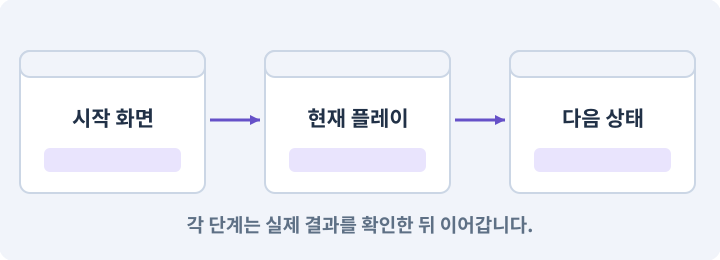

# 093. 3D 마을과 퀘스트 연결하기

**목표:** 마을에서 준비하고 던전·보상으로 이어집니다.

**시작 상태:** 3D 전투·장비·진행 규칙

## 한눈에 보는 기능의 흐름

3D 마을 → NPC·거래 → 던전 입장 → 퀘스트 보상



**경계:** 씬을 오가도 서비스와 플레이어는 하나

그림은 실제 게임 실행 결과가 아닙니다. 값·규칙과 예제를 필요한 때 펼쳐 읽고 현재 단계의 메시지를 한 번씩 보냅니다.

## 1. 지금 상태 확인하기

첫 메시지를 보내 현재 준비 상태를 확인합니다. AI가 읽어 온 실제 프로젝트가 맞는지 보고, 없는 준비나 다른 상태가 있으면 먼저 알려 주세요. 아직 기능을 만들지 않는 단계입니다.

### AI에게 보낼 요구와 이유

#### 01. 작업 대상부터 확인

**“3D 마을과 퀘스트 연결하기” 작업을 시작하기 전에 현재 상태를 읽기 전용으로 확인해 줘.**

왜 이렇게 요청하나요? AI가 다른 프로젝트나 오래된 예제를 보고 작업할 수 있습니다. 실제 경로·파일·현재 기능을 읽게 하면 지금 이어서 작업할 대상을 먼저 맞출 수 있습니다.

#### 02. 작업 대상부터 확인

**필요한 시작 상태는 3D 전투·장비·진행 규칙야.**

왜 이렇게 요청하나요? AI가 다른 프로젝트나 오래된 예제를 보고 작업할 수 있습니다. 실제 경로·파일·현재 기능을 읽게 하면 지금 이어서 작업할 대상을 먼저 맞출 수 있습니다.

#### 03. 실제 사용 중인 구현 재사용

**실제 프로젝트와 작업 기록을 읽고 이것이 준비되어 있는지, 이미 같은 기능이 있는지 확인해 줘.**

왜 이렇게 요청하나요? 이름이 비슷한 새 클래스를 또 만들면 기존 화면은 여전히 옛 코드를 사용할 수 있습니다. 실제 호출되는 진입점을 찾아 연결해야 두 구현이 충돌하거나 수정이 반영되지 않는 문제를 막습니다.

#### 04. 현재 상태와 다음 확인 지점 구분

**이번 기능이 연결될 실제 파일·화면·도구와 보존할 기존 동작을 짧게 정리해 줘.**

왜 이렇게 요청하나요? 이미 준비된 기능과 아직 확인하지 못한 기능을 섞으면 불필요한 재설치나 성급한 완료 판정이 생깁니다. 현재 대상과 남은 준비를 나눠 가장 작은 다음 작업을 선택하게 합니다.

#### 05. 조사 단계에서 변경하지 않기

**아직 새 구현·설치·유료 호출·파일 변경은 하지 마.**

왜 이렇게 요청하나요? 현재 상태를 알아보기만 할 때 파일 변경이나 결제가 시작되면 검토 전의 환경이 바뀝니다. 준비 확인과 실제 구현을 나눠 되돌리기 어려운 작업이 먼저 실행되지 않게 합니다.

#### 06. 막힌 준비를 먼저 해결

**준비가 다르면 부족한 항목과 다음에 필요한 작업을 알려 줘.**

왜 이렇게 요청하나요? 빠진 파일·권한·패키지를 있다고 가정하면 다음 구현이 엉뚱한 대상을 만들게 됩니다. 무엇이 없고 무엇을 먼저 해야 하는지 분리하면 불필요한 재작업을 줄일 수 있습니다.

<details>
<summary>보낼 원문 전체 — 설명은 복사되지 않습니다</summary>

```text
“3D 마을과 퀘스트 연결하기” 작업을 시작하기 전에 현재 상태를 읽기 전용으로 확인해 줘.
필요한 시작 상태는 3D 전투·장비·진행 규칙야. 실제 프로젝트와 작업 기록을 읽고 이것이 준비되어 있는지, 이미 같은 기능이 있는지 확인해 줘.
이번 기능이 연결될 실제 파일·화면·도구와 보존할 기존 동작을 짧게 정리해 줘. 아직 새 구현·설치·유료 호출·파일 변경은 하지 마. 준비가 다르면 부족한 항목과 다음에 필요한 작업을 알려 줘.
```

</details>

**기대 결과:** 정상 3D 진입과 상호작용 동선

### 직접 확인하기

1. AI가 읽은 실제 프로젝트 또는 도구 경로를 확인합니다.
2. 필수 준비가 없다면 문제 해결 요청을 보내고, 준비됐을 때 다음으로 갑니다.

## 2. 필요한 기능 만들기

준비가 확인되면 아래 요청을 보냅니다. AI가 파일·설정·실행을 맡습니다. 변경 범위나 비용 승인이 나오면 내용을 읽고 결정하세요.

### AI에게 보낼 요구와 이유

#### 01. 작업 대상부터 확인

**현재 프로젝트의 실제 파일과 이미 결정한 규칙을 먼저 확인해 줘.**

왜 이렇게 요청하나요? AI가 다른 프로젝트나 오래된 예제를 보고 작업할 수 있습니다. 실제 경로·파일·현재 기능을 읽게 하면 지금 이어서 작업할 대상을 먼저 맞출 수 있습니다.

#### 02. 실제 사용 중인 코드에 연결

**이름이 다른 기존 구현이 있으면 새로 중복 제작하지 말고 그 구현에 연결해 줘.**

왜 이렇게 요청하나요? 예제와 이름이 다르더라도 현재 씬과 입력에서 호출하는 구현이 작업 대상입니다. 같은 기능을 새로 만들기보다 기존 진입점을 확인해 수정이 실제 게임에 반영되고 중복 실행되지 않게 합니다.

#### 03. 안내 위치와 실제 목표 연결

**3D 씬의 마을·NPC·포털·퀘스트·미니맵을 연결해 줘.**

왜 이렇게 요청하나요? 텍스트 목표와 지도 표식이 서로 다른 데이터를 쓰면 끝난 목표가 남거나 잘못된 지역을 안내할 수 있습니다. 활성 단계·지역·실제 월드 위치를 기준으로 표식을 구성합니다.

#### 04. 규칙과 화면 구현 분리

**UGUI와 기존 Core 서비스는 재사용하고 AppRoot/EventSystem을 씬마다 중복 생성하지 마.**

왜 이렇게 요청하나요? 피해 계산·아이템 ID 같은 규칙은 재사용할 수 있지만 물리·렌더링·입력 연결은 환경에 맞아야 합니다. 무엇을 유지하고 무엇을 교체하는지 먼저 구분해 불필요한 의존성을 가져오지 않게 합니다.

#### 05. 기존 결과를 보호

**NPC 정의 ID와 퀘스트 보상 상태를 보존하고 논리 거리+3D LOS로 상호작용해 줘.**

왜 이렇게 요청하나요? 새 작업이 이미 정상인 기능이나 자산까지 바꾸면 원인을 추적하기 어렵습니다. 유지할 대상을 명시해 변경 전후를 비교하고 원치 않은 영향을 찾습니다.

#### 06. 좌표계 혼동 방지

**미니맵은 DungeonLayout을 재사용하고 XZ→(u,v) 좌표 변환을 적용해 줘.**

왜 이렇게 요청하나요? 2D의 XY와 3D의 XZ는 같은 이동 의미라도 축 배치가 다릅니다. 변환 위치를 한 곳으로 모아야 지도·물리·카메라가 서로 다른 축을 높이나 전진 방향으로 해석하지 않습니다.

#### 07. 빠른 반응과 허용 행동 구분

**왕복10회, 새 게임/계속하기, 구매/판매, 보상 연타, 저장/재시작을 검사해 줘.**

왜 이렇게 요청하나요? 다음 입력을 받는 것과 현재 공격을 무조건 취소하는 것은 다릅니다. 입력 저장 시간과 취소 가능한 시점을 정해야 조작은 이어지면서 비정상적인 빠른 연타는 막을 수 있습니다.

#### 08. 아래 항목을 완료 조건으로 사용

**적용할 세부 규칙:**

왜 이렇게 요청하나요? 요구사항의 목록은 AI에게 참고 설명을 주는 것이 아니라 완료를 판단할 기준을 정합니다. 구현 뒤 각 항목을 실제 입력과 결과에 대응시켜 빠진 조건을 찾습니다.

#### 09. 시작부터 플레이까지 한 흐름으로 연결

**Boot3D→MainMenu3D→Town3D→Dungeon3D의 흐름을 만든다.**

왜 이렇게 요청하나요? 개발 씬을 직접 여는 것과 사용자가 타이틀에서 시작하는 것은 다른 경로입니다. 초기화·저장 선택·씬 이동·조작권을 연결해야 배포한 게임에서도 같은 기능을 사용할 수 있습니다.

#### 10. 상호작용·NPC·퀘스트의 적용 조건

**마을의 회복·상점·퀘스트 NPC는 기존 정의 ID를 사용한다.**

왜 이렇게 요청하나요? 상호작용은 근처 객체와 대화·문 열기·줍기 등의 행동을 하는 기능입니다. NPC는 플레이어가 아닌 캐릭터, 퀘스트는 목표와 진행·보상 규칙을 가진 작업입니다. NPC의 말풍선을 봤다고 보상 지급이 완료된 것은 아닙니다. 데이터 상태와 저장을 확인합니다.

#### 11. 상호작용·NPC·퀘스트의 적용 조건

**상호작용 거리는 논리 평면에서 계산하고 벽 너머 상호작용은 3D LOS로 차단한다.**

왜 이렇게 요청하나요? 상호작용은 근처 객체와 대화·문 열기·줍기 등의 행동을 하는 기능입니다. NPC는 플레이어가 아닌 캐릭터, 퀘스트는 목표와 진행·보상 규칙을 가진 작업입니다. NPC의 말풍선을 봤다고 보상 지급이 완료된 것은 아닙니다. 데이터 상태와 저장을 확인합니다.

#### 12. 논리 지형과 플레이 가능한 지형 검사

**미니맵은 같은 DungeonLayout의 방/통로 데이터를 그린다.**

왜 이렇게 요청하나요? 방이 보기 좋게 놓였어도 통로가 끊기거나 출구가 막히면 완주할 수 없습니다. 연결성과 스폰·몸체 이동을 검사하고 실패한 생성은 재현 정보와 함께 복구합니다.

#### 13. 카메라·직교·원근의 적용 조건

**별도 고해상도 카메라가 필수는 아니다.**

왜 이렇게 요청하나요? 카메라는 게임 세계를 어떤 위치·방향·범위로 볼지 정합니다. 직교 투영은 거리에 따른 크기 감소가 없고, 원근 투영은 먼 물체가 작아 보이게 합니다. 카메라를 멀리 옮기는 것만으로 직교 화면의 캐릭터 크기가 줄지는 않습니다. 직교 크기를 봅니다.

#### 14. 좌표계 혼동 방지

**플레이어 XZ를 논리 (u,v)로 바꾸어 표시한다.**

왜 이렇게 요청하나요? 2D의 XY와 3D의 XZ는 같은 이동 의미라도 축 배치가 다릅니다. 변환 위치를 한 곳으로 모아야 지도·물리·카메라가 서로 다른 축을 높이나 전진 방향으로 해석하지 않습니다.

#### 15. 사용자가 결과를 이해하게 표시

**NPC 이름표는 WorldToScreenPoint 결과를 사용하며 카메라 뒤의 점을 화면에 표시하지 않는다.**

왜 이렇게 요청하나요? 내부 데이터가 맞아도 화면에 현재 선택과 가능한 행동이 보이지 않으면 기능을 쓰기 어렵습니다. 선택 전후와 사용할 수 없는 상태를 구분해 조작과 실제 결과가 연결되게 합니다.

#### 16. 거래·보상의 전체 성공 보장

**퀘스트 보상은 기존 상태 전이에서 한 번만 지급한다.**

왜 이렇게 요청하나요? 재료 차감과 결과 지급이 따로 성공하면 손해나 복제가 생깁니다. 조건을 먼저 검사하고 한 거래로 반영하며 같은 요청을 다시 받아도 두 번 지급하지 않게 합니다.

#### 17. 이벤트·콜백·구독·이벤트 버스의 적용 조건

**3D 보스의 사망 효과나 씬 로드 완료 이벤트가 보상을 다시 주지 않게 한다.**

왜 이렇게 요청하나요? 이벤트는 어떤 일이 일어났다는 알림입니다. 구독자는 관심 있는 알림을 받아 콜백을 실행합니다. 이벤트 버스는 여러 기능 사이의 알림 전달을 모으는 구조입니다. 모든 것을 전역 이벤트로 만들면 흐름을 추적하기 어려워집니다. 소유권·발행 시점·순서를 명시합니다.

#### 18. 구현과 실행은 AI에게 맡기기

**코드·설정·파일 생성·실행은 네가 맡고, 필요한 화면과 결과를 보여 줘.**

왜 이렇게 요청하나요? 설명이나 코드 조각만 받으면 실제 파일 생성·연결·실행이 빠질 수 있습니다. AI가 개발 작업까지 수행하고, 사람은 요구·승인·결과 판단을 맡도록 역할을 분명히 합니다.

#### 19. 막힌 준비를 먼저 해결

**수행하지 못한 작업과 필요한 승인·도구 연결은 구분해서 알려 줘.**

왜 이렇게 요청하나요? 빠진 파일·권한·패키지를 있다고 가정하면 다음 구현이 엉뚱한 대상을 만들게 됩니다. 무엇이 없고 무엇을 먼저 해야 하는지 분리하면 불필요한 재작업을 줄일 수 있습니다.

<details>
<summary>보낼 원문 전체 — 설명은 복사되지 않습니다</summary>

```text
현재 프로젝트의 실제 파일과 이미 결정한 규칙을 먼저 확인해 줘. 이름이 다른 기존 구현이 있으면 새로 중복 제작하지 말고 그 구현에 연결해 줘.

3D 씬의 마을·NPC·포털·퀘스트·미니맵을 연결해 줘.
UGUI와 기존 Core 서비스는 재사용하고 AppRoot/EventSystem을 씬마다 중복 생성하지 마.
NPC 정의 ID와 퀘스트 보상 상태를 보존하고 논리 거리+3D LOS로 상호작용해 줘.
미니맵은 DungeonLayout을 재사용하고 XZ→(u,v) 좌표 변환을 적용해 줘.
왕복10회, 새 게임/계속하기, 구매/판매, 보상 연타, 저장/재시작을 검사해 줘.

적용할 세부 규칙:
Boot3D→MainMenu3D→Town3D→Dungeon3D의 흐름을 만든다. 마을의 회복·상점·퀘스트 NPC는 기존 정의 ID를 사용한다. 상호작용 거리는 논리 평면에서 계산하고 벽 너머 상호작용은 3D LOS로 차단한다.

미니맵은 같은 DungeonLayout의 방/통로 데이터를 그린다. 별도 고해상도 카메라가 필수는 아니다. 플레이어 XZ를 논리 (u,v)로 바꾸어 표시한다. NPC 이름표는 WorldToScreenPoint 결과를 사용하며 카메라 뒤의 점을 화면에 표시하지 않는다.

퀘스트 보상은 기존 상태 전이에서 한 번만 지급한다. 3D 보스의 사망 효과나 씬 로드 완료 이벤트가 보상을 다시 주지 않게 한다.

코드·설정·파일 생성·실행은 네가 맡고, 필요한 화면과 결과를 보여 줘. 수행하지 못한 작업과 필요한 승인·도구 연결은 구분해서 알려 줘.
```

</details>

**기대 결과:** 확인할 결과: 3D 정상 흐름을 확인함. AI가 이 상태를 확인할 실제 화면과 변경 내용을 준비합니다. 아직 실행하지 못한 부분은 따로 표시합니다.

### 직접 확인하기

1. 제안서만 반환됐다면 “설명으로 끝내지 말고 승인한 범위의 실제 작업을 수행해 줘”라고 보냅니다.
2. 코드나 설정을 직접 고치라는 안내가 나오면 “작성과 실행은 네가 맡아 줘”라고 요청합니다.

## 3. 결과를 직접 확인하기

먼저 확인 요청을 보내 AI가 검사와 화면을 준비하게 하세요. 그다음 아래 동작을 하나씩 확인합니다.

### AI에게 보낼 요구와 이유

#### 01. 검사할 입력과 관찰 지점 준비

**방금 구현한 기능의 자동 검사와 확인 화면을 준비해 줘.**

왜 이렇게 요청하나요? 정상 예 하나만 보면 실패 조건을 놓치기 쉽습니다. 정상·경계·반례를 실제 입력으로 준비하고 사람이 볼 화면도 맞춰 확인 범위를 분명하게 합니다.

#### 02. 결과를 재확인할 근거 남기기

**정상 동작과 아래 실패 조건을 실제로 검사하고 대상·실행 수·결과를 보여 줘.**

왜 이렇게 요청하나요? “잘 됩니다”라는 요약만으로는 어떤 입력과 버전을 검사했는지 알 수 없습니다. 대상·실행 수·실패 내용·파일을 함께 남겨 같은 조건으로 다시 확인할 수 있게 합니다.

#### 03. 상호작용·NPC·퀘스트의 적용 조건

**마을 기능과 퀘스트가 2D와 같은 규칙으로 작동한다.**

왜 이렇게 요청하나요? 상호작용은 근처 객체와 대화·문 열기·줍기 등의 행동을 하는 기능입니다. NPC는 플레이어가 아닌 캐릭터, 퀘스트는 목표와 진행·보상 규칙을 가진 작업입니다. NPC의 말풍선을 봤다고 보상 지급이 완료된 것은 아닙니다. 데이터 상태와 저장을 확인합니다.

#### 04. 같은 요청의 반복 처리 정의

**왕복에서 이벤트가 중복되지 않는다.**

왜 이렇게 요청하나요? 클릭 연타·재연결·중복 이벤트는 개발과 플레이 중 모두 발생할 수 있습니다. 반복돼도 한 번 처리해야 하는 결과와 매번 새로 처리할 결과를 나눠 데이터가 누적되지 않게 합니다.

#### 05. 안내 위치와 실제 목표 연결

**플레이어와 포털이 미니맵의 올바른 위치에 표시된다.**

왜 이렇게 요청하나요? 텍스트 목표와 지도 표식이 서로 다른 데이터를 쓰면 끝난 목표가 남거나 잘못된 지역을 안내할 수 있습니다. 활성 단계·지역·실제 월드 위치를 기준으로 표식을 구성합니다.

#### 06. 사람 검사의 시작점 준비

**내가 조작해야 하는 부분은 실행할 화면과 시작 상태를 준비해 줘.**

왜 이렇게 요청하나요? 같은 기능이라도 시작 상태가 다르면 관찰 결과가 달라집니다. AI가 실행 화면과 재현 위치를 먼저 준비해야 사람이 이동·공격·소리·조작감을 같은 조건에서 확인할 수 있습니다.

#### 07. 사람이 실제로 본 것만 기록

**연결되지 않은 휴대폰의 터치나 사람이 보지 않은 재미·소리 품질을 대신 확인했다고 하지 마.**

왜 이렇게 요청하나요? AI가 준비한 검사와 사람이 직접 플레이하거나 들은 결과는 다른 근거입니다. 관찰하지 않은 조작감·소리·실기기 결과를 임의로 완료 처리하지 않게 합니다.

#### 08. 실제로 실행한 검사만 인정

**테스트 0개와 예전 소스 결과는 현재 성공으로 쓰지 마.**

왜 이렇게 요청하나요? 실행된 검사가 없거나 같은 결과를 중복 집계한 경우는 기능을 확인한 것이 아닙니다. 실행 수와 개별 결과를 함께 확인해야 형식적인 성공 표시를 걸러낼 수 있습니다.

<details>
<summary>보낼 원문 전체 — 설명은 복사되지 않습니다</summary>

```text
방금 구현한 기능의 자동 검사와 확인 화면을 준비해 줘. 정상 동작과 아래 실패 조건을 실제로 검사하고 대상·실행 수·결과를 보여 줘.

마을 기능과 퀘스트가 2D와 같은 규칙으로 작동한다. 왕복에서 이벤트가 중복되지 않는다. 플레이어와 포털이 미니맵의 올바른 위치에 표시된다.

내가 조작해야 하는 부분은 실행할 화면과 시작 상태를 준비해 줘. 연결되지 않은 휴대폰의 터치나 사람이 보지 않은 재미·소리 품질을 대신 확인했다고 하지 마. 테스트 0개와 예전 소스 결과는 현재 성공으로 쓰지 마.
```

</details>

**기대 결과:** 3D 정상 흐름을 확인함

### 직접 확인하기

1. 마을에서 회복하고 물약을 삽니다.
2. 던전에 갔다 돌아와 퀘스트 보상을 받습니다.
3. 씬 전환을 반복해 플레이어·서비스가 중복되지 않는지 봅니다.

## 4. 결과를 남기고 마무리하기

실제로 본 결과를 아래 메모에 적고 AI에 전달합니다. 결과 저장 요청으로 현재 상태를 남긴 뒤 다음 페이지로 갑니다.

### AI에게 보낼 요구와 이유

#### 01. 결과를 재확인할 근거 남기기

**지금 작업한 “3D 마을과 퀘스트 연결하기”의 실제 결과를 정리해 줘.**

왜 이렇게 요청하나요? “잘 됩니다”라는 요약만으로는 어떤 입력과 버전을 검사했는지 알 수 없습니다. 대상·실행 수·실패 내용·파일을 함께 남겨 같은 조건으로 다시 확인할 수 있게 합니다.

#### 02. 다음 작업이 읽을 인수인계

**변경한 기능·파일·현재 후보와 실제 실행한 검사, 남은 문제를 기능 이름으로 기록해 줘.**

왜 이렇게 요청하나요? 새 AI 세션은 이전 대화 전체를 알고 있다고 보장할 수 없습니다. 현재 후보·파일 위치·실행한 검사·남은 일을 남겨야 같은 작업을 반복하지 않고 이어갈 수 있습니다.

#### 03. 사람이 실제로 본 것만 기록

**자동 검사 결과와 내가 직접 확인한 결과를 구분하고, 내 관찰이 아직 없으면 미확인으로 남겨 줘.**

왜 이렇게 요청하나요? AI가 준비한 검사와 사람이 직접 플레이하거나 들은 결과는 다른 근거입니다. 관찰하지 않은 조작감·소리·실기기 결과를 임의로 완료 처리하지 않게 합니다.

#### 04. 다음 작업이 읽을 인수인계

**재시작하거나 다음 작업에서 읽을 기록의 실제 위치를 알려 줘.**

왜 이렇게 요청하나요? 새 AI 세션은 이전 대화 전체를 알고 있다고 보장할 수 없습니다. 현재 후보·파일 위치·실행한 검사·남은 일을 남겨야 같은 작업을 반복하지 않고 이어갈 수 있습니다.

#### 05. 미확인을 완료와 분리

**아직 확인하지 않은 결과를 완료로 채우지 마.**

왜 이렇게 요청하나요? 만들어진 것, 검사에 실패한 것, 아직 확인하지 못한 것을 나눠야 다음 작업을 정확히 고를 수 있습니다. 실행할 조건이 없는 기능을 성공으로 기록하면 뒤에서 원인을 찾기 어려워집니다.

<details>
<summary>보낼 원문 전체 — 설명은 복사되지 않습니다</summary>

```text
지금 작업한 “3D 마을과 퀘스트 연결하기”의 실제 결과를 정리해 줘. 변경한 기능·파일·현재 후보와 실제 실행한 검사, 남은 문제를 기능 이름으로 기록해 줘.
자동 검사 결과와 내가 직접 확인한 결과를 구분하고, 내 관찰이 아직 없으면 미확인으로 남겨 줘. 재시작하거나 다음 작업에서 읽을 기록의 실제 위치를 알려 줘. 아직 확인하지 않은 결과를 완료로 채우지 마.
```

</details>

**기대 결과:** 현재 상태·검사 결과·남은 문제·다음에 읽을 기록을 확인할 수 있습니다.

### 직접 확인하기

1. 자동 검사와 내 관찰 결과가 섞이지 않았는지 봅니다.
2. 문제가 남았다면 해결 요청을 보내고 같은 동작을 다시 확인합니다.

## 이 작업에서 사용할 값과 규칙 전체

설계 시작값이며 측정된 성능·게임 성공 결과가 아닙니다. 구현은 AI가 수행합니다.

Boot3D→MainMenu3D→Town3D→Dungeon3D의 흐름을 만든다. 마을의 회복·상점·퀘스트 NPC는 기존 정의 ID를 사용한다. 상호작용 거리는 논리 평면에서 계산하고 벽 너머 상호작용은 3D LOS로 차단한다.

미니맵은 같은 DungeonLayout의 방/통로 데이터를 그린다. 별도 고해상도 카메라가 필수는 아니다. 플레이어 XZ를 논리 (u,v)로 바꾸어 표시한다. NPC 이름표는 WorldToScreenPoint 결과를 사용하며 카메라 뒤의 점을 화면에 표시하지 않는다.

퀘스트 보상은 기존 상태 전이에서 한 번만 지급한다. 3D 보스의 사망 효과나 씬 로드 완료 이벤트가 보상을 다시 주지 않게 한다.

## 문제가 있으면

### AI에게 보낼 요구와 이유

#### 01. 같은 요청의 반복 처리 정의

**퀘스트를 새 ID 로 복제하지 마.3D 상호작용과 기존 진행 서비스를 연결하고 중복 구독을 확인해 줘.**

왜 이렇게 요청하나요? 클릭 연타·재연결·중복 이벤트는 개발과 플레이 중 모두 발생할 수 있습니다. 반복돼도 한 번 처리해야 하는 결과와 매번 새로 처리할 결과를 나눠 데이터가 누적되지 않게 합니다.

#### 02. 원인 하나를 좁혀 수정

**새 기능을 추가하지 말고 현재 오류와 실제 로그를 먼저 읽어 줘.**

왜 이렇게 요청하나요? 오류 수정 중 새 기능까지 넣으면 어떤 변경이 문제를 해결하거나 악화했는지 알기 어렵습니다. 원래 재현을 보존하고 작은 변경 뒤 같은 입력과 주변 정상 동작을 다시 확인합니다.

#### 03. 원인 하나를 좁혀 수정

**최소 수정 뒤 같은 재현과 관련 정상 동작을 다시 검사해 줘.**

왜 이렇게 요청하나요? 오류 수정 중 새 기능까지 넣으면 어떤 변경이 문제를 해결하거나 악화했는지 알기 어렵습니다. 원래 재현을 보존하고 작은 변경 뒤 같은 입력과 주변 정상 동작을 다시 확인합니다.

#### 04. 실패도 재현 자료로 보존

**실패 기록은 지우지 마.**

왜 이렇게 요청하나요? 실패한 입력과 로그가 있어야 같은 문제가 다시 생겼을 때 비교할 수 있습니다. 성공 기록으로 덮어쓰지 않고 전후 자료를 남기면 무엇을 고쳤는지 확인할 수 있습니다.

<details>
<summary>보낼 원문 전체 — 설명은 복사되지 않습니다</summary>

```text
퀘스트를 새 ID 로 복제하지 마.3D 상호작용과 기존 진행 서비스를 연결하고 중복 구독을 확인해 줘.
새 기능을 추가하지 말고 현재 오류와 실제 로그를 먼저 읽어 줘. 최소 수정 뒤 같은 재현과 관련 정상 동작을 다시 검사해 줘. 실패 기록은 지우지 마.
```

</details>

## 새 세션에서 이어가기

### AI에게 보낼 요구와 이유

#### 01. 이어서 할 작업 식별

**“3D 마을과 퀘스트 연결하기” 작업을 이어가고 싶어.**

왜 이렇게 요청하나요? 이름으로 재개할 작업을 찾고, 뒤에 이어지는 요청으로 실제 파일·진행 중 작업·기록을 다시 읽게 합니다. 제목만 보고 이전 상태를 기억한다고 가정하지 않습니다.

#### 02. 조회는 상태를 바꾸지 않게

**실제 프로젝트와 내 도구의 작업 기록을 읽고 어디까지 구현·검사됐는지 확인해 줘.**

왜 이렇게 요청하나요? 진행 상황을 물을 때 새 구현이나 유료 호출이 시작되면 단순 확인이 실행 명령이 되어 버립니다. 저장된 근거를 읽어 완료·진행·승인 대기·미검증을 나누게 합니다.

#### 03. 재개 전 중복 작업 방지

**진행 중인 프로세스·승인·미저장 변경을 확인한 뒤 남은 가장 작은 작업부터 안내해 줘.**

왜 이렇게 요청하나요? 대화가 끊겨도 외부 작업은 끝났거나 아직 실행 중일 수 있습니다. 프로세스·승인·미저장 상태를 먼저 읽어 같은 생성·빌드·결제를 두 번 시작하지 않도록 합니다.

#### 04. 되돌아갈 원본 남기기

**기존 성공과 실패 기록은 보존해 줘.**

왜 이렇게 요청하나요? 새 구현이 실패해도 이전 게임과 저장을 복원할 수 있어야 합니다. 현재 내용을 먼저 조사하고 별도 후보에서 작업하면 실험이 유일한 정상본을 망가뜨리는 일을 피할 수 있습니다.

<details>
<summary>보낼 원문 전체 — 설명은 복사되지 않습니다</summary>

```text
“3D 마을과 퀘스트 연결하기” 작업을 이어가고 싶어. 실제 프로젝트와 내 도구의 작업 기록을 읽고 어디까지 구현·검사됐는지 확인해 줘. 진행 중인 프로세스·승인·미저장 변경을 확인한 뒤 남은 가장 작은 작업부터 안내해 줘. 기존 성공과 실패 기록은 보존해 줘.
```

</details>

## 왜 이렇게 만드는가

메뉴와 가방, 스킬트리 같은 화면 UI는 3D가 되었다고 다시 만들 필요가 없다. UGUI의 화면 영역은 재사용하고, NPC 위 이름표나 미니맵 플레이어 표시는 3D 좌표를 변환해서 연결한다.

씬이 바뀔 때마다 AppRoot나 저장 서비스를 만들면 골드·퀘스트·입력 이벤트가 중복될 수 있다. Boot에서 만든 수명 관리 구조를 유지하고 장면별 시각 오브젝트만 바꾼다.

## 공식 참고

