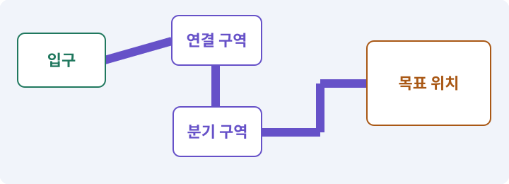

# 094. 같은 랜덤 던전을 3D로 생성하기

**목표:** 같은 시드의 방과 통로를 3D로 걷습니다.

**시작 상태:** 공유 Layout와 3D 모듈

## 한눈에 보는 기능의 흐름

같은 시드 → 공통 방·통로 → 3D 메시·NavMesh → 실제 완주 검사



**경계:** 논리 맵이 같아도 몸체 통과는 다시 확인

그림은 실제 게임 실행 결과가 아닙니다. 값·규칙과 예제를 필요한 때 펼쳐 읽고 현재 단계의 메시지를 한 번씩 보냅니다.

## 1. 지금 상태 확인하기

첫 메시지를 보내 현재 준비 상태를 확인합니다. AI가 읽어 온 실제 프로젝트가 맞는지 보고, 없는 준비나 다른 상태가 있으면 먼저 알려 주세요. 아직 기능을 만들지 않는 단계입니다.

### AI에게 보낼 요구와 이유

#### 01. 작업 대상부터 확인

**“같은 랜덤 던전을 3D로 생성하기” 작업을 시작하기 전에 현재 상태를 읽기 전용으로 확인해 줘.**

왜 이렇게 요청하나요? AI가 다른 프로젝트나 오래된 예제를 보고 작업할 수 있습니다. 실제 경로·파일·현재 기능을 읽게 하면 지금 이어서 작업할 대상을 먼저 맞출 수 있습니다.

#### 02. 작업 대상부터 확인

**필요한 시작 상태는 공유 Layout와 3D 모듈야.**

왜 이렇게 요청하나요? AI가 다른 프로젝트나 오래된 예제를 보고 작업할 수 있습니다. 실제 경로·파일·현재 기능을 읽게 하면 지금 이어서 작업할 대상을 먼저 맞출 수 있습니다.

#### 03. 실제 사용 중인 구현 재사용

**실제 프로젝트와 작업 기록을 읽고 이것이 준비되어 있는지, 이미 같은 기능이 있는지 확인해 줘.**

왜 이렇게 요청하나요? 이름이 비슷한 새 클래스를 또 만들면 기존 화면은 여전히 옛 코드를 사용할 수 있습니다. 실제 호출되는 진입점을 찾아 연결해야 두 구현이 충돌하거나 수정이 반영되지 않는 문제를 막습니다.

#### 04. 현재 상태와 다음 확인 지점 구분

**이번 기능이 연결될 실제 파일·화면·도구와 보존할 기존 동작을 짧게 정리해 줘.**

왜 이렇게 요청하나요? 이미 준비된 기능과 아직 확인하지 못한 기능을 섞으면 불필요한 재설치나 성급한 완료 판정이 생깁니다. 현재 대상과 남은 준비를 나눠 가장 작은 다음 작업을 선택하게 합니다.

#### 05. 조사 단계에서 변경하지 않기

**아직 새 구현·설치·유료 호출·파일 변경은 하지 마.**

왜 이렇게 요청하나요? 현재 상태를 알아보기만 할 때 파일 변경이나 결제가 시작되면 검토 전의 환경이 바뀝니다. 준비 확인과 실제 구현을 나눠 되돌리기 어려운 작업이 먼저 실행되지 않게 합니다.

#### 06. 막힌 준비를 먼저 해결

**준비가 다르면 부족한 항목과 다음에 필요한 작업을 알려 줘.**

왜 이렇게 요청하나요? 빠진 파일·권한·패키지를 있다고 가정하면 다음 구현이 엉뚱한 대상을 만들게 됩니다. 무엇이 없고 무엇을 먼저 해야 하는지 분리하면 불필요한 재작업을 줄일 수 있습니다.

<details>
<summary>보낼 원문 전체 — 설명은 복사되지 않습니다</summary>

```text
“같은 랜덤 던전을 3D로 생성하기” 작업을 시작하기 전에 현재 상태를 읽기 전용으로 확인해 줘.
필요한 시작 상태는 공유 Layout와 3D 모듈야. 실제 프로젝트와 작업 기록을 읽고 이것이 준비되어 있는지, 이미 같은 기능이 있는지 확인해 줘.
이번 기능이 연결될 실제 파일·화면·도구와 보존할 기존 동작을 짧게 정리해 줘. 아직 새 구현·설치·유료 호출·파일 변경은 하지 마. 준비가 다르면 부족한 항목과 다음에 필요한 작업을 알려 줘.
```

</details>

**기대 결과:** 같은 논리 지도와 플랫폼별 준비 상태

### 직접 확인하기

1. AI가 읽은 실제 프로젝트 또는 도구 경로를 확인합니다.
2. 필수 준비가 없다면 문제 해결 요청을 보내고, 준비됐을 때 다음으로 갑니다.

## 2. 필요한 기능 만들기

준비가 확인되면 아래 요청을 보냅니다. AI가 파일·설정·실행을 맡습니다. 변경 범위나 비용 승인이 나오면 내용을 읽고 결정하세요.

### AI에게 보낼 요구와 이유

#### 01. 작업 대상부터 확인

**현재 프로젝트의 실제 파일과 이미 결정한 규칙을 먼저 확인해 줘.**

왜 이렇게 요청하나요? AI가 다른 프로젝트나 오래된 예제를 보고 작업할 수 있습니다. 실제 경로·파일·현재 기능을 읽게 하면 지금 이어서 작업할 대상을 먼저 맞출 수 있습니다.

#### 02. 실제 사용 중인 코드에 연결

**이름이 다른 기존 구현이 있으면 새로 중복 제작하지 말고 그 구현에 연결해 줘.**

왜 이렇게 요청하나요? 예제와 이름이 다르더라도 현재 씬과 입력에서 호출하는 구현이 작업 대상입니다. 같은 기능을 새로 만들기보다 기존 진입점을 확인해 수정이 실제 게임에 반영되고 중복 실행되지 않게 합니다.

#### 03. Play 모드·편집 모드·런타임의 적용 조건

**런타임 3D 던전 생성 파이프라인을 구현해 줘.**

왜 이렇게 요청하나요? 편집 모드는 제작 상태이고 Play 모드는 게임 로직을 실행해 보는 상태입니다. 런타임은 게임이 실제로 실행되는 시간과 환경을 뜻합니다. Play에서 보인 상태만 보고 저장·재개방까지 통과했다고 기록하지 않습니다.

#### 04. 무작위 결과를 재현 가능하게

**기존 generatorVersion/시드/설정/난수 스트림과 DungeonLayout을 변경하지 마.**

왜 이렇게 요청하나요? 실패한 맵이나 전리품 결과를 다시 만들 수 있어야 원인을 고칠 수 있습니다. 생성 버전·설정·시드를 함께 기록하고 지형·장식·보상 난수를 분리해 작은 변경의 파급을 줄입니다.

#### 05. 같은 Layout을 바닥과 벽으로 구분

**walkable 셀은 메시 바닥으로, 차단 셀과 그 경계는 벽 Collider로 만들어 줘.**

왜 이렇게 요청하나요? 통행 가능 셀과 차단 셀은 반대 역할입니다. 같은 원본 Layout에서 각각 바닥과 벽을 만들되, 통행 가능한 셀에 벽을 설치해 길을 막지 않도록 구분합니다.

#### 06. 길찾기와 실제 도달을 구분

**물리와 NavMesh 준비 및 실제 경로 검사 후에만 플레이어/적을 활성화해 줘.**

왜 이렇게 요청하나요? 목적지 표시나 경로 목록이 있다고 캐릭터가 끝까지 갈 수 있는 것은 아닙니다. 이동 가능한 경로와 실제 몸체의 진행을 확인하고 막힌 지점을 성공으로 표시하지 않게 합니다.

#### 07. 늦게 온 결과가 최신 작업을 덮지 않기

**generationId로 취소/늦은 완료를 구분하고 자신이 소유한 자원만 정리해 줘.**

왜 이렇게 요청하나요? AI 생성이나 다운로드가 진행되는 동안 원본과 선택이 바뀔 수 있습니다. 요청 ID·기준 버전·취소 상태를 대조해야 이전 결과가 최신 편집을 덮어쓰지 않습니다.

#### 08. 무작위 결과를 재현 가능하게

**논리100시드와 실제 3D10시드를 구분하고 실패 복구를 생성 성공으로 기록하지 마.**

왜 이렇게 요청하나요? 실패한 맵이나 전리품 결과를 다시 만들 수 있어야 원인을 고칠 수 있습니다. 생성 버전·설정·시드를 함께 기록하고 지형·장식·보상 난수를 분리해 작은 변경의 파급을 줄입니다.

#### 09. 관찰 가능한 기준으로 확인

**2D와 같은 논리 Layout 해시 및 보스/보물 접근을 검사해 줘.**

왜 이렇게 요청하나요? 구현 완료라는 설명을 실제 결과로 바꾸기 위한 조건입니다. 요청에 나온 대상과 경계 상황을 확인해 정상 결과뿐 아니라 실패를 어떻게 구분했는지도 남깁니다.

#### 10. 아래 항목을 완료 조건으로 사용

**적용할 세부 규칙:**

왜 이렇게 요청하나요? 요구사항의 목록은 AI에게 참고 설명을 주는 것이 아니라 완료를 판단할 기준을 정합니다. 구현 뒤 각 항목을 실제 입력과 결과에 대응시켜 빠진 조건을 찾습니다.

#### 11. 길찾기와 실제 도달을 구분

**생성 순서는 Layout→Mesh/Collider→물리 반영→NavMesh→실제 도달 검사→적/보상 배치→입장이다.**

왜 이렇게 요청하나요? 목적지 표시나 경로 목록이 있다고 캐릭터가 끝까지 갈 수 있는 것은 아닙니다. 이동 가능한 경로와 실제 몸체의 진행을 확인하고 막힌 지점을 성공으로 표시하지 않게 합니다.

#### 12. 구현할 결과와 조건 고정

**전체 맵을 덮는 Plane을 바닥으로 사용하지 않는다.**

왜 이렇게 요청하나요? “전체 맵을 덮는 Plane을 바닥으로 사용하지 않는다”를 명시하면 AI가 무엇을 구현하거나 검사해야 하는지 범위를 좁힐 수 있습니다. 같은 시드의 방과 통로를 3D로 걷습니다. 이 결과를 확인할 때 이 조건이 실제로 반영됐는지 함께 봅니다.

#### 13. 통로 안에는 벽을 세우지 않기

**지면은 걸을 수 있는 셀에만 만들고, 벽은 차단 셀 또는 지도 외곽에 맞닿은 변에 세우되 통행 가능한 이웃 셀 사이에는 세우지 않는다.**

왜 이렇게 요청하나요? 격자가 연결되어 있어도 셀마다 네 면에 벽을 세우면 실제 캐릭터는 움직이지 못합니다. 지형 데이터의 차단 경계에만 벽을 만들고, 서로 연결된 바닥 셀의 공통 변은 열어 둡니다.

#### 14. 요청 ID·세대 ID·오래된 응답의 적용 조건

**생성 작업마다 generationId와 소유 Root를 가진다.**

왜 이렇게 요청하나요? 비동기 요청에 식별자를 붙여 어느 요청의 결과인지 확인하는 방법입니다. 취소·새 지도 생성·새 클릭 이후 늦게 온 응답이 현재 상태를 덮어쓰지 않게 합니다. 취소 토큰만 전달했다고 모든 외부 작업이 즉시 중단됐다고 보장하지 않습니다.

#### 15. 취소한 화면에 늦은 결과를 붙이지 않기

**취소 후 늦게 끝난 NavMesh/로드 결과는 최신 던전을 덮어쓰지 않고 자신의 자원을 해제한다.**

왜 이렇게 요청하나요? 비동기 요청을 취소해도 이미 진행 중인 완료 응답이 도착할 수 있습니다. 현재 요청과 화면의 수명을 검사해 사용하지 않을 자산을 연결하지 않고 정리하게 합니다.

#### 16. 구현할 결과와 조건 고정

**기존 지형을 지우기 전에 새 지형이 준비되는지, 동시에 두 맵이 충돌하지 않는지 정책을 명시한다.**

왜 이렇게 요청하나요? “기존 지형을 지우기 전에 새 지형이 준비되는지, 동시에 두 맵이 충돌하지 않는지 정책을 명시한다”를 명시하면 AI가 무엇을 구현하거나 검사해야 하는지 범위를 좁힐 수 있습니다. 같은 시드의 방과 통로를 3D로 걷습니다. 이 결과를 확인할 때 이 조건이 실제로 반영됐는지 함께 봅니다.

#### 17. 무작위 결과를 재현 가능하게

**논리100시드 검사와 대표10시드의 실제 3D 지형·경로 검사를 나눈다.**

왜 이렇게 요청하나요? 실패한 맵이나 전리품 결과를 다시 만들 수 있어야 원인을 고칠 수 있습니다. 생성 버전·설정·시드를 함께 기록하고 지형·장식·보상 난수를 분리해 작은 변경의 파급을 줄입니다.

#### 18. 실패의 시간·비용 상한 두기

**실패 시 제한된 재시도 뒤 기존 고정 던전으로 복구한다.**

왜 이렇게 요청하나요? 실패를 자동으로 반복하면 같은 원인으로 비용과 시간이 계속 들 수 있습니다. 종료·사용량·확인 불가 상태를 기록하고 정한 한도에서 멈춘 뒤 원인을 판단하게 합니다.

#### 19. 증거·검사 상태·미실행의 적용 조건

**복구는 플레이 가능성 보장이지 무작위 생성 PASS 가 아니다.**

왜 이렇게 요청하나요? 증거는 어떤 대상에 어떤 검사를 실제 실행했는지 확인할 수 있는 자료입니다. PASS·FAIL·BLOCKED·NOT RUN은 성공·실패·조건 부족·미실행을 구분합니다. 스크린샷 하나는 멀티터치·저장 복구·전투 재미를 모두 입증하지 못합니다.

#### 20. 구현과 실행은 AI에게 맡기기

**코드·설정·파일 생성·실행은 네가 맡고, 필요한 화면과 결과를 보여 줘.**

왜 이렇게 요청하나요? 설명이나 코드 조각만 받으면 실제 파일 생성·연결·실행이 빠질 수 있습니다. AI가 개발 작업까지 수행하고, 사람은 요구·승인·결과 판단을 맡도록 역할을 분명히 합니다.

#### 21. 막힌 준비를 먼저 해결

**수행하지 못한 작업과 필요한 승인·도구 연결은 구분해서 알려 줘.**

왜 이렇게 요청하나요? 빠진 파일·권한·패키지를 있다고 가정하면 다음 구현이 엉뚱한 대상을 만들게 됩니다. 무엇이 없고 무엇을 먼저 해야 하는지 분리하면 불필요한 재작업을 줄일 수 있습니다.

<details>
<summary>보낼 원문 전체 — 설명은 복사되지 않습니다</summary>

```text
현재 프로젝트의 실제 파일과 이미 결정한 규칙을 먼저 확인해 줘. 이름이 다른 기존 구현이 있으면 새로 중복 제작하지 말고 그 구현에 연결해 줘.

런타임 3D 던전 생성 파이프라인을 구현해 줘.
기존 generatorVersion/시드/설정/난수 스트림과 DungeonLayout을 변경하지 마.
walkable 셀은 메시 바닥으로, 차단 셀과 그 경계는 벽 Collider로 만들어 줘.
물리와 NavMesh 준비 및 실제 경로 검사 후에만 플레이어/적을 활성화해 줘.
generationId로 취소/늦은 완료를 구분하고 자신이 소유한 자원만 정리해 줘.
논리100시드와 실제 3D10시드를 구분하고 실패 복구를 생성 성공으로 기록하지 마.
2D와 같은 논리 Layout 해시 및 보스/보물 접근을 검사해 줘.

적용할 세부 규칙:
생성 순서는 Layout→Mesh/Collider→물리 반영→NavMesh→실제 도달 검사→적/보상 배치→입장이다. 전체 맵을 덮는 Plane을 바닥으로 사용하지 않는다. 지면은 걸을 수 있는 셀에만 만들고, 벽은 차단 셀 또는 지도 외곽에 맞닿은 변에 세우되 통행 가능한 이웃 셀 사이에는 세우지 않는다.

생성 작업마다 generationId와 소유 Root를 가진다. 취소 후 늦게 끝난 NavMesh/로드 결과는 최신 던전을 덮어쓰지 않고 자신의 자원을 해제한다. 기존 지형을 지우기 전에 새 지형이 준비되는지, 동시에 두 맵이 충돌하지 않는지 정책을 명시한다.

논리100시드 검사와 대표10시드의 실제 3D 지형·경로 검사를 나눈다. 실패 시 제한된 재시도 뒤 기존 고정 던전으로 복구한다. 복구는 플레이 가능성 보장이지 무작위 생성 PASS 가 아니다.

코드·설정·파일 생성·실행은 네가 맡고, 필요한 화면과 결과를 보여 줘. 수행하지 못한 작업과 필요한 승인·도구 연결은 구분해서 알려 줘.
```

</details>

**기대 결과:** 확인할 결과: 논리 지도 일치와 실제 3D 경로를 확인함. AI가 이 상태를 확인할 실제 화면과 변경 내용을 준비합니다. 아직 실행하지 못한 부분은 따로 표시합니다.

### 직접 확인하기

1. 제안서만 반환됐다면 “설명으로 끝내지 말고 승인한 범위의 실제 작업을 수행해 줘”라고 보냅니다.
2. 코드나 설정을 직접 고치라는 안내가 나오면 “작성과 실행은 네가 맡아 줘”라고 요청합니다.

## 3. 결과를 직접 확인하기

먼저 확인 요청을 보내 AI가 검사와 화면을 준비하게 하세요. 그다음 아래 동작을 하나씩 확인합니다.

### AI에게 보낼 요구와 이유

#### 01. 검사할 입력과 관찰 지점 준비

**방금 구현한 기능의 자동 검사와 확인 화면을 준비해 줘.**

왜 이렇게 요청하나요? 정상 예 하나만 보면 실패 조건을 놓치기 쉽습니다. 정상·경계·반례를 실제 입력으로 준비하고 사람이 볼 화면도 맞춰 확인 범위를 분명하게 합니다.

#### 02. 결과를 재확인할 근거 남기기

**정상 동작과 아래 실패 조건을 실제로 검사하고 대상·실행 수·결과를 보여 줘.**

왜 이렇게 요청하나요? “잘 됩니다”라는 요약만으로는 어떤 입력과 버전을 검사했는지 알 수 없습니다. 대상·실행 수·실패 내용·파일을 함께 남겨 같은 조건으로 다시 확인할 수 있게 합니다.

#### 03. 무작위 결과를 재현 가능하게

**같은 시드의 논리 지형이 같다.**

왜 이렇게 요청하나요? 실패한 맵이나 전리품 결과를 다시 만들 수 있어야 원인을 고칠 수 있습니다. 생성 버전·설정·시드를 함께 기록하고 지형·장식·보상 난수를 분리해 작은 변경의 파급을 줄입니다.

#### 04. 구현할 결과와 조건 고정

**실제 몸체가 모든 필수 구역에 도달한다.**

왜 이렇게 요청하나요? “실제 몸체가 모든 필수 구역에 도달한다”를 명시하면 AI가 무엇을 구현하거나 검사해야 하는지 범위를 좁힐 수 있습니다. 같은 시드의 방과 통로를 3D로 걷습니다. 이 결과를 확인할 때 이 조건이 실제로 반영됐는지 함께 봅니다.

#### 05. 같은 요청의 반복 처리 정의

**첫 프레임 낙하·오래된 비동기 결과·중복 적 스폰이 없다.**

왜 이렇게 요청하나요? 클릭 연타·재연결·중복 이벤트는 개발과 플레이 중 모두 발생할 수 있습니다. 반복돼도 한 번 처리해야 하는 결과와 매번 새로 처리할 결과를 나눠 데이터가 누적되지 않게 합니다.

#### 06. 관찰 가능한 기준으로 확인

**복구 사용 여부가 보고서에 남는다.**

왜 이렇게 요청하나요? 구현 완료라는 설명을 실제 결과로 바꾸기 위한 조건입니다. 요청에 나온 대상과 경계 상황을 확인해 정상 결과뿐 아니라 실패를 어떻게 구분했는지도 남깁니다.

#### 07. 사람 검사의 시작점 준비

**내가 조작해야 하는 부분은 실행할 화면과 시작 상태를 준비해 줘.**

왜 이렇게 요청하나요? 같은 기능이라도 시작 상태가 다르면 관찰 결과가 달라집니다. AI가 실행 화면과 재현 위치를 먼저 준비해야 사람이 이동·공격·소리·조작감을 같은 조건에서 확인할 수 있습니다.

#### 08. 사람이 실제로 본 것만 기록

**연결되지 않은 휴대폰의 터치나 사람이 보지 않은 재미·소리 품질을 대신 확인했다고 하지 마.**

왜 이렇게 요청하나요? AI가 준비한 검사와 사람이 직접 플레이하거나 들은 결과는 다른 근거입니다. 관찰하지 않은 조작감·소리·실기기 결과를 임의로 완료 처리하지 않게 합니다.

#### 09. 실제로 실행한 검사만 인정

**테스트 0개와 예전 소스 결과는 현재 성공으로 쓰지 마.**

왜 이렇게 요청하나요? 실행된 검사가 없거나 같은 결과를 중복 집계한 경우는 기능을 확인한 것이 아닙니다. 실행 수와 개별 결과를 함께 확인해야 형식적인 성공 표시를 걸러낼 수 있습니다.

<details>
<summary>보낼 원문 전체 — 설명은 복사되지 않습니다</summary>

```text
방금 구현한 기능의 자동 검사와 확인 화면을 준비해 줘. 정상 동작과 아래 실패 조건을 실제로 검사하고 대상·실행 수·결과를 보여 줘.

같은 시드의 논리 지형이 같다. 실제 몸체가 모든 필수 구역에 도달한다. 첫 프레임 낙하·오래된 비동기 결과·중복 적 스폰이 없다. 복구 사용 여부가 보고서에 남는다.

내가 조작해야 하는 부분은 실행할 화면과 시작 상태를 준비해 줘. 연결되지 않은 휴대폰의 터치나 사람이 보지 않은 재미·소리 품질을 대신 확인했다고 하지 마. 테스트 0개와 예전 소스 결과는 현재 성공으로 쓰지 마.
```

</details>

**기대 결과:** 논리 지도 일치와 실제 3D 경로를 확인함

### 직접 확인하기

1. 같은 시드의 방 연결을 비교합니다.
2. 입구에서 보물과 보스로 실제 이동합니다.
3. 생성 실패와 복구가 3D에서도 숨겨지지 않는지 봅니다.

## 4. 결과를 남기고 마무리하기

실제로 본 결과를 아래 메모에 적고 AI에 전달합니다. 결과 저장 요청으로 현재 상태를 남긴 뒤 다음 페이지로 갑니다.

### AI에게 보낼 요구와 이유

#### 01. 결과를 재확인할 근거 남기기

**지금 작업한 “같은 랜덤 던전을 3D로 생성하기”의 실제 결과를 정리해 줘.**

왜 이렇게 요청하나요? “잘 됩니다”라는 요약만으로는 어떤 입력과 버전을 검사했는지 알 수 없습니다. 대상·실행 수·실패 내용·파일을 함께 남겨 같은 조건으로 다시 확인할 수 있게 합니다.

#### 02. 다음 작업이 읽을 인수인계

**변경한 기능·파일·현재 후보와 실제 실행한 검사, 남은 문제를 기능 이름으로 기록해 줘.**

왜 이렇게 요청하나요? 새 AI 세션은 이전 대화 전체를 알고 있다고 보장할 수 없습니다. 현재 후보·파일 위치·실행한 검사·남은 일을 남겨야 같은 작업을 반복하지 않고 이어갈 수 있습니다.

#### 03. 사람이 실제로 본 것만 기록

**자동 검사 결과와 내가 직접 확인한 결과를 구분하고, 내 관찰이 아직 없으면 미확인으로 남겨 줘.**

왜 이렇게 요청하나요? AI가 준비한 검사와 사람이 직접 플레이하거나 들은 결과는 다른 근거입니다. 관찰하지 않은 조작감·소리·실기기 결과를 임의로 완료 처리하지 않게 합니다.

#### 04. 다음 작업이 읽을 인수인계

**재시작하거나 다음 작업에서 읽을 기록의 실제 위치를 알려 줘.**

왜 이렇게 요청하나요? 새 AI 세션은 이전 대화 전체를 알고 있다고 보장할 수 없습니다. 현재 후보·파일 위치·실행한 검사·남은 일을 남겨야 같은 작업을 반복하지 않고 이어갈 수 있습니다.

#### 05. 미확인을 완료와 분리

**아직 확인하지 않은 결과를 완료로 채우지 마.**

왜 이렇게 요청하나요? 만들어진 것, 검사에 실패한 것, 아직 확인하지 못한 것을 나눠야 다음 작업을 정확히 고를 수 있습니다. 실행할 조건이 없는 기능을 성공으로 기록하면 뒤에서 원인을 찾기 어려워집니다.

<details>
<summary>보낼 원문 전체 — 설명은 복사되지 않습니다</summary>

```text
지금 작업한 “같은 랜덤 던전을 3D로 생성하기”의 실제 결과를 정리해 줘. 변경한 기능·파일·현재 후보와 실제 실행한 검사, 남은 문제를 기능 이름으로 기록해 줘.
자동 검사 결과와 내가 직접 확인한 결과를 구분하고, 내 관찰이 아직 없으면 미확인으로 남겨 줘. 재시작하거나 다음 작업에서 읽을 기록의 실제 위치를 알려 줘. 아직 확인하지 않은 결과를 완료로 채우지 마.
```

</details>

**기대 결과:** 현재 상태·검사 결과·남은 문제·다음에 읽을 기록을 확인할 수 있습니다.

### 직접 확인하기

1. 자동 검사와 내 관찰 결과가 섞이지 않았는지 봅니다.
2. 문제가 남았다면 해결 요청을 보내고 같은 동작을 다시 확인합니다.

## 이 작업에서 사용할 값과 규칙 전체

설계 시작값이며 측정된 성능·게임 성공 결과가 아닙니다. 구현은 AI가 수행합니다.

생성 순서는 Layout→Mesh/Collider→물리 반영→NavMesh→실제 도달 검사→적/보상 배치→입장이다. 전체 맵을 덮는 Plane을 바닥으로 사용하지 않는다. 지면은 걸을 수 있는 셀에만 만들고, 벽은 차단 셀 또는 지도 외곽에 맞닿은 변에 세우되 통행 가능한 이웃 셀 사이에는 세우지 않는다.

생성 작업마다 generationId와 소유 Root를 가진다. 취소 후 늦게 끝난 NavMesh/로드 결과는 최신 던전을 덮어쓰지 않고 자신의 자원을 해제한다. 기존 지형을 지우기 전에 새 지형이 준비되는지, 동시에 두 맵이 충돌하지 않는지 정책을 명시한다.

논리100시드 검사와 대표10시드의 실제 3D 지형·경로 검사를 나눈다. 실패 시 제한된 재시도 뒤 기존 고정 던전으로 복구한다. 복구는 플레이 가능성 보장이지 무작위 생성 PASS 가 아니다.

## 문제가 있으면

### AI에게 보낼 요구와 이유

#### 01. 길찾기와 실제 도달을 구분

**NavMesh가 끝나기 전에 적을 스폰하지 마.2D 연결성 성공을 3D 실제 도달로 대신하지 마.**

왜 이렇게 요청하나요? 목적지 표시나 경로 목록이 있다고 캐릭터가 끝까지 갈 수 있는 것은 아닙니다. 이동 가능한 경로와 실제 몸체의 진행을 확인하고 막힌 지점을 성공으로 표시하지 않게 합니다.

#### 02. 원인 하나를 좁혀 수정

**새 기능을 추가하지 말고 현재 오류와 실제 로그를 먼저 읽어 줘.**

왜 이렇게 요청하나요? 오류 수정 중 새 기능까지 넣으면 어떤 변경이 문제를 해결하거나 악화했는지 알기 어렵습니다. 원래 재현을 보존하고 작은 변경 뒤 같은 입력과 주변 정상 동작을 다시 확인합니다.

#### 03. 원인 하나를 좁혀 수정

**최소 수정 뒤 같은 재현과 관련 정상 동작을 다시 검사해 줘.**

왜 이렇게 요청하나요? 오류 수정 중 새 기능까지 넣으면 어떤 변경이 문제를 해결하거나 악화했는지 알기 어렵습니다. 원래 재현을 보존하고 작은 변경 뒤 같은 입력과 주변 정상 동작을 다시 확인합니다.

#### 04. 실패도 재현 자료로 보존

**실패 기록은 지우지 마.**

왜 이렇게 요청하나요? 실패한 입력과 로그가 있어야 같은 문제가 다시 생겼을 때 비교할 수 있습니다. 성공 기록으로 덮어쓰지 않고 전후 자료를 남기면 무엇을 고쳤는지 확인할 수 있습니다.

<details>
<summary>보낼 원문 전체 — 설명은 복사되지 않습니다</summary>

```text
NavMesh가 끝나기 전에 적을 스폰하지 마.2D 연결성 성공을 3D 실제 도달로 대신하지 마.
새 기능을 추가하지 말고 현재 오류와 실제 로그를 먼저 읽어 줘. 최소 수정 뒤 같은 재현과 관련 정상 동작을 다시 검사해 줘. 실패 기록은 지우지 마.
```

</details>

## 새 세션에서 이어가기

### AI에게 보낼 요구와 이유

#### 01. 이어서 할 작업 식별

**“같은 랜덤 던전을 3D로 생성하기” 작업을 이어가고 싶어.**

왜 이렇게 요청하나요? 이름으로 재개할 작업을 찾고, 뒤에 이어지는 요청으로 실제 파일·진행 중 작업·기록을 다시 읽게 합니다. 제목만 보고 이전 상태를 기억한다고 가정하지 않습니다.

#### 02. 조회는 상태를 바꾸지 않게

**실제 프로젝트와 내 도구의 작업 기록을 읽고 어디까지 구현·검사됐는지 확인해 줘.**

왜 이렇게 요청하나요? 진행 상황을 물을 때 새 구현이나 유료 호출이 시작되면 단순 확인이 실행 명령이 되어 버립니다. 저장된 근거를 읽어 완료·진행·승인 대기·미검증을 나누게 합니다.

#### 03. 재개 전 중복 작업 방지

**진행 중인 프로세스·승인·미저장 변경을 확인한 뒤 남은 가장 작은 작업부터 안내해 줘.**

왜 이렇게 요청하나요? 대화가 끊겨도 외부 작업은 끝났거나 아직 실행 중일 수 있습니다. 프로세스·승인·미저장 상태를 먼저 읽어 같은 생성·빌드·결제를 두 번 시작하지 않도록 합니다.

#### 04. 되돌아갈 원본 남기기

**기존 성공과 실패 기록은 보존해 줘.**

왜 이렇게 요청하나요? 새 구현이 실패해도 이전 게임과 저장을 복원할 수 있어야 합니다. 현재 내용을 먼저 조사하고 별도 후보에서 작업하면 실험이 유일한 정상본을 망가뜨리는 일을 피할 수 있습니다.

<details>
<summary>보낼 원문 전체 — 설명은 복사되지 않습니다</summary>

```text
“같은 랜덤 던전을 3D로 생성하기” 작업을 이어가고 싶어. 실제 프로젝트와 내 도구의 작업 기록을 읽고 어디까지 구현·검사됐는지 확인해 줘. 진행 중인 프로세스·승인·미저장 변경을 확인한 뒤 남은 가장 작은 작업부터 안내해 줘. 기존 성공과 실패 기록은 보존해 줘.
```

</details>

## 왜 이렇게 만드는가

무작위 던전의 원본은 메시가 아니라 DungeonLayout 이다. 같은 generatorVersion·설정·시드를 사용하면 2D와 3D의 논리 방과 통로는 같아야 한다. 렌더링과 물리 내부 결과까지 비트 단위로 같아야 하는 것은 아니다.

3D 생성 단계에는 메시·Collider·NavMesh의 준비 시간이 추가된다. 화면에 바닥이 보인다고 적을 먼저 소환하면 첫 프레임에 떨어지거나 이동 경로가 없는 상태가 될 수 있다. 준비 완료를 명시적인 단계로 관리한다. [D14]

## 공식 참고

- [AI Navigation NavMeshSurface](https://docs.unity3d.com/Packages/com.unity.ai.navigation@2.0/manual/NavMeshSurface.html)
