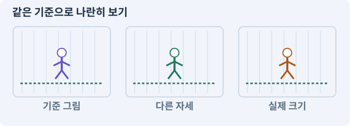

# 097. 선택: 3D 모델에서 2D 시트 만들기

**목표:** 같은 캐릭터를 2D 게임에 다시 사용할 수 있습니다.

**시작 상태:** 실제 3D 모델과 동작

## 한눈에 보는 기능의 흐름

3D 모델·동작 → 방향별 카메라 → 프레임 렌더링 → 2D 시트 연결



**경계:** 2D에 가져와도 기존 몸체·피해 규칙 유지

그림은 실제 게임 실행 결과가 아닙니다. 값·규칙과 예제를 필요한 때 펼쳐 읽고 현재 단계의 메시지를 한 번씩 보냅니다.

## 1. 지금 상태 확인하기

첫 메시지를 보내 현재 준비 상태를 확인합니다. AI가 읽어 온 실제 프로젝트가 맞는지 보고, 없는 준비나 다른 상태가 있으면 먼저 알려 주세요. 아직 기능을 만들지 않는 단계입니다.

### AI에게 보낼 요구와 이유

#### 01. 작업 대상부터 확인

**“선택: 3D 모델에서 2D 시트 만들기” 작업을 시작하기 전에 현재 상태를 읽기 전용으로 확인해 줘.**

왜 이렇게 요청하나요? AI가 다른 프로젝트나 오래된 예제를 보고 작업할 수 있습니다. 실제 경로·파일·현재 기능을 읽게 하면 지금 이어서 작업할 대상을 먼저 맞출 수 있습니다.

#### 02. 작업 대상부터 확인

**필요한 시작 상태는 실제 3D 모델과 동작야.**

왜 이렇게 요청하나요? AI가 다른 프로젝트나 오래된 예제를 보고 작업할 수 있습니다. 실제 경로·파일·현재 기능을 읽게 하면 지금 이어서 작업할 대상을 먼저 맞출 수 있습니다.

#### 03. 실제 사용 중인 구현 재사용

**실제 프로젝트와 작업 기록을 읽고 이것이 준비되어 있는지, 이미 같은 기능이 있는지 확인해 줘.**

왜 이렇게 요청하나요? 이름이 비슷한 새 클래스를 또 만들면 기존 화면은 여전히 옛 코드를 사용할 수 있습니다. 실제 호출되는 진입점을 찾아 연결해야 두 구현이 충돌하거나 수정이 반영되지 않는 문제를 막습니다.

#### 04. 현재 상태와 다음 확인 지점 구분

**이번 기능이 연결될 실제 파일·화면·도구와 보존할 기존 동작을 짧게 정리해 줘.**

왜 이렇게 요청하나요? 이미 준비된 기능과 아직 확인하지 못한 기능을 섞으면 불필요한 재설치나 성급한 완료 판정이 생깁니다. 현재 대상과 남은 준비를 나눠 가장 작은 다음 작업을 선택하게 합니다.

#### 05. 조사 단계에서 변경하지 않기

**아직 새 구현·설치·유료 호출·파일 변경은 하지 마.**

왜 이렇게 요청하나요? 현재 상태를 알아보기만 할 때 파일 변경이나 결제가 시작되면 검토 전의 환경이 바뀝니다. 준비 확인과 실제 구현을 나눠 되돌리기 어려운 작업이 먼저 실행되지 않게 합니다.

#### 06. 막힌 준비를 먼저 해결

**준비가 다르면 부족한 항목과 다음에 필요한 작업을 알려 줘.**

왜 이렇게 요청하나요? 빠진 파일·권한·패키지를 있다고 가정하면 다음 구현이 엉뚱한 대상을 만들게 됩니다. 무엇이 없고 무엇을 먼저 해야 하는지 분리하면 불필요한 재작업을 줄일 수 있습니다.

<details>
<summary>보낼 원문 전체 — 설명은 복사되지 않습니다</summary>

```text
“선택: 3D 모델에서 2D 시트 만들기” 작업을 시작하기 전에 현재 상태를 읽기 전용으로 확인해 줘.
필요한 시작 상태는 실제 3D 모델과 동작야. 실제 프로젝트와 작업 기록을 읽고 이것이 준비되어 있는지, 이미 같은 기능이 있는지 확인해 줘.
이번 기능이 연결될 실제 파일·화면·도구와 보존할 기존 동작을 짧게 정리해 줘. 아직 새 구현·설치·유료 호출·파일 변경은 하지 마. 준비가 다르면 부족한 항목과 다음에 필요한 작업을 알려 줘.
```

</details>

**기대 결과:** 촬영 방향·프레임·투명도·피벗 규격

### 직접 확인하기

1. AI가 읽은 실제 프로젝트 또는 도구 경로를 확인합니다.
2. 필수 준비가 없다면 문제 해결 요청을 보내고, 준비됐을 때 다음으로 갑니다.

## 2. 필요한 기능 만들기

준비가 확인되면 아래 요청을 보냅니다. AI가 파일·설정·실행을 맡습니다. 변경 범위나 비용 승인이 나오면 내용을 읽고 결정하세요.

### AI에게 보낼 요구와 이유

#### 01. 작업 대상부터 확인

**현재 프로젝트의 실제 파일과 이미 결정한 규칙을 먼저 확인해 줘.**

왜 이렇게 요청하나요? AI가 다른 프로젝트나 오래된 예제를 보고 작업할 수 있습니다. 실제 경로·파일·현재 기능을 읽게 하면 지금 이어서 작업할 대상을 먼저 맞출 수 있습니다.

#### 02. 실제 사용 중인 코드에 연결

**이름이 다른 기존 구현이 있으면 새로 중복 제작하지 말고 그 구현에 연결해 줘.**

왜 이렇게 요청하나요? 예제와 이름이 다르더라도 현재 씬과 입력에서 호출하는 구현이 작업 대상입니다. 같은 기능을 새로 만들기보다 기존 진입점을 확인해 수정이 실제 게임에 반영되고 중복 실행되지 않게 합니다.

#### 03. 관찰 가능한 기준으로 확인

**선택 테스트으로 SpriteBakeLab과 Editor 캡처 도구를 만들어 줘.**

왜 이렇게 요청하나요? 구현 완료라는 설명을 실제 결과로 바꾸기 위한 조건입니다. 요청에 나온 대상과 경계 상황을 확인해 정상 결과뿐 아니라 실패를 어떻게 구분했는지도 남깁니다.

#### 04. 스크립트와 실제 씬 연결

**원본 게임 씬과 프리팹은 유지하고 복제한 모델을 고정 카메라·조명·캔버스에서 촬영해 줘.**

왜 이렇게 요청하나요? 코드 파일을 만들어도 씬의 오브젝트에 붙지 않거나 참조가 비어 있으면 플레이에 반영되지 않습니다. 실제 사용하는 프리팹과 컴포넌트까지 연결해 동작을 확인하게 합니다.

#### 05. 그림 크기와 월드 크기 연결

**128x128, 발 기준(64,112), 실제 알파, 최종 PPU64를 기준으로 S방향 walk6부터 만들어 줘.**

왜 이렇게 요청하나요? 픽셀 수만 정하면 게임 안에서의 크기는 정해지지 않습니다. PPU와 배율을 함께 고정해야 자산을 바꿔도 캐릭터·바닥·UI의 크기 관계를 비교할 수 있습니다.

#### 06. 같은 요청의 반복 처리 정의

**루프는 마지막 중복 프레임을 제외하고 비루프는 마지막 포즈를 포함하는 샘플 규칙을 분리해 줘.**

왜 이렇게 요청하나요? 클릭 연타·재연결·중복 이벤트는 개발과 플레이 중 모두 발생할 수 있습니다. 반복돼도 한 번 처리해야 하는 결과와 매번 새로 처리할 결과를 나눠 데이터가 누적되지 않게 합니다.

#### 07. 프레임의 순서와 시간 맞추기

**게임 시간·피해를 실행하지 않고 애니메이션 포즈만 샘플링해 줘.**

왜 이렇게 요청하나요? 이미지나 동작 파일이 있어도 순서·속도·전환 기준이 맞지 않으면 끊기거나 타격 시점과 어긋납니다. 실제 사용 크기와 반복 재생에서 연결이 자연스러운지 확인합니다.

#### 08. 프레임의 기준점 통일

**네 방향과 동작 메타데이터를 만들고 2D 사본에서 피벗·크기·방향·공격 표시를 확인해 줘.**

왜 이렇게 요청하나요? 걷기·공격 그림의 몸통 크기가 달라도 발은 같은 위치에 있어야 합니다. 기준점이 다르면 몸체는 정지해 있는데 그림만 튀거나 바닥을 미끄러지는 것처럼 보입니다.

#### 09. 원본 자산과 렌더 출력의 사용 조건

**외부 모델/클립을 사용했다면 렌더 출력의 배포 조건을 기록해 줘.**

왜 이렇게 요청하나요? 3D 모델을 2D 이미지로 렌더링했더라도 원본 모델·애니메이션의 사용 조건을 확인해야 합니다. 결과물을 배포할 수 있는 근거와 출처를 기록합니다.

#### 10. 아래 항목을 완료 조건으로 사용

**적용할 세부 규칙:**

왜 이렇게 요청하나요? 요구사항의 목록은 AI에게 참고 설명을 주는 것이 아니라 완료를 판단할 기준을 정합니다. 구현 뒤 각 항목을 실제 입력과 결과에 대응시켜 빠진 조건을 찾습니다.

#### 11. 구현할 결과와 조건 고정

**별도 SpriteBakeLab에서 배경을 투명하게 렌더링한다.**

왜 이렇게 요청하나요? “별도 SpriteBakeLab에서 배경을 투명하게 렌더링한다”를 명시하면 AI가 무엇을 구현하거나 검사해야 하는지 범위를 좁힐 수 있습니다. 같은 캐릭터를 2D 게임에 다시 사용할 수 있습니다. 이 결과를 확인할 때 이 조건이 실제로 반영됐는지 함께 봅니다.

#### 12. 프레임의 순서와 시간 맞추기

**카메라·조명·정사영 크기·루트 위치·포즈 시간은 모든 프레임에서 고정한다.**

왜 이렇게 요청하나요? 이미지나 동작 파일이 있어도 순서·속도·전환 기준이 맞지 않으면 끊기거나 타격 시점과 어긋납니다. 실제 사용 크기와 반복 재생에서 연결이 자연스러운지 확인합니다.

#### 13. 프레임의 기준점 통일

**한 방향에서 보기 좋은 자동 크롭을 각 프레임에 적용하면 발이 흔들리므로 고정 캔버스를 사용한다.**

왜 이렇게 요청하나요? 걷기·공격 그림의 몸통 크기가 달라도 발은 같은 위치에 있어야 합니다. 기준점이 다르면 몸체는 정지해 있는데 그림만 튀거나 바닥을 미끄러지는 것처럼 보입니다.

#### 14. 프레임의 순서와 시간 맞추기

**최종 규격은 S/W/N/E 네 방향, idle4/walk6/attack6/hurt2/death6이다.**

왜 이렇게 요청하나요? 이미지나 동작 파일이 있어도 순서·속도·전환 기준이 맞지 않으면 끊기거나 타격 시점과 어긋납니다. 실제 사용 크기와 반복 재생에서 연결이 자연스러운지 확인합니다.

#### 15. 프레임의 순서와 시간 맞추기

**먼저 S방향 walk6만 만든다.**

왜 이렇게 요청하나요? 이미지나 동작 파일이 있어도 순서·속도·전환 기준이 맞지 않으면 끊기거나 타격 시점과 어긋납니다. 실제 사용 크기와 반복 재생에서 연결이 자연스러운지 확인합니다.

#### 16. 프레임의 기준점 통일

**128×128 원본에서 발 기준 (64,112)을 유지하면 Unity 정규화 피벗은(0.5,0.125)다.**

왜 이렇게 요청하나요? 걷기·공격 그림의 몸통 크기가 달라도 발은 같은 위치에 있어야 합니다. 기준점이 다르면 몸체는 정지해 있는데 그림만 튀거나 바닥을 미끄러지는 것처럼 보입니다.

#### 17. 그림 크기와 월드 크기 연결

**캐릭터 PPU64를 사용하면64px/PPU32와 같은 월드 크기를 유지한다.**

왜 이렇게 요청하나요? 픽셀 수만 정하면 게임 안에서의 크기는 정해지지 않습니다. PPU와 배율을 함께 고정해야 자산을 바꿔도 캐릭터·바닥·UI의 크기 관계를 비교할 수 있습니다.

#### 18. 같은 요청의 반복 처리 정의

**루프 동작은 t=i*duration/frameCount로 끝 프레임 중복을 피한다.**

왜 이렇게 요청하나요? 클릭 연타·재연결·중복 이벤트는 개발과 플레이 중 모두 발생할 수 있습니다. 반복돼도 한 번 처리해야 하는 결과와 매번 새로 처리할 결과를 나눠 데이터가 누적되지 않게 합니다.

#### 19. 프레임의 순서와 시간 맞추기

**사망처럼 비루프 동작은 시작/마지막 포즈를 포함하는 샘플 규칙을 따로 정의한다.**

왜 이렇게 요청하나요? 이미지나 동작 파일이 있어도 순서·속도·전환 기준이 맞지 않으면 끊기거나 타격 시점과 어긋납니다. 실제 사용 크기와 반복 재생에서 연결이 자연스러운지 확인합니다.

#### 20. 그림의 동작과 게임 판정 분리

**캡처용 애니메이션 샘플링은 게임 플레이의 시간이나 피해를 진행하지 않는다.**

왜 이렇게 요청하나요? 모델 동작이 이동이나 피해를 또 적용하면 기존 모터·전투 타이머와 충돌할 수 있습니다. 위치와 피해를 책임지는 주체를 하나로 두고 애니메이션은 정해진 사건을 표현하게 합니다.

#### 21. 2D 출력물도 자산 사용 조건 확인

**모델·애니메이션의 사용 조건이 2D 렌더 출력 배포를 허용하는지도 기록한다.**

왜 이렇게 요청하나요? 결과의 형식이 달라졌다고 원본 조건이 사라지는 것은 아닙니다. 사용한 모델과 동작의 조건을 확인하고 실제 출처를 남겨야 교체나 배포를 판단할 수 있습니다.

#### 22. 구현할 결과와 조건 고정

**단순히 소스 모델을 샀다는 이유로 모든 재배포 방식이 허용된다고 가정하지 않는다.**

왜 이렇게 요청하나요? “단순히 소스 모델을 샀다는 이유로 모든 재배포 방식이 허용된다고 가정하지 않는다”를 명시하면 AI가 무엇을 구현하거나 검사해야 하는지 범위를 좁힐 수 있습니다. 같은 캐릭터를 2D 게임에 다시 사용할 수 있습니다. 이 결과를 확인할 때 이 조건이 실제로 반영됐는지 함께 봅니다.

#### 23. 구현과 실행은 AI에게 맡기기

**코드·설정·파일 생성·실행은 네가 맡고, 필요한 화면과 결과를 보여 줘.**

왜 이렇게 요청하나요? 설명이나 코드 조각만 받으면 실제 파일 생성·연결·실행이 빠질 수 있습니다. AI가 개발 작업까지 수행하고, 사람은 요구·승인·결과 판단을 맡도록 역할을 분명히 합니다.

#### 24. 막힌 준비를 먼저 해결

**수행하지 못한 작업과 필요한 승인·도구 연결은 구분해서 알려 줘.**

왜 이렇게 요청하나요? 빠진 파일·권한·패키지를 있다고 가정하면 다음 구현이 엉뚱한 대상을 만들게 됩니다. 무엇이 없고 무엇을 먼저 해야 하는지 분리하면 불필요한 재작업을 줄일 수 있습니다.

<details>
<summary>보낼 원문 전체 — 설명은 복사되지 않습니다</summary>

```text
현재 프로젝트의 실제 파일과 이미 결정한 규칙을 먼저 확인해 줘. 이름이 다른 기존 구현이 있으면 새로 중복 제작하지 말고 그 구현에 연결해 줘.

선택 테스트으로 SpriteBakeLab과 Editor 캡처 도구를 만들어 줘.
원본 게임 씬과 프리팹은 유지하고 복제한 모델을 고정 카메라·조명·캔버스에서 촬영해 줘.
128x128, 발 기준(64,112), 실제 알파, 최종 PPU64를 기준으로 S방향 walk6부터 만들어 줘.
루프는 마지막 중복 프레임을 제외하고 비루프는 마지막 포즈를 포함하는 샘플 규칙을 분리해 줘.
게임 시간·피해를 실행하지 않고 애니메이션 포즈만 샘플링해 줘.
네 방향과 동작 메타데이터를 만들고 2D 사본에서 피벗·크기·방향·공격 표시를 확인해 줘.
외부 모델/클립을 사용했다면 렌더 출력의 배포 조건을 기록해 줘.

적용할 세부 규칙:
별도 SpriteBakeLab에서 배경을 투명하게 렌더링한다. 카메라·조명·정사영 크기·루트 위치·포즈 시간은 모든 프레임에서 고정한다. 한 방향에서 보기 좋은 자동 크롭을 각 프레임에 적용하면 발이 흔들리므로 고정 캔버스를 사용한다.

최종 규격은 S/W/N/E 네 방향, idle4/walk6/attack6/hurt2/death6이다. 먼저 S방향 walk6만 만든다. 128×128 원본에서 발 기준 (64,112)을 유지하면 Unity 정규화 피벗은(0.5,0.125)다. 캐릭터 PPU64를 사용하면64px/PPU32와 같은 월드 크기를 유지한다.

루프 동작은 t=i*duration/frameCount로 끝 프레임 중복을 피한다. 사망처럼 비루프 동작은 시작/마지막 포즈를 포함하는 샘플 규칙을 따로 정의한다. 캡처용 애니메이션 샘플링은 게임 플레이의 시간이나 피해를 진행하지 않는다.

모델·애니메이션의 사용 조건이 2D 렌더 출력 배포를 허용하는지도 기록한다. 단순히 소스 모델을 샀다는 이유로 모든 재배포 방식이 허용된다고 가정하지 않는다.

코드·설정·파일 생성·실행은 네가 맡고, 필요한 화면과 결과를 보여 줘. 수행하지 못한 작업과 필요한 승인·도구 연결은 구분해서 알려 줘.
```

</details>

**기대 결과:** 확인할 결과: 렌더링한 시트의 2D 사용을 확인함. AI가 이 상태를 확인할 실제 화면과 변경 내용을 준비합니다. 아직 실행하지 못한 부분은 따로 표시합니다.

### 직접 확인하기

1. 제안서만 반환됐다면 “설명으로 끝내지 말고 승인한 범위의 실제 작업을 수행해 줘”라고 보냅니다.
2. 코드나 설정을 직접 고치라는 안내가 나오면 “작성과 실행은 네가 맡아 줘”라고 요청합니다.

## 3. 결과를 직접 확인하기

먼저 확인 요청을 보내 AI가 검사와 화면을 준비하게 하세요. 그다음 아래 동작을 하나씩 확인합니다.

### AI에게 보낼 요구와 이유

#### 01. 검사할 입력과 관찰 지점 준비

**현재 구현한 “3D 모델에서 2D 시트 만들기”의 자동 검사와 확인 화면을 준비해 줘.**

왜 이렇게 요청하나요? 정상 예 하나만 보면 실패 조건을 놓치기 쉽습니다. 정상·경계·반례를 실제 입력으로 준비하고 사람이 볼 화면도 맞춰 확인 범위를 분명하게 합니다.

#### 02. 결과를 재확인할 근거 남기기

**정상 동작과 아래 실패 조건을 실제로 검사하고 대상·실행 수·결과를 보여 줘.**

왜 이렇게 요청하나요? “잘 됩니다”라는 요약만으로는 어떤 입력과 버전을 검사했는지 알 수 없습니다. 대상·실행 수·실패 내용·파일을 함께 남겨 같은 조건으로 다시 확인할 수 있게 합니다.

#### 03. 프레임의 기준점 통일

**모든 프레임의 발 기준과 크기가 같다.**

왜 이렇게 요청하나요? 걷기·공격 그림의 몸통 크기가 달라도 발은 같은 위치에 있어야 합니다. 기준점이 다르면 몸체는 정지해 있는데 그림만 튀거나 바닥을 미끄러지는 것처럼 보입니다.

#### 04. 실제 투명 데이터 확인

**실제 알파가 있고 자동 크롭 흔들림이 없다.**

왜 이렇게 요청하나요? 바둑판이 그려진 이미지와 배경 픽셀의 알파가 투명한 파일은 다릅니다. 배경 위에 겹쳐 확인해야 사각 테두리나 번짐이 게임에 그대로 나타나는 것을 막습니다.

#### 05. 점이 아니라 몸체가 지나가게 하기

**2D에 가져와도 몸체 반경과 피해 규칙은 바뀌지 않는다.**

왜 이렇게 요청하나요? 길의 중심점이 연결돼 있어도 반경이 있는 캐릭터는 모서리나 좁은 문에 걸릴 수 있습니다. 실제 몸체 크기로 통과·차단을 확인해야 길찾기 그림과 플레이 결과가 맞습니다.

#### 06. 기존 결과를 보호

**원본 모델·게임 씬은 유지된다.**

왜 이렇게 요청하나요? 새 작업이 이미 정상인 기능이나 자산까지 바꾸면 원인을 추적하기 어렵습니다. 유지할 대상을 명시해 변경 전후를 비교하고 원치 않은 영향을 찾습니다.

#### 07. 사람 검사의 시작점 준비

**내가 조작해야 하는 부분은 실행할 화면과 시작 상태를 준비해 줘.**

왜 이렇게 요청하나요? 같은 기능이라도 시작 상태가 다르면 관찰 결과가 달라집니다. AI가 실행 화면과 재현 위치를 먼저 준비해야 사람이 이동·공격·소리·조작감을 같은 조건에서 확인할 수 있습니다.

#### 08. 사람이 실제로 본 것만 기록

**연결되지 않은 휴대폰의 터치나 사람이 보지 않은 재미·소리 품질을 대신 확인했다고 하지 마.**

왜 이렇게 요청하나요? AI가 준비한 검사와 사람이 직접 플레이하거나 들은 결과는 다른 근거입니다. 관찰하지 않은 조작감·소리·실기기 결과를 임의로 완료 처리하지 않게 합니다.

#### 09. 실제로 실행한 검사만 인정

**테스트 0개와 예전 소스 결과는 현재 성공으로 쓰지 마.**

왜 이렇게 요청하나요? 실행된 검사가 없거나 같은 결과를 중복 집계한 경우는 기능을 확인한 것이 아닙니다. 실행 수와 개별 결과를 함께 확인해야 형식적인 성공 표시를 걸러낼 수 있습니다.

<details>
<summary>보낼 원문 전체 — 설명은 복사되지 않습니다</summary>

```text
현재 구현한 “3D 모델에서 2D 시트 만들기”의 자동 검사와 확인 화면을 준비해 줘. 정상 동작과 아래 실패 조건을 실제로 검사하고 대상·실행 수·결과를 보여 줘.

모든 프레임의 발 기준과 크기가 같다. 실제 알파가 있고 자동 크롭 흔들림이 없다. 2D에 가져와도 몸체 반경과 피해 규칙은 바뀌지 않는다. 원본 모델·게임 씬은 유지된다.

내가 조작해야 하는 부분은 실행할 화면과 시작 상태를 준비해 줘. 연결되지 않은 휴대폰의 터치나 사람이 보지 않은 재미·소리 품질을 대신 확인했다고 하지 마. 테스트 0개와 예전 소스 결과는 현재 성공으로 쓰지 마.
```

</details>

**기대 결과:** 렌더링한 시트의 2D 사용을 확인함

### 직접 확인하기

1. 네 방향의 실루엣을 비교합니다.
2. 걷기 루프를 2D 크기로 재생합니다.
3. 2D 사본에 연결해 몸체와 타격이 그대로인지 봅니다.

## 4. 결과를 남기고 마무리하기

실제로 본 결과를 아래 메모에 적고 AI에 전달합니다. 결과 저장 요청으로 현재 상태를 남긴 뒤 다음 페이지로 갑니다.

### AI에게 보낼 요구와 이유

#### 01. 결과를 재확인할 근거 남기기

**지금 작업한 “선택: 3D 모델에서 2D 시트 만들기”의 실제 결과를 정리해 줘.**

왜 이렇게 요청하나요? “잘 됩니다”라는 요약만으로는 어떤 입력과 버전을 검사했는지 알 수 없습니다. 대상·실행 수·실패 내용·파일을 함께 남겨 같은 조건으로 다시 확인할 수 있게 합니다.

#### 02. 다음 작업이 읽을 인수인계

**변경한 기능·파일·현재 후보와 실제 실행한 검사, 남은 문제를 기능 이름으로 기록해 줘.**

왜 이렇게 요청하나요? 새 AI 세션은 이전 대화 전체를 알고 있다고 보장할 수 없습니다. 현재 후보·파일 위치·실행한 검사·남은 일을 남겨야 같은 작업을 반복하지 않고 이어갈 수 있습니다.

#### 03. 사람이 실제로 본 것만 기록

**자동 검사 결과와 내가 직접 확인한 결과를 구분하고, 내 관찰이 아직 없으면 미확인으로 남겨 줘.**

왜 이렇게 요청하나요? AI가 준비한 검사와 사람이 직접 플레이하거나 들은 결과는 다른 근거입니다. 관찰하지 않은 조작감·소리·실기기 결과를 임의로 완료 처리하지 않게 합니다.

#### 04. 다음 작업이 읽을 인수인계

**재시작하거나 다음 작업에서 읽을 기록의 실제 위치를 알려 줘.**

왜 이렇게 요청하나요? 새 AI 세션은 이전 대화 전체를 알고 있다고 보장할 수 없습니다. 현재 후보·파일 위치·실행한 검사·남은 일을 남겨야 같은 작업을 반복하지 않고 이어갈 수 있습니다.

#### 05. 미확인을 완료와 분리

**아직 확인하지 않은 결과를 완료로 채우지 마.**

왜 이렇게 요청하나요? 만들어진 것, 검사에 실패한 것, 아직 확인하지 못한 것을 나눠야 다음 작업을 정확히 고를 수 있습니다. 실행할 조건이 없는 기능을 성공으로 기록하면 뒤에서 원인을 찾기 어려워집니다.

<details>
<summary>보낼 원문 전체 — 설명은 복사되지 않습니다</summary>

```text
지금 작업한 “선택: 3D 모델에서 2D 시트 만들기”의 실제 결과를 정리해 줘. 변경한 기능·파일·현재 후보와 실제 실행한 검사, 남은 문제를 기능 이름으로 기록해 줘.
자동 검사 결과와 내가 직접 확인한 결과를 구분하고, 내 관찰이 아직 없으면 미확인으로 남겨 줘. 재시작하거나 다음 작업에서 읽을 기록의 실제 위치를 알려 줘. 아직 확인하지 않은 결과를 완료로 채우지 마.
```

</details>

**기대 결과:** 현재 상태·검사 결과·남은 문제·다음에 읽을 기록을 확인할 수 있습니다.

### 직접 확인하기

1. 자동 검사와 내 관찰 결과가 섞이지 않았는지 봅니다.
2. 문제가 남았다면 해결 요청을 보내고 같은 동작을 다시 확인합니다.

## 이 작업에서 사용할 값과 규칙 전체

설계 시작값이며 측정된 성능·게임 성공 결과가 아닙니다. 구현은 AI가 수행합니다.

별도 SpriteBakeLab에서 배경을 투명하게 렌더링한다. 카메라·조명·정사영 크기·루트 위치·포즈 시간은 모든 프레임에서 고정한다. 한 방향에서 보기 좋은 자동 크롭을 각 프레임에 적용하면 발이 흔들리므로 고정 캔버스를 사용한다.

최종 규격은 S/W/N/E 네 방향, idle4/walk6/attack6/hurt2/death6이다. 먼저 S방향 walk6만 만든다. 128×128 원본에서 발 기준 (64,112)을 유지하면 Unity 정규화 피벗은(0.5,0.125)다. 캐릭터 PPU64를 사용하면64px/PPU32와 같은 월드 크기를 유지한다.

루프 동작은 `t=i*duration/frameCount`로 끝 프레임 중복을 피한다. 사망처럼 비루프 동작은 시작/마지막 포즈를 포함하는 샘플 규칙을 따로 정의한다. 캡처용 애니메이션 샘플링은 게임 플레이의 시간이나 피해를 진행하지 않는다.

모델·애니메이션의 사용 조건이 2D 렌더 출력 배포를 허용하는지도 기록한다. 단순히 소스 모델을 샀다는 이유로 모든 재배포 방식이 허용된다고 가정하지 않는다.

## 문제가 있으면

### AI에게 보낼 요구와 이유

#### 01. 프레임의 순서와 시간 맞추기

**카메라와 캐릭터 크기를 프레임마다 바꾸지 마.**

왜 이렇게 요청하나요? 이미지나 동작 파일이 있어도 순서·속도·전환 기준이 맞지 않으면 끊기거나 타격 시점과 어긋납니다. 실제 사용 크기와 반복 재생에서 연결이 자연스러운지 확인합니다.

#### 02. 실제 투명 데이터 확인

**그림자·알파·발 기준을 먼저 고정해 줘.**

왜 이렇게 요청하나요? 바둑판이 그려진 이미지와 배경 픽셀의 알파가 투명한 파일은 다릅니다. 배경 위에 겹쳐 확인해야 사각 테두리나 번짐이 게임에 그대로 나타나는 것을 막습니다.

#### 03. 원인 하나를 좁혀 수정

**새 기능을 추가하지 말고 현재 오류와 실제 로그를 먼저 읽어 줘.**

왜 이렇게 요청하나요? 오류 수정 중 새 기능까지 넣으면 어떤 변경이 문제를 해결하거나 악화했는지 알기 어렵습니다. 원래 재현을 보존하고 작은 변경 뒤 같은 입력과 주변 정상 동작을 다시 확인합니다.

#### 04. 원인 하나를 좁혀 수정

**최소 수정 뒤 같은 재현과 관련 정상 동작을 다시 검사해 줘.**

왜 이렇게 요청하나요? 오류 수정 중 새 기능까지 넣으면 어떤 변경이 문제를 해결하거나 악화했는지 알기 어렵습니다. 원래 재현을 보존하고 작은 변경 뒤 같은 입력과 주변 정상 동작을 다시 확인합니다.

#### 05. 실패도 재현 자료로 보존

**실패 기록은 지우지 마.**

왜 이렇게 요청하나요? 실패한 입력과 로그가 있어야 같은 문제가 다시 생겼을 때 비교할 수 있습니다. 성공 기록으로 덮어쓰지 않고 전후 자료를 남기면 무엇을 고쳤는지 확인할 수 있습니다.

<details>
<summary>보낼 원문 전체 — 설명은 복사되지 않습니다</summary>

```text
카메라와 캐릭터 크기를 프레임마다 바꾸지 마. 그림자·알파·발 기준을 먼저 고정해 줘.
새 기능을 추가하지 말고 현재 오류와 실제 로그를 먼저 읽어 줘. 최소 수정 뒤 같은 재현과 관련 정상 동작을 다시 검사해 줘. 실패 기록은 지우지 마.
```

</details>

## 새 세션에서 이어가기

### AI에게 보낼 요구와 이유

#### 01. 이어서 할 작업 식별

**“선택: 3D 모델에서 2D 시트 만들기” 작업을 이어가고 싶어.**

왜 이렇게 요청하나요? 이름으로 재개할 작업을 찾고, 뒤에 이어지는 요청으로 실제 파일·진행 중 작업·기록을 다시 읽게 합니다. 제목만 보고 이전 상태를 기억한다고 가정하지 않습니다.

#### 02. 조회는 상태를 바꾸지 않게

**실제 프로젝트와 내 도구의 작업 기록을 읽고 어디까지 구현·검사됐는지 확인해 줘.**

왜 이렇게 요청하나요? 진행 상황을 물을 때 새 구현이나 유료 호출이 시작되면 단순 확인이 실행 명령이 되어 버립니다. 저장된 근거를 읽어 완료·진행·승인 대기·미검증을 나누게 합니다.

#### 03. 재개 전 중복 작업 방지

**진행 중인 프로세스·승인·미저장 변경을 확인한 뒤 남은 가장 작은 작업부터 안내해 줘.**

왜 이렇게 요청하나요? 대화가 끊겨도 외부 작업은 끝났거나 아직 실행 중일 수 있습니다. 프로세스·승인·미저장 상태를 먼저 읽어 같은 생성·빌드·결제를 두 번 시작하지 않도록 합니다.

#### 04. 되돌아갈 원본 남기기

**기존 성공과 실패 기록은 보존해 줘.**

왜 이렇게 요청하나요? 새 구현이 실패해도 이전 게임과 저장을 복원할 수 있어야 합니다. 현재 내용을 먼저 조사하고 별도 후보에서 작업하면 실험이 유일한 정상본을 망가뜨리는 일을 피할 수 있습니다.

<details>
<summary>보낼 원문 전체 — 설명은 복사되지 않습니다</summary>

```text
“선택: 3D 모델에서 2D 시트 만들기” 작업을 이어가고 싶어. 실제 프로젝트와 내 도구의 작업 기록을 읽고 어디까지 구현·검사됐는지 확인해 줘. 진행 중인 프로세스·승인·미저장 변경을 확인한 뒤 남은 가장 작은 작업부터 안내해 줘. 기존 성공과 실패 기록은 보존해 줘.
```

</details>

## 왜 이렇게 만드는가

카메라가 모델을 렌더링한 결과는 그림이다. 생성한 시트를 2D 프로젝트에 넣더라도 이동·충돌·피해가 3D로 바뀌지 않는다. 원본 모델을 배포하지 않고 PNG와 클립만 사용하는 경로도 가능하다.

## 공식 참고


## 실제 Unity Editor 화면 참고
공식 예시와 내 프로젝트 실행 결과를 구분하세요. 원본 사진은 온라인 연결이 필요합니다.

- [Sprite Editor — 그림 경계·테두리·기준점 구분하기](../editor_references/sprite-editor.md)
