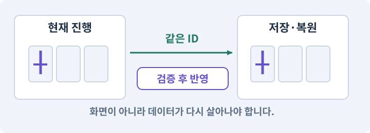

# 099. 2D와 3D 사이에 진행 가져오기

**목표:** 명시적으로 옮긴 진행이 두 게임에서 같습니다.

**시작 상태:** 각각 분리된 저장과 같은 Core

## 한눈에 보는 기능의 흐름

2D 진행 내보내기 → ID·버전 검증 → 3D 사본에 적용 → 결과 비교



**경계:** 원본을 보호하고 명시적으로만 진행 이동

그림은 실제 게임 실행 결과가 아닙니다. 값·규칙과 예제를 필요한 때 펼쳐 읽고 현재 단계의 메시지를 한 번씩 보냅니다.

## 1. 지금 상태 확인하기

첫 메시지를 보내 현재 준비 상태를 확인합니다. AI가 읽어 온 실제 프로젝트가 맞는지 보고, 없는 준비나 다른 상태가 있으면 먼저 알려 주세요. 아직 기능을 만들지 않는 단계입니다.

### AI에게 보낼 요구와 이유

#### 01. 작업 대상부터 확인

**“2D와 3D 사이에 진행 가져오기” 작업을 시작하기 전에 현재 상태를 읽기 전용으로 확인해 줘.**

왜 이렇게 요청하나요? AI가 다른 프로젝트나 오래된 예제를 보고 작업할 수 있습니다. 실제 경로·파일·현재 기능을 읽게 하면 지금 이어서 작업할 대상을 먼저 맞출 수 있습니다.

#### 02. 공통 규칙과 공간별 연결을 나누기

**필요한 시작 상태는 각각 분리된 저장과 같은 Core야.**

왜 이렇게 요청하나요? 피해 계산·소유 데이터는 유지하고 좌표·물리·화면 연결만 바꾸려는 요청입니다. 같은 규칙을 재사용하면 2D와 3D 사이의 차이가 기능 변경인지 공간 표현의 차이인지 비교할 수 있습니다.

#### 03. 실제 사용 중인 구현 재사용

**실제 프로젝트와 작업 기록을 읽고 이것이 준비되어 있는지, 이미 같은 기능이 있는지 확인해 줘.**

왜 이렇게 요청하나요? 이름이 비슷한 새 클래스를 또 만들면 기존 화면은 여전히 옛 코드를 사용할 수 있습니다. 실제 호출되는 진입점을 찾아 연결해야 두 구현이 충돌하거나 수정이 반영되지 않는 문제를 막습니다.

#### 04. 현재 상태와 다음 확인 지점 구분

**이번 기능이 연결될 실제 파일·화면·도구와 보존할 기존 동작을 짧게 정리해 줘.**

왜 이렇게 요청하나요? 이미 준비된 기능과 아직 확인하지 못한 기능을 섞으면 불필요한 재설치나 성급한 완료 판정이 생깁니다. 현재 대상과 남은 준비를 나눠 가장 작은 다음 작업을 선택하게 합니다.

#### 05. 조사 단계에서 변경하지 않기

**아직 새 구현·설치·유료 호출·파일 변경은 하지 마.**

왜 이렇게 요청하나요? 현재 상태를 알아보기만 할 때 파일 변경이나 결제가 시작되면 검토 전의 환경이 바뀝니다. 준비 확인과 실제 구현을 나눠 되돌리기 어려운 작업이 먼저 실행되지 않게 합니다.

#### 06. 막힌 준비를 먼저 해결

**준비가 다르면 부족한 항목과 다음에 필요한 작업을 알려 줘.**

왜 이렇게 요청하나요? 빠진 파일·권한·패키지를 있다고 가정하면 다음 구현이 엉뚱한 대상을 만들게 됩니다. 무엇이 없고 무엇을 먼저 해야 하는지 분리하면 불필요한 재작업을 줄일 수 있습니다.

<details>
<summary>보낼 원문 전체 — 설명은 복사되지 않습니다</summary>

```text
“2D와 3D 사이에 진행 가져오기” 작업을 시작하기 전에 현재 상태를 읽기 전용으로 확인해 줘.
필요한 시작 상태는 각각 분리된 저장과 같은 Core야. 실제 프로젝트와 작업 기록을 읽고 이것이 준비되어 있는지, 이미 같은 기능이 있는지 확인해 줘.
이번 기능이 연결될 실제 파일·화면·도구와 보존할 기존 동작을 짧게 정리해 줘. 아직 새 구현·설치·유료 호출·파일 변경은 하지 마. 준비가 다르면 부족한 항목과 다음에 필요한 작업을 알려 줘.
```

</details>

**기대 결과:** 옮길 필드와 제외할 임시 위치·전투 상태

### 직접 확인하기

1. AI가 읽은 실제 프로젝트 또는 도구 경로를 확인합니다.
2. 필수 준비가 없다면 문제 해결 요청을 보내고, 준비됐을 때 다음으로 갑니다.

## 2. 필요한 기능 만들기

준비가 확인되면 아래 요청을 보냅니다. AI가 파일·설정·실행을 맡습니다. 변경 범위나 비용 승인이 나오면 내용을 읽고 결정하세요.

### AI에게 보낼 요구와 이유

#### 01. 작업 대상부터 확인

**현재 프로젝트의 실제 파일과 이미 결정한 규칙을 먼저 확인해 줘.**

왜 이렇게 요청하나요? AI가 다른 프로젝트나 오래된 예제를 보고 작업할 수 있습니다. 실제 경로·파일·현재 기능을 읽게 하면 지금 이어서 작업할 대상을 먼저 맞출 수 있습니다.

#### 02. 실제 사용 중인 코드에 연결

**이름이 다른 기존 구현이 있으면 새로 중복 제작하지 말고 그 구현에 연결해 줘.**

왜 이렇게 요청하나요? 예제와 이름이 다르더라도 현재 씬과 입력에서 호출하는 구현이 작업 대상입니다. 같은 기능을 새로 만들기보다 기존 진입점을 확인해 수정이 실제 게임에 반영되고 중복 실행되지 않게 합니다.

#### 03. 종료 이후의 상태까지 확인

**저장 내보내기/가져오기를 구현해 줘.**

왜 이렇게 요청하나요? 현재 화면에서 맞는 값도 저장하거나 다시 구성할 때 빠질 수 있습니다. 실제 종료·불러오기 전후에 ID·옵션·장착·진행을 비교해야 유지되는 범위를 확인할 수 있습니다.

#### 04. 저장 형식 변화에 대응

**2D와 3D 앱 ID·저장 경로를 격리하고 공유 진행 DTO의 schema2를 사용해 줘.**

왜 이렇게 요청하나요? 새 기능의 필드를 추가했다고 예전 저장에 그 값이 생기지는 않습니다. 이전·기본값·불명 ID 처리 규칙을 정해야 업데이트 후 장비나 퀘스트 진행을 잃지 않습니다.

#### 05. 저장 중단과 손상에 대비

**파일 선택→검증→기존 저장 백업→원자적 교체→마을 복원 순서를 지켜 줘.**

왜 이렇게 요청하나요? 파일 쓰기가 중단되거나 읽을 수 없는 값이 있으면 정상 진행을 잃을 수 있습니다. 완성된 데이터 검증·교체·백업 복구를 나눠 손상된 자료가 정상본을 덮지 않게 합니다.

#### 06. 종류와 실제 소유 물건 구분

**아이템 instanceId/옵션·장비·골드·레벨·스킬 선행조건/포인트·퀘스트를 검증해 줘.**

왜 이렇게 요청하나요? 같은 종류의 검 두 자루도 옵션과 소유 위치는 별개입니다. 정의 데이터와 개별 아이템을 나누면 한 물건을 수정했을 때 다른 물건과 원본 규격까지 바뀌지 않습니다.

#### 07. 같은 요청의 반복 처리 정의

**schema1은 기존 이전기로 처리하고 미래 스키마/손상/중복 ID는 안전하게 거절해 줘.**

왜 이렇게 요청하나요? 클릭 연타·재연결·중복 이벤트는 개발과 플레이 중 모두 발생할 수 있습니다. 반복돼도 한 번 처리해야 하는 결과와 매번 새로 처리할 결과를 나눠 데이터가 누적되지 않게 합니다.

#### 08. 2D·3D 외형과 진행 데이터 분리

**표현 방식만 바뀌었다고 데이터 버전을 임의로 올리거나 아이템을 재생성하지 마.**

왜 이렇게 요청하나요? 표현만 달라졌다면 아이템 ID·옵션·스킬·퀘스트 진행의 의미는 그대로입니다. 필요 없는 저장 이전이나 재생성을 하지 않아 두 버전 사이의 진행 비교가 가능해집니다.

#### 09. 되돌아갈 원본 남기기

**2D→3D→2D 왕복과 실패 시 원본 보존을 검사해 줘.**

왜 이렇게 요청하나요? 새 구현이 실패해도 이전 게임과 저장을 복원할 수 있어야 합니다. 현재 내용을 먼저 조사하고 별도 후보에서 작업하면 실험이 유일한 정상본을 망가뜨리는 일을 피할 수 있습니다.

#### 10. 아래 항목을 완료 조건으로 사용

**적용할 세부 규칙:**

왜 이렇게 요청하나요? 요구사항의 목록은 AI에게 참고 설명을 주는 것이 아니라 완료를 판단할 기준을 정합니다. 구현 뒤 각 항목을 실제 입력과 결과에 대응시켜 빠진 조건을 찾습니다.

#### 11. 저장 중단과 손상에 대비

**각 앱은 자체 persistentDataPath 아래 saves/2d 또는 saves/3d를 사용한다.**

왜 이렇게 요청하나요? 파일 쓰기가 중단되거나 읽을 수 없는 값이 있으면 정상 진행을 잃을 수 있습니다. 완성된 데이터 검증·교체·백업 복구를 나눠 손상된 자료가 정상본을 덮지 않게 합니다.

#### 12. 패키지·패키지 관리자의 적용 조건

**패키지/제품 ID 도 다르게 한다.**

왜 이렇게 요청하나요? 패키지는 입력·타일맵·테스트처럼 특정 기능을 묶어 프로젝트에 추가하는 단위입니다. Unity Package Manager가 설치와 의존 버전을 관리합니다. 이름이 비슷한 제삼자 패키지를 공식 패키지로 오해하지 않습니다. 버전과 출처를 기록합니다.

#### 13. 저장 형식 변화에 대응

**내보내기는 현재 저장의 검증된 사본이며, 가져오기는 임시 파일 파싱→버전/ID/범위 검사→기존 저장 백업→원자적 교체→마을 복원 순서다.**

왜 이렇게 요청하나요? 새 기능의 필드를 추가했다고 예전 저장에 그 값이 생기지는 않습니다. 이전·기본값·불명 ID 처리 규칙을 정해야 업데이트 후 장비나 퀘스트 진행을 잃지 않습니다.

#### 14. 선택 조건과 실제 능력 연결

**검사 항목은 item instanceId 중복, 존재하지 않는 정의 ID, 잘못된 장비 슬롯, 음수 골드, 포인트 초과, 선행 조건을 위반한 스킬 노드, 알려지지 않은 미래 스키마다.**

왜 이렇게 요청하나요? 트리에 선이 그려져 있어도 선행 조건·포인트·실제 사용 가능 상태는 따로 구현해야 합니다. 투자 전후와 저장 복원에서 같은 선택 결과가 유지되도록 만듭니다.

#### 15. 기존 결과를 보호

**알 수 없는 파일을 묵시적으로 초기화해 덮어쓰지 않는다.**

왜 이렇게 요청하나요? 새 작업이 이미 정상인 기능이나 자산까지 바꾸면 원인을 추적하기 어렵습니다. 유지할 대상을 명시해 변경 전후를 비교하고 원치 않은 영향을 찾습니다.

#### 16. 스키마·JSON Schema·계약의 적용 조건

**schema1은 기존 schema2 이전을 먼저 적용한다.**

왜 이렇게 요청하나요? 스키마는 데이터가 어떤 필드·타입·범위를 가져야 하는지 정한 구조 약속입니다. 스키마 버전은 구조가 바뀌었음을 식별하고 이전 데이터 변환에 사용합니다. JSON Schema 통과가 게임의 모든 불변 조건을 보장하지는 않습니다.

#### 17. 아이템 인스턴스와 소유권의 적용 조건

**성공적인 가져오기도 기존 인스턴스 UUID와 옵션을 재발급하지 않는다.**

왜 이렇게 요청하나요? 인스턴스는 실제로 생성되어 소유되는 한 개의 물건입니다. 같은 종류의 검이라도 고유 ID·랜덤 옵션·소켓 상태가 각각 다를 수 있습니다. 화면 아이콘 두 개와 소유 데이터 두 개는 다를 수 있습니다. 실제 데이터 목록을 검사합니다.

#### 18. 앱과 맞는 콘텐츠만 연결

**외형 카탈로그를 찾지 못한 아이템은 기본 외형으로 보이되 소유 데이터는 유지한다.**

왜 이렇게 요청하나요? 주소가 같아도 플랫폼·앱 버전·콘텐츠 규격이 다르면 사용할 수 없습니다. 카탈로그와 번들의 대상·호환성을 확인하고 새 버전 적용 실패에 대비해 이전 자료를 보존합니다.

#### 19. 구현과 실행은 AI에게 맡기기

**코드·설정·파일 생성·실행은 네가 맡고, 필요한 화면과 결과를 보여 줘.**

왜 이렇게 요청하나요? 설명이나 코드 조각만 받으면 실제 파일 생성·연결·실행이 빠질 수 있습니다. AI가 개발 작업까지 수행하고, 사람은 요구·승인·결과 판단을 맡도록 역할을 분명히 합니다.

#### 20. 막힌 준비를 먼저 해결

**수행하지 못한 작업과 필요한 승인·도구 연결은 구분해서 알려 줘.**

왜 이렇게 요청하나요? 빠진 파일·권한·패키지를 있다고 가정하면 다음 구현이 엉뚱한 대상을 만들게 됩니다. 무엇이 없고 무엇을 먼저 해야 하는지 분리하면 불필요한 재작업을 줄일 수 있습니다.

<details>
<summary>보낼 원문 전체 — 설명은 복사되지 않습니다</summary>

```text
현재 프로젝트의 실제 파일과 이미 결정한 규칙을 먼저 확인해 줘. 이름이 다른 기존 구현이 있으면 새로 중복 제작하지 말고 그 구현에 연결해 줘.

저장 내보내기/가져오기를 구현해 줘.
2D와 3D 앱 ID·저장 경로를 격리하고 공유 진행 DTO의 schema2를 사용해 줘.
파일 선택→검증→기존 저장 백업→원자적 교체→마을 복원 순서를 지켜 줘.
아이템 instanceId/옵션·장비·골드·레벨·스킬 선행조건/포인트·퀘스트를 검증해 줘.
schema1은 기존 이전기로 처리하고 미래 스키마/손상/중복 ID는 안전하게 거절해 줘.
표현 방식만 바뀌었다고 데이터 버전을 임의로 올리거나 아이템을 재생성하지 마.
2D→3D→2D 왕복과 실패 시 원본 보존을 검사해 줘.

적용할 세부 규칙:
각 앱은 자체 persistentDataPath 아래 saves/2d 또는 saves/3d를 사용한다. 패키지/제품 ID 도 다르게 한다. 내보내기는 현재 저장의 검증된 사본이며, 가져오기는 임시 파일 파싱→버전/ID/범위 검사→기존 저장 백업→원자적 교체→마을 복원 순서다. 

검사 항목은 item instanceId 중복, 존재하지 않는 정의 ID, 잘못된 장비 슬롯, 음수 골드, 포인트 초과, 선행 조건을 위반한 스킬 노드, 알려지지 않은 미래 스키마다. 알 수 없는 파일을 묵시적으로 초기화해 덮어쓰지 않는다.

schema1은 기존 schema2 이전을 먼저 적용한다. 성공적인 가져오기도 기존 인스턴스 UUID와 옵션을 재발급하지 않는다. 외형 카탈로그를 찾지 못한 아이템은 기본 외형으로 보이되 소유 데이터는 유지한다.

코드·설정·파일 생성·실행은 네가 맡고, 필요한 화면과 결과를 보여 줘. 수행하지 못한 작업과 필요한 승인·도구 연결은 구분해서 알려 줘.
```

</details>

**기대 결과:** 확인할 결과: 진행 이전과 원본 저장 보호를 확인함. AI가 이 상태를 확인할 실제 화면과 변경 내용을 준비합니다. 아직 실행하지 못한 부분은 따로 표시합니다.

### 직접 확인하기

1. 제안서만 반환됐다면 “설명으로 끝내지 말고 승인한 범위의 실제 작업을 수행해 줘”라고 보냅니다.
2. 코드나 설정을 직접 고치라는 안내가 나오면 “작성과 실행은 네가 맡아 줘”라고 요청합니다.

## 3. 결과를 직접 확인하기

먼저 확인 요청을 보내 AI가 검사와 화면을 준비하게 하세요. 그다음 아래 동작을 하나씩 확인합니다.

### AI에게 보낼 요구와 이유

#### 01. 검사할 입력과 관찰 지점 준비

**방금 구현한 기능의 자동 검사와 확인 화면을 준비해 줘.**

왜 이렇게 요청하나요? 정상 예 하나만 보면 실패 조건을 놓치기 쉽습니다. 정상·경계·반례를 실제 입력으로 준비하고 사람이 볼 화면도 맞춰 확인 범위를 분명하게 합니다.

#### 02. 결과를 재확인할 근거 남기기

**정상 동작과 아래 실패 조건을 실제로 검사하고 대상·실행 수·결과를 보여 줘.**

왜 이렇게 요청하나요? “잘 됩니다”라는 요약만으로는 어떤 입력과 버전을 검사했는지 알 수 없습니다. 대상·실행 수·실패 내용·파일을 함께 남겨 같은 조건으로 다시 확인할 수 있게 합니다.

#### 03. 설정과 실제 사용 결과 연결

**왕복 후 소유 데이터와 성장 상태가 같다.**

왜 이렇게 요청하나요? 데이터에 수치를 넣어도 사용 조건·UI·실제 전투가 그 값을 읽지 않으면 기능이 완성되지 않습니다. 선택 전후의 계산과 저장을 함께 확인합니다.

#### 04. 되돌아갈 원본 남기기

**입력 파일이 잘못되면 기존 저장을 보존한다.**

왜 이렇게 요청하나요? 새 구현이 실패해도 이전 게임과 저장을 복원할 수 있어야 합니다. 현재 내용을 먼저 조사하고 별도 후보에서 작업하면 실험이 유일한 정상본을 망가뜨리는 일을 피할 수 있습니다.

#### 05. 종료 이후의 상태까지 확인

**두 앱의 자동 저장이 서로 덮어쓰지 않는다.**

왜 이렇게 요청하나요? 현재 화면에서 맞는 값도 저장하거나 다시 구성할 때 빠질 수 있습니다. 실제 종료·불러오기 전후에 ID·옵션·장착·진행을 비교해야 유지되는 범위를 확인할 수 있습니다.

#### 06. 구현할 결과와 조건 고정

**이 기능을 클라우드 동기화로 표현하지 않는다.**

왜 이렇게 요청하나요? “이 기능을 클라우드 동기화로 표현하지 않는다”를 명시하면 AI가 무엇을 구현하거나 검사해야 하는지 범위를 좁힐 수 있습니다. 명시적으로 옮긴 진행이 두 게임에서 같습니다. 이 결과를 확인할 때 이 조건이 실제로 반영됐는지 함께 봅니다.

#### 07. 사람 검사의 시작점 준비

**내가 조작해야 하는 부분은 실행할 화면과 시작 상태를 준비해 줘.**

왜 이렇게 요청하나요? 같은 기능이라도 시작 상태가 다르면 관찰 결과가 달라집니다. AI가 실행 화면과 재현 위치를 먼저 준비해야 사람이 이동·공격·소리·조작감을 같은 조건에서 확인할 수 있습니다.

#### 08. 사람이 실제로 본 것만 기록

**연결되지 않은 휴대폰의 터치나 사람이 보지 않은 재미·소리 품질을 대신 확인했다고 하지 마.**

왜 이렇게 요청하나요? AI가 준비한 검사와 사람이 직접 플레이하거나 들은 결과는 다른 근거입니다. 관찰하지 않은 조작감·소리·실기기 결과를 임의로 완료 처리하지 않게 합니다.

#### 09. 실제로 실행한 검사만 인정

**테스트 0개와 예전 소스 결과는 현재 성공으로 쓰지 마.**

왜 이렇게 요청하나요? 실행된 검사가 없거나 같은 결과를 중복 집계한 경우는 기능을 확인한 것이 아닙니다. 실행 수와 개별 결과를 함께 확인해야 형식적인 성공 표시를 걸러낼 수 있습니다.

<details>
<summary>보낼 원문 전체 — 설명은 복사되지 않습니다</summary>

```text
방금 구현한 기능의 자동 검사와 확인 화면을 준비해 줘. 정상 동작과 아래 실패 조건을 실제로 검사하고 대상·실행 수·결과를 보여 줘.

왕복 후 소유 데이터와 성장 상태가 같다. 입력 파일이 잘못되면 기존 저장을 보존한다. 두 앱의 자동 저장이 서로 덮어쓰지 않는다. 이 기능을 클라우드 동기화로 표현하지 않는다.

내가 조작해야 하는 부분은 실행할 화면과 시작 상태를 준비해 줘. 연결되지 않은 휴대폰의 터치나 사람이 보지 않은 재미·소리 품질을 대신 확인했다고 하지 마. 테스트 0개와 예전 소스 결과는 현재 성공으로 쓰지 마.
```

</details>

**기대 결과:** 진행 이전과 원본 저장 보호를 확인함

### 직접 확인하기

1. 2D 진행을 내보내 3D 사본에 가져옵니다.
2. 장비와 스킬 투자·퀘스트를 비교합니다.
3. 잘못된 버전이나 중복 ID는 원본을 바꾸지 않고 거부하는지 봅니다.

## 4. 결과를 남기고 마무리하기

실제로 본 결과를 아래 메모에 적고 AI에 전달합니다. 결과 저장 요청으로 현재 상태를 남긴 뒤 다음 페이지로 갑니다.

### AI에게 보낼 요구와 이유

#### 01. 결과를 재확인할 근거 남기기

**지금 작업한 “2D와 3D 사이에 진행 가져오기”의 실제 결과를 정리해 줘.**

왜 이렇게 요청하나요? “잘 됩니다”라는 요약만으로는 어떤 입력과 버전을 검사했는지 알 수 없습니다. 대상·실행 수·실패 내용·파일을 함께 남겨 같은 조건으로 다시 확인할 수 있게 합니다.

#### 02. 다음 작업이 읽을 인수인계

**변경한 기능·파일·현재 후보와 실제 실행한 검사, 남은 문제를 기능 이름으로 기록해 줘.**

왜 이렇게 요청하나요? 새 AI 세션은 이전 대화 전체를 알고 있다고 보장할 수 없습니다. 현재 후보·파일 위치·실행한 검사·남은 일을 남겨야 같은 작업을 반복하지 않고 이어갈 수 있습니다.

#### 03. 사람이 실제로 본 것만 기록

**자동 검사 결과와 내가 직접 확인한 결과를 구분하고, 내 관찰이 아직 없으면 미확인으로 남겨 줘.**

왜 이렇게 요청하나요? AI가 준비한 검사와 사람이 직접 플레이하거나 들은 결과는 다른 근거입니다. 관찰하지 않은 조작감·소리·실기기 결과를 임의로 완료 처리하지 않게 합니다.

#### 04. 다음 작업이 읽을 인수인계

**재시작하거나 다음 작업에서 읽을 기록의 실제 위치를 알려 줘.**

왜 이렇게 요청하나요? 새 AI 세션은 이전 대화 전체를 알고 있다고 보장할 수 없습니다. 현재 후보·파일 위치·실행한 검사·남은 일을 남겨야 같은 작업을 반복하지 않고 이어갈 수 있습니다.

#### 05. 미확인을 완료와 분리

**아직 확인하지 않은 결과를 완료로 채우지 마.**

왜 이렇게 요청하나요? 만들어진 것, 검사에 실패한 것, 아직 확인하지 못한 것을 나눠야 다음 작업을 정확히 고를 수 있습니다. 실행할 조건이 없는 기능을 성공으로 기록하면 뒤에서 원인을 찾기 어려워집니다.

<details>
<summary>보낼 원문 전체 — 설명은 복사되지 않습니다</summary>

```text
지금 작업한 “2D와 3D 사이에 진행 가져오기”의 실제 결과를 정리해 줘. 변경한 기능·파일·현재 후보와 실제 실행한 검사, 남은 문제를 기능 이름으로 기록해 줘.
자동 검사 결과와 내가 직접 확인한 결과를 구분하고, 내 관찰이 아직 없으면 미확인으로 남겨 줘. 재시작하거나 다음 작업에서 읽을 기록의 실제 위치를 알려 줘. 아직 확인하지 않은 결과를 완료로 채우지 마.
```

</details>

**기대 결과:** 현재 상태·검사 결과·남은 문제·다음에 읽을 기록을 확인할 수 있습니다.

### 직접 확인하기

1. 자동 검사와 내 관찰 결과가 섞이지 않았는지 봅니다.
2. 문제가 남았다면 해결 요청을 보내고 같은 동작을 다시 확인합니다.

## 이 작업에서 사용할 값과 규칙 전체

설계 시작값이며 측정된 성능·게임 성공 결과가 아닙니다. 구현은 AI가 수행합니다.

각 앱은 자체 persistentDataPath 아래 `saves/2d` 또는 `saves/3d`를 사용한다. 패키지/제품 ID 도 다르게 한다. 내보내기는 현재 저장의 검증된 사본이며, 가져오기는 임시 파일 파싱→버전/ID/범위 검사→기존 저장 백업→원자적 교체→마을 복원 순서다. [S17]

검사 항목은 item instanceId 중복, 존재하지 않는 정의 ID, 잘못된 장비 슬롯, 음수 골드, 포인트 초과, 선행 조건을 위반한 스킬 노드, 알려지지 않은 미래 스키마다. 알 수 없는 파일을 묵시적으로 초기화해 덮어쓰지 않는다.

schema1은 기존 schema2 이전을 먼저 적용한다. 성공적인 가져오기도 기존 인스턴스 UUID와 옵션을 재발급하지 않는다. 외형 카탈로그를 찾지 못한 아이템은 기본 외형으로 보이되 소유 데이터는 유지한다.

## 문제가 있으면

### AI에게 보낼 요구와 이유

#### 01. 기존 결과를 보호

**단순 파일 복사로 덮어쓰지 마.**

왜 이렇게 요청하나요? 새 작업이 이미 정상인 기능이나 자산까지 바꾸면 원인을 추적하기 어렵습니다. 유지할 대상을 명시해 변경 전후를 비교하고 원치 않은 영향을 찾습니다.

#### 02. 종료 이후의 상태까지 확인

**검증된DTO만 적용하고 실패 전후 원본 저장을 비교해 줘.**

왜 이렇게 요청하나요? 현재 화면에서 맞는 값도 저장하거나 다시 구성할 때 빠질 수 있습니다. 실제 종료·불러오기 전후에 ID·옵션·장착·진행을 비교해야 유지되는 범위를 확인할 수 있습니다.

#### 03. 원인 하나를 좁혀 수정

**새 기능을 추가하지 말고 현재 오류와 실제 로그를 먼저 읽어 줘.**

왜 이렇게 요청하나요? 오류 수정 중 새 기능까지 넣으면 어떤 변경이 문제를 해결하거나 악화했는지 알기 어렵습니다. 원래 재현을 보존하고 작은 변경 뒤 같은 입력과 주변 정상 동작을 다시 확인합니다.

#### 04. 원인 하나를 좁혀 수정

**최소 수정 뒤 같은 재현과 관련 정상 동작을 다시 검사해 줘.**

왜 이렇게 요청하나요? 오류 수정 중 새 기능까지 넣으면 어떤 변경이 문제를 해결하거나 악화했는지 알기 어렵습니다. 원래 재현을 보존하고 작은 변경 뒤 같은 입력과 주변 정상 동작을 다시 확인합니다.

#### 05. 실패도 재현 자료로 보존

**실패 기록은 지우지 마.**

왜 이렇게 요청하나요? 실패한 입력과 로그가 있어야 같은 문제가 다시 생겼을 때 비교할 수 있습니다. 성공 기록으로 덮어쓰지 않고 전후 자료를 남기면 무엇을 고쳤는지 확인할 수 있습니다.

<details>
<summary>보낼 원문 전체 — 설명은 복사되지 않습니다</summary>

```text
단순 파일 복사로 덮어쓰지 마. 검증된DTO만 적용하고 실패 전후 원본 저장을 비교해 줘.
새 기능을 추가하지 말고 현재 오류와 실제 로그를 먼저 읽어 줘. 최소 수정 뒤 같은 재현과 관련 정상 동작을 다시 검사해 줘. 실패 기록은 지우지 마.
```

</details>

## 새 세션에서 이어가기

### AI에게 보낼 요구와 이유

#### 01. 이어서 할 작업 식별

**“2D와 3D 사이에 진행 가져오기” 작업을 이어가고 싶어.**

왜 이렇게 요청하나요? 이름으로 재개할 작업을 찾고, 뒤에 이어지는 요청으로 실제 파일·진행 중 작업·기록을 다시 읽게 합니다. 제목만 보고 이전 상태를 기억한다고 가정하지 않습니다.

#### 02. 조회는 상태를 바꾸지 않게

**실제 프로젝트와 내 도구의 작업 기록을 읽고 어디까지 구현·검사됐는지 확인해 줘.**

왜 이렇게 요청하나요? 진행 상황을 물을 때 새 구현이나 유료 호출이 시작되면 단순 확인이 실행 명령이 되어 버립니다. 저장된 근거를 읽어 완료·진행·승인 대기·미검증을 나누게 합니다.

#### 03. 재개 전 중복 작업 방지

**진행 중인 프로세스·승인·미저장 변경을 확인한 뒤 남은 가장 작은 작업부터 안내해 줘.**

왜 이렇게 요청하나요? 대화가 끊겨도 외부 작업은 끝났거나 아직 실행 중일 수 있습니다. 프로세스·승인·미저장 상태를 먼저 읽어 같은 생성·빌드·결제를 두 번 시작하지 않도록 합니다.

#### 04. 되돌아갈 원본 남기기

**기존 성공과 실패 기록은 보존해 줘.**

왜 이렇게 요청하나요? 새 구현이 실패해도 이전 게임과 저장을 복원할 수 있어야 합니다. 현재 내용을 먼저 조사하고 별도 후보에서 작업하면 실험이 유일한 정상본을 망가뜨리는 일을 피할 수 있습니다.

<details>
<summary>보낼 원문 전체 — 설명은 복사되지 않습니다</summary>

```text
“2D와 3D 사이에 진행 가져오기” 작업을 이어가고 싶어. 실제 프로젝트와 내 도구의 작업 기록을 읽고 어디까지 구현·검사됐는지 확인해 줘. 진행 중인 프로세스·승인·미저장 변경을 확인한 뒤 남은 가장 작은 작업부터 안내해 줘. 기존 성공과 실패 기록은 보존해 줘.
```

</details>

## 왜 이렇게 만드는가

두 버전이 같은 게임이어도 저장 폴더를 무조건 공유하지 않는다. 개발 중 한 버전의 손상이나 초기화가 다른 버전을 훼손할 수 있기 때문이다. 이 작업은 사용자가 선택한 파일을 검증해 가져오는 방식이며, 클라우드 저장이나 실시간 동기화는 만들지 않는다.

공유 저장 DTO에 캐릭터 진행만 담았기 때문에 2D 위치를 3D 위치로 변환할 필요가 없다. 재접속은 항상 마을이다. 화면 표현이 바뀌었다는 이유만으로 schema2를 schema3으로 올리지 않는다. 실제 데이터 구조 변경이 있다면 그때 별도 이전 규칙을 만든다.

## 공식 참고

- [Application.persistentDataPath](https://docs.unity3d.com/6000.3/Documentation/ScriptReference/Application-persistentDataPath.html)
